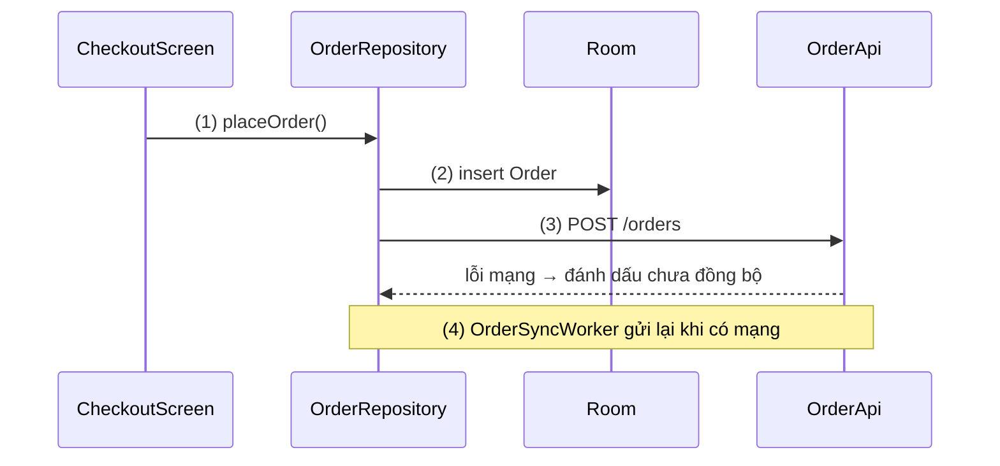

# Playbook: Write Example

## Tư duy

Ví dụ tồn tại để củng cố hiểu biết, không phải để trình diễn kỹ thuật.

Kiến thức trong bài viết **tổng quát**. Ví dụ code chỉ là phần minh hoạ: nó cho người đọc thấy kiến thức vừa học **chạy thế nào** trong một bài toán thật.

Một kiến thức áp dụng được cho nhiều bài toán khác nhau, nên **không ép mọi ví dụ vào một app mẫu chung**. Mỗi ví dụ chọn bài toán thể hiện rõ nhất kiến thức nó minh hoạ:

| Kiến thức | Bài toán hợp |
|---|---|
| Room `@Transaction` | Đặt hàng: trừ tồn kho và ghi đơn phải cùng thành công hoặc cùng thất bại |
| `PendingIntent` | Bấm thông báo mở đúng màn hình chi tiết |
| Foreground service | Phát nhạc, tải file lớn, ghi hành trình |
| JNI | Lọc ảnh, giải mã âm thanh bằng thư viện C/C++ có sẵn |

Các phần trong cùng một Topic có thể dùng bài toán khác nhau nếu mỗi bài toán hợp hơn với phần đó.

## Cấu trúc một ví dụ

Đặt ngay sau phần kiến thức nó minh hoạ, heading `#### Ví dụ: <bài toán>`:

1. **Bài toán**: 1–2 câu, vì sao bài toán này cần đúng kiến thức vừa giải thích.
2. **Luồng chạy** (khi code có logic): giải thích các bước đánh số bằng lời, rồi sơ đồ luồng chạy (Mermaid) dùng cùng số. Xem mục bên dưới.
3. **Code**: chỉ phần code minh hoạ kiến thức, ghi rõ file hoặc class (`// OrderRepository.kt`), comment `// (n)` khớp số bước.
4. **Kết quả**: chạy ra gì, kiểm chứng bằng cách nào (chạy, log, test, quan sát UI).

Phần "Ví dụ thực tế" có thể liệt kê 2–3 bài toán thường gặp của kiến thức; chỉ bài toán chính cần code đầy đủ.

Phản ví dụ (code sai, sai lầm thường gặp) chỉ rõ lỗi lộ ra thế nào và cách sửa.

## Giải thích trước, sơ đồ luồng chạy, rồi mới code

Khi đoạn code mô tả logic (luồng xử lý, rẽ nhánh, gọi qua nhiều tầng, chuyển thread, đổi trạng thái), ưu tiên giải thích. Người đọc phải hiểu luồng chạy trước khi nhìn code.

````markdown
#### Ví dụ: đặt hàng khi mất mạng

**Bài toán:** người dùng bấm "Đặt hàng" khi mất mạng. Đơn không được mất, và phải tự gửi lên server khi có mạng lại.

**Luồng chạy:**

1. Màn hình thanh toán gọi `OrderRepository.placeOrder()`.
2. Repository ghi `Order` vào Room trước, nên danh sách đơn thấy đơn ngay cả khi offline.
3. Repository thử gửi `POST /orders`; lỗi mạng thì đánh dấu đơn "chưa đồng bộ".
4. Khi có mạng, `OrderSyncWorker` gửi lại các đơn chưa đồng bộ.



**Code:**

```kotlin
// OrderRepository.kt
suspend fun placeOrder(order: Order) {
    orderDao.insert(order)                        // (2) ghi local trước
    runCatching { orderApi.createOrder(order) }   // (3) thử gửi lên server
        .onFailure { orderDao.markUnsynced(order.id) }
}
```

**Kết quả:** tắt mạng, đặt hàng → đơn vẫn hiện trong danh sách; bật mạng → đơn được gửi lên server.
````

- Số bước trong lời giải thích, sơ đồ và comment code phải khớp nhau.
- Chọn loại sơ đồ theo logic: tương tác theo thời gian → sequence; rẽ nhánh → flowchart; trạng thái → state.
- Không vẽ sơ đồ cho code không có luồng (khai báo dependency, cấu hình Gradle, một hàm một bước).
- Trên website, sơ đồ được vẽ lại bằng diagram-design (rule 05); Markdown giữ Mermaid làm nguồn.

## Best Practices

- Mỗi ví dụ chỉ minh họa **một** kiến thức, đúng kiến thức vừa giải thích ngay trước nó.
- Chọn bài toán mà kiến thức đó **thật sự** giải quyết; bài toán gượng ép làm người đọc hiểu sai khi nào nên dùng.
- Tên class, biến có nghĩa trong bài toán (không `foo`, `bar`, `Animal`).
- Không ví dụ nào dùng kiến thức chưa được giải thích ở phần trước của bài (hoặc ở Topic tiên quyết).
- Loại bỏ chi tiết không liên quan (xử lý lỗi phức tạp, cấu hình thừa, thư viện ngoài phạm vi).
- Phản ánh cách dùng được khuyến nghị hiện hành, không dùng cách viết lỗi thời.

## Các bước suy nghĩ

1. Phần kiến thức này giải quyết vấn đề gì, tổng quát?
2. Bài toán thực tế nào thể hiện rõ nhất vấn đề đó?
3. Luồng chạy của kiến thức trong bài toán gồm những bước nào?
4. Code tối thiểu nào minh hoạ đủ các bước đó?
5. Ví dụ có thể gây hiểu nhầm sang khái niệm khác, hoặc sang trường hợp không nên dùng không?

## Checklist

- [ ] Kiến thức (vấn đề, định nghĩa, cách hoạt động) đứng được mà không cần đọc ví dụ?
- [ ] Bài toán của ví dụ hợp với đúng kiến thức nó minh hoạ?
- [ ] Code có logic thì đã có giải thích từng bước và sơ đồ luồng chạy đặt trước code, số bước khớp comment?
- [ ] Ví dụ có "Kết quả" để người đọc kiểm chứng?
- [ ] Code compile được, ghi rõ file hoặc class?
- [ ] Code Block có khai báo đúng ngôn ngữ?
- [ ] Ví dụ phản ánh best practice hiện hành?

## Lỗi thường gặp

- Đóng khung kiến thức quanh một app cụ thể, người đọc không tách được đâu là kiến thức, đâu là bài toán.
- Ép kiến thức vào bài toán không hợp chỉ để thống nhất bối cảnh.
- Đưa nguyên một project hoàn chỉnh thay vì phần code minh hoạ.
- Một ví dụ gom nhiều khái niệm cùng lúc.
- Ví dụ giữa bài dùng API sẽ chỉ được giải thích ở cuối bài.
- Đưa khối code có nhiều bước logic mà không giải thích luồng chạy, bắt người đọc tự dò code.
- Sơ đồ và code đánh số bước không khớp nhau.

## Tiêu chí đánh giá

- Bỏ hết ví dụ đi, phần kiến thức vẫn đầy đủ và đúng.
- Đọc ví dụ, người đọc thấy rõ luồng chạy của kiến thức và áp dụng được vào bài toán tương tự.
- Ví dụ chính xác về mặt kỹ thuật tại thời điểm viết.
