# Futures and Async/Await

## Vấn đề cần giải quyết

Phần lớn việc một ứng dụng làm là **chờ**: chờ server trả lời, chờ đọc file, chờ người dùng bấm, chờ hết một khoảng thời gian. Trong lúc chờ, giao diện vẫn phải vẽ frame, vẫn phải phản hồi thao tác.

Có hai cách trả lời câu hỏi "chờ mà không đóng băng giao diện":

- **Nhiều thread**: việc chờ chạy trên thread khác, thread UI tiếp tục. Đây là cách của Java, và cũng là nền của Kotlin coroutine với `Dispatchers.IO`. Cái giá là state dùng chung giữa các thread phải được bảo vệ (lock, `@Volatile`, `Mutex`), nếu không sẽ có race condition.
- **Một thread, không bao giờ ngồi chờ**: thread duy nhất giao việc chờ cho hệ điều hành (socket, file, timer), ghi lại "khi có kết quả thì làm tiếp phần này", rồi đi làm việc khác. Đây là cách của Dart (và JavaScript).

Dart chọn cách thứ hai. Code Dart trong một isolate (vùng chạy có bộ nhớ riêng, xem [1.3.3 Isolates](isolates.md)) chỉ có **một thread** chạy, nên không có race condition trên state. Đổi lại, chính thread đó vừa chạy logic vừa vẽ UI, và hiểu sai cơ chế thì gặp lỗi rất điển hình:

```dart
Future<void> onSavePressed() async {
  try {
    saveDraft('Bản nháp'); // thiếu await
    print('Đã lưu!'); // in ra ngay, kể cả khi việc lưu thất bại
  } catch (e) {
    print('Báo lỗi cho người dùng: $e'); // không bao giờ chạy
  }
}
```

Bài này giải thích cơ chế đứng sau `Future`, `async`, `await`: code chạy theo thứ tự nào, lỗi đi đâu, khi nào cần thứ khác (Stream, isolate).

## Sau khi học xong

- Giải thích được event loop của Dart với microtask queue và event queue, và dự đoán đúng thứ tự chạy của code trộn đồng bộ, microtask và event.
- Phân biệt được ba trạng thái của Future và hai cách tiêu thụ nó (then/catchError và async/await).
- Xử lý được lỗi bất đồng bộ bằng try/catch quanh await, và nhận diện được lỗi thoát khỏi luồng xử lý khi quên await.
- Áp dụng được Future.wait, record .wait, timeout, Future.delayed và Completer cho các bài toán chờ nhiều việc, giới hạn thời gian và bọc API callback.
- Biết khi nào dùng unawaited một cách có chủ đích, và vì sao async không phải đa luồng.

## Future và async/await là gì?

`Future<T>` (giá trị tương lai) là một đối tượng đại diện cho **một** giá trị kiểu `T`, hoặc một lỗi, **sẽ có sau này**. `async`/`await` là cú pháp để viết code chờ Future theo kiểu tuần tự: `await` **treo hàm hiện tại** và trả quyền cho event loop, thay vì chặn thread.

**Mental model: một nhân viên, hai hàng việc.** Mỗi isolate có đúng một "nhân viên" (thread) và hai hàng việc: hàng ưu tiên (microtask queue) và hàng thường (event queue). Nhân viên làm xong việc đang cầm, rồi làm **hết** hàng ưu tiên, rồi mới lấy **một** việc ở hàng thường. Khi gặp `await`, nhân viên không đứng chờ: họ cầm một **phiếu hẹn** (Future), ghi chú "khi phiếu có kết quả thì làm tiếp phần còn lại của hàm", rồi đi làm việc khác.

## Cách hoạt động

### 1. Event loop: một thread, hai hàng đợi

Event loop (vòng lặp sự kiện) là vòng lặp mà runtime Dart chạy cho mỗi isolate. Nó có hai hàng đợi:

| Hàng đợi | Chứa gì | Ai đưa việc vào |
|---|---|---|
| **Microtask queue** | Việc nội bộ, ngắn, cần chạy "ngay sau code hiện tại" | Hoàn thành Future, phần tiếp theo sau `await`, callback `then`, `scheduleMicrotask`, `Future.microtask` |
| **Event queue** | Sự kiện từ bên ngoài | Timer (`Timer`, `Future.delayed`, `Future()`), I/O (network, file), message từ platform, gesture; trong Flutter, việc vẽ frame cũng đi qua đây |

Quy tắc của vòng lặp:

1. Chạy hết code đồng bộ đang có trên call stack. Không gì chen ngang được nó.
2. Khi call stack rỗng, chạy **hết** microtask queue, kể cả microtask vừa được xếp thêm trong lúc chạy.
3. Lấy **một** event từ event queue, chạy nó (lại là code đồng bộ, quay về bước 1).
4. Lặp lại. Hai hàng đợi đều rỗng và không còn việc nào đang chờ (timer, socket, port mở) thì isolate kết thúc.

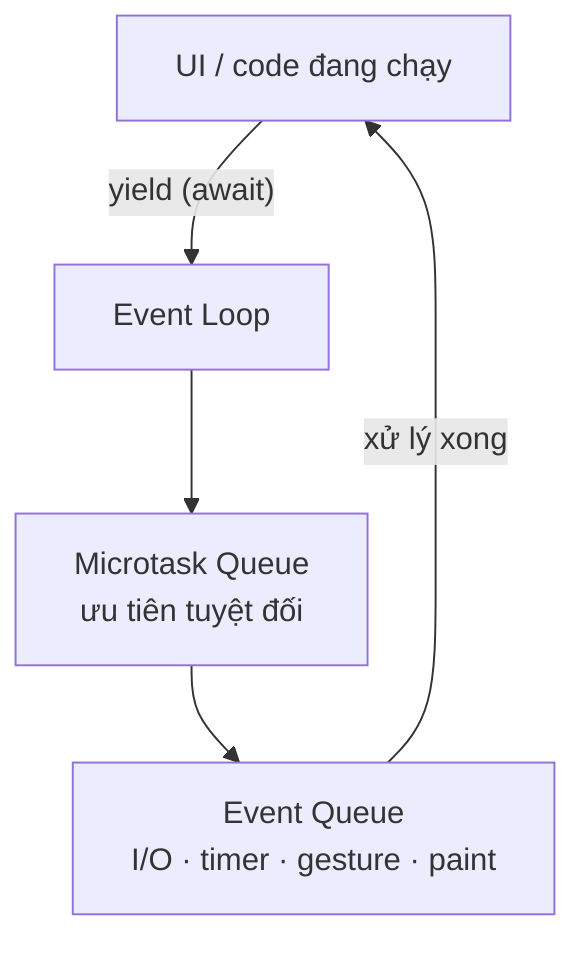

<!-- dd: flutter-event-loop -->

Hai hệ quả quan trọng:

- **Code đồng bộ dài chặn tất cả.** Trong lúc một vòng `for` nặng đang chạy, không microtask nào, không event nào (kể cả frame mới) được xử lý. Trên Flutter, một frame ở 60 Hz có khoảng 16 ms; code đồng bộ chạy quá mức đó là UI bị giật (jank).
- **Microtask chen trước mọi event.** Một microtask được xếp ra lúc nào cũng chạy trước event kế tiếp, kể cả event đã nằm chờ từ trước. Đó là lý do phần tiếp theo sau `await` một Future đã hoàn thành chạy gần như "ngay lập tức".

#### Ví dụ: thứ tự chạy khi mở màn hình hồ sơ

**Bài toán:** khi mở màn hình hồ sơ, code xếp vài việc: gửi analytics (timer), tải ảnh đại diện (event), cập nhật badge (microtask), và đọc tên người dùng từ cache (Future đã có sẵn giá trị). Ta cần biết chính xác dòng nào chạy trước để không giả định sai (ví dụ tưởng analytics gửi trước khi UI có tên).

**Luồng chạy:**

1. `main` chạy, in dòng đầu tiên. Đây là code đồng bộ.
2. `Timer.run` xếp **event 1** (gửi analytics) vào event queue. Callback chưa chạy.
3. `Future(...)` cũng dùng timer, xếp **event 2** (tải ảnh đại diện) vào event queue.
4. `scheduleMicrotask` xếp microtask "cập nhật badge" vào microtask queue.
5. `main` gọi `openProfile()`. Hàm `async` chạy **đồng bộ** cho tới `await` đầu tiên, nên dòng in trong `openProfile` xuất hiện ngay.
6. `Future.value('Lan')` xếp một microtask để hoàn thành chính nó; `await` treo `openProfile` và trả một Future chưa hoàn thành về cho `main`.
7. `main` in dòng cuối và kết thúc. Call stack rỗng.
8. Event loop chạy hết microtask queue theo thứ tự xếp: "cập nhật badge" trước, rồi microtask hoàn thành `Future.value`, làm `openProfile` chạy tiếp sau `await`.
9. Microtask queue rỗng, event loop lấy **event 1**: in "gửi analytics", và callback này xếp thêm một microtask.
10. Trước khi lấy event 2, event loop chạy hết microtask queue: microtask vừa sinh ra trong event 1 chạy.
11. Event loop lấy **event 2**: in "tải ảnh đại diện". Hết việc, chương trình kết thúc.

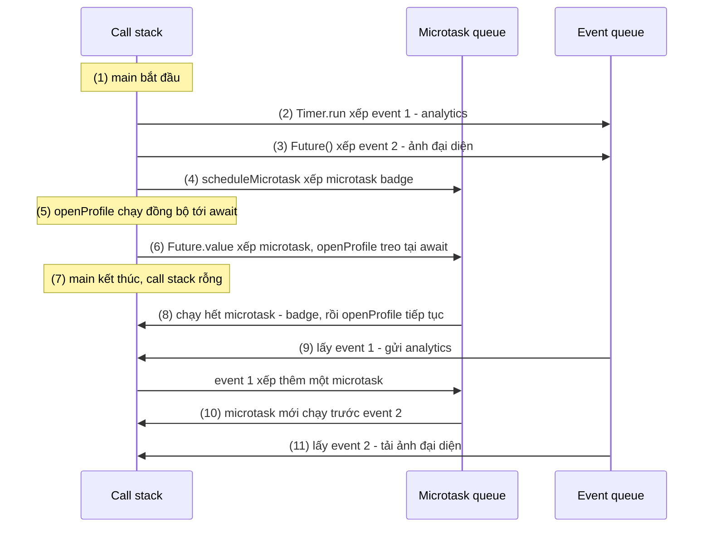

<!-- archify: s01-flutter-event-loop-order | Thứ tự chạy: sync, microtask, event -->

**Code:**

```dart
// event_loop_order.dart
import 'dart:async';

void main() {
  print('sync      | main bắt đầu'); // (1)
  Timer.run(() {
    // (2) xếp event 1 vào event queue
    print('event     | Timer.run: gửi analytics mở màn hình'); // (9)
    scheduleMicrotask(
      () => print('microtask | sinh ra trong event 1, chạy trước event 2'), // (10)
    );
  });
  Future(() => print('event     | Future(): tải ảnh đại diện')); // (3) event 2, chạy ở (11)
  scheduleMicrotask(
    () => print('microtask | scheduleMicrotask: cập nhật badge'), // (4) chạy ở (8)
  );
  openProfile(); // (5)
  print('sync      | main kết thúc'); // (7)
}

Future<void> openProfile() async {
  print('sync      | openProfile chạy tới await đầu tiên'); // (5)
  final name = await Future.value('Lan'); // (6) treo hàm, trả Future về main
  print('microtask | openProfile tiếp tục sau await: $name'); // (8)
}
```

**Kết quả** (`dart run event_loop_order.dart`, Dart 3.12):

```text
sync      | main bắt đầu
sync      | openProfile chạy tới await đầu tiên
sync      | main kết thúc
microtask | scheduleMicrotask: cập nhật badge
microtask | openProfile tiếp tục sau await: Lan
event     | Timer.run: gửi analytics mở màn hình
microtask | sinh ra trong event 1, chạy trước event 2
event     | Future(): tải ảnh đại diện
```

Thứ tự **xếp** (code) và thứ tự **chạy** (output) khác nhau; bốn quy tắc ở trên giải thích được mọi khác biệt đó.

> [!NOTE]
> Bạn hiếm khi gọi `scheduleMicrotask` hay `Timer.run` trong code ứng dụng. Ví dụ dùng chúng để thấy rõ hai hàng đợi; trong thực tế, microtask đến từ việc hoàn thành Future và `await`, event đến từ network, timer và gesture.

### 2. Future và ba trạng thái

Tài liệu Dart chia Future thành hai trạng thái, **uncompleted** và **completed**; trạng thái completed lại có hai dạng (có giá trị hoặc có lỗi). Gộp lại, một `Future<T>` luôn ở một trong ba trạng thái:

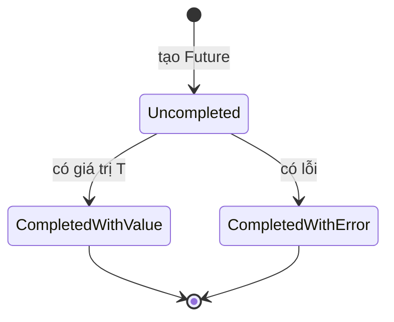

- **Uncompleted**: vừa tạo, kết quả chưa có.
- **Completed with value**: có giá trị kiểu `T`.
- **Completed with error**: có một lỗi (và `StackTrace`).

Một Future **chỉ hoàn thành một lần** và không quay lại trạng thái cũ. Cần nhiều giá trị theo thời gian (vị trí GPS, tin nhắn) thì đó là việc của [1.3.2 Streams](streams.md).

Ba điểm về bản chất cần nắm:

- **Future bắt đầu chạy ngay khi được tạo** (eager). Gọi `fetchProfile(7)` là request đã được gửi, dù bạn chưa `await` hay `then`. Future không phải "công thức chờ được gọi" như một Kotlin `Flow` lạnh.
- **Future không huỷ được.** Không có API `cancel()` trên Future. Bạn chỉ có thể bỏ qua kết quả của nó (xem `timeout` ở mục 6).
- **Đăng ký callback trên Future đã hoàn thành vẫn chạy bất đồng bộ.** Callback `then` không bao giờ chạy đồng bộ ngay lúc đăng ký; nó được xếp vào microtask queue.

Cách tiêu thụ Future cũ hơn là đăng ký callback: `then` cho giá trị, `catchError` cho lỗi, `whenComplete` cho việc dọn dẹp chạy trong cả hai trường hợp. Mỗi lời gọi trả về một Future **mới**, nên chúng nối thành chuỗi.

#### Ví dụ: tải hồ sơ bằng then/catchError

**Bài toán:** gọi API lấy hồ sơ người dùng, hiện tên nếu thành công, báo lỗi nếu server trả 404, và luôn tắt loading.

**Luồng chạy:**

1. `fetchProfile(7)` trả về ngay một Future đang uncompleted; dòng "chưa có kết quả" in trước.
2. Khoảng 300 ms sau, Future hoàn thành: (2a) có giá trị thì `then` chạy, (2b) có lỗi thì `then` bị bỏ qua, lỗi đi tiếp xuống `catchError`.
3. `whenComplete` chạy trong cả hai trường hợp.

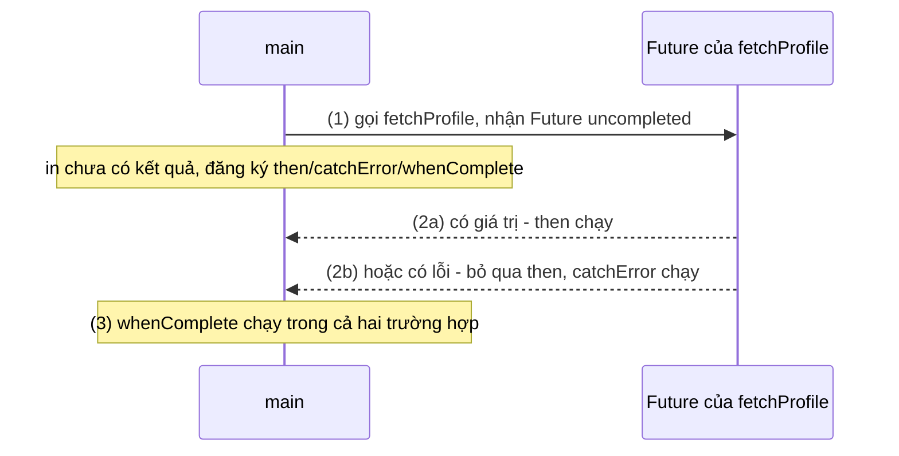

**Code:**

```dart
// profile_then.dart
import 'dart:async';

class UserProfile {
  final int id;
  final String name;
  UserProfile(this.id, this.name);
}

// Giả lập gọi API: id <= 0 thì server trả lỗi.
Future<UserProfile> fetchProfile(int id) {
  return Future.delayed(const Duration(milliseconds: 300), () {
    if (id <= 0) throw StateError('404: không có user $id');
    return UserProfile(id, 'Lan');
  });
}

void main() {
  final future = fetchProfile(7); // (1) Future vừa tạo: uncompleted
  print('Đã gọi fetchProfile, chưa có kết quả');

  future
      .then((profile) => print('Có dữ liệu: ${profile.name}')) // (2a) completed with value
      .catchError((Object e) => print('Lỗi: $e')) // (2b) completed with error
      .whenComplete(() => print('Tắt loading')); // (3) chạy trong cả hai trường hợp

  fetchProfile(0)
      .then((profile) => print('Có dữ liệu: ${profile.name}'))
      .catchError((Object e) => print('Lỗi: $e'))
      .whenComplete(() => print('Tắt loading'));
}
```

**Kết quả:**

```text
Đã gọi fetchProfile, chưa có kết quả
Có dữ liệu: Lan
Tắt loading
Lỗi: Bad state: 404: không có user 0
Tắt loading
```

Cách này đúng nhưng khó đọc khi có nhiều bước phụ thuộc nhau: rẽ nhánh, vòng lặp, `try/finally` đều phải viết lại bằng callback. `async`/`await` giải quyết đúng chỗ đó.

### 3. async và await

Ba quy tắc của hàm `async`:

1. **Hàm `async` luôn trả về `Future`.** Với `Future<String> f() async { return 'x'; }`, `return 'x'` hoàn thành Future với giá trị `'x'`; `throw` trong thân hàm hoàn thành Future với lỗi, **không** ném đồng bộ ra cho người gọi. Hàm không trả gì khai báo `Future<void>`.
2. **Thân hàm chạy đồng bộ cho tới `await` đầu tiên** (từ Dart 2.0). Hàm `async` không có `await` nào chạy hết thân hàm ngay lúc được gọi; chỉ có Future kết quả là hoàn thành sau.
3. **`await` chỉ dùng được trong hàm `async`** (hoặc `async*`, xem [1.3.2 Streams](streams.md)). `await f` treo hàm hiện tại cho tới khi `f` hoàn thành: có giá trị thì biểu thức `await` trả giá trị đó; có lỗi thì lỗi được **ném lại ngay tại dòng `await`**, nên `try`/`catch`/`finally` bình thường bắt được nó.

Điểm cốt lõi là "treo hàm", không phải "chặn thread": hàm lưu lại vị trí, event loop chạy việc khác (vẽ frame, xử lý tap), và khi Future hoàn thành, phần còn lại của hàm chạy tiếp như một microtask.

> [!TIP]
> Kotlin dev có thể nghĩ hàm `async` gần giống `suspend fun`, và `await` gần giống chỗ gọi một hàm suspend. Khác biệt lớn: Dart không có dispatcher hay thread pool để "chuyển" sang; mọi thứ quay về cùng một thread. Bảng ánh xạ đầy đủ ở [1.1.1 Dart for Kotlin Developers](../dart/dart_for_kotlin_devs.md).

`await` nhận một `FutureOr<T>`, tức `Future<T>` hoặc `T`. `await` một giá trị không phải Future vẫn treo hàm một nhịp microtask.

#### Ví dụ: tải hồ sơ bằng async/await

**Bài toán:** viết lại ví dụ trước bằng `async`/`await`, cùng hành vi: loading, thành công, 404, luôn tắt loading.

**Luồng chạy:**

1. Gọi `loadProfileTitle(id)`: dòng "Hiện loading" chạy đồng bộ ngay.
2. `await fetchProfile(id)` treo hàm, event loop rảnh trong khoảng 300 ms.
3. Thành công: hàm `return`, Future của hàm hoàn thành với chuỗi chào.
4. Lỗi: `StateError` được ném lại tại dòng `await`, `on StateError catch` xử lý.
5. `finally` luôn chạy trước khi Future của hàm hoàn thành.

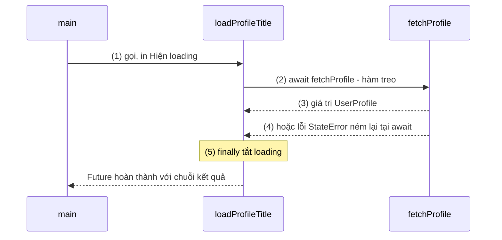

**Code:**

```dart
// profile_await.dart (UserProfile và fetchProfile như ví dụ trước)

// ProfileLoader: async/await viết lại cùng luồng .then/.catchError/.whenComplete
Future<String> loadProfileTitle(int id) async {
  print('Hiện loading cho user $id'); // (1) chạy đồng bộ ngay khi được gọi
  try {
    final profile = await fetchProfile(id); // (2) treo hàm, nhường event loop
    return 'Xin chào, ${profile.name}'; // (3) Future của hàm complete với giá trị
  } on StateError catch (e) {
    return 'Không tải được: ${e.message}'; // (4) lỗi của Future được ném lại tại await
  } finally {
    print('Tắt loading cho user $id'); // (5) luôn chạy
  }
}

Future<void> main() async {
  print(await loadProfileTitle(7));
  print(await loadProfileTitle(0));
}
```

**Kết quả:**

```text
Hiện loading cho user 7
Tắt loading cho user 7
Xin chào, Lan
Hiện loading cho user 0
Tắt loading cho user 0
Không tải được: 404: không có user 0
```

`finally` in trước kết quả vì nó chạy trước khi Future của `loadProfileTitle` hoàn thành; `main` chỉ in sau khi `await` của nó nhận được giá trị. Cú pháp `try`/`on`/`catch`/`finally` là của exception đồng bộ, đã học ở [1.2.3 Control Flow and Patterns](../dart/control_flow_patterns.md); `await` cho phép dùng lại nguyên nó cho lỗi bất đồng bộ.

### 4. Xử lý lỗi bất đồng bộ

Lỗi bất đồng bộ là lỗi nằm **bên trong một Future**. Nó chỉ đến tay bạn qua một trong hai đường: `await` (ném lại tại chỗ, bắt bằng `try`/`catch`) hoặc callback (`catchError`, `onError`). Nếu Future có lỗi mà **không ai** đăng ký nhận, lỗi trở thành **uncaught asynchronous error** và đi lên trình xử lý lỗi toàn cục:

| Môi trường | Lỗi bất đồng bộ không ai bắt sẽ |
|---|---|
| `dart run` (CLI) | In `Unhandled exception`, dừng chương trình với exit code 255 |
| Flutter | Chuyển tới `PlatformDispatcher.instance.onError`; mặc định chỉ in log, app chạy tiếp |

Điều nguy hiểm trong Flutter: app không crash, nhưng **luồng xử lý của bạn không biết lỗi đã xảy ra**. Màn hình báo "Đã lưu", người dùng tin là đã lưu.

#### Ví dụ: quên await khi lưu bản nháp

**Bài toán:** nút "Lưu" gọi `saveDraft`, bắt lỗi để báo người dùng khi hết dung lượng. Lập trình viên quên `await`.

**Luồng chạy:**

1. `saveDraft(...)` được gọi, trả về Future và chạy tới `await` bên trong nó.
2. Không có `await` ở phía gọi, nên `try` chạy tiếp ngay dòng `print('Đã lưu!')` rồi thoát khỏi khối `try`.
3. 100 ms sau, Future của `saveDraft` hoàn thành với lỗi. Lúc này khối `try`/`catch` đã kết thúc từ lâu, không có ai nhận lỗi.
4. Lỗi thành uncaught asynchronous error.

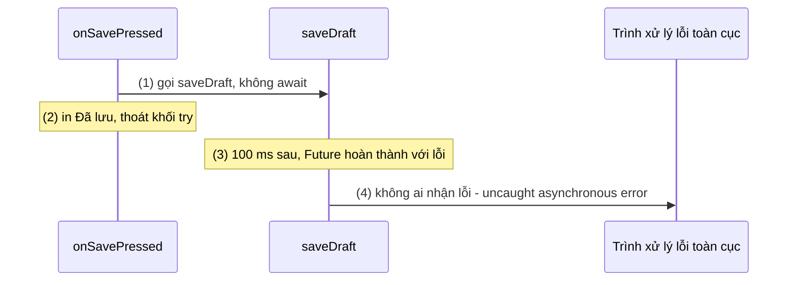

**Code:**

```dart
// forgot_await.dart
import 'dart:async';

Future<void> saveDraft(String text) async {
  await Future.delayed(const Duration(milliseconds: 100));
  throw StateError('Hết dung lượng'); // (3) Future của saveDraft hoàn thành với lỗi
}

Future<void> onSavePressed() async {
  try {
    saveDraft('Bản nháp'); // (1) ❌ thiếu await
    print('Đã lưu!'); // (2) in ra dù việc lưu sẽ thất bại
  } catch (e) {
    print('Báo lỗi cho người dùng: $e'); // không bao giờ chạy
  }
}

Future<void> main() async {
  await onSavePressed();
  await Future.delayed(const Duration(milliseconds: 300)); // (4) lỗi không ai nhận, xảy ra trong lúc này
  print('main kết thúc');
}
```

**Kết quả** (đường dẫn file rút gọn):

```text
Đã lưu!
Unhandled exception:
Bad state: Hết dung lượng
#0      saveDraft (file:///.../forgot_await.dart:6:3)
<asynchronous suspension>
```

Dòng `main kết thúc` không bao giờ in: chương trình CLI dừng ở (4) với exit code 255. Sửa bằng `await saveDraft('Bản nháp');`, khi đó lỗi ném lại tại dòng `await` và `catch` chạy.

> [!IMPORTANT]
> Analyzer **mặc định không cảnh báo** lỗi này: `unawaited_futures` và `discarded_futures` không có trong rule set `core`, `recommended` (`package:lints`) hay `flutter` (`flutter_lints`). Nên bật thủ công:
>
> ```yaml
> linter:
>   rules:
>     - unawaited_futures   # Future không await trong hàm async
>     - discarded_futures   # Future bị bỏ đi trong hàm đồng bộ (Dart 2.18+)
> ```
>
> Với file trên, `dart analyze` báo `Missing an 'await' for the 'Future' computed by this expression.` `discarded_futures` báo cả lời gọi cố ý không chờ trong hàm đồng bộ (như `openProfile()` ở ví dụ thứ tự chạy); khi đó bọc bằng `unawaited(...)`.

### 5. Chạy song song: Future.wait và record .wait

Vì Future bắt đầu ngay khi tạo, "song song" trong Dart nghĩa là **khởi động nhiều Future trước, rồi mới chờ**: request mạng chạy cùng lúc (hệ điều hành lo I/O), còn code Dart xử lý kết quả vẫn chạy lần lượt trên một thread. `await` từng cái một thì Future sau chỉ được **tạo** khi Future trước xong, tổng thời gian là tổng các thời gian; tạo hết rồi chờ chung thì gần bằng việc lâu nhất. Có hai API để chờ chung:

| API | Kiểu | Khi có lỗi |
|---|---|---|
| `Future.wait<T>(Iterable<Future<T>>)` | Mọi Future cùng kiểu `T`, trả `List<T>` | Mặc định chờ **tất cả** xong rồi hoàn thành với **lỗi đầu tiên**, các lỗi khác bị bỏ. `eagerError: true` thì báo lỗi ngay khi lỗi đầu tiên xuất hiện. `cleanUp` dọn dẹp giá trị của các Future đã thành công |
| Record `(f1, f2, ...).wait` (Dart 3.0) | Mỗi Future một kiểu, trả record cùng hình dạng | Ném `ParallelWaitError` chứa **cả** giá trị thành công (`values`) và lỗi của từng Future (`errors`) |

Record xem ở [1.2.1 Variables and Types](../dart/variables_and_types.md), destructuring `final (a, b) = ...` ở [1.2.3 Control Flow and Patterns](../dart/control_flow_patterns.md). `Iterable<Future<T>>` cũng có getter `.wait`, hành xử như record `.wait`.

#### Ví dụ: màn hình Dashboard tải ba API độc lập

**Bài toán:** Dashboard cần tên người dùng, số tin chưa đọc và danh sách banner. Ba API không phụ thuộc nhau, mỗi API mất khoảng 1 giây.

**Luồng chạy:**

1. Tạo cả ba Future trong một record: cả ba request bắt đầu gần như cùng lúc.
2. `.wait` chờ cả ba hoàn thành.
3. Destructuring record ra ba biến có đúng kiểu `String`, `int`, `List<String>`.

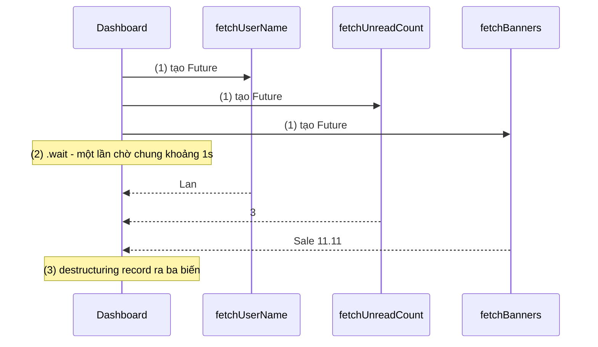

**Code:**

```dart
// dashboard.dart
import 'dart:async';

// Giả lập ba API độc lập của màn hình Dashboard, mỗi API mất ~1 giây.
Future<String> fetchUserName() =>
    Future.delayed(const Duration(seconds: 1), () => 'Lan');
Future<int> fetchUnreadCount() =>
    Future.delayed(const Duration(seconds: 1), () => 3);
Future<List<String>> fetchBanners() =>
    Future.delayed(const Duration(seconds: 1), () => ['Sale 11.11']);

String seconds(Stopwatch sw) =>
    '${(sw.elapsedMilliseconds / 1000).toStringAsFixed(1)}s';

Future<void> main() async {
  // Cách 1: await tuần tự
  final sw1 = Stopwatch()..start();
  final name1 = await fetchUserName();
  final unread1 = await fetchUnreadCount();
  final banners1 = await fetchBanners();
  print('Tuần tự: $name1, $unread1, $banners1 sau ${seconds(sw1)}');

  // Cách 2: khởi động cả ba rồi chờ chung bằng record .wait (Dart 3)
  final sw2 = Stopwatch()..start();
  final (name2, unread2, banners2) = await (
    fetchUserName(), // (1) cả ba Future được tạo -> cả ba bắt đầu ngay
    fetchUnreadCount(),
    fetchBanners(),
  ).wait; // (2) chờ cả ba
  print('Song song: $name2, $unread2, $banners2 sau ${seconds(sw2)}'); // (3)
}
```

**Kết quả:**

```text
Tuần tự: Lan, 3, [Sale 11.11] sau 3.0s
Song song: Lan, 3, [Sale 11.11] sau 1.0s
```

#### Ví dụ: Dashboard khi một phần bị lỗi

**Bài toán:** API số tin chưa đọc và API banner cùng lỗi 503. Màn hình vẫn nên hiện tên người dùng, ẩn phần lỗi, thay vì báo lỗi cả trang.

**Luồng chạy:**

1. `Future.wait` mặc định đợi cả ba xong (khoảng 300 ms, theo Future chậm nhất) rồi chỉ báo lỗi **đầu tiên**; giá trị `'Lan'` mất. Với `eagerError: true`, lỗi đến sau khoảng 100 ms.
2. Record `.wait` ném `ParallelWaitError`.
3. `e.values` chứa giá trị của Future thành công, `null` ở vị trí bị lỗi.
4. `e.errors` chứa `AsyncError` ở vị trí bị lỗi, `null` ở vị trí thành công.

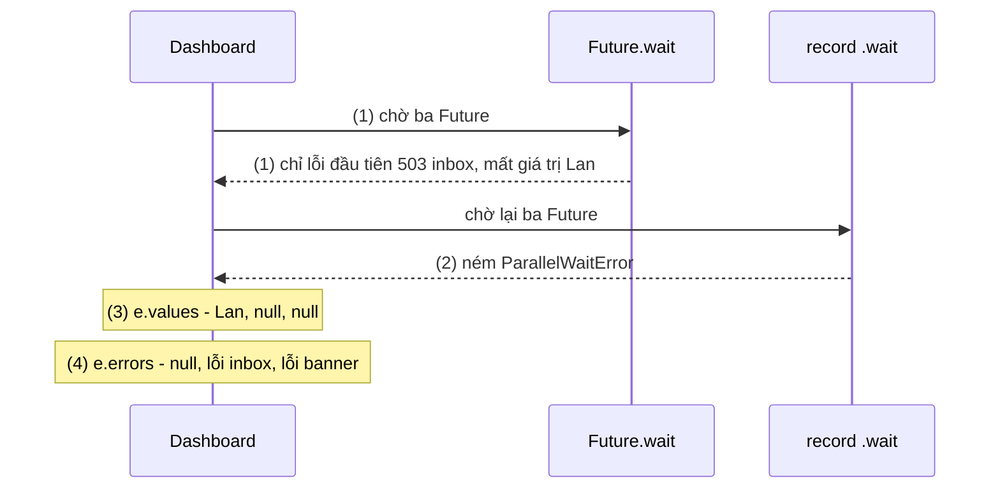

**Code:**

```dart
// dashboard_partial.dart
import 'dart:async';

Future<String> fetchUserName() =>
    Future.delayed(const Duration(milliseconds: 300), () => 'Lan');
Future<int> fetchUnreadCount() =>
    Future.delayed(const Duration(milliseconds: 100), () => throw StateError('503 inbox'));
Future<List<String>> fetchBanners() =>
    Future.delayed(const Duration(milliseconds: 200), () => throw StateError('503 banner'));

Future<void> main() async {
  final sw = Stopwatch()..start();
  // (1) Future.wait: mặc định chờ tất cả xong rồi báo lỗi ĐẦU TIÊN, các lỗi khác bị bỏ.
  try {
    await Future.wait<Object>([fetchUserName(), fetchUnreadCount(), fetchBanners()]);
  } catch (e) {
    print('Future.wait: $e sau ${sw.elapsedMilliseconds ~/ 100 * 100}ms');
  }

  sw.reset();
  try {
    await Future.wait<Object>(
      [fetchUserName(), fetchUnreadCount(), fetchBanners()],
      eagerError: true,
    );
  } catch (e) {
    print('eagerError: $e sau ${sw.elapsedMilliseconds ~/ 100 * 100}ms');
  }

  // Record .wait: lấy được phần thành công qua ParallelWaitError.
  try {
    final (name, unread, banners) =
        await (fetchUserName(), fetchUnreadCount(), fetchBanners()).wait;
    print('$name $unread $banners');
  } on ParallelWaitError<(String?, int?, List<String>?),
      (AsyncError?, AsyncError?, AsyncError?)> catch (e) { // (2)
    final (name, unread, banners) = e.values; // (3) giá trị của Future thành công, null nếu lỗi
    final (_, unreadError, bannerError) = e.errors; // (4) lỗi của từng Future, null nếu thành công
    print('Tên: $name, chưa đọc: ${unread ?? '-'}, banner: ${banners ?? 'ẩn'}');
    print('Lỗi inbox: ${unreadError?.error}');
    print('Lỗi banner: ${bannerError?.error}');
  }
  await Future.delayed(const Duration(milliseconds: 400));
}
```

**Kết quả:**

```text
Future.wait: Bad state: 503 inbox sau 300ms
eagerError: Bad state: 503 inbox sau 100ms
Tên: Lan, chưa đọc: -, banner: ẩn
Lỗi inbox: Bad state: 503 inbox
Lỗi banner: Bad state: 503 banner
```

Kiểu trong `on ParallelWaitError<...>` phải khớp đúng hình dạng record: values là các kiểu gốc thêm `?`, errors là `AsyncError?`.

### 6. Giới hạn thời gian và trì hoãn: timeout, Future.delayed

`future.timeout(duration)` trả về một Future **mới**: nếu `future` không xong trong `duration` thì Future mới hoàn thành với `TimeoutException`, hoặc với giá trị từ `onTimeout` nếu bạn truyền vào. Điều quan trọng: **Future gốc không bị huỷ**. Request vẫn chạy tới cùng, kết quả của nó chỉ bị bỏ qua.

`Future.delayed(duration, [computation])` tạo một Future hoàn thành sau `duration`, dùng timer nên nằm trong event queue. `await Future.delayed(...)` là cách "ngủ" mà không chặn event loop, tương đương `delay()` của Kotlin coroutine.

#### Ví dụ: tỷ giá chậm, dùng giá trị trong cache

**Bài toán:** API tỷ giá đôi khi mất 2 giây. Màn hình thanh toán chỉ chờ tối đa 1 giây, quá thì báo hết thời gian hoặc dùng tỷ giá cache.

**Luồng chạy:**

1. `timeout` không có `onTimeout`: sau 1 giây ném `TimeoutException`, `catch` xử lý.
2. `timeout` có `onTimeout`: sau 1 giây dùng giá trị dự phòng.
3. Ở cả hai lần, Future gốc vẫn chạy tiếp và in dòng "server vẫn trả lời" sau 2 giây.

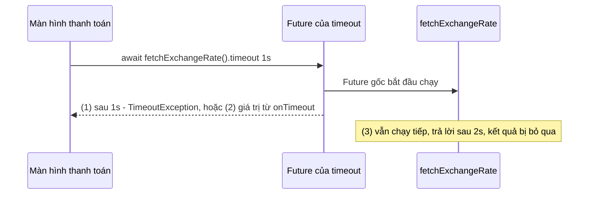

**Code:**

```dart
// exchange_rate_timeout.dart
import 'dart:async';

// Giả lập API tỷ giá chậm: mất 2 giây mới trả lời.
Future<double> fetchExchangeRate() async {
  await Future.delayed(const Duration(seconds: 2));
  print('API tỷ giá: server vẫn trả lời sau 2s'); // (3) timeout không huỷ được việc này
  return 25400;
}

Future<void> main() async {
  // (1) timeout không có onTimeout: ném TimeoutException
  try {
    final rate = await fetchExchangeRate().timeout(const Duration(seconds: 1));
    print('Tỷ giá: $rate');
  } on TimeoutException catch (e) {
    print('Hết thời gian chờ: ${e.duration}');
  }

  // (2) timeout có onTimeout: dùng giá trị dự phòng (vd tỷ giá trong cache)
  final rate = await fetchExchangeRate().timeout(
    const Duration(seconds: 1),
    onTimeout: () => 25000,
  );
  print('Tỷ giá hiển thị: $rate (từ cache)');

  await Future.delayed(const Duration(seconds: 2));
}
```

**Kết quả:**

```text
Hết thời gian chờ: 0:00:01.000000
API tỷ giá: server vẫn trả lời sau 2s
Tỷ giá hiển thị: 25000.0 (từ cache)
API tỷ giá: server vẫn trả lời sau 2s
```

> [!WARNING]
> Với thao tác có side effect (ghi dữ liệu, thanh toán), timeout ở client **không** có nghĩa là thao tác không xảy ra. Server có thể vẫn xử lý xong. Đừng tự động gửi lại một thao tác không idempotent chỉ vì timeout.

Muốn dừng công việc bên dưới, API đó phải tự hỗ trợ huỷ (như `CancelToken` của Dio, 5.1.1 REST APIs with http and Dio (chưa có bài)); `CancelableOperation` của `package:async` chỉ giúp ngừng xử lý kết quả.

### 7. Completer: biến callback thành Future

Hàm `async` tạo Future cho bạn. Nhưng có nguồn kết quả không phải hàm async: SDK bên thứ ba chỉ có callback, listener của platform, một sự kiện xảy ra một lần. `Completer<T>` là "tay cầm" để bạn tự hoàn thành một Future:

- `completer.future`: Future trao cho bên ngoài `await`.
- `completer.complete(value)` hoặc `completer.completeError(error)`: hoàn thành Future đó.
- Gọi `complete`/`completeError` lần thứ hai ném `StateError` (`Future already completed`). Dùng `completer.isCompleted` để chặn khi nguồn có thể gọi callback nhiều lần.

#### Ví dụ: bọc SDK định vị chỉ có callback

**Bài toán:** SDK định vị cũ có `requestLocation(onSuccess, onError)`, và có lỗi là đôi khi gọi `onSuccess` hai lần. Repository muốn cung cấp `Future<(double, double)>` cho phần còn lại của app.

**Luồng chạy:**

1. Tạo `Completer`, Future của nó đang uncompleted.
2. Đăng ký callback với SDK, trả `completer.future` ngay cho người gọi.
3. Callback tới: `complete` với toạ độ, người gọi đang `await` nhận được giá trị.
4. Callback tới lần hai: `isCompleted` đã là `true`, bỏ qua thay vì ném `StateError`.
5. Người gọi dùng toạ độ.

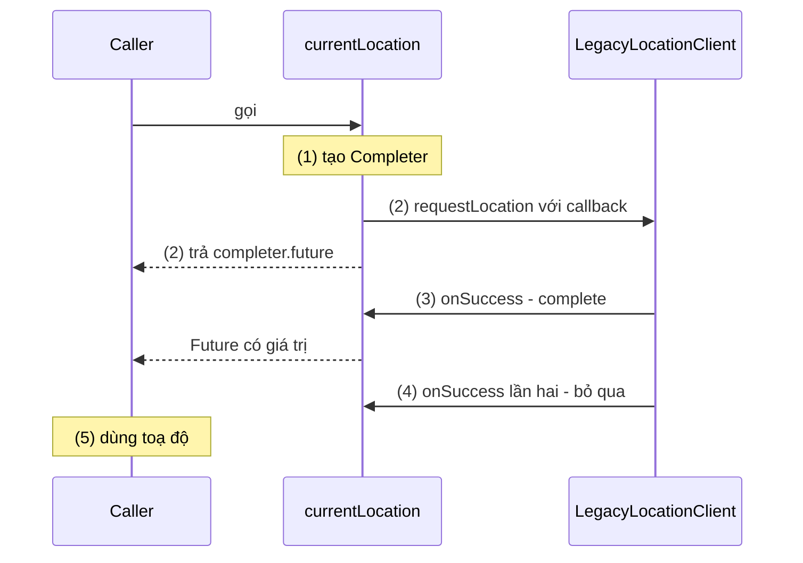

**Code:**

```dart
// location_completer.dart
import 'dart:async';

// SDK cũ chỉ có callback (giả lập SDK định vị của bên thứ ba).
class LegacyLocationClient {
  void requestLocation({
    required void Function(double lat, double lng) onSuccess,
    required void Function(String reason) onError,
  }) {
    Timer(const Duration(milliseconds: 200), () {
      onSuccess(21.0285, 105.8542);
      onSuccess(21.0286, 105.8543); // SDK lỗi: gọi callback hai lần
    });
  }
}

// LocationRepository: bọc callback thành Future
Future<(double, double)> currentLocation(LegacyLocationClient client) {
  final completer = Completer<(double, double)>(); // (1) tạo Completer, Future đang uncompleted
  client.requestLocation( // (2) đăng ký callback rồi trả Future ngay
    onSuccess: (lat, lng) {
      if (completer.isCompleted) return; // (4) chặn lần gọi thứ hai
      completer.complete((lat, lng)); // (3) callback tới -> complete Future
    },
    onError: (reason) {
      if (completer.isCompleted) return;
      completer.completeError(StateError(reason));
    },
  );
  return completer.future; // (2)
}

Future<void> main() async {
  final (lat, lng) = await currentLocation(LegacyLocationClient()); // (5)
  print('Vị trí: $lat, $lng');

  final c = Completer<int>();
  c.complete(1);
  try {
    c.complete(2);
  } on StateError catch (e) {
    print('Gọi complete lần hai: $e');
  }
}
```

**Kết quả:**

```text
Vị trí: 21.0285, 105.8542
Gọi complete lần hai: Bad state: Future already completed
```

> [!TIP]
> Nguồn gọi callback **nhiều lần có chủ đích** (cập nhật vị trí liên tục, tiến độ tải) không hợp với Completer, vì Future chỉ có một giá trị. Dùng `StreamController` ở [1.3.2 Streams](streams.md).

### 8. unawaited: không chờ một cách có chủ đích

Có việc bạn thật sự không muốn chờ: gửi analytics, ghi cache nền, prefetch ảnh. Bỏ `await` thì mất cả kết quả **lẫn chỗ nhận lỗi**. `dart:async` có hai công cụ để nói rõ ý định:

| Cách viết | Ý nghĩa | Lỗi của Future |
|---|---|---|
| `unawaited(future)` | "Tôi cố ý không chờ." Tắt cảnh báo `unawaited_futures` | **Vẫn được báo** như uncaught asynchronous error |
| `future.ignore()` | "Kết quả không còn quan trọng, kể cả lỗi." | Bị **nuốt hoàn toàn**, không báo ở đâu |

Vì `unawaited` không bắt lỗi, mẫu an toàn là: **xử lý lỗi bên trong** việc chạy nền, rồi mới `unawaited` nó. `try`/`catch` bao quanh lời gọi `unawaited(...)` không bắt được gì, cùng lý do với mục 4.

#### Ví dụ: gửi analytics khi bấm thanh toán

**Bài toán:** bấm "Thanh toán" thì mở màn hình thanh toán ngay, đồng thời gửi một event analytics. Server analytics lỗi không được làm phiền người dùng, nhưng cũng không được biến mất không dấu vết.

**Luồng chạy:**

1. `logEventSafely` bọc `logEvent` trong `try`/`catch`, nên Future của nó không bao giờ hoàn thành với lỗi.
2. `unawaited(...)` khởi động việc gửi log mà không chờ.
3. Màn hình thanh toán mở ngay; khoảng 100 ms sau, lỗi analytics được ghi nhận ở (1).

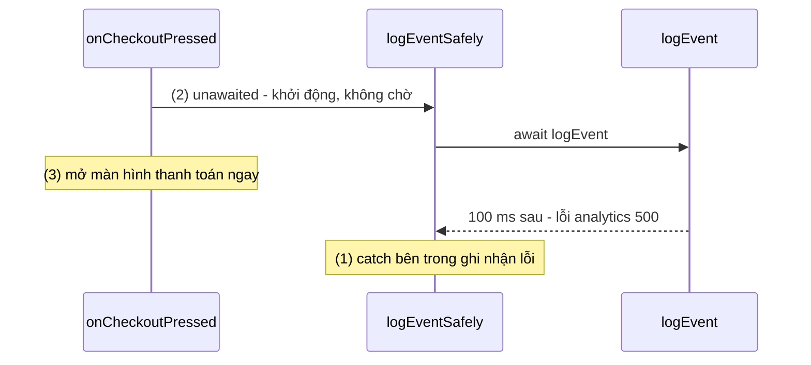

**Code:**

```dart
// checkout_analytics.dart
import 'dart:async';

// AnalyticsService: gửi log, server analytics đôi khi lỗi.
Future<void> logEvent(String name) async {
  await Future.delayed(const Duration(milliseconds: 100));
  throw StateError('analytics 500 khi gửi $name');
}

// (1) Bọc an toàn: tự bắt lỗi bên trong rồi mới bỏ qua Future
Future<void> logEventSafely(String name) async {
  try {
    await logEvent(name);
  } catch (e) {
    print('Ghi nhận lỗi analytics, không làm phiền người dùng: $e');
  }
}

Future<void> onCheckoutPressed() async {
  unawaited(logEventSafely('checkout_tap')); // (2) không chờ, nhưng lỗi đã có chỗ xử lý
  print('Mở màn hình thanh toán ngay'); // (3)
}

Future<void> main() async {
  await onCheckoutPressed();
  await Future.delayed(const Duration(milliseconds: 300));
}
```

**Kết quả:**

```text
Mở màn hình thanh toán ngay
Ghi nhận lỗi analytics, không làm phiền người dùng: Bad state: analytics 500 khi gửi checkout_tap
```

Nếu viết thẳng `unawaited(logEvent('checkout_tap'))`, chương trình CLI in `Unhandled exception: Bad state: analytics 500 khi gửi checkout_tap` và dừng với exit code 255; trên Flutter, lỗi rơi vào `PlatformDispatcher.instance.onError`.

### 9. Async không phải đa luồng

`async`/`await` giúp **chờ** mà không chặn thread. Nó không làm cho **tính toán** chạy ở thread khác. Thân hàm `async` vẫn chạy trên cùng một thread của isolate; giữa hai `await`, nó là code đồng bộ và chặn mọi thứ như bất kỳ code đồng bộ nào.

| Loại việc | Bản chất | Công cụ |
|---|---|---|
| I/O-bound: gọi API, đọc file, chờ timer | Thread rảnh trong lúc hệ điều hành làm việc | `Future`, `async`/`await` (bài này) |
| CPU-bound: parse JSON vài MB, nén ảnh, mã hoá | Thread bận tính toán liên tục | Isolate, xem [1.3.3 Isolates](isolates.md) |

#### Ví dụ: tính checksum trong hàm async vẫn chặn timer

**Bài toán:** tính checksum cho một file lớn (giả lập bằng vòng lặp nặng) trong một hàm `async`, với hy vọng nó "chạy nền". Đồng thời có một timer 16 ms đại diện cho frame tiếp theo.

**Luồng chạy:**

1. Đặt timer 16 ms (một event trong tương lai).
2. Gọi `computeChecksum`: thân hàm `async` chạy đồng bộ, vòng lặp không có `await` nào.
3. Suốt vòng lặp, event loop không được quay lại, timer không chạy được dù đã quá hạn.
4. Vòng lặp xong, phần sau `await computeChecksum(...)` là microtask nên chạy **trước** timer; timer chạy cuối cùng, trễ hơn một giây.

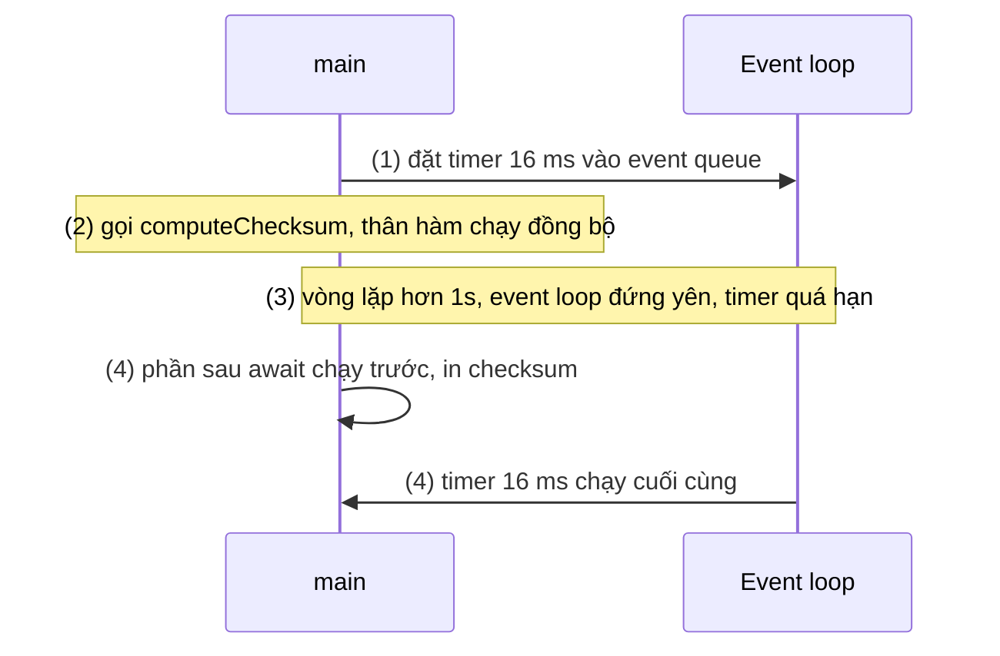

**Code:**

```dart
// checksum_blocking.dart
import 'dart:async';

// Tính tổng kiểm tra cho một file lớn (giả lập bằng vòng lặp nặng).
Future<int> computeChecksum(int size) async {
  var sum = 0;
  for (var i = 0; i < size; i++) {
    sum = (sum + i * 31) % 1000000007; // (3) CPU chạy liên tục, không có await nào
  }
  return sum;
}

Future<void> main() async {
  final sw = Stopwatch()..start();
  // (1) Giả lập frame/animation cần chạy sau 16ms.
  Timer(const Duration(milliseconds: 16), () {
    print('Timer 16ms thực tế chạy sau ${sw.elapsedMilliseconds ~/ 100 * 100}+ms'); // (4)
  });
  final checksum = await computeChecksum(300000000); // (2) thân hàm chạy đồng bộ ngay
  print('checksum = $checksum sau ${sw.elapsedMilliseconds ~/ 100 * 100}+ms'); // (4)
}
```

**Kết quả** (số mili giây tuỳ máy):

```text
checksum = 585000105 sau 1100+ms
Timer 16ms thực tế chạy sau 1100+ms
```

Trên Flutter, "timer trễ hơn một giây" chính là UI đứng hình hơn một giây. `async` không giúp gì; việc này phải chuyển sang isolate khác (xem [1.3.3 Isolates](isolates.md)).

## Deep Dive: mỗi cách tạo Future đi vào hàng đợi nào

Biết constructor nào dùng hàng đợi nào giúp đọc được thứ tự chạy của code thư viện và test:

| Cách tạo | Chạy computation khi nào |
|---|---|
| `Future.sync(f)` | Ngay lập tức, đồng bộ |
| Hàm `async` | Thân hàm chạy đồng bộ tới `await` đầu tiên |
| `Future.microtask(f)`, `scheduleMicrotask(f)` | Microtask queue |
| `Future.value(v)` | Giá trị có sẵn; Future hoàn thành qua microtask |
| `Future(f)` | Event queue (dùng `Timer.run`) |
| `Future.delayed(d, f)` | Event queue, sau ít nhất `d` |

```dart
// future_constructors.dart
import 'dart:async';

Future<int> readBadge() async {
  print('readBadge: thân hàm chạy hết, không có await');
  return 3;
}

void main() {
  Future(() => print('Future(): event queue'));
  Future.delayed(Duration.zero, () => print('Future.delayed(zero): event queue'));
  Future.microtask(() => print('Future.microtask: microtask queue'));
  Future.sync(() => print('Future.sync: chạy ngay'));
  readBadge().then((n) => print('readBadge xong: $n (callback ở microtask)'));
  print('main: hết code đồng bộ');
}
```

```text
Future.sync: chạy ngay
readBadge: thân hàm chạy hết, không có await
main: hết code đồng bộ
Future.microtask: microtask queue
readBadge xong: 3 (callback ở microtask)
Future(): event queue
Future.delayed(zero): event queue
```

**Microtask có thể bỏ đói event queue.** Vì event loop chạy *hết* microtask trước khi lấy event, một chuỗi microtask tự xếp microtask mới sẽ giữ event loop mãi ở bước 2. Trong đoạn dưới, timer "chạy ngay" phải đợi một triệu microtask:

```dart
// microtask_starvation.dart
import 'dart:async';

void main() {
  Timer.run(() => print('event: timer (đáng lẽ chạy ngay)'));
  var count = 0;
  void pump() {
    count++;
    if (count < 1000000) {
      scheduleMicrotask(pump); // microtask tự lên lịch microtask mới
    } else {
      print('microtask: đã chạy $count microtask liên tiếp');
    }
  }
  scheduleMicrotask(pump);
}
```

```text
microtask: đã chạy 1000000 microtask liên tiếp
event: timer (đáng lẽ chạy ngay)
```

Trên Flutter, đó là không vẽ được frame nào. Việc có thể chờ nên đi qua event queue (`Future`, `Future.delayed`); microtask chỉ dành cho việc thật ngắn phải chạy trước event kế tiếp.

## Ví dụ thực tế

Trên UI, Flutter có widget `FutureBuilder` vẽ lại theo ba trạng thái của Future; widget và vòng đời thuộc 3.1.1 Stateless and Stateful Widgets (chưa có bài). Điều cần mang theo từ bài này: tạo Future **một lần** (ví dụ trong `initState`), không tạo trong `build`, vì Future bắt đầu chạy ngay khi được tạo còn `build` chạy nhiều lần.

### Ví dụ: thử lại request với backoff tăng dần

**Bài toán:** tải danh sách sản phẩm trên mạng di động chập chờn. Mỗi lần thử có giới hạn 2 giây; lỗi thì chờ một khoảng tăng dần (200 ms, 400 ms, ...) rồi thử lại, tối đa 3 lần; hết lượt thì báo lỗi cho người dùng. Đây là request đọc (GET), gọi lại nhiều lần vẫn an toàn.

**Luồng chạy:**

1. Mỗi lần thử: `await action().timeout(timeout)`.
2. Lỗi là `Exception` (`TimeoutException`, lỗi mạng) thì xử lý; `Error` (lỗi lập trình) đi thẳng ra ngoài.
3. Lần cuối vẫn lỗi: `rethrow` cho caller.
4. Chưa hết lượt: `await Future.delayed(delay)`, event loop rảnh trong lúc chờ.
5. Nhân đôi `delay` cho lần sau.
6. Caller chỉ thấy một `Future<List<String>>`, không biết bên trong đã thử mấy lần.

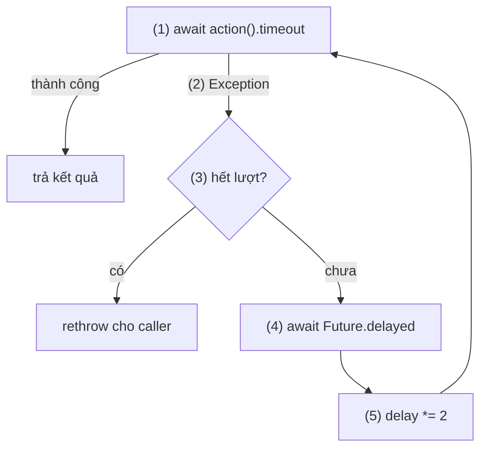

**Code:**

```dart
// retry.dart
import 'dart:async';

// retry: thử lại một thao tác async với backoff tăng dần.
Future<T> retry<T>(
  Future<T> Function() action, {
  int maxAttempts = 3,
  Duration timeout = const Duration(seconds: 2),
  Duration initialDelay = const Duration(milliseconds: 200),
}) async {
  var delay = initialDelay;
  for (var attempt = 1; ; attempt++) {
    try {
      return await action().timeout(timeout); // (1) mỗi lần thử có giới hạn thời gian
    } on Exception catch (e) {
      // (2) TimeoutException, lỗi mạng... đều là Exception
      if (attempt == maxAttempts) rethrow; // (3) hết lượt: ném lỗi cho caller
      print('Lần $attempt lỗi ($e), thử lại sau ${delay.inMilliseconds}ms');
      await Future.delayed(delay); // (4) chờ mà không chặn event loop
      delay *= 2; // (5) backoff: 200ms, 400ms, ...
    }
  }
}

// Giả lập API danh sách sản phẩm (GET, gọi lại nhiều lần vẫn an toàn): hai lần đầu lỗi mạng.
var _calls = 0;
Future<List<String>> fetchProducts() async {
  _calls++;
  await Future.delayed(const Duration(milliseconds: 100));
  if (_calls < 3) throw const SocketLikeException('mất kết nối');
  return ['Áo thun', 'Quần jean', 'Giày chạy bộ'];
}

class SocketLikeException implements Exception {
  final String message;
  const SocketLikeException(this.message);
  @override
  String toString() => 'SocketLikeException: $message';
}

Future<void> main() async {
  try {
    final products = await retry(fetchProducts); // (6)
    print('Đã tải ${products.length} sản phẩm sau $_calls lần gọi');
  } on Exception catch (e) {
    print('Báo lỗi cho người dùng: $e');
  }
}
```

**Kết quả:**

```text
Lần 1 lỗi (SocketLikeException: mất kết nối), thử lại sau 200ms
Lần 2 lỗi (SocketLikeException: mất kết nối), thử lại sau 400ms
Đã tải 3 sản phẩm sau 3 lần gọi
```

Để ý `return await action()...` bên trong `try`: thiếu `await` ở đây thì lỗi của Future không được ném lại trong `try`, và `catch` không bao giờ chạy. Đây là trường hợp `return await` khác `return`.

## So sánh với các cách tiếp cận khác

Người đọc biết Kotlin coroutine thường ánh xạ sang Dart như sau (bảng đầy đủ ở [1.1.1 Dart for Kotlin Developers](../dart/dart_for_kotlin_devs.md)):

| Kotlin coroutine | Dart | Khác biệt cần nhớ |
|---|---|---|
| `suspend fun` | Hàm `async` trả `Future` | Dart không có dispatcher; mọi thứ chạy trên thread của isolate |
| `async { }` / `Deferred<T>` | `Future<T>` | Future luôn bắt đầu ngay (eager) |
| `awaitAll` | `Future.wait`, record `.wait` | |
| `withTimeout` | `.timeout` | Kotlin huỷ coroutine; Dart **không** huỷ Future gốc |
| `delay` | `Future.delayed` | |
| `CompletableDeferred` | `Completer` | |
| `scope.launch { }` không chờ | `unawaited(...)` | Dart không có structured concurrency: không có scope tự huỷ việc con khi màn hình đóng |
| `Dispatchers.Default` cho việc nặng | Isolate | Isolate không chia sẻ bộ nhớ, xem [1.3.3 Isolates](isolates.md) |

So với `then`: `async`/`await` dùng lại được `if`, `for`, `try`/`finally`; `then` vẫn tiện khi chỉ cần biến đổi một Future mà không muốn hàm hiện tại thành `async`.

## Khi nào nên và không nên dùng

**Nên dùng `Future` + `async`/`await` khi:**

- Thao tác trả về **một** kết quả trong tương lai: request HTTP, đọc/ghi file, truy vấn database, hộp thoại chờ người dùng chọn.
- Cần chờ nhiều thao tác độc lập: khởi động hết rồi `wait`.
- Cần bọc một API callback chỉ gọi lại một lần: `Completer`.

**Không nên, hoặc không đủ, khi:**

- **Nhiều giá trị theo thời gian** (vị trí, tin nhắn, tiến độ): dùng Stream, [1.3.2 Streams](streams.md).
- **Tính toán nặng trên CPU**: `async` không giúp; dùng isolate, [1.3.3 Isolates](isolates.md).
- **Cần huỷ công việc giữa chừng**: Future không có cơ chế huỷ; cần API hỗ trợ huỷ (`CancelToken`, `CancelableOperation`), hoặc Stream subscription (có `cancel()`).
- **Hàm không có gì để chờ**: đừng gắn `async` cho "chắc ăn"; nó biến kết quả thành Future và buộc mọi caller phải `await`.

## Sai lầm thường gặp

**1. Quên `await`, lỗi thoát khỏi `try`/`catch`.** Đã phân tích ở mục 4: màn hình báo thành công, lỗi đi lên trình xử lý toàn cục. Sửa: thêm `await`; bật lint `unawaited_futures` và `discarded_futures` để analyzer bắt.

**2. `await` tuần tự các việc độc lập.**

```dart
// ❌ chờ nối tiếp: tổng thời gian của mọi ảnh
for (final photo in photos) {
  await uploadPhoto(photo);
}

// ✅ khởi động tất cả, chờ chung: khoảng thời gian của ảnh chậm nhất
await Future.wait(photos.map(uploadPhoto));
```

Việc sau cần kết quả việc trước (lấy `userId` rồi mới lấy đơn hàng) thì bắt buộc tuần tự. Danh sách rất dài thì chia nhóm (batch), đừng khởi động hàng nghìn request cùng lúc.

**3. Tưởng `Future.wait` dừng ngay khi có lỗi, hoặc trả về đủ lỗi.** Mặc định nó đợi tất cả rồi chỉ báo lỗi đầu tiên (mục 5). Dùng `eagerError: true` hoặc record `.wait` tuỳ nhu cầu.

**4. Tưởng `timeout` huỷ request.** Nó chỉ ngừng *chờ*. Request vẫn chạy và có thể đã ghi dữ liệu ở server. Xem mục 6.

**5. Đặt phép tính nặng trong hàm `async` và tin là nó chạy nền.** UI vẫn giật. Xem mục 9 và chuyển sang [1.3.3 Isolates](isolates.md).

**6. Dùng `unawaited` hoặc `.ignore()` để "dập" cảnh báo.** `unawaited` không bắt lỗi, `.ignore()` nuốt lỗi khỏi log (mục 8). Chỉ dùng khi lỗi đã được xử lý bên trong, hoặc thật sự không quan trọng.

**7. Dùng trạng thái cũ sau `await` trong Flutter.** Trong lúc hàm treo, người dùng có thể đã rời màn hình; gọi `setState` hay dùng `BuildContext` của màn hình đã đóng sau `await` sẽ báo lỗi. Code Flutter (không chạy bằng `dart run`):

```dart
// Code Flutter: _ProfileScreenState
Future<void> _onRefresh() async {
  final profile = await repository.fetchProfile(userId);
  if (!mounted) return; // màn hình đã bị dispose trong lúc chờ
  setState(() => _profile = profile);
}
```

Lint `use_build_context_synchronously` (có trong bộ `flutter` của `flutter_lints`) cảnh báo việc dùng `BuildContext` sau `await` mà không kiểm tra.

**8. Gọi `complete` hai lần trên một `Completer`.** Ném `StateError`; kiểm tra `isCompleted` (mục 7).

## Lịch sử phát triển

- **Dart 1.0 (2013)**: `Future` và `Stream` đã có trong `dart:async`, nhưng chỉ tiêu thụ được bằng callback (`then`, `catchError`). Code nhiều bước nhanh chóng thành chuỗi callback khó đọc và khó xử lý lỗi.
- **Dart 1.9 (3/2015)**: thêm `async`/`await` (cùng `async*`, `sync*`, `await for`). Mục tiêu: viết code bất đồng bộ bằng `if`, vòng lặp, `try`/`catch` quen thuộc, xây trên API Future có sẵn.
- **Dart 2.0 (8/2018)**: hàm `async` đổi sang **chạy đồng bộ tới `await` đầu tiên**, thay vì quay về event loop một lần trước khi chạy thân hàm (issue 30345). Lý do: bước hoãn đó gây bất ngờ và tốn thêm một nhịp. Dart 2 cũng đưa vào sound type system, nên `Future<T>` và `FutureOr<T>` được kiểm tra kiểu đầy đủ.
- **Dart 2.12 (2021)**: null safety. `Future<String>` và `Future<String?>` trở thành hai kiểu khác nhau, nên giá trị `await` được ra có nullability chính xác.
- **Dart 2.14 (9/2021)**: thêm extension `future.ignore()` và hàm `unawaited` vào `dart:async` (CHANGELOG 2.14.0; riêng API docs của `unawaited` ghi `@Since("2.15")`). Trước đó `unawaited` nằm trong `package:pedantic`. Hai API này giúp nói rõ ý định "không chờ" thay vì để Future rơi im lặng.
- **Dart 2.18 (2022)**: thêm lint `discarded_futures` để bắt Future bị bỏ đi trong hàm đồng bộ, bổ sung cho `unawaited_futures`.
- **Dart 3.0 (2023)**: cùng với records, thêm `.wait` trên record của Future và trên `Iterable<Future>`, kèm `ParallelWaitError`. Lý do: `Future.wait` buộc mọi Future cùng kiểu và làm mất lỗi thứ hai trở đi.

## Kết nối hệ thống

**Tiên quyết:**

- [1.2.2 Functions and Operators](../dart/functions_operators.md): hàm là giá trị, closure, kiểu hàm như `Future<T> Function()`.
- [1.2.3 Control Flow and Patterns](../dart/control_flow_patterns.md): `try`/`on`/`catch`/`finally`, `rethrow`, `Exception` và `Error`, destructuring record.

**Liên quan:**

- [1.2.1 Variables and Types](../dart/variables_and_types.md): records, generics, null safety dùng trong kiểu như `Future<(double, double)>`.
- [1.1.1 Dart for Kotlin Developers](../dart/dart_for_kotlin_devs.md): bảng ánh xạ coroutine sang Dart, mô hình một thread và isolate.

**Học tiếp:**

- [1.3.2 Streams](streams.md): khi cần nhiều giá trị theo thời gian thay vì một.
- [1.3.3 Isolates](isolates.md): khi việc cần làm là tính toán nặng, không phải chờ.
- 3.1.1 Stateless and Stateful Widgets (chưa có bài): `FutureBuilder`, `setState` sau `await`.
- 5.1.1 REST APIs with http and Dio (chưa có bài): Future trong request thật, `CancelToken`.

## Tham khảo

- [Concurrency in Dart](https://dart.dev/language/concurrency): event loop, async và isolate.
- [Asynchronous programming: futures, async, await](https://dart.dev/libraries/async/async-await).
- [Future.wait](https://api.dart.dev/dart-async/Future/wait.html), [FutureRecord2.wait](https://api.dart.dev/dart-async/FutureRecord2/wait.html), [ParallelWaitError](https://api.dart.dev/dart-async/ParallelWaitError-class.html).
- [unawaited](https://api.dart.dev/dart-async/unawaited.html), [FutureExtensions.ignore](https://api.dart.dev/dart-async/FutureExtensions/ignore.html).
- Linter rules: [danh sách và rule set](https://dart.dev/tools/linter-rules), [unawaited_futures](https://dart.dev/tools/linter-rules/unawaited_futures), [discarded_futures](https://dart.dev/tools/linter-rules/discarded_futures), [use_build_context_synchronously](https://dart.dev/tools/linter-rules/use_build_context_synchronously).
- [Handling errors in Flutter](https://docs.flutter.dev/testing/errors): `PlatformDispatcher.instance.onError`.
- [dart-lang/sdk#30345](https://github.com/dart-lang/sdk/issues/30345): đề xuất và thay đổi để hàm `async` chạy đồng bộ tới `await` đầu tiên (Dart 2.0).
