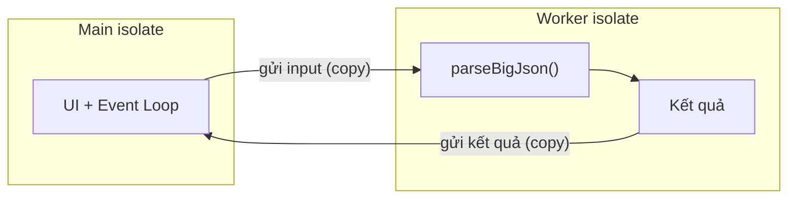
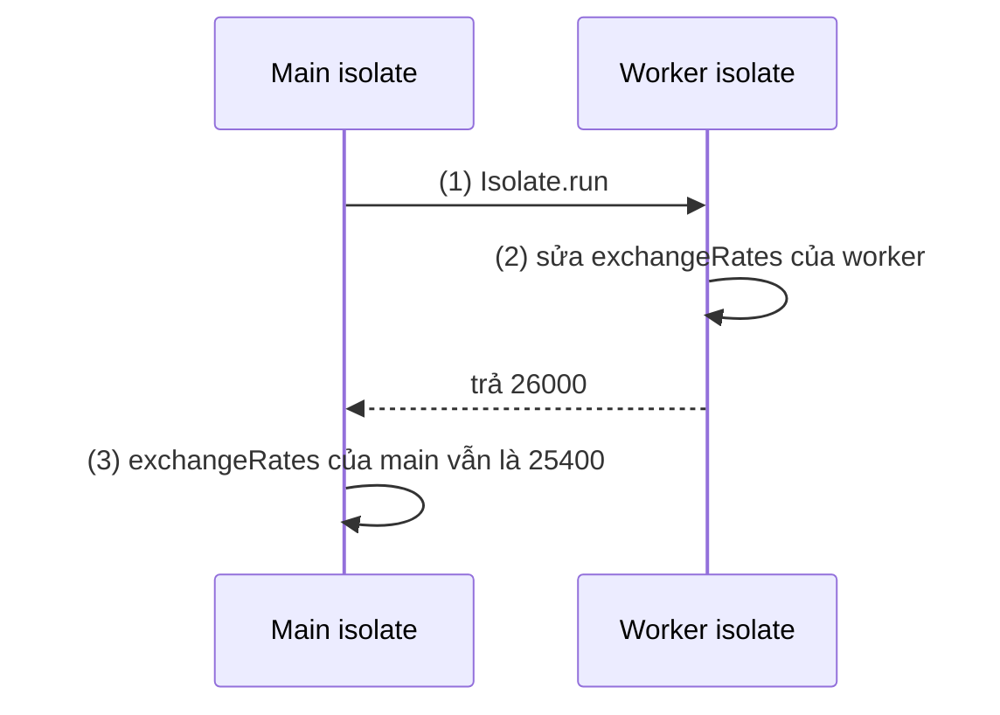
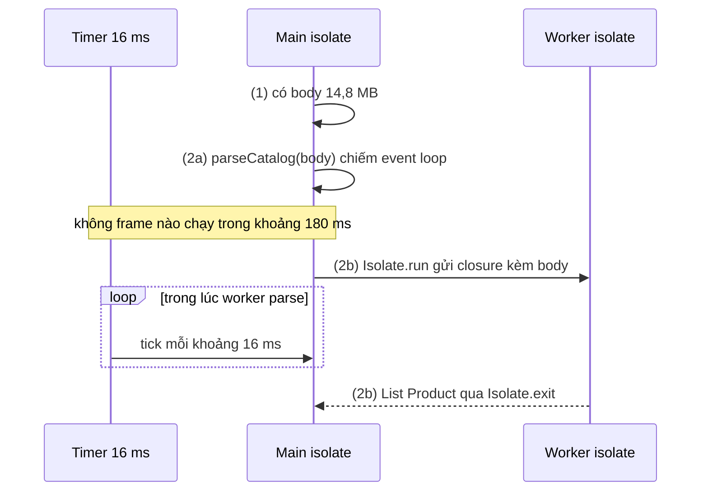
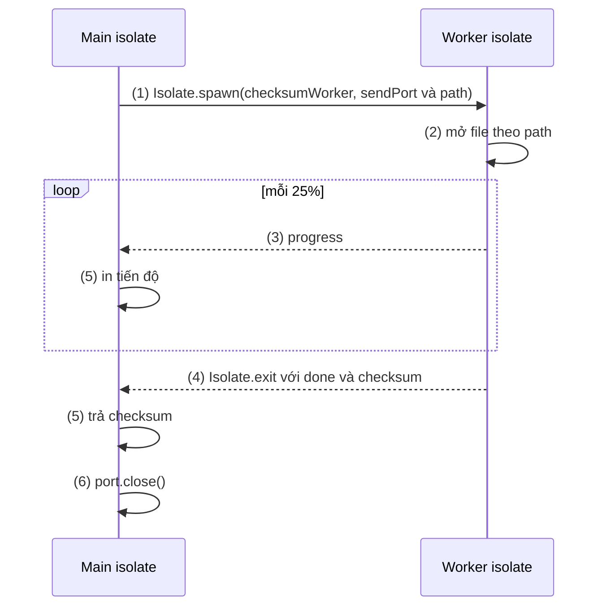
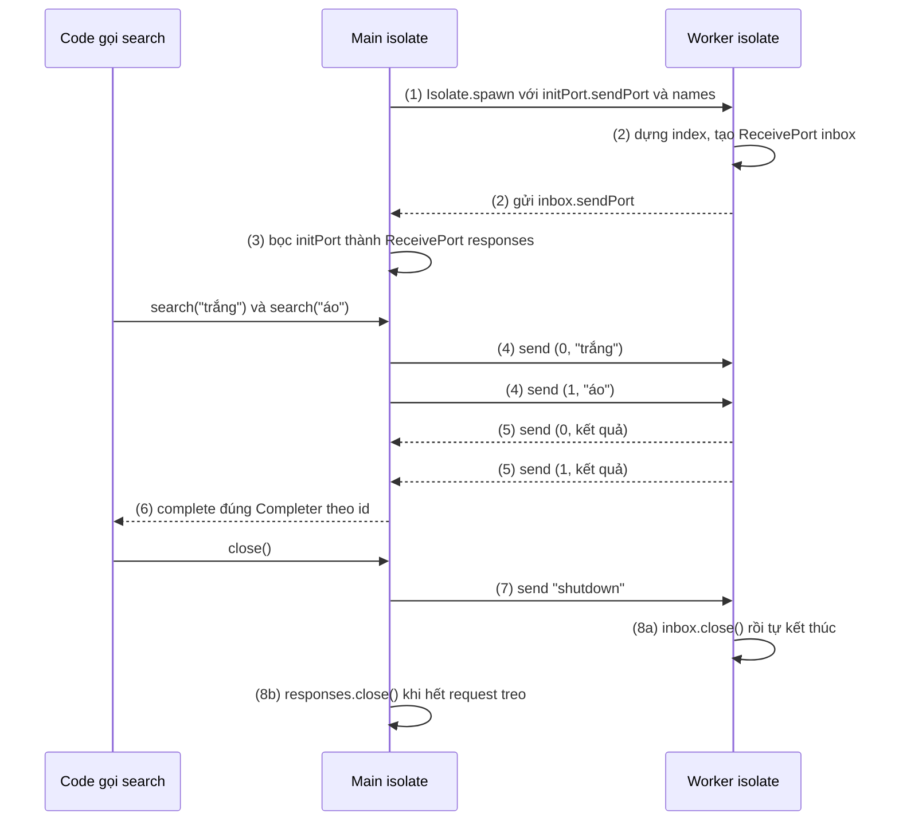
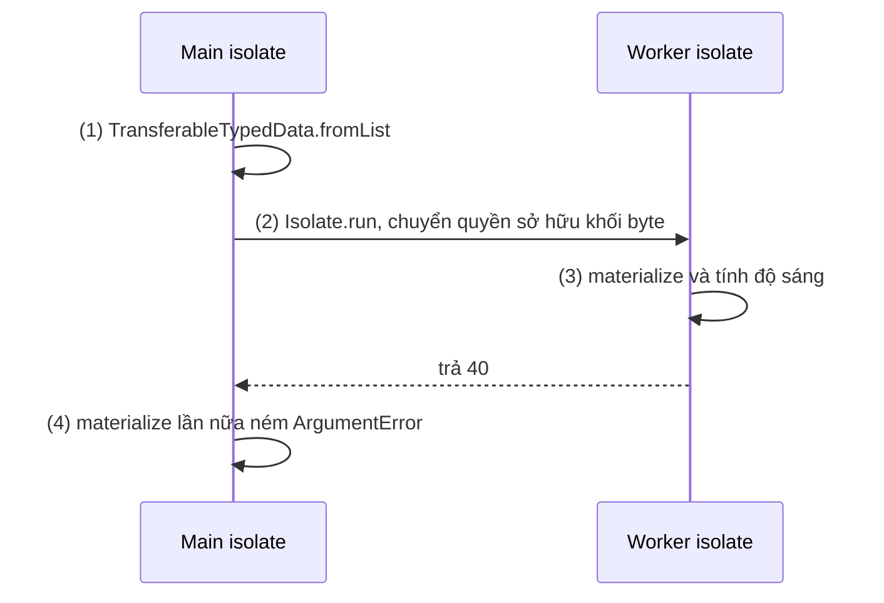
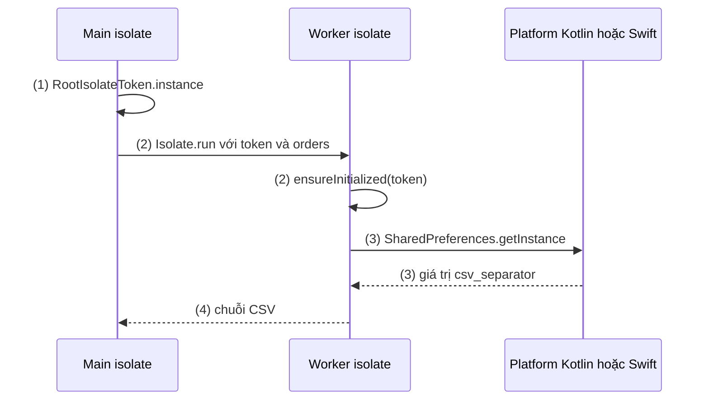
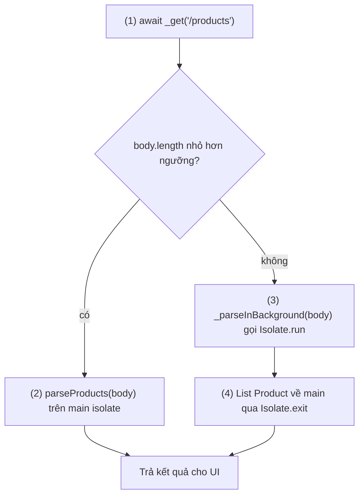
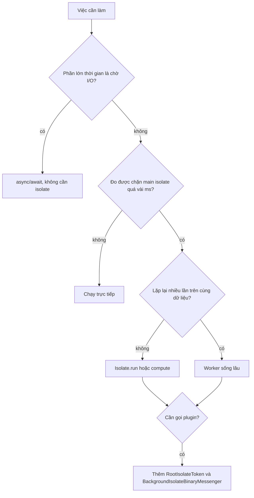

# Isolates

## Vấn đề cần giải quyết

Bài [1.3.1 Futures and Async/Await](futures_async_await.md) cho thấy `await` giúp main isolate không phải **chờ**: trong lúc request mạng hay đọc file chưa xong, event loop vẫn xử lý được việc khác. Nhưng `await` không giúp gì cho việc **tính**. Một hàm đồng bộ như `jsonDecode` trên chuỗi 15 MB chạy từ đầu tới cuối mà không nhường event loop. Trong thời gian đó, không event nào khác được xử lý, kể cả event vẽ frame.

```dart
Future<List<Product>> loadCatalog() async {
  final body = await api.get('/products'); // chờ I/O: event loop vẫn rảnh
  return parseCatalog(body);               // tính toán đồng bộ: event loop bị chiếm
}
```

Hàm có `async` không có nghĩa phần thân chạy ở "luồng khác". Đo trên MacBook Apple M5 (macOS, Dart 3.12, `dart run`), parse 14,8 MB JSON mất khoảng 180–200 ms, và trong thời gian đó một timer 16 ms giả lập frame không chạy được lần nào. Ở 60 Hz mỗi frame có khoảng 16,7 ms (120 Hz: 8,3 ms), nên UI đứng hình hơn chục frame. Hiện tượng này gọi là jank (giật khung hình). Từ Flutter 3.29, trên Android và iOS main isolate còn chạy trên main thread của platform, nên chặn main isolate là chặn luôn main thread của app.

Kotlin developer sẽ nghĩ tới `withContext(Dispatchers.Default)`: đẩy việc sang thread khác dùng chung heap. Code Dart không có thread chia sẻ bộ nhớ, không có `synchronized`, không có `Mutex`. Cần một cách chạy việc nặng **song song thật sự** trên core CPU khác mà vẫn giữ điều Dart hứa: không có race condition trên object Dart. Isolate giải quyết vấn đề này.

## Sau khi học xong

- Giải thích được vì sao mỗi isolate có bộ nhớ và event loop riêng, và vì sao async/await không cứu được main isolate khỏi việc tính toán nặng.
- Triển khai được tác vụ một lần bằng Isolate.run hoặc compute, và worker sống lâu trao đổi hai chiều qua SendPort/ReceivePort.
- Phân biệt được dữ liệu gửi được và không gửi được qua port, cùng chi phí của copy, Isolate.exit và TransferableTypedData.
- Biết khi nào dùng isolate, khi nào async là đủ, và giới hạn của isolate trên web và khi gọi plugin.
- Debug được các lỗi isolate thường gặp - closure bắt object không gửi được, worker chết làm main chờ mãi, port không đóng giữ isolate sống.

## Isolate là gì?

**Isolate (vùng thực thi cô lập)** là đơn vị thực thi độc lập của Dart: mỗi isolate có bộ nhớ riêng chứa object của nó và một event loop riêng; các isolate không chia sẻ object nào với nhau và chỉ giao tiếp bằng message gửi qua port.

Mental model dùng xuyên suốt bài: **mỗi isolate là một process thu nhỏ bên trong app**. Giống hai process Android, hai isolate không nhìn thấy bộ nhớ của nhau; muốn trao đổi thì gửi message, và bên nhận có bản của riêng nó. Khác process, isolate nhẹ: trên máy đo, tạo một isolate mới bằng `Isolate.run` chỉ tốn khoảng 0,1 ms sau lần đầu (số đo ở mục 6).



<!-- dd: flutter-isolate-msg -->

Sơ đồ trên là mô hình mặc định: dữ liệu đi qua ranh giới isolate được **copy**, nên không bên nào sửa được object của bên kia. Hai tối ưu không phá vỡ mô hình này (object bất biến được chia sẻ, kết quả gửi bằng `Isolate.exit` được chuyển quyền sở hữu) nằm ở mục 6.

Mọi app Dart bắt đầu với một isolate, gọi là **main isolate**. Trong Flutter, main isolate (còn gọi là root isolate hay UI isolate) chạy toàn bộ widget, layout, xử lý input và mọi code bạn viết, trừ khi bạn chủ động tạo isolate khác.

## Cách hoạt động

### 1. Bộ nhớ riêng, event loop riêng

Mỗi isolate có:

- **Bộ nhớ riêng**: mọi object tạo trong isolate chỉ isolate đó tham chiếu được. Biến top-level và biến `static` cũng thuộc về từng isolate: isolate mới có bản của riêng nó, khởi tạo lại từ đầu, không thấy giá trị main isolate đã gán.
- **Event loop riêng**: microtask queue và event queue (cơ chế ở [1.3.1](futures_async_await.md)) của isolate nào thì chỉ isolate đó xử lý. `Future`, `Timer`, `Stream` trong worker chạy trên event loop của worker.
- **Một luồng thực thi tại một thời điểm**: bên trong một isolate, code Dart vẫn chạy tuần tự như bạn đã học. Song song chỉ xảy ra **giữa** các isolate: Dart VM có thể chạy nhiều isolate cùng lúc trên nhiều core CPU.

Vì không object nào bị hai isolate cùng giữ, Dart không cần lock cho object Dart; cái giá là mọi thứ muốn qua lại phải đóng gói thành message. So với Kotlin: coroutine trên `Dispatchers.Default` là nhiều thread **chia sẻ** heap, an toàn nhờ `Mutex` hay dữ liệu bất biến; isolate là nhiều vùng **không chia sẻ**, an toàn nhờ cấu trúc chứ không nhờ kỷ luật người viết. Bảng ánh xạ đầy đủ ở [1.1.1 Dart for Kotlin Developers](../dart/dart_for_kotlin_devs.md).

#### Ví dụ: cache tỉ giá toàn cục không được chia sẻ

**Bài toán:** app lưu tỉ giá trong một `Map` top-level để mọi màn hình dùng chung. Một developer cập nhật tỉ giá bên trong worker và mong main isolate thấy giá mới.

**Luồng chạy:**

1. Main isolate gọi `Isolate.run` để chạy một hàm trong isolate mới.
2. Trong worker, biến `exchangeRates` là bản của worker, khởi tạo lại từ giá trị ban đầu; worker sửa bản này.
3. Main isolate đọc `exchangeRates` của chính nó và vẫn thấy giá cũ.



```dart
// global_cache.dart
import 'dart:isolate';

// Cache tỉ giá dùng chung trong isolate hiện tại (biến top-level)
final Map<String, double> exchangeRates = {'USD': 25400};

Future<void> main() async {
  // (1) Worker cập nhật tỉ giá trong cache của chính nó
  final seenInWorker = await Isolate.run(() {
    exchangeRates['USD'] = 26000; // (2) sửa bản của worker
    return exchangeRates['USD'];
  });

  // (3) Main isolate vẫn thấy giá trị cũ
  print('Worker thấy USD = $seenInWorker');
  print('Main thấy USD   = ${exchangeRates['USD']}');
}
```

**Kết quả** (`dart run global_cache.dart`):

```text
Worker thấy USD = 26000.0
Main thấy USD   = 25400.0
```

Muốn main thấy giá mới thì worker phải **gửi** giá trị về, và main tự gán vào cache của nó. Đây là hệ quả trực tiếp của định nghĩa: không có object dùng chung, chỉ có message.

### 2. Isolate.run: tác vụ một lần

`Isolate.run` (từ Dart 2.19) là cách đơn giản nhất để chạy một việc nặng trong isolate khác:

```dart
static Future<R> run<R>(FutureOr<R> computation(), {String? debugName})
```

Một lần gọi làm trọn vòng đời của một worker ngắn hạn:

- Tạo isolate mới và gửi hàm `computation` sang. Hàm có thể là hàm top-level hoặc closure; nếu là closure, các biến nó bắt (capture) được gửi theo.
- Chạy `computation` trong isolate mới. Nếu nó trả về `Future`, worker chờ `Future` đó xong.
- Gửi kết quả về bằng `Isolate.exit`, nên kết quả **không bị copy**, rồi isolate kết thúc.
- Nếu `computation` ném lỗi, `run` ném lại đúng lỗi đó ở phía gọi, nên `try`/`catch` quanh `await Isolate.run(...)` hoạt động như với code thường. Lỗi bất đồng bộ không được bắt trong worker về dưới dạng `RemoteError`.
- `debugName` đặt tên cho isolate, hiện trong DevTools khi profile.

`Isolate.run` **không làm việc chạy nhanh hơn**: nó chuyển việc sang core khác để main isolate rảnh, và cộng thêm chi phí tạo isolate, gửi input, kiểm tra kết quả.

#### Ví dụ: parse response JSON 15 MB mà không làm đứng frame

**Bài toán:** API trả về danh mục 200.000 sản phẩm. Cần biến JSON thành `List<Product>` mà trong lúc đó UI vẫn vẽ frame đều.

**Luồng chạy:**

1. Có chuỗi JSON lớn (ở đây giả lập bằng `jsonEncode`). Một `Timer.periodic` 16 ms đóng vai "vẽ frame" và ghi lại khoảng trễ lớn nhất giữa hai lần chạy.
2. (2a) Parse ngay trên main isolate: hàm đồng bộ chiếm event loop, timer không chạy được. (2b) Parse bằng `Isolate.run`: worker làm việc nặng, event loop của main vẫn xử lý timer đều đặn.



```dart
// parse_catalog.dart
import 'dart:async';
import 'dart:convert';
import 'dart:isolate';

class Product {
  final int id;
  final String name;
  final int priceVnd;
  Product(this.id, this.name, this.priceVnd);

  factory Product.fromJson(Map<String, dynamic> json) =>
      Product(json['id'] as int, json['name'] as String, json['price'] as int);
}

// Hàm thuần: chỉ nhận String, trả List<Product>, không đụng state bên ngoài
List<Product> parseCatalog(String body) {
  final list = jsonDecode(body) as List<dynamic>;
  return [for (final item in list) Product.fromJson(item as Map<String, dynamic>)];
}

// Giả lập response 200.000 sản phẩm từ API
String fakeResponse() => jsonEncode([
      for (var i = 0; i < 200000; i++)
        {'id': i, 'name': 'Sản phẩm số $i', 'price': 10000 + i, 'tags': ['sale', 'new']}
    ]);

/// Đo khoảng cách lớn nhất giữa hai "frame" giả lập (Timer 16 ms)
/// trong lúc [work] chạy.
Future<void> measure(String label, Future<List<Product>> Function() work) async {
  var lastTick = DateTime.now();
  var maxGapMs = 0;
  final frames = Timer.periodic(const Duration(milliseconds: 16), (_) {
    final now = DateTime.now();
    final gap = now.difference(lastTick).inMilliseconds;
    if (gap > maxGapMs) maxGapMs = gap;
    lastTick = now;
  });

  final watch = Stopwatch()..start();
  final products = await work();
  watch.stop();
  frames.cancel();
  final tail = DateTime.now().difference(lastTick).inMilliseconds;
  if (tail > maxGapMs) maxGapMs = tail;
  print('$label: ${products.length} sản phẩm, ${watch.elapsedMilliseconds} ms, '
      'frame bị trễ lâu nhất ${maxGapMs} ms');
}

Future<void> main() async {
  final body = fakeResponse(); // (1) có body JSON lớn
  print('Body: ${(body.length / 1024 / 1024).toStringAsFixed(1)} MB');
  await Isolate.run(() => parseCatalog('[]')); // khởi động trước một lần

  // (2a) Parse ngay trên main isolate: event loop bị chiếm
  await measure('Main isolate  ', () async => parseCatalog(body));

  // (2b) Parse trong isolate mới bằng Isolate.run
  await measure('Isolate.run   ', () => Isolate.run(() => parseCatalog(body)));
}
```

**Kết quả** (`dart run parse_catalog.dart`, Apple M5, Dart 3.12, số đo dao động vài chục ms giữa các lần chạy):

```text
Body: 14.8 MB
Main isolate  : 200000 sản phẩm, 179 ms, frame bị trễ lâu nhất 180 ms
Isolate.run   : 200000 sản phẩm, 157 ms, frame bị trễ lâu nhất 21 ms
```

Tổng thời gian của hai cách gần như nhau. Khác biệt nằm ở cột cuối: trên main isolate, "frame" bị trễ đúng bằng thời gian parse; với `Isolate.run`, frame chỉ trễ vài ms so với nhịp 16 ms. Đó chính là thứ isolate mua được: **main isolate rảnh**, không phải việc xong sớm hơn.

### 3. compute: Isolate.run phiên bản Flutter

Flutter có hàm `compute` trong `package:flutter/foundation.dart`:

```dart
Future<R> compute<M, R>(ComputeCallback<M, R> callback, M message, {String? debugLabel})
```

Trên mobile và desktop, `await compute(fn, message)` tương đương `await Isolate.run(() => fn(message))`: từ Flutter 3.7, bản cài đặt cho nền tảng native (`_isolates_io.dart`) gọi thẳng `Isolate.run`, nên cũng trả kết quả bằng `Isolate.exit`. Khác biệt nằm ở web: `compute` chỉ nhường một nhịp (`await null`) rồi chạy `callback` trên chính event loop hiện tại, không có isolate nào, còn `Isolate.run` ném lỗi `Unsupported operation` (mục 8).

```dart
// catalog_repository.dart (code Flutter)
import 'package:flutter/foundation.dart';

Future<List<Product>> parseCatalogInBackground(String body) =>
    compute(parseCatalog, body, debugLabel: 'parse-catalog');
```

App Flutter có build web thì dùng `compute` để cùng đoạn code không crash ở mọi platform. Package Dart thuần, server, hoặc app chỉ nhắm mobile/desktop thì dùng `Isolate.run` vì nhận closure, gọn hơn. Việc chỉ tốn cỡ một mili giây thì API docs của `compute` gợi ý `SchedulerBinding.scheduleTask` thay vì tạo isolate.

### 4. SendPort và ReceivePort: kênh message giữa hai isolate

`Isolate.run` giấu đi cơ chế bên dưới. Khi cần nhiều hơn một kết quả (báo tiến độ, gửi nhiều phần), bạn dùng trực tiếp ba API:

- **`ReceivePort` (cổng nhận)**: đầu nhận, thuộc về isolate tạo ra nó. Nó là một `Stream` single-subscription của các message đến (Stream ở [1.3.2 Streams](streams.md)), nên dùng được `listen`, `await for`, `first`.
- **`SendPort` (cổng gửi)**: lấy từ `receivePort.sendPort`. Chính `SendPort` gửi được qua port, nên isolate này có thể đưa "địa chỉ" của mình cho isolate kia. `send(message)` không chặn, không chờ bên nhận; message được đưa vào event queue của isolate nhận và xử lý khi event loop của nó tới lượt.
- **`Isolate.spawn(entryPoint, message)`**: tạo isolate mới chạy `entryPoint(message)`. Thường `message` chứa `SendPort` của main để worker có đường gửi về. Tham số `onError` và `onExit` nhận một `SendPort`: khi worker gặp lỗi không bắt hoặc kết thúc, VM tự gửi thông báo vào đó.

Hai quy tắc vòng đời:

1. **Port đang mở giữ isolate sống.** Còn `ReceivePort` chưa đóng thì event loop vẫn chờ và isolate không kết thúc; với main isolate của chương trình Dart, process không thoát. Đóng port (`close()`) khi không cần nữa.
2. **`Isolate.exit(port, message)`** gửi message cuối rồi kết thúc isolate ngay (code sau nó, kể cả `finally`, không chạy). Message gửi kiểu này được chuyển quyền sở hữu, không copy.

#### Ví dụ: worker tính checksum file lớn và báo tiến độ

**Bài toán:** trước khi upload một file sao lưu vài chục MB, app tính checksum để server kiểm tra toàn vẹn, đồng thời hiện thanh tiến độ. Cần nhiều message từ worker về main, nên `Isolate.run` không đủ.

**Luồng chạy:**

1. Main tạo `ReceivePort`, spawn worker kèm `SendPort` và **đường dẫn** file. `onError` và `onExit` cũng trỏ vào port này để main biết khi worker chết.
2. Worker tự mở file theo đường dẫn. Gửi đường dẫn (vài chục byte) rẻ hơn nhiều so với gửi nội dung file.
3. Worker đọc từng MB và cứ mỗi 25% gửi một message `('progress', percent)`.
4. Xong, worker gửi `('done', checksum)` bằng `Isolate.exit`, gửi và kết thúc trong một lệnh.
5. Main dùng `await for` trên port, phân loại message bằng `switch` pattern ([1.2.3 Control Flow and Patterns](../dart/control_flow_patterns.md)).
6. Dù thành công hay lỗi, main đóng port trong `finally`.



```dart
// file_checksum.dart
import 'dart:io';
import 'dart:isolate';

void checksumWorker((SendPort, String) args) {
  final (SendPort port, String path) = args;
  // (2) Worker tự mở file theo đường dẫn: không gửi bytes qua port
  final file = File(path).openSync();
  final total = file.lengthSync();
  var a = 1, b = 0, read = 0, nextReport = 25;

  while (read < total) {
    final chunk = file.readSync(1 << 20); // đọc từng 1 MB
    for (final byte in chunk) {
      a = (a + byte) % 65521; // Adler-32
      b = (b + a) % 65521;
    }
    read += chunk.length;
    final percent = read * 100 ~/ total;
    if (percent >= nextReport) {
      port.send(('progress', percent)); // (3) báo tiến độ, không chờ main
      nextReport += 25;
    }
  }
  file.closeSync();
  // (4) Gửi kết quả cuối rồi kết thúc isolate trong cùng một lệnh
  Isolate.exit(port, ('done', (b << 16) | a));
}

Future<int> checksumInBackground(String path) async {
  // (1) Main tạo ReceivePort, spawn worker kèm SendPort của port đó.
  //     onError/onExit cũng gửi vào port này để main biết khi worker chết.
  final port = ReceivePort();
  await Isolate.spawn(checksumWorker, (port.sendPort, path),
      onError: port.sendPort, onExit: port.sendPort);

  try {
    await for (final message in port) {
      // (5) Main xử lý từng message theo loại
      switch (message) {
        case ('progress', int percent):
          print('Đã xử lý $percent%');
        case ('done', int checksum):
          return checksum;
        case [String error, String stack]: // từ onError
          throw RemoteError(error, stack);
        case null: // từ onExit: worker dừng mà chưa gửi 'done'
          throw StateError('Worker kết thúc mà không gửi kết quả');
      }
    }
    throw StateError('Port đã đóng');
  } finally {
    port.close(); // (6) luôn đóng cổng, kể cả khi lỗi
  }
}

Future<void> main() async {
  final path = '${Directory.systemTemp.path}/backup.bin';
  File(path).writeAsBytesSync(List<int>.generate(32 << 20, (i) => i % 251));

  final checksum = await checksumInBackground(path);
  print('Adler-32: 0x${checksum.toRadixString(16)}');

  try {
    await checksumInBackground('/khong-ton-tai/backup.bin');
  } on RemoteError catch (e) {
    print('Worker lỗi: ${e.toString().split(':').first}');
  }
}
```

**Kết quả** (`dart run file_checksum.dart`):

```text
Đã xử lý 25%
Đã xử lý 50%
Đã xử lý 75%
Đã xử lý 100%
Adler-32: 0xdd78a656
Worker lỗi: PathNotFoundException
```

Lần gọi thứ hai cho thấy vì sao cần `onError`: file không tồn tại, worker chết ngay ở bước (2). Không có `onError`, main sẽ chờ message `done` mãi mãi (xem "Sai lầm thường gặp"). Message từ `onError` là một `List` hai `String` (lỗi và stack trace), từ `onExit` là `null`.

### 5. Worker sống lâu trao đổi hai chiều

`Isolate.run` tạo isolate mới mỗi lần gọi và mọi input phải gửi lại từ đầu. Điều đó ổn cho việc thỉnh thoảng mới làm. Khi cùng một loại việc lặp lại nhiều lần trên cùng một dữ liệu lớn, ví dụ tìm kiếm trên chỉ mục mỗi lần người dùng gõ phím, dữ liệu nên **ở lại trong worker**. Main chỉ gửi yêu cầu nhỏ và nhận kết quả nhỏ.

Worker sống lâu phải tự làm bốn việc mà `Isolate.run` làm hộ: **bắt tay** (trao `SendPort` cho nhau), **ghép yêu cầu với kết quả** (mỗi yêu cầu mang một `id`, main giữ `Map<int, Completer>`; `Completer` ở [1.3.1](futures_async_await.md)), **báo lỗi** từng yêu cầu bằng `RemoteError` thay vì để lỗi giết worker, và **đóng** đúng cách. Cách tổ chức dưới đây theo ví dụ "robust ports" của tài liệu Dart: bước bắt tay dùng `RawReceivePort` (nhận một `handler` gọi trực tiếp), sau đó bọc thành `ReceivePort` bằng `ReceivePort.fromRawReceivePort`.

#### Ví dụ: worker giữ chỉ mục tìm kiếm sản phẩm

**Bài toán:** màn hình tìm kiếm cần tra từ khoá trên hơn 100.000 tên sản phẩm. Dựng chỉ mục (index) tốn thời gian và chỉ nên làm một lần; mỗi lần tìm chỉ gửi từ khoá sang và nhận danh sách kết quả về.

**Luồng chạy:**

1. Main tạo `RawReceivePort` làm cổng khởi tạo, spawn worker và gửi kèm `SendPort` của cổng đó cùng danh sách tên sản phẩm (copy một lần duy nhất).
2. Worker dựng index trong bộ nhớ của nó, tạo `ReceivePort` riêng (`inbox`) và gửi `inbox.sendPort` về main.
3. Main nhận `SendPort` của worker, bọc cổng khởi tạo thành `ReceivePort` để nghe kết quả. Kênh hai chiều đã sẵn sàng.
4. Mỗi lần `search`, main tạo `id`, lưu `Completer` vào `_pending`, gửi `(id, query)`.
5. Worker tra index và gửi `(id, kết quả)`, hoặc `(id, RemoteError)` nếu yêu cầu lỗi.
6. Main nhận message, lấy `Completer` theo `id` và hoàn thành `Future` của đúng lời gọi đó.
7. `close()`: main gửi `'shutdown'`.
8. (8a) Worker đóng `inbox`; không còn port nào mở nên worker tự kết thúc. (8b) Main đóng port nhận khi `_pending` rỗng.



<!-- archify: s01-flutter-isolate-worker | Worker isolate sống lâu: trao đổi hai chiều -->

```dart
// search_index_worker.dart
import 'dart:async';
import 'dart:isolate';

class SearchIndexWorker {
  final SendPort _commands; // cổng gửi lệnh sang worker
  final ReceivePort _responses; // cổng nhận kết quả từ worker
  final Map<int, Completer<List<String>>> _pending = {};
  int _nextId = 0;
  bool _closed = false;

  SearchIndexWorker._(this._responses, this._commands) {
    _responses.listen(_handleResponse);
  }

  static Future<SearchIndexWorker> spawn(List<String> productNames) async {
    // (1) Main tạo cổng khởi tạo rồi spawn worker, gửi kèm dữ liệu cần index
    final initPort = RawReceivePort();
    final connection = Completer<(ReceivePort, SendPort)>.sync();
    initPort.handler = (SendPort commandPort) {
      // (3) Main nhận SendPort của worker: kênh hai chiều đã sẵn sàng
      connection.complete((ReceivePort.fromRawReceivePort(initPort), commandPort));
    };
    try {
      await Isolate.spawn(_workerMain, (initPort.sendPort, productNames),
          debugName: 'search-index');
    } on Object {
      initPort.close();
      rethrow;
    }
    final (responses, commands) = await connection.future;
    return SearchIndexWorker._(responses, commands);
  }

  Future<List<String>> search(String query) {
    if (_closed) throw StateError('Worker đã đóng');
    // (4) Main gắn id cho request, lưu Completer, gửi (id, query)
    final id = _nextId++;
    final completer = Completer<List<String>>();
    _pending[id] = completer;
    _commands.send((id, query));
    return completer.future;
  }

  void _handleResponse(dynamic message) {
    // (6) Main nhận (id, kết quả), tìm đúng Completer để hoàn thành
    final (int id, Object result) = message as (int, Object);
    final completer = _pending.remove(id)!;
    if (result is RemoteError) {
      completer.completeError(result);
    } else {
      completer.complete(result as List<String>);
    }
    if (_closed && _pending.isEmpty) _responses.close(); // (8b)
  }

  void close() {
    if (_closed) return;
    // (7) Main gửi lệnh shutdown; chỉ đóng cổng nhận khi hết request treo
    _closed = true;
    _commands.send('shutdown');
    if (_pending.isEmpty) _responses.close(); // (8b)
  }

  // ===== Phần dưới chạy trong worker isolate =====
  static void _workerMain((SendPort, List<String>) args) {
    final (SendPort mainPort, List<String> names) = args;

    // (2) Worker dựng index một lần (việc nặng), giữ trong bộ nhớ của nó
    final index = <String, Set<String>>{};
    for (final name in names) {
      for (final word in name.toLowerCase().split(' ')) {
        index.putIfAbsent(word, () => {}).add(name);
      }
    }

    // (2) Tạo cổng nhận lệnh riêng và gửi SendPort của nó về main
    final inbox = ReceivePort();
    mainPort.send(inbox.sendPort);

    inbox.listen((dynamic message) {
      if (message == 'shutdown') {
        inbox.close(); // (8a) hết cổng mở, worker tự kết thúc
        return;
      }
      // (5) Worker tra index rồi gửi (id, kết quả) hoặc (id, RemoteError)
      final (int id, String query) = message as (int, String);
      try {
        if (query.trim().isEmpty) throw ArgumentError('Từ khoá rỗng');
        final hits = index[query.toLowerCase()] ?? const <String>{};
        mainPort.send((id, hits.toList()..sort()));
      } catch (e, s) {
        mainPort.send((id, RemoteError(e.toString(), s.toString())));
      }
    });
  }
}

Future<void> main() async {
  final names = [
    'Áo thun cotton trắng',
    'Áo khoác gió',
    'Quần jean xanh',
    'Giày chạy bộ trắng',
    for (var i = 0; i < 100000; i++) 'Mã hàng $i',
  ];

  final watch = Stopwatch()..start();
  final worker = await SearchIndexWorker.spawn(names);
  print('Worker sẵn sàng sau ${watch.elapsedMilliseconds} ms');

  // Hai request gửi gần như cùng lúc, kết quả về đúng chỗ nhờ id
  final results = await Future.wait([worker.search('trắng'), worker.search('áo')]);
  print('trắng -> ${results[0]}');
  print('áo    -> ${results[1]}');

  try {
    await worker.search('  ');
  } on RemoteError catch (e) {
    print('Lỗi từ worker: $e');
  }

  worker.close();
  print('Đã gửi shutdown, chương trình kết thúc khi mọi port đã đóng');
}
```

**Kết quả** (`dart run search_index_worker.dart`; số ms thay đổi theo lần chạy):

```text
Worker sẵn sàng sau 52 ms
trắng -> [Giày chạy bộ trắng, Áo thun cotton trắng]
áo    -> [Áo khoác gió, Áo thun cotton trắng]
Lỗi từ worker: Invalid argument(s): Từ khoá rỗng
Đã gửi shutdown, chương trình kết thúc khi mọi port đã đóng
```

Process thoát ngay sau dòng cuối. Đó là cách kiểm chứng bước (8b): quên đóng `_responses` thì chương trình treo ở đó, vì port của main isolate còn mở. Quên đóng `inbox` thì process vẫn thoát, vì chương trình Dart kết thúc khi main isolate kết thúc và isolate con bị dừng theo; lỗi đó chỉ lộ ra khi main sống lâu (như app Flutter): worker không bao giờ tự kết thúc và chiếm bộ nhớ. Thứ tự sắp xếp đặt "Giày" trước "Áo" vì `sort()` so sánh theo code unit Unicode, không theo bảng chữ cái tiếng Việt.

Viết tay worker như trên giúp hiểu cơ chế. Trong dự án thật, tài liệu Flutter gợi ý các package như `worker_manager` hoặc `isolate_agents` khi cần quản lý nhiều worker; chúng xây trên đúng các API vừa học.

### 6. Dữ liệu gửi được và chi phí copy

#### Cái gì gửi được

Quy tắc phụ thuộc vào việc hai isolate có **chung code** hay không:

| Isolate tạo bằng | Gửi được | Không gửi được |
|---|---|---|
| `Isolate.spawn`, `Isolate.run`, `compute` (chung code, cùng isolate group) | Gần như mọi object: số, `String`, `List`/`Map`/`Set`, record, instance class tự viết, closure, `SendPort`, `TransferableTypedData` | Object giữ tài nguyên native (socket, file đang mở như `RandomAccessFile`), `ReceivePort`, `Timer`, `Future`, `Completer`, `DynamicLibrary`, `Finalizer`/`NativeFinalizer`, `UserTag`, class đánh dấu `@pragma('vm:isolate-unsendable')` |
| `Isolate.spawnUri` (code khác, chạy từ URI khác) | Danh sách hẹp: `null`, `bool`, số, `String`, list/map/set tạo bằng literal hoặc constructor của `List`/`Map`/`Set`, `TransferableTypedData`, `SendPort`, `Capability`, một số `Type` | Mọi thứ còn lại, kể cả instance class tự viết và `Uint8List` |

Trong app Flutter bạn gần như chỉ gặp dòng thứ nhất. Việc kiểm tra diễn ra **lúc runtime**, khi `send` hoặc `Isolate.run` duyệt qua toàn bộ object graph của message. Gửi object không hợp lệ ném `ArgumentError` kèm đường đi tới object vi phạm (ví dụ ở "Sai lầm thường gặp"). Thử trên Dart 3.12: `Timer`, `ReceivePort`, `RandomAccessFile`, `Future`, `Completer` bị từ chối (`Timer`, `Future`, `Completer` không có tên trong danh sách của API docs nhưng VM vẫn chặn); `File` (chỉ chứa đường dẫn) gửi được.

> [!WARNING]
> Closure gửi sang isolate mang theo mọi biến nó bắt. Trong một method của class, chỉ cần đọc một field là closure bắt cả `this`, kéo theo **toàn bộ** object và mọi thứ object đó tham chiếu. Dart VM hiện còn có thể bắt nhiều biến hơn mức closure thực sự dùng (theo dõi ở dart-lang/sdk#36983): khi đo số liệu cho bài này, closure `() => jsonDecode(body)` bị từ chối vì dùng chung context với một `StreamIterator` khai báo trong cùng hàm, dù closure không hề đọc biến đó. Cách an toàn mà API docs của `Isolate.run` khuyên: viết một hàm helper nhận đủ dữ liệu qua tham số, rồi gọi `Isolate.run` bên trong helper đó.

#### Copy, chia sẻ hay chuyển quyền sở hữu

| Cách gửi | Điều gì xảy ra | Chi phí |
|---|---|---|
| `SendPort.send` với object có thể sửa (list, map, object thường, `Uint8List`) | Copy sâu toàn bộ object graph | Tỉ lệ tuyến tính với kích thước graph, trả ở phía gửi |
| `SendPort.send` với object bất biến (`String`, số, list byte không sửa được) | Chia sẻ tham chiếu, không copy | Gần như bằng 0 |
| `Isolate.exit(port, message)`, và kết quả của `Isolate.run`/`compute` | Chuyển quyền sở hữu graph sang isolate nhận, không copy | Vẫn duyệt graph một lần để kiểm tra mọi object gửi được; bên nhận thường nhận trong thời gian hằng số |
| `TransferableTypedData` | `fromList` copy bytes một lần; sau đó `send` chỉ chuyển quyền sở hữu | `fromList` tuyến tính theo số byte; `send` và `materialize` hằng số |

Số đo minh hoạ cho các con số trên: MacBook Apple M5, macOS, Dart 3.12, vài lần chạy; JIT là `dart run`, AOT là bản `dart compile exe`. Kết quả dao động mạnh theo tải máy nên bảng chỉ ghi khoảng, dùng để so bậc độ lớn. Ở các dòng "gửi + nhận", worker sống lâu gửi trả lại đúng message nó nhận: `Uint8List` bị copy hai lần, còn `TransferableTypedData` chỉ copy một lần ở `fromList`, hai lượt gửi đều là chuyển quyền sở hữu.

| Thao tác | JIT | AOT |
|---|---|---|
| `Isolate.run` lần đầu tiên trong process | 4–7 ms | 0,2–0,8 ms |
| `Isolate.run(() => 0)` các lần sau, trung bình | 0,07–0,14 ms | 0,02–0,03 ms |
| `Isolate.spawnUri` một file Dart nhỏ (group mới) | 20–70 ms | không đo |
| Round-trip một `int` tới worker sống lâu | 0,005–0,01 ms | khoảng 0,002 ms |
| Gửi + nhận `List<int>` 2 triệu phần tử (khoảng 16 MB) | 8–19 ms | 6–19 ms |
| Gửi + nhận `Uint8List` 16 MB | 3,5–11 ms | 3–14 ms |
| Riêng lệnh `send` một `Uint8List` 16 MB | 1,6–4 ms | 1,2–6 ms |
| Riêng `TransferableTypedData.fromList` 16 MB | 0,7–1,9 ms | 0,6–1 ms |
| `TransferableTypedData` 16 MB: `fromList` + gửi + nhận | 1–3 ms | 1–5 ms |
| Riêng lệnh `send` một `TransferableTypedData` 16 MB | 0,02–1 ms | 0,04–0,3 ms |
| Parse JSON 1 MB trực tiếp / qua `Isolate.run` | khoảng 8 / 13–14 ms | khoảng 8 / 11–14 ms |
| Parse JSON 106 KB trực tiếp / qua `Isolate.run` | 1,1–1,3 / 1,1–1,3 ms | 0,7–0,9 / 0,9 ms |

Ba điều rút ra:

- Với isolate cùng group (`spawn`, `run`, `compute`), bản thân việc tạo isolate rẻ nhờ isolate group (Deep Dive bên dưới): khoảng 0,1 ms ở JIT, vài chục micro giây ở AOT; chỉ lần đầu trong process đắt hơn. Tài liệu Flutter và Dart nói đúng là cả spawn lẫn copy đều có overhead, nhưng trên máy này phần đắt là **dữ liệu**: copy input, duyệt kết quả. `spawnUri` đắt hơn hàng trăm lần vì phải tạo group mới và nạp code từ URI.
- `List<int>` 2 triệu phần tử và `Uint8List` 16 MB chiếm bộ nhớ ngang nhau, nhưng list thường tốn khoảng gấp đôi khi gửi: VM phải duyệt từng slot phần tử, còn `Uint8List` được copy nguyên một khối byte liền nhau. Dữ liệu nhị phân nên để ở dạng typed data.
- Với JSON 1 MB, đi qua `Isolate.run` lâu hơn parse trực tiếp, vì cộng thêm việc tạo isolate và kiểm tra graph `Map`/`List` kết quả trước khi chuyển.

Điện thoại, nhất là máy yếu, chậm hơn máy đo nhiều lần: dùng các con số này để so sánh tương đối, còn ngưỡng thật phải đo trên thiết bị bạn hỗ trợ bằng DevTools (2.2.2 DevTools and Debugging (chưa có bài)).

#### TransferableTypedData

`TransferableTypedData` (có từ Dart 2.4) là một khối byte có thể **chuyển** giữa các isolate:

`fromList(List<TypedData>)` copy bytes vào khối mới (thời gian tỉ lệ số byte); gửi qua port tốn thời gian hằng số và bản bên gửi không dùng được nữa; `materialize()` trả về `ByteBuffer` và chỉ gọi được **một lần**, gọi lần hai hoặc gọi trên bản đã gửi đi ném `ArgumentError`.

Trong cùng isolate group, gửi một `Uint8List` thường chỉ là một lần copy nguyên khối byte, tốn ngang `fromList` (bảng trên). Với một chặng gửi, `TransferableTypedData` vì thế không nhanh hơn rõ rệt: nó chỉ dời lần copy từ lúc `send` sang lúc `fromList`. Nó có giá trị khi cần lệnh `send` gần như tức thời, khi cùng khối bytes đi qua nhiều isolate liên tiếp (copy một lần thay vì mỗi chặng một lần), khi gửi sang isolate `spawnUri` (không nhận `Uint8List`), và khi muốn chắc chỉ một bên dùng được dữ liệu.

#### Ví dụ: kiểm tra ảnh quá tối trước khi upload

**Bài toán:** app chụp ảnh 12 MP (khoảng 46 MB dạng RGBA) và cần tính độ sáng trung bình để cảnh báo ảnh thiếu sáng. Tính trên 12 triệu pixel là việc của worker; buffer lớn nên chuyển bằng `TransferableTypedData`.

**Luồng chạy:**

1. Main đóng gói buffer pixel bằng `fromList` (copy một lần).
2. Closure của `Isolate.run` bắt `transferable`; gửi closure sang worker chỉ chuyển quyền sở hữu khối byte.
3. Worker `materialize()` ra `Uint8List` mà không copy thêm, rồi tính độ sáng.
4. Main thử `materialize()` bản của mình và nhận lỗi, vì khối byte đã thuộc về worker.



```dart
// photo_brightness_check.dart
import 'dart:isolate';
import 'dart:typed_data';

// Chạy trong worker: độ sáng trung bình (0–255) của ảnh RGBA
int averageBrightness(TransferableTypedData transferable) {
  final pixels = transferable.materialize().asUint8List(); // (3) không copy thêm
  var sum = 0;
  for (var i = 0; i < pixels.length; i += 4) {
    sum += (pixels[i] * 299 + pixels[i + 1] * 587 + pixels[i + 2] * 114) ~/ 1000;
  }
  return sum ~/ (pixels.length ~/ 4);
}

Future<void> main() async {
  final pixels = Uint8List(4000 * 3000 * 4); // ảnh RGBA 12 MP, khoảng 46 MB
  for (var i = 0; i < pixels.length; i++) {
    pixels[i] = 40; // ảnh chụp thiếu sáng
  }

  // (1) Đóng gói bytes: bước này copy một lần, thời gian tỉ lệ số byte
  final transferable = TransferableTypedData.fromList([pixels]);

  // (2) Gửi sang worker: chỉ chuyển quyền sở hữu, thời gian hằng số
  final brightness = await Isolate.run(() => averageBrightness(transferable));
  print('Độ sáng trung bình: $brightness/255');

  try {
    transferable.materialize(); // (4) bản ở main đã bị chuyển đi
  } on ArgumentError catch (e) {
    print(e.message);
  }
}
```

**Kết quả** (`dart run photo_brightness_check.dart`):

```text
Độ sáng trung bình: 40/255
Attempt to materialize object that was transferred already.
```

Lưu ý `pixels` gốc vẫn còn trong main isolate, vì `fromList` đã copy. Nếu không cần nữa, bỏ tham chiếu tới nó để GC thu hồi.

### 7. Background isolate gọi plugin qua platform channel

Plugin Flutter (camera, `shared_preferences`, mã hoá native...) nói chuyện với code Kotlin/Swift qua platform channel, và mặc định chỉ main isolate có đường đi tới platform. Trước Flutter 3.7, gọi plugin trong isolate khác sẽ lỗi. Từ Flutter 3.7, isolate khác dùng được plugin nếu được "giới thiệu" bởi main isolate: main lấy `RootIsolateToken.instance` (từ `package:flutter/services.dart`; ngoài main isolate getter này trả `null`), gửi token sang worker, và worker gọi `BackgroundIsolateBinaryMessenger.ensureInitialized(token)` **trước** mọi lời gọi plugin. Sau đó plugin dùng platform channel như bình thường, phản hồi từ native về đúng event loop của worker.

Giới hạn cần biết ở mức nhận biết:

- Background isolate gửi được message tới platform và nhận phản hồi, nhưng **không nhận được message do platform chủ động gửi**. Một truy vấn một lần chạy được; một listener sống lâu như snapshot listener của Firestore thì không.
- Không dùng được `rootBundle` để đọc asset, và không làm được bất kỳ việc gì liên quan tới widget hay UI trong isolate khác. Toàn bộ UI gắn với main isolate.

#### Ví dụ: xuất CSV đơn hàng, đọc cấu hình từ SharedPreferences trong worker

**Bài toán:** dựng file CSV hàng chục nghìn đơn hàng là việc nặng; ký tự phân cách do người dùng chọn và được lưu trong `shared_preferences` (một plugin, học ở 6.1.1 SharedPreferences and Secure Storage (chưa có bài)). Worker cần đọc cấu hình đó.

**Luồng chạy:**

1. Main lấy `RootIsolateToken.instance!`; token gửi được qua port.
2. Closure của `Isolate.run` bắt token và danh sách đơn; trong worker gọi `ensureInitialized(token)` trước tiên.
3. Worker gọi plugin `SharedPreferences` để đọc ký tự phân cách.
4. Worker dựng chuỗi CSV và trả về main.



```dart
// order_export.dart (code Flutter, cần package shared_preferences)
import 'dart:isolate';

import 'package:flutter/services.dart';
import 'package:shared_preferences/shared_preferences.dart';

class OrderRow {
  final String id;
  final int totalVnd;
  const OrderRow(this.id, this.totalVnd);
}

Future<String> exportOrdersCsv(List<OrderRow> orders) {
  final token = RootIsolateToken.instance!; // (1) chỉ có giá trị ở main isolate
  return _buildCsvInBackground(token, orders);
}

// Hàm top-level: closure chỉ bắt token và orders
Future<String> _buildCsvInBackground(RootIsolateToken token, List<OrderRow> orders) =>
    Isolate.run(() async {
      BackgroundIsolateBinaryMessenger.ensureInitialized(token); // (2)
      final prefs = await SharedPreferences.getInstance(); // (3) gọi plugin
      final separator = prefs.getString('csv_separator') ?? ',';
      return [
        'id${separator}total', // (4) dựng CSV
        for (final order in orders) '${order.id}$separator${order.totalVnd}',
      ].join('\n');
    });
```

**Kết quả:** gọi `exportOrdersCsv` trên Android hoặc iOS trả về chuỗi CSV dùng đúng ký tự phân cách đã lưu. Bỏ dòng (2) thì lời gọi plugin ở (3) ném `StateError` báo `BackgroundIsolateBinaryMessenger.instance` chưa hợp lệ. Đây là code Flutter (không chạy bằng `dart run`), viết theo mẫu trong tài liệu "Concurrency and isolates" của Flutter.

### 8. Isolate trên web

Nền tảng web của Dart, gồm cả Flutter web, **không hỗ trợ isolate**. Khi biên dịch sang JavaScript, `dart:isolate` vẫn import được và code vẫn build, nhưng gọi tới sẽ lỗi lúc chạy. Thử `Isolate.run(() => 42)` biên dịch bằng `dart compile js` (Dart 3.12) rồi chạy, kết quả là:

```text
Unsupported operation: new RawReceivePort
```

Hệ quả cho app Flutter có build web:

- Dùng `compute` thay vì `Isolate.run` (mục 3): code không crash nhưng **vẫn chặn UI** như chạy trực tiếp.
- Nếu việc nặng thật sự quan trọng trên web, các lựa chọn là chia nhỏ việc thành nhiều đoạn và nhường event loop giữa các đoạn (`await` một `Future`, cơ chế ở [1.3.1](futures_async_await.md)), đẩy việc về server, hoặc dùng Web Worker qua JS interop (ngoài phạm vi bài này).

## Deep Dive: Isolate group và cái giá thật của một message

Định nghĩa nói mỗi isolate có bộ nhớ riêng. Từ Dart 2.15, VM hiện thực điều đó tinh tế hơn.

**Isolate group.** Isolate tạo bằng `Isolate.spawn` (và vì thế `Isolate.run`, `compute`) thuộc cùng **isolate group** với isolate tạo ra nó: dùng chung code đã nạp và cùng hoạt động trên một managed heap do VM quản lý. Theo changelog Dart 2.15, nhờ vậy khởi động isolate nhanh khoảng 100 lần, bộ nhớ nền mỗi isolate giảm khoảng 10–100 lần, giao tiếp nhanh khoảng 8 lần. Chung heap ở tầng VM **không** có nghĩa code Dart được chia sẻ object: mỗi isolate vẫn chỉ tham chiếu được object của chính nó, mô hình "process thu nhỏ" vẫn đúng với người viết code. Hệ quả phụ changelog nêu: các isolate trong group cùng tham gia garbage collection, nên trong một số trường hợp hiếm, app sinh nhiều rác có thể bị ảnh hưởng thời gian dừng GC.

**Vì sao chuyển quyền sở hữu được.** Vì cùng heap, khi isolate kết thúc bằng `Isolate.exit`, VM giao luôn object graph của message cho isolate nhận mà không copy, sau khi kiểm tra mọi object trong graph đều gửi được. Bước kiểm tra tuyến tính theo kích thước graph này là một phần chi phí phụ trong số đo JSON 1 MB.

**`spawnUri` tạo group mới.** Isolate tạo bằng `Isolate.spawnUri` chạy code từ URI khác, không chung code, không chung heap. Vì vậy message chỉ được chứa danh sách kiểu hẹp ở mục 6, và `Isolate.exit` ném lỗi nếu port đích thuộc isolate như vậy. Trong app Flutter gần như không có lý do dùng `spawnUri`.

## Ví dụ thực tế

### Repository chỉ chuyển sang isolate khi response đủ lớn

Đây là bài toán gặp nhiều nhất: lớp data nhận JSON từ API và cần parse thành model. Phần lớn response nhỏ, parse trực tiếp rẻ hơn tạo isolate; chỉ số ít response lớn (danh mục đầy đủ, lịch sử giao dịch) mới đáng chuyển đi.

**Luồng chạy:**

1. Repository `await` lớp network. Đây là chờ I/O, async là đủ, không cần isolate.
2. Nếu body nhỏ hơn ngưỡng, parse ngay trên main isolate.
3. Nếu body lớn, gọi một hàm `static` nhận `body` qua tham số rồi `Isolate.run`, để closure không bắt `this`.
4. Danh sách `Product` về main qua `Isolate.exit`, không copy lại.



```dart
// product_repository.dart
import 'dart:convert';
import 'dart:isolate';

class Product {
  final int id;
  final String name;
  final int priceVnd;
  const Product(this.id, this.name, this.priceVnd);

  factory Product.fromJson(Map<String, dynamic> json) =>
      Product(json['id'] as int, json['name'] as String, json['price'] as int);
}

// Hàm top-level thuần: input là String, output là List<Product>
List<Product> parseProducts(String body) => [
      for (final item in jsonDecode(body) as List<dynamic>)
        Product.fromJson(item as Map<String, dynamic>),
    ];

class ProductRepository {
  // Ngưỡng tính theo số ký tự của body, chọn bằng cách đo trên thiết bị yếu nhất app hỗ trợ
  static const offloadThreshold = 256 * 1024;

  final Future<String> Function(String path) _get; // lớp network (giả lập)
  ProductRepository(this._get);

  Future<List<Product>> fetchCatalog() async {
    final body = await _get('/products'); // (1) chờ I/O: async là đủ

    if (body.length < offloadThreshold) {
      return parseProducts(body); // (2) body nhỏ: parse ngay trên main isolate
    }
    return _parseInBackground(body); // (3) body lớn: chuyển sang isolate khác
  }

  // (3) Hàm static: closure chỉ bắt `body`, không bắt `this`
  static Future<List<Product>> _parseInBackground(String body) =>
      Isolate.run(() => parseProducts(body), debugName: 'parse-products');
  // (4) Kết quả về main qua Isolate.exit, không copy lại danh sách
}

String fakeBody(int count) => jsonEncode([
      for (var i = 0; i < count; i++) {'id': i, 'name': 'Sản phẩm $i', 'price': 10000 + i}
    ]);

Future<void> main() async {
  for (final count in [100, 50000]) {
    final body = fakeBody(count);
    final repo = ProductRepository((_) async => body);
    final watch = Stopwatch()..start();
    final products = await repo.fetchCatalog();
    final route = body.length < ProductRepository.offloadThreshold
        ? 'main isolate'
        : 'Isolate.run';
    print('${(body.length / 1024).round()} KB -> ${products.length} sản phẩm '
        'qua $route (${watch.elapsedMilliseconds} ms)');
  }
}
```

**Kết quả** (`dart run product_repository.dart`; số ms thay đổi theo lần chạy):

```text
4 KB -> 100 sản phẩm qua main isolate (3 ms)
2469 KB -> 50000 sản phẩm qua Isolate.run (28 ms)
```

`body` là `String`, bất biến, nên việc closure bắt `body` không copy chuỗi 2,4 MB: worker nhận tham chiếu. App Flutter có build web thì thay dòng (3) bằng `compute(parseProducts, body)`. Khi model được sinh bằng `json_serializable` (5.1.2 JSON Serialization and Codegen (chưa có bài)), cách chuyển sang isolate vẫn y hệt: hàm `fromJson` sinh ra là hàm thường, gọi được trong worker.

### Các bài toán khác

- **Xử lý ảnh trước khi upload**: decode, resize, nén bằng package Dart thuần như `image` là việc CPU nặng; gói thành hàm top-level nhận và trả `Uint8List`, gọi bằng `Isolate.run`/`compute`.
- **Mã hoá hoặc nén file bằng plugin native**: background isolate với `RootIsolateToken` như mục 7.
- **Database cục bộ**: một số thư viện tự chạy database trên isolate riêng (drift có `NativeDatabase.createInBackground`); xem 6.1.2 SQLite, Drift and Hive (chưa có bài).

## Khi nào nên và không nên dùng

Tài liệu Flutter nêu đúng một quy tắc cứng: dùng isolate khi tính toán lớn đang làm UI jank. Quy trình chọn:



**Nên dùng isolate khi:**

- Parse JSON hoặc file lớn (hàng trăm KB trở lên, tuỳ thiết bị), lọc/sắp xếp danh sách rất lớn.
- Xử lý ảnh, âm thanh, video; nén, giải nén; mã hoá, băm.
- Việc nặng lặp lại nhiều lần trên cùng dữ liệu (tìm kiếm trên index, xử lý luồng dữ liệu cảm biến): dùng worker sống lâu.

**Không nên dùng isolate khi:**

- Việc là I/O: gọi API, đọc file, query database. Các API này vốn không chặn event loop; đưa vào isolate chỉ thêm chi phí copy.
- Việc nhỏ, không chặn quá một frame: số đo ở mục 6 cho thấy với JSON khoảng 100 KB, tổng thời gian qua `Isolate.run` đã ngang parse trực tiếp; nhỏ hơn nữa thì isolate chỉ thêm chi phí.
- Việc cần widget, `BuildContext`, `rootBundle` hay listener chủ động từ platform: những thứ này chỉ có ở main isolate.
- Code chạy trên web: `Isolate.run` crash với `Unsupported operation`; dùng `compute` và nhớ nó vẫn chặn UI (mục 8).

## Sai lầm thường gặp

### 1. Closure bắt `this` kéo theo object không gửi được

```dart
// product_search_controller.dart
import 'dart:async';
import 'dart:isolate';

List<String> filterByKeyword(List<String> names, String keyword) =>
    names.where((n) => n.toLowerCase().contains(keyword)).toList();

class ProductSearchController {
  final List<String> _names;
  Timer? _debounce; // Timer giữ tài nguyên của event loop: không gửi được
  ProductSearchController(this._names);

  void onQueryChanged(String query) {
    _debounce?.cancel();
    _debounce = Timer(const Duration(milliseconds: 300), () => search(query));
  }

  // SAI: closure đọc field `_names` nên bắt luôn `this` (kèm `_debounce`)
  Future<List<String>> search(String query) =>
      Isolate.run(() => filterByKeyword(_names, query.toLowerCase()));

  // ĐÚNG: hàm static nhận đủ dữ liệu qua tham số
  Future<List<String>> searchFixed(String query) =>
      _filterInBackground(_names, query.toLowerCase());

  static Future<List<String>> _filterInBackground(List<String> names, String keyword) =>
      Isolate.run(() => filterByKeyword(names, keyword));
}
```

**Lỗi lộ ra thế nào:** `dart analyze` không báo gì; lúc chạy, sau khi `onQueryChanged` đã tạo `Timer`, lời gọi `search` ném `ArgumentError` (đường dẫn file rút gọn):

```text
Illegal argument in isolate message: object is unsendable - Library:'dart:isolate' Class: _Timer@1026248 (see restrictions listed at `SendPort.send()` documentation for more information)
 <- _debounce in Instance of 'ProductSearchController' (from file:///.../product_search_controller.dart)
 <- field this in ProductSearchController.search.<anonymous closure> (from file:///.../product_search_controller.dart)
```

Đọc từ dưới lên: closure bắt `this`, `this` có field `_debounce`, `_debounce` là `Timer` không gửi được. **Cách sửa:** `searchFixed` chuyển dữ liệu qua tham số của một hàm static, nên closure chỉ bắt `names` và `keyword`. Ngay cả khi `this` gửi được, bắt `this` vẫn có thể copy cả một object lớn mỗi lần gọi.

### 2. Worker chết, main chờ mãi, process không thoát

```dart
// report_worker.dart (SAI)
import 'dart:io';
import 'dart:isolate';

void reportWorker(SendPort port) {
  final rows = File('/khong-ton-tai/orders.csv').readAsLinesSync(); // ném lỗi
  port.send(rows.length);
}

Future<void> main() async {
  final port = ReceivePort();
  await Isolate.spawn(reportWorker, port.sendPort); // không có onError/onExit
  final count = await port.first; // chờ một message không bao giờ tới
  print('Số dòng: $count');
}
```

**Lỗi lộ ra thế nào:** worker in `Unhandled exception: PathNotFoundException: Cannot open file...` ra stderr rồi chết. Main không nhận được gì nên `await port.first` treo mãi. Khi chạy thử với `port.first.timeout(const Duration(seconds: 2))`, main in được thông báo hết giờ nhưng process **vẫn không thoát**, vì `port` vẫn mở. Trong app Flutter, triệu chứng là một spinner quay mãi.

**Cách sửa:** truyền `onError: port.sendPort, onExit: port.sendPort` cho `Isolate.spawn`, xử lý cả message lỗi lẫn `null`, và đóng port trong `finally`, như ví dụ checksum ở mục 4. Với tác vụ một lần, dùng `Isolate.run`: nó tự làm đúng việc này và ném lại lỗi ở phía gọi.

### 3. Tưởng object đã gửi là object dùng chung

Worker `add` vào một `List` nhận được, hay sửa biến top-level, không ảnh hưởng gì tới main isolate (ví dụ tỉ giá ở mục 1). **Cách sửa:** coi message là dữ liệu một chiều; worker gửi kết quả về và main tự cập nhật state của nó.

### 4. Gửi đi gửi lại dữ liệu lớn

Gọi `Isolate.run(() => search(allProducts, query))` mỗi lần người dùng gõ phím nghĩa là copy toàn bộ `allProducts` mỗi lần. **Cách sửa:** dữ liệu lớn và cố định thì gửi một lần vào worker sống lâu (mục 5); dữ liệu nằm trên đĩa thì gửi đường dẫn và để worker tự đọc (mục 4); dữ liệu nhị phân thì giữ ở dạng `Uint8List`.

### 5. Đưa I/O hoặc việc nhỏ vào isolate "cho chắc"

Bọc lời gọi HTTP trong `Isolate.run` không làm request nhanh hơn, vì I/O vốn không chặn event loop. Bọc một phép parse 3 KB thì chi phí isolate lớn hơn chính việc đó (trên máy đo: khoảng 0,05–0,1 ms qua `Isolate.run`, so với khoảng 0,02 ms parse trực tiếp). **Cách sửa:** đo trước, chỉ chuyển sang isolate phần tính toán đã đo được là chặn main.

### 6. Gọi plugin trong isolate mà chưa khởi tạo messenger

Gọi `SharedPreferences.getInstance()` hay bất kỳ plugin nào trong worker mà chưa gọi `BackgroundIsolateBinaryMessenger.ensureInitialized(token)` sẽ ném `StateError` ngay ở lời gọi plugin. Lấy `RootIsolateToken.instance` **bên trong** worker cũng không được: getter này trả `null` ngoài main isolate. **Cách sửa:** lấy token ở main, gửi sang, khởi tạo trước mọi lời gọi plugin (mục 7).

## Lịch sử phát triển

- **Dart 1.0 (11/2013)**: isolate đã là mô hình concurrency của Dart từ bản ổn định đầu tiên, với `dart:isolate` trong thư viện chuẩn và giao tiếp qua port. Mô hình không chia sẻ bộ nhớ có từ đầu, nên code Dart chưa bao giờ cần lock cho object Dart.
- **Dart 2.0 (08/2018)**: `dart:isolate` bị gỡ khỏi nền tảng web, chỉ còn trên VM; changelog khuyên dùng Web Worker cho việc nền trên web. Đây là gốc của giới hạn ở mục 8.
- **Dart 2.4 (06/2019)**: thêm `TransferableTypedData` để lệnh gửi khối byte lớn không phải copy.
- **Dart 2.12 (03/2021)**: thêm `Isolate.exit([port, message])`, nền tảng cho việc trả kết quả không copy.
- **Dart 2.15 (12/2021)**: isolate tạo bằng `Isolate.spawn` được gom thành isolate group (khởi động nhanh khoảng 100 lần, giao tiếp nhanh khoảng 8 lần). Closure được phép làm message và làm entry point của `Isolate.spawn`; trước đó entry point phải là hàm top-level hoặc static. Isolate trở nên đủ rẻ để dùng thường xuyên.
- **Dart 2.19 và Flutter 3.7 (01/2023)**: Dart 2.19 thêm `Isolate.run`, gói vòng đời spawn, chạy, `Isolate.exit` vào một lời gọi; từ Flutter 3.7, `compute` trên mobile/desktop gọi thẳng `Isolate.run`. Flutter 3.7 thêm background isolate channels (`RootIsolateToken`, `BackgroundIsolateBinaryMessenger`) để isolate khác gọi được plugin.
- **Flutter 3.29 (02/2025)**: trên Android và iOS, UI thread và platform thread được hợp nhất; code Dart của main isolate chạy trên main thread của platform. Chặn main isolate từ đây là chặn main thread của app, nên việc nặng càng cần isolate.

## Kết nối hệ thống

**Tiên quyết:**

- [1.3.1 Futures and Async/Await](futures_async_await.md): event loop, `Future`, `Completer`, vì sao async không phải đa luồng. Isolate là phần còn thiếu của bài đó: song song thật sự.
- [1.2.3 Control Flow and Patterns](../dart/control_flow_patterns.md): pattern matching và destructuring dùng để đọc message dạng record.

**Liên quan:**

- [1.3.2 Streams](streams.md): `ReceivePort` là một `Stream`; worker gửi luồng kết quả về main tương tự một stream đi qua ranh giới isolate.
- [1.1.1 Dart for Kotlin Developers](../dart/dart_for_kotlin_devs.md): ánh xạ coroutine và `Dispatchers` sang `Future` và isolate.
- [1.2.1 Variables and Types](../dart/variables_and_types.md): record, kiểu thường dùng làm message giữa isolate.

**Học tiếp:**

- 2.2.2 DevTools and Debugging (chưa có bài): đo jank và xem các isolate trong DevTools trước khi quyết định tối ưu.
- 5.1.2 JSON Serialization and Codegen (chưa có bài): parse model sinh bằng codegen, thường kết hợp với `compute`.
- 10.2.1 Memory Management and Profiling (chưa có bài): đọc timeline và bộ nhớ khi có nhiều isolate.

## Tham khảo

- [Concurrency in Dart](https://dart.dev/language/concurrency) - dart.dev
- [Isolates](https://dart.dev/language/isolates) - dart.dev (gồm ví dụ worker hai chiều "robust ports")
- [Better isolate management with Isolate.run()](https://dart.dev/blog/better-isolate-management-with-isolate-run) - Dart blog
- [Isolate.run](https://api.dart.dev/dart-isolate/Isolate/run.html), [Isolate.exit](https://api.dart.dev/dart-isolate/Isolate/exit.html), [SendPort.send](https://api.dart.dev/dart-isolate/SendPort/send.html), [TransferableTypedData](https://api.dart.dev/dart-isolate/TransferableTypedData-class.html) - api.dart.dev
- [Dart SDK CHANGELOG](https://github.com/dart-lang/sdk/blob/main/CHANGELOG.md) - các mục `dart:isolate` của 2.0, 2.4, 2.12, 2.15, 2.19
- [Concurrency and isolates](https://docs.flutter.dev/perf/isolates) - docs.flutter.dev
- [compute](https://api.flutter.dev/flutter/foundation/compute.html), [BackgroundIsolateBinaryMessenger](https://api.flutter.dev/flutter/services/BackgroundIsolateBinaryMessenger-class.html) - api.flutter.dev
- [Introducing background isolate channels](https://medium.com/flutter/introducing-background-isolate-channels-7a299609cad8) - Flutter blog
- [What's new in Flutter 3.29](https://flutter.dev/blog/whats-new-in-flutter-3-29) - Flutter blog (hợp nhất UI thread và platform thread)
