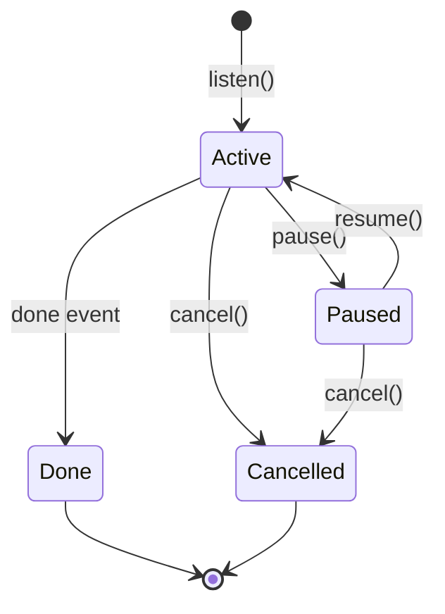
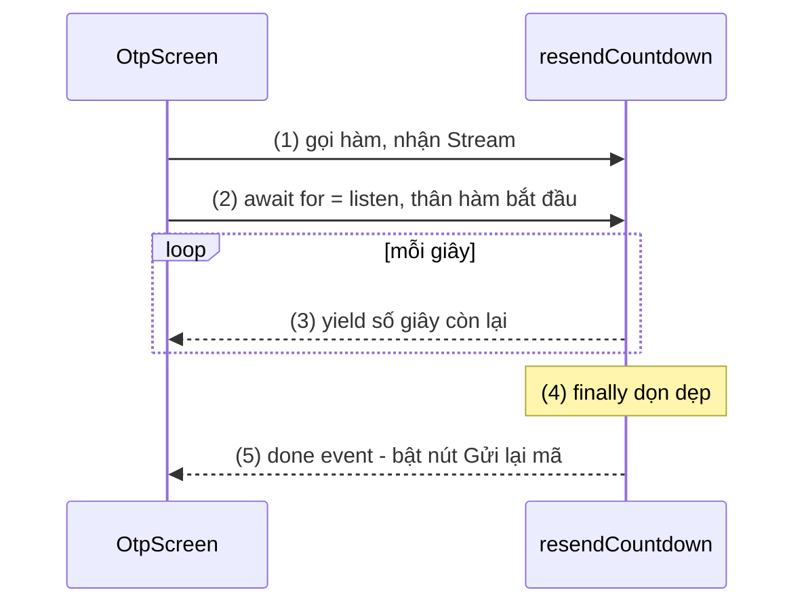
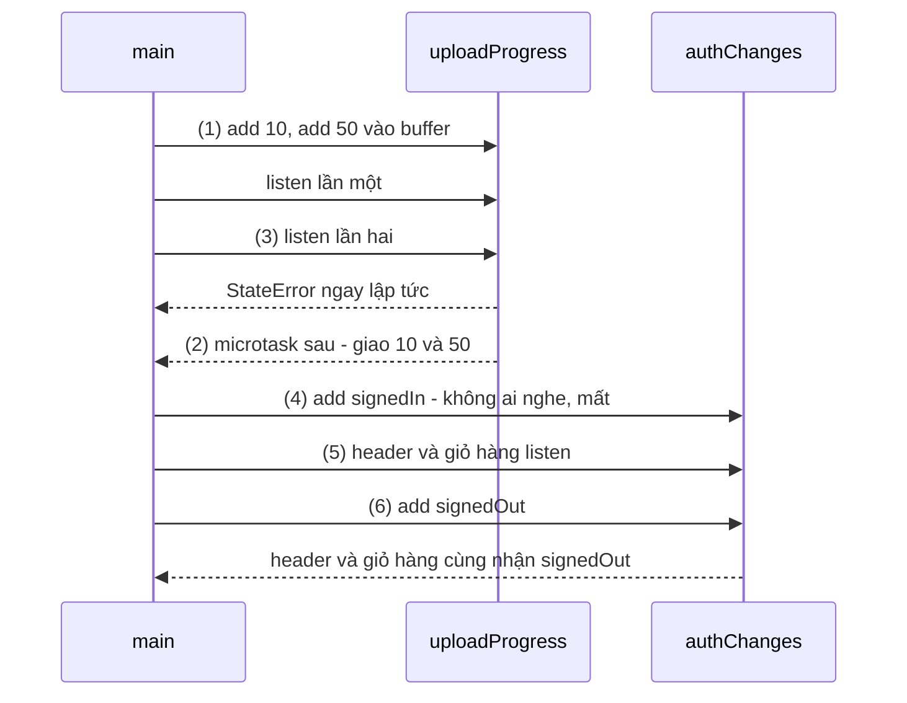
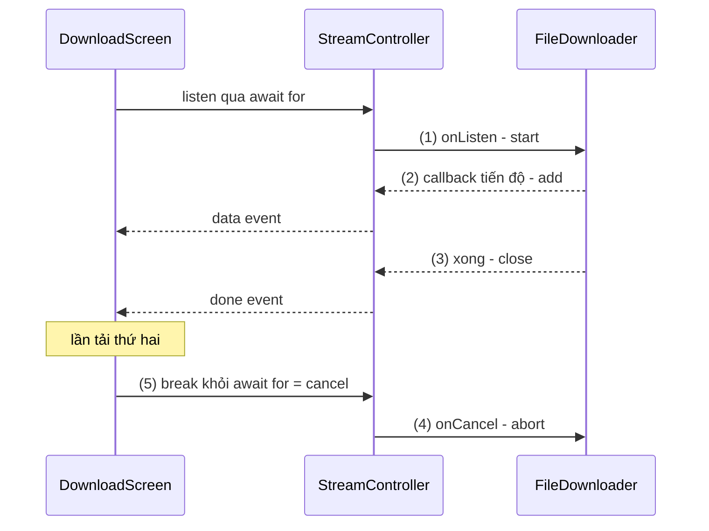
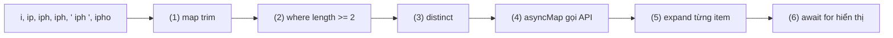
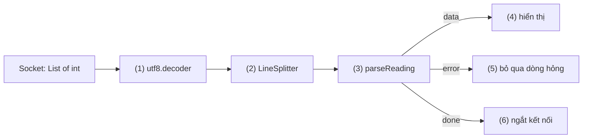
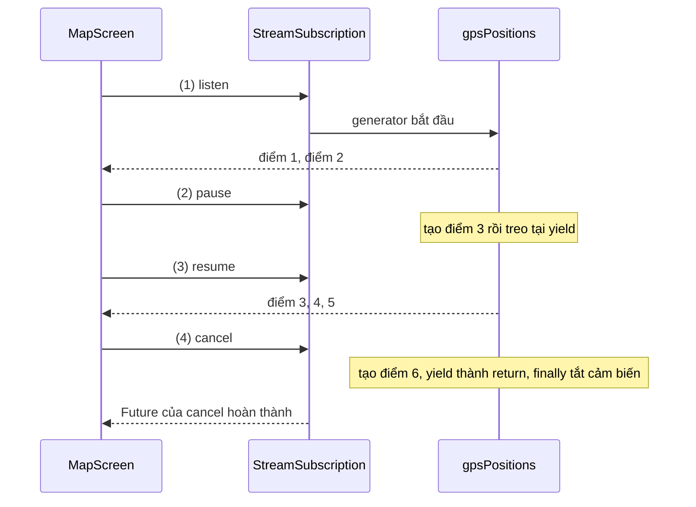
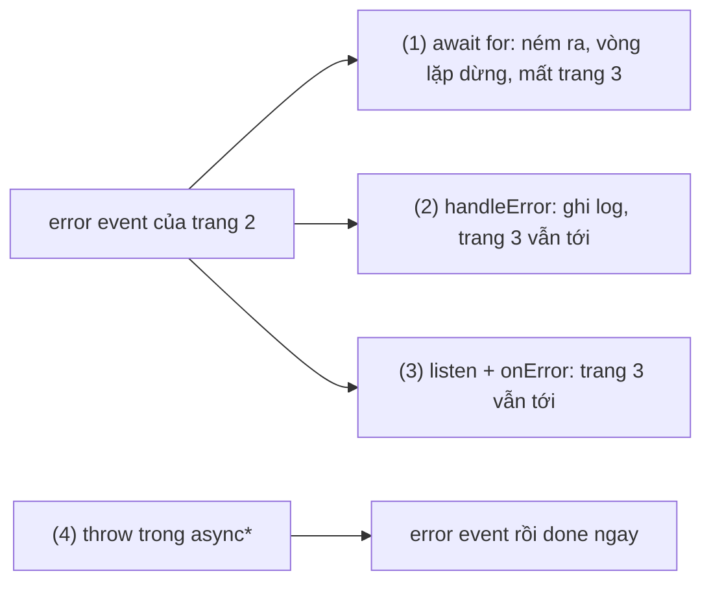
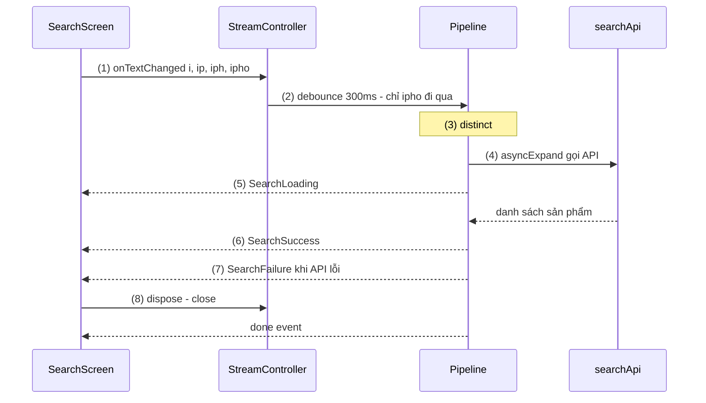

# Streams

## Vấn đề cần giải quyết

`Future` trả về **một** giá trị rồi kết thúc (xem [1.3.1 Futures and Async/Await](futures_async_await.md)). Nhưng rất nhiều dữ liệu trong ứng dụng là **một chuỗi giá trị đến dần theo thời gian**:

- Vị trí GPS, tin nhắn WebSocket, tiến độ tải file.
- Nội dung ô tìm kiếm thay đổi theo từng phím gõ.
- Dữ liệu đọc từ file hoặc socket theo từng khối byte.

Dùng Future cho những thứ này buộc bạn hỏi lại liên tục, hoặc tự viết hệ thống callback: ai đăng ký, khi nào huỷ, lỗi đi đâu, khi nào kết thúc. Mỗi nguồn tự làm một kiểu, và lỗi hay gặp là màn hình đã đóng nhưng callback vẫn được gọi.

`Stream` trong `dart:async` là lời giải chuẩn của Dart. Hầu hết API bất đồng bộ nhiều giá trị của Dart và Flutter trả về Stream: `File.openRead`, socket, plugin vị trí, Firestore snapshot, và BLoC.

## Sau khi học xong

- Giải thích được ba loại sự kiện của Stream và vòng đời listen, pause, resume, cancel của một StreamSubscription.
- Phân biệt được single-subscription stream và broadcast stream, và chọn đúng loại cho từng nguồn dữ liệu.
- Triển khai được Stream bằng async*/yield và bằng StreamController, gồm việc close controller đúng lúc.
- Áp dụng được các phép biến đổi map, where, distinct, asyncMap, expand và StreamTransformer để xây pipeline xử lý sự kiện.
- Xử lý được lỗi trong Stream và nhận diện được subscription bị leak khi listen mà không cancel.

## Stream là gì?

`Stream<T>` (luồng sự kiện) là một chuỗi **sự kiện bất đồng bộ** được đẩy (push) tới listener theo thời gian: các **data event** mang giá trị `T`, các **error event**, và tối đa một **done event** báo kết thúc. Future là *một* giá trị sẽ có; Stream là *nhiều* giá trị sẽ đến.

**Mental model: băng chuyền.** Nguồn dữ liệu đặt từng món lên băng chuyền; listener đứng cuối băng nhận từng món theo thứ tự. Băng chuyền chỉ giao hàng khi có người đứng cuối (listen). Người nhận có thể bảo băng tạm dừng (pause), chạy lại (resume) hoặc rời đi (cancel). Món hỏng (error) vẫn đi trên băng như một món đặc biệt; tấm biển "hết hàng" (done) là món cuối cùng.

Stream là bản bất đồng bộ của `Iterable` ([1.2.4 Collections and Functional APIs](../dart/collections_functional.md)): với `Iterable`, consumer **kéo** phần tử đồng bộ (`for`, `sync*`); với Stream, nguồn **đẩy** sự kiện khi có (`await for`/`listen`, `async*`), và lỗi là một loại sự kiện.

## Cách hoạt động

### 1. Sự kiện, listen và StreamSubscription

Stream **không giao sự kiện nào** cho tới khi có ai gọi `listen`. `listen` nhận tối đa ba callback cho ba loại sự kiện và trả về một `StreamSubscription<T>`:

```dart
final subscription = stream.listen(
  (value) { /* data event */ },
  onError: (Object error, StackTrace stackTrace) { /* error event */ },
  onDone: () { /* done event: stream kết thúc */ },
  cancelOnError: false, // true: tự cancel ngay sau error event đầu tiên
);
```

Vòng đời của `StreamSubscription`:



- **Paused**: không giao sự kiện; sự kiện đến trong lúc này được buffer, và với single-subscription stream nguồn thường được báo để ngừng tạo.
- **Cancelled**: listener rời đi, nguồn được báo để dọn dẹp. `cancel()` trả về `Future` hoàn thành khi dọn dẹp xong.

Sự kiện được giao **bất đồng bộ**: `add` hay `listen` trả về ngay, listener nhận sự kiện trong một microtask sau đó (microtask queue ở [1.3.1 Futures and Async/Await](futures_async_await.md)). Ngoại lệ là `StreamController(sync: true)`, xem mục 4.

### 2. Tạo Stream bằng async* và yield

Cách tự nhiên nhất để tạo Stream là **generator bất đồng bộ**: hàm `async*` trả về `Stream<T>` và `yield` từng giá trị.

- Gọi hàm trả về Stream **ngay**, nhưng thân hàm chỉ chạy khi có listener.
- `yield value` đẩy một data event; `yield* otherStream` đẩy mọi sự kiện của stream khác. Thân hàm dùng được `await`, vòng lặp, `try`/`finally`.
- Hàm kết thúc (hết thân hoặc `return`) thì stream phát done event.
- `throw` trong thân hàm phát một error event **rồi kết thúc** stream.
- Khi subscription bị cancel, hàm dừng ở lần `yield` kế tiếp (như thể `yield` biến thành `return`), và các khối `finally` vẫn chạy. Khi subscription pause, hàm treo tại `yield`.

Stream do `async*` tạo là single-subscription (mục 3). Muốn một stream mới, gọi lại hàm.

#### Ví dụ: đếm ngược trước khi cho gửi lại mã OTP

**Bài toán:** màn hình nhập OTP hiện "Gửi lại mã sau 3s, 2s, 1s", hết giờ thì bật nút "Gửi lại mã". Mỗi giây có một giá trị mới, có kết thúc rõ ràng: đúng hình dạng của Stream.

**Luồng chạy:**

1. Gọi `resendCountdown(3)`: có Stream, thân hàm chưa chạy.
2. `await for` bắt đầu listen: thân hàm generator chạy.
3. Mỗi vòng, `yield` đẩy số giây còn lại; `await for` nhận và in ra.
4. Vòng lặp trong generator hết: khối `finally` chạy.
5. Generator kết thúc, stream phát done event; `await for` thoát vòng lặp và bật nút.



**Code:**

```dart
// otp_countdown.dart
import 'dart:async';

// OtpTimer: đếm ngược trước khi cho phép gửi lại mã OTP.
Stream<int> resendCountdown(int seconds) async* {
  print('Generator bắt đầu chạy'); // (2) chỉ chạy khi có listener
  try {
    for (var remaining = seconds; remaining > 0; remaining--) {
      yield remaining; // (3) đẩy một giá trị cho listener
      await Future.delayed(const Duration(milliseconds: 100)); // rút ngắn 1s thành 100ms cho demo
    }
  } finally {
    print('Generator dọn dẹp (finally)'); // (4) chạy cả khi xong lẫn khi bị cancel
  }
}

Future<void> main() async {
  final countdown = resendCountdown(3); // (1) tạo Stream, thân hàm chưa chạy
  print('Đã tạo stream');
  await for (final remaining in countdown) {
    print('Gửi lại mã sau ${remaining}s'); // (3)
  }
  print('Bật nút "Gửi lại mã"'); // (5) done event -> vòng lặp kết thúc
}
```

**Kết quả:**

```text
Đã tạo stream
Generator bắt đầu chạy
Gửi lại mã sau 3s
Gửi lại mã sau 2s
Gửi lại mã sau 1s
Generator dọn dẹp (finally)
Bật nút "Gửi lại mã"
```

Dòng "Đã tạo stream" in trước "Generator bắt đầu chạy": tạo Stream không chạy gì cả, giống Kotlin `flow { }`. Khác ở chỗ đối tượng Stream từ `async*` chỉ listen được một lần; muốn chạy lại thì gọi lại `resendCountdown(3)`.

> [!NOTE]
> Stream đơn giản có sẵn constructor: `Stream.fromIterable(list)`, `Stream.value(v)`, `Stream.error(e)`, `Stream.fromFuture(f)`, `Stream.periodic(duration, computation)`. Đếm ngược ở trên cũng viết được bằng `Stream.periodic(...).take(3)`; `async*` hợp hơn khi logic có nhiều bước, `await`, hoặc cần `finally`.

### 3. Single-subscription và broadcast

Đây là quyết định đầu tiên khi thiết kế một Stream: ai nghe được, và có mất sự kiện không.

| | Single-subscription | Broadcast |
|---|---|---|
| Số listener | Đúng **một** trong suốt vòng đời. Listen lần hai ném `StateError` | Nhiều listener cùng lúc, đến và đi lúc nào cũng được |
| Sự kiện trước khi có listener | `StreamController()`: **được buffer**, listener đầu tiên nhận đủ. `async*`: chưa chạy nên chưa có sự kiện | **Mất**; listener chỉ nhận sự kiện xảy ra sau khi nó listen |
| Pause | Báo về nguồn để nguồn ngừng tạo sự kiện | Chỉ subscription đó dừng (sự kiện được buffer riêng cho nó); nguồn vẫn phát cho listener khác |
| Hợp với | Một chuỗi dữ liệu có thứ tự, ý nghĩa khi đầy đủ: đọc file, response HTTP, tiến độ một lần tải | Sự kiện riêng lẻ nhiều nơi quan tâm: trạng thái đăng nhập, thay đổi giỏ hàng, sự kiện hệ thống |
| Tạo bằng | `async*`, `StreamController()`, đa số API I/O | `StreamController.broadcast()`, `stream.asBroadcastStream()` |

Kiểm tra bằng `stream.isBroadcast`.

#### Ví dụ: tiến độ upload và trạng thái đăng nhập

**Bài toán:** tiến độ upload là một chuỗi dành cho đúng một thanh tiến độ, và không được mất các mốc đầu. Trạng thái đăng nhập thì header và giỏ hàng cùng cần nghe.

**Luồng chạy:**

1. Single-subscription: `add` trước khi có listener, sự kiện được buffer.
2. Listener đầu tiên nhận cả hai mốc đã buffer.
3. Listener thứ hai bị từ chối bằng `StateError`. Dòng báo lỗi in **trước** các mốc tiến độ vì sự kiện được giao bất đồng bộ.
4. Broadcast: `add` khi chưa ai nghe, sự kiện mất.
5. Header và giỏ hàng cùng listen.
6. Sự kiện sau đó tới cả hai.



**Code:**

```dart
// stream_kinds.dart
import 'dart:async';

enum AuthState { signedOut, signedIn }

Future<void> main() async {
  // Single-subscription: StreamController mặc định
  final uploadProgress = StreamController<int>();
  uploadProgress.add(10); // (1) chưa có listener: sự kiện được buffer
  uploadProgress.add(50);
  final sub = uploadProgress.stream.listen((p) => print('Upload: $p%')); // (2) nhận cả 10 và 50
  try {
    uploadProgress.stream.listen((p) => print('Listener thứ hai: $p%')); // (3)
  } on StateError catch (e) {
    print('Listen lần hai: $e');
  }
  await Future<void>.delayed(Duration.zero);
  await sub.cancel();
  await uploadProgress.close();

  // Broadcast: nhiều listener, không buffer cho người đến muộn
  final authChanges = StreamController<AuthState>.broadcast();
  authChanges.add(AuthState.signedIn); // (4) chưa có ai nghe: sự kiện mất
  final header = authChanges.stream.listen((s) => print('Header: $s')); // (5)
  final cart = authChanges.stream.listen((s) => print('Giỏ hàng: $s'));
  authChanges.add(AuthState.signedOut); // (6) cả hai cùng nhận
  await Future<void>.delayed(Duration.zero);
  await header.cancel();
  await cart.cancel();
  await authChanges.close();
}
```

**Kết quả:**

```text
Listen lần hai: Bad state: Stream has already been listened to.
Upload: 10%
Upload: 50%
Header: AuthState.signedOut
Giỏ hàng: AuthState.signedOut
```

`AuthState.signedIn` không ai nhận được: broadcast stream **không nhớ giá trị hiện tại**, màn hình mở sau khi đăng nhập không biết trạng thái cho tới lần thay đổi kế tiếp. Dart core không có tương đương Kotlin `StateFlow`; trong Flutter, giá trị hiện tại thường do `ValueNotifier` (4.1.1 ChangeNotifier and ValueNotifier (chưa có bài)) hoặc `BehaviorSubject` của rxdart (4.2.4 RxDart and Reactive Streams (chưa có bài)) giữ.

### 4. StreamController: đưa nguồn bên ngoài vào Stream

`async*` hợp khi chính bạn sinh dữ liệu. Khi dữ liệu đến từ **bên ngoài** (callback của SDK, sự kiện người dùng), dùng `StreamController<T>`:

- `controller.stream`: Stream trao cho listener. Thường expose qua getter, giữ controller `private`.
- `controller.add(value)`, `controller.addError(error)`: đặt sự kiện lên băng chuyền. `controller.sink` là cùng chức năng dưới dạng `StreamSink`.
- `controller.close()`: phát done event, trả về chính Future `controller.done`, hoàn thành khi done event đã được giao (hoặc subscription bị cancel). Controller single-subscription **chưa ai listen** thì done event nằm trong buffer, nên `await controller.close()` treo mãi. Sau `close()`, gọi `add` ném `StateError`.
- `onListen`: chạy khi có listener, là chỗ **khởi động nguồn**. `onCancel`: chạy khi subscription kết thúc (listener cancel, hoặc lúc done event được giao), là chỗ **dừng nguồn**. `onPause`/`onResume` cho nguồn hỗ trợ tạm dừng. Với `StreamController.broadcast()`, `onListen` chạy khi có listener **đầu tiên**, `onCancel` khi listener **cuối cùng** rời đi, và không có `onPause`/`onResume`.
- `StreamController(sync: true)`: `add` gọi listener **ngay trong lời gọi** thay vì đợi microtask. Nó phá giả định "listener chạy sau", nên tài liệu API chỉ dành nó để tối ưu khi một sự kiện bất đồng bộ lập tức kích hoạt sự kiện khác (ví dụ trong transformer tự viết); không chắc thì giữ mặc định `sync: false`.

Bắt đầu nguồn trong `onListen` thay vì ngay khi tạo controller giúp Stream "lười" như `async*`: không ai nghe thì không tốn tài nguyên.

> [!IMPORTANT]
> Ai tạo `StreamController` thì phải `close()` nó, không thì listener không bao giờ nhận done event: `await for` treo mãi, `onDone` không chạy. Lint `close_sinks` (không bật mặc định) giúp phát hiện controller không được close.

#### Ví dụ: bọc thư viện tải file chỉ có callback

**Bài toán:** thư viện tải file báo tiến độ bằng callback và có hàm `abort()`. Repository muốn trả về `Stream<int>` tiến độ; người dùng huỷ (rời màn hình, bấm "Huỷ") thì phải dừng tải thật.

**Luồng chạy:**

1. Có listener: `onListen` bắt đầu tải.
2. Mỗi callback tiến độ: `controller.add`.
3. Tải xong: `controller.close()` phát done event; `await for` thoát.
4. Listener huỷ giữa chừng: `onCancel` gọi `abort()` dừng nguồn.
5. `break` khỏi `await for` chính là cancel subscription, nên (4) xảy ra.



**Code:**

```dart
// download_progress.dart
import 'dart:async';

// Thư viện tải file chỉ có callback (giả lập).
class FileDownloader {
  Timer? _timer;
  void start(String url, void Function(int percent) onProgress, void Function() onFinished) {
    var percent = 0;
    _timer = Timer.periodic(const Duration(milliseconds: 50), (t) {
      percent += 25;
      onProgress(percent);
      if (percent == 100) {
        t.cancel();
        onFinished();
      }
    });
  }

  void abort() {
    if (_timer?.isActive ?? false) {
      _timer!.cancel();
      print('Downloader: đã huỷ tải giữa chừng');
    }
  }
}

// DownloadRepository: biến callback thành Stream<int>
Stream<int> downloadProgress(String url) {
  final downloader = FileDownloader();
  late final StreamController<int> controller;
  controller = StreamController<int>(
    onListen: () { // (1) có listener mới bắt đầu tải
      print('onListen: bắt đầu tải $url');
      downloader.start(
        url,
        controller.add, // (2) mỗi callback -> một data event
        () => controller.close(), // (3) tải xong -> close -> done event
      );
    },
    onCancel: downloader.abort, // (4) listener huỷ -> dừng nguồn
  );
  return controller.stream;
}

Future<void> main() async {
  await for (final percent in downloadProgress('https://cdn.example.com/report.pdf')) {
    print('Tiến độ: $percent%');
  }
  print('Tải xong, mở file');

  // Huỷ giữa chừng: break khỏi await for sẽ cancel subscription
  await for (final percent in downloadProgress('https://cdn.example.com/video.mp4')) {
    print('Tiến độ video: $percent%');
    if (percent >= 50) break; // (5) người dùng bấm "Huỷ"
  }
  print('Đã thoát vòng lặp');
}
```

**Kết quả:**

```text
onListen: bắt đầu tải https://cdn.example.com/report.pdf
Tiến độ: 25%
Tiến độ: 50%
Tiến độ: 75%
Tiến độ: 100%
Tải xong, mở file
onListen: bắt đầu tải https://cdn.example.com/video.mp4
Tiến độ video: 25%
Tiến độ video: 50%
Downloader: đã huỷ tải giữa chừng
Đã thoát vòng lặp
```

`abort()` kiểm tra `isActive` vì `onCancel` cũng chạy khi lần tải đầu kết thúc bình thường.

### 5. Biến đổi Stream: map, where, distinct, asyncMap, expand

Stream có các phép biến đổi giống `Iterable`, mỗi phép trả về **một Stream mới** bọc stream cũ; chuỗi các phép là một pipeline.

| Phép | Ý nghĩa | Ghi chú |
|---|---|---|
| `map(f)` | Mỗi giá trị thành `f(value)` | `f` đồng bộ |
| `where(test)` | Chỉ giữ giá trị thoả `test` | |
| `distinct([equals])` | Bỏ giá trị **bằng giá trị liền trước** | So bằng `==`; không phải "loại mọi trùng lặp" |
| `asyncMap(f)` | Như `map` nhưng `f` trả `Future`; chờ xong mới xử lý giá trị kế | Tuần tự, không chạy chồng |
| `asyncExpand(f)` | Mỗi giá trị thành một Stream con, phát hết stream con rồi mới tới giá trị kế | |
| `expand(f)` | Mỗi giá trị thành một `Iterable`, phát từng phần tử | Một sự kiện thành nhiều |
| `take(n)`, `skip(n)`, `takeWhile`, `skipWhile` | Cắt theo số lượng hoặc điều kiện | `take` cancel nguồn khi đủ |
| `handleError(f)`, `timeout(d)` | Xử lý lỗi, giới hạn thời gian giữa hai sự kiện | Xem mục 9 |

Biến đổi một stream single-subscription cho ra stream single-subscription: cả pipeline vẫn chỉ có một listener ở cuối.

#### Ví dụ: chuẩn hoá từ khoá tìm kiếm trước khi gọi API

**Bài toán:** mỗi lần người dùng gõ, ô tìm kiếm phát toàn bộ nội dung hiện tại. Cần bỏ khoảng trắng, bỏ từ khoá quá ngắn, không gọi API lại cho cùng từ khoá, gọi API tuần tự và hiện từng sản phẩm.

**Luồng chạy:**

1. `map`: bỏ khoảng trắng hai đầu.
2. `where`: dưới 2 ký tự thì bỏ.
3. `distinct`: `'iph'` lặp lại và `' iph '` (sau trim) trùng giá trị liền trước, bị bỏ.
4. `asyncMap`: gọi API, chờ xong mới nhận từ khoá kế tiếp.
5. `expand`: một `List` kết quả thành nhiều sự kiện, mỗi sự kiện một sản phẩm.
6. `await for` hiển thị từng sản phẩm.



**Code:**

```dart
// search_pipeline.dart
import 'dart:async';

// Giả lập API tìm kiếm: mất 100ms mỗi request.
Future<List<String>> searchProducts(String keyword) async {
  await Future.delayed(const Duration(milliseconds: 100));
  print('  API: tìm "$keyword"');
  return ['$keyword case', '$keyword sạc'];
}

// Người dùng gõ vào ô tìm kiếm (mỗi giá trị là toàn bộ nội dung ô).
Stream<String> typedQueries() =>
    Stream.fromIterable(['i', 'ip', 'iph', 'iph', ' iph ', 'ipho']);

Future<void> main() async {
  final results = typedQueries()
      .map((q) => q.trim()) // (1) chuẩn hoá: bỏ khoảng trắng hai đầu
      .where((q) => q.length >= 2) // (2) chưa đủ 2 ký tự thì không tìm
      .distinct() // (3) bỏ giá trị trùng với giá trị liền trước
      .asyncMap(searchProducts) // (4) gọi API, chờ xong mới xử lý query kế
      .expand((items) => items); // (5) một List kết quả -> nhiều event, mỗi event một item

  await for (final item in results) {
    print('Hiển thị: $item'); // (6)
  }
}
```

**Kết quả:**

```text
  API: tìm "ip"
Hiển thị: ip case
Hiển thị: ip sạc
  API: tìm "iph"
Hiển thị: iph case
Hiển thị: iph sạc
  API: tìm "ipho"
Hiển thị: ipho case
Hiển thị: ipho sạc
```

Sáu lần gõ chỉ tạo ba request, nhưng vẫn gọi API cho mọi từ khoá trung gian khi gõ nhanh; chờ ngừng gõ (debounce) cần một transformer, xem "Ví dụ thực tế".

### 6. StreamTransformer: phép biến đổi tự định nghĩa

Khi các phép có sẵn không đủ, đặc biệt khi **nhiều sự kiện vào gộp thành một sự kiện ra** hoặc ngược lại, dùng `StreamTransformer<S, T>` và `stream.transform(transformer)`. `transform` nhận cả stream đầu vào và trả về stream đầu ra.

Thư viện chuẩn có sẵn nhiều transformer, phổ biến nhất là trong `dart:convert`: `utf8.decoder` (byte thành `String`) và `LineSplitter` (`String` thành từng dòng). Tự viết thì có hai cách:

- `StreamTransformer.fromHandlers(handleData:, handleError:, handleDone:)`: xử lý từng sự kiện, ghi kết quả vào một `EventSink`. Đủ cho phần lớn trường hợp.
- `StreamTransformer.fromBind((stream) => ...)`: toàn quyền với stream đầu vào, dùng khi cần trạng thái theo thời gian (timer, buffer). Ví dụ debounce ở phần "Ví dụ thực tế" dùng cách này.

#### Ví dụ: đọc số đo từ cảm biến nhiệt độ qua socket

**Bài toán:** cảm biến gửi nhiệt độ dạng text, mỗi dòng một số, qua socket. Socket trả về các khối byte bị cắt ngang giữa dòng (`"21.5\n22"`, `".0\nERR\n23.1\n"`), và thỉnh thoảng có dòng hỏng.

**Luồng chạy:**

1. `utf8.decoder`: byte thành `String`, xử lý đúng cả ký tự UTF-8 nhiều byte bị cắt giữa hai khối.
2. `LineSplitter`: gom và cắt thành từng dòng hoàn chỉnh (`"22"` + `".0"` thành `"22.0"`).
3. Transformer tự viết: dòng hợp lệ thành `double`, dòng hỏng thành error event.
4. Data event: hiển thị nhiệt độ.
5. Error event: ghi nhận và bỏ qua; stream vẫn chạy tiếp.
6. Socket đóng: done event.



**Code:**

```dart
// sensor_transformer.dart
import 'dart:async';
import 'dart:convert';

// Cảm biến nhiệt độ gửi dữ liệu qua socket: các chunk byte cắt ngang giữa dòng.
Stream<List<int>> sensorSocket() => Stream.fromIterable([
      utf8.encode('21.5\n22'),
      utf8.encode('.0\nERR\n23.1\n'),
    ]);

// (3) Transformer tự viết: một dòng text -> một số đo, dòng hỏng -> error event
final parseReading = StreamTransformer<String, double>.fromHandlers(
  handleData: (line, sink) {
    final value = double.tryParse(line);
    if (value == null) {
      sink.addError(FormatException('Dòng không hợp lệ', line));
    } else {
      sink.add(value);
    }
  },
);

Future<void> main() async {
  final readings = sensorSocket()
      .transform(utf8.decoder) // (1) byte -> String (xử lý cả ký tự UTF-8 bị cắt đôi)
      .transform(const LineSplitter()) // (2) gom/cắt thành từng dòng hoàn chỉnh
      .transform(parseReading); // (3)

  readings.listen(
    (celsius) => print('Nhiệt độ: $celsius°C'), // (4) data event
    onError: (Object e) => print('Bỏ qua dòng hỏng: ${(e as FormatException).source}'), // (5) error event, stream vẫn chạy tiếp
    onDone: () => print('Cảm biến ngắt kết nối'), // (6) done event
  );
}
```

**Kết quả:**

```text
Nhiệt độ: 21.5°C
Nhiệt độ: 22.0°C
Bỏ qua dòng hỏng: ERR
Nhiệt độ: 23.1°C
Cảm biến ngắt kết nối
```

Cùng chuỗi `utf8.decoder` + `LineSplitter` dùng được cho `File.openRead()` hay bất kỳ nguồn byte nào.

### 7. Tiêu thụ Stream: listen và await for

Hai cách nhận sự kiện:

| | `listen(...)` | `await for (x in stream)` |
|---|---|---|
| Kiểu | Đăng ký callback, trả `StreamSubscription` ngay | Vòng lặp trong hàm `async`, hàm treo cho tới khi stream done |
| Huỷ | Gọi `subscription.cancel()` | `break`, `return`, hoặc exception thoát khỏi vòng lặp đều **cancel subscription** |
| Error event | Vào `onError`; stream tiếp tục (trừ `cancelOnError: true`) | **Ném ra** tại vòng lặp, vòng lặp kết thúc, subscription bị cancel |
| Pause | Gọi `pause()`/`resume()` | Tự động: trong lúc thân vòng lặp đang `await`, subscription được pause |
| Hợp với | Listener sống theo vòng đời một đối tượng (màn hình, service) | Xử lý tuần tự một stream có kết thúc |

Ví dụ ở mục 4 cho thấy `break` **có** huỷ subscription (`onCancel` chạy ngay). Ngược lại, với stream không bao giờ done (broadcast trạng thái đăng nhập, `Stream.periodic`), code sau `await for` không bao giờ chạy nếu không `break`.

### 8. StreamSubscription: pause, resume, cancel

`pause()` nói "tạm thời chưa nhận": generator `async*` treo tại `yield`, `StreamController` gọi `onPause`. `cancel()` nói "không quay lại nữa": generator dừng ở `yield` kế tiếp và chạy `finally`, controller gọi `onCancel`.

#### Ví dụ: tạm dừng GPS khi app vào background

**Bài toán:** màn hình bản đồ nghe vị trí GPS. Khi app vào background thì tạm dừng để tiết kiệm pin, quay lại thì tiếp tục, rời màn hình thì tắt hẳn cảm biến.

**Luồng chạy:**

1. `listen`: generator bắt đầu, mỗi 100 ms tạo một điểm.
2. `pause()`: generator đang chờ điểm #3; tạo xong, nó treo tại `yield` vì subscription đang pause. Không có điểm #4, #5 nào được tạo trong lúc pause.
3. `resume()`: điểm #3 đang treo được giao, generator chạy tiếp.
4. `cancel()`: generator đang chờ ở `await Future.delayed`; nó chạy tới `yield` kế tiếp (tạo điểm #6), `yield` lúc này kết thúc hàm, `finally` tắt cảm biến. `await cancel()` chỉ xong sau khi `finally` chạy.



**Code:**

```dart
// gps_subscription.dart
import 'dart:async';

// Giả lập GPS: mỗi 100ms phát một điểm, ghi log mỗi khi tạo điểm.
Stream<String> gpsPositions() async* {
  var tick = 0;
  try {
    while (true) {
      await Future.delayed(const Duration(milliseconds: 100));
      tick++;
      print('  GPS: tạo điểm #$tick');
      yield 'điểm #$tick';
    }
  } finally {
    print('  GPS: tắt cảm biến');
  }
}

Future<void> main() async {
  final subscription = gpsPositions().listen( // (1) listen -> generator bắt đầu
    (p) => print('Bản đồ vẽ $p'),
  );

  await Future.delayed(const Duration(milliseconds: 250));
  subscription.pause(); // (2) app vào background: tạm dừng
  print('-- pause --');

  await Future.delayed(const Duration(milliseconds: 300));
  print('-- resume --');
  subscription.resume(); // (3) quay lại foreground

  await Future.delayed(const Duration(milliseconds: 250));
  await subscription.cancel(); // (4) rời màn hình: huỷ -> generator chạy finally
  print('Đã cancel, chương trình có thể kết thúc');
}
```

**Kết quả:**

```text
  GPS: tạo điểm #1
Bản đồ vẽ điểm #1
  GPS: tạo điểm #2
Bản đồ vẽ điểm #2
-- pause --
  GPS: tạo điểm #3
-- resume --
Bản đồ vẽ điểm #3
  GPS: tạo điểm #4
Bản đồ vẽ điểm #4
  GPS: tạo điểm #5
Bản đồ vẽ điểm #5
  GPS: tạo điểm #6
  GPS: tắt cảm biến
Đã cancel, chương trình có thể kết thúc
```

#### Subscription bị leak

Mỗi `listen` tạo một tham chiếu từ nguồn tới callback của bạn. Nguồn sống lâu hơn listener (service toàn app, broadcast stream) thì giữ listener sống theo: callback vẫn chạy, đối tượng không được giải phóng. Quy tắc: **mỗi `listen` có một `cancel` đối xứng** ở cuối vòng đời bên listen.

```dart
// leak_demo.dart
import 'dart:async';

// CartService sống suốt vòng đời app.
class CartService {
  final _changes = StreamController<int>.broadcast();
  Stream<int> get itemCount => _changes.stream;
  bool get hasListener => _changes.hasListener;
  void add(int count) => _changes.add(count);
}

// Màn hình chi tiết sản phẩm: mở rồi đóng.
class ProductDetailScreen {
  final CartService cart;
  final String name;
  StreamSubscription<int>? _sub;
  bool _mounted = false;
  ProductDetailScreen(this.cart, this.name);

  void open() {
    _mounted = true;
    _sub = cart.itemCount.listen((count) {
      if (!_mounted) print('$name: cập nhật UI sau khi đã đóng màn hình!');
    });
  }

  Future<void> close({required bool cancel}) async {
    _mounted = false;
    if (cancel) await _sub?.cancel(); // đối xứng với listen trong open()
  }
}

Future<void> main() async {
  final cart = CartService();

  final leaky = ProductDetailScreen(cart, 'Màn hình A')..open();
  await leaky.close(cancel: false); // ❌ quên cancel
  cart.add(1);
  await Future<void>.delayed(Duration.zero);
  print('Còn listener sau khi đóng A? ${cart.hasListener}');

  await leaky._sub?.cancel(); // dọn để demo tiếp

  final fixed = ProductDetailScreen(cart, 'Màn hình B')..open();
  await fixed.close(cancel: true); // ✅
  cart.add(2);
  await Future<void>.delayed(Duration.zero);
  print('Còn listener sau khi đóng B? ${cart.hasListener}');
}
```

```text
Màn hình A: cập nhật UI sau khi đã đóng màn hình!
Còn listener sau khi đóng A? true
Còn listener sau khi đóng B? false
```

Lint `cancel_subscriptions` (không bật mặc định) cảnh báo subscription được tạo mà không thấy `cancel`. Bản Flutter của lỗi này ở Sai lầm 2.

### 9. Lỗi trong Stream

Lỗi trong Stream là **error event**, một loại sự kiện đi trên băng chuyền giống data event. Vì vậy:

- `try`/`catch` quanh lời gọi `listen(...)` **không** bắt được nó: `listen` trả về ngay, lỗi đến sau.
- `listen` có `onError`: stream **tiếp tục** giao sự kiện sau lỗi. Với `cancelOnError: true`, subscription tự cancel ngay sau lỗi đầu tiên và `onDone` **không** được gọi. Không có `onError`: lỗi thành uncaught asynchronous error, giống Future lỗi mà không ai bắt.
- `await for`: lỗi được ném ra tại vòng lặp, vòng lặp kết thúc và subscription bị cancel; bắt bằng `try`/`catch` quanh vòng lặp. `handleError(f)` đặt trước đó (hoặc giữa pipeline) chặn error event, ghi log, để data event sau đi tiếp.
- Lỗi có làm stream kết thúc hay không là **do nguồn quyết định**: `StreamController` vẫn nhận `add` sau `addError`; `throw` trong `async*` phát lỗi rồi kết thúc generator, còn `yield*` một stream lỗi thì chuyển tiếp error event và generator chạy tiếp. Theo tài liệu Dart, phần lớn stream dừng sau lỗi đầu tiên.

#### Ví dụ: đồng bộ tin nhắn khi một trang bị lỗi

**Bài toán:** đồng bộ tin nhắn theo từng trang; trang 2 timeout. Tuỳ cách tiêu thụ, ta muốn dừng ngay, hoặc bỏ qua trang lỗi và lấy tiếp trang 3.

**Luồng chạy:**

1. `await for`: nhận trang 1, error event của trang 2 ném ra tại vòng lặp, vòng lặp dừng, không có trang 3.
2. `handleError` trước `await for`: lỗi được ghi log, trang 3 vẫn tới.
3. `listen` với `onError`: lỗi vào `onError`, trang 3 vẫn tới.
4. `throw` trong `async*`: stream phát error event rồi done ngay.



**Code:**

```dart
// sync_messages_errors.dart
import 'dart:async';

// Đồng bộ tin nhắn theo trang; trang 2 lỗi mạng.
Stream<String> syncMessages() async* {
  yield 'Trang 1: 20 tin';
  yield* Stream<String>.error(StateError('timeout trang 2')); // error event, generator vẫn chạy tiếp
  yield 'Trang 3: 5 tin';
}

Future<void> main() async {
  // (1) await for: error event bị ném ra tại vòng lặp, vòng lặp dừng
  try {
    await for (final page in syncMessages()) {
      print('await for nhận: $page');
    }
  } on StateError catch (e) {
    print('await for dừng vì: ${e.message}');
  }

  // (2) handleError trước await for: ghi nhận lỗi, bỏ qua và đi tiếp
  final tolerant = syncMessages().handleError(
    (Object e) => print('handleError ghi log: $e'),
  );
  await for (final page in tolerant) {
    print('tolerant nhận: $page');
  }

  // (3) listen với onError: stream vẫn giao event sau lỗi
  final done = Completer<void>();
  syncMessages().listen(
    (page) => print('listen nhận: $page'),
    onError: (Object e) => print('listen onError: $e'),
    onDone: done.complete,
  );
  await done.future;

  // (4) async* ném exception: stream phát error rồi đóng luôn
  Stream<String> failing() async* {
    yield 'Trang 1: 20 tin';
    throw StateError('token hết hạn');
  }
  failing().listen(
    (page) => print('failing nhận: $page'),
    onError: (Object e) => print('failing onError: $e'),
    onDone: () => print('failing: done'),
  );
}
```

**Kết quả:**

```text
await for nhận: Trang 1: 20 tin
await for dừng vì: timeout trang 2
tolerant nhận: Trang 1: 20 tin
handleError ghi log: Bad state: timeout trang 2
tolerant nhận: Trang 3: 5 tin
listen nhận: Trang 1: 20 tin
listen onError: Bad state: timeout trang 2
listen nhận: Trang 3: 5 tin
failing nhận: Trang 1: 20 tin
failing onError: Bad state: token hết hạn
failing: done
```

Với stream trạng thái cho UI, mẫu hay dùng là **biến lỗi thành dữ liệu**: bắt lỗi bên trong và phát một state "thất bại", để stream không dừng vì lỗi ("Ví dụ thực tế" dùng mẫu này).

## Ví dụ thực tế

1. **Ô tìm kiếm có debounce**: chỉ gọi API khi người dùng ngừng gõ, phát trạng thái loading/kết quả/lỗi cho UI (bài toán chính dưới đây).
2. **Dữ liệu realtime** (WebSocket, Firestore snapshot, GPS): nguồn đã là Stream; việc của bạn là biến đổi và quản lý subscription theo vòng đời màn hình (WebSocket ở 5.1.4 WebSockets and GraphQL (chưa có bài)).
3. **Hiện Stream lên UI**: widget `StreamBuilder` tự listen và cancel theo vòng đời widget (3.1.1 Stateless and Stateful Widgets (chưa có bài)); tạo Stream một lần, không tạo trong `build`. Kiến trúc BLoC ở 4.2.3 BLoC and Cubit (chưa có bài).

### Ví dụ: ô tìm kiếm sản phẩm có debounce

**Bài toán:** người dùng gõ "i", "ip", "iph", "ipho" liên tục. Chỉ gọi API khi họ ngừng gõ 300 ms, không gọi lại cho cùng từ khoá, hiện loading, và lỗi API không làm hỏng ô tìm kiếm.

**Luồng chạy:**

1. Ô tìm kiếm gọi `onTextChanged`, đưa text vào `StreamController<String>`.
2. `debounce` chỉ cho giá trị đi qua khi 300 ms không có giá trị mới; "i", "ip", "iph" bị thay thế trước khi kịp đi qua.
3. `distinct` bỏ từ khoá trùng lần trước (`'ipho '` sau khi trim).
4. `asyncExpand` biến mỗi từ khoá thành một chuỗi trạng thái con.
5. Chuỗi con phát `SearchLoading` trước.
6. Có kết quả: phát `SearchSuccess`.
7. API lỗi: phát `SearchFailure` thay vì error event, nên stream chính không dừng.
8. Màn hình đóng: `dispose` close controller nguồn; done event đi hết pipeline, vòng `await for` của UI kết thúc.



**Code:**

```dart
// product_search.dart
import 'dart:async';

// debounce: chỉ cho giá trị đi qua khi nguồn "im lặng" đủ lâu.
StreamTransformer<T, T> debounce<T>(Duration quiet) {
  return StreamTransformer<T, T>.fromBind((source) {
    Timer? timer;
    StreamSubscription<T>? sub;
    late final StreamController<T> out;
    out = StreamController<T>(
      onListen: () {
        sub = source.listen(
          (value) {
            timer?.cancel(); // giá trị mới tới: huỷ hẹn giờ cũ
            timer = Timer(quiet, () => out.add(value));
          },
          onError: out.addError,
          onDone: () {
            timer?.cancel();
            out.close();
          },
        );
      },
      onCancel: () {
        timer?.cancel();
        return sub?.cancel();
      },
    );
    return out.stream;
  });
}

sealed class SearchState {}
class SearchLoading extends SearchState {
  final String keyword;
  SearchLoading(this.keyword);
}
class SearchSuccess extends SearchState {
  final String keyword;
  final List<String> items;
  SearchSuccess(this.keyword, this.items);
}
class SearchFailure extends SearchState {
  final String message;
  SearchFailure(this.message);
}

// Giả lập API: "lỗi" thì server trả 500.
Future<List<String>> searchApi(String keyword) async {
  await Future.delayed(const Duration(milliseconds: 100));
  if (keyword == 'lỗi') throw StateError('500');
  return ['$keyword #1', '$keyword #2'];
}

// ProductSearchController: nhận text từ ô tìm kiếm, phát SearchState cho UI.
class ProductSearchController {
  final _queries = StreamController<String>(); // (1) nguồn: mỗi lần người dùng gõ
  late final Stream<SearchState> states = _queries.stream
      .map((q) => q.trim())
      .transform(debounce(const Duration(milliseconds: 300))) // (2) chờ ngừng gõ 300ms
      .where((q) => q.length >= 2)
      .distinct() // (3) cùng từ khoá với lần trước thì không gọi lại
      .asyncExpand(_search); // (4) mỗi từ khoá -> một chuỗi trạng thái

  Stream<SearchState> _search(String keyword) async* {
    yield SearchLoading(keyword); // (5) UI hiện loading
    try {
      yield SearchSuccess(keyword, await searchApi(keyword)); // (6) có kết quả
    } catch (e) {
      yield SearchFailure('Không tìm được "$keyword": $e'); // (7) lỗi thành state, stream không chết
    }
  }

  void onTextChanged(String text) => _queries.add(text);
  Future<void> dispose() => _queries.close(); // (8) đóng nguồn -> stream done
}

// Thay cho UI: vẽ từng state nhận được.
Future<void> render(Stream<SearchState> states) async {
  await for (final state in states) {
    switch (state) {
      case SearchLoading(:final keyword):
        print('UI: đang tìm "$keyword"...');
      case SearchSuccess(:final keyword, :final items):
        print('UI: "$keyword" -> $items');
      case SearchFailure(:final message):
        print('UI: $message');
    }
  }
  print('UI: stream đã đóng');
}

Future<void> main() async {
  final controller = ProductSearchController();
  final rendering = render(controller.states);

  // Người dùng gõ nhanh "i", "ip", "iph", "ipho" (cách nhau 100ms) rồi dừng.
  for (final text in ['i', 'ip', 'iph', 'ipho']) {
    controller.onTextChanged(text);
    await Future.delayed(const Duration(milliseconds: 100));
  }
  await Future.delayed(const Duration(milliseconds: 600));
  controller.onTextChanged('ipho '); // trim xong trùng từ khoá cũ -> distinct bỏ qua
  await Future.delayed(const Duration(milliseconds: 600));
  controller.onTextChanged('lỗi');
  await Future.delayed(const Duration(milliseconds: 600));

  await controller.dispose(); // (8)
  await rendering;
}
```

**Kết quả:**

```text
UI: đang tìm "ipho"...
UI: "ipho" -> [ipho #1, ipho #2]
UI: đang tìm "lỗi"...
UI: Không tìm được "lỗi": Bad state: 500
UI: stream đã đóng
```

Bốn lần gõ nhanh chỉ tạo một request. `sealed class` và `switch` với object pattern dùng để UI xử lý đủ mọi trạng thái; chúng thuộc [1.2.5 Classes, Mixins and Sealed Types](../dart/classes_mixins_sealed.md) và [1.2.3 Control Flow and Patterns](../dart/control_flow_patterns.md).

> [!NOTE]
> `asyncExpand` xử lý từng từ khoá **tuần tự**: từ khoá mới đến khi request cũ chưa xong thì phải chờ, và kết quả cũ vẫn được hiển thị. Muốn huỷ request cũ khi có từ khoá mới (Kotlin `flatMapLatest`), rxdart có `switchMap`, cùng `debounceTime` dựng sẵn thay cho transformer tự viết; xem 4.2.4 RxDart and Reactive Streams (chưa có bài).

## So sánh với các cách tiếp cận khác

**Với Kotlin Flow** (bảng ánh xạ đầy đủ ở [1.1.1 Dart for Kotlin Developers](../dart/dart_for_kotlin_devs.md)):

| Kotlin | Dart | Khác biệt cần nhớ |
|---|---|---|
| `flow { emit(x) }` (cold) | Hàm `async*` + `yield` | Một đối tượng Flow collect được nhiều lần; một đối tượng Stream `async*` chỉ listen được một lần, phải gọi lại hàm |
| `collect { }` (suspend tới khi Flow xong) | `await for` | `listen` giống `launchIn(scope)` hơn: đăng ký rồi trả về ngay |
| Huỷ theo `CoroutineScope` (structured concurrency) | `subscription.cancel()` gọi tay | Dart không tự huỷ khi màn hình đóng; `StreamBuilder` làm thay bạn trong widget |
| `SharedFlow` (replay = 0) | Broadcast stream | `SharedFlow` không bao giờ complete; broadcast stream có done khi controller close |
| `StateFlow` | Không có trong core | Dùng `ValueNotifier` hoặc `BehaviorSubject` (rxdart) |
| `MutableSharedFlow.emit`, `Channel.send` | `StreamController.add` | `emit`/`send` suspend khi buffer đầy (backpressure); `add` không bao giờ chờ, sự kiện dồn vào buffer không giới hạn khi chưa có listener hoặc listener đang pause |
| `map`, `filter`, `distinctUntilChanged` | `map`, `where`, `distinct` | |
| `flatMapConcat`, `flatMapLatest`, `debounce` | `asyncExpand`; `switchMap`, `debounceTime` của rxdart | |

Dart không phân loại cold/hot, nên đừng đánh đồng single-subscription với cold. `async*` lười như `flow { }` (chỉ chạy khi listen) nhưng chỉ chạy một lần; `StreamController()` thì nhận `add` được trước khi ai listen, nguồn đã chạy như hot và sự kiện chờ trong buffer. Broadcast stream gần với hot `SharedFlow`.

**Với các lựa chọn khác trong Dart/Flutter:**

- **Future**: đủ khi chỉ có một kết quả.
- **`ValueNotifier`/`ChangeNotifier`**: giữ **giá trị hiện tại**, báo đồng bộ khi đổi, không có error hay done; hợp với state UI hơn broadcast stream (4.1.1 ChangeNotifier and ValueNotifier (chưa có bài)).
- **Callback thuần**: đơn giản nhất cho một listener cố định, nhưng tự lo đăng ký, huỷ, lỗi, kết thúc.

## Khi nào nên và không nên dùng

**Nên dùng Stream khi:**

- Dữ liệu là **chuỗi giá trị theo thời gian** và cần biến đổi, lọc thành pipeline.
- Cần listener **huỷ được** và nguồn biết để dừng (Future không huỷ được).
- Bọc một API callback gọi nhiều lần.

**Không nên, hoặc cân nhắc thứ khác, khi:**

- **Chỉ có một kết quả**: dùng Future.
- **Cần giá trị hiện tại cho UI** (trạng thái đăng nhập, theme): dùng `ValueNotifier` hoặc giải pháp state management ở Session 04 (Sai lầm 5).
- **Cần toán tử thời gian phức tạp** (`switchMap`, `combineLatest`, `throttle`): đừng tự viết hết; dùng rxdart.
- **Xử lý từng sự kiện tốn nhiều CPU** (giải mã ảnh trong mỗi frame camera): Stream không làm việc đó nhanh hơn, vẫn chạy trong isolate hiện tại; chuyển phần nặng sang [1.3.3 Isolates](isolates.md).

## Sai lầm thường gặp

**1. Listen một single-subscription stream hai lần.**

```dart
final positions = gpsPositions();
positions.listen(drawOnMap);
positions.listen(updateDistance); // ❌ StateError: Stream has already been listened to.
```

Sửa: thiết kế nguồn là broadcast (`StreamController.broadcast()`), hoặc listen `positions.asBroadcastStream()`. Lưu ý `asBroadcastStream` mặc định giữ subscription gốc kể cả khi không còn ai nghe, nên nguồn có thể chạy mãi.

**2. Quên cancel subscription.** Trong Flutter là lỗi `setState() called after dispose()` và rò rỉ bộ nhớ (mục 8). Mỗi `listen` trong `initState` có `cancel` trong `dispose`. Code Flutter:

```dart
// Code Flutter: _OrderTrackingScreenState
StreamSubscription<OrderStatus>? _statusSub;

@override
void initState() {
  super.initState();
  _statusSub = orderService.statusChanges(orderId).listen((status) {
    setState(() => _status = status);
  });
}

@override
void dispose() {
  _statusSub?.cancel(); // đối xứng với listen trong initState
  super.dispose();
}
```

**3. Quên close StreamController, hoặc `await close()` khi chưa ai listen.** Cả hai đều treo: trường hợp đầu `await for` của listener không bao giờ thoát; trường hợp sau Future của `close()` chờ một listener không bao giờ đến (mục 4). Ai tạo controller thì close nó, thường trong `dispose()` của lớp sở hữu.

**4. Đặt code sau `await for` của một stream không bao giờ done.** Code đó không bao giờ chạy. Cần thoát thì `break` (nó có cancel subscription, chạy `onCancel` và `finally` của generator), hoặc dùng `listen` và cancel khi cần.

**5. Dùng broadcast stream cho "giá trị hiện tại".** Listener đến sau không thấy giá trị trước đó (`AuthState.signedIn` ở mục 3). Dùng `ValueNotifier`, `BehaviorSubject`, hoặc phát giá trị hiện tại ngay khi có listener.

**6. Dùng `map` với hàm async.**

```dart
// ❌ ra Stream<Future<List<String>>>: request chạy chồng, UI nhận Future chứ không nhận kết quả
queries.map((q) => searchProducts(q));

// ✅ ra Stream<List<String>>: chờ từng request
queries.asyncMap(searchProducts);
```

**7. Bọc `listen` trong `try`/`catch` để bắt lỗi của stream.** Không bắt được (mục 9); dùng `onError`, `handleError`, hoặc `try`/`catch` quanh `await for`.

**8. Tưởng `distinct` loại mọi giá trị trùng.** Nó chỉ so với giá trị **liền trước**: chuỗi `a, b, a` vẫn đi qua đủ ba. Với object, class không override `==` thì hai object cùng nội dung vẫn bị coi là khác (xem [1.2.5 Classes, Mixins and Sealed Types](../dart/classes_mixins_sealed.md)).

## Lịch sử phát triển

- **Dart 1.0 (2013)**: `Stream`, `StreamController`, `StreamSubscription` và `StreamTransformer` đã có trong `dart:async`, cùng phân biệt single-subscription và broadcast. Hai loại ứng với sự kiện DOM như click chuột (broadcast) và dữ liệu I/O có thứ tự (single-subscription). Chỉ tiêu thụ được bằng `listen` và callback.
- **Dart 1.9 (3/2015)**: thêm `async*`/`yield`/`yield*` và `await for`, cùng đợt với `async`/`await`. Tạo và tiêu thụ Stream viết được như vòng lặp bình thường.
- **Dart 2.0 (2018)** và **2.12 (2021)**: sound type system rồi null safety; kiểu sự kiện của Stream được kiểm tra chặt, `Stream<T>` và `Stream<T?>` là hai kiểu khác nhau.
- **Dart 3.0 (2023)**: sealed class và pattern matching. API Stream không đổi, nhưng stream trạng thái thường phát một `sealed class` để `switch` buộc UI xử lý đủ mọi trường hợp (mẫu ở "Ví dụ thực tế").

## Kết nối hệ thống

**Tiên quyết:**

- [1.3.1 Futures and Async/Await](futures_async_await.md): event loop, `async`/`await`, lỗi bất đồng bộ mà Stream dùng lại.

**Liên quan:**

- [1.2.4 Collections and Functional APIs](../dart/collections_functional.md): `Iterable` và `sync*`, bản đồng bộ của Stream.
- [1.3.3 Isolates](isolates.md): khi mỗi sự kiện tốn nhiều CPU; `ReceivePort` cũng là một Stream.
- [1.1.1 Dart for Kotlin Developers](../dart/dart_for_kotlin_devs.md): ánh xạ Flow sang Stream.

**Học tiếp:**

- 3.1.1 Stateless and Stateful Widgets (chưa có bài): `StreamBuilder`, `dispose`.
- 4.1.1 ChangeNotifier and ValueNotifier (chưa có bài): giữ giá trị hiện tại cho UI.
- 4.2.3 BLoC and Cubit (chưa có bài): kiến trúc state dựa trên Stream.
- 4.2.4 RxDart and Reactive Streams (chưa có bài): `BehaviorSubject`, `switchMap`, `debounceTime`.
- 5.1.4 WebSockets and GraphQL (chưa có bài): Stream từ kết nối realtime.

## Tham khảo

- [Asynchronous programming: Streams](https://dart.dev/libraries/async/using-streams): single-subscription và broadcast, `await for`, các phương thức biến đổi.
- [Concurrency in Dart](https://dart.dev/language/concurrency): event loop mà Stream chạy trên.
- [StreamController constructor](https://api.dart.dev/dart-async/StreamController/StreamController.html): `onListen`, `onPause`, `onResume`, `onCancel`, buffer trước khi listen.
- [Stream.asBroadcastStream](https://api.dart.dev/dart-async/Stream/asBroadcastStream.html): giữ subscription gốc cho tới khi stream kết thúc hoặc callback huỷ nó.
- Linter rules: [danh sách và rule set](https://dart.dev/tools/linter-rules) (`cancel_subscriptions`, `close_sinks`).
