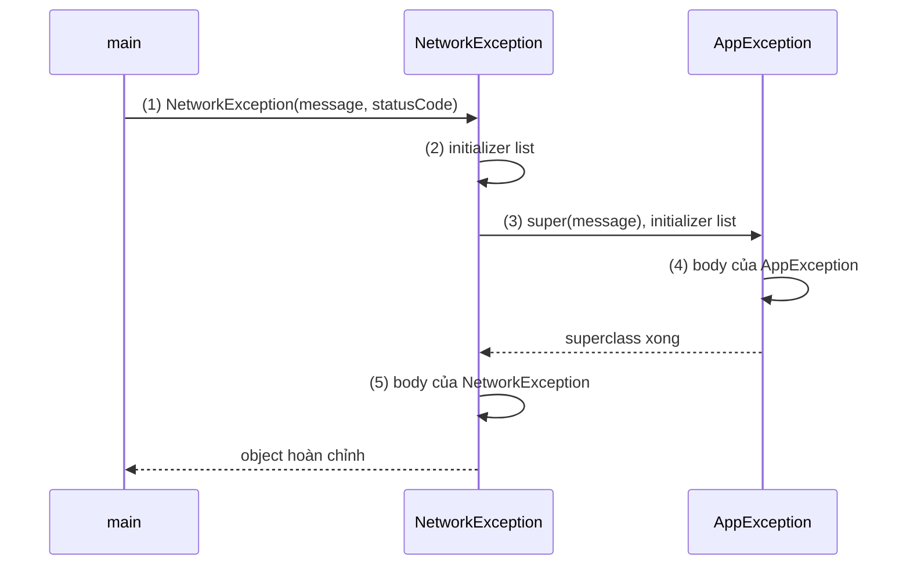
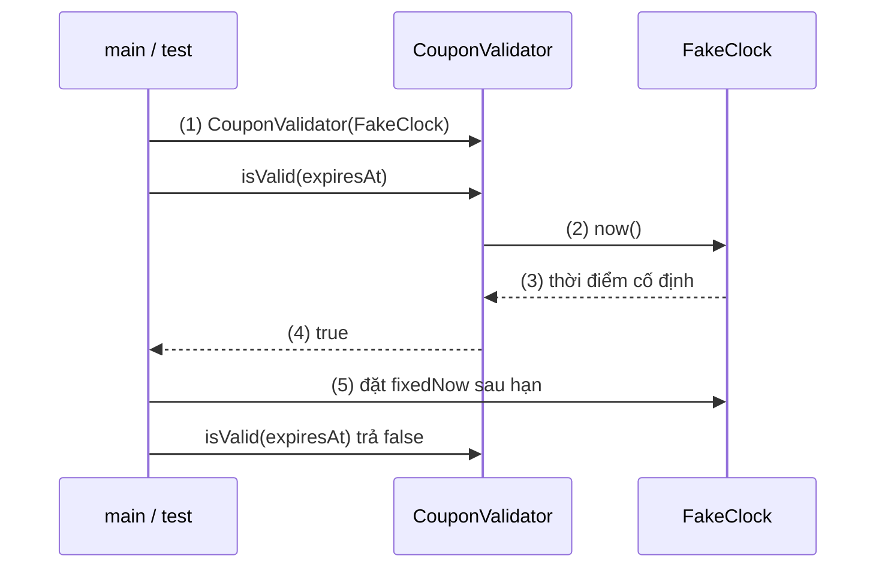
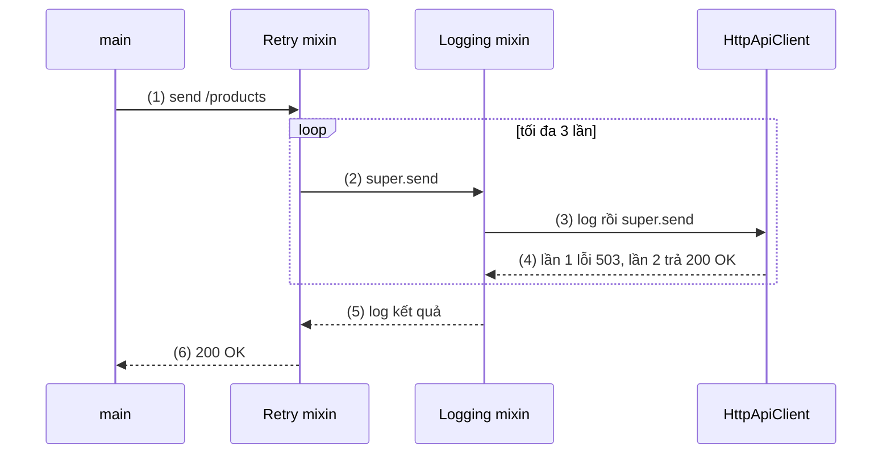
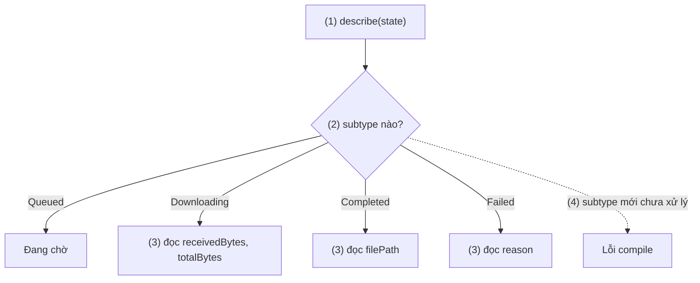
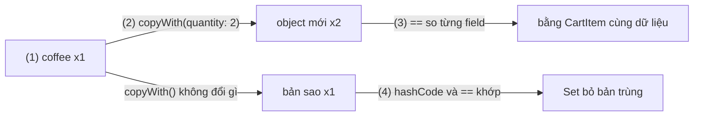
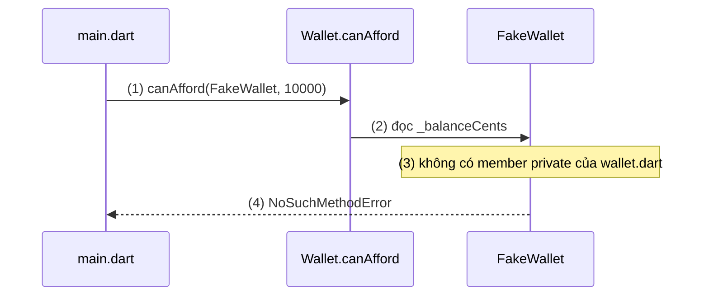
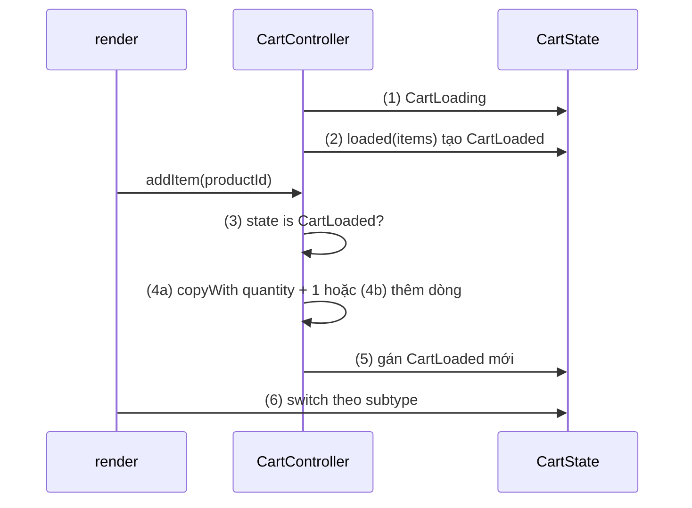

# Classes, Mixins and Sealed Types

## Vấn đề cần giải quyết

Mọi chương trình Dart, và toàn bộ Flutter framework, được dựng từ class: widget, state, model, service. Khi thiết kế kiểu dữ liệu, ba câu hỏi luôn xuất hiện:

1. **Tạo object hợp lệ thế nào?** Field `final` phải có giá trị trước khi object dùng được, dữ liệu đầu vào cần kiểm tra, có lúc cần trả object có sẵn thay vì tạo mới.
2. **Chia sẻ hành vi thế nào?** Kế thừa implementation, chỉ cam kết một contract, hay ghép thêm một gói hành vi (logging, retry) vào nhiều class không cùng gốc.
3. **Ai được phép mở rộng kiểu của mình?** Nếu bất kỳ ai cũng kế thừa được, compiler không bao giờ biết đủ các biến thể của một kiểu, và tác giả thư viện không thể sửa class mà không sợ làm hỏng code bên ngoài.

Câu hỏi thứ ba lộ ra rõ nhất khi mô hình hoá kết quả của một thao tác:

```dart
abstract class PaymentResult {}
class PaymentSuccess extends PaymentResult {}
class PaymentDeclined extends PaymentResult {}
class PaymentPending extends PaymentResult {} // thêm sau, không ai nhắc phải xử lý

String message(PaymentResult result) => switch (result) {
      PaymentSuccess() => 'Thanh toán thành công',
      PaymentDeclined() => 'Thẻ bị từ chối',
      _ => 'Lỗi không xác định', // bắt buộc có vì compiler không biết hết subtype
    };

void main() => print(message(PaymentPending())); // In: Lỗi không xác định
```

Bỏ nhánh `_` thì compiler báo `non_exhaustive_switch_expression`, vì một file khác có thể thêm subtype bất kỳ lúc nào. Giữ nhánh `_` thì `PaymentPending` mới thêm rơi vào "Lỗi không xác định" mà không có cảnh báo nào. Phần 6 (sealed types) giải quyết đúng chỗ này.

Với Kotlin developer, Dart còn đảo ngược vài mặc định quen thuộc: class **mở** cho kế thừa (Kotlin `final` mặc định), **không có từ khoá `interface`** (mọi class đều là interface), và **không có `data class`** (equality và `copy` phải tự viết hoặc sinh code).

## Sau khi học xong

- Triển khai được class với các dạng constructor (generative, named, initializer list, const, factory, redirecting, super parameters) và giải thích được thứ tự khởi tạo.
- Phân biệt được extends, implements và with dựa trên implicit interface, và giải thích được thứ tự linearization khi một class trộn nhiều mixin.
- Thiết kế được hierarchy đóng bằng sealed và chọn đúng class modifier (base, interface, final, mixin class) theo những quyền được và bị cấm trong và ngoài library.
- Biết khi nào dùng enhanced enum, extension method hoặc extension type thay cho một class mới.
- Áp dụng được value equality (== và hashCode), immutability và copyWith cho model, và nhận diện được khi nào nên chuyển sang codegen.

## Classes, Mixins and Sealed Types là gì?

**Class** trong Dart là khai báo vừa dùng để tạo object, vừa tự định nghĩa một **implicit interface (interface ngầm)** gồm mọi instance member của nó. **Mixin** là một gói member được chèn vào chuỗi superclass của class qua `with`; **sealed type** là class mà mọi subtype trực tiếp phải nằm trong cùng library, nên compiler biết đủ các biến thể.

**Mental model: bảng quyền.** Mỗi khai báo kiểu trao cho code khác bốn quyền: **construct** (gọi constructor), **extend** (kế thừa implementation), **implement** (cam kết contract, tự viết implementation) và **mix in** (dùng sau `with`). `abstract` bỏ quyền construct; `base`, `interface`, `final` bỏ bớt quyền extend/implement **đối với code ngoài library**; `sealed` bỏ cả construct lẫn mọi quyền kế thừa từ ngoài library; `mixin` bật quyền mix in. Trong suốt bài, mỗi tính năng được giải thích bằng câu hỏi "nó bật hay tắt quyền nào, với ai".

## Cách hoạt động

### 1. Class và constructor

Một class gồm field (instance variable), constructor và method. Field non-nullable hoặc `final` phải có giá trị **trước khi body của constructor chạy**, nên Dart có nhiều cách gán field sớm:

| Dạng | Cú pháp | Dùng khi |
|---|---|---|
| Generative + initializing formal | `Money(this.minorUnits, this.currency);` | Gán thẳng tham số vào field |
| Named constructor | `Money.fromMajor(...)` | Nhiều cách tạo, tên nói rõ ý nghĩa (Dart không có overload constructor) |
| Initializer list | `: minorUnits = (amount * 100).round()` | Tính field `final` từ tham số, `assert` đầu vào |
| Redirecting | `Money.zero(String c) : this(0, c);` | Chuyển tiếp sang constructor khác cùng class, body rỗng |
| `const` constructor | `const Money(...)` | Mọi field `final`; tạo được hằng compile-time |
| `factory` | `factory Money.parse(String text) {...}` | Cần logic trước khi quyết định trả object nào: validate, cache, trả subtype |

Một số quy tắc đáng nhớ:

- Không khai báo constructor nào thì class có **default constructor** không tham số. Constructor **không được kế thừa**: subclass phải tự khai báo.
- Initializer list chạy trước body và **không truy cập được `this`**, nhưng đọc được tham số, kể cả tham số `this.x`.
- `factory` không tạo `this` mới, nên không có initializer list, không truy cập `this`, và không được trả `null`.
- `const` constructor không bắt buộc tạo hằng: `Money(1, 'USD')` không có `const` vẫn tạo object thường. Chỉ khi gọi trong ngữ cảnh `const`, các lời gọi cùng đối số mới trả về **cùng một instance** (canonicalized).
- Từ Dart 3.12, initializing formal dùng được cho field private trong named parameter: `SessionToken({required this._value})`, người gọi viết `SessionToken(value: ...)`.

#### Ví dụ: kiểu `Money` với nhiều cách tạo

**Bài toán:** số tiền đến từ nhiều nguồn: hằng số trong code, số thập phân người dùng nhập, chuỗi `"12.50 USD"` từ API. Mỗi nguồn cần một constructor có tên rõ ràng, và chuỗi sai định dạng phải bị chặn trước khi tạo object.

**Code:**

```dart
// money.dart
class Money {
  final int minorUnits; // số tiền theo đơn vị nhỏ nhất (cent, đồng)
  final String currency;

  // Generative constructor + initializing formal + assert trong initializer list
  const Money(this.minorUnits, this.currency)
      : assert(minorUnits >= 0, 'Số tiền không được âm');

  // Named + redirecting: chỉ chuyển tiếp sang constructor chính
  const Money.zero(String currency) : this(0, currency);

  // Initializer list tính field final từ tham số
  Money.fromMajor(double amount, this.currency)
      : minorUnits = (amount * 100).round();

  // Factory: chạy logic trước khi quyết định trả object nào
  factory Money.parse(String text) {
    final parts = text.trim().split(' ');
    if (parts.length != 2) {
      throw FormatException('Sai định dạng tiền', text);
    }
    return Money.fromMajor(double.parse(parts[0]), parts[1]);
  }

  @override
  String toString() => '${(minorUnits / 100).toStringAsFixed(2)} $currency';
}

void main() {
  const price = Money(1999, 'USD');
  const free = Money.zero('USD');
  final fee = Money.fromMajor(2.5, 'USD');
  final parsed = Money.parse('12.50 USD');

  print('$price | $free | $fee | $parsed');
  print(identical(const Money.zero('USD'), free)); // hằng cùng giá trị là cùng instance
  try {
    Money.parse('12.50');
  } on FormatException catch (e) {
    print(e.message);
  }
}
```

**Kết quả** (`dart run money.dart`):

```text
19.99 USD | 0.00 USD | 2.50 USD | 12.50 USD
true
Sai định dạng tiền
```

`assert` chỉ chạy khi bật assertion (`dart run --enable-asserts`, hoặc chế độ debug của Flutter); bản release bỏ qua nó. Kiểm tra bắt buộc ở mọi môi trường thì `throw` như trong `factory`.

### 2. Getter, setter và private theo library

Dart không có từ khoá `private`/`public`. Tên bắt đầu bằng `_` là **private theo library**: mọi code trong cùng library (một file, cộng các file `part` của nó) thấy được; file khác thì không, kể cả subclass. Đây là khác biệt lớn với Kotlin, nơi `private` tính theo class và có thêm `protected`, `internal`.

Field public thực chất là một cặp getter/setter ngầm (field `final` chỉ có getter). Vì vậy có thể đổi một field thành getter/setter tự viết sau này mà **không đổi code gọi**. Getter không có field đứng sau gọi là computed property.

#### Ví dụ: âm lượng trình phát nhạc

**Bài toán:** âm lượng chỉ hợp lệ trong 0–100; mọi chỗ gán phải bị kẹp vào khoảng đó, và trạng thái "tắt tiếng" suy ra từ âm lượng.

```dart
// player_volume.dart
class PlayerVolume {
  int _level = 50; // private: file khác không đọc được _level

  int get level => _level; // getter: đọc như field

  set level(int value) => _level = value.clamp(0, 100); // setter: kiểm soát giá trị ghi vào

  bool get isMuted => _level == 0; // computed property
}

void main() {
  final volume = PlayerVolume();
  volume.level = 140; // gọi setter
  print('${volume.level} muted=${volume.isMuted}');
  volume.level = -5;
  print('${volume.level} muted=${volume.isMuted}');
}
```

**Kết quả:**

```text
100 muted=false
0 muted=true
```

Từ một file khác, `volume._level` báo lỗi `undefined_getter`: với library bên ngoài, member private coi như không tồn tại.

### 3. Kế thừa, implicit interface và `abstract`

Dart có hai cách để một class trở thành subtype của class khác, và chúng khác nhau về bản chất:

| | `extends` | `implements` |
|---|---|---|
| Nhận gì | Toàn bộ implementation của superclass | Chỉ contract (implicit interface) |
| Số lượng | Đúng một superclass | Nhiều interface |
| Phải tự viết | Chỉ những gì muốn `@override` | **Mọi** member, kể cả field (dưới dạng getter/setter) |
| Gọi `super` | Có | Không |

Vì mọi class đều có implicit interface, `implements` dùng được với **bất kỳ class nào**, kể cả class có implementation đầy đủ. Đó là lý do Dart không cần từ khoá `interface` riêng (Dart 3 có modifier `interface`, nhưng nó mang nghĩa khác, xem phần 5).

`abstract class` không construct được và được phép có **abstract member** (khai báo không có body). Subclass cụ thể phải viết đủ các member đó. Đây là cách Dart diễn đạt cái mà Kotlin gọi là `interface` hoặc `abstract class`.

Khi `extends`, constructor của subclass luôn gọi một constructor của superclass. **Super parameter** (`super.message`, từ Dart 2.17) chuyển tiếp tham số lên superclass mà không phải viết lại `: super(message)`.

#### Ví dụ: thứ tự khởi tạo của exception có kế thừa

**Bài toán:** app có `AppException` chung và `NetworkException` riêng mang thêm `statusCode`. Cần biết chính xác phần nào chạy trước khi object được tạo, để không đọc field chưa gán.

**Luồng chạy:**

1. Gọi `NetworkException('...', statusCode: 504)`. Tham số `super.message` sẽ được chuyển cho constructor của `AppException`; `this.statusCode` gán field ngay.
2. Initializer list của `NetworkException` chạy (`retryable` tính từ `statusCode`).
3. Constructor của superclass bắt đầu: initializer list của `AppException` chạy.
4. Body của `AppException` chạy.
5. Body của `NetworkException` chạy sau cùng, lúc này mọi field của cả hai lớp đã có giá trị.



**Code:**

```dart
// network_exception.dart
T _logged<T>(String step, T value) {
  print(step);
  return value;
}

class AppException implements Exception {
  final String message;
  final DateTime createdAt;

  AppException(this.message)
      : createdAt = _logged('(3) initializer list của AppException', DateTime.now()) {
    print('(4) body của AppException');
  }
}

class NetworkException extends AppException {
  final int statusCode;
  final bool retryable;

  // (1) super.message là super parameter: chuyển thẳng lên AppException(message)
  NetworkException(super.message, {required this.statusCode})
      : retryable = _logged('(2) initializer list của NetworkException', statusCode >= 500) {
    print('(5) body của NetworkException');
  }
}

void main() {
  final error = NetworkException('Hết thời gian chờ', statusCode: 504);
  print('${error.statusCode} retryable=${error.retryable}: ${error.message}');
}
```

**Kết quả:**

```text
(2) initializer list của NetworkException
(3) initializer list của AppException
(4) body của AppException
(5) body của NetworkException
504 retryable=true: Hết thời gian chờ
```

Khác Kotlin/Java ở một điểm quan trọng: initializer list của **subclass chạy trước** superclass. Vì initializer list không truy cập được `this`, thứ tự này an toàn; code trong body thì luôn thấy object đã khởi tạo đủ.

#### Ví dụ: fake `Clock` để test logic phụ thuộc thời gian

**Bài toán:** logic kiểm tra mã giảm giá hết hạn phụ thuộc giờ hệ thống, nên test không thể chờ tới ngày hết hạn. Cần thay đồng hồ thật bằng đồng hồ giả trong test.

**Luồng chạy:**

1. Test tạo `FakeClock` với thời điểm cố định và truyền vào `CouponValidator`.
2. `isValid` gọi `_clock.now()`; validator chỉ biết contract `Clock`, không biết đó là đồng hồ thật hay giả.
3. `FakeClock` trả thời điểm test đặt.
4. Validator so sánh và trả kết quả.
5. Test "tua" đồng hồ qua thời điểm hết hạn và kiểm tra lại.



**Code:**

```dart
// coupon_validator.dart
abstract class Clock {
  DateTime now(); // abstract member: subclass cụ thể phải viết
}

class SystemClock implements Clock {
  @override
  DateTime now() => DateTime.now();
}

class CouponValidator {
  CouponValidator(this._clock);
  final Clock _clock;

  bool isValid(DateTime expiresAt) => _clock.now().isBefore(expiresAt); // (2) (4)
}

// coupon_validator_test.dart
class FakeClock implements Clock {
  FakeClock(this.fixedNow);
  DateTime fixedNow;

  @override
  DateTime now() => fixedNow; // (3)
}

void main() {
  final clock = FakeClock(DateTime(2026, 11, 30, 23, 59)); // (1)
  final validator = CouponValidator(clock);
  final expiresAt = DateTime(2026, 12, 1);

  print(validator.isValid(expiresAt));
  clock.fixedNow = DateTime(2026, 12, 1, 0, 1); // (5)
  print(validator.isValid(expiresAt));
}
```

**Kết quả:**

```text
true
false
```

Vì implicit interface, `class FakeSystemClock implements SystemClock` cũng hợp lệ dù `SystemClock` là class cụ thể. Viết fake thường không cần thư viện tạo proxy; các thư viện mock (`mocktail`, `mockito`) cũng dựa trên chính cơ chế `implements` này (11.1.1 Unit Testing and Mocking (chưa có bài)).

### 4. Mixin và thứ tự linearization

`extends` chỉ cho một superclass. Khi nhiều class không cùng gốc cần cùng một hành vi (logging, retry, đếm thời gian), đặt hành vi đó vào **mixin** rồi ghép bằng `with`.

- `mixin Logging { ... }` khai báo được field, method, getter và abstract member, nhưng **không khai báo được constructor** nào (lỗi `mixin_declares_constructor`) và không có `extends`.
- `mixin Logging on ApiClient` là **superclass constraint**: chỉ class là subtype của `ApiClient` mới được `with Logging`, và trong mixin được gọi `super.send(...)`.
- `mixin class` (Dart 3.0) vừa dùng như class thường vừa dùng sau `with`; nó không được có `extends`, `with` hay `on`. Từ Dart 3.0, class thường **không** dùng được sau `with` (lỗi `class_used_as_mixin`).

**Linearization.** `class ProductApi extends HttpApiClient with Logging, Retry {}` không "gộp" ba nguồn vào một class. Compiler tạo một chuỗi superclass trung gian, mỗi mixin là một tầng chồng lên tầng trước:

```text
ProductApi → Retry → Logging → HttpApiClient → ApiClient → Object
```

Tra method đi từ trái sang phải: mixin viết **sau cùng** trong `with` nằm gần class nhất nên thắng. `super.send()` bên trong một mixin gọi tầng **ngay dưới nó**, không phải superclass gốc. Nhờ vậy các mixin xếp chồng thành một chuỗi bọc nhau, giống interceptor.

#### Ví dụ: retry và logging cho API client

**Bài toán:** mọi request cần được ghi log, và request lỗi tạm thời (503) cần thử lại tối đa 3 lần. Hai hành vi này dùng chung cho nhiều client, nên không muốn viết vào từng class.

**Luồng chạy:**

1. Code gọi `api.send('/products')`. Tra method tìm thấy `Retry.send` trước tiên (mixin sau cùng).
2. `Retry` mở vòng thử và gọi `super.send`, tức tầng `Logging`.
3. `Logging` ghi log rồi gọi `super.send`, tức `HttpApiClient`.
4. `HttpApiClient` gửi request. Lần đầu ném lỗi 503: lỗi đi ngược qua `Logging` lên `Retry`, `Retry` thử lại từ bước (2). Lần hai trả `200 OK`.
5. `Logging` ghi log kết quả.
6. `Retry` trả kết quả cho code gọi.



**Code:**

```dart
// api_client.dart
abstract class ApiClient {
  String send(String path);
}

class HttpApiClient extends ApiClient {
  int _calls = 0;

  @override
  String send(String path) {
    _calls++;
    print('    (4) HttpApiClient gửi $path, lần $_calls');
    if (_calls < 2) throw StateError('503 Service Unavailable');
    return '200 OK';
  }
}

mixin Logging on ApiClient {
  @override
  String send(String path) {
    print('  (3) Logging: bắt đầu $path');
    final result = super.send(path); // super = tầng ngay dưới Logging
    print('  (5) Logging: xong $path -> $result');
    return result;
  }
}

mixin Retry on ApiClient {
  int get maxAttempts => 3;

  @override
  String send(String path) {
    for (var attempt = 1;; attempt++) {
      try {
        print('(2) Retry: lần thử $attempt');
        return super.send(path); // super = Logging
      } on StateError {
        if (attempt == maxAttempts) rethrow;
      }
    }
  }
}

// Linearization: ProductApi → Retry → Logging → HttpApiClient → ApiClient
class ProductApi extends HttpApiClient with Logging, Retry {}

void main() {
  final api = ProductApi();
  print('(1) gọi send');
  final result = api.send('/products');
  print('(6) kết quả: $result');
}
```

**Kết quả:**

```text
(1) gọi send
(2) Retry: lần thử 1
  (3) Logging: bắt đầu /products
    (4) HttpApiClient gửi /products, lần 1
(2) Retry: lần thử 2
  (3) Logging: bắt đầu /products
    (4) HttpApiClient gửi /products, lần 2
  (5) Logging: xong /products -> 200 OK
(6) kết quả: 200 OK
```

Đổi thành `with Retry, Logging` thì `Logging` nằm ngoài cùng: "bắt đầu" chỉ in một lần, cả hai lần thử nằm bên trong một dòng log. Cùng hai mixin, thứ tự khác cho hành vi khác.

### 5. Class modifiers: thu hẹp quyền với code ngoài library

Từ Dart 3.0, tác giả một library dùng modifier để quyết định code **ngoài library** được làm gì với class. Trong cùng library, tác giả vẫn extend và implement tự do (trừ ràng buộc ở cột "Subtype phải là"). Theo mental model bảng quyền:

| Khai báo | Construct | Ngoài library: extend | Ngoài library: implement | Mix in | Subtype phải là | Exhaustive |
|---|---|---|---|---|---|---|
| `class` | Có | Có | Có | Không | Tự do | Không |
| `abstract class` | Không | Có | Có | Không | Tự do | Không |
| `base class` | Có | Có | **Không** | Không | `base`/`final`/`sealed` | Không |
| `interface class` | Có | **Không** | Có | Không | Tự do | Không |
| `abstract interface class` | Không | **Không** | Có | Không | Tự do | Không |
| `final class` | Có | **Không** | **Không** | Không | `base`/`final`/`sealed` | Không |
| `sealed class` | Không | **Không** | **Không** | Không | Tự do | **Có** |
| `mixin class` | Có | Có | Có | Có | Tự do | Không |
| `mixin` | Không | Không (không phải class) | Có | Có | Tự do | Không |
| `base mixin` | Không | Không | **Không** | Có | `base`/`final`/`sealed` | Không |

Ý nghĩa thiết kế của từng modifier:

- **`base`**: mọi subtype đều đi qua implementation thật (constructor được gọi, member private tồn tại). Cấm `implements` từ ngoài; ràng buộc `base`/`final`/`sealed` lan xuống **mọi** subtype, kể cả trong library, để không ai "mở" lại được.
- **`interface`**: chỉ cho cam kết contract. Code ngoài không kế thừa được, nên tác giả tự do thay đổi cách các method gọi nhau bên trong mà không làm vỡ subclass của người khác.
- **`final`**: đóng hẳn với bên ngoài; tác giả thêm member mới mà không phải lo trùng tên hay vỡ implementation bên ngoài. Gần với class mặc định của Kotlin, nhưng ranh giới là library.
- **`sealed`**: như `final` với bên ngoài, cộng thêm implicitly abstract và exhaustiveness (phần 6).
- `abstract interface class` gần nhất với `interface` của Kotlin.

> [!IMPORTANT]
> `interface` và `sealed` **không lan truyền**. Một `class` thường extend một `interface class` ngay trong library sẽ mở lại quyền extend cho code bên ngoài (đã kiểm chứng: không có lỗi). Muốn khoá cả cây thì đánh dấu cả subclass.

#### Ví dụ: kiểm chứng bảng quyền bằng hai library

**Bài toán:** một package SDK thanh toán công bố các class với modifier khác nhau. Cần thấy chính xác compiler chặn gì khi app (một library khác) dùng chúng.

**Code** (đặt trong một package có `environment: sdk: ^3.12.0`, chạy `dart analyze`):

```dart
// lib/payment_sdk.dart — library khai báo
class PlainGateway { void charge() {} }
base class BaseGateway { void charge() {} }
interface class InterfaceGateway { void charge() {} }
final class FinalGateway { void charge() {} }
sealed class SealedResult {}

// Trong library: extend/implement final và sealed đều được
final class InFinalImpl implements FinalGateway { void charge() {} }
class InSealedExt extends SealedResult {}
class InBaseExtNoMod extends BaseGateway {} // lỗi: subtype của base phải base/final/sealed
```

```dart
// bin/app.dart — library khác
import 'package:classes_demo/payment_sdk.dart';

class OutPlainImpl implements PlainGateway { void charge() {} }        // được
base class OutBaseExt extends BaseGateway {}                           // được
base class OutBaseImpl implements BaseGateway { void charge() {} }     // lỗi
class OutIfaceExt extends InterfaceGateway {}                          // lỗi
class OutIfaceImpl implements InterfaceGateway { void charge() {} }    // được
class OutFinalImpl implements FinalGateway { void charge() {} }        // lỗi
class OutSealedExt extends SealedResult {}                             // lỗi
class OutMixPlain with PlainGateway {}                                 // lỗi
```

**Kết quả** (`dart analyze`, Dart 3.12):

```text
error - bin/app.dart:6:35 - The class 'BaseGateway' can't be implemented outside of its library because it's a base class. - invalid_use_of_type_outside_library
error - bin/app.dart:7:27 - The class 'InterfaceGateway' can't be extended outside of its library because it's an interface class. - invalid_use_of_type_outside_library
error - bin/app.dart:9:31 - The class 'FinalGateway' can't be implemented outside of its library because it's a final class. - invalid_use_of_type_outside_library
error - bin/app.dart:10:28 - The class 'SealedResult' can't be extended, implemented, or mixed in outside of its library because it's a sealed class. - invalid_use_of_type_outside_library
error - bin/app.dart:11:24 - The class 'PlainGateway' can't be used as a mixin because it's neither a mixin class nor a mixin. - class_used_as_mixin
error - lib/payment_sdk.dart:11:7 - The type 'InBaseExtNoMod' must be 'base', 'final' or 'sealed' because the supertype 'BaseGateway' is 'base'. - subtype_of_base_or_final_is_not_base_final_or_sealed
6 issues found.
```

Các dòng `// được` không có lỗi. Mọi lỗi "ngoài library" do modifier đều có cùng mã `invalid_use_of_type_outside_library`: modifier là luật về **ranh giới library**, không phải về class.

### 6. Sealed types: tập subtype đóng

`sealed class` có hai đặc tính:

1. **Implicitly abstract**: không construct trực tiếp được, nhưng được khai báo constructor (generative cho subclass gọi, hoặc `factory`).
2. **Mọi subtype trực tiếp phải nằm trong cùng library.** Từ ngoài library, không ai extend, implement hay mix in được.

Đặc tính thứ hai là lý do sealed cho phép **exhaustiveness checking**: khi compile library đó, compiler đã thấy đủ danh sách subtype trực tiếp, nên một `switch` liệt kê đủ các subtype là bao trọn mọi giá trị có thể có, không cần nhánh `_`. Với `abstract class`, file nào cũng có thể thêm subtype, nên compiler không bao giờ kết luận được như vậy. Cơ chế kiểm tra (pattern nào "bao" pattern nào, thông báo lỗi, switch statement và switch expression) thuộc [1.2.3 Control Flow and Patterns](control_flow_patterns.md); bài này chỉ dùng nó.

Subclass của một sealed class **không** tự động sealed hay final. Ví dụ dưới đánh dấu chúng `final class` để không ai bên ngoài kế thừa tiếp. Nếu để `class` thường thì bên ngoài vẫn kế thừa được subclass đó (subtype gián tiếp), và exhaustiveness vẫn đúng vì pattern `Completed()` bao luôn subclass của `Completed`.

So với Kotlin: `sealed class` của Kotlin yêu cầu subclass cùng package và cùng module; Dart dùng ranh giới library. `when` của Kotlin và `switch` của Dart cùng ý tưởng exhaustiveness.

#### Ví dụ: trạng thái tải file

**Bài toán:** một tác vụ tải file đi qua các trạng thái chờ, đang tải (có tiến độ), xong (có đường dẫn), lỗi (có lý do). Mỗi trạng thái mang dữ liệu riêng, và UI phải xử lý đủ mọi trạng thái.

**Luồng chạy:**

1. UI truyền state hiện tại vào `describe`.
2. `switch` thử từng subtype theo thứ tự.
3. Nhánh khớp destructure field riêng của subtype đó (`receivedBytes`, `filePath`...).
4. Không có nhánh `_`: thêm subtype thứ năm mà quên xử lý là lỗi compile.



**Code:**

```dart
// download_state.dart
sealed class DownloadState {
  const DownloadState();
}

final class Queued extends DownloadState {
  const Queued();
}

final class Downloading extends DownloadState {
  const Downloading(this.receivedBytes, this.totalBytes);
  final int receivedBytes;
  final int totalBytes;
}

final class Completed extends DownloadState {
  const Completed(this.filePath);
  final String filePath;
}

final class Failed extends DownloadState {
  const Failed(this.reason);
  final String reason;
}

String describe(DownloadState state) => switch (state) { // (1)
      Queued() => 'Đang chờ', // (2) khớp theo subtype
      Downloading(:final receivedBytes, :final totalBytes) => // (3) destructure field
        'Đã tải ${receivedBytes * 100 ~/ totalBytes}%',
      Completed(:final filePath) => 'Xong: $filePath',
      Failed(:final reason) => 'Lỗi: $reason',
    }; // (4) không cần nhánh _

void main() {
  const states = <DownloadState>[
    Queued(),
    Downloading(3500000, 10000000),
    Completed('/downloads/report.pdf'),
    Failed('Mất kết nối'),
  ];
  for (final state in states) {
    print(describe(state));
  }
}
```

**Kết quả:**

```text
Đang chờ
Đã tải 35%
Xong: /downloads/report.pdf
Lỗi: Mất kết nối
```

Thêm `final class Paused extends DownloadState` vào cùng file, `dart analyze` báo ngay tại `switch`:

```text
error - download_state.dart:26:41 - The type 'DownloadState' isn't exhaustively matched by the switch cases since it doesn't match the pattern 'Paused()'. Try adding a wildcard pattern or cases that match 'Paused()'. - non_exhaustive_switch_expression
```

Còn khai báo `Paused` ở một file khác thì lỗi nằm ở chính khai báo đó (`invalid_use_of_type_outside_library`).

### 7. Enhanced enum

Từ Dart 2.17, `enum` có thể có field, constructor, method, getter, `implements` interface và `with` mixin. Mỗi giá trị enum là một instance `const`, nên:

- Mọi field phải `final`, generative constructor phải `const` (được thêm `factory` trả về một giá trị có sẵn).
- Các giá trị khai báo đầu tiên, kết thúc bằng `;` trước member.
- Enum ngầm extend `Enum`, không extend class khác; có sẵn `values`, `index`, `name` và `values.byName(...)`.
- `switch` trên enum cũng được kiểm tra exhaustiveness như sealed.

Ranh giới với sealed: **enum khi tập giá trị cố định và mọi giá trị có cùng cấu trúc dữ liệu biết trước lúc compile; sealed khi mỗi biến thể mang dữ liệu khác nhau tạo lúc runtime** (`Downloading` mang tiến độ thay đổi liên tục, enum không làm được).

#### Ví dụ: phương thức giao hàng

**Bài toán:** app có ba phương thức giao hàng cố định, mỗi cái có mã API, phí và số ngày. Phí miễn cho đơn từ 500.000 đ, trừ giao hoả tốc.

```dart
// shipping_method.dart
enum ShippingMethod {
  standard('STD', baseFee: 15000, days: 4),
  express('EXP', baseFee: 35000, days: 1),
  pickup('PICK', baseFee: 0, days: 0);

  const ShippingMethod(this.code, {required this.baseFee, required this.days});

  final String code;
  final int baseFee;
  final int days;

  int feeFor(int subtotal) => subtotal >= 500000 && this != express ? 0 : baseFee;

  // Tra ngược từ mã API, mã lạ trả null
  static ShippingMethod? fromCode(String code) {
    for (final method in values) {
      if (method.code == code) return method;
    }
    return null;
  }
}

void main() {
  print(ShippingMethod.values.map((m) => '${m.name}:${m.feeFor(600000)}').join(', '));
  print(ShippingMethod.fromCode('EXP')?.days);
  print(ShippingMethod.fromCode('DRONE'));
}
```

**Kết quả:**

```text
standard:0, express:35000, pickup:0
1
null
```

### 8. Extension methods

**Extension method** (Dart 2.7) thêm method, getter, operator cho một kiểu mà mình không sở hữu (`int`, `String`, class của package khác) mà không kế thừa hay bọc nó.

Bản chất: extension được **resolve lúc compile theo static type**. `1250000.toVnd()` được compiler dịch thành lời gọi một hàm tĩnh với `1250000` làm đối số. Hệ quả:

- Không polymorphic, không override được. Nếu kiểu đã có member cùng tên, **member thật luôn thắng**.
- Biến kiểu `dynamic` không thấy extension (runtime không biết extension tồn tại).
- Hai extension cùng áp dụng một member mà không cái nào cụ thể hơn (theo kiểu `on`) thì lời gọi bị lỗi mơ hồ; phải gọi tường minh `VndFormat(total).toVnd()` hoặc dùng `show`/`hide` khi import.
- Extension trên kiểu nullable (`on String?`) gọi được trên giá trị `null`.

Kotlin extension function có cùng bản chất (static dispatch), nên Kotlin developer gần như không phải đổi tư duy.

#### Ví dụ: định dạng tiền và ngày

```dart
// formatting_extensions.dart
extension VndFormat on int {
  String toVnd() {
    final digits = toString();
    final buffer = StringBuffer();
    for (var i = 0; i < digits.length; i++) {
      if (i > 0 && (digits.length - i) % 3 == 0) buffer.write('.');
      buffer.write(digits[i]);
    }
    return '$buffer ₫';
  }
}

extension DateOnly on DateTime {
  bool isSameDay(DateTime other) =>
      year == other.year && month == other.month && day == other.day;
}

extension BlankCheck on String? {
  bool get isNullOrBlank => this == null || this!.trim().isEmpty;
}

void main() {
  print(1250000.toVnd());
  print(DateTime(2026, 11, 10, 8).isSameDay(DateTime(2026, 11, 10, 23)));
  String? note;
  print(note.isNullOrBlank);

  dynamic total = 99000;
  try {
    print(total.toVnd()); // runtime không biết extension
  } on NoSuchMethodError {
    print('NoSuchMethodError: dynamic không thấy extension');
  }
  print(VndFormat(total as int).toVnd()); // gọi tường minh
}
```

**Kết quả:**

```text
1.250.000 ₫
true
true
NoSuchMethodError: dynamic không thấy extension
99.000 ₫
```

### 9. Extension types

**Extension type** (Dart 3.3) khai báo một kiểu mới **chỉ tồn tại lúc compile** bao quanh một kiểu có sẵn (representation type). Lúc runtime nó bị xoá hẳn: chỉ còn object gốc, không có object bọc, nên không tốn bộ nhớ hay thời gian.

```dart
extension type const UserId(String value) {}
```

- Không có `implements`, extension type **không** dùng được member của `String` và không gán được cho `String`; ngược lại `String` cũng không gán được cho `UserId`. Có `implements String` (hoặc một supertype của nó) thì nó "trong suốt" và dùng được member đó.
- `is`, `as` và pattern kiểm tra trên **representation type**: một `UserId` lúc runtime `is OrderId` cũng là `true` nếu cả hai bọc `String`.
- Không có instance field riêng; được khai báo constructor phụ, method, getter.

Tài liệu Dart gọi extension type là một abstraction "unsafe": chỉ là lớp bảo vệ của type checker, không phải ranh giới runtime. Dùng nó để chặn nhầm lẫn khi viết code, không dùng để bảo mật. Gần nhất ở Kotlin là `value class`, nhưng `value class` có lúc bị boxing ở runtime, còn extension type luôn bị xoá.

#### Ví dụ: không truyền nhầm ID

**Bài toán:** `userId` và `orderId` đều là `String`; truyền nhầm cái này vào hàm nhận cái kia vẫn compile và chỉ lộ ra khi server trả 404. Phần trăm giảm giá cần được kẹp trong 0–100 mà vẫn dùng như `double`.

```dart
// ids.dart
extension type const UserId(String value) {}
extension type const OrderId(String value) {}

extension type Percent._(double value) implements double {
  Percent(double value) : this._(value.clamp(0, 100).toDouble());
  double of(double amount) => amount * value / 100;
}

String loadOrder(OrderId id) => 'Đơn ${id.value}';

void main() {
  const userId = UserId('u-42');
  const orderId = OrderId('o-1001');
  print(loadOrder(orderId));
  // loadOrder(userId);      // lỗi compile: UserId không phải OrderId
  // loadOrder('o-1001');    // lỗi compile: String không phải OrderId

  final discount = Percent(15);
  print('${discount.of(200000)} ${Percent(120)}'); // 120 bị kẹp về 100

  Object? raw = userId;  // không implements gì: chỉ là subtype của Object?
  print(raw is OrderId); // true: is kiểm tra kiểu biểu diễn String
  print(userId.runtimeType);
}
```

**Kết quả:**

```text
Đơn o-1001
30000.0 100.0
true
String
```

Bỏ comment hai dòng `loadOrder`, `dart analyze` báo `argument_type_not_assignable` cho cả hai.

### 10. Equality, immutability và `copyWith`

Mặc định `==` của class so **identity** (hai biến cùng trỏ một object), giống `identical`. Model dữ liệu thường cần **value equality**: hai object bằng nhau khi mọi field bằng nhau. Dart không có `data class`, nên phải tự override:

- `operator ==(Object other)`: tham số luôn là `Object`, kiểm tra `other is CartItem` rồi so từng field.
- `hashCode` **phải override cùng lúc** và phải khớp `==` (bằng nhau thì cùng hashCode), vì `Set`, `Map` dùng hashCode để tìm. `Object.hash(...)` gộp nhiều field.

**Immutability**: mọi field `final`, có `const` constructor nếu được. Muốn "sửa" thì tạo object mới qua `copyWith`, field không truyền thì giữ nguyên. Lợi ích: object cũ không bao giờ đổi sau lưng code đang giữ nó, và việc so sánh state cũ với state mới (Flutter làm điều này liên tục) đáng tin.

Các lựa chọn khác trước khi tự viết:

- **Record** (`(id: 'p-01', quantity: 2)`) có sẵn value equality, hợp cho dữ liệu nhỏ, cục bộ (xem [1.2.1 Variables and Types](variables_and_types.md)).
- Field kiểu `List`/`Map` không có deep equality: `[1] == [1]` là `false`. So sánh nội dung cần `package:collection` (xem [1.2.4 Collections and Functional APIs](collections_functional.md)).
- **Codegen** khi model nhiều và lớn: `freezed` sinh `==`, `hashCode`, `copyWith`, `toString` và cả sealed union; `json_serializable` sinh `fromJson`/`toJson`; `equatable` giảm boilerplate `==`/`hashCode` mà không cần sinh code. Cách cấu hình nằm ở 5.1.2 JSON Serialization and Codegen (chưa có bài).

#### Ví dụ: dòng sản phẩm trong giỏ hàng

**Bài toán:** một dòng giỏ hàng tăng số lượng phải tạo object mới; hai dòng có cùng dữ liệu phải coi là bằng nhau, và `Set` không được chứa trùng.

**Luồng chạy:**

1. Tạo `coffee` bằng `const` constructor.
2. `copyWith(quantity: 2)` tạo object mới; `coffee` giữ nguyên.
3. `==` so từng field: object mới bằng một object khác có cùng dữ liệu.
4. `hashCode` khớp `==`, nên `Set` loại được bản trùng tạo bởi `copyWith()`.



**Code:**

```dart
// cart_item.dart
class CartItem {
  const CartItem({required this.productId, required this.name, this.quantity = 1, this.note});

  final String productId;
  final String name;
  final int quantity;
  final String? note;

  // (2) copyWith: field không truyền thì giữ nguyên
  CartItem copyWith({String? name, int? quantity, String? note}) => CartItem(
        productId: productId,
        name: name ?? this.name,
        quantity: quantity ?? this.quantity,
        note: note ?? this.note,
      );

  // (3) value equality
  @override
  bool operator ==(Object other) =>
      other is CartItem &&
      other.productId == productId &&
      other.name == name &&
      other.quantity == quantity &&
      other.note == note;

  // (4) hashCode phải khớp ==
  @override
  int get hashCode => Object.hash(productId, name, quantity, note);

  @override
  String toString() => 'CartItem($productId x$quantity)';
}

void main() {
  const coffee = CartItem(productId: 'p-01', name: 'Cà phê sữa'); // (1)
  final twoCoffees = coffee.copyWith(quantity: 2);
  print('$coffee -> $twoCoffees');
  print(twoCoffees == const CartItem(productId: 'p-01', name: 'Cà phê sữa', quantity: 2));
  print(identical(coffee, twoCoffees));
  print({coffee, coffee.copyWith(), twoCoffees}.length);
}
```

**Kết quả:**

```text
CartItem(p-01 x1) -> CartItem(p-01 x2)
true
false
2
```

## Deep Dive: vì sao Dart 3 cần `base`

Implicit interface có một lỗ hổng mà chỉ `base` (và `final`, `sealed`) bịt được: interface của class gồm cả member **private**, nhưng code ngoài library không thể viết member private đó.

Ví dụ: library `wallet.dart` có `class Wallet` với field `_balanceCents` và hàm `static bool canAfford(Wallet wallet, int cents) => wallet._balanceCents >= cents;`. Ở library khác, `class FakeWallet implements Wallet` viết đủ mọi member public, và `dart analyze` báo **No issues found**. Nhưng khi chạy:

1. App truyền `FakeWallet` vào `Wallet.canAfford`.
2. Code của library đọc `wallet._balanceCents`, tin rằng mọi `Wallet` đều có field này.
3. `FakeWallet` không có (và không thể có) `_balanceCents` của library `wallet.dart`.
4. Runtime ném `NoSuchMethodError`.



```text
NoSuchMethodError: Class 'FakeWallet' has no instance getter '_balanceCents'.
Receiver: Instance of 'FakeWallet'
Tried calling: _balanceCents
```

Đánh dấu `base class Wallet` thì dòng `implements Wallet` ở library khác thành lỗi compile, và mọi subtype buộc phải extend (đi qua constructor thật, có đủ member private). Đây cũng là lý do ràng buộc `base` lan xuống mọi subtype: nếu một subclass được bỏ `base`, người khác lại `implements` subclass đó và lỗ hổng mở lại.

## Ví dụ thực tế

### 1. State của màn hình giỏ hàng: sealed + immutable model

Đây là pattern phổ biến nhất trong app Flutter: state là một sealed hierarchy, dữ liệu bên trong là model immutable, mỗi thay đổi tạo state mới. Code dưới là Dart thuần; trong Flutter, controller này sẽ được bọc bằng `ChangeNotifier` hoặc Cubit (4.1.1 ChangeNotifier and ValueNotifier (chưa có bài), 4.2.3 BLoC and Cubit (chưa có bài)).

**Luồng chạy:**

1. Controller khởi đầu ở `CartLoading`.
2. Khi dữ liệu về, state thành `CartLoaded(items)`; danh sách được bọc `List.unmodifiable` nên không ai sửa được từ ngoài.
3. `addItem` chỉ làm việc khi state là `CartLoaded`; đang tải thì bỏ qua.
4. Sản phẩm đã có thì (4a) `copyWith` tăng số lượng, chưa có thì (4b) thêm dòng mới, đều trên một bản sao của danh sách.
5. Gán state **mới**; state cũ không đổi.
6. View `switch` trên sealed state để hiển thị, không cần nhánh `_`.



**Code:**

```dart
// cart_state.dart
class CartItem {
  const CartItem({required this.productId, required this.unitPrice, this.quantity = 1});

  final String productId;
  final int unitPrice;
  final int quantity;

  int get lineTotal => unitPrice * quantity;

  CartItem copyWith({int? quantity}) =>
      CartItem(productId: productId, unitPrice: unitPrice, quantity: quantity ?? this.quantity);

  // == và hashCode viết như phần 10 (lược bớt để tập trung vào state)
}

sealed class CartState {
  const CartState();
}

final class CartLoading extends CartState {
  const CartLoading();
}

final class CartLoaded extends CartState {
  CartLoaded(List<CartItem> items) : items = List.unmodifiable(items);
  final List<CartItem> items;

  int get total => items.fold(0, (sum, item) => sum + item.lineTotal);
}

final class CartError extends CartState {
  const CartError(this.message);
  final String message;
}

// cart_controller.dart
class CartController {
  CartState _state = const CartLoading(); // (1)
  CartState get state => _state;

  void loaded(List<CartItem> items) => _state = CartLoaded(items); // (2)

  void addItem(String productId, int unitPrice) {
    final current = _state;
    if (current is! CartLoaded) return; // (3)

    final items = [...current.items];
    final index = items.indexWhere((item) => item.productId == productId);
    if (index >= 0) {
      items[index] = items[index].copyWith(quantity: items[index].quantity + 1); // (4a)
    } else {
      items.add(CartItem(productId: productId, unitPrice: unitPrice)); // (4b)
    }
    _state = CartLoaded(items); // (5)
  }
}

// cart_view.dart
String render(CartState state) => switch (state) { // (6)
      CartLoading() => 'Đang tải giỏ hàng...',
      CartLoaded(items: []) => 'Giỏ hàng trống',
      CartLoaded(:final items, :final total) => '${items.length} sản phẩm, tổng $total đ',
      CartError(:final message) => 'Lỗi: $message',
    };

void main() {
  final controller = CartController();
  controller.addItem('p-01', 45000); // bị bỏ qua: đang CartLoading
  print(render(controller.state));

  controller.loaded([]);
  final before = controller.state;
  controller.addItem('p-01', 45000);
  controller.addItem('p-01', 45000);
  controller.addItem('p-02', 30000);
  print(render(controller.state));
  print(render(before)); // state cũ vẫn nguyên vẹn
}
```

**Kết quả:**

```text
Đang tải giỏ hàng...
2 sản phẩm, tổng 120000 đ
Giỏ hàng trống
```

### 2. Mixin trong Flutter framework

Flutter dùng mixin cho hành vi gắn vào `State`. Code Flutter (đúng API, không chạy trong bài):

```dart
// login_screen.dart (Flutter)
class _LoginScreenState extends State<LoginScreen>
    with SingleTickerProviderStateMixin {
  late final AnimationController _shake =
      AnimationController(vsync: this, duration: const Duration(milliseconds: 300));

  @override
  void dispose() {
    _shake.dispose();
    super.dispose();
  }

  @override
  Widget build(BuildContext context) => const Placeholder();
}
```

`SingleTickerProviderStateMixin` có superclass constraint `State<T>` và implements `TickerProvider`, nên `this` truyền được vào `vsync`. `ChangeNotifier` là một `mixin class`: vừa `extends ChangeNotifier` vừa `with ChangeNotifier` được.

### 3. Thiết kế API cho package dùng chung

Khi viết package nội bộ hoặc public, chọn modifier cho từng class công khai ngay từ đầu: model và state nên `final class` (thêm field sau này không phá ai), contract cho người dùng tự cài (`Logger`, `Storage`) nên `abstract interface class`, class cần người dùng kế thừa nhưng phải đi qua constructor (base repository) nên `base class`. Gỡ `final`, `base` hay `interface` sau này không phá người dùng; **thêm** modifier vào class đã công bố là breaking change. Riêng gỡ `sealed` cũng là breaking change: các `switch` không có nhánh `_` của người dùng mất exhaustiveness và báo lỗi.

## Khi nào nên và không nên dùng

| Công cụ | Nên dùng khi | Không nên dùng khi |
|---|---|---|
| `extends` | Quan hệ "là một" thật, cần dùng lại implementation | Chỉ để mượn vài hàm tiện ích: dùng mixin hoặc composition |
| `implements` | Cam kết contract, viết fake cho test | Class có member private mà library gốc đọc trên mọi instance (Deep Dive), hoặc class `base`/`final` |
| `mixin` | Hành vi cắt ngang nhiều class không cùng gốc (log, retry, ticker) | Hành vi cần state khởi tạo qua constructor, hoặc chỉ một class dùng |
| `sealed` | Tập biến thể đóng, mỗi biến thể mang dữ liệu riêng (state, result, event) | Người dùng package cần thêm biến thể của họ |
| `final` / `base` / `interface` | Class công khai của package, cần tiến hoá mà không phá người dùng | Code app nằm gọn trong một library, nơi modifier không khoá được gì |
| Enhanced enum | Giá trị cố định, cùng cấu trúc, biết lúc compile | Dữ liệu khác nhau theo từng lần tạo |
| Extension method | Thêm tiện ích cho kiểu không sở hữu | Logic cần polymorphism, hoặc class mình sở hữu (viết method thật) |
| Extension type | Chặn nhầm lẫn giữa các ID, đơn vị cùng kiểu gốc mà không tốn runtime | Cần kiểm tra kiểu lúc runtime hoặc ranh giới bảo mật |
| Value equality tự viết | Vài model nhỏ | Hàng chục model: chuyển sang `freezed`/`equatable` |

## Sai lầm thường gặp

1. **Override `==` mà quên `hashCode`.** `Set`/`Map` tìm theo hashCode trước, nên hai object "bằng nhau" vẫn bị coi là khác. Analyzer có lint `hash_and_equals`. Luôn override cặp đôi, dùng `Object.hash`.

2. **Đưa field mutable vào `hashCode`.** Object đã nằm trong `Set` mà field đổi thì hashCode đổi, `Set` không tìm thấy nó nữa:

   ```dart
   final tag = Tag('sale'); // Tag có `String label` không final, == và hashCode theo label
   final tags = {tag};
   tag.label = 'hot';
   print(tags.contains(tag)); // false
   ```

   Sửa: field tham gia equality phải `final`.

3. **`copyWith` không đặt được field về `null`.** Với `note: note ?? this.note`, gọi `copyWith(note: null)` giữ nguyên giá trị cũ. Sửa: tham số dạng hàm (`String? Function()? note`), sentinel object, hoặc dùng `freezed` (xử lý sẵn trường hợp này).

4. **Quên `@override` rồi gõ sai tên.** `void dispoze()` trong subclass tạo method mới, không override gì, và `dispose` thật không bao giờ chạy logic dọn dẹp của bạn. Lint `annotate_overrides` (có trong `package:lints/recommended.yaml` và `flutter_lints`) nhắc thêm annotation; khi có `@override` mà sai tên, analyzer báo `override_on_non_overriding_member`.

5. **Sai thứ tự mixin.** `with Logging, Retry` và `with Retry, Logging` cho hành vi khác nhau (phần 4). Mixin viết sau bọc ngoài cùng.

6. **Dùng `abstract class` + nhánh `_` cho state.** Trạng thái mới rơi lặng lẽ vào `_` (phần "Vấn đề cần giải quyết"). Dùng `sealed` và bỏ nhánh `_`; bẫy thêm `_` cả khi đã sealed nằm ở [1.2.3 Control Flow and Patterns](control_flow_patterns.md).

7. **Tưởng `final class` hay `sealed` khoá được trong cùng file.** Modifier chỉ áp dụng với library khác. Trong cùng library, code vẫn implement `final class` tự do; muốn có ranh giới thì tách file.

8. **Gọi extension qua `dynamic`.** Compile được nhưng ném `NoSuchMethodError` lúc runtime (phần 8). Giữ static type rõ ràng ở chỗ dùng extension.

9. **Truy cập `this` trong `factory` hoặc initializer list.** Cả hai chạy khi object chưa tồn tại, compiler báo lỗi. Logic cần `this` đặt vào body của generative constructor hoặc method.

## Trade-offs

- **`sealed` đổi tính mở lấy an toàn.** Thêm một subtype vào sealed class công khai làm hỏng mọi `switch` exhaustive của người dùng package: đó là breaking change, cần tăng major version.
- **`final class` khó fake trong test.** File test là library riêng nên không `implements` được class `final` hay `base`. Hoặc thiết kế contract `abstract interface class` cho test dùng, hoặc chấp nhận dùng implementation thật.
- **Mixin giúp tái sử dụng nhưng làm luồng gọi khó dò.** Một `super.send()` đi qua bao nhiêu tầng phụ thuộc vào `with` ở chỗ khai báo class. Giữ mỗi mixin nhỏ và ít mixin chồng nhau.
- **Value equality viết tay tốn công bảo trì.** Thêm field mà quên cập nhật `==`/`hashCode`/`copyWith` là lỗi im lặng. Codegen loại lỗi này nhưng thêm bước build và phụ thuộc.

## Lịch sử phát triển

- **Dart 1.0 (11/2013)**: class, implicit interface, `abstract`, factory constructor và mixin có từ đầu, nhưng mixin là class thường dùng sau `with` và không gọi được `super`. Thiết kế "mọi class là interface" giảm boilerplate và giúp viết fake dễ.
- **Dart 2.1 (11/2018)**: cú pháp khai báo `mixin` riêng, có `on`, cho phép gọi `super` trong mixin. Tách ý định "để trộn" khỏi "để tạo object".
- **Dart 2.7 (12/2019)**: extension methods, thêm API cho kiểu có sẵn (đặc biệt kiểu của SDK và Flutter) mà không phải bọc.
- **Dart 2.12 (3/2021)**: sound null safety. Field non-nullable buộc phải có giá trị trước body, làm initializer list và `late` thành công cụ hằng ngày.
- **Dart 2.17 (5/2022)**: enhanced enum và super parameters, giảm boilerplate khi enum cần dữ liệu và khi subclass chuyển tham số lên superclass.
- **Dart 3.0 (5/2023)**: class modifiers (`base`, `interface`, `final`, `sealed`, `mixin class`) cùng patterns, records, switch expression; class thường không còn dùng được làm mixin. Lý do: tác giả package cần công cụ để tiến hoá API mà không phá người dùng, và pattern matching cần một hierarchy đóng để kiểm tra exhaustiveness.
- **Dart 3.3 (2/2024)**: extension types, wrapper không tốn chi phí runtime, cũng là nền cho JS interop mới (`dart:js_interop`).
- **Dart 3.12 (5/2026)**: private named parameters (`this._value` trong named parameter).
- **Dart 3.13 (8/2026)**: primary constructors (`class Point(var int x, var int y);`) chính thức, khai báo field và constructor ngay trên header. Ví dụ trong bài viết theo Dart 3.12 nên chưa dùng cú pháp này.

## Kết nối hệ thống

- **Tiên quyết**: [1.2.1 Variables and Types](variables_and_types.md) (`final`, `late`, null safety, generics, records) và [1.2.2 Functions and Operators](functions_operators.md) (named parameter, tear-off, operator overloading như `operator ==`).
- **Liên quan**: [1.2.3 Control Flow and Patterns](control_flow_patterns.md) giải thích cơ chế exhaustiveness và object pattern dùng với sealed; [1.2.4 Collections and Functional APIs](collections_functional.md) về equality và mutability của `List`/`Map` bên trong model; [1.1.1 Dart for Kotlin Developers](dart_for_kotlin_devs.md) có bảng ánh xạ Kotlin → Dart.
- **Học tiếp**: [1.3.1 Futures and Async/Await](../async/futures_async_await.md) mở đầu phần Asynchronous Dart. Ở các Session sau, kiến thức bài này được dùng trực tiếp trong 3.1.1 Stateless and Stateful Widgets (chưa có bài), 4.1.1 ChangeNotifier and ValueNotifier (chưa có bài), 4.2.3 BLoC and Cubit (chưa có bài), 5.1.2 JSON Serialization and Codegen (chưa có bài) và 11.1.1 Unit Testing and Mocking (chưa có bài).

## Developer Curiosity Checklist

- Vì sao initializer list không được truy cập `this`, và điều đó liên quan gì tới việc initializer list của subclass chạy trước superclass?
- `class C extends B with M1, M2` thì `super.x()` trong `M2` gọi tới đâu?
- Một `class` thường extend `interface class` trong cùng library thì code bên ngoài có extend được class đó không? Còn với `base class`?
- Vì sao `sealed` cho phép switch không cần nhánh `_`, còn `abstract class` thì không?
- Khi nào chọn enhanced enum thay vì sealed class?
- Vì sao `dynamic` không gọi được extension method, và `UserId is OrderId` lại trả `true`?
- Override `==` mà không override `hashCode` thì `Set` hỏng thế nào?

## Tham khảo

- [Classes](https://dart.dev/language/classes), dart.dev
- [Constructors](https://dart.dev/language/constructors), dart.dev
- [Extend a class](https://dart.dev/language/extend), dart.dev
- [Mixins](https://dart.dev/language/mixins), dart.dev
- [Class modifiers](https://dart.dev/language/class-modifiers), dart.dev
- [Class modifiers reference](https://dart.dev/language/modifier-reference), dart.dev
- [Enumerated types](https://dart.dev/language/enums), dart.dev
- [Extension methods](https://dart.dev/language/extension-methods), dart.dev
- [Extension types](https://dart.dev/language/extension-types), dart.dev
- [Primary constructors](https://dart.dev/language/primary-constructors), dart.dev
- [Language evolution](https://dart.dev/resources/language/evolution), dart.dev
- [Dart SDK CHANGELOG](https://github.com/dart-lang/sdk/blob/main/CHANGELOG.md), dart-lang/sdk
- [Object.hash](https://api.dart.dev/dart-core/Object/hash.html), api.dart.dev
- [ChangeNotifier](https://api.flutter.dev/flutter/foundation/ChangeNotifier-class.html) và [SingleTickerProviderStateMixin](https://api.flutter.dev/flutter/widgets/SingleTickerProviderStateMixin-mixin.html), api.flutter.dev
