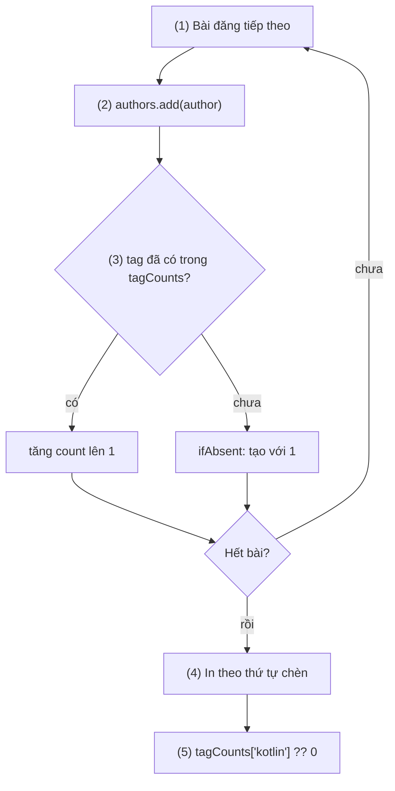
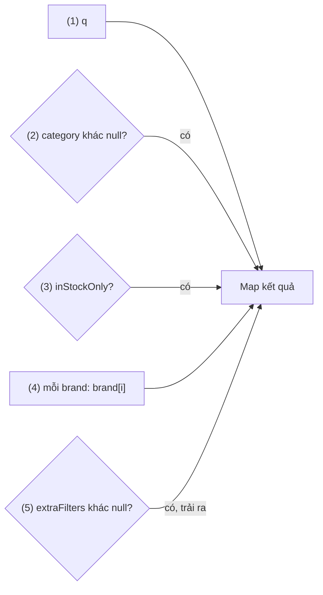
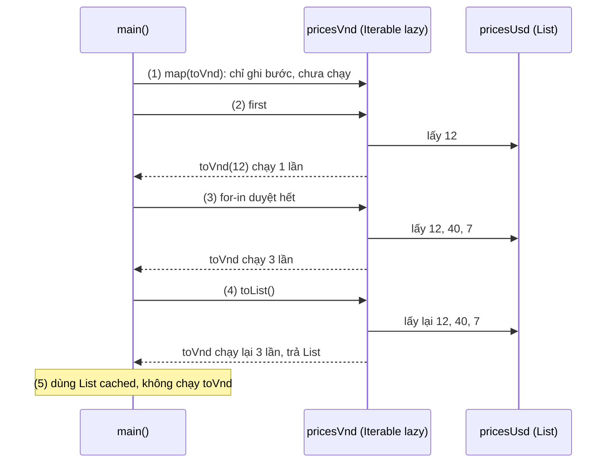
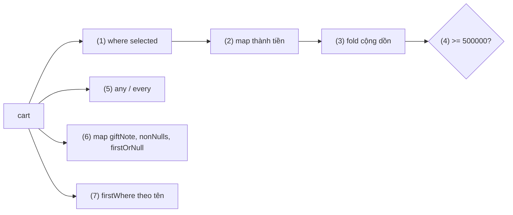
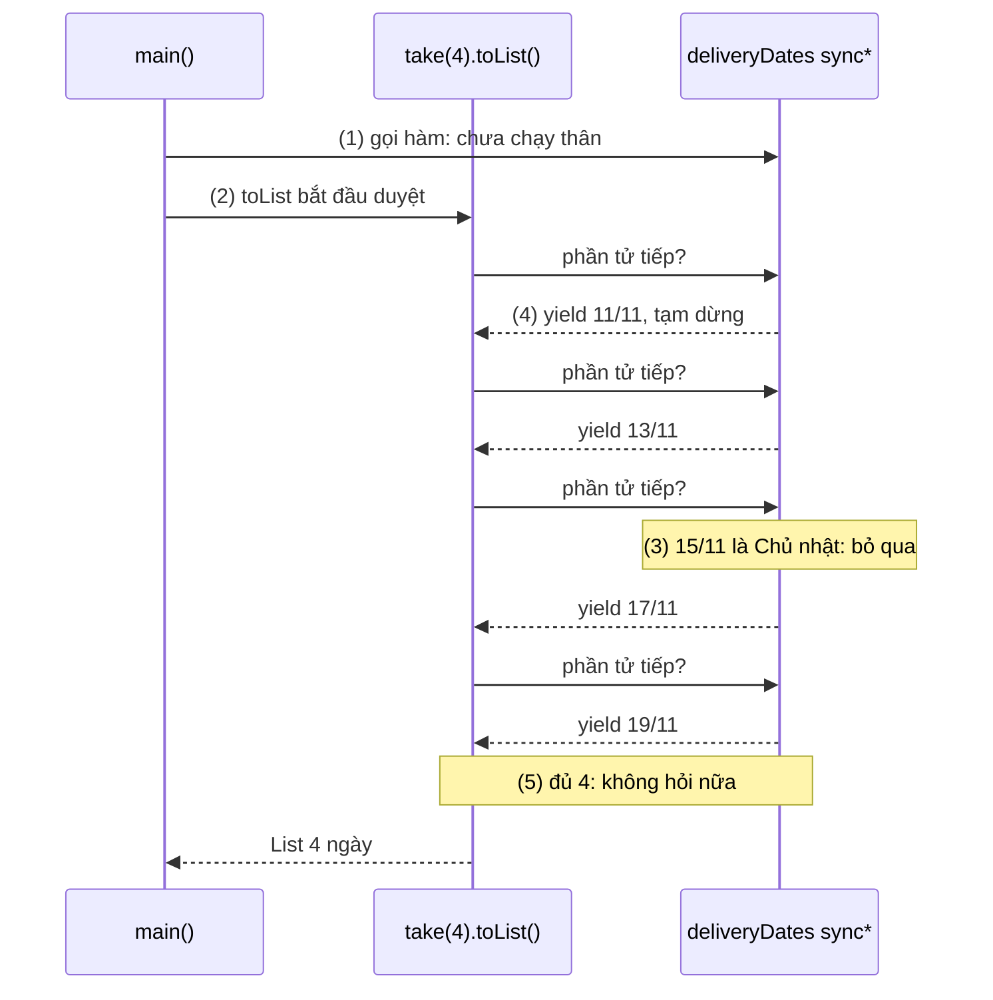
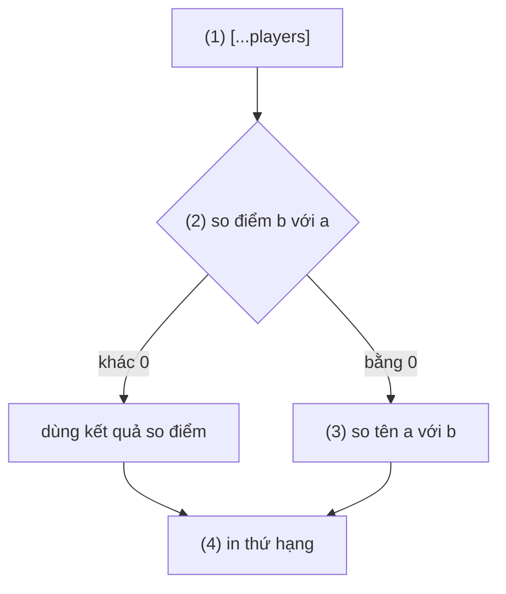
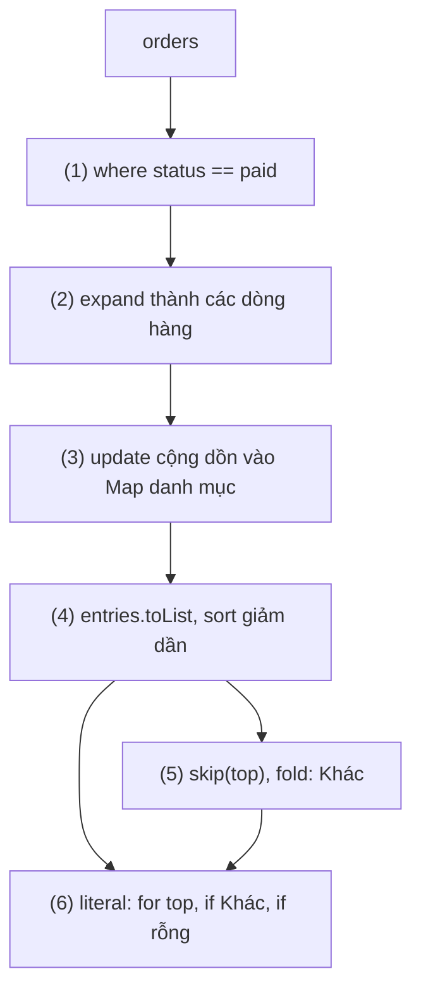

# Collections and Functional APIs

## Vấn đề cần giải quyết

Phần lớn code của một app là **biến đổi một nhóm dữ liệu thành một nhóm dữ liệu khác**: danh sách đơn hàng thành tổng doanh thu, danh sách sản phẩm thành danh sách widget, tham số lọc thành query string. Mỗi lần như vậy phải trả lời bốn câu hỏi:

1. **Chứa dữ liệu bằng gì?** Cần giữ thứ tự, cần loại trùng, hay cần tra nhanh theo key?
2. **Dựng collection có điều kiện thế nào?** Phần tử này chỉ có khi người dùng đã đăng nhập, entry kia chỉ có khi giá trị khác null.
3. **Biến đổi xảy ra lúc nào?** Ngay khi gọi `map`, hay chỉ khi có người đọc kết quả? Đọc hai lần thì tính mấy lần?
4. **Ai được sửa collection?** Truyền một list cho hàm khác, hàm đó `sort()` thì bản của mình có đổi không?

Vòng lặp thủ công trả lời được câu 1 và 2 nhưng dài, nhiều biến tạm. Dùng `map`/`where` mà không hiểu câu 3 và 4 thì gặp lỗi rất khó thấy:

```dart
var minPrice = 100;
final expensive = [80, 150, 600].where((price) => price > minPrice);
minPrice = 500;
print(expensive.toList()); // [600], không phải [150, 600]
```

`where` không lọc ngay lúc gọi; nó chỉ lọc khi `toList()` duyệt, và lúc đó `minPrice` đã là 500.

## Sau khi học xong

- Phân biệt được List, Set, Map và chọn đúng loại theo cách truy cập dữ liệu (theo thứ tự, không trùng lặp, tra theo key).
- Áp dụng được collection literal với collection if, collection for, spread và null-aware element để dựng collection có điều kiện.
- Giải thích được lazy evaluation của Iterable, method nào chỉ thêm bước vào chuỗi xử lý và method nào thực sự duyệt, và vì sao duyệt lại thì callback chạy lại.
- Triển khai được chuỗi xử lý dữ liệu bằng where, map, expand, fold, any, every, firstWhere và generator sync*.
- Nhận diện được các bẫy mutability và equality của collection, gồm final list vẫn sửa được, const và List.unmodifiable chỉ chặn sửa lúc chạy, sort sửa tại chỗ và không ổn định, == so sánh identity.

## Collections and Functional APIs là gì?

**Collection** là object chứa một nhóm phần tử: `List` (dãy có thứ tự, truy cập theo chỉ số), `Set` (không có phần tử trùng) và `Map` (tra value theo key). `List` và `Set` là **`Iterable`**: một nguồn phần tử duyệt được lần lượt từ đầu tới cuối. **Functional API** là các method trên `Iterable` nhận một hàm (`map`, `where`, `fold`...) để mô tả cách biến đổi phần tử; phần lớn trả về một `Iterable` **lazy**, chỉ tính khi được duyệt và tính lại mỗi lần duyệt.

Mental model: một `Iterable` lazy là **một công thức nấu ăn, chưa phải món ăn**. `map`, `where` chỉ ghi thêm bước vào công thức. Chỉ khi có người "ăn" (duyệt bằng `for`, gọi `toList`, `fold`, `first`...) thì công thức mới được nấu, mỗi lần ăn là nấu lại từ đầu với nguyên liệu tại thời điểm đó. `toList()` là nấu một lần rồi cất vào hộp: `List` là món đã nấu xong.

## Cách hoạt động

### List, Set, Map: ba cách tổ chức phần tử

| | `List<E>` | `Set<E>` | `Map<K, V>` |
|---|---|---|---|
| Literal | `['a', 'b']` | `{'a', 'b'}` | `{'a': 1}` |
| Thứ tự | Theo chỉ số | Mặc định giữ thứ tự chèn | Mặc định giữ thứ tự chèn của key |
| Trùng lặp | Cho phép | Không (dựa trên `==` và `hashCode`) | Key không trùng, value tuỳ ý |
| Truy cập chính | `list[i]` | `set.contains(x)` | `map[key]` |
| Là `Iterable` | Có | Có | Không; duyệt qua `keys`, `values`, `entries` |

Những điểm khác Kotlin và dễ sai:

- **Literal mặc định**: `[...]` là list **growable** (thêm, bớt được); `{...}` có phần tử là `LinkedHashSet`, `{k: v}` là `LinkedHashMap`, nên duyệt Set và Map ra đúng thứ tự chèn.
- **`{}` rỗng là `Map`, không phải `Set`.** `var tags = {};` có kiểu `Map<dynamic, dynamic>`. Set rỗng phải viết `<String>{}`. Tương tự, list rỗng nên ghi kiểu: `<String>[]`, nếu không sẽ thành `List<dynamic>`.
- **`map[key]` luôn trả `V?`**, kể cả khi `V` không nullable, vì key có thể không tồn tại. Dùng `map[key] ?? defaultValue`, hoặc `containsKey` khi `null` cũng là một value hợp lệ. Null-aware operator nằm ở [1.2.1 Variables and Types](variables_and_types.md).
- **Constructor có bẫy**: `List.filled(n, value)` tạo list **fixed-length** (gọi `add` ném `UnsupportedError`) và mọi ô **dùng chung một object** `value`. `List.filled(3, <int>[])` là ba tham chiếu tới cùng một list; cần ba list riêng thì dùng `List.generate(3, (_) => <int>[])`.
- Thao tác Map hay dùng: `putIfAbsent(key, () => v)`, `update(key, (old) => ..., ifAbsent: () => ...)`, `remove(key)`, `entries` (các `MapEntry` có `key`, `value`), `Map.fromEntries(...)`.

#### Ví dụ: thống kê hashtag trong các bài đăng

**Bài toán:** từ danh sách bài đăng, cần biết những tác giả nào đã đăng (mỗi người một lần) và mỗi hashtag xuất hiện bao nhiêu lần. "Mỗi người một lần" là việc của `Set`; "đếm theo hashtag" là việc của `Map` với key là hashtag.

**Luồng chạy:**

1. Duyệt từng bài đăng.
2. Thêm tác giả vào `Set`: đã có thì `add` không làm gì.
3. Với mỗi hashtag, `update` tăng bộ đếm nếu key đã có, `ifAbsent` tạo key mới với giá trị 1.
4. In Set và Map: thứ tự đúng như lúc chèn.
5. Đọc một key không tồn tại trả `null`, dùng `??` để có giá trị mặc định.



**Code:**

```dart
// hashtag_stats.dart
void main() {
  const posts = [
    (author: 'lan', tags: ['flutter', 'dart']),
    (author: 'minh', tags: ['dart']),
    (author: 'lan', tags: ['flutter', 'firebase']),
  ];

  final authors = <String>{};                       // Set: mỗi tác giả một lần
  final tagCounts = <String, int>{};                // Map: hashtag -> số lần

  for (final post in posts) {                       // (1) duyệt từng bài
    authors.add(post.author);                       // (2) trùng thì Set bỏ qua
    for (final tag in post.tags) {
      tagCounts.update(tag, (count) => count + 1,   // (3) đã có key: tăng
          ifAbsent: () => 1);                       //     chưa có: tạo với 1
    }
  }

  print('Tác giả: $authors');                       // (4) giữ thứ tự chèn
  print('Hashtag: $tagCounts');
  print('Số lần #kotlin: ${tagCounts['kotlin'] ?? 0}'); // (5) key vắng mặt -> null
}
```

**Kết quả:**

```text
Tác giả: {lan, minh}
Hashtag: {flutter: 2, dart: 2, firebase: 1}
Số lần #kotlin: 0
```

### Collection literal: if, for, spread, null-aware element

Trong một literal `[...]`, `{...}`, ngoài phần tử thường còn đặt được **element điều khiển**. Chúng không phải câu lệnh (không có ngoặc nhọn, không có `;`), mà là cách **sinh ra 0, 1 hoặc nhiều phần tử** ngay tại chỗ:

| Element | Cú pháp | Sinh ra |
|---|---|---|
| Collection if | `if (cond) x` hoặc `if (cond) x else y` | `x` khi điều kiện đúng; không có gì (hoặc `y`) khi sai |
| If-case | `if (value case pattern) x` | `x` khi pattern khớp (pattern ở [1.2.3 Control Flow and Patterns](control_flow_patterns.md)) |
| Collection for | `for (final item in items) f(item)` | Một phần tử cho mỗi lượt lặp |
| Spread | `...other` | Toàn bộ phần tử của `other` |
| Null-aware spread | `...?other` | Như spread, `other` là `null` thì không sinh gì |
| Null-aware element | `?value` (list, set); `?key: value` hoặc `key: ?value` (map) | `value` nếu khác `null`, bỏ qua nếu là `null` (với map: bỏ cả entry) |

Các element lồng nhau được (`for` bên trong `if`, `if` bên trong `for`). Null-aware element cần Dart 3.8 trở lên (`sdk: ^3.8.0` trong `pubspec.yaml`). Kotlin không có cú pháp tương đương trong literal; gần nhất là `buildList { if (...) add(x) }` hoặc `listOfNotNull(...)`.

#### Ví dụ: dựng query parameters cho API tìm kiếm

**Bài toán:** màn hình tìm kiếm có từ khoá bắt buộc và nhiều bộ lọc tuỳ chọn. Query gửi lên server chỉ được chứa bộ lọc người dùng đã chọn: không gửi `category=null`, không gửi `stock=false`. Một Map literal với element điều khiển mô tả đúng "map này gồm những gì" mà không cần `if` rời rạc sau khi tạo.

**Luồng chạy:**

1. `q` luôn có.
2. `category` là `String?`: null-aware value `?category` bỏ cả entry nếu null.
3. `stock` chỉ có khi bật lọc còn hàng: collection if.
4. Mỗi thương hiệu một entry `brand[i]`: collection for kết hợp `indexed` (cặp chỉ số và phần tử).
5. Bộ lọc bổ sung có thể null: null-aware spread `...?`.



**Code:**

```dart
// search_query.dart
Map<String, String> buildSearchQuery({
  required String keyword,
  String? category,
  bool inStockOnly = false,
  List<String> brands = const [],
  Map<String, String>? extraFilters,
}) {
  return {
    'q': keyword,                                   // (1) luôn có
    'category': ?category,                          // (2) null thì bỏ cả entry
    if (inStockOnly) 'stock': 'in',                 // (3) collection if
    for (final (i, brand) in brands.indexed)        // (4) collection for
      'brand[$i]': brand,
    ...?extraFilters,                               // (5) null-aware spread
  };
}

void main() {
  print(buildSearchQuery(keyword: 'giày'));
  print(buildSearchQuery(
    keyword: 'giày',
    category: 'the-thao',
    inStockOnly: true,
    brands: ['nike', 'adidas'],
    extraFilters: {'sort': 'price_asc'},
  ));
}
```

**Kết quả:**

```text
{q: giày}
{q: giày, category: the-thao, stock: in, brand[0]: nike, brand[1]: adidas, sort: price_asc}
```

Trong Flutter, đây chính là cách dựng danh sách widget con, vì `children` là một `List<Widget>`:

```dart
// Code Flutter: product_list_screen.dart (trong build)
Column(
  children: [
    const Text('Sản phẩm'),
    if (isLoading) const LinearProgressIndicator(),
    ?promoBanner,                                   // Widget? : null thì không hiện
    for (final product in products) ProductTile(product: product),
    if (!isLoading && products.isEmpty) const Text('Không có sản phẩm'),
  ],
)
```

### Iterable và lazy evaluation

`Iterable<E>` là bất cứ thứ gì đưa ra được một `Iterator` để lấy lần lượt từng phần tử. `for-in` chỉ cần một `Iterable`. Method của `Iterable` chia làm hai nhóm, và đây là điều quan trọng nhất của bài:

| Nhóm | Method | Khi gọi |
|---|---|---|
| **Lazy** (thêm bước vào công thức) | `map`, `where`, `whereType`, `expand`, `take`, `skip`, `takeWhile`, `skipWhile`, `followedBy`, `cast`, `nonNulls`, `indexed` | Trả về `Iterable` mới ngay lập tức, **chưa gọi callback nào** |
| **Duyệt thật** (nấu) | `for-in`, `toList`, `toSet`, `fold`, `reduce`, `forEach`, `join`, `any`, `every`, `contains`, `first`, `firstWhere`, `last`, `length` (với phần lớn Iterable lazy) | Lấy phần tử từ nguồn, gọi callback của các bước trước |

Hệ quả của mental model công thức:

- **Duyệt bao nhiêu lần, tính bấy nhiêu lần.** Mỗi lần duyệt chạy lại toàn bộ chuỗi `map`/`where` từ nguồn. Callback có side effect (log, đếm, gọi API) sẽ chạy lại.
- **Đọc nguyên liệu tại thời điểm duyệt.** Biến mà callback dùng, hoặc chính list nguồn, bị sửa sau khi gọi `where` thì kết quả theo giá trị mới (ví dụ ở "Vấn đề cần giải quyết").
- **Xử lý từng phần tử qua cả chuỗi.** Với `list.where(a).map(b)`, phần tử 1 qua `a` rồi `b`, sau đó mới tới phần tử 2; không có list trung gian.
- **Dừng sớm được.** `first`, `any`, `take(3)` chỉ kéo đủ phần tử cần dùng. Nhờ vậy chuỗi trên nguồn vô hạn (generator, mục sau) vẫn chạy được.

> [!IMPORTANT]
> Đây là khác biệt lớn nhất với Kotlin. `list.map { }` của Kotlin chạy **ngay** và trả `List`; muốn lazy phải `asSequence()`. Còn `list.map(...)` của Dart trả **`Iterable` lazy**, tương đương `Sequence` của Kotlin. Muốn có `List` phải gọi `.toList()`.

#### Ví dụ: quy đổi giá và đếm số lần callback chạy

**Bài toán:** giỏ hàng lưu giá bằng USD, màn hình hiển thị VND. Hàm quy đổi có log để thấy rõ nó chạy lúc nào và bao nhiêu lần.

**Luồng chạy:**

1. `map(toVnd)` chỉ trả về một Iterable lazy: chưa quy đổi gì.
2. `first` kéo phần tử đầu tiên: `toVnd` chạy một lần rồi dừng.
3. Duyệt bằng `for-in`: `toVnd` chạy cho cả ba phần tử.
4. `toList()` là một lần duyệt nữa: `toVnd` chạy lại ba lần, kết quả được lưu vào một `List`.
5. Dùng `List` đã lưu: không chạy lại.



**Code:**

```dart
// lazy_prices.dart
const usdToVnd = 25000;

int toVnd(int usd) {
  print('  quy đổi $usd USD');                      // log để thấy lúc nào hàm chạy
  return usd * usdToVnd;
}

void main() {
  final pricesUsd = [12, 40, 7];

  final pricesVnd = pricesUsd.map(toVnd);           // (1) chỉ tạo "công thức"
  print('Đã gọi map, kiểu: ${pricesVnd.runtimeType}');

  print('first = ${pricesVnd.first}');              // (2) duyệt tới phần tử đầu là dừng

  print('Lần duyệt 1:');
  for (final _ in pricesVnd) {}                     // (3) duyệt hết: chạy toVnd 3 lần
  print('Lần duyệt 2:');
  final cached = pricesVnd.toList();                // (4) duyệt lại: chạy lại 3 lần, rồi lưu kết quả

  print('Dùng cached: $cached');                    // (5) List đã tính sẵn, không chạy lại
}
```

**Kết quả:**

```text
Đã gọi map, kiểu: MappedListIterable<int, int>
  quy đổi 12 USD
first = 300000
Lần duyệt 1:
  quy đổi 12 USD
  quy đổi 40 USD
  quy đổi 7 USD
Lần duyệt 2:
  quy đổi 12 USD
  quy đổi 40 USD
  quy đổi 7 USD
Dùng cached: [300000, 1000000, 175000]
```

`runtimeType` cho thấy kết quả của `map` không phải `List`. `length` cũng tuỳ implementation: trên kết quả `map` của một List thì không gọi callback, trên kết quả `where` thì phải duyệt hết. Đừng dựa vào chi tiết đó: kết quả dùng nhiều lần thì `toList()` một lần.

### Các thao tác functional thường dùng

| Việc | Method | Ghi chú |
|---|---|---|
| Biến đổi từng phần tử | `map(f)` | Lazy |
| Lọc | `where(test)`, `whereType<T>()` | Lazy; `whereType` lọc theo kiểu và trả đúng `Iterable<T>` (Kotlin: `filterIsInstance`) |
| Một thành nhiều, trải phẳng | `expand(f)` | Lazy; tương đương `flatMap` |
| Bỏ null | `nonNulls` | Lazy; `Iterable<T?>` thành `Iterable<T>` (Dart 3.0; Kotlin: `filterNotNull`) |
| Kèm chỉ số | `indexed` | Lazy; mỗi phần tử là record `(index, value)` (Dart 3.0) |
| Gộp thành một giá trị | `fold(initial, f)` | An toàn với collection rỗng (trả `initial`) |
| Gộp không có giá trị đầu | `reduce(f)` | Collection rỗng ném `StateError: No element` |
| Có ít nhất một / tất cả | `any(test)`, `every(test)` | Dừng sớm khi đã biết kết quả |
| Tìm phần tử | `firstWhere(test, orElse: ...)` | Không thấy và không có `orElse` thì ném `StateError` |
| Lấy an toàn | `firstOrNull`, `lastOrNull`, `singleOrNull`, `elementAtOrNull(i)` | Trả `null` thay vì ném (Dart 3.0) |
| Cắt | `take(n)`, `skip(n)`, `takeWhile`, `skipWhile` | Lazy |
| Ghép chuỗi | `join(', ')` | Gọi `toString()` từng phần tử |
| Chốt kết quả | `toList()`, `toSet()` | `toSet()` cũng loại trùng, giữ thứ tự gặp đầu tiên |

Hai điểm về null safety:

- Muốn "không thấy thì null", dùng `where(test).firstOrNull` hoặc `firstWhereOrNull(test)` của `package:collection`; `orElse: () => null` không compile trên `List<String>` (Sai lầm 5).
- `fold` suy kiểu kết quả từ giá trị đầu; khi ngữ cảnh không rõ, ghi kiểu tường minh `fold<int>(0, ...)`.

`forEach(f)` duyệt được, nhưng với thân nhiều dòng thì `for-in` dễ đọc hơn và dùng được `break`, `continue`, `await`; analyzer có lint `avoid_function_literals_in_foreach_calls` cho trường hợp này. Truyền tear-off như `forEach(print)` thì vẫn gọn.

#### Ví dụ: tính tạm tính giỏ hàng

**Bài toán:** giỏ hàng có món được chọn và món bỏ chọn. Cần tạm tính các món được chọn, xác định có miễn phí vận chuyển không, có món nào mua số lượng lớn, có món nào kèm lời nhắn gói quà, và tra một món theo tên. Mỗi câu hỏi là một method functional.

**Luồng chạy:**

1. `where`: giữ món được chọn.
2. `map`: mỗi món thành thành tiền `price * quantity`.
3. `fold`: cộng dồn từ 0. Đây là lúc chuỗi lazy (1) và (2) thực sự chạy, từng món một.
4. So tạm tính với ngưỡng miễn phí vận chuyển.
5. `any`/`every`: câu hỏi có/không trên cả giỏ.
6. `map` ra lời nhắn (có thể null), `nonNulls` bỏ null, `firstOrNull` lấy cái đầu hoặc `null`.
7. `firstWhere`: tra món theo tên (chắc chắn có trong giỏ).



**Code:**

```dart
// cart_summary.dart
class CartItem {
  CartItem(this.name, this.price, this.quantity, {this.selected = true, this.giftNote});
  final String name;
  final int price;
  final int quantity;
  final bool selected;
  final String? giftNote;
}

void main() {
  final cart = [
    CartItem('Tai nghe', 450000, 1),
    CartItem('Cáp USB-C', 90000, 3, giftNote: 'Gói quà giúp mình'),
    CartItem('Ốp lưng', 120000, 2, selected: false),
  ];

  final subtotal = cart
      .where((item) => item.selected)                 // (1) lọc món được chọn
      .map((item) => item.price * item.quantity)      // (2) thành tiền từng món
      .fold(0, (sum, line) => sum + line);            // (3) cộng dồn từ 0

  final freeShipping = subtotal >= 500000;            // (4) điều kiện tổng
  final hasBulk = cart.any((item) => item.quantity >= 3);       // (5) có ít nhất một?
  final allSelected = cart.every((item) => item.selected);      //     tất cả?
  final firstGift = cart.map((item) => item.giftNote).nonNulls.firstOrNull; // (6)
  final headphone = cart.firstWhere((item) => item.name == 'Tai nghe'); // (7)

  print('Tạm tính: $subtotal');
  print('Miễn phí vận chuyển: $freeShipping');
  print('Có món mua số lượng lớn: $hasBulk, chọn hết: $allSelected');
  print('Lời nhắn quà: ${firstGift ?? 'không có'}');
  print('Giá tai nghe: ${headphone.price}');
}
```

**Kết quả:**

```text
Tạm tính: 720000
Miễn phí vận chuyển: true
Có món mua số lượng lớn: true, chọn hết: false
Lời nhắn quà: Gói quà giúp mình
Giá tai nghe: 450000
```

Tạm tính là 450000 + 90000 × 3; ốp lưng bị loại ở bước (1).

### Generator `sync*`

Một hàm đánh dấu **`sync*`** là **generator đồng bộ**: nó trả về một `Iterable`, và thân hàm chỉ chạy khi có người duyệt Iterable đó. Mỗi `yield value` đưa ra một phần tử rồi **tạm dừng** thân hàm tại chỗ; lần lấy phần tử kế tiếp, thân hàm chạy tiếp từ ngay sau `yield`. `yield* other` đưa ra toàn bộ phần tử của một Iterable khác (hay dùng cho đệ quy).

Theo mental model công thức, generator là **công thức viết bằng code tuần tự** thay vì ghép `map`/`where`, nên có đủ tính chất lazy: gọi hàm chưa chạy gì, mỗi lần duyệt chạy lại thân hàm từ đầu, nguồn vô hạn vẫn an toàn nếu chỉ lấy hữu hạn phần tử.

Phiên bản bất đồng bộ `async*` trả về `Stream` thay vì `Iterable`, nằm ở [1.3.2 Streams](../async/streams.md). Kotlin dev sẽ thấy `sync*` tương ứng `sequence { yield(x) }`.

#### Ví dụ: sinh lịch giao hàng định kỳ, bỏ qua Chủ nhật

**Bài toán:** gói đăng ký giao hàng hai ngày một lần, không giao Chủ nhật. Lịch là vô hạn; màn hình chỉ cần vài ngày tới. Generator mô tả quy tắc một lần, người dùng tự lấy bao nhiêu tuỳ ý.

**Luồng chạy:**

1. Gọi `deliveryDates(...)`: nhận về Iterable, thân hàm **chưa chạy**.
2. `take(4).toList()` bắt đầu duyệt: thân hàm chạy lần đầu.
3. Ngày rơi vào Chủ nhật thì không `yield`, cộng thêm hai ngày.
4. `yield` một ngày rồi tạm dừng, chờ được hỏi phần tử tiếp theo.
5. Sau phần tử thứ tư, `take` không hỏi nữa: vòng lặp vô hạn dừng ở trạng thái tạm dừng, không bao giờ chạy tiếp.



**Code:**

```dart
// delivery_dates.dart
Iterable<DateTime> deliveryDates(DateTime start, {int everyDays = 2}) sync* {
  print('  [bắt đầu chạy thân generator]');        // (2) chỉ chạy khi có người duyệt
  var date = start;
  while (true) {                                     // vô hạn: an toàn vì lazy
    if (date.weekday != DateTime.sunday) {           // (3) Chủ nhật không giao
      print('  yield ${date.day}/${date.month}');
      yield date;                                    // (4) trả một phần tử rồi tạm dừng
    }
    date = date.add(Duration(days: everyDays));
  }
}

void main() {
  final schedule = deliveryDates(DateTime(2026, 11, 11)); // (1) chưa chạy gì
  print('Đã tạo schedule');

  final nextFour = schedule.take(4).toList();        // (5) take dừng sau 4 phần tử
  print(nextFour.map((d) => '${d.day}/${d.month}').join(', '));
}
```

**Kết quả:**

```text
Đã tạo schedule
  [bắt đầu chạy thân generator]
  yield 11/11
  yield 13/11
  yield 17/11
  yield 19/11
11/11, 13/11, 17/11, 19/11
```

Dòng "bắt đầu chạy thân generator" in **sau** "Đã tạo schedule": đúng bước (1). Gọi `schedule.take(4).toList()` lần nữa thì thân hàm chạy lại từ đầu và in lại toàn bộ log.

`yield*` hợp với cấu trúc đệ quy, ví dụ trải phẳng cây danh mục thành các đường dẫn:

```dart
Iterable<String> flatten(Map<String, Object> tree, [String prefix = '']) sync* {
  for (final MapEntry(:key, :value) in tree.entries) {
    final path = '$prefix/$key';
    yield path;
    if (value case Map<String, Object> children) {
      yield* flatten(children, path);              // đưa ra mọi phần tử của nhánh con
    }
  }
}
// {'thoi-trang': {'nam': {}, 'nu': {}}, 'dien-tu': {'dien-thoai': {}}}
// -> [/thoi-trang, /thoi-trang/nam, /thoi-trang/nu, /dien-tu, /dien-tu/dien-thoai]
```

### Sort và các bẫy

`list.sort([compare])`:

- **Sửa list tại chỗ và trả về `void`.** `final sorted = list.sort();` dùng `sorted` ở đâu đó là lỗi compile `use_of_void_result`. Muốn bản đã sắp xếp mà giữ nguyên bản gốc: sao chép rồi sort, `[...list]..sort()` (cascade `..` ở [1.2.2 Functions and Operators](functions_operators.md)).
- **Không có `compare` thì dùng `Comparable.compare`**: phần tử phải là `Comparable` (`int`, `double`, `String`, `DateTime`...).
- **Không đảm bảo ổn định (stable)**: hai phần tử so bằng nhau có thể đổi chỗ. Cần thứ tự xác định thì so thêm tiêu chí phụ trong `compare`, hoặc dùng `mergeSort` (ổn định) của `package:collection`.
- **`String` so theo mã UTF-16**, không theo ngôn ngữ: chữ hoa đứng trước chữ thường, chữ có dấu tiếng Việt đứng sau `z`. `['Bình', 'Ánh', 'an', 'Châu']..sort()` ra `[Bình, Châu, an, Ánh]`. Số lưu dạng chuỗi sắp theo từng ký tự: `['10', '9', '1']` ra `[1, 10, 9]`.

`dart:core` không có `sortedBy`, `groupBy`, `firstWhereOrNull` như Kotlin. Package **`collection`** (của Dart team, trên pub.dev) bổ sung các extension đó và gần như có mặt trong mọi dự án Flutter: `sortedBy`, `sorted`, `groupListsBy`, `firstWhereOrNull`, `mergeSort`, cùng các lớp equality ở mục Equality. Cách khai báo dependency nằm ở 2.2.1 pub.dev and Package Management (chưa có bài).

#### Ví dụ: bảng xếp hạng cùng điểm thì xếp theo tên

**Bài toán:** bảng xếp hạng sắp theo điểm giảm dần; người cùng điểm phải có thứ tự cố định (theo tên), nếu không mỗi lần mở màn hình thứ hạng có thể nhảy lung tung. Danh sách gốc còn được màn hình khác dùng nên không được sửa.

**Luồng chạy:**

1. Sao chép bằng spread rồi mới `sort` (qua cascade `..`), bản gốc giữ nguyên.
2. So điểm giảm dần: `b.compareTo(a)`.
3. Cùng điểm (`compareTo` trả 0) thì so tên tăng dần, nên kết quả không phụ thuộc thuật toán sort có ổn định hay không.
4. Duyệt kèm chỉ số để in thứ hạng.



**Code:**

```dart
// leaderboard.dart (cần dependency collection trong pubspec.yaml)
import 'package:collection/collection.dart';

typedef Player = ({String name, int score});

void main() {
  final players = <Player>[
    (name: 'Minh', score: 80),
    (name: 'An', score: 95),
    (name: 'Châu', score: 80),
    (name: 'Bảo', score: 95),
  ];

  final ranking = [...players]                         // (1) sao chép, không đụng bản gốc
    ..sort((a, b) {
      final byScore = b.score.compareTo(a.score);      // (2) điểm giảm dần
      if (byScore != 0) return byScore;
      return a.name.compareTo(b.name);                 // (3) cùng điểm: theo tên
    });

  for (final (index, p) in ranking.indexed) {          // (4) in thứ hạng
    print('${index + 1}. ${p.name} - ${p.score}');
  }
  print('Bản gốc giữ nguyên: ${players.map((p) => p.name).join(', ')}');

  // package:collection: trả list mới, không sửa bản gốc
  final byName = players.sortedBy((p) => p.name);
  print(byName.map((p) => p.name).join(', '));
  final groups = players.groupListsBy((p) => p.score);
  print(groups.map((score, list) => MapEntry(score, list.map((p) => p.name).toList())));
  print(players.firstWhereOrNull((p) => p.score > 100));
}
```

**Kết quả:**

```text
1. An - 95
2. Bảo - 95
3. Châu - 80
4. Minh - 80
Bản gốc giữ nguyên: Minh, An, Châu, Bảo
An, Bảo, Châu, Minh
{80: [Minh, Châu], 95: [An, Bảo]}
null
```

### Mutability: ai được sửa collection

`final` chỉ khoá **biến** (không gán biến sang object khác), không khoá **object** mà biến trỏ tới. Dart chỉ có **một** kiểu `List` cho cả list sửa được lẫn không sửa được; việc chặn sửa xảy ra **lúc chạy**:

| Cách tạo | Gán lại biến | `add`/`remove`/`[i] =` | Ghi chú |
|---|---|---|---|
| `var items = [...]` | Được | Được | |
| `final items = [...]` | Không | **Được** | Bẫy số một của Kotlin dev |
| `List.filled(n, v)` | Tuỳ biến | Sửa ô được; `add`/`remove` ném `UnsupportedError` | Fixed-length |
| `List.unmodifiable(src)` | Tuỳ biến | Ném `UnsupportedError` | **Bản sao**: `src` đổi sau đó không ảnh hưởng |
| `UnmodifiableListView(src)` (`dart:collection`) | Tuỳ biến | Ném `UnsupportedError` | **View**: `src` đổi thì view thấy thay đổi |
| `const [...]` | Không | Ném `UnsupportedError` | Hằng compile-time, các literal const giống nhau dùng chung một object |

Điều quan trọng: `const items = [1, 2]; items.add(3);` **vẫn compile được**, vì kiểu tĩnh vẫn là `List<int>`. Lỗi chỉ hiện lúc chạy: `Unsupported operation: Cannot add to an unmodifiable list`. Kotlin chặn được ở compile-time nhờ tách `List` và `MutableList`; Dart thì không. `final`/`const` nói chung nằm ở [1.2.1 Variables and Types](variables_and_types.md).

Hai hệ quả thực tế:

- **Collection được chia sẻ theo tham chiếu.** Truyền list vào hàm hay constructor là truyền cùng một object; bên kia `sort()`, `add()` thì bên này cũng thấy. Class muốn giữ dữ liệu không bị sửa từ ngoài thì sao chép khi nhận (`List.unmodifiable(items)`); phần immutability của class nằm ở [1.2.5 Classes, Mixins and Sealed Types](classes_mixins_sealed.md).
- **Không sửa kích thước collection đang được duyệt.** `for (final x in list) { list.remove(x); }` ném `ConcurrentModificationError`. Dùng `list.removeWhere(test)` / `retainWhere(test)`, hoặc duyệt một bản sao (`for (final x in [...list])`).

### Equality của collection

`==` của `List`, `Set`, `Map` là **so identity**: chỉ `true` khi hai biến trỏ tới **cùng một object**. Hai list có cùng phần tử theo cùng thứ tự vẫn khác nhau:

```dart
import 'package:collection/collection.dart';

final a = ['dart', 'flutter'];
final b = ['dart', 'flutter'];
print(a == b);                                                    // false
print(const ListEquality<String>().equals(a, b));                 // true
print(const DeepCollectionEquality().equals({'tags': a}, {'tags': b})); // true: so lồng nhau
print(const DeepCollectionEquality.unordered().equals([1, 2], [2, 1])); // true: bỏ qua thứ tự
print((tags: a) == (tags: b));                                    // false: record so field bằng ==
print(identical(const ['x'], const ['x']));                       // true: const dùng chung object
```

Đây là chỗ khác Kotlin (`listOf(1, 2) == listOf(1, 2)` là `true`). Nó quan trọng vì nhiều thư viện state management so state cũ và mới bằng `==` để quyết định có rebuild UI hay không: state chứa list mới tạo mỗi lần sẽ luôn "khác", còn state bị sửa tại chỗ thì vẫn là cùng object nên luôn "giống". Code Flutter có sẵn `listEquals`, `setEquals`, `mapEquals` trong `package:flutter/foundation.dart` cho so sánh một tầng; override `==`/`hashCode` cho class nằm ở [1.2.5 Classes, Mixins and Sealed Types](classes_mixins_sealed.md).

## Ví dụ thực tế

### Báo cáo doanh thu theo danh mục

**Bài toán chính:** từ danh sách đơn hàng (mỗi đơn có trạng thái và nhiều dòng hàng thuộc các danh mục), dựng các dòng hiển thị cho màn hình báo cáo: top danh mục theo doanh thu, gộp phần còn lại thành "Khác", và thông báo riêng khi chưa có đơn nào đã thanh toán. Bài toán dùng gần như mọi phần của bài: chuỗi lazy, Map để cộng dồn, sort, và collection literal để dựng kết quả.

**Luồng chạy:**

1. `where`: chỉ giữ đơn đã thanh toán.
2. `expand`: mỗi đơn thành các dòng hàng của nó, trải phẳng thành một chuỗi dòng hàng.
3. `Map.update` cộng dồn doanh thu theo danh mục trong khi `for-in` duyệt chuỗi lazy (1)(2).
4. `entries.toList()` chốt thành List (vì `sort` chỉ có trên List), rồi sort giảm dần theo doanh thu.
5. `skip(top)` + `fold`: tổng doanh thu của các danh mục ngoài top.
6. List literal với collection for (kèm `indexed` và pattern tách `MapEntry`) và collection if dựng các dòng hiển thị.



**Code:**

```dart
// revenue_report.dart
class OrderLine {
  const OrderLine(this.category, this.amount);
  final String category;
  final int amount;
}

class Order {
  const Order(this.id, this.status, this.lines);
  final String id;
  final String status;
  final List<OrderLine> lines;
}

List<String> buildReport(List<Order> orders, {int top = 2, bool showOthers = true}) {
  final revenueByCategory = <String, int>{};
  for (final line in orders
      .where((order) => order.status == 'paid')              // (1) chỉ đơn đã thanh toán
      .expand((order) => order.lines)) {                     // (2) trải phẳng thành các dòng hàng
    revenueByCategory.update(line.category, (sum) => sum + line.amount,
        ifAbsent: () => line.amount);                        // (3) cộng dồn theo danh mục
  }

  final ranked = revenueByCategory.entries.toList()          // (4) chốt thành List rồi sort
    ..sort((a, b) => b.value.compareTo(a.value));

  final others = ranked.skip(top).fold(0, (sum, e) => sum + e.value); // (5) phần ngoài top

  return [                                                   // (6) dựng các dòng hiển thị
    'Doanh thu theo danh mục',
    for (final (rank, MapEntry(:key, :value)) in ranked.take(top).indexed)
      '${rank + 1}. $key: $value',
    if (showOthers && others > 0) 'Khác: $others',
    if (ranked.isEmpty) 'Chưa có đơn đã thanh toán',
  ];
}

void main() {
  const orders = [
    Order('DH01', 'paid', [OrderLine('Điện tử', 900), OrderLine('Sách', 120)]),
    Order('DH02', 'cancelled', [OrderLine('Điện tử', 5000)]),
    Order('DH03', 'paid', [OrderLine('Thời trang', 300), OrderLine('Sách', 80)]),
    Order('DH04', 'paid', [OrderLine('Gia dụng', 150)]),
  ];
  buildReport(orders).forEach(print);
  print('---');
  buildReport([]).forEach(print);
}
```

**Kết quả:**

```text
Doanh thu theo danh mục
1. Điện tử: 900
2. Thời trang: 300
Khác: 350
---
Doanh thu theo danh mục
Chưa có đơn đã thanh toán
```

Đơn `DH02` bị huỷ nên 5000 không được tính. "Khác" là Sách (120 + 80) cộng Gia dụng (150). Hai danh mục cùng doanh thu có thể ra thứ tự bất kỳ vì `sort` không đảm bảo ổn định; báo cáo thật nên thêm tiêu chí phụ như ví dụ bảng xếp hạng.

### Danh sách "đã xem gần đây" không trùng lặp

Mở lại một sản phẩm đã xem thì nó phải lên đầu và không xuất hiện hai lần. Set literal mặc định (`LinkedHashSet`) giữ thứ tự chèn và không trùng: `remove` rồi `add` lại để đưa phần tử xuống cuối, hiển thị bằng `toList().reversed.take(n)`. Không cần tự kiểm tra trùng bằng `List.contains` (chậm dần theo độ dài list).

## Khi nào nên và không nên dùng

**Chọn loại collection:**

- `List`: thứ tự quan trọng, cần truy cập theo chỉ số, cho phép trùng (danh sách tin nhắn, dòng hàng).
- `Set`: cần "mỗi phần tử một lần" hoặc `contains` nhanh (id đã chọn, tag, sản phẩm đã xem).
- `Map`: tra theo key (cache theo id, đếm theo nhóm, header HTTP). Nếu key là một tập cố định biết trước (các field của một đối tượng), dùng class hoặc record thay cho `Map<String, dynamic>` để có kiểm tra kiểu.

**Lazy hay chốt kết quả:**

- Giữ `Iterable` lazy khi kết quả chỉ được duyệt **một lần**, khi có thể dừng sớm (`first`, `any`, `take`), hoặc khi nguồn rất lớn / vô hạn.
- Gọi `toList()` khi kết quả được dùng **nhiều lần**, được lưu vào field hay state, được trả ra từ API public, hoặc khi callback có side effect hay đọc biến có thể đổi. API public nên nhận và trả `List` thay vì `Iterable` lazy, trừ khi lazy là chủ ý.

**Functional API hay vòng lặp:**

- Chuỗi `where`/`map`/`fold` ngắn gọn khi mỗi bước là một biến đổi thuần.
- Vòng lặp `for-in` dễ đọc hơn khi cần `break`, `await`, cập nhật nhiều biến cùng lúc, hoặc chuỗi đã quá ba bốn bước khó dò.

**`sync*`**: khi logic sinh phần tử có trạng thái hoặc đệ quy (lịch, cây, phân trang), khó viết bằng `map`/`where`. Không cần khi chỉ biến đổi một list có sẵn.

## Sai lầm thường gặp

### 1. Viết `{}` để tạo Set rỗng

`var selectedIds = {};` là `Map<dynamic, dynamic>`; gọi `selectedIds.add(1)` là lỗi compile vì Map không có `add`. Sửa: `final selectedIds = <int>{};`.

### 2. Dùng kết quả `map`/`where` nhiều lần mà không `toList()`

Mỗi lần duyệt chạy lại callback: việc gọi API, ghi log analytics, tạo object bị lặp, và nếu biến bên ngoài đổi giữa hai lần duyệt thì hai lần ra hai kết quả (ví dụ `minPrice` ở đầu bài). Chốt bằng `toList()` khi kết quả cần ổn định.

### 3. Tưởng `sort()` trả về list mới

```dart
final sorted = prices.sort();
print(sorted); // error - This expression has a type of 'void' so its value can't be used.
```

Và nếu không gán, `prices.sort()` đã âm thầm đổi thứ tự list gốc mà nơi khác đang dùng. Sửa: `final sorted = [...prices]..sort();` hoặc `prices.sorted()` của `package:collection`.

### 4. `List.filled` với một object sửa được

```dart
final grid = List.filled(2, <int>[]);
grid[0].add(7);
print(grid); // [[7], [7]]: hai ô là cùng một list
```

Sửa: `List.generate(2, (_) => <int>[])` tạo object mới cho từng ô.

### 5. `firstWhere` với `orElse: () => null`

Trên `List<String>` lỗi compile `return_of_invalid_type_from_closure`, vì `orElse` phải trả `String`. Không có `orElse` thì không tìm thấy là `StateError: No element`. Sửa: `names.where((n) => n == id).firstOrNull` hoặc `names.firstWhereOrNull(...)` (`package:collection`).

### 6. `reduce` trên collection có thể rỗng

`<int>[].reduce((a, b) => a + b)` ném `StateError: No element`. Giỏ hàng rỗng, danh sách lọc ra rỗng là chuyện bình thường; dùng `fold(0, ...)`.

### 7. Sửa list const hoặc unmodifiable

Compile qua, crash lúc chạy với `Unsupported operation: Cannot add to an unmodifiable list`. Hay gặp khi tham số mặc định là `const []` (`List<String> brands = const []`) rồi hàm gọi `brands.add(...)`. Muốn sửa thì sao chép trước: `final result = [...brands, extra];`.

### 8. Xoá phần tử trong lúc duyệt chính list đó

`for (final item in cart) { if (item.expired) cart.remove(item); }` ném `ConcurrentModificationError`. Sửa: `cart.removeWhere((item) => item.expired);`.

### 9. So sánh hai list bằng `==`

`if (newTags == oldTags)` luôn `false` với hai list khác object dù cùng nội dung, nên logic "chỉ lưu khi có thay đổi" luôn lưu. Dùng `ListEquality().equals`, `DeepCollectionEquality` hoặc `listEquals` của Flutter.

## Lịch sử phát triển

- **Dart 1.0 (11/2013)**: `dart:core` đã có `List`, `Set`, `Map`, `Iterable` cùng `map`, `where`, `expand`, `fold`, `reduce`, `any`, `every`, `firstWhere`; tài liệu của `map`/`where` khi đó đã ghi rõ kết quả là Iterable lazy, callback chạy lại mỗi lần duyệt. Nghĩa là lazy (khác Kotlin) là thiết kế gốc của Dart, không phải thay đổi về sau.
- **Dart 1.9 (2015)**: thêm generator `sync*` (cùng `async`, `await`, `async*`, `yield`, `yield*`) để viết Iterable lazy bằng code tuần tự thay vì tự cài `Iterator`.
- **Dart 2.2 (2019)**: thêm Set literal `{a, b}`. Trước đó phải viết `Set.from([...])`, và `{}` đã là Map literal, nên Set rỗng phải ghi kiểu `<T>{}`.
- **Dart 2.3 (2019)**: spread `...`/`...?`, collection if và collection for, nhóm tính năng "UI-as-code". Lý do được nêu rõ trong changelog: Flutter viết UI bằng các biểu thức lồng nhau sâu, và `children: [...]` với `..add()` hay biến tạm làm code UI khó đọc.
- **Dart 2.12 (2021)**: sound null safety. `map[key]` trả `V?`, `orElse` của `firstWhere` phải trả đúng kiểu phần tử; các API trả "có thể không có" trở nên tường minh.
- **Dart 3.0 (5/2023)**: thêm vào `dart:core` các extension `nonNulls`, `firstOrNull`, `lastOrNull`, `singleOrNull`, `elementAtOrNull`, `indexed`; pattern dùng được trong `for-in` và if-case dùng được trong collection literal.
- **Dart 3.8 (5/2025)**: null-aware element `?value` trong list, set, map literal, thay cho `if (x != null) x`.

## Kết nối hệ thống

- **Tiên quyết**:
  - [1.2.1 Variables and Types](variables_and_types.md): `final`/`const`, generics (`List<E>`, `Map<K, V>`), null safety, record.
  - [1.2.2 Functions and Operators](functions_operators.md): hàm là giá trị, closure, tear-off (`map(toVnd)`, `forEach(print)`), cascade `..`.
  - [1.2.3 Control Flow and Patterns](control_flow_patterns.md): `for-in`, pattern trong `for` và if-case trong collection literal.
- **Liên quan**:
  - [1.2.5 Classes, Mixins and Sealed Types](classes_mixins_sealed.md): override `==`/`hashCode` (quyết định phần tử có trùng trong `Set`, key có trùng trong `Map`), immutability và `copyWith`.
  - [1.3.2 Streams](../async/streams.md): `Stream` là phiên bản bất đồng bộ của `Iterable`, `async*` là phiên bản bất đồng bộ của `sync*`, cùng bộ method `map`/`where`/`expand`.
  - [1.1.1 Dart for Kotlin Developers](dart_for_kotlin_devs.md): khác biệt collection Kotlin và Dart ở mức tổng quan.
- **Học tiếp**: [1.2.5 Classes, Mixins and Sealed Types](classes_mixins_sealed.md) theo thứ tự mục lục. Collection if/for được dùng hằng ngày khi dựng widget tree (3.1.1 Stateless and Stateful Widgets (chưa có bài)); `package:collection` được khai báo qua 2.2.1 pub.dev and Package Management (chưa có bài).

## Tham khảo

- [Collections: List, Set, Map, collection if/for, spread, null-aware element](https://dart.dev/language/collections) (dart.dev)
- [Iterable collections](https://dart.dev/libraries/collections/iterables) (dart.dev)
- [Generators](https://dart.dev/language/functions#generators) (dart.dev)
- [Iterable class](https://api.dart.dev/dart-core/Iterable-class.html) và [List.sort](https://api.dart.dev/dart-core/List/sort.html) (api.dart.dev)
- [package:collection](https://pub.dev/packages/collection) (pub.dev)
- [listEquals](https://api.flutter.dev/flutter/foundation/listEquals.html) (api.flutter.dev)
- [Dart SDK CHANGELOG](https://github.com/dart-lang/sdk/blob/main/CHANGELOG.md): các mục 3.8.0, 3.0.0, 2.3.0, 2.2.0, 1.9.1
- [`iterable.dart` của Dart 1.0](https://github.com/dart-lang/sdk/blob/1.0.0.3/sdk/lib/core/iterable.dart) (mã nguồn SDK, tag 1.0.0.3): API và tài liệu lazy của `Iterable` lúc phát hành 1.0
