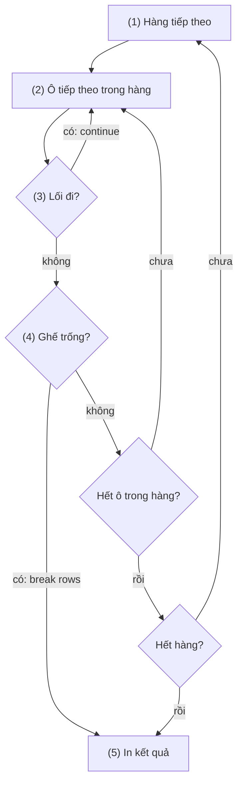
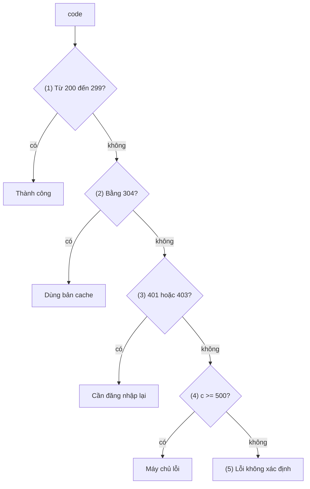
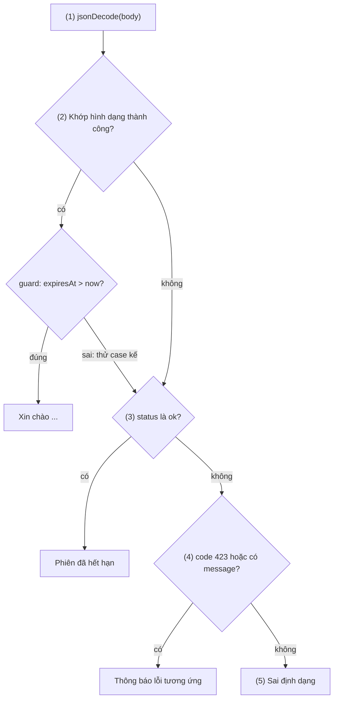
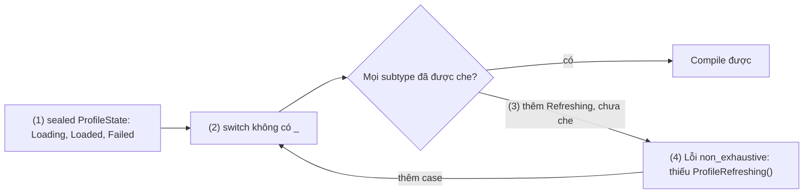
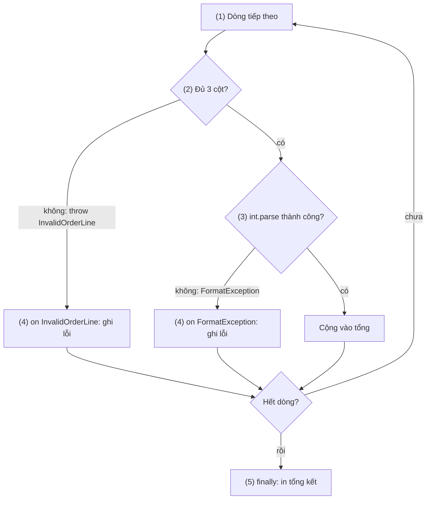
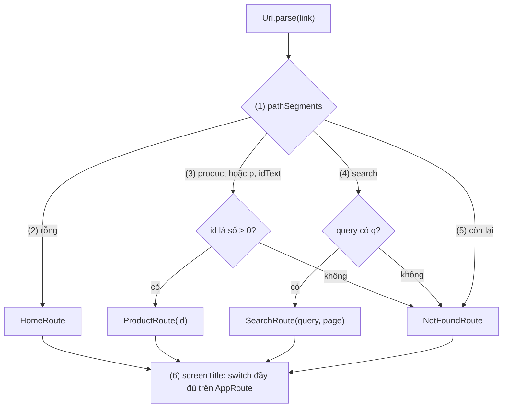

# Control Flow and Patterns

## Vấn đề cần giải quyết

Phần lớn logic của một app là **rẽ nhánh theo hình dạng dữ liệu**: phản hồi API thành công hay lỗi; deep link trỏ tới màn hình nào; state đang loading, có dữ liệu hay thất bại. Mỗi nhánh thường cần ba việc:

1. **Kiểm tra kiểu và cấu trúc**: có phải `Map` không, có key `user` không, `user.id` có phải `int` không.
2. **Lấy các phần bên trong** ra biến.
3. **Chắc chắn đã xử lý hết các trường hợp**, kể cả trường hợp thêm sau này.

Không có công cụ phù hợp, ba việc đó thành chuỗi `if` lồng nhau với `is` và truy cập key thủ công:

```dart
// Đọc phản hồi đăng nhập theo kiểu "trước Dart 3"
String greet(Object? json) {
  if (json is Map<String, dynamic> && json['status'] == 'ok') {
    final user = json['user'];
    if (user is Map<String, dynamic>) {
      final id = user['id'];
      final name = user['name'];
      if (id is int && name is String) {
        return 'Xin chào $name (#$id)';
      }
    }
  }
  return 'Phản hồi không đúng định dạng';
}
```

Code dài, dễ sót một bước kiểm tra, và compiler không biết bạn đã xử lý hết các trường hợp hay chưa. Ngoài ra, khi luồng chạy bình thường **không thể tiếp tục** (dữ liệu sai định dạng, hết hàng), cần một cách thoát ra và đưa lỗi lên chỗ biết cách xử lý: exception.

## Sau khi học xong

- Phân biệt được switch statement và switch expression, cùng quy tắc case của Dart 3 (không cần break, chỉ case rỗng mới rơi xuống case sau, continue tới label).
- Áp dụng được các loại pattern để kiểm tra và destructure record, list, map, object trong switch, if-case, khai báo biến và for-in.
- Giải thích được cách exhaustiveness checking quyết định một switch đã phủ hết giá trị hay chưa, và vì sao chỉ bool, enum, sealed type (và nullable, record của chúng) hoặc một case khớp mọi giá trị như `_` mới giúp compiler chứng minh được điều đó.
- Xử lý được exception đồng bộ bằng throw, on/catch, finally và rethrow, và phân biệt được Exception với Error.
- Biết khi nào dùng if, if-case, switch statement hay switch expression cho một nhánh rẽ.

## Control Flow and Patterns là gì?

**Control flow (luồng điều khiển)** là các cấu trúc quyết định câu lệnh nào chạy tiếp theo: rẽ nhánh (`if`, `switch`), lặp (`for`, `while`) và thoát bất thường (`throw`/`try`). Từ Dart 3, các cấu trúc này dùng chung **pattern (mẫu)**: một mô tả hình dạng của giá trị, vừa **kiểm tra** giá trị có khớp không, vừa **tách** (destructure) các phần bên trong ra biến.

Mental model: pattern là **một cái khuôn có lỗ**. Đặt khuôn lên giá trị: hình dạng không vừa khuôn thì không khớp; vừa khuôn thì phần giá trị nằm dưới mỗi lỗ được gán vào biến mang tên lỗ đó. Một switch là một chồng khuôn được thử lần lượt từ trên xuống; exhaustiveness checking là compiler kiểm tra chồng khuôn đó đã che kín mọi hình dạng mà kiểu dữ liệu cho phép hay chưa.

## Cách hoạt động

### Rẽ nhánh và vòng lặp cơ bản

Phần này giống Kotlin và Java, chỉ khác vài điểm:

- **Điều kiện phải là `bool` thật.** Dart không có truthy/falsy: `if (items.length)` hay `if (name)` là lỗi compile.
- **`if` là statement**, không trả về giá trị như Kotlin. Muốn chọn giá trị thì dùng toán tử ba ngôi `cond ? a : b` (xem [1.2.2 Functions and Operators](functions_operators.md)) hoặc switch expression.
- **Vòng lặp**: `for (var i = 0; i < n; i++)` khi cần chỉ số; `for (final item in items)` duyệt mọi `Iterable`; `while` kiểm tra điều kiện trước, `do-while` chạy ít nhất một lần.
- **`break`** thoát vòng lặp gần nhất, **`continue`** bỏ qua phần còn lại của lượt hiện tại. Gắn **label** (`rows:`) trước vòng lặp để `break rows;` / `continue rows;` tác động thẳng vào vòng ngoài, thay vì dùng biến cờ.

#### Ví dụ: tìm ghế trống đầu tiên trong sơ đồ rạp

**Bài toán:** sơ đồ ghế là danh sách các hàng; mỗi ô là ghế đã bán, ghế trống hoặc lối đi. Cần tìm ghế trống đầu tiên rồi dừng ngay. `break` thường chỉ thoát vòng trong, nên cần label.

**Luồng chạy:**

1. Vòng ngoài (gắn label `rows`) duyệt từng hàng.
2. Vòng trong duyệt từng ô của hàng.
3. Ô là lối đi thì `continue` sang ô kế tiếp.
4. Ô là ghế trống thì ghi lại vị trí và `break rows`: thoát **cả hai** vòng.
5. In kết quả (hoặc "Hết ghế").



**Code:**

```dart
// seat_finder.dart
void main() {
  // 'X' = đã bán, 'O' = còn trống, '_' = lối đi
  const seatMap = [
    ['X', 'X', '_', 'X', 'X'],
    ['X', 'X', '_', 'O', 'X'],
    ['O', 'O', '_', 'O', 'O'],
  ];

  String? firstFree;
  var checked = 0;

  rows:
  for (var row = 0; row < seatMap.length; row++) {     // (1) duyệt từng hàng
    for (var col = 0; col < seatMap[row].length; col++) { // (2) duyệt từng ô
      final cell = seatMap[row][col];
      if (cell == '_') continue;                        // (3) lối đi: bỏ qua ô này
      checked++;
      if (cell == 'O') {
        firstFree = 'Hàng ${row + 1}, ghế ${col + 1}';  // (4) tìm thấy
        break rows;                                     //     thoát cả hai vòng lặp
      }
    }
  }

  print(firstFree ?? 'Hết ghế');                        // (5) sau vòng lặp
  print('Đã kiểm tra $checked ghế');
}
```

**Kết quả:** `dart run seat_finder.dart` in:

```text
Hàng 2, ghế 4
Đã kiểm tra 7 ghế
```

Hàng 3 không được duyệt vì `break rows` dừng cả vòng ngoài. Chỉ viết `break` thì vòng ngoài chạy tiếp sang hàng 3 và `firstFree` bị ghi đè.

### Switch statement

`switch` so một giá trị (**matched value**, giá trị được so khớp) với lần lượt từng `case`, rồi chạy thân của case **đầu tiên** khớp. Quy tắc từ Dart 3:

- **Mỗi `case` là một pattern**, không chỉ là hằng số. `case 0:` là constant pattern; `case int n when n < 0:` là variable pattern kèm guard (mục sau).
- **Case có thân không rơi xuống case sau.** Chạy xong thân, switch kết thúc; không cần `break`. Đây là thay đổi của Dart 3.0: trước đó thân case không rỗng bắt buộc kết thúc bằng `break`, `continue`, `return`, `throw` hoặc `rethrow`.
- **Case rỗng rơi xuống case kế tiếp**, để nhiều case dùng chung một thân (hoặc viết gọn bằng logical-or pattern `case 'png' || 'jpg':`).
- **Nhảy sang một case không liền kề**: gắn label cho case đích và dùng `continue label;`.
- **`default:`** hoặc **`case _:`** bắt mọi giá trị còn lại.

```dart
// Lệnh điều khiển đèn thông minh: switch statement thực thi hành động, không trả giá trị
void handleCommand(String command) {
  switch (command) {
    case 'on':
      print('Bật đèn');           // xong là thoát switch, không cần break
    case 'off':
    case 'shutdown':              // case rỗng 'off' rơi xuống đây
      print('Tắt đèn');
    case 'reset':
      print('Xoá cấu hình');
      continue restart;           // nhảy tới case có label restart
    restart:
    case 'restart':
      print('Khởi động lại');
    default:
      print('Lệnh không hỗ trợ: $command');
  }
}
```

`handleCommand('reset')` in `Xoá cấu hình` rồi `Khởi động lại`; `handleCommand('off')` in `Tắt đèn`; `handleCommand('x')` in `Lệnh không hỗ trợ: x`.

### Switch expression

**Switch expression** (Dart 3.0) là dạng switch **trả về một giá trị**, dùng được ở mọi chỗ cần biểu thức: vế phải phép gán, `return`, đối số hàm, thân `=>`.

| | Switch statement | Switch expression |
|---|---|---|
| Mục đích | Thực thi hành động | Tính ra một giá trị |
| Một case | `case pattern:` + các câu lệnh | `pattern => biểu thức` |
| Phân cách case | xuống dòng | dấu phẩy |
| Case rỗng rơi xuống | có | không, mọi case phải có thân |
| Case mặc định | `default:` hoặc `case _:` | chỉ `_` |
| Phải phủ hết mọi giá trị | chỉ khi kiểu là bool, enum, sealed... | luôn luôn |

Một switch expression không được đứng đầu một câu lệnh (dễ nhầm với switch statement); muốn chạy hành động thì dùng statement.

#### Ví dụ: chọn thông báo theo mã HTTP status

**Bài toán:** từ mã HTTP status chọn ra câu thông báo cho người dùng: "từ một giá trị chọn ra một giá trị", đúng việc của switch expression.

**Luồng chạy:** các case được thử **từ trên xuống**, case đầu tiên khớp quyết định kết quả.

1. Khoảng `[200, 300)`: relational pattern kết hợp logical-and.
2. Đúng `304`: constant pattern.
3. `401` hoặc `403`: logical-or pattern.
4. Từ 500 trở lên: bind vào `c` rồi kiểm tra bằng guard `when`.
5. Còn lại: wildcard `_`.



**Code:**

```dart
// http_status.dart
String describeStatus(int code) => switch (code) {
      >= 200 && < 300 => 'Thành công',                 // (1) relational + logical-and
      304 => 'Dùng bản cache',                         // (2) constant pattern
      401 || 403 => 'Cần đăng nhập lại',               // (3) logical-or
      final c when c >= 500 => 'Máy chủ lỗi ($c), thử lại sau', // (4) guard
      _ => 'Lỗi không xác định ($code)',               // (5) wildcard
    };

void main() {
  for (final code in [201, 304, 403, 503, 418]) {
    print('$code → ${describeStatus(code)}');
  }
}
```

**Kết quả:**

```text
201 → Thành công
304 → Dùng bản cache
403 → Cần đăng nhập lại
503 → Máy chủ lỗi (503), thử lại sau
418 → Lỗi không xác định (418)
```

Bỏ dòng `_ => ...` thì `dart analyze` báo lỗi `non_exhaustive_switch_expression`: switch expression trên `int` phải có nhánh cho mọi số nguyên (mục Exhaustiveness checking giải thích vì sao).

### Pattern: khuôn kiểm tra và tách giá trị

Một pattern làm hai việc, tuỳ loại:

- **Match (khớp)**: giá trị có đúng hình dạng không (đúng kiểu, bằng hằng số, list đủ số phần tử, map có key).
- **Destructure (tách)**: khi khớp, gán các phần bên trong vào biến mới.

Pattern xuất hiện ở hai loại ngữ cảnh:

| Ngữ cảnh | Ở đâu | Pattern không khớp thì sao |
|---|---|---|
| **Matching context** (refutable: được phép không khớp) | `case` của switch, `if (x case ...)` | Chỉ là "không khớp": thử case kế tiếp hoặc chạy nhánh `else` |
| **Irrefutable context** (không được phép không khớp) | Khai báo biến `final (a, b) = ...`, gán `(a, b) = ...`, `for (final (a, b) in ...)` | Compiler từ chối nếu kiểu không chắc khớp; nếu chỉ lộ ra lúc chạy (list sai độ dài, map thiếu key) thì ném `StateError` |

Các loại pattern chính, xếp theo độ ưu tiên từ thấp tới cao (dùng ngoặc `( )` để đổi thứ tự):

| Pattern | Cú pháp | Khớp khi |
|---|---|---|
| Logical-or | `p1 \|\| p2` | Một trong hai khớp; hai nhánh phải bind cùng tập biến |
| Logical-and | `p1 && p2` | Cả hai khớp; hai nhánh không được bind trùng tên biến |
| Relational | `>= 200`, `< 300`, `== x`, `!= x` | Phép so sánh với một **hằng số** cho kết quả `true` |
| Cast | `p as int` | Ép kiểu rồi khớp tiếp; **ném lỗi** nếu giá trị không đúng kiểu |
| Null-check | `p?` | Giá trị khác `null` (null chỉ là không khớp) |
| Null-assert | `p!` | Giá trị khác `null`; **ném lỗi** nếu là `null` |
| Constant | `304`, `'ok'`, `null`, `Zone.inner`, `const (1 + 2)` | Giá trị `==` hằng số |
| Variable | `var x`, `final String s`, `int n` | Luôn khớp (có kiểu thì phải đúng kiểu), bind giá trị vào biến |
| Wildcard | `_`, `int _` | Luôn khớp (có kiểu thì phải đúng kiểu), không bind gì |
| List | `[a, b]`, `[first, ...rest]` | Là `List` và **đúng số phần tử** (trừ khi có một rest element `...`) |
| Map | `{'id': int id}` | Là `Map` và có các key được nêu; **key thừa bị bỏ qua** |
| Record | `(a, b)`, `(:name, :age)` | Là record có **đúng** các field đó (khớp toàn bộ record) |
| Object | `ProfileLoaded(:final name)` | Đúng kiểu, rồi khớp từng getter được nêu; getter không nêu thì bỏ qua |

`:name` là viết tắt của `name: name` (getter hay field tên `name`, bind vào biến cùng tên); `:final name` thêm `final` cho biến đó.

Ba điểm hay nhầm:

- **Một tên đứng trần trong `case` là constant pattern, không phải biến mới.** `case maxRetry:` so với hằng `maxRetry`. Muốn bind thì viết `case final n:` (xem Sai lầm 4).
- **Relational và constant pattern chỉ nhận hằng số.** Điều kiện phụ thuộc giá trị lúc chạy phải nằm trong guard.
- **`_` không bind gì.** Từ Dart 3.7, `_` làm tên biến cục bộ hay tham số (`(_, _) => ...`) cũng là wildcard, không tạo biến.

### Destructuring: record, list, map, object

Destructuring là dùng pattern ở irrefutable context để **khai báo nhiều biến từ một giá trị**. Bản thân kiểu record (field, equality) nằm ở [1.2.1 Variables and Types](variables_and_types.md).

```dart
// Record: hàm trả nhiều giá trị, nơi gọi tách ra ngay
(String, int) topSeller() => ('Áo thun', 120);
final (name, sold) = topSeller();               // name = 'Áo thun', sold = 120

// Record có field tên
final ({String city, int zip}) address = (city: 'Huế', zip: 49000);
final (:city, :zip) = address;

// Gán bằng pattern: hoán đổi hai biến không cần biến tạm
var low = 9, high = 2;
(low, high) = (high, low);                      // low = 2, high = 9

// List: phần tử đầu và phần còn lại
final [best, ...others] = [9, 7, 8, 6];         // best = 9, others = [7, 8, 6]

// Object: gọi getter x, y của Point
final Point(:x, :y) = Point(3, 4);

// for-in: mỗi phần tử của map.entries là MapEntry, dùng object pattern
for (final MapEntry(:key, :value) in headers.entries) {
  print('$key: $value');
}
```

Hai giới hạn của irrefutable context:

- **Kiểu phải chắc chắn khớp ở compile-time.** `MapEntry` là class, không phải record, nên tách nó phải dùng object pattern `MapEntry(:key, :value)`; record pattern bị từ chối (Sai lầm 1).
- **Cấu trúc chỉ biết lúc chạy thì ném `StateError`.** `final [a, b] = list;` compile được với mọi `List`, nhưng `list` có một phần tử thì chạy ra `Bad state: Pattern matching error`; map pattern thiếu key cũng vậy. Dữ liệu không chắc chắn (JSON, input người dùng) phải đi qua matching context: `switch` hoặc `if-case`.

### Guard `when` và if-case

**Guard** là điều kiện `bool` viết sau pattern bằng `when`. Pattern khớp và bind biến trước, rồi mới tính guard (nên guard dùng được biến vừa bind). **Guard sai thì switch thử case kế tiếp**, không thoát khỏi switch. Guard dùng được trong cả hai dạng switch và if-case.

**If-case** (`if (value case pattern)`) thử **một** pattern: khớp thì chạy nhánh `then` với các biến của pattern trong scope; không khớp thì chạy `else` nếu có.

```dart
// Chỉ quan tâm một loại message từ WebSocket
if (message case {'type': 'typing', 'userId': int userId} when userId != myId) {
  showTypingIndicator(userId);                  // userId chỉ tồn tại trong nhánh này
}
```

If-case còn dùng được ngay trong collection literal (`[..., if (x case ...) item]`); collection `if`/`for` nói chung nằm ở [1.2.4 Collections and Functional APIs](collections_functional.md).

#### Ví dụ: đọc phản hồi đăng nhập từ JSON

**Bài toán:** API đăng nhập trả JSON có vài hình dạng: thành công (kèm user, danh sách role, thời điểm token hết hạn), tài khoản bị khoá, lỗi có message. `jsonDecode` không đảm bảo kiểu gì: bài toán điển hình của map pattern lồng nhau trong matching context.

**Luồng chạy:**

1. `jsonDecode` trả về giá trị chưa biết hình dạng.
2. Case thành công: map có `status: 'ok'`, `user` là map có `id` kiểu `int` và `name` kiểu `String`, `roles` là list có ít nhất một `String`, `expiresAt` là `int`; guard so `expiresAt` với `now` (giá trị lúc chạy nên phải dùng guard).
3. Guard sai (token hết hạn) thì thử case kế tiếp: chỉ cần `status: 'ok'`.
4. Hai hình dạng lỗi: `code: 423`, hoặc có `message`.
5. Còn lại: wildcard.



**Code:**

```dart
// login_response.dart
import 'dart:convert';

String handleLogin(String body, {required int now}) {
  final Object? json = jsonDecode(body); // (1) chưa biết hình dạng

  return switch (json) {
    // (2) đúng hình dạng thành công VÀ token còn hạn
    {
      'status': 'ok',
      'user': {'id': int id, 'name': String name},
      'roles': [String mainRole, ...],
      'expiresAt': int expiresAt,
    }
        when expiresAt > now =>
      'Xin chào $name (#$id), vai trò chính: $mainRole',
    // (3) guard ở trên sai thì rơi xuống đây
    {'status': 'ok'} => 'Phiên đã hết hạn, đăng nhập lại',
    // (4) hai hình dạng lỗi
    {'status': 'error', 'code': 423} => 'Tài khoản bị khoá',
    {'status': 'error', 'message': String message} => 'Lỗi: $message',
    // (5) mọi hình dạng còn lại
    _ => 'Phản hồi không đúng định dạng',
  };
}

void main() {
  const now = 1000;
  const ok = '{"status":"ok","user":{"id":7,"name":"Lan"},'
      '"roles":["admin","editor"],"expiresAt":2000,"token":"abc"}';
  const expired = '{"status":"ok","user":{"id":7,"name":"Lan"},'
      '"roles":["admin"],"expiresAt":900}';
  print(handleLogin(ok, now: now));
  print(handleLogin(expired, now: now));
  print(handleLogin('{"status":"error","code":423}', now: now));
  print(handleLogin('{"status":"error","code":500,"message":"DB down"}', now: now));
  print(handleLogin('{"user":{"id":"7"}}', now: now));
}
```

**Kết quả:**

```text
Xin chào Lan (#7), vai trò chính: admin
Phiên đã hết hạn, đăng nhập lại
Tài khoản bị khoá
Lỗi: DB down
Phản hồi không đúng định dạng
```

Key thừa `token` không cản việc khớp (map pattern bỏ qua key thừa), còn bỏ `...` thì `["admin","editor"]` **không** khớp `[String mainRole]`. Trong thân case, `id` và `name` đã có kiểu `int`, `String` mà không cần cast: đoạn này thay hẳn chuỗi `if` lồng nhau ở đầu bài.

### Exhaustiveness checking

**Exhaustiveness checking** (kiểm tra tính đầy đủ) là bước compiler chứng minh **mọi giá trị có thể có của kiểu matched value đều khớp ít nhất một case**; còn giá trị lọt qua thì báo lỗi và chỉ ra hình dạng còn thiếu.

Theo mental model cái khuôn: kiểu của matched value là một "không gian" các hình dạng, mỗi case không có guard che bớt một phần. Hết case mà còn phần chưa bị che thì switch chưa đầy đủ. Case có guard **không được tính là che** gì, vì compiler không biết trước guard đúng hay sai.

Compiler chỉ chia được không gian thành các phần **hữu hạn** khi kiểu có tập con biết trước (spec gọi là *always-exhaustive type*):

| Kiểu matched value | Compiler liệt kê được | Cách phủ hết |
|---|---|---|
| `bool` | `true`, `false` | Hai case, hoặc `_` |
| `enum` | mọi giá trị của enum | Mỗi giá trị một case, hoặc `_` |
| Sealed class | mọi subtype trực tiếp (khai báo cùng library) | Mỗi subtype một case, hoặc `_` |
| `T?` | các giá trị của `T` cộng thêm `null` | Phủ `T` và thêm case `null` |
| Record | tổ hợp các field (mỗi field theo các quy tắc trên) | Phủ mọi tổ hợp |
| `int`, `String`, `double`, class thường | vô hạn | Chỉ một case khớp mọi giá trị của kiểu: `_`, `default`, `final n`, `int()` (không kèm guard) |

Với `int`, compiler không suy luận khoảng số: ba case `< 0`, `0`, `> 0` phủ hết số nguyên về mặt toán học, nhưng compiler vẫn báo thiếu `int()`. Exhaustiveness checking làm việc trên kiểu, không phải trên toán học.

Áp dụng cho hai dạng switch:

- **Switch expression luôn phải đầy đủ**, với mọi kiểu, vì nó phải trả về một giá trị cho mọi đầu vào.
- **Switch statement chỉ phải đầy đủ khi matched value có always-exhaustive type**: `bool`, `Null`, enum, sealed type, `T?` hay record mà các thành phần đều là các kiểu đó. Thiếu case là lỗi compile `non_exhaustive_switch_statement`. Với `int`, `String`, `String?`, class thường, statement không có case nào khớp thì đơn giản là không làm gì.

Sealed class là cách tự tạo một kiểu có tập subtype đóng. Bài này chỉ dùng `sealed` để minh hoạ exhaustiveness; khai báo và các class modifier khác nằm ở [1.2.5 Classes, Mixins and Sealed Types](classes_mixins_sealed.md).

#### Ví dụ: hiển thị state của màn hình hồ sơ

**Bài toán:** màn hình hồ sơ có ba state: đang tải, đã có dữ liệu, thất bại; sau này sẽ có thêm state (đang làm mới). Mỗi khi thêm state, **mọi chỗ render chưa xử lý nó phải thành lỗi compile**, thay vì lặng lẽ rơi vào nhánh mặc định.

**Luồng chạy:**

1. `sealed class ProfileState` có ba subtype trong cùng file: tập subtype đóng.
2. `render` dùng switch expression **không có `_`**, mỗi subtype một case (`ProfileLoaded` tách hai case theo `followers`): compiler chứng minh được switch đầy đủ.
3. Thêm subtype `ProfileRefreshing`: không gian có thêm một phần chưa bị che.
4. `dart analyze` báo lỗi tại `render`, chỉ ra pattern còn thiếu; sửa bằng một case mới.



**Code:**

```dart
// profile_state.dart
sealed class ProfileState {}                       // (1) tập subtype đóng

class ProfileLoading extends ProfileState {}

class ProfileLoaded extends ProfileState {
  ProfileLoaded(this.name, this.followers);
  final String name;
  final int followers;
}

class ProfileFailed extends ProfileState {
  ProfileFailed(this.message);
  final String message;
}

String render(ProfileState state) => switch (state) { // (2) không có `_`
      ProfileLoading() => 'Đang tải...',
      ProfileLoaded(:final name, followers: 0) => '$name chưa có người theo dõi',
      ProfileLoaded(:final name, :final followers) => '$name · $followers người theo dõi',
      ProfileFailed(:final message) => 'Lỗi: $message',
    };

void main() {
  for (final state in [
    ProfileLoading(),
    ProfileLoaded('Lan', 0),
    ProfileLoaded('Minh', 1200),
    ProfileFailed('Mất kết nối'),
  ]) {
    print(render(state));
  }
}
```

**Kết quả:** chạy in:

```text
Đang tải...
Lan chưa có người theo dõi
Minh · 1200 người theo dõi
Lỗi: Mất kết nối
```

Thêm `class ProfileRefreshing extends ProfileState {}` (bước 3) rồi chạy `dart analyze` (bước 4):

```text
error - The type 'ProfileState' isn't exhaustively matched by the switch cases since it doesn't match the pattern 'ProfileRefreshing()'. Try adding a wildcard pattern or cases that match 'ProfileRefreshing()'. - non_exhaustive_switch_expression
```

Exhaustiveness đi sâu cả vào field: nếu bỏ case `followers: 0` và đổi case còn lại thành `ProfileLoaded(:final name, followers: > 0)`, compiler báo thiếu `ProfileLoaded(followers: int())`, vì `> 0` không phủ hết `int`.

### Exception đồng bộ

Khi một hàm không thể tiếp tục luồng bình thường, nó **ném** (throw) một object. Luồng chạy dừng tại đó và đi ngược lên chuỗi lời gọi tới khối `try` gần nhất có mệnh đề bắt phù hợp. Không ai bắt thì chương trình Dart dòng lệnh in lỗi kèm stack trace rồi dừng; trong Flutter, framework nhận lỗi qua cơ chế báo lỗi của nó.

**Ném:**

- `throw` ném được **mọi object khác null**, nhưng chỉ nên ném object implement `Exception` hoặc extend `Error`.
- `throw` là **biểu thức** (kiểu `Never`), nên đặt được trong thân `=>` và sau `??`: `final id = json['id'] ?? (throw FormatException('thiếu id'));`.
- Dart **không có checked exception** (giống Kotlin): hàm có thể ném gì phải được ghi trong doc comment.

**Exception và Error mang hai ý nghĩa khác nhau:**

| | `Exception` | `Error` |
|---|---|---|
| Ý nghĩa | Tình huống bất thường **dự đoán được**, người gọi có thể xử lý | **Lỗi lập trình**, đáng lẽ code phải tránh |
| Ví dụ | `FormatException` (`int.parse('ba')`), `IOException`, `TimeoutException` | `RangeError` (index ngoài list), `TypeError` (cast sai), `StateError` (`reduce` trên list rỗng), `ArgumentError` |
| Có nên catch | Có, ở nơi biết cách xử lý | Không; sửa code. Chỉ bắt ở tầng ngoài cùng để ghi log, báo crash |
| Tự định nghĩa | `class X implements Exception` | Hiếm khi cần |

Chỉ class **extend** `Error` mới tự ghi stack trace vào getter `stackTrace` khi bị ném lần đầu; implement `Error` thì không.

**Bắt:**

```dart
// Đặt giữ hàng từ ô nhập số lượng
try {
  final quantity = int.parse(input);
  reserve(quantity);
} on FormatException catch (e) {     // on: lọc theo kiểu; catch: lấy object
  showError('Số lượng không hợp lệ: ${e.source}');
} on OutOfStockException {           // chỉ cần kiểu, không cần object
  showError('Hết hàng');
} catch (e, stackTrace) {            // không có on: bắt mọi thứ còn lại
  logger.severe('Lỗi không mong đợi', e, stackTrace);
  rethrow;                           // ném tiếp đúng object và stack trace gốc
} finally {
  hideLoading();                     // luôn chạy: thành công, đã bắt, hay lỗi lọt ra ngoài
}
```

- Các mệnh đề `on`/`catch` được thử **theo thứ tự**, mệnh đề khớp đầu tiên xử lý: kiểu cụ thể đặt trước.
- `catch (e, s)`: tham số thứ hai là `StackTrace` tại chỗ ném.
- `rethrow` (chỉ dùng trong `catch`) ném tiếp exception đang xử lý, **giữ nguyên stack trace gốc** (khác `throw e;`, xem Sai lầm 7). Muốn đổi sang lỗi khác mà giữ stack trace cũ thì dùng `Error.throwWithStackTrace(newError, s)` (Dart 2.16).
- `finally` chạy sau mệnh đề `catch` khớp. Nếu không mệnh đề nào khớp, exception được ném tiếp **sau khi** `finally` chạy xong. `finally` chạy cả khi `try` kết thúc bằng `return`.

**`assert(condition, message)`** ném `AssertionError` khi điều kiện sai, nhưng **chỉ khi assert được bật** (Flutter debug mode, `dart run --enable-asserts`, `dart test`). Ở bản release, assert bị bỏ qua và biểu thức bên trong không được tính: chỉ dùng cho giả định nội bộ, không dùng kiểm tra input.

> [!IMPORTANT]
> Bài này chỉ nói về exception **đồng bộ**: lỗi ném ra trong lúc khối `try` đang chạy. Lỗi bên trong một `Future` hay `Stream` chỉ bắt được bằng `try`/`catch` khi bạn `await` nó; chi tiết ở [1.3.1 Futures and Async/Await](../async/futures_async_await.md).

#### Ví dụ: nhập đơn hàng từ file CSV

**Bài toán:** nhập đơn từ CSV, mỗi dòng `mã,tên,số lượng`. Dòng sai định dạng thì bỏ qua, ghi lỗi, đi tiếp; bản tổng kết luôn được in, kể cả khi một bug (một `Error`) làm vỡ vòng lặp.

**Luồng chạy:**

1. Duyệt từng dòng.
2. `parseQuantity` kiểm tra số cột; sai thì ném `InvalidOrderLine` (implement `Exception`).
3. `int.parse` ném `FormatException` nếu số lượng không phải số.
4. Hai mệnh đề `on ... catch` bắt đúng hai loại lỗi dữ liệu, ghi lại rồi đi tiếp. Một `Error` (bug) không khớp mệnh đề nào nên lọt ra ngoài.
5. `finally` của khối `try` ngoài luôn in tổng kết.



**Code:**

```dart
// order_import.dart
class InvalidOrderLine implements Exception {
  InvalidOrderLine(this.lineNumber, this.reason);
  final int lineNumber;
  final String reason;

  @override
  String toString() => 'Dòng $lineNumber: $reason';
}

int parseQuantity(String line, int lineNumber) {
  final columns = line.split(',');
  if (columns.length != 3) {
    throw InvalidOrderLine(lineNumber, 'cần 3 cột, có ${columns.length}'); // (2)
  }
  return int.parse(columns[2]); // (3) có thể ném FormatException
}

void importOrders(List<String> lines) {
  var total = 0;
  final errors = <String>[];
  try {
    for (var i = 0; i < lines.length; i++) {           // (1) từng dòng
      try {
        total += parseQuantity(lines[i], i + 1);
      } on InvalidOrderLine catch (e) {                // (4) lỗi dữ liệu: ghi lại, đi tiếp
        errors.add(e.toString());
      } on FormatException catch (e) {
        errors.add('Dòng ${i + 1}: số lượng "${e.source}" không phải số');
      }
    }
  } finally {
    print('Tổng số lượng: $total, lỗi: ${errors.length}'); // (5) luôn chạy
  }
  for (final error in errors) {
    print(error);
  }
}

void main() {
  importOrders([
    'SKU-01,Áo thun,2',
    'SKU-02,Quần jean',
    'SKU-03,Mũ,ba',
    'SKU-04,Tất,5',
  ]);
}
```

**Kết quả:**

```text
Tổng số lượng: 7, lỗi: 2
Dòng 2: cần 3 cột, có 2
Dòng 3: số lượng "ba" không phải số
```

Dòng 1 và 4 được cộng (2 + 5). Nếu thay hai mệnh đề `on` bằng một `catch (e)`, hai dòng lỗi vẫn bị bỏ qua, nhưng một bug như đọc nhầm `columns[3]` (`RangeError`) cũng bị ghi thành "lỗi dữ liệu" và vòng lặp chạy tiếp như không có gì. Đó là lý do lọc bằng `on`.

## Ví dụ thực tế

### Định tuyến deep link sang màn hình

**Bài toán chính:** app nhận deep link như `https://shop.example/product/42` hoặc `https://shop.example/search?q=giày&page=3` và phải chọn đúng màn hình. Đường dẫn là list các segment, query là map: đúng địa bàn của list pattern và map pattern. Kết quả định tuyến là sealed class, nên nơi hiển thị bị compiler bắt xử lý đủ mọi route.

**Luồng chạy:**

1. Switch expression trên `uri.pathSegments` (`List<String>`).
2. List rỗng (`/`) là trang chủ.
3. `['product' || 'p', final idText]`: đúng hai segment, segment đầu là `product` hoặc alias cũ `p`. Switch lồng trên `int.tryParse(idText)`: null-check pattern `final id?` cộng guard `id > 0`.
4. `['search']`: switch lồng trên `uri.queryParameters`. Case có `page` đặt **trước** case chỉ có `q`, vì map pattern bỏ qua key thừa (Sai lầm 2).
5. Mọi đường dẫn khác: `NotFoundRoute`.
6. `screenTitle` switch trên sealed `AppRoute` không có `_`: quên xử lý route mới là lỗi compile.



**Code:**

```dart
// deep_link.dart
sealed class AppRoute {}

class HomeRoute extends AppRoute {}

class ProductRoute extends AppRoute {
  ProductRoute(this.id);
  final int id;
}

class SearchRoute extends AppRoute {
  SearchRoute(this.query, this.page);
  final String query;
  final int page;
}

class NotFoundRoute extends AppRoute {
  NotFoundRoute(this.uri);
  final Uri uri;
}

AppRoute parseDeepLink(Uri uri) => switch (uri.pathSegments) { // (1)
      [] => HomeRoute(),                                        // (2)
      ['product' || 'p', final idText] =>                       // (3)
        switch (int.tryParse(idText)) {
          final id? when id > 0 => ProductRoute(id),
          _ => NotFoundRoute(uri),
        },
      ['search'] => switch (uri.queryParameters) {              // (4)
          {'q': final query, 'page': final pageText} =>
            SearchRoute(query, int.tryParse(pageText) ?? 1),
          {'q': final query} => SearchRoute(query, 1),
          _ => NotFoundRoute(uri),
        },
      _ => NotFoundRoute(uri),                                  // (5)
    };

String screenTitle(AppRoute route) => switch (route) {          // (6)
      HomeRoute() => 'Trang chủ',
      ProductRoute(:final id) => 'Sản phẩm #$id',
      SearchRoute(:final query, page: 1) => 'Tìm "$query"',
      SearchRoute(:final query, :final page) => 'Tìm "$query" · trang $page',
      NotFoundRoute(:final uri) => 'Không tìm thấy ${uri.path}',
    };

void main() {
  const links = [
    'https://shop.example/',
    'https://shop.example/product/42',
    'https://shop.example/p/42',
    'https://shop.example/product/abc',
    'https://shop.example/search?q=giày&page=3',
    'https://shop.example/search?q=áo',
    'https://shop.example/cart/checkout',
  ];
  for (final link in links) {
    print(screenTitle(parseDeepLink(Uri.parse(link))));
  }
}
```

**Kết quả:**

```text
Trang chủ
Sản phẩm #42
Sản phẩm #42
Không tìm thấy /product/abc
Tìm "giày" · trang 3
Tìm "áo"
Không tìm thấy /cart/checkout
```

Trong app Flutter, `screenTitle` sẽ trả về widget màn hình tương ứng; thư viện router làm việc này ở quy mô lớn hơn với cùng ý tưởng khớp đường dẫn.

### Tính phí vận chuyển theo hai tiêu chí

Kết quả phụ thuộc **tổ hợp** nhiều giá trị thì gom thành record rồi switch trên record. `Zone` là enum nên compiler kiểm tra được mọi vùng đã có giá; khối lượng là `double` nên phủ bằng `_`.

```dart
enum Zone { inner, suburb, province }

int shippingFee(Zone zone, double kg) => switch ((zone, kg)) {
      (Zone.inner, <= 3) => 15000,
      (Zone.inner, _) => 25000,
      (Zone.suburb, <= 3) => 25000,
      (Zone.suburb || Zone.province, _) => 40000,
    };
// shippingFee(Zone.inner, 2) == 15000, shippingFee(Zone.suburb, 5) == 40000
```

Thêm `Zone.island` vào enum mà quên thêm giá là lỗi compile ngay tại hàm này.

## So sánh với các cách tiếp cận khác

Switch expression gần với `when` của Kotlin. Điểm khác cần nhớ (bảng ánh xạ đầy đủ ở [1.1.1 Dart for Kotlin Developers](dart_for_kotlin_devs.md)):

| Việc cần làm | Kotlin | Dart 3 |
|---|---|---|
| Khoảng giá trị | `in 200..299 ->` | `>= 200 && < 300 =>` |
| Kiểm tra kiểu và lấy field | `is Loaded -> state.name` (smart cast) | `Loaded(:final name) =>` |
| Destructuring | `val (a, b) = pair` qua `componentN()` | record, list, map, object pattern, lồng nhau |
| Điều kiện phụ | guard `is Loaded if cond ->` (Kotlin 2.2), hoặc `when` không subject | guard `when` sau pattern |
| Kiểm tra đầy đủ | `when` biểu thức luôn; `when` statement trên sealed/enum/`Boolean` (từ Kotlin 1.7) | switch expression luôn; statement khi kiểu là always-exhaustive (bool/enum/sealed...) |
| Exception | `try` là biểu thức | `try` là statement, có `on` lọc kiểu và `rethrow` |

## Khi nào nên và không nên dùng

**Chọn cấu trúc rẽ nhánh:**

- **`if`/`else`**: điều kiện `bool` đơn giản, một hai nhánh. Đừng đổi `if (count > 0)` thành switch chỉ vì có pattern.
- **if-case**: chỉ quan tâm **một** hình dạng và cần lấy dữ liệu ra (một key trong JSON, một loại message).
- **Switch expression**: từ một giá trị **tính ra** một giá trị (chuỗi hiển thị, widget, route, phí); lựa chọn mặc định khi mọi nhánh trả về cùng một kiểu.
- **Switch statement**: mỗi nhánh **thực thi** câu lệnh có side effect (ghi log, gọi API, cập nhật state).

**Có dùng `_` hay không:**

- Sealed/enum do chính bạn sở hữu: **không** dùng `_`, để compiler báo khi có subtype hoặc giá trị mới (Sai lầm 5).
- `int`, `String`, JSON: bắt buộc có `_`, và nhánh đó nên xử lý thật (thông báo lỗi, ghi log).

**Exception:**

- Ném khi hàm **không thể hoàn thành** đúng hợp đồng của nó (input sai định dạng, tài nguyên không có).
- Không dùng exception cho kết quả bình thường dự đoán được: "không tìm thấy" thường nên là `null` (như `int.tryParse`) hoặc một subtype của sealed result, để compiler buộc người gọi xử lý.

## Sai lầm thường gặp

### 1. Dùng record pattern để tách MapEntry

```dart
for (final (:key, :value) in prices.entries) {
  print('$key: $value');
}
// error - The matched value of type 'MapEntry<String, int>' isn't assignable to the
// required type '({Object? key, Object? value})'.
```

`MapEntry` là class có getter `key`, `value`, không phải record. Sửa: `for (final MapEntry(:key, :value) in prices.entries)`.

### 2. Tưởng list pattern cũng bỏ qua phần thừa như map pattern

`case ['search', final keyword]:` không khớp `['search', 'giày', 'nam']` vì list pattern đòi đúng số phần tử; cần chấp nhận phần đuôi thì thêm rest: `['search', final keyword, ...]`. Ngược lại, map pattern bỏ qua key thừa, nên case ít key đặt trước sẽ nuốt case nhiều key đặt sau: đặt case cụ thể hơn lên trên.

### 3. Destructure dữ liệu chưa kiểm chứng ở irrefutable context

```dart
final {'id': id} = response;   // response thiếu key 'id'
// Bad state: Pattern matching error
```

Compile được, nhưng crash lúc chạy với thông báo không nói thiếu gì. Dữ liệu từ bên ngoài phải qua `if (response case {'id': int id})` hoặc switch có nhánh `_`.

### 4. So sánh với biến thường bằng tên trần trong case

```dart
String checkAttempt(int attempt, int limit) => switch (attempt) {
      limit => 'Hết lượt', // error - The expression of a constant pattern must be a valid constant.
      _ => 'Thử lại',
    };
```

Trong case, tên trần là constant pattern. Sửa bằng guard: `final n when n >= limit => 'Hết lượt'`.

### 5. Thêm `_` vào switch trên sealed class "cho chắc"

`_ => 'Không rõ'` làm switch luôn đầy đủ, nên khi thêm subtype mới compiler **không** báo gì và màn hình lặng lẽ hiện nội dung mặc định. Bỏ `_` để exhaustiveness checking làm việc.

### 6. `catch (e)` không lọc kiểu

Bắt cả `Error` (`RangeError`, `TypeError`) rồi hiện "Có lỗi, thử lại" làm bug bị che đi. Lọc bằng `on FormatException`, `on OutOfStockException`...; chỉ bắt tất cả ở tầng ngoài cùng để ghi log, báo crash, rồi `rethrow`.

### 7. `throw e` thay vì `rethrow`

Stack trace bắt đầu lại từ dòng `throw e`, báo cáo crash chỉ tới hàm xử lý lỗi thay vì chỗ hỏng thật. Dùng `rethrow`.

### 8. Ném String, hoặc dùng assert để kiểm tra input

`throw 'Sai mật khẩu'` chạy được, nhưng `on Exception` không bắt được nó và nó không mang ý nghĩa Exception hay Error. `assert(amount > 0)` để chặn số tiền âm từ người dùng thì ở bản release kiểm tra biến mất. Định nghĩa `class InvalidAmount implements Exception` và `throw` thật.

## Lịch sử phát triển

- **Dart 1.0 (2013)**: `switch` kiểu C/Java (`case` là hằng số so bằng `==`), nhưng không cho rơi ngầm xuống case sau, nguồn bug kinh điển của C: thân case không rỗng phải kết thúc bằng `break`/`continue`/`return`/`throw`. Dart 1 chỉ cảnh báo lúc phân tích và ném `FallThroughError` nếu lúc chạy vẫn rơi xuống. Exception theo mô hình `try`/`on`/`catch`/`finally`, không có checked exception.
- **Dart 2.0 (2018)**: rơi ngầm giữa các case thành lỗi compile, `FallThroughError` không còn được ném (class này bị gỡ ở Dart 3.0).
- **Dart 2.16 (2022)**: thêm `Error.throwWithStackTrace`, ném lỗi mới mà giữ stack trace cũ khi đổi kiểu lỗi ở ranh giới thư viện.
- **Dart 3.0 (5/2023)**: thay đổi lớn nhất của control flow. Thêm patterns, records, switch expression, if-case, sealed class và exhaustiveness checking; `case` là pattern thay vì biểu thức hằng; thân case không cần `break`; `continue` tới label không phải vòng lặp hay case thành lỗi compile. Switch statement thiếu case trên enum trước đó chỉ là warning, trên `bool` không bị kiểm tra; từ 3.0 cả hai là lỗi compile. Lý do: UI và state của Flutter viết hoàn toàn bằng code, cần rẽ nhánh an toàn theo hình dạng dữ liệu kiểu algebraic data type (như sealed class cộng `when` của Kotlin); exhaustiveness biến "quên xử lý trường hợp mới" thành lỗi compile.
- **Dart 3.7 (2/2025)**: wildcard variables: `_` làm tên biến cục bộ hay tham số không còn tạo biến, thống nhất với `_` trong pattern.
- **Dart 3.10 (11/2025)**: dot shorthands, viết `.red` thay cho `Light.red` khi kiểu suy ra được, kể cả trong case: `switch (light) { .red => 'dừng', ... }`.

## Kết nối hệ thống

- **Tiên quyết**:
  - [1.2.1 Variables and Types](variables_and_types.md): kiểu record, null safety, type promotion sau `is`.
  - [1.2.2 Functions and Operators](functions_operators.md): toán tử so sánh, logic, ba ngôi, hàm `=>`.
- **Liên quan**:
  - [1.2.4 Collections and Functional APIs](collections_functional.md): collection `if`/`for`, `Iterable` mà `for-in` duyệt qua.
  - [1.2.5 Classes, Mixins and Sealed Types](classes_mixins_sealed.md): khai báo sealed class, enhanced enum, class modifiers.
  - [1.3.1 Futures and Async/Await](../async/futures_async_await.md): bắt lỗi của `Future` bằng `try`/`catch` cùng `await`.
  - [1.1.1 Dart for Kotlin Developers](dart_for_kotlin_devs.md): ánh xạ `when`, smart cast, destructuring của Kotlin sang Dart.
- **Học tiếp**: [1.2.4 Collections and Functional APIs](collections_functional.md) theo thứ tự mục lục, rồi [1.2.5 Classes, Mixins and Sealed Types](classes_mixins_sealed.md) để tự thiết kế state bằng sealed class. Switch expression trên state là cách chọn widget theo state ở 3.1.1 Stateless and Stateful Widgets (chưa có bài).

## Tham khảo

- [Branches: if, if-case, switch, exhaustiveness, guard](https://dart.dev/language/branches) (dart.dev)
- [Loops: for, while, break, continue](https://dart.dev/language/loops) (dart.dev)
- [Patterns](https://dart.dev/language/patterns) và [Pattern types](https://dart.dev/language/pattern-types) (dart.dev)
- [Error handling: throw, catch, finally, assert](https://dart.dev/language/error-handling) (dart.dev)
- [Error class](https://api.dart.dev/dart-core/Error-class.html) và [Exception class](https://api.dart.dev/dart-core/Exception-class.html) (api.dart.dev)
- [Dart SDK CHANGELOG](https://github.com/dart-lang/sdk/blob/main/CHANGELOG.md): các mục 3.10.0, 3.7.0, 3.0.0, 2.16.0
