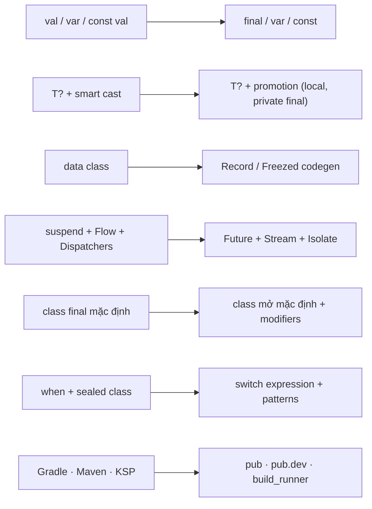
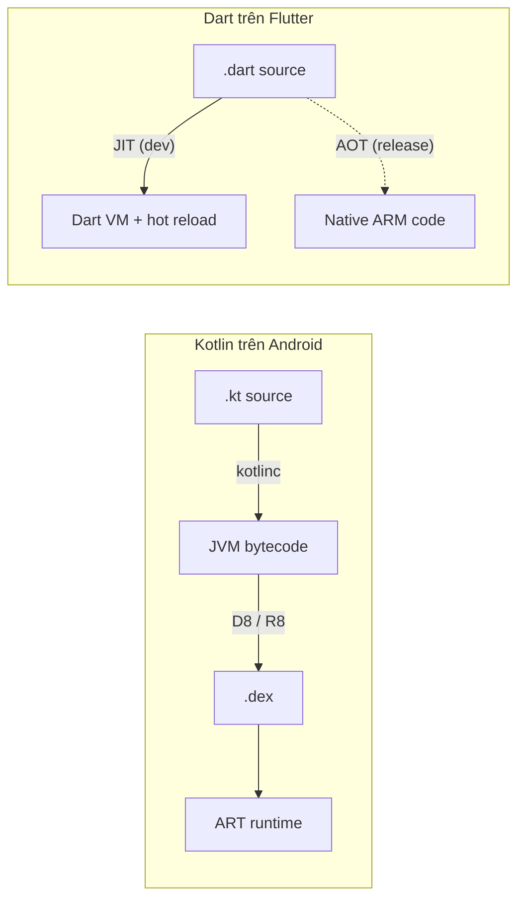
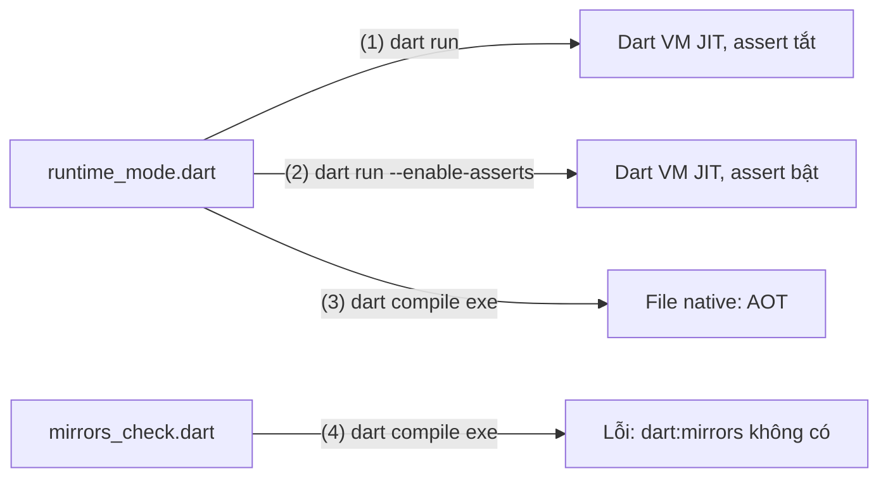
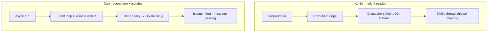
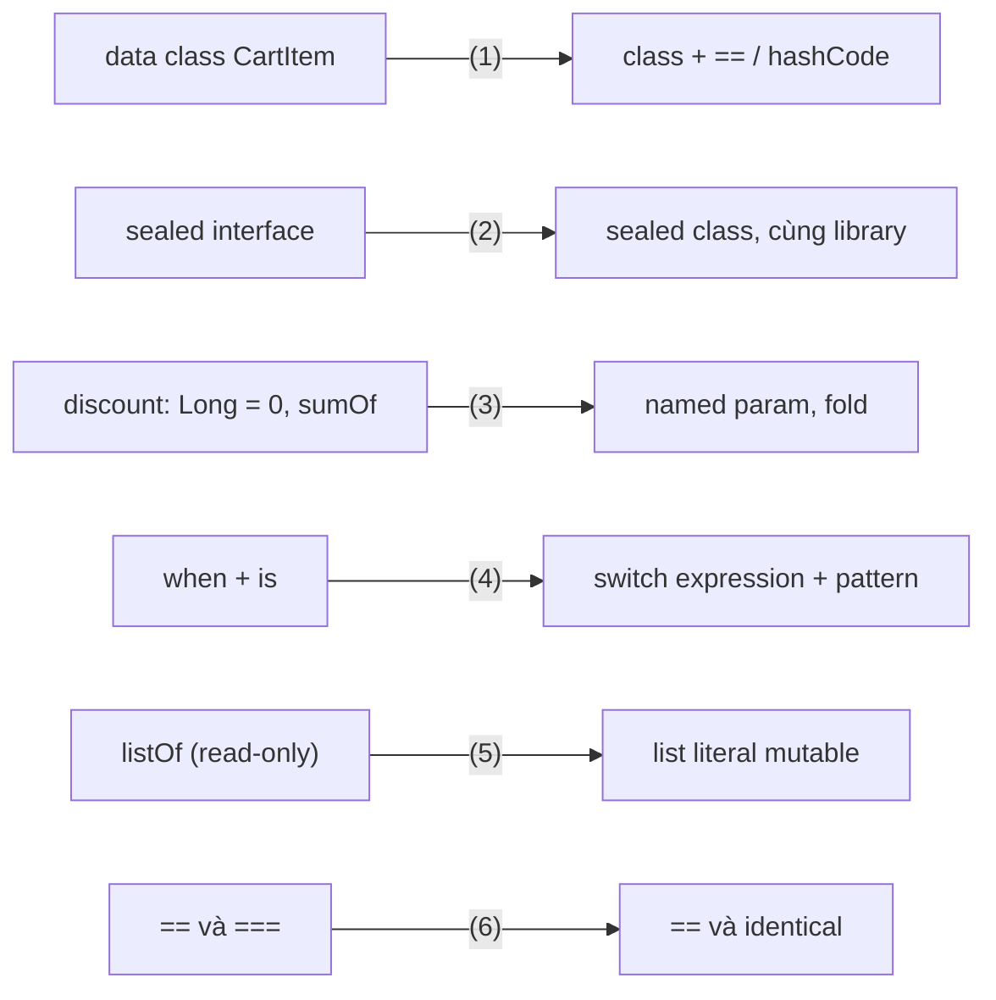

# Dart for Kotlin Developers

## Vấn đề cần giải quyết

Kotlin developer mở file `.dart` đầu tiên thường thấy quen: có `T?`, có `?.`, có lambda, có `sealed class`, có string template `$name`. Phần lớn cú pháp dịch được gần như từng dòng, nhưng có ba loại khác biệt gây bug mà compiler không báo:

- **Giống tên nhưng khác nghĩa.** `final` giống `val` ở chỗ chỉ gán một lần, nhưng list literal của Dart luôn sửa được:

  ```dart
  final tags = ['flutter'];
  tags.add('kotlin'); // hợp lệ: final chỉ khoá biến, không khoá list
  ```

  Trong Kotlin, `val tags = listOf("flutter")` không có `add`. Người quen Kotlin đọc `final` thành "không đổi" và để lọt bug state.
- **Không có tương đương.** Dart không có `data class`, không có `it`, không có `Dispatchers`; Flutter không có reflection. Đi tìm "bản Dart của X" thì mất thời gian, hoặc dùng nhầm một thứ trông giống nhưng sai.
- **Phải đổi tư duy.** Code Dart không chạy trên ART, và concurrency của Dart không dựa trên thread chia sẻ memory. Hai khác biệt này giải thích vì sao Flutter có hot reload, vì sao bản debug chạy chậm, và vì sao một vòng lặp tính toán làm cả UI đứng hình.

Học lại Dart từ đầu thì phí phần Kotlin đã biết, dịch từng dòng thì dính bẫy. Cần một bản đồ cho biết chỗ nào dịch thẳng, chỗ nào phải dừng lại học kỹ.

## Sau khi học xong

- Giải thích được code Dart chạy thế nào trong app Flutter (JIT trên Dart VM kèm hot reload khi dev, AOT ra mã máy native khi release) và khác chuỗi Kotlin → bytecode → dex → ART ở đâu.
- Phân biệt được cặp khái niệm Kotlin–Dart tương đương thật với cặp false friend giống tên nhưng khác nghĩa, như `val` và `final`, named argument và named parameter, smart cast và type promotion.
- Giải thích được vì sao phải đổi tư duy concurrency khi sang Dart, gồm event loop của mỗi isolate, không chia sẻ memory, IO chỉ cần `await` còn việc nặng CPU phải chuyển sang isolate khác.
- Nhận diện được các bẫy Kotlin developer hay mắc khi viết Dart và Topic nào trong Session 01 giải thích từng bẫy.
- Áp dụng được bảng ánh xạ và bộ công cụ `dart`/pub để dịch một đoạn code Kotlin quen thuộc sang Dart và chạy được nó.

## Dart for Kotlin Developers là gì?

**Dart for Kotlin Developers** là bản đồ chuyển đổi từ Kotlin sang Dart: mỗi khái niệm Kotlin được đặt cạnh khái niệm Dart tương ứng và xếp vào một trong ba nhóm (**tương đương**, **false friend** tức giống tên nhưng khác nghĩa, **không có tương đương**), kèm Topic dạy chi tiết.

Mental model: một **từ điển song ngữ có đánh dấu false friend**. Từ điển không dạy lại ngữ pháp; nó cho biết từ nào dịch thẳng, từ nào trông giống nhưng nghĩa khác, và mở trang nào để học kỹ.

Vì vậy mỗi mục của bảng chỉ nói đủ để nhận ra khác biệt rồi link sang Topic sở hữu. Riêng **runtime và biên dịch** và **hệ sinh thái công cụ** được giải thích đầy đủ ở đây, vì không Topic nào khác trong Session 01 sở hữu chúng.

## Cách hoạt động

### Bảy cặp khái niệm cốt lõi

Bảy cặp dưới đây bao phủ phần lớn code Kotlin hằng ngày, đọc từ khái niệm Kotlin sang thứ gần nhất trong Dart.



<!-- dd: flutter-kotlin-dart-map -->

Cặp thứ tư (async) là bước nhảy lớn nhất vì nó đổi mô hình chạy, nên có mục riêng bên dưới. Các bảng sau mở rộng bảy cặp theo từng Topic; cột "Nhóm": **=** tương đương, **≈** false friend, **✗** không có tương đương.

#### Biến, kiểu, null safety → 1.2.1

| Kotlin | Dart | Nhóm | Ghi chú |
|---|---|---|---|
| `val x = 1` | `final x = 1;` | ≈ | Chỉ khoá biến; object bên trong vẫn sửa được nếu nó mutable |
| `const val MAX = 3` | `const max = 3;` | ≈ | `const` của Dart rộng hơn: dùng được cho constructor và collection literal, giá trị giống nhau dùng chung một instance |
| `lateinit var x: T` | `late T x;` | = | Đọc trước khi gán thì lỗi runtime |
| `val x by lazy { … }` | `late final x = compute();` | ≈ | Không có property delegation; `late` có initializer thì chạy ở lần đọc đầu tiên |
| `Int`, `Long`, `Double` | `int`, `double`, `num` | ≈ | Không có `Long`/`Short`/`Float`; `int` 64-bit trên native nhưng trên web là số JavaScript |
| `Any` / `Any?` / `Nothing` / `Unit` | `Object` / `Object?` / `Never` / `void` | = | Dart có thêm `dynamic`: tắt kiểm tra kiểu tĩnh, Kotlin không có |
| Smart cast sau `!= null` | Type promotion | ≈ | Áp dụng cho biến local và (từ Dart 3.2) private final field; field public không được promote |
| `as?` | `x is T ? x : null`, hoặc pattern | ✗ | Không có toán tử safe cast |
| `Pair`, `Triple` | Record `(a, b)` | = | Record so sánh `==` theo giá trị, có field đặt tên `(id: 1, name: 'A')` |
| Generic bị erase, `reified` | Generic reified | ≈ | `List<int>` biết kiểu phần tử lúc runtime, không cần `inline reified` |

Chi tiết ở [1.2.1 Variables and Types](variables_and_types.md).

#### Hàm và toán tử → 1.2.2

| Kotlin | Dart | Nhóm | Ghi chú |
|---|---|---|---|
| `fun f(a: Int = 0)` | `void f([int a = 0])` hoặc `void f({int a = 0})` | ≈ | Dart chia hai kiểu tham số tuỳ chọn: positional `[]` và named `{}` |
| Gọi `f(a = 1)` tuỳ ý | `{}` thì **bắt buộc** gọi kèm tên | ≈ | Ngược chiều Kotlin: tên là thuộc tính của khai báo, không phải của lời gọi |
| Tham số không default là bắt buộc | Named không `required`, không default thì được bỏ qua và nhận `null` | ≈ | Quên `required` là bỏ sót tham số mà không lỗi |
| `(Int) -> Unit` | `void Function(int)` | = | `typedef` thay cho `typealias` |
| `{ x -> … }`, `it` | `(x) => …`, `(x) { … }` | ✗ | Không có `it`, không có trailing lambda |
| `::format` | Tear-off `format`, `Text.new` | = | |
| `.apply { … }` | Cascade `..` | ≈ | Cascade trả lại receiver, không có scope `this` mới |
| `?.let { … }` | Biến local + `if`, hoặc `if (x case final v?)` | ✗ | |
| `===` | `identical(a, b)` | = | |

Chi tiết ở [1.2.2 Functions and Operators](functions_operators.md).

#### Điều khiển luồng, pattern, exception → 1.2.3

| Kotlin | Dart | Nhóm | Ghi chú |
|---|---|---|---|
| `when (x) { is A -> … }` | `switch (x) { A() => … }` | = | `switch` expression có từ Dart 3.0 |
| `when` không subject | Chuỗi `if`/`else if` | ✗ | |
| `val (a, b) = pair` | `final (a, b) = record;` | = | Dart destructure được cả list, map và object bằng pattern |
| `for (i in 0 until n)` | `for (var i = 0; i < n; i++)` | ✗ | Không có range |
| `try`/`catch (e: T)` | `try`/`on T catch (e, st)` | ≈ | Dart throw được mọi object khác null; phân biệt `Exception` (lỗi dự kiến) và `Error` (bug) |

Chi tiết ở [1.2.3 Control Flow and Patterns](control_flow_patterns.md).

#### Collections → 1.2.4

| Kotlin | Dart | Nhóm | Ghi chú |
|---|---|---|---|
| `listOf(…)` (read-only) | `[…]` | ≈ | List literal luôn mutable; bản không sửa được là `const […]` hoặc `List.unmodifiable` |
| `mapOf("a" to 1)`, `setOf(…)` | `{'a': 1}`, `{…}` | ≈ | `{}` rỗng là `Map`, không phải `Set` |
| `filter`, `flatMap`, `sumOf` | `where`, `expand`, `fold` | = | `map`/`where` trả `Iterable` lazy, cần `.toList()` |
| `asSequence()`, `sequence { }` | `Iterable` sẵn lazy, `sync*` | ≈ | |
| `sortedBy { }` (list mới) | `list.sort(…)` (sửa tại chỗ) | ≈ | |
| `groupBy` | `groupBy` của `package:collection` | ✗ | Không có trong `dart:core` |
| Không có | Collection `if`/`for`, spread `...` | ✗ | Dart có, Kotlin không |

Chi tiết ở [1.2.4 Collections and Functional APIs](collections_functional.md).

#### Class → 1.2.5

| Kotlin | Dart | Nhóm | Ghi chú |
|---|---|---|---|
| `class User(val name: String)` | Constructor `this.name`, hoặc primary constructor (Dart 3.13) | ≈ | Primary constructor chỉ bớt boilerplate, không sinh `==` |
| `data class` | Record, `==`/`hashCode` tự viết, hoặc Freezed | ✗ | Class thường so `==` theo identity |
| Class `final` mặc định, `open` | Class mở mặc định, `final class` để khoá | ≈ | Mặc định ngược nhau |
| `interface` | Implicit interface, `abstract interface class` | ≈ | Mọi class đều `implements` được |
| `sealed class` / `sealed interface` | `sealed class` | = | Subclass phải cùng library |
| Default method trong interface, `by` | `mixin` + `with` | ≈ | |
| `enum class` có property | Enhanced enum | = | |
| `companion object`, `object` | `static`, private constructor `._()` | ≈ | |
| Extension function/property | `extension … on T` | = | |
| `value class` | Extension type (Dart 3.3) | ≈ | Chỉ tồn tại lúc compile; runtime chỉ thấy kiểu bên dưới |
| Hilt/Moshi dùng reflection, KSP | Codegen bằng `build_runner` | ≈ | Flutter không có `dart:mirrors` |

Chi tiết ở [1.2.5 Classes, Mixins and Sealed Types](classes_mixins_sealed.md).

#### Bất đồng bộ → 1.3.x

| Kotlin | Dart | Nhóm | Ghi chú |
|---|---|---|---|
| `suspend fun load(): User` | `Future<User> load() async` | ≈ | Không có từ khoá `suspend`; hàm async trả `Future` ([1.3.1](../async/futures_async_await.md)) |
| `scope.launch { }` | Gọi không `await`, đánh dấu `unawaited(…)` | ≈ | Lỗi của `Future` không ai `await` dễ bị bỏ sót ([1.3.1](../async/futures_async_await.md)) |
| `withContext(Dispatchers.IO)` | Không cần | ✗ | IO của Dart vốn không chặn event loop |
| `withContext(Dispatchers.Default)` | `Isolate.run(…)`, `compute(…)` | ≈ | Dữ liệu được copy sang isolate khác ([1.3.3](../async/isolates.md)) |
| `delay`, `withTimeout` | `Future.delayed`, `.timeout(…)` | = | ([1.3.1](../async/futures_async_await.md)) |
| `job.cancel()` | `StreamSubscription.cancel()` | ≈ | `Future` không hủy được ([1.3.2](../async/streams.md)) |
| `Flow`, `flow { emit(x) }` | `Stream`, `async* { yield x; }` | ≈ | Stream mặc định chỉ listen được một lần ([1.3.2](../async/streams.md)) |
| `StateFlow` | `ValueNotifier` | ≈ | Học ở 4.1.1 ChangeNotifier and ValueNotifier (chưa có bài) |
| `Mutex`, `synchronized` | Hiếm khi cần | ✗ | Isolate không chia sẻ memory |
| `runBlocking` | Không có | ✗ | Không có cách chặn thread để chờ `Future` |

### Runtime và biên dịch: code Dart không chạy trên ART

**Kotlin trên Android** đi qua một chuỗi biến đổi: `kotlinc` biên dịch `.kt` thành Java bytecode `.class`, D8/R8 chuyển thành `.dex`, và ART trên thiết bị chạy `.dex` (bản thân ART còn JIT và AOT `.dex` sang mã máy theo profile sử dụng). Kotlin không có runtime riêng; ART không biết class ban đầu viết bằng Java hay Kotlin. Chuỗi này được giải thích ở [Android 1.1.1 Java Android](../../../../knowledge/android/docs/session_01/languages/java_android.md) và [Android 1.1.2 Kotlin](../../../../knowledge/android/docs/session_01/languages/kotlin.md).

**Dart trong Flutter** không đi qua JVM bytecode, D8 hay ART. Dart có runtime riêng (garbage collector, kiểm tra kiểu lúc chạy, quản lý isolate), và cách biên dịch phụ thuộc build mode:

1. **Debug (khi dev): JIT trên Dart VM.** Compiler trên máy dev dịch source thành kernel file (dạng trung gian của Dart). Dart VM trên thiết bị nạp kernel và biên dịch JIT. Khi bạn sửa code và hot reload, chỉ các library bị ảnh hưởng được dịch lại thành kernel và gửi sang VM đang chạy; VM nạp lại library, Flutter build lại cây widget, **state hiện tại được giữ**.
2. **Profile và release: AOT ra mã máy native.** Compiler AOT dịch toàn bộ code Dart thành mã máy ARM hoặc x64 trước khi đóng gói. Trên Android, mã này nằm trong `libapp.so`, chạy cùng Flutter engine (`libflutter.so`). Không JIT lúc chạy nên app khởi động nhanh và hiệu năng ổn định.
3. **Web**: Dart được dịch sang JavaScript hoặc WebAssembly (`dartdevc` khi dev, `dart2js`/`dart2wasm` khi release).



<!-- dd: flutter-build-pipeline -->

> [!NOTE]
> App Flutter trên Android vẫn có một `Activity` (thường là `FlutterActivity`) chạy trên ART, vì đó là cửa vào bắt buộc của mọi app Android. Phần chạy trên ART chỉ là lớp embedder và plugin viết bằng Kotlin/Java; code Dart của bạn chạy trong Dart runtime của Flutter engine.

Hệ quả thực tế của mô hình này:

| Hệ quả | Vì sao | Việc cần làm |
|---|---|---|
| Hot reload chỉ có ở debug | Cần Dart VM JIT để nạp lại kernel lúc chạy | Không mong hot reload trên bản profile/release |
| Bản debug chậm, có thể giật | JIT, bật `assert`, bật service extension để debug | Đo hiệu năng bằng `flutter run --profile` trên máy thật |
| Hot reload không chạy lại `main()`, `initState()`, initializer của biến global/static | Hot reload giữ state; các đoạn đó coi như đã chạy xong | Dùng hot restart khi sửa chúng |
| Sửa code Kotlin/Swift cần full restart | Hot reload chỉ thay code Dart | Build lại app |
| Không có reflection | `dart:mirrors` chỉ có trên native JIT, Flutter không hỗ trợ | Parse JSON, DI bằng codegen (`build_runner`) hoặc viết tay |

#### Ví dụ: cùng một file chạy bằng JIT và AOT

**Bài toán:** kiểm chứng rằng cùng một source Dart có thể chạy bằng JIT hoặc biên dịch AOT, và AOT từ chối code dùng reflection. Dart SDK cho làm việc này ngay trên máy dev, không cần Flutter: `dart run` chạy JIT trên Dart VM, `dart compile exe` biên dịch AOT ra file thực thi native.

**Luồng chạy:**

1. `dart run` chạy file trên Dart VM bằng JIT, `assert` tắt mặc định.
2. `dart run --enable-asserts` vẫn JIT nhưng bật `assert`, giống cách Flutter debug mode bật assert.
3. `dart compile exe` biên dịch AOT ra file native; chạy file đó thì hằng `dart.vm.product` là `true` (hằng `kReleaseMode` của Flutter được định nghĩa từ chính hằng này).
4. Biên dịch AOT một file import `dart:mirrors` thì thất bại ngay lúc biên dịch.



**Code:**

```dart
// runtime_mode.dart
void main() {
  // (3) true chỉ khi chạy bản AOT product (dart compile exe)
  const isProduct = bool.fromEnvironment('dart.vm.product');
  print(isProduct ? 'Chạy AOT: mã máy native' : 'Chạy JIT trên Dart VM');

  // (1)(2) Phép gán trong assert chỉ chạy khi assert được bật
  var assertsOn = false;
  assert(assertsOn = true);
  print('assert: ${assertsOn ? 'bật' : 'tắt'}');
}
```

```dart
// mirrors_check.dart — (4) dùng reflection để đọc tên class lúc runtime
import 'dart:mirrors';

class Product {
  Product(this.name);
  final String name;
}

void main() {
  final mirror = reflect(Product('Bàn phím'));
  print(mirror.type.simpleName);
}
```

```bash
dart run runtime_mode.dart                     # (1)
dart run --enable-asserts runtime_mode.dart    # (2)
dart compile exe runtime_mode.dart -o runtime_mode && ./runtime_mode   # (3)
dart run mirrors_check.dart                    # chạy được vì đây là JIT
dart compile exe mirrors_check.dart -o mirrors_check                   # (4)
```

**Kết quả** (Dart 3.12, macOS; lược dòng "Generated: …" của `dart compile` và hai dòng trích source trong thông báo lỗi):

```text
Chạy JIT trên Dart VM
assert: tắt
Chạy JIT trên Dart VM
assert: bật
Chạy AOT: mã máy native
assert: tắt
Symbol("Product")
mirrors_check.dart:2:8: Error: Dart library 'dart:mirrors' is not available on this platform.
Error: AOT compilation failed
Bad state: Generating AOT kernel dill failed!
```

Sáu dòng đầu cho thấy cùng một source, khác cách chạy. Các dòng lỗi cuối là lý do mọi thư viện Flutter phải dùng codegen thay cho reflection: bản release luôn là AOT.

### Concurrency: từ thread chia sẻ memory sang event loop và isolate

Trong Kotlin, coroutine chạy trên dispatcher (`Dispatchers.Main` là main thread, `IO` và `Default` là thread pool), mọi thread dùng chung một heap nên cần `Mutex` hoặc `synchronized` khi hai coroutine cùng sửa một object.

Dart không cho code của bạn chạy song song trên cùng một vùng nhớ. Mọi code Dart chạy trong một **isolate**: heap riêng và **một thread chạy event loop** (vòng lặp lấy từng việc trong hàng đợi ra chạy cho tới hết). Code Flutter của bạn chạy trong main isolate; từ Flutter 3.29, trên Android và iOS main isolate chạy ngay trên main thread của app. Ba tư duy phải đổi:

1. **IO chỉ cần `await`.** Request mạng, đọc file được thực hiện bên ngoài event loop; `await` nhường event loop cho việc khác. Không cần tương đương `withContext(Dispatchers.IO)`. Cơ chế ở [1.3.1 Futures and Async/Await](../async/futures_async_await.md).
2. **Việc nặng CPU phải ra isolate khác.** Một vòng lặp đồng bộ chiếm event loop tới khi xong, trong lúc đó không frame nào được vẽ; đánh dấu hàm là `async` không thay đổi điều này. `Isolate.run` (hoặc `compute` của Flutter) chạy việc đó ở isolate khác ([1.3.3 Isolates](../async/isolates.md)).
3. **Không chia sẻ memory.** Dữ liệu gửi giữa các isolate được copy (một số trường hợp được chuyển giao không copy), kết quả gửi về bằng message. Không có biến chung nên hầu như không cần lock, đổi lại phải trả chi phí copy.



<!-- dd: flutter-threads-isolates -->

Thêm một khác biệt ít được nhắc: Dart không có structured concurrency. Không có scope nào tự hủy các `Future` con khi màn hình đóng; `Future` không hủy được, còn `Stream` thì dừng nghe bằng `StreamSubscription.cancel()` ([1.3.2 Streams](../async/streams.md)).

### Hệ sinh thái: pubspec, pub và dart CLI

Phần này ở mức nhận biết, đủ để đọc một project Dart/Flutter; chi tiết ở 2.1.1 Flutter CLI and FVM (chưa có bài) và 2.2.1 pub.dev and Package Management (chưa có bài).

| Vai trò | Kotlin/Android | Dart/Flutter |
|---|---|---|
| File khai báo project và dependency | `build.gradle.kts`, `libs.versions.toml` | `pubspec.yaml` |
| Kho package | Maven Central, Google Maven | pub.dev |
| Khoá version đã resolve | Gradle lockfile (tuỳ chọn) | `pubspec.lock` (sinh tự động) |
| Cấu hình lint | detekt, Android Lint config | `analysis_options.yaml` |

Khác Gradle, pub không phải hệ thống build có task và plugin; nó chỉ resolve và tải package. `dart pub get` ghi version chính xác vào `pubspec.lock`, lưu package vào pub cache dùng chung trên máy, và tạo `.dart_tool/package_config.json` chỉ cho compiler biết mỗi package nằm ở đâu. Project là ứng dụng thì nên commit `pubspec.lock`.

`pubspec.yaml` do `dart create -t console price_tool` sinh ra, sau khi chạy `dart pub add collection` (đã bỏ comment mẫu, thêm chú thích):

```yaml
# pubspec.yaml
name: price_tool
description: A sample command-line application.
version: 1.0.0

environment:
  sdk: ^3.12.0 # Dart tối thiểu 3.12, dưới 4.0; cũng quyết định tính năng ngôn ngữ được bật

dependencies:
  collection: ^1.19.1 # ^ cho phép bản minor/patch mới hơn, giữ nguyên major
  path: ^1.9.0

dev_dependencies:
  lints: ^6.0.0
  test: ^1.25.6
```

Lệnh tương đương cần nhớ:

| Việc | Kotlin/Android | Dart | Flutter |
|---|---|---|---|
| Tạo project | Android Studio wizard | `dart create` | `flutter create` |
| Thêm dependency | sửa `build.gradle.kts` | `dart pub add <package>` | `flutter pub add <package>` |
| Tải dependency | Gradle sync | `dart pub get` | `flutter pub get` |
| Chạy | `./gradlew installDebug` | `dart run` | `flutter run` |
| Test | `./gradlew test` | `dart test` | `flutter test` |
| Phân tích tĩnh, format | `./gradlew lint`, ktlint | `dart analyze`, `dart format` | `flutter analyze`, `dart format` |
| Sinh code | KSP chạy cùng build | `dart run build_runner build` | như Dart |

Trong project Flutter, dùng lệnh `flutter` để chắc chắn dùng đúng Dart SDK đi kèm Flutter SDK.

## Ví dụ thực tế

### Dịch một đoạn checkout từ Kotlin sang Dart

**Bài toán:** một đoạn Kotlin quen thuộc (giỏ hàng, tổng tiền có giảm giá, kết quả đặt hàng dạng sealed) cần chuyển sang Dart. Đây là việc Kotlin developer làm nhiều nhất trong tuần đầu, và nó chạm vào gần đủ bảy cặp khái niệm.

Bản Kotlin:

```kotlin
// Checkout.kt
data class CartItem(val sku: String, val price: Long, val quantity: Int = 1)

sealed interface CheckoutResult {
    data class Success(val orderId: String) : CheckoutResult
    data class Failed(val reason: String) : CheckoutResult
}

fun totalOf(items: List<CartItem>, discount: Long = 0): Long =
    items.sumOf { it.price * it.quantity } - discount

fun checkout(items: List<CartItem>): CheckoutResult =
    if (items.isEmpty()) CheckoutResult.Failed("Giỏ hàng trống")
    else CheckoutResult.Success("ORD-${items.size}-${totalOf(items)}")

fun messageOf(result: CheckoutResult): String = when (result) {
    is CheckoutResult.Success -> "Đặt hàng thành công: ${result.orderId}"
    is CheckoutResult.Failed -> "Không đặt được: ${result.reason}"
}
```

**Luồng dịch:** mỗi construct Kotlin được tra trong bảng ánh xạ, rồi xử lý theo nhóm của nó.

1. `data class CartItem` thuộc nhóm ✗: viết class với field `final`, named parameter, tự viết `==` và `hashCode`.
2. `sealed interface` + `data class` con: dùng `sealed class` và subclass trong cùng file (cùng library).
3. Tham số mặc định `discount` thành named parameter có default; `sumOf { it… }` thành `fold` với tham số lambda đặt tên.
4. `when` với `is` thành `switch` expression với object pattern; compiler vẫn kiểm tra đủ nhánh.
5. Kiểm tra false friend: list literal của Dart sửa được dù biến là `final`.
6. Kiểm tra `==`: so theo giá trị nhờ bước (1); `identical` thay cho `===`.



**Code:**

```dart
// checkout.dart — bản Dart của đoạn Kotlin CartItem / CheckoutResult
// (1) data class CartItem -> class có ==/hashCode tự viết (Dart không có data class)
class CartItem {
  const CartItem({required this.sku, required this.price, this.quantity = 1});

  final String sku;
  final int price; // Kotlin Long -> Dart int (64-bit trên native)
  final int quantity;

  @override
  bool operator ==(Object other) =>
      other is CartItem &&
      other.sku == sku &&
      other.price == price &&
      other.quantity == quantity;

  @override
  int get hashCode => Object.hash(sku, price, quantity);
}

// (2) sealed interface + data class con -> sealed class + subclass cùng library
sealed class CheckoutResult {}

class CheckoutSuccess extends CheckoutResult {
  CheckoutSuccess(this.orderId);
  final String orderId;
}

class CheckoutFailed extends CheckoutResult {
  CheckoutFailed(this.reason);
  final String reason;
}

// (3) Tham số mặc định Kotlin -> named parameter có default; sumOf -> fold
int totalOf(List<CartItem> items, {int discount = 0}) =>
    items.fold(0, (sum, item) => sum + item.price * item.quantity) - discount;

CheckoutResult checkout(List<CartItem> items) => items.isEmpty
    ? CheckoutFailed('Giỏ hàng trống')
    : CheckoutSuccess('ORD-${items.length}-${totalOf(items)}');

// (4) when (r) { is ... } -> switch expression, compiler kiểm tra đủ nhánh
String messageOf(CheckoutResult result) => switch (result) {
      CheckoutSuccess(:final orderId) => 'Đặt hàng thành công: $orderId',
      CheckoutFailed(:final reason) => 'Không đặt được: $reason',
    };

void main() {
  final cart = [
    const CartItem(sku: 'KB-01', price: 890_000),
    const CartItem(sku: 'MS-02', price: 350_000, quantity: 2),
  ];

  // (5) Bẫy false friend: final chỉ khoá biến, list vẫn thêm được phần tử
  cart.add(const CartItem(sku: 'PAD-03', price: 120_000));

  print(totalOf(cart, discount: 100_000));
  print(messageOf(checkout(cart)));
  print(messageOf(checkout([])));

  // (6) == so theo giá trị nhờ operator == ở bước (1); identical so reference như ===
  final sameItem = CartItem(sku: 'KB-01', price: 890_000);
  print('${sameItem == cart.first} ${identical(sameItem, cart.first)}');
}
```

**Kết quả** (`dart run checkout.dart`, Dart 3.12, `dart analyze` không báo lỗi):

```text
1610000
Đặt hàng thành công: ORD-3-1710000
Không đặt được: Giỏ hàng trống
true false
```

Dòng 4 xác nhận `==` tự viết hoạt động; bỏ `operator ==` và `hashCode` ở bước (1) thì dòng này thành `false false`. Thêm một subclass thứ ba cho `CheckoutResult` mà không sửa `messageOf` thì `dart analyze` báo `non_exhaustive_switch_expression`, giống `when` của Kotlin báo thiếu nhánh. Dấu `_` trong `890_000` là digit separator (Dart 3.6), giống Kotlin. Trong project thật, model nhiều field thường dùng Freezed để sinh `==`, `hashCode`, `copyWith` ([1.2.5](classes_mixins_sealed.md)).

### Dịch ViewModel và parse JSON

Hai việc dịch hay gặp tiếp theo không dịch từng dòng được, chỉ cần biết hướng:

- **ViewModel dùng `MutableStateFlow` + `viewModelScope.launch`** thường thành class kế thừa `ChangeNotifier` (hoặc giữ `ValueNotifier`) với `Future<void> load() async` gọi `notifyListeners()`. Không có `viewModelScope` tự hủy việc đang chạy, nên phải kiểm tra object còn được dùng trước khi cập nhật state. Học ở 4.1.1 ChangeNotifier and ValueNotifier (chưa có bài).
- **Parse JSON bằng Gson/Moshi reflection** thành `factory Product.fromJson(Map<String, dynamic> json)` viết tay hoặc `json_serializable` sinh bằng `build_runner`; JSON lớn thì parse trong `Isolate.run` ([1.3.3](../async/isolates.md)). Học ở 5.1.2 JSON Serialization and Codegen (chưa có bài).

## Khi nào nên và không nên dùng

Nên dùng bản đồ này khi:

- **Đọc hoặc review code Dart lần đầu**: gặp construct lạ thì tra nhóm của nó trước khi đoán nghĩa theo Kotlin.
- **Port logic thuần** (model, tính toán, validate): phần lớn construct thuộc nhóm "=" và dịch thẳng.
- **Lên kế hoạch học**: các dòng "≈" và "✗" là danh sách mục phải đọc kỹ trong 1.2.x và 1.3.x.

Không nên dùng khi:

- **Port kiến trúc**: ViewModel, Hilt, Room, `Dispatchers` không dịch từng dòng được; kiến trúc Flutter đi theo cây widget và state management riêng (Session 04, Session 08).
- **Thay cho việc học Topic**: bảng chỉ cho biết có khác biệt, không giải thích cơ chế.
- **Tìm bản Dart cho mọi idiom Kotlin**: scope function (`let`, `also`, `run`), property delegation hay `it` không có tương đương. Viết theo cách Dart (biến local, cascade, tham số lambda đặt tên) thay vì dựng lại idiom Kotlin bằng extension.

## Sai lầm thường gặp

Mỗi mục là một false friend hoặc một chỗ không có tương đương; cơ chế nằm ở Topic được link.

### 1. Tin `final` là bất biến

`final cart = [...]` vẫn `add`, `remove`, `sort` được. Muốn không sửa được thì dùng `const [...]` hoặc `List.unmodifiable(...)`. Xem [1.2.4](collections_functional.md).

### 2. Quên `required` ở named parameter

```dart
void sendInvoice({String? email, bool includePdf = false}) {}

void main() => sendInvoice(includePdf: true); // biên dịch được: email bị bỏ qua, nhận null
```

Kotlin buộc truyền tham số không có default; Dart coi named parameter là tuỳ chọn trừ khi có `required`. Xem [1.2.2](functions_operators.md).

### 3. So sánh model bằng `==` khi không có data class

Class Dart không tự sinh `==`, nên `Set` chứa phần tử trùng và phép so state để tránh cập nhật thừa không hoạt động. Dùng record, tự viết `==`/`hashCode`, hoặc Freezed. Xem [1.2.5](classes_mixins_sealed.md).

### 4. Mong smart cast trên field

`if (order.note != null) print(order.note.length);` không biên dịch được khi `note` là field public, vì getter có thể trả giá trị khác ở lần đọc thứ hai. Gán ra biến local trước. Xem [1.2.1](variables_and_types.md).

### 5. Chạy tính toán nặng trên main isolate

Hàm `async` vẫn chạy trên event loop; vòng lặp đồng bộ trong đó vẫn chặn mọi frame. Dùng `Isolate.run`/`compute`. Xem [1.3.1](../async/futures_async_await.md), [1.3.3](../async/isolates.md).

### 6. Listen một `Stream` hai lần

`Stream` từ `StreamController()` hoặc `async*` là single-subscription: lần `listen` thứ hai ném `StateError`, khác `Flow` collect bao nhiêu lần cũng được. Xem [1.3.2](../async/streams.md).

### 7. Gọi `Future` mà không `await` rồi mất lỗi

Giống `launch` không có `CoroutineExceptionHandler`: lỗi của `Future` không ai `await` không về khối `try` của bạn. Xem [1.3.1](../async/futures_async_await.md).

### 8. Đo hiệu năng trên bản debug

Bản debug chạy JIT, bật assert và công cụ debug nên giật hơn release nhiều. Đo bằng `flutter run --profile` trên thiết bị thật (emulator và simulator không chạy profile mode).

### 9. Sửa initializer của biến global rồi hot reload

```dart
// Sửa chuỗi này rồi hot reload: app vẫn dùng giá trị cũ
final apiBaseUrl = 'https://staging.example.com';
```

Biến global và static được coi là state nên hot reload không khởi tạo lại; `main()` và `initState()` cũng không chạy lại. Dùng hot restart, hoặc đổi thành `const`/getter.

### 10. Dùng `it` và trailing lambda theo thói quen

`items.map { it.price }` không phải cú pháp Dart; viết `items.map((item) => item.price)` hoặc tear-off. Xem [1.2.2](functions_operators.md).

## Lịch sử phát triển

Dart tiến dần về phía Kotlin qua từng bản lớn, nên các bài "Dart cho Kotlin developer" cũ có thể đã lỗi thời:

- **2011–2013, Dart 1.x**: Google giới thiệu Dart năm 2011 cho web; Dart 1.0 ra tháng 11/2013. Kiểu dữ liệu khi đó là tuỳ chọn và không sound.
- **2018, Dart 2.0**: bắt buộc **sound type system**. Kiểu được đảm bảo đúng nên compiler AOT tối ưu được; đây là nền cho Flutter 1.0 (12/2018) biên dịch AOT ra mã máy.
- **2019, Dart 2.3 và 2.7**: collection `if`/`for` và spread (2.3) để viết cây widget gọn hơn, nên Dart có mà Kotlin không; extension methods (2.7).
- **2021, Dart 2.12**: **sound null safety**, kiểu non-null mặc định như Kotlin.
- **2022, Dart 2.17**: enhanced enum, super parameters, named argument đặt xen kẽ positional.
- **2023, Dart 2.19 và 3.0**: `Isolate.run` (2.19). Dart 3.0 thêm records, patterns, `switch` expression, class modifiers và bắt buộc 100% null safety, đưa `when` + `sealed class` + destructuring kiểu Kotlin sang Dart.
- **2023–2024, Dart 3.2 và 3.3**: promotion cho private final field (3.2); extension types (3.3), gần với `value class`.
- **2025**: ngày 29/1, nhóm Dart dừng dự án macros, nên codegen bằng `build_runner` vẫn là cách chính thay cho reflection. Flutter 3.29 chạy code Dart trên main thread của app trên Android và iOS. Dart 3.8 thêm null-aware element, Dart 3.10 thêm dot shorthands.
- **2026, Dart 3.12 và 3.13**: private named parameter (3.12); **primary constructor** stable ở Dart 3.13 (8/2026), ví dụ `class Point(final int x, final int y);`. Nó gần primary constructor của Kotlin nhưng không sinh `==`. Ví dụ trong bài chạy trên Dart 3.12 nên dùng constructor truyền thống.

## Kết nối hệ thống

- **Kiến thức nền**: Kotlin trên Android. Chuỗi `kotlinc` → `.class` → D8/R8 → `.dex` → ART được giải thích ở [Android 1.1.2 Kotlin](../../../../knowledge/android/docs/session_01/languages/kotlin.md).
- **Vị trí trong Session**: bài mở đầu của [Session 01: Dart Foundations](../index.md). Bảng ánh xạ là mục lục ngược cho các Topic:
  - [1.2.1 Variables and Types](variables_and_types.md), [1.2.2 Functions and Operators](functions_operators.md), [1.2.3 Control Flow and Patterns](control_flow_patterns.md), [1.2.4 Collections and Functional APIs](collections_functional.md), [1.2.5 Classes, Mixins and Sealed Types](classes_mixins_sealed.md).
  - [1.3.1 Futures and Async/Await](../async/futures_async_await.md), [1.3.2 Streams](../async/streams.md), [1.3.3 Isolates](../async/isolates.md).
- **Học tiếp**: 1.2.1 theo thứ tự mục lục. Hệ sinh thái mở rộng ở 2.1.1 Flutter CLI and FVM (chưa có bài) và 2.2.1 pub.dev and Package Management (chưa có bài); đo hiệu năng đúng ở 2.2.2 DevTools and Debugging (chưa có bài) và 10.2.1 Memory Management and Profiling (chưa có bài).

## Developer Curiosity Checklist

Bài 1 chạy được bằng `dart run` (hoặc DartPad); bài 2–3 là câu hỏi dịch và giải thích. Đáp án ngắn ngay dưới; cơ chế đầy đủ ở Topic được link.

1. **`final` và `const`.** Tạo `final tags = ['a'];` rồi `tags.add('b')`; tạo `const fixed = ['a'];` rồi `fixed.add('b')`. Lệnh nào lỗi, lúc compile hay lúc chạy?
   - *Đáp án:* `tags.add` chạy bình thường. `fixed.add` biên dịch được nhưng ném `UnsupportedError` lúc chạy, vì kiểu tĩnh vẫn là `List<String>`. Xem [1.2.1](variables_and_types.md), [1.2.4](collections_functional.md).
2. **Coroutine → Dart.** Dịch `viewModelScope.launch { items = repo.load() }` và `withContext(Dispatchers.Default) { parse(raw) }` sang Dart.
   - *Đáp án:* `Future<void> refresh() async { items = await repo.load(); }`, không cần dispatcher vì IO không chặn event loop; `await Isolate.run(() => parse(raw))` vì parse là việc CPU. Xem [1.3.1](../async/futures_async_await.md), [1.3.3](../async/isolates.md).
3. **Build mode.** Vì sao bản release không có hot reload và không dùng được thư viện dựa trên `dart:mirrors`?
   - *Đáp án:* release là AOT, không có JIT để nạp lại code lúc chạy, và `dart:mirrors` chỉ có trên Dart VM JIT (xem `mirrors_check.dart` ở mục "Runtime và biên dịch").

## Tham khảo

- [Dart overview: platform, JIT và AOT, runtime](https://dart.dev/overview)
- [Dart libraries: nền tảng hỗ trợ `dart:mirrors`](https://dart.dev/libraries)
- [Concurrency in Dart](https://dart.dev/language/concurrency)
- [`Isolate.run` API](https://api.dart.dev/stable/dart-isolate/Isolate/run.html)
- [Language evolution: tính năng theo từng version Dart](https://dart.dev/resources/language/evolution)
- [Primary constructors](https://dart.dev/language/primary-constructors) và [Announcing Dart 3.13](https://dart.dev/blog/announcing-dart-3-13)
- [An update on Dart macros & data serialization (29/1/2025)](https://dart.dev/blog/an-update-on-dart-macros-data-serialization)
- [How to use packages: pubspec, `pubspec.lock`, pub cache](https://dart.dev/tools/pub/packages)
- [Flutter build modes](https://docs.flutter.dev/testing/build-modes)
- [Flutter hot reload](https://docs.flutter.dev/tools/hot-reload)
- [What's new in Flutter 3.29: Dart threading changes on Android/iOS](https://flutter.dev/blog/whats-new-in-flutter-3-29)
