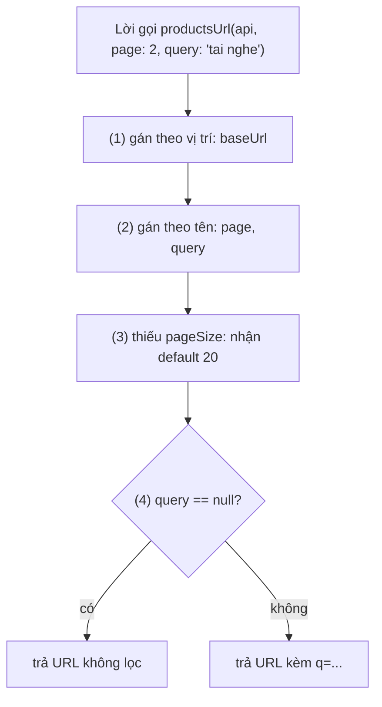
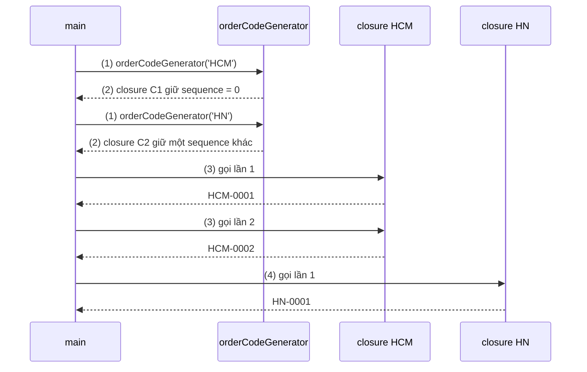
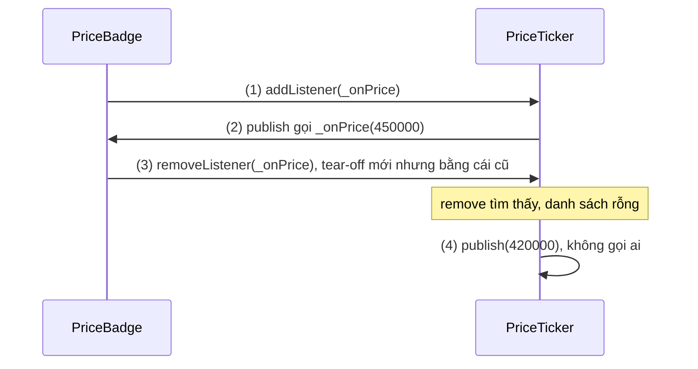
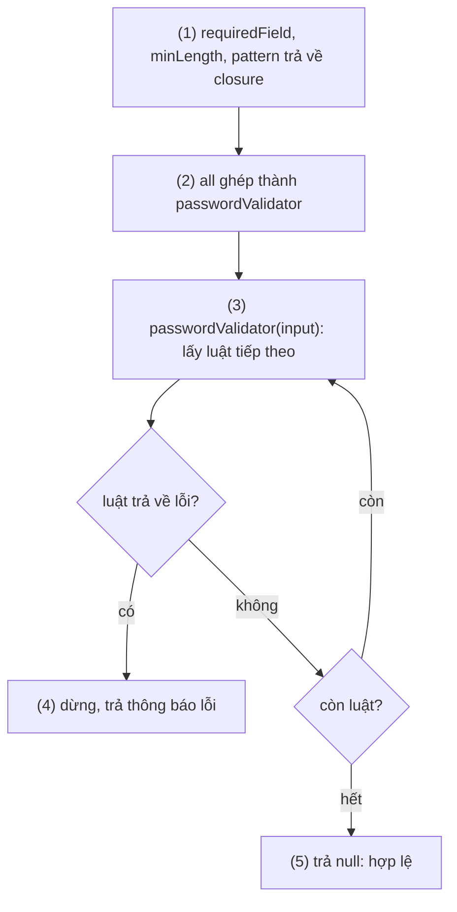

# Functions and Operators

## Vấn đề cần giải quyết

Trong một ngôn ngữ, hàm là đơn vị nhỏ nhất để đặt tên cho một hành vi và tái sử dụng nó. Hai câu hỏi thiết kế quyết định code gọi hàm có dễ đọc và an toàn không:

- **Caller truyền đối số thế nào?** Hàm có năm tham số `bool`, `int` truyền theo vị trí thì `createOrder(true, false, 3, 0, true)` không ai đọc hiểu, và đổi thứ tự là bug im lặng. Tham số tuỳ chọn mà không có default rõ ràng thì mỗi caller tự đoán.
- **Hành vi có được truyền đi như dữ liệu không?** Callback khi bấm nút, hàm kiểm tra form, listener khi dữ liệu đổi: tất cả đều là "một đoạn code đưa cho người khác gọi sau". Ngôn ngữ phải cho biết đoạn code đó nhìn thấy biến nào và hai callback khi nào được coi là một.

Toán tử có vấn đề riêng: chúng trông giống nhau giữa các ngôn ngữ nhưng ngữ nghĩa thì không. `-7 % 3` trong Kotlin là `-1`, trong Dart là `2`; `a & b != 0` trong Java là lỗi compile, trong Dart lại đúng ý. Không biết toán tử thực chất là gì thì không biết khi nào nó được override, khi nào nó so identity, khi nào nó trả về chính object bên trái.

Flutter làm vấn đề này rõ hơn: UI là cây lời gọi constructor với tham số named, và mọi tương tác là callback.

```dart
// Code Flutter: chỉ cần thấy hình dạng lời gọi
ElevatedButton(
  onPressed: submitOrder,          // truyền hàm, không gọi hàm
  child: const Text('Đặt hàng'),
)
```

## Sau khi học xong

- Phân biệt được tham số positional, optional positional và named, cùng vai trò của required và giá trị default khi thiết kế chữ ký hàm.
- Giải thích được vì sao function là object có kiểu, closure capture biến chứ không capture giá trị, và tear-off khác lambda ở điểm nào.
- Áp dụng được function type, typedef và closure để thiết kế API nhận callback, như validator hay listener.
- Nhận diện được các toán tử có hành vi khác Kotlin như /, ~/, %, == so với identical, độ ưu tiên của bitwise, và cascade .. trả về chính receiver.
- Triển khai được operator overloading cho kiểu giá trị của domain, giữ == và hashCode nhất quán.

## Functions and Operators là gì?

Trong Dart, **function** là một **object có kiểu** (function type), gói một đoạn code nhận tham số theo chữ ký đã khai báo (positional hoặc named) và trả về một giá trị. **Operator** là cú pháp viết tắt cho lời gọi một method đặc biệt trên operand bên trái (`a + b` là `a.+(b)`), trừ vài toán tử do ngôn ngữ tự xử lý: `&&`, `||`, `!`, `?:`, `??`, `is`, `as` và cascade `..`.

Mental model dùng xuyên suốt bài: **mọi thứ là lời gọi**. Hàm là một giá trị có thể gọi được, nên cất vào biến, truyền đi, trả về như mọi giá trị khác; toán tử là lời gọi method được viết gọn, nên class của bạn tự định nghĩa được ý nghĩa của `+` hay `==`.

## Cách hoạt động

### Khai báo hàm và arrow syntax

Kiểu trả về đứng **trước** tên hàm, không có từ khoá `fun`. Thân hàm chỉ có một biểu thức thì viết bằng arrow `=>`, tương đương `= expr` của Kotlin.

```dart
// cart_utils.dart
int subtotal(int unitPrice, int quantity) {   // kiểu trả về đứng trước tên hàm
  return unitPrice * quantity;
}

int shippingFee(int subtotal) => subtotal >= 300000 ? 0 : 30000; // arrow: thân là một biểu thức

void logCheckout(String orderId) {
  print('checkout $orderId');                  // không có return: hàm trả về null
}

void main() {
  final total = subtotal(150000, 2);
  print('$total + ship ${shippingFee(total)}');
  logCheckout('HCM-0001');
}
```

**Kết quả:**

```text
300000 + ship 0
checkout HCM-0001
```

- Mọi hàm đều trả về một giá trị; không có `return` thì Dart ngầm thêm `return null;`. Kiểu `void` nói rằng giá trị đó không được dùng.
- Sau `=>` chỉ là **biểu thức**, không phải câu lệnh: không viết được `=> if (...)`, nhưng viết được `=> a ? b : c`.
- Hàm khai báo được ở top-level, trong class (method) và **bên trong hàm khác** (local function).
- Điểm vào chương trình là hàm top-level `main()`, có thể nhận `List<String> args`.
- Hàm có type parameter (`T first<T>(List<T> items)`) là generics, được học ở [1.2.1 Variables and Types](variables_and_types.md). Hàm `async` thuộc [1.3.1 Futures and Async/Await](../async/futures_async_await.md), hàm generator `sync*` thuộc [1.2.4 Collections and Functional APIs](collections_functional.md).

### Tham số: positional, optional positional, named

Dart có ba kiểu tham số, mỗi kiểu một cách gọi:

| Kiểu | Khai báo | Khi gọi | Bỏ qua được không |
|---|---|---|---|
| Positional bắt buộc | `(String baseUrl)` | Theo vị trí, không kèm tên | Không |
| Optional positional | `([String unit = 'đ'])` | Theo vị trí, không kèm tên | Được, nhận default hoặc null |
| Named | `({int pageSize = 20, String? query})` | **Bắt buộc kèm tên**, thứ tự tuỳ ý | Được, trừ khi có `required` |

Quy tắc của chữ ký:

- Một hàm có thể có positional bắt buộc, theo sau là **hoặc** nhóm `[...]` **hoặc** nhóm `{...}`, không có cả hai.
- Tham số tuỳ chọn có kiểu non-nullable thì **phải** có default (`int pageSize = 20`); nếu không, compiler báo lỗi vì default ngầm là `null`. Kiểu nullable (`String? query`) thì default là `null`.
- Giá trị default phải là **hằng compile-time**. Không viết được `{DateTime at = DateTime.now()}`; cách thường dùng là `DateTime? at` rồi `at ?? DateTime.now()` trong thân hàm.
- `required` biến tham số named thành bắt buộc. Khác Kotlin, nơi mọi tham số không có default đều bắt buộc, named của Dart **mặc định là tuỳ chọn**.
- Từ Dart 2.17, đối số named có thể đặt ở bất kỳ vị trí nào trong lời gọi, kể cả trước đối số positional.

#### Ví dụ: dựng URL lấy danh sách sản phẩm

**Bài toán:** hàm dựng URL cho API sản phẩm: địa chỉ server luôn có (positional), số trang bắt buộc nhưng phải đọc được ở chỗ gọi (named + `required`), cỡ trang có giá trị chuẩn (default), từ khoá tìm kiếm có thể không có (nullable).

**Luồng chạy:**

1. Đối số positional được gán theo vị trí cho `baseUrl`.
2. Đối số named được gán theo tên; thiếu `page` là lỗi compile vì có `required`.
3. Tham số named không được truyền nhận default (`pageSize = 20`) hoặc `null` (`query`).
4. Thân hàm rẽ nhánh theo `query` có null hay không.



```dart
// product_api.dart
String productsUrl(
  String baseUrl, {      // (1) positional bắt buộc: truyền theo vị trí, không kèm tên
  required int page,     // (2) named + required: phải truyền, kèm tên
  int pageSize = 20,     // (3) named có default: bỏ qua thì nhận 20
  String? query,         // (3) named nullable: bỏ qua thì nhận null
}) {
  final url = '$baseUrl/products?page=$page&size=$pageSize';
  if (query == null) return url;                              // (4) không lọc
  return '$url&q=${Uri.encodeQueryComponent(query)}';         // (4) có từ khoá
}

String formatVnd(int amount, [String unit = 'đ']) => '$amount$unit'; // optional positional

void main() {
  const api = 'https://api.example.com';
  print(productsUrl(api, page: 1));
  print(productsUrl(api, query: 'tai nghe', page: 2));   // named: thứ tự tuỳ ý
  print(productsUrl(page: 3, api, pageSize: 50));        // named đặt trước positional (Dart 2.17+)
  print(formatVnd(450000));
  print(formatVnd(450, 'k'));
  // productsUrl(api);                 // lỗi compile: thiếu 'page'
  // productsUrl(api, 1);              // lỗi compile: page là named, phải ghi page: 1
}
```

**Kết quả:**

```text
https://api.example.com/products?page=1&size=20
https://api.example.com/products?page=2&size=20&q=tai+nghe
https://api.example.com/products?page=3&size=50
450000đ
450k
```

Quy ước thực tế (cũng là cách API của Flutter được thiết kế): positional cho một hai đối số hiển nhiên từ tên hàm, named cho mọi thứ còn lại, đặc biệt là cờ `bool`. Optional positional `[...]` ít dùng.

### Function là object và function type

Hàm là object, thuộc một **function type** viết theo dạng `ReturnType Function(ParamTypes)`: `int Function(int)`, `void Function()`, `String? Function(String value)`. Function type khai báo được cả tham số named: `void Function({required int page})`. Mọi function type đều là kiểu con của `Function`.

Vì là object, hàm:

- gán được vào biến và field;
- truyền được làm đối số (callback), trả về được từ hàm khác (higher-order function);
- được tạo tại chỗ dưới dạng **anonymous function** (lambda): `(price) => price - 50000` hoặc `(int price) { ... }`.

```dart
// discount.dart
int applyDiscount(int priceVnd, int Function(int) rule) => rule(priceVnd);

int memberDiscount(int priceVnd) => priceVnd - 20000;       // hàm top-level

void main() {
  int Function(int) rule = memberDiscount;                  // gán hàm vào biến
  print(applyDiscount(500000, rule));                       // truyền hàm như tham số
  print(applyDiscount(500000, (price) => price - 50000));   // anonymous function dạng arrow
  final flashSale = (int price) {                           // anonymous function có thân block
    final discounted = price - 100000;
    if (discounted < 50000) return 50000;                   // giá sàn
    return discounted;
  };
  print(applyDiscount(120000, flashSale));
  print(flashSale.runtimeType);
}
```

**Kết quả:**

```text
480000
450000
50000
(int) => int
```

Khác Kotlin: Dart không có cú pháp trailing lambda (đặt lambda ngoài ngoặc), không có `it` ngầm định, và lambda viết bằng `(x) => ...` hoặc `(x) { ... }` chứ không phải `{ x -> ... }`. Tham số của callback không dùng tới thì đặt tên `_`; từ Dart 3.7, `_` là wildcard nên viết được `(_, _) => ...` cho hai tham số đều bỏ qua.

Một class có method `call` cũng gọi được như hàm (callable object): `validator(value)` gọi `validator.call(value)`. Đây là cùng ý "mọi thứ là lời gọi".

### typedef: đặt tên cho kiểu

`typedef` đặt một cái tên cho một kiểu có sẵn, thường là function type dài hoặc lặp lại:

```dart
typedef PriceListener = void Function(int priceVnd);
typedef Validator = String? Function(String value);
typedef LatLng = ({double lat, double lng});      // từ Dart 2.13 typedef dùng được cho mọi kiểu, kể cả record
```

`typedef` **không tạo kiểu mới**: `PriceListener` và `void Function(int)` là cùng một kiểu, gán qua lại tự do. Tên tham số trong typedef (`priceVnd`) chỉ để làm tài liệu. Flutter dùng typedef khắp nơi: `VoidCallback` là `void Function()`, `ValueChanged<T>` là `void Function(T value)`, `FormFieldValidator<T>` là `String? Function(T? value)`. Cần một kiểu thật sự mới (không gán lẫn được) thì dùng class hoặc extension type ở [1.2.5 Classes, Mixins and Sealed Types](classes_mixins_sealed.md).

### Closure: hàm mang theo phạm vi nơi nó được tạo

Dart dùng **lexical scope**: một hàm nhìn thấy biến dựa vào **nơi hàm được viết** trong code, không phải nơi nó được gọi. Hàm lồng bên trong nhìn thấy biến của hàm bao ngoài.

**Closure** là một function object cùng với các biến của phạm vi bao ngoài mà nó dùng tới. Điểm mấu chốt: closure **capture chính biến**, không chụp lại giá trị tại lúc tạo. Biến đó sống tiếp sau khi hàm bao ngoài đã return, và mọi thay đổi qua closure đều thấy được ở lần gọi sau.

#### Ví dụ: bộ sinh mã đơn hàng theo từng cửa hàng

**Bài toán:** mỗi cửa hàng cần mã đơn tăng dần riêng (`HCM-0001`, `HCM-0002`, `HN-0001`). Bộ đếm không được lộ ra ngoài để code khác sửa nhầm.

**Luồng chạy:**

1. Gọi `orderCodeGenerator('HCM')`: tạo biến local `sequence = 0` của riêng lần gọi này.
2. Hàm trả về một closure capture `storeCode` và `sequence`; hàm bao ngoài kết thúc nhưng hai biến vẫn sống vì closure còn giữ.
3. Mỗi lần gọi closure, nó tăng **đúng biến `sequence` đã capture** và trả về mã mới.
4. Closure của HN tăng biến `sequence` riêng, tạo ra ở lần gọi `orderCodeGenerator('HN')`, nên hai cửa hàng đếm độc lập.



```dart
// order_code.dart
String Function() orderCodeGenerator(String storeCode) {
  var sequence = 0;                                   // (1) biến local của riêng lần gọi này
  return () {                                         // (2) closure capture storeCode và sequence
    sequence++;                                       // (3) sửa đúng biến đã capture, không phải bản sao
    return '$storeCode-${sequence.toString().padLeft(4, '0')}';
  };
}

void main() {
  final nextHcm = orderCodeGenerator('HCM');          // (1)(2) một biến sequence cho HCM
  final nextHn = orderCodeGenerator('HN');            // (1)(2) một biến sequence khác cho HN
  print(nextHcm());                                   // (3)
  print(nextHcm());
  print(nextHn());                                    // (4) HN đếm độc lập với HCM
  print(nextHcm());
}
```

**Kết quả:**

```text
HCM-0001
HCM-0002
HN-0001
HCM-0003
```

#### Closure trong vòng lặp

Vì closure capture biến, câu hỏi là: mỗi vòng lặp có biến riêng không? Với `for (var i = 0; ...)` của Dart, **có**: mỗi vòng lặp có một bản riêng của biến lặp (khác `var` của JavaScript). Bẫy thật nằm ở biến khai báo **bên ngoài** vòng lặp:

```dart
void main() {
  final retryActions = <void Function()>[];
  for (var attempt = 1; attempt <= 3; attempt++) {
    retryActions.add(() => print('thử lại lần $attempt'));   // mỗi vòng có biến attempt riêng
  }
  for (final retry in retryActions) {
    retry();
  }

  var current = 1;                                            // một biến chung, khai báo ngoài vòng lặp
  final logActions = <void Function()>[];
  while (current <= 3) {
    logActions.add(() => print('log lần $current'));
    current++;
  }
  for (final log in logActions) {
    log();                                                    // cả ba đọc cùng biến current, đã là 4
  }
}
```

**Kết quả:**

```text
thử lại lần 1
thử lại lần 2
thử lại lần 3
log lần 4
log lần 4
log lần 4
```

Muốn closure giữ giá trị tại thời điểm tạo thì chép vào một biến `final` khai báo bên trong vòng lặp (`final snapshot = current;`) rồi capture biến đó. Vòng lặp được học ở [1.2.3 Control Flow and Patterns](control_flow_patterns.md).

### Tear-off: dùng chính hàm có sẵn làm giá trị

**Tear-off** là việc nhắc tên một hàm, method hoặc constructor **mà không có ngoặc gọi**, để lấy function object của nó:

| Loại | Ví dụ | Ý nghĩa |
|---|---|---|
| Hàm top-level hoặc static | `print`, `int.parse` | Function object trỏ tới hàm đó |
| Instance method | `buffer.write`, `_onPrice` | Function object **gắn với receiver** cụ thể (`buffer`, `this`) |
| Constructor (từ Dart 2.15) | `Product.new`, `DateTime.fromMillisecondsSinceEpoch` | Function object tạo object mới |

So với lambda bọc lại (`(x) => print(x)`), tear-off ngắn hơn, và quan trọng hơn: **tear-off của cùng một method trên cùng một object thì bằng nhau** (`==`), còn mỗi lần viết lambda là một function object mới, không bằng lambda nào khác. Các API "đăng ký rồi huỷ" (`addListener`/`removeListener` của `ChangeNotifier` trong Flutter) tìm callback cần huỷ bằng `==`, nên khác biệt này quyết định listener có được gỡ hay không.

#### Ví dụ: đăng ký và huỷ listener khi giá thay đổi

**Bài toán:** badge hiển thị giá đăng ký nhận giá mới từ một nguồn; khi badge bị huỷ (màn hình đóng) phải gỡ listener, nếu không nguồn giá vẫn giữ badge (rò bộ nhớ) và tiếp tục gọi vào nó.

**Luồng chạy:**

1. `attach()` đăng ký tear-off `_onPrice`, function object gắn với chính badge này.
2. `publish()` duyệt danh sách listener và gọi từng cái.
3. `detach()` tạo tear-off `_onPrice` lần nữa; nó `==` tear-off ở bước 1 nên `remove` tìm thấy và gỡ được.
4. Lần `publish()` sau không còn listener nào. Bản dùng lambda thì bước 3 tạo một lambda mới, `remove` không tìm thấy, listener còn lại.



```dart
// price_ticker.dart
typedef PriceListener = void Function(int priceVnd);

class PriceTicker {
  final _listeners = <PriceListener>[];
  void addListener(PriceListener listener) => _listeners.add(listener);
  void removeListener(PriceListener listener) => _listeners.remove(listener); // remove so bằng ==
  void publish(int priceVnd) {
    for (final listener in _listeners) {
      listener(priceVnd);
    }
  }
  int get listenerCount => _listeners.length;
}

class PriceBadge {
  PriceBadge(this.ticker);
  final PriceTicker ticker;

  void attach() => ticker.addListener(_onPrice);      // (1) tear-off: giá trị hàm gắn với this
  void detach() => ticker.removeListener(_onPrice);   // (3) tear-off mới, nhưng == tear-off ở (1)
  void _onPrice(int priceVnd) => print('Badge hiển thị $priceVnd đ');
}

class BuggyBadge {
  BuggyBadge(this.ticker);
  final PriceTicker ticker;

  void attach() => ticker.addListener((price) => _onPrice(price));    // closure A
  void detach() => ticker.removeListener((price) => _onPrice(price)); // closure B, khác A
  void _onPrice(int priceVnd) => print('BuggyBadge hiển thị $priceVnd đ');
}

void main() {
  final ticker = PriceTicker();
  final badge = PriceBadge(ticker);
  badge.attach();                                     // (1)
  ticker.publish(450000);                             // (2) ticker gọi listener
  badge.detach();                                     // (3)
  ticker.publish(420000);                             // (4) không còn ai nhận
  print('Sau detach PriceBadge: ${ticker.listenerCount} listener');

  final buggy = BuggyBadge(ticker);
  buggy.attach();
  buggy.detach();
  print('Sau detach BuggyBadge: ${ticker.listenerCount} listener'); // vẫn còn 1: rò listener
}
```

**Kết quả:**

```text
Badge hiển thị 450000 đ
Sau detach PriceBadge: 0 listener
Sau detach BuggyBadge: 1 listener
```

Giá `420000` không được in: listener đã bị gỡ ở bước 3. Nếu thật sự cần lambda (ví dụ phải truyền thêm tham số), lưu lambda vào một field rồi dùng **cùng field đó** cho cả `add` và `remove`.

### Toán tử: bức tranh chung và độ ưu tiên

Phần lớn toán tử của Dart là method trên operand bên trái: `a + b` gọi `a.+(b)`, `a[i]` gọi method `operator []` của `a`, `-a` gọi `a.-()` (unary minus). Vì vậy `int`, `String`, `List` mỗi kiểu tự định nghĩa `+` riêng, và class của bạn cũng làm được (phần operator overloading bên dưới). Một số toán tử thì do ngôn ngữ xử lý trực tiếp và không override được: `&&`, `||`, `!`, `?:`, `??`, `is`, `as`, `..`, và `!=` (luôn là phủ định của `==`).

Độ ưu tiên từ cao xuống thấp, rút gọn từ bảng của dart.dev:

| Mức | Toán tử |
|---|---|
| Postfix | `expr++`, `expr--`, `()`, `[]`, `?[]`, `.`, `?.`, `!` |
| Prefix | `-expr`, `!expr`, `~expr`, `++expr`, `--expr`, `await expr` |
| Nhân | `*`, `/`, `%`, `~/` |
| Cộng | `+`, `-` |
| Shift | `<<`, `>>`, `>>>` |
| Bitwise | `&`, rồi `^`, rồi `|` |
| So sánh và kiểm tra kiểu | `>=`, `>`, `<=`, `<`, `as`, `is`, `is!` |
| Bằng nhau | `==`, `!=` |
| Logic | `&&`, rồi `||` |
| If-null | `??` |
| Điều kiện | `?:` |
| Cascade | `..`, `?..` |
| Gán | `=`, `+=`, `??=` và các dạng gán kép khác |

Hai hệ quả hay gặp:

- Bitwise đứng **trên** so sánh bằng, nên `flags & mask != 0` của Dart được hiểu là `(flags & mask) != 0`. Trong Java/C thì ngược lại.
- `??` đứng **dưới** `+`, nên `count ?? 0 + 1` là `count ?? (0 + 1)` (sai lầm 8 bên dưới). Bản thân toán tử null-aware được học ở [1.2.1 Variables and Types](variables_and_types.md).

### Toán tử số học

```dart
void main() {
  print(7 / 2);            // 3.5: / luôn trả về double
  print(6 / 2);            // 3.0: kể cả khi chia hết
  print(7 ~/ 2);           // 3: chia lấy phần nguyên (cắt về phía 0)
  print(-7 ~/ 2);          // -3
  print(-7 % 3);           // 2: % của Dart luôn không âm
  print((-7).remainder(3)); // -1: giống % của Kotlin/Java
  var stock = 10;
  stock -= 3;              // compound assignment
  stock++;
  print(stock);            // 8
}
```

**Kết quả:**

```text
3.5
3.0
3
-3
2
-1
8
```

| Toán tử | Dart | Kotlin |
|---|---|---|
| `7 / 2` | `3.5` (`double`) | `3` (`Int / Int` là chia nguyên) |
| Chia nguyên | `7 ~/ 2` | `7 / 2` |
| `-7 % 3` | `2` (modulo Euclid, không âm) | `-1` (dấu theo số bị chia) |
| Phần dư theo dấu số bị chia | `(-7).remainder(3)` | `-7 % 3` hoặc `(-7).rem(3)` |

`++`, `--`, `+=` và các dạng gán kép hoạt động như Kotlin. Viết `x += y` là gọi `x = x + y`, nên class chỉ cần định nghĩa `+`.

### So sánh và equality: == và identical

- `==` hỏi "hai object có **tương đương** không", theo định nghĩa của class. Mặc định (kế thừa từ `Object`) là so identity; `String`, `int` override để so theo giá trị.
- `identical(a, b)` hỏi "có phải **cùng một object** không", không override được. Tương đương `===` của Kotlin.
- Trước khi gọi method `==`, ngôn ngữ xử lý null: hai vế cùng null là `true`, một vế null là `false`; chỉ khi cả hai khác null mới gọi `a.==(b)`. Vì vậy method `==` không bao giờ nhận `null`.

```dart
class CartItem {
  const CartItem(this.productId);
  final int productId;
}
void main() {
  final a = CartItem(7);
  final b = CartItem(7);
  print(a == b);                          // false: == mặc định của Object so identity
  print(identical(a, a));                 // true
  print('tai nghe' == 'tai ' 'nghe');     // true: String override == theo nội dung
  print(identical(const CartItem(7), const CartItem(7))); // true: hằng const được canonicalize
}
```

**Kết quả:**

```text
false
true
true
true
```

Class thường không có `equals` tự sinh như `data class` của Kotlin: muốn so theo giá trị thì override `operator ==` (phần operator overloading bên dưới; `hashCode` và codegen ở [1.2.5 Classes, Mixins and Sealed Types](classes_mixins_sealed.md)). Equality của record ở [1.2.1](variables_and_types.md); `List` **không** so theo phần tử như Kotlin, xem [1.2.4 Collections and Functional APIs](collections_functional.md).

### Toán tử logic, bitwise và điều kiện

- **Logic**: `&&`, `||`, `!` chỉ nhận `bool` và đánh giá tắt (short-circuit): `user != null && user.isActive` không đọc `isActive` khi `user` null.
- **Bitwise và shift** trên `int`: `&`, `|`, `^`, `~`, `<<`, `>>` (shift có dấu), `>>>` (shift không dấu, từ Dart 2.14). Kotlin dùng infix function `and`, `or`, `xor`, `shl`; Dart dùng ký hiệu như Java.
- **Điều kiện**: `condition ? a : b` là biểu thức, dùng được trong interpolation, trong đối số, sau `=>`. Kotlin không cần toán tử này vì `if` của Kotlin là biểu thức; `if` của Dart là câu lệnh ([1.2.3](control_flow_patterns.md)).

Bitwise ít gặp trong code app, chủ yếu khi đọc cờ từ API hoặc platform:

```dart
// notification_settings.dart
const orderUpdates = 1 << 0;   // 0b001
const promotions = 1 << 1;     // 0b010
const chatMessages = 1 << 2;   // 0b100

void main() {
  var enabled = orderUpdates | chatMessages;       // bật hai loại
  print(enabled);                                  // 5
  print(enabled & promotions != 0);                // false: & đứng trên !=, đọc là (enabled & promotions) != 0
  enabled ^= promotions;                           // đảo trạng thái khuyến mãi
  print((enabled & promotions) != 0);              // true
  print(enabled.toRadixString(2));                 // 111
}
```

**Kết quả:**

```text
5
false
true
111
```

Trong code mới, ưu tiên `Set` của enum thay cho bitmask; bitmask chỉ đáng dùng khi định dạng dữ liệu đã quy định sẵn. Dù độ ưu tiên đúng ý, vẫn nên viết ngoặc như dòng `(enabled & promotions) != 0`.

### Cascade: .. và ?..

Cascade `..` thực hiện **một chuỗi thao tác trên cùng một object** (gán field, gọi method) và cả biểu thức **trả về chính object đó**, bỏ qua giá trị trả về của từng thao tác. Gần với `apply { }` của Kotlin, nhưng là cú pháp chứ không phải hàm. `?..` là dạng null-aware: đặt ở thao tác đầu tiên, receiver null thì cả chuỗi bị bỏ qua.

```dart
// receipt.dart
class Receipt {
  String? customerName;
  final lines = <String>[];
  void addLine(String line) => lines.add(line);
}

Receipt? findDraft(String customerName) => null;  // giả lập: không có hoá đơn nháp

void main() {
  final receipt = Receipt()
    ..customerName = 'Lan'          // gán field trên cùng object
    ..addLine('Tai nghe x2')        // gọi method, bỏ qua giá trị trả về
    ..addLine('Phí ship');
  print('${receipt.customerName}: ${receipt.lines}');

  final text = StringBuffer()
    ..write('Tổng: ')
    ..write(930000)
    ..toString();                   // kết quả toString() bị bỏ, cả biểu thức vẫn là StringBuffer
  print(text.runtimeType);

  final draft = findDraft('Lan');   // kiểu Receipt?
  draft?..addLine('Không chạy')     // ?.. : draft null thì bỏ qua cả chuỗi cascade
    ..addLine('Cũng không chạy');
  print(draft);
}
```

**Kết quả:**

```text
Lan: [Tai nghe x2, Phí ship]
StringBuffer
null
```

`..toString()` ở cuối **không** biến `text` thành `String` (sai lầm 6). Muốn lấy chuỗi thì gọi `.toString()` (một dấu chấm) trên kết quả: `(StringBuffer()..write('a')).toString()`.

### Operator overloading

Class định nghĩa toán tử bằng method có tên `operator` + ký hiệu. Các toán tử định nghĩa được: `<`, `>`, `<=`, `>=`, `==`, `+`, `-`, `*`, `/`, `~/`, `%`, `|`, `^`, `&`, `<<`, `>>`, `>>>`, `~`, `[]`, `[]=` và unary minus (`operator -()`). Không định nghĩa được `!=`, `&&`, `||`, `??`, `+=`: chúng được suy ra hoặc do ngôn ngữ xử lý.

Toán tử nhị phân được tra trên **operand bên trái**: `money * 2` gọi `Money.*`, còn `2 * money` gọi `int.*` và là lỗi compile vì `int.*` không nhận `Money`. Kotlin dùng `operator fun plus` với tên chữ; Dart dùng chính ký hiệu.

#### Ví dụ: kiểu Money cho giỏ hàng

**Bài toán:** giỏ hàng cộng tiền, nhân theo số lượng, so sánh với hạn mức thanh toán. Dùng `int` trần thì dễ cộng nhầm tiền với số lượng; một kiểu `Money` có toán tử riêng giữ code đọc như công thức mà vẫn đúng kiểu.

```dart
// money.dart
class Money {
  const Money(this.vnd);
  final int vnd;

  Money operator +(Money other) => Money(vnd + other.vnd);   // a + b gọi a.+(b)
  Money operator *(int quantity) => Money(vnd * quantity);   // vế phải là int, không phải Money
  Money operator -() => Money(-vnd);                         // unary minus: -a
  bool operator <(Money other) => vnd < other.vnd;

  @override
  bool operator ==(Object other) => other is Money && other.vnd == vnd;
  @override
  int get hashCode => vnd.hashCode;                          // override == thì phải override hashCode
  @override
  String toString() => '$vnd đ';
}

void main() {
  const headphone = Money(450000);
  const shipping = Money(30000);
  var total = headphone * 2 + shipping;    // * trước +, như số học thường
  print(total);
  total += -Money(50000);                  // += tự có từ +, unary - từ operator -()
  print(total);
  print(total < const Money(1000000));
  print(Money(30000) == shipping);         // true: so theo giá trị
  print(Money(30000) != shipping);         // false: != là !(a == b), không override riêng
  // print(2 * headphone);                 // lỗi compile: int.* không nhận Money
}
```

**Kết quả:**

```text
930000 đ
880000 đ
true
true
false
```

- Toán tử giữ nguyên độ ưu tiên của ngôn ngữ: định nghĩa lại `*` không làm nó đứng sau `+`.
- `operator ==` nhận `Object` (không phải `Object?`, vì null đã được xử lý trước) và phải đi kèm `hashCode` nhất quán (sai lầm 7; quy tắc đầy đủ ở [1.2.5](classes_mixins_sealed.md)).
- Chỉ overload khi ý nghĩa toán tử là hiển nhiên với kiểu đó (tiền, vector, toạ độ, thời lượng). `user + group` là method đội lốt toán tử, nên đặt tên rõ ràng.

## Ví dụ thực tế

### Ghép validator cho form từ các hàm nhỏ

**Bài toán:** form đăng ký có nhiều ô, mỗi ô một bộ luật (bắt buộc, độ dài tối thiểu, phải có chữ số...). Viết một hàm kiểm tra riêng cho mỗi ô thì lặp code; cần các luật nhỏ có tham số, ghép lại được. Đây chính là hình dạng mà Flutter dùng: `TextFormField(validator: ...)` nhận một hàm trả về thông báo lỗi hoặc `null`.

**Luồng chạy:**

1. Các factory `requiredField`, `minLength`, `pattern` trả về closure; mỗi closure capture cấu hình của nó (tên ô, độ dài, regex).
2. `all` nhận danh sách validator và trả về **một** validator mới, capture danh sách đó.
3. Khi kiểm tra, validator ghép chạy lần lượt từng luật theo thứ tự khai báo.
4. Gặp luật đầu tiên trả về lỗi thì dừng, trả lỗi đó.
5. Qua hết các luật thì trả `null`, nghĩa là hợp lệ.



```dart
// validators.dart
typedef Validator = String? Function(String value); // null = hợp lệ, String = thông báo lỗi

Validator requiredField(String fieldName) =>        // (1) factory trả về closure, capture fieldName
    (value) => value.trim().isEmpty ? '$fieldName không được để trống' : null;

Validator minLength(int length) =>                  // (1) capture length
    (value) => value.length < length ? 'Cần ít nhất $length ký tự' : null;

Validator pattern(RegExp regex, String message) =>  // (1) capture regex và message
    (value) => regex.hasMatch(value) ? null : message;

Validator all(List<Validator> validators) {         // (2) ghép nhiều validator thành một
  return (value) {
    for (final validate in validators) {            // (3) chạy lần lượt theo thứ tự khai báo
      final error = validate(value);
      if (error != null) return error;              // (4) gặp lỗi đầu tiên thì dừng
    }
    return null;                                    // (5) qua hết: hợp lệ
  };
}

final passwordValidator = all([
  requiredField('Mật khẩu'),
  minLength(8),
  pattern(RegExp(r'\d'), 'Cần ít nhất một chữ số'),
]);

void main() {
  for (final input in ['', 'abc', 'matkhaumoi', 'matkhau2026']) {
    print('"$input" -> ${passwordValidator(input) ?? 'hợp lệ'}');
  }
}
```

**Kết quả:**

```text
"" -> Mật khẩu không được để trống
"abc" -> Cần ít nhất 8 ký tự
"matkhaumoi" -> Cần ít nhất một chữ số
"matkhau2026" -> hợp lệ
```

Gắn vào Flutter (code Flutter, không chạy bằng `dart run`): `FormFieldValidator<String>` có kiểu `String? Function(String? value)`, nên bọc một lớp để xử lý `null`:

```dart
// sign_up_form.dart (Flutter)
TextFormField(
  obscureText: true,
  validator: (value) => passwordValidator(value ?? ''),
)
```

### Truyền callback, không gọi callback

`onPressed` của button có kiểu `VoidCallback?` (`void Function()?`). Truyền **tear-off** hoặc lambda; đừng gọi hàm.

```dart
// checkout_button.dart (Flutter)
ElevatedButton(
  onPressed: isSubmitting ? null : submitOrder,   // null: button bị vô hiệu hoá
  child: const Text('Đặt hàng'),
)

// Sai: submitOrder() chạy ngay mỗi lần build, onPressed nhận kết quả void của nó
// onPressed: submitOrder(),
```

Hàm cần đối số thì bọc lambda: `onPressed: () => addToCart(product.id)`.

### Cấu hình object nhiều thuộc tính bằng cascade

API của Flutter có nhiều object cấu hình bằng setter, cascade giữ chúng trong một biểu thức:

```dart
// progress_ring_painter.dart (Flutter)
final ringPaint = Paint()
  ..color = Colors.teal
  ..strokeWidth = 6
  ..style = PaintingStyle.stroke
  ..strokeCap = StrokeCap.round;
```

## Khi nào nên và không nên dùng

| Lựa chọn | Nên dùng khi | Không nên dùng khi |
|---|---|---|
| Positional | Một hai đối số, ý nghĩa hiển nhiên từ tên hàm (`subtotal(price, quantity)`) | Cờ `bool`, nhiều đối số cùng kiểu, đối số tuỳ chọn |
| Named + `required` | Đối số bắt buộc nhưng cần đọc được ở chỗ gọi (`page: 2`) | Hàm một tham số rõ nghĩa |
| Named có default | Đối số có giá trị chuẩn mà đa số caller dùng | Default phải tính lúc runtime: dùng nullable rồi `??` trong thân hàm |
| Optional positional `[...]` | Đối số phụ rất ngắn, rõ nghĩa | Từ hai đối số tuỳ chọn trở lên: dùng named |
| Arrow `=>` | Thân hàm là một biểu thức | Cần nhiều câu lệnh, hoặc biểu thức dài khó đọc |
| Closure | Callback cần nhớ cấu hình hoặc trạng thái riêng | Trạng thái phức tạp, nhiều thao tác: dùng class có tên |
| Tear-off | Truyền hàm có sẵn, đặc biệt khi cần huỷ đăng ký sau | Cần cố định thêm đối số: dùng lambda và lưu lại nếu phải huỷ |
| `typedef` | Function type dài hoặc dùng ở nhiều chỗ | Cần một kiểu riêng không gán lẫn được: dùng class hoặc extension type |
| Cascade | Nhiều thao tác lên cùng một object vừa tạo | Cần giá trị trả về của thao tác cuối; chuỗi dài làm mờ luồng dữ liệu |
| Operator overloading | Kiểu giá trị mà toán tử có nghĩa toán học hiển nhiên | Hành vi có tác dụng phụ hoặc ý nghĩa không hiển nhiên |

## Sai lầm thường gặp

**1. Quên `required` cho named parameter quan trọng.**

```dart
void sendOtp({String? phoneNumber}) { /* ... */ }
sendOtp();   // compile được, phoneNumber là null, lỗi chỉ lộ khi chạy
```

Named của Dart mặc định là tuỳ chọn. Đối số mà hàm không thể chạy thiếu thì khai báo `required String phoneNumber`.

**2. Gọi hàm thay vì truyền hàm.** `onPressed: submitOrder()` chạy hàm ngay lúc build. Hàm trả về `void` thì analyzer báo `use_of_void_result`, nhưng hàm trả về một function hoặc tham số kiểu `dynamic` thì lỗi lọt qua. Viết `onPressed: submitOrder`.

**3. Huỷ listener bằng một lambda mới.** Hai lambda không bằng nhau nên `remove` không tìm thấy (xem `BuggyBadge` ở trên). Dùng tear-off cho cả hai lần, hoặc lưu lambda vào field.

**4. Tear-off instance method từ tên class.** `names.map(String.toUpperCase)` là lỗi compile (`Instance member 'toUpperCase' can't be accessed using static access`). Instance method chỉ tear-off được từ một object (`buffer.write`); với từng phần tử thì viết `names.map((name) => name.toUpperCase())`.

**5. Mang thói quen số học của Kotlin sang.**

```dart
final lastPage = totalItems / pageSize;   // double, không phải int: 2.5 trang
final index = (current - 1) % length;     // current = 0: Kotlin ra -1, Dart ra length - 1
```

Chia lấy số trang dùng `~/` (hoặc `(totalItems / pageSize).ceil()`); khi chỉ số âm có ý nghĩa thì cân nhắc rõ `%` hay `remainder`.

**6. Tưởng cascade trả về kết quả của thao tác cuối.** `final s = StringBuffer()..write('a')..toString();` cho `s` là `StringBuffer`: cascade luôn trả về receiver.

**7. Override `==` mà không override `hashCode`.** Hai `Money(30000)` bằng nhau theo `==` nhưng khác `hashCode`, nên `Set<Money>` giữ cả hai và `Map` không tìm thấy key. Luôn override cả hai.

**8. Đọc sai độ ưu tiên của `??`.** `subtotal ?? 0 + shippingFee` là `subtotal ?? (0 + shippingFee)`: khi `subtotal` khác null thì phí ship bị bỏ mất. Viết `(subtotal ?? 0) + shippingFee`.

## Lịch sử phát triển

| Phiên bản | Thay đổi | Vì sao |
|---|---|---|
| Dart 1.0 (11/2013) | Hàm là first-class object, closure, cascade `..`, operator overloading, tham số positional/optional/named | Dart ra đời cho lập trình web, nơi callback và closure là cách làm việc chính |
| Dart 2.12 (03/2021) | Từ khoá `required` thay annotation `@required`; cascade null-aware `?..` | Null safety cần phân biệt "named bắt buộc" với "named nullable"; `@required` chỉ là cảnh báo của analyzer |
| Dart 2.13 | `typedef` dùng được cho mọi kiểu, không chỉ function type | Đặt tên cho kiểu generic và (sau này) record |
| Dart 2.14 | Toán tử `>>>` | Shift không dấu vốn có trong Java và JavaScript; trước đó Dart phải tự mô phỏng bằng mask |
| Dart 2.15 (12/2021) | Constructor tear-off (`Product.new`) | Truyền constructor như hàm mà không bọc lambda |
| Dart 2.17 (05/2022) | Đối số named đặt được ở bất kỳ vị trí nào | Đặt được đối số named lên trước để đối số positional dài (thường là callback) nằm cuối lời gọi |
| Dart 3.0 (05/2023) | Bỏ cú pháp `:` cho default của named parameter, chỉ còn `=` | Thống nhất một cách viết |
| Dart 3.7 | Wildcard `_`: nhiều tham số tên `_` trong cùng hàm | Callback có nhiều tham số không dùng tới không phải đặt `_`, `__` |

## Kết nối hệ thống

- **Tiên quyết:** [1.2.1 Variables and Types](variables_and_types.md): kiểu, null safety và toán tử null-aware (`?.`, `??`, `??=`, `!`), generics dùng cho hàm generic.
- **Liên quan:**
  - [1.1.1 Dart for Kotlin Developers](dart_for_kotlin_devs.md): bảng ánh xạ cú pháp hàm và tham số từ Kotlin.
  - [1.2.3 Control Flow and Patterns](control_flow_patterns.md): vòng lặp, switch expression thay cho `when`, exception.
  - [1.2.4 Collections and Functional APIs](collections_functional.md): `map`, `where`, `fold` nhận chính các function và closure học ở bài này; spread `...`.
  - [1.2.5 Classes, Mixins and Sealed Types](classes_mixins_sealed.md): method, getter/setter, `==`/`hashCode` đầy đủ, constructor dùng tham số named và `this.`.
  - [1.3.1 Futures and Async/Await](../async/futures_async_await.md): hàm `async` và callback bất đồng bộ.
- **Trong Flutter:** `VoidCallback`, `ValueChanged`, `onPressed`, `builder` ở 3.1 Widget System (chưa có bài); `addListener`/`removeListener` của `ChangeNotifier` ở 4.1.1 ChangeNotifier and ValueNotifier (chưa có bài).

## Developer Curiosity Checklist

- Vì sao named parameter của Dart mặc định là tuỳ chọn, và điều đó ảnh hưởng thế nào tới thiết kế API?
- Một closure tạo trong hàm đã return vẫn đọc và sửa được biến local của hàm đó; biến ấy sống ở đâu?
- Vì sao `removeListener(_onChanged)` gỡ được listener còn `removeListener(() => _onChanged())` thì không?
- Vì sao `2 * money` lỗi còn `money * 2` thì không?
- Cascade khác gì một chuỗi method trả về `this` (builder pattern), và khi nào sự khác biệt đó gây bug?

## Tham khảo

- [Functions](https://dart.dev/language/functions), dart.dev
- [Operators](https://dart.dev/language/operators), dart.dev
- [Methods: operators](https://dart.dev/language/methods), dart.dev
- [Typedefs](https://dart.dev/language/typedefs), dart.dev
- [Loops: closures trong vòng lặp for](https://dart.dev/language/loops), dart.dev
- [Effective Dart: Design](https://dart.dev/effective-dart/design), dart.dev
- [Language evolution](https://dart.dev/resources/language/evolution), dart.dev
- [num operator %](https://api.dart.dev/dart-core/num/operator_modulo.html), api.dart.dev
- [FormFieldValidator](https://api.flutter.dev/flutter/widgets/FormFieldValidator.html), api.flutter.dev
- [ChangeNotifier.removeListener](https://api.flutter.dev/flutter/foundation/ChangeNotifier/removeListener.html), api.flutter.dev
