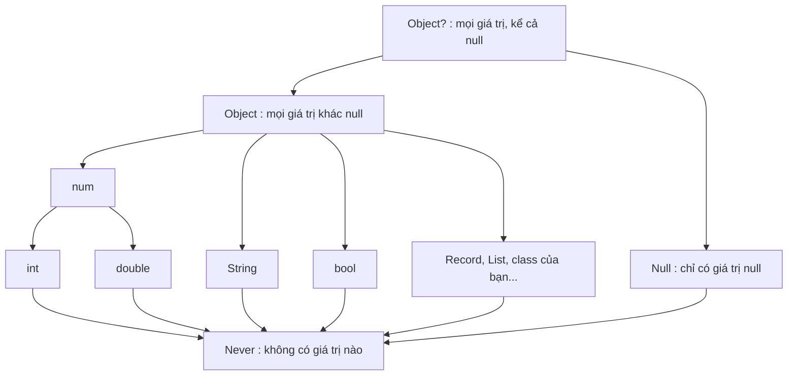
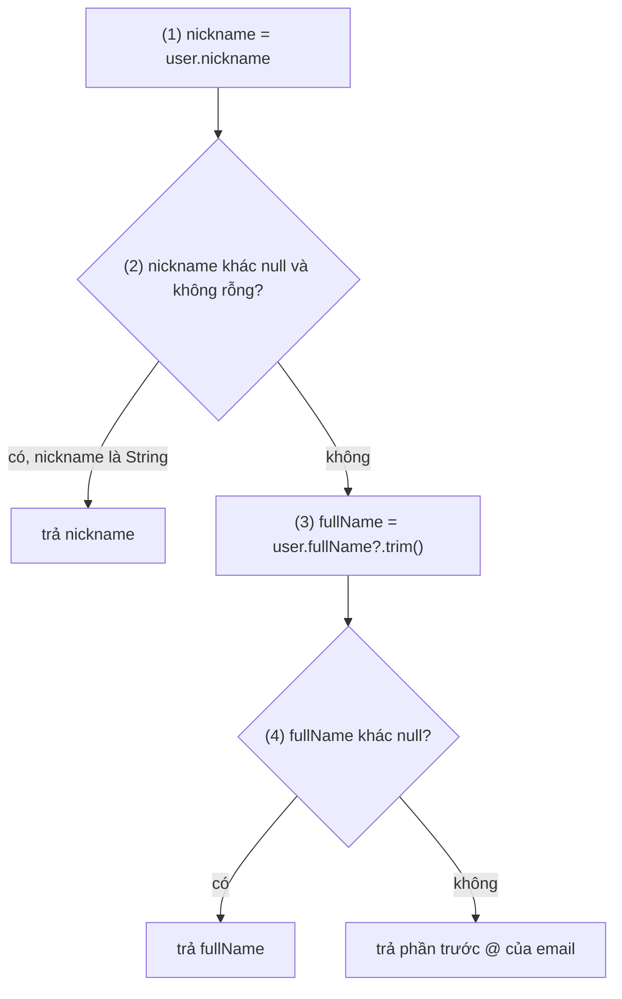
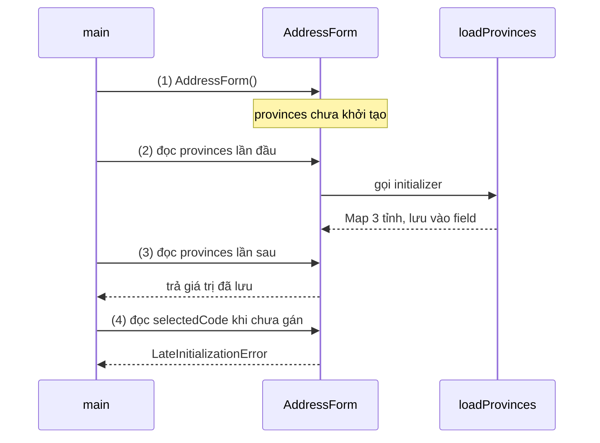
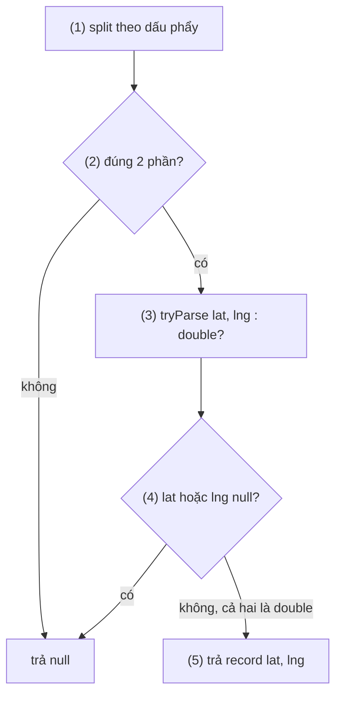
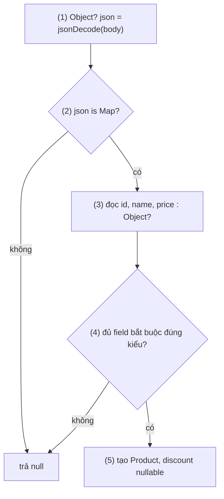

# Variables and Types

## Vấn đề cần giải quyết

Mọi chương trình đều phải trả lời hai câu hỏi về dữ liệu: **cái tên này trỏ tới giá trị nào, có được đổi không**, và **giá trị đó thuộc loại gì, có thể vắng mặt (null) không**. Ngôn ngữ trả lời hai câu đó càng muộn thì lỗi càng lộ ra muộn:

- Khai báo không nói rõ "được gán lại hay không", người đọc code phải dò cả hàm mới biết giá trị có đổi giữa chừng.
- Kiểu chỉ được kiểm tra khi chạy (như JavaScript, hay chính Dart 1), lỗi gõ sai tên method chỉ lộ ra khi đúng dòng đó được chạy.
- Mọi tham chiếu đều có thể null (như Java), `NullPointerException` trở thành lỗi crash phổ biến nhất.

Dart, ngôn ngữ của Flutter, giải quyết bằng **khai báo thể hiện vòng đời của giá trị** (`var`, `final`, `const`, `late`), **type system tĩnh và sound** kèm type inference, và **sound null safety**. Nếu chỉ học cú pháp mà không hiểu cơ chế, lỗi vẫn lọt qua đúng những chỗ ngôn ngữ cho phép "thoát": `dynamic`, toán tử `!`, phép ép kiểu `as`, và `late`.

```dart
dynamic body = {'price': '450000'};  // API trả price dạng String
int price = body['price'];           // compile được, nhưng TypeError khi chạy
```

## Sau khi học xong

- Phân biệt được var, final, const và late theo thời điểm giá trị được xác định và mức độ bất biến của từng cách khai báo.
- Giải thích được type inference, sound type system và vai trò của Object?, Object, dynamic, Never trong cây kiểu của Dart.
- Xử lý được giá trị có thể null bằng kiểu nullable, các toán tử null-aware và type promotion của flow analysis, không lạm dụng toán tử !.
- Áp dụng được generics có bound và records để khai báo kiểu dữ liệu dùng chung, và nhận diện được chỗ generics được kiểm tra lúc runtime.
- Nhận diện được các bẫy của kiểu built-in như int trên native và web, độ chính xác của double, String.length theo UTF-16 và việc bool không có truthy/falsy.

## Variables and Types là gì?

Trong Dart, **biến** là một cái tên giữ **tham chiếu tới một object** (mọi giá trị, kể cả số và `null`, đều là object), còn **kiểu** (static type) là hợp đồng mà compiler kiểm tra về những object cái tên đó được phép trỏ tới, kể cả có được là `null` hay không. Type system của Dart là **sound**: chương trình đã qua được compiler thì lúc chạy, một biểu thức kiểu `String` không bao giờ cho ra object không phải `String`.

Mental model dùng xuyên suốt bài: **biến là cái nhãn dán lên một object, kiểu là giấy phép in trên nhãn**. Khai báo (`var`/`final`/`const`/`late`) quyết định nhãn có được bóc ra dán sang object khác không; kiểu quyết định nhãn được dán lên loại object nào, và dấu `?` cho biết nhãn có được phép dán vào "không có gì" (`null`) hay không.

## Cách hoạt động

### Mọi giá trị là object, biến giữ tham chiếu

Dart không có kiểu primitive: `42`, `3.14`, `true`, `null` đều là object, có method (`42.isEven`). Việc tối ưu số thành giá trị máy là chuyện nội bộ của VM, không lộ ra ngôn ngữ. Hệ quả:

- Gán `b = a` là sao chép **tham chiếu**: hai nhãn dán lên cùng một object. Với object sửa được (như `List`), sửa qua `b` thì `a` cũng thấy.
- Biến chưa khởi tạo có kiểu nullable mặc định là `null`, kể cả `int?`; không có "mặc định 0" như field `int` của Java.

### Khai báo: var, final, const

| Khai báo | Gán lại nhãn | Giá trị được xác định lúc | Object có bất biến không |
|---|---|---|---|
| `var x = ...` hoặc `String x = ...` | Được | Runtime | Tuỳ object |
| `final x = ...` | Không, gán đúng một lần | Runtime | Tuỳ object: `final` chỉ khoá **nhãn** |
| `const x = ...` | Không | **Compile-time** | Có, bất biến **sâu** (cả object và mọi thứ bên trong) |

- `final` tương đương `val` của Kotlin; viết kiểu tường minh (`String name = ...`) thay cho `var` vẫn là biến gán lại được.
- `const` mạnh hơn `const val` của Kotlin: cả `List`, `Map`, `Set` literal và object của class có **const constructor** ([1.2.5 Classes, Mixins and Sealed Types](classes_mixins_sealed.md)) cũng là hằng. Hai biểu thức `const` cùng giá trị được **canonicalize** thành một object duy nhất trong bộ nhớ, lý do Flutter khuyên dùng `const` cho widget không đổi (3.1.1 Stateless and Stateful Widgets, chưa có bài).
- Instance field có thể là `final` nhưng không thể là `const`; hằng ở mức class phải viết `static const`.

#### Ví dụ: cấu hình hàng đợi upload ảnh

**Bài toán:** một màn hình upload ảnh có giới hạn số luồng và danh sách đuôi file cho phép (không bao giờ đổi), thời điểm tạo batch (chỉ biết khi chạy), danh sách file chờ (thêm dần) và bộ đếm (tăng dần). Mỗi giá trị cần đúng cách khai báo của nó.

```dart
// upload_queue.dart
const maxConcurrentUploads = 3;            // hằng compile-time
const allowedExtensions = ['jpg', 'png'];  // const list: không sửa được

void main() {
  final batchCreatedAt = DateTime.now();   // chỉ biết lúc runtime, gán một lần
  final pending = <String>[];              // final: không gán lại, nhưng list vẫn sửa được
  var uploadedCount = 0;                   // var: giá trị thay đổi

  pending.add('avatar.jpg');
  pending.add('banner.png');
  uploadedCount += pending.length;

  print('Đã tải $uploadedCount/${pending.length} file, tối đa $maxConcurrentUploads luồng');
  print('Batch tạo lúc: ${batchCreatedAt.runtimeType}');
  print(allowedExtensions.contains('png'));

  // allowedExtensions.add('gif');         // compile được, nhưng ném UnsupportedError khi chạy
  // pending = [];                         // lỗi compile: 'pending' chỉ gán được một lần
  // const now = DateTime.now();           // lỗi compile: không phải giá trị hằng
}
```

**Kết quả** (`dart run upload_queue.dart`):

```text
Đã tải 2/2 file, tối đa 3 luồng
Batch tạo lúc: DateTime
true
```

Bỏ comment dòng `allowedExtensions.add('gif')` thì chương trình ném `Unsupported operation: Cannot add to an unmodifiable list` lúc chạy: kiểu của nó vẫn là `List<String>`, nên compiler không chặn. Mutability của collection (`List.unmodifiable`, `final` list) được học kỹ ở [1.2.4 Collections and Functional APIs](collections_functional.md).

> [!NOTE]
> Biến top-level và `static` trong Dart được **khởi tạo lười**: biểu thức khởi tạo chỉ chạy ở lần đầu biến được đọc, không chạy khi chương trình khởi động.

### Type inference

Dart là ngôn ngữ kiểu tĩnh, nhưng phần lớn chỗ không cần viết kiểu: compiler **suy kiểu** (type inference) theo hai hướng.

- **Từ giá trị lên biến**: `var count = 0;` thì `count` có kiểu `int`; `final names = <String>[];` thì `names` là `List<String>`. Kiểu đã suy ra là cố định: gán `count = 'a'` là lỗi compile.
- **Từ kiểu mong đợi xuống giá trị** (context type): `List<int> ids = [];` thì literal `[]` được hiểu là `List<int>`; `double weight = 2;` thì literal `2` được hiểu là `2.0`.

Hai trường hợp suy ra `dynamic` mà người mới hay vấp:

```dart
var cache;          // không có giá trị khởi tạo: cache có kiểu dynamic, gán gì cũng được
var items = [];     // không có context: List<dynamic>, không phải List<String>
```

Quy ước của Effective Dart: dùng `var`/`final` cho biến local khi kiểu đã rõ từ giá trị; viết kiểu tường minh ở **biên của API** (tham số, kiểu trả về, field public) và khi biến chưa có giá trị khởi tạo.

### Sound type system: static type, runtime type, is và as

Mỗi biểu thức có hai loại kiểu:

- **Static type**: kiểu compiler biết lúc compile, dựa vào khai báo và inference.
- **Runtime type**: kiểu thật của object lúc chạy (`object.runtimeType`).

**Sound** nghĩa là runtime type luôn là kiểu con của static type. Compiler đảm bảo điều đó bằng kiểm tra tĩnh; chỗ nào không chứng minh được lúc compile thì nó chèn **kiểm tra lúc runtime** và ném `TypeError` thay vì để giá trị sai kiểu lọt vào. Nhờ đó compiler AOT dùng được thông tin kiểu để tối ưu, và bạn tin được rằng biến `String` luôn là `String`.

Hai toán tử làm việc với runtime type:

- `x is T` (và `x is! T`): hỏi "object này có phải `T` không", trả về `bool`. Với biến local, sau phép kiểm tra thành công compiler **promote** biến lên kiểu `T` (xem phần flow analysis bên dưới).
- `x as T`: **khẳng định** object là `T`. Đúng thì biểu thức có static type `T`; sai thì ném `TypeError` ngay tại đó.

Chỗ runtime check hay gặp nhất ngoài `as` là **generics covariant**. Dart cho phép dùng `List<String>` ở chỗ cần `List<Object>` (Kotlin chỉ cho với `List` read-only), đổi lại phép ghi được kiểm tra lúc chạy:

```dart
void addPlaceholder(List<Object> items) {
  items.add(0);                                     // hợp lệ với List<Object>
}

void main() {
  final tags = <String>['sale', 'new'];
  addPlaceholder(tags);   // compile được, nhưng TypeError:
                          // type 'int' is not a subtype of type 'String' of 'value'
}
```

Soundness vẫn giữ (số `0` không lọt vào list `String`), nhưng lỗi lộ ra lúc runtime. Cách phòng: khai báo tham số đúng kiểu cần ghi, hoặc nhận `Iterable<Object>` khi hàm chỉ đọc.

### Cây kiểu: Object?, Object, Null, dynamic, Never



- **`Object?`** là kiểu trên cùng (top type): mọi giá trị đều thuộc nó. `T?` thực chất là hợp của `T` và `Null`.
- **`Object`** là mọi giá trị khác null. Biến kiểu `Object` vẫn được compiler kiểm tra: chỉ gọi được member của `Object` (`toString`, `hashCode`, `==`); muốn dùng `length` phải kiểm tra `is String` trước.
- **`dynamic`** cũng nằm ở đỉnh như `Object?`, nhưng **tắt kiểm tra tĩnh**: gọi gì cũng compile được, sai thì `NoSuchMethodError` lúc chạy. `dynamic` được gán ngầm vào bất kỳ kiểu nào mà không cần `as`.
- **`Never`** là kiểu dưới cùng (bottom type): không có giá trị nào. Biểu thức `throw` có kiểu `Never`; hàm khai báo trả về `Never` là hàm không bao giờ trả về bình thường (luôn ném lỗi hoặc thoát). Compiler dùng nó để biết code phía sau không chạy tới. Tương đương `Nothing` của Kotlin.

```dart
void main() {
  dynamic fromPlatform = 42;       // giá trị chưa rõ kiểu, kiểm tra bị tắt
  Object? fromCache = 42;          // giá trị chưa rõ kiểu, compiler vẫn kiểm tra

  print(fromPlatform.isEven);      // compile được, kiểm tra lúc runtime: true
  // print(fromCache.isEven);      // lỗi compile: Object? không có isEven
  if (fromCache is int) {
    print(fromCache.isEven);       // sau is: fromCache được promote thành int
  }
  final count = fromCache as int;  // as: khẳng định kiểu, sai thì TypeError
  print(count + 1);                // 43
  // fromPlatform.length;          // compile được, chạy thì NoSuchMethodError
}
```

Quy tắc chọn: giá trị chưa biết kiểu thì dùng `Object?` và kiểm tra bằng `is` (hoặc pattern ở [1.2.3 Control Flow and Patterns](control_flow_patterns.md)); `dynamic` chỉ để ở ranh giới thật sự động và đóng nó lại ngay.

### Kiểu built-in: int, double, num, bool

| Kiểu | Bản chất | Bẫy cần nhớ |
|---|---|---|
| `int` | Số nguyên. Trên native (Android, iOS, desktop): 64-bit bù hai, tràn số thì quay vòng. Trên web: là số của JavaScript, chỉ chính xác tới 2^53, và `1 is double` cho `true` | Không có `Long`, `Short`, `Byte` riêng; app chạy cả web không được dựa vào tràn số 64-bit |
| `double` | Số thực 64-bit IEEE 754 | `0.1 + 0.2` là `0.30000000000000004`; không có `Float` |
| `num` | Supertype của `int` và `double` | Gán `num` vào `int` phải kiểm tra hoặc ép kiểu |
| `bool` | Chỉ có `true` và `false` | Không có truthy/falsy: `if (items.length)` là lỗi compile |

```dart
void main() {
  int quantity = 3;
  double weightKg = 2;                    // literal int được đổi thành 2.0 (từ Dart 2.1)
  num anyNumber = quantity;               // num là supertype của int và double
  anyNumber = 1.5;
  const maxFileSize = 10_000_000;         // digit separator (Dart 3.6)

  print(weightKg);                        // 2.0
  print(int.parse('42') + 1);             // 43
  print(int.tryParse('4x2'));             // null thay vì ném FormatException
  print(0.1 + 0.2);                       // 0.30000000000000004
  print(9223372036854775807 + 1);         // tràn số trên native: quay về số âm
  print(quantity.toDouble() * weightKg);  // đổi kiểu phải gọi tường minh
  print('$anyNumber $maxFileSize');
}
```

**Kết quả** (chạy trên Dart VM):

```text
2.0
43
null
0.30000000000000004
-9223372036854775808
6.0
1.5 10000000
```

Literal `2` đổi được thành `double` vì compiler biết context type; nhưng **biến** `int` thì không tự đổi: `double d = quantity;` là lỗi compile, phải viết `quantity.toDouble()`. Dart không có chuyển kiểu số ngầm giữa các biến, giống Kotlin.

> [!WARNING]
> Đừng lưu tiền bằng `double`. Lưu số nguyên theo đơn vị nhỏ nhất (đồng, cent) bằng `int`, chỉ đổi sang chuỗi hiển thị ở UI.

### String và interpolation

`String` là chuỗi **bất biến** các UTF-16 code unit. Literal dùng nháy đơn hoặc nháy kép như nhau.

```dart
// order_message.dart
void main() {
  final customer = 'Lan';
  final total = 450000;
  print('Xin chào $customer, tổng kèm ship: ${total + 30000}đ');
  final sql = 'SELECT * FROM orders '
      'WHERE status = "paid"';             // hai literal đứng cạnh nhau được nối lại
  print(sql);
  print(r'C:\Users\lan\$cache');           // raw string: không xử lý \ và $
  final receipt = '''
Cảm ơn $customer
Tổng: $total đ''';
  print(receipt);
  print('Lan' == 'L' + 'an');              // so sánh nội dung
  print('👍'.length);                      // 2: length đếm UTF-16 code unit
}
```

**Kết quả:**

```text
Xin chào Lan, tổng kèm ship: 480000đ
SELECT * FROM orders WHERE status = "paid"
C:\Users\lan\$cache
Cảm ơn Lan
Tổng: 450000 đ
true
2
```

- `$customer` chèn một identifier; biểu thức phức tạp hơn phải bọc trong cặp ngoặc nhọn ngay sau `$`. Giá trị chèn vào được đổi sang chuỗi bằng `toString()`.
- `==` trên `String` so **nội dung**, không cần `equals` như Java.
- `length` đếm code unit chứ không đếm ký tự người dùng thấy. Emoji, chữ có dấu tổ hợp chiếm nhiều code unit; đếm và cắt chuỗi theo ký tự hiển thị thì dùng package `characters` (Flutter export sẵn, dùng qua `text.characters`).
- Nối nhiều đoạn trong vòng lặp thì dùng `StringBuffer` thay vì `+` liên tục.

### Null safety: kiểu nullable và non-nullable

Từ Dart 2.12, mọi kiểu **mặc định là non-nullable**: `String` không bao giờ chứa `null`. Muốn cho phép null phải viết `String?`. Từ Dart 3, sound null safety là bắt buộc, không còn chế độ trộn code chưa migrate.

Theo mental model: nhãn `String` không bao giờ được dán vào "không có gì"; nhãn `String?` thì được, và compiler bắt bạn kiểm tra trước khi dùng object qua nhãn đó:

```dart
String name = null;      // lỗi compile: Null không gán được cho String
String? nickname;        // mặc định là null
nickname.length;         // lỗi compile: receiver có thể null
```

Null safety của Dart là **sound** giống phần còn lại của type system: không có "platform type" như khi Kotlin gọi Java. Một biểu thức non-nullable chỉ có thể dẫn tới lỗi null nếu bạn đi qua lối thoát tường minh: `!`, `as`, `dynamic` hoặc `late`.

### Toán tử null-aware

| Toán tử | Ý nghĩa | Kotlin tương đương |
|---|---|---|
| `a?.b` | `a` null thì cả biểu thức là null, không truy cập `b` | `a?.b` |
| `a?[i]` | Index an toàn: `a` null thì trả null | `a?.get(i)` |
| `a ?? b` | `a` khác null thì lấy `a`, ngược lại mới tính `b` | `a ?: b` |
| `a ??= b` | Chỉ gán `b` (và chỉ tính `b`) khi `a` đang null | không có toán tử riêng |
| `a!` | Khẳng định `a` khác null; sai thì ném `TypeError` | `a!!` |

Cascade null-aware `?..` thuộc cú pháp cascade, được học ở [1.2.2 Functions and Operators](functions_operators.md); null-aware spread `...?` và null-aware element thuộc collection literal ở [1.2.4 Collections and Functional APIs](collections_functional.md).

**Null-shorting**: khi `?.` gặp null, **cả chuỗi phía sau** dừng lại, nên `customer?.address.city.length` chỉ cần một `?.` nếu `address` và `city` là non-nullable.

```dart
class Address {
  Address(this.city);
  final String city;
}

class Customer {
  Customer({this.address, this.tags});
  final Address? address;
  final List<String>? tags;
}

class AuthSession {
  String? _token;
  String get token => _token ??= readToken(); // ??= : chỉ gán (và chỉ gọi vế phải) khi đang null
}

String readToken() {
  print('đọc token từ storage');
  return 'token-123';
}

Customer? findCustomer(String id) => id == 'c1' ? Customer(address: Address('Huế')) : null;

void main() {
  final found = findCustomer('c1');
  final missing = findCustomer('c9');

  print(found?.address?.city);         // ?. : receiver null thì trả null, không gọi tiếp
  print(missing?.address?.city.length); // null-shorting: missing null thì cả chuỗi dừng, .length không chạy
  print(found?.tags?[0]);              // ?[] : list null thì trả null
  print(missing?.address?.city ?? 'Chưa có địa chỉ'); // ?? : vế trái null thì lấy vế phải

  final session = AuthSession();
  print(session.token);                // lần đầu: _token null nên gọi readToken()
  print(session.token);                // lần sau: đã có giá trị, không gọi lại

  final city = found!.address!.city;   // ! : khẳng định không null, sai thì TypeError
  print(city);
}
```

**Kết quả:**

```text
Huế
null
null
Chưa có địa chỉ
đọc token từ storage
token-123
token-123
Huế
```

Class trong ví dụ chỉ ở mức tối thiểu (học đầy đủ ở [1.2.5](classes_mixins_sealed.md)); toán tử điều kiện `cond ? a : b` trong `findCustomer` thuộc [1.2.2](functions_operators.md).

### Flow analysis và type promotion

Compiler không chỉ đọc khai báo; nó **phân tích luồng điều khiển** (flow analysis) để biết tại mỗi dòng biến có thể mang kiểu gì. Sau `if (x != null)`, `if (x is String)`, hoặc sau một nhánh `return`/`throw` loại bỏ trường hợp null, compiler **promote** biến lên kiểu hẹp hơn: `String?` thành `String`, `Object?` thành `int`. Không cần `!` hay `as`.

Promotion chỉ áp dụng khi compiler **chứng minh được** giá trị không đổi giữa lúc kiểm tra và lúc dùng:

| Trường hợp | Promote được? | Lý do |
|---|---|---|
| Biến local, tham số | Có | Chỉ code trong hàm mới đổi được nó |
| Field `final` **private** (`_name`), dùng trong cùng library (từ Dart 3.2) | Có | Code ngoài library không override hay đổi được nó |
| Field public (`user.nickname`) | Không | Lớp con có thể override bằng getter trả giá trị khác mỗi lần đọc |
| Biến local bị một closure ghi | Không | Closure có thể đổi nó bất kỳ lúc nào |

Khi không promote được, analyzer báo lỗi kèm lý do, ví dụ: `'nickname' refers to a public property so it couldn't be promoted`. Cách sửa chuẩn: **chép giá trị vào biến local** rồi kiểm tra biến đó.

#### Ví dụ: chọn tên hiển thị của người dùng

**Bài toán:** màn hình hồ sơ hiển thị nickname nếu có và không rỗng; không thì họ tên (bỏ khoảng trắng thừa); không có nữa thì lấy phần trước `@` của email. Hai trong ba field là nullable và là field public, nên không promote trực tiếp được.

**Luồng chạy:**

1. Chép `user.nickname` (field public, kiểu `String?`) vào biến local `nickname`.
2. Kiểm tra `nickname != null && nickname.isNotEmpty`: ngay sau `&&`, `nickname` đã được promote thành `String`; nhánh đúng trả về nickname.
3. `user.fullName?.trim()`: nếu `fullName` null thì cả biểu thức là null, `trim()` không chạy.
4. `??` chọn họ tên đã trim, hoặc fallback về phần trước `@` của email.



```dart
// user_profile.dart
class UserProfile {
  UserProfile(this.email, {this.nickname, this.fullName});
  final String email;
  final String? nickname;
  final String? fullName;
}

String displayName(UserProfile user) {
  final nickname = user.nickname;               // (1) chép field public vào biến local
  if (nickname != null && nickname.isNotEmpty) { // (2) từ đây nickname có kiểu String
    return nickname;
  }
  final fullName = user.fullName?.trim();       // (3) ?. : fullName null thì cả biểu thức null
  return fullName ?? user.email.split('@').first; // (4) ?? : fallback về phần trước @ của email
}

void main() {
  print(displayName(UserProfile('lan@example.com', nickname: 'Lan béo')));
  print(displayName(UserProfile('lan@example.com', nickname: '', fullName: '  Nguyễn Lan ')));
  print(displayName(UserProfile('lan@example.com')));
}
```

**Kết quả:**

```text
Lan béo
Nguyễn Lan
lan
```

### late: hứa khởi tạo sau, hoặc khởi tạo lười

`late` dùng cho biến **non-nullable** mà compiler không chứng minh được là đã có giá trị trước khi đọc. Nó có hai công dụng:

1. **Khởi tạo sau** (`late String token;`): bạn hứa sẽ gán trước khi đọc. Compiler bỏ kiểm tra lúc compile và chèn kiểm tra lúc runtime: đọc trước khi gán thì ném `LateInitializationError`. Tương đương `lateinit var` của Kotlin, nhưng dùng được cho mọi kiểu, kể cả `int`.
2. **Khởi tạo lười** (`late final x = compute();`): biểu thức khởi tạo chỉ chạy ở lần đọc đầu tiên, rồi giá trị được giữ lại. Tương đương `by lazy` của Kotlin, nhưng **không cần đồng bộ hoá** vì mỗi isolate chỉ có một luồng chạy code Dart (isolate được học ở [1.3.3 Isolates](../async/isolates.md)).

`late final` không có initializer cho phép gán đúng một lần; gán lần hai là lỗi runtime (`Field 'region' has already been initialized`), hoặc lỗi compile nếu compiler thấy được.

#### Ví dụ: bảng tỉnh/thành chỉ dựng khi form địa chỉ cần

**Bài toán:** form địa chỉ cần bảng mã tỉnh/thành; dựng bảng tốn công và nhiều người dùng mở form rồi thoát không chọn gì. Mã tỉnh đã chọn chỉ có sau khi người dùng chọn.

**Luồng chạy:**

1. Tạo `AddressForm`: field `late final provinces` chưa chạy initializer.
2. Lần đầu đọc `provinces`: Dart chạy `loadProvinces()`, lưu kết quả vào field.
3. Các lần đọc sau trả về giá trị đã lưu, không gọi lại `loadProvinces()`.
4. Đọc `selectedCode` trước khi gán: runtime ném `LateInitializationError`.



```dart
// address_form.dart
Map<String, String> loadProvinces() {
  print('  -> đang dựng bảng tỉnh/thành...');   // (2) chỉ chạy ở lần truy cập đầu
  return {'79': 'TP. Hồ Chí Minh', '01': 'Hà Nội', '48': 'Đà Nẵng'};
}

class AddressForm {
  late final Map<String, String> provinces = loadProvinces(); // initializer chưa chạy
  late String selectedCode;                                   // không initializer: hứa sẽ gán trước khi đọc
}

void main() {
  final form = AddressForm();                      // (1) tạo form, bảng tỉnh chưa được dựng
  print('Form đã tạo');
  print(form.provinces['79']);                     // (2) lần đọc đầu: chạy loadProvinces()
  print(form.provinces['01']);                     // (3) lần sau: dùng giá trị đã lưu
  try {
    print(form.selectedCode);                      // (4) đọc trước khi gán: lỗi runtime
  } on Error catch (e) {
    print(e);
  }
  form.selectedCode = '48';
  print(form.provinces[form.selectedCode]);
}
```

**Kết quả:**

```text
Form đã tạo
  -> đang dựng bảng tỉnh/thành...
TP. Hồ Chí Minh
Hà Nội
LateInitializationError: Field 'selectedCode' has not been initialized.
Đà Nẵng
```

Dòng "đang dựng bảng" in đúng một lần và in **sau** "Form đã tạo". `try`/`on` chỉ để in lỗi; exception học ở [1.2.3](control_flow_patterns.md).

> [!WARNING]
> `late` chuyển lỗi "chưa khởi tạo" từ compile-time sang runtime. Nếu giá trị thật sự có thể vắng mặt, dùng kiểu nullable; chỉ dùng `late` khi vòng đời đảm bảo nó được gán trước khi đọc (ví dụ gán trong `initState` của `State`, học ở 3.1.1 Stateless and Stateful Widgets, chưa có bài).

### Generics: type parameter, bound, reified

Generics cho phép một class hoặc hàm làm việc với nhiều kiểu mà vẫn giữ kiểm tra tĩnh: `List<String>` chỉ nhận `String`, đọc ra là `String`, không cần ép kiểu.

- **Type parameter**: khai báo `class Page<T>`, hàm `T first<T>(List<T> items)`. Khi gọi, Dart thường suy ra `T` từ đối số.
- **Bound**: `T extends num` giới hạn `T` phải là kiểu con của `num`, nhờ đó trong thân hàm dùng được `+`, `toDouble()`. Không ghi bound thì bound là `Object?`, nghĩa là `T` có thể là kiểu nullable.
- **Reified**: khác JVM (Java và Kotlin xoá type argument lúc chạy, Kotlin phải dùng `inline` + `reified` mới hỏi được), Dart **giữ type argument ở runtime**. `items is List<Product>` hoạt động thật, và `runtimeType` của một `Page<Product>` in ra đúng `Page<Product>`.
- **Raw type**: viết `List` không có type argument thì Dart điền bound đã khai báo của type parameter, hoặc `dynamic` nếu không khai báo bound, nên `List` thành `List<dynamic>`. Luôn ghi type argument hoặc để inference làm.

#### Ví dụ: response phân trang dùng chung cho mọi loại item

**Bài toán:** nhiều API trả về danh sách có phân trang (sản phẩm, từ khoá gợi ý, đơn hàng). Thay vì viết một class cho mỗi loại, dùng một `Page<T>`; thêm một hàm tính trung bình dùng được cho cả list `int` và `double`.

```dart
// page.dart
class Page<T> {
  Page(this.items, {this.nextCursor});
  final List<T> items;
  final String? nextCursor;
  bool get hasMore => nextCursor != null;
}

class Product {
  Product(this.name);
  final String name;
}

double average<T extends num>(List<T> values) {
  if (values.isEmpty) return 0;
  num total = 0;
  for (final value in values) {
    total += value;              // dùng được + vì T chắc chắn là num
  }
  return total / values.length;
}

void main() {
  final products = Page([Product('Tai nghe'), Product('Sạc nhanh')], nextCursor: 'c2');
  final keywords = Page(['tai nghe', 'ốp lưng']);  // suy ra Page<String>

  print(products.runtimeType);                     // Page<Product>
  print('${products.hasMore} ${keywords.hasMore}');

  final Object data = products.items;              // chỉ còn biết là Object
  print(data is List<Product>);                    // type argument còn ở runtime
  print(data is List<String>);

  print(average(<int>[5, 4, 4]));                  // T = int
  print(average(<double>[4.5, 3.5]));              // T = double
  // average(<String>['5']);                       // lỗi compile: String không thoả bound num
}
```

**Kết quả:**

```text
Page<Product>
true false
true
false
4.333333333333333
4.0
```

Dòng `data is List<String>` cho `false` chính là reified generics: trên JVM, phép kiểm tra tương tự không làm được vì type argument đã bị xoá.

### Records: nhóm giá trị không cần khai báo class

**Record** (từ Dart 3.0) là một giá trị gộp nhiều field, **bất biến**, **ẩn danh** (không cần khai báo class) và có kiểu theo **hình dạng** (shape) của nó.

- Field positional: kiểu `(String, int)`, giá trị `('Bán chạy', 120)`, đọc bằng `$1`, `$2`.
- Field named: kiểu `({double lat, double lng})`, giá trị `(lat: 10.7, lng: 106.7)`, đọc bằng `.lat`, `.lng`.
- Hai kiểu record giống nhau khi cùng số field positional với cùng kiểu theo thứ tự, và cùng tập field named. `(int, String)` khác `(String, int)`; `({int a})` khác `({int b})`.
- **Equality theo cấu trúc**: hai record bằng nhau (`==`) khi cùng shape và từng field bằng nhau; `hashCode` nhất quán theo đó, nên record dùng được làm key của `Map` hay phần tử `Set`.
- Record một field positional phải có dấu phẩy: `(42,)`, vì `(42)` chỉ là biểu thức trong ngoặc.
- Record không có method; muốn đặt tên cho một kiểu record thì dùng `typedef` (học ở [1.2.2 Functions and Operators](functions_operators.md)).

Record thay cho `Pair`/`Triple` của Kotlin, có thêm field named. Khi cần method, validation hay một tên kiểu trong domain thì dùng class ([1.2.5](classes_mixins_sealed.md)). Tách record ra từng biến (`final (lat, lng) = ...`) là **destructuring**, học ở [1.2.3 Control Flow and Patterns](control_flow_patterns.md).

#### Ví dụ: đọc toạ độ cửa hàng từ link chia sẻ

**Bài toán:** link chia sẻ vị trí chứa chuỗi `"10.7769, 106.7009"`. Hàm cần trả về hai số cùng lúc, hoặc null nếu chuỗi sai định dạng; tạo class `LatLng` riêng chỉ cho một hàm parse là thừa.

**Luồng chạy:**

1. Tách chuỗi theo dấu phẩy.
2. Không đúng hai phần thì trả về null.
3. `double.tryParse` từng phần, kết quả có kiểu `double?`.
4. Một trong hai là null thì trả null; sau dòng này cả hai được promote thành `double`.
5. Trả về record `(lat: ..., lng: ...)`.



```dart
// location_link.dart
({double lat, double lng})? parseLatLng(String raw) {
  final parts = raw.split(',');                       // (1) tách "10.77,106.70"
  if (parts.length != 2) return null;                 // (2) sai định dạng
  final lat = double.tryParse(parts[0].trim());       // (3) double? : null nếu không phải số
  final lng = double.tryParse(parts[1].trim());
  if (lat == null || lng == null) return null;        // (4) sau dòng này lat, lng là double
  return (lat: lat, lng: lng);                        // (5) trả về record có field tên
}

void main() {
  final shop = parseLatLng('10.7769, 106.7009');
  final shared = parseLatLng('10.7769,106.7009');

  print(shop);                       // in cả record
  print(shop?.lat);                  // đọc field tên qua ?. vì kiểu là record?
  print(shop == shared);             // so theo giá trị từng field
  print(parseLatLng('Quận 1'));      // null
  print(parseLatLng('10.7,abc'));    // null

  final (String, int) badge = ('Bán chạy', 120);      // record positional
  print('${badge.$1}: ${badge.$2} đơn');
}
```

**Kết quả:**

```text
(lat: 10.7769, lng: 106.7009)
10.7769
true
null
null
Bán chạy: 120 đơn
```

`shop == shared` là `true` dù hai record được tạo từ hai chuỗi khác nhau: record so theo giá trị từng field.

## Ví dụ thực tế

### Đọc JSON từ API mà không để dynamic lan ra

**Bài toán:** `jsonDecode` (thư viện `dart:convert`) trả về `dynamic`. Nếu gán thẳng `json['price']` vào `int`, API đổi kiểu một field là app crash. Cần đọc response thành object có kiểu: field bắt buộc sai kiểu thì trả null có kiểm soát, field tuỳ chọn thì nullable.

**Luồng chạy:**

1. Nhận kết quả `jsonDecode` vào biến `Object?`: từ đây compiler bắt kiểm tra trước khi dùng.
2. `is! Map<String, Object?>` thì trả null; qua được dòng này `json` được promote thành Map.
3. Đọc từng field ra biến local, mỗi biến có kiểu `Object?`.
4. Kiểm tra kiểu các field bắt buộc bằng `is!`; sai một field thì trả null.
5. Sau bước 4, `id`, `name`, `price` đã được promote; field tuỳ chọn `discount` chỉ nhận khi đúng `int`.



```dart
// product_parser.dart
import 'dart:convert';

class Product {
  Product(this.id, this.name, this.priceVnd, {this.discountVnd});
  final int id;
  final String name;
  final int priceVnd;          // tiền tính bằng int (đồng), không dùng double
  final int? discountVnd;      // API có thể không gửi field này

  int get finalPriceVnd => priceVnd - (discountVnd ?? 0);
}

Product? parseProduct(String body) {
  final Object? json = jsonDecode(body);              // (1) nhận kết quả về Object?, không để dynamic lan ra
  if (json is! Map<String, Object?>) return null;     // (2) không phải object JSON: dừng
  final id = json['id'];                              // (3) mỗi giá trị đều là Object?
  final name = json['name'];
  final price = json['price'];
  if (id is! int || name is! String || price is! int) {
    return null;                                      // (4) thiếu hoặc sai kiểu field bắt buộc
  }
  final discount = json['discount'];
  return Product(id, name, price,                     // (5) từ đây id, name, price đã có kiểu cụ thể
      discountVnd: discount is int ? discount : null);
}

void main() {
  final ok = parseProduct('{"id": 7, "name": "Tai nghe", "price": 450000, "discount": 50000}');
  print('${ok?.name}: ${ok?.finalPriceVnd}');

  final noDiscount = parseProduct('{"id": 8, "name": "Ốp lưng", "price": 90000}');
  print('${noDiscount?.name}: ${noDiscount?.finalPriceVnd}');

  final wrongType = parseProduct('{"id": "9", "name": "Cáp sạc", "price": 120000}');
  print(wrongType);                                    // id là String: trả null thay vì crash

  print(parseProduct('[1, 2, 3]'));                    // không phải Map
}
```

**Kết quả:**

```text
Tai nghe: 400000
Ốp lưng: 90000
null
null
```

`jsonDecode` thực tế tạo `Map<String, dynamic>`, kiểu này thoả `is Map<String, Object?>` vì `dynamic` và `Object?` là kiểu con của nhau. Cách viết gọn hơn bằng map pattern ở [1.2.3](control_flow_patterns.md); dự án lớn thường sinh code parse bằng `json_serializable` ([1.2.5](classes_mixins_sealed.md)).

### Cấu hình theo môi trường bằng hằng compile-time

`String.fromEnvironment`, `bool.fromEnvironment`, `int.fromEnvironment` là **const constructor**: giá trị được chốt lúc compile từ cờ `--dart-define`, nên dùng được với `const` và compiler loại bỏ được nhánh code không dùng tới.

```dart
// env.dart
const apiBaseUrl = String.fromEnvironment('API_BASE_URL', defaultValue: 'https://staging.example.com');
const isProduction = bool.fromEnvironment('PRODUCTION');
```

Không truyền cờ thì dùng `defaultValue`; `dart run -DAPI_BASE_URL=https://api.example.com env.dart` (Flutter: `flutter run --dart-define=API_BASE_URL=...`) chốt giá trị khác. API docs chỉ đảm bảo các constructor này hoạt động khi gọi dưới dạng `const`.

## Khi nào nên và không nên dùng

| Lựa chọn | Nên dùng khi | Không nên dùng khi |
|---|---|---|
| `final` | Mặc định cho biến local và field: giá trị không cần gán lại | Biến thật sự đổi giá trị (bộ đếm, accumulator): dùng `var` |
| `const` | Giá trị biết lúc compile: hằng số, list/map cấu hình, widget không đổi | Giá trị chỉ có lúc runtime (`DateTime.now()`, dữ liệu từ API) |
| `late` | Vòng đời đảm bảo gán trước khi đọc; hoặc cần khởi tạo lười một giá trị tốn công | Giá trị có thể vắng mặt thật sự: dùng `T?` |
| `T?` | Dữ liệu có thể không tồn tại (field tuỳ chọn của API, kết quả tìm kiếm) | Để né lỗi compile khi giá trị luôn có: khai báo non-null |
| `!` | Ngay sau một bất biến mà compiler không thấy được, có comment giải thích | Thay cho kiểm tra null; trên dữ liệu từ ngoài (API, input) |
| `Object?` | Giá trị chưa biết kiểu, sẽ kiểm tra bằng `is` hoặc pattern | Đã biết kiểu: khai báo kiểu cụ thể |
| `dynamic` | Ranh giới thật sự động, đóng lại ngay sau đó | Logic nghiệp vụ, tham số và kiểu trả về của API |
| Record | Trả nhiều giá trị từ một hàm, key ghép tạm thời, dữ liệu ngắn sống trong vài dòng | Khái niệm của domain cần tên, method, validation, hoặc đi qua nhiều tầng: dùng class |
| Generics có bound | Logic giống nhau cho nhiều kiểu cùng có một năng lực (`num`, `Comparable`) | Chỉ có một kiểu dùng thật: đừng tổng quát hoá sớm |

## Sai lầm thường gặp

1. **Nhầm `final` với bất biến.** `final cart = <String>[]; cart.add('Ốp lưng');` hợp lệ: `final` chỉ khoá nhãn. Cần bất biến thì dùng `const` hoặc `List.unmodifiable` ([1.2.4](collections_functional.md)).
2. **Để inference ra `dynamic`.** `var items = [];` là `List<dynamic>`, `var cache;` là `dynamic`. Sửa: `final items = <String>[];`, hoặc khai báo kiểu khi chưa có giá trị. Bật `strict-inference` và `strict-raw-types` trong `analysis_options.yaml` để analyzer báo các chỗ này.
3. **Dùng `!` để "tắt" lỗi nullable.** `user.avatarUrl!` compile được, nhưng khi API không trả field đó thì runtime ném `Null check operator used on a null value`. Sửa: xử lý null bằng `??`/`if`, hoặc sửa model thành non-null nếu field luôn có.
4. **Kiểm tra null trên field public rồi dùng luôn.** `if (user.nickname != null) print(user.nickname.length);` là lỗi compile vì field public không promote được. Đừng sửa bằng `!`; chép vào biến local như ví dụ `displayName`.
5. **Gán `dynamic` thẳng vào kiểu cụ thể.** `int price = json['price'];` compile được nhưng `TypeError` khi API trả `"450000"`. Sửa: nhận về `Object?`, kiểm tra bằng `is` như ví dụ đọc JSON.
6. **Dùng `late` thay cho nullable.** `late User currentUser;` cho người dùng chưa đăng nhập sẽ ném `LateInitializationError` ở màn hình nào đó đọc nó trước khi đăng nhập. "Chưa có" là trạng thái hợp lệ, nên mô hình hoá bằng `User?`.
7. **Tin rằng generics bị xoá như JVM.** Thói quen Kotlin viết `as List<Product>` "cho qua" không dùng được: Dart kiểm tra thật và ném `TypeError` nếu list thật là `List<dynamic>`. Muốn đổi kiểu phần tử thì tạo list mới (`List<Product>.from(...)`, `cast` ở [1.2.4](collections_functional.md)).
8. **Đếm ký tự bằng `String.length`.** Giới hạn "tối đa 20 ký tự" sẽ đếm sai với emoji; dùng `characters.length`.

## Lịch sử phát triển

| Phiên bản | Thay đổi | Vì sao |
|---|---|---|
| Dart 1.0 (11/2013) | Kiểu là **optional**: chỉ được kiểm tra ở checked mode khi phát triển, production mode bỏ qua | Dart ra đời để thay JavaScript trên web, ưu tiên sự linh hoạt của ngôn ngữ động |
| Dart 2.0 (08/2018) | **Sound type system** bắt buộc, type inference, kiểm tra runtime cho generics covariant | Flutter cần compile AOT ra mã máy nhanh và tin được thông tin kiểu; kiểu optional không đảm bảo được điều đó |
| Dart 2.1 | Literal `int` dùng được ở chỗ cần `double` | Bớt phải viết `2.0` khi context đã rõ |
| Dart 2.12 (03/2021) | **Sound null safety**: `T?`, `late`, `!`, `?[]`, `required` | Lỗi null là lỗi runtime phổ biến nhất; đưa nó thành lỗi compile, cho phép migrate dần từng package |
| Dart 3.0 (05/2023) | Chỉ còn sound null safety; thêm **records** và patterns | Bỏ được chế độ trộn code chưa migrate; records lấp chỗ trống "trả nhiều giá trị" mà trước đó phải tạo class hoặc dùng `List<dynamic>` |
| Dart 3.2 | Type promotion cho field `final` private | Bớt phải chép field ra biến local trong code nội bộ library |
| Dart 3.6 | Digit separator `1_000_000` | Dễ đọc số lớn |
| Dart 3.9 | Flow analysis luôn giả định null safety khi tính promotion và reachability | Code trước null safety không còn chạy được trên Dart 3, logic cũ là thừa |

## Kết nối hệ thống

- **Tiên quyết:** [1.1.1 Dart for Kotlin Developers](dart_for_kotlin_devs.md), bản đồ chuyển đổi từ Kotlin.
- **Học tiếp:** [1.2.2 Functions and Operators](functions_operators.md) dùng kiểu để khai báo tham số, function type và `typedef` (đặt tên cho function type, kiểu record).
- **Liên quan:**
  - [1.2.3 Control Flow and Patterns](control_flow_patterns.md): destructuring record, pattern kiểm tra kiểu thay cho chuỗi `is`, exhaustiveness dựa trên type system.
  - [1.2.4 Collections and Functional APIs](collections_functional.md): `List<T>`, `Map<K, V>` là ứng dụng trực tiếp của generics; mutability của collection.
  - [1.2.5 Classes, Mixins and Sealed Types](classes_mixins_sealed.md): const constructor, `==`/`hashCode`, class thay record khi cần tên và hành vi.
  - [1.3.1 Futures and Async/Await](../async/futures_async_await.md): `Future<T>` là một kiểu generic; null safety và promotion áp dụng y nguyên trong code async.
- **Trong Flutter:** `const` widget và `late` trong `State` ở 3.1.1 Stateless and Stateful Widgets (chưa có bài).

## Developer Curiosity Checklist

- `dynamic` và `Object?` cùng chứa được mọi giá trị; khác nhau ở đâu khi gọi method?
- Khi nào một hàm nên trả về record, khi nào nên trả về class?

## Tham khảo

- [Variables](https://dart.dev/language/variables), dart.dev
- [Built-in types](https://dart.dev/language/built-in-types), dart.dev
- [Numbers in Dart](https://dart.dev/resources/language/number-representation), dart.dev
- [The Dart type system](https://dart.dev/language/type-system), dart.dev
- [Sound null safety](https://dart.dev/null-safety) và [Understanding null safety](https://dart.dev/null-safety/understanding-null-safety), dart.dev
- [Fixing type promotion failures](https://dart.dev/tools/non-promotion-reasons), dart.dev
- [Generics](https://dart.dev/language/generics), dart.dev
- [Records](https://dart.dev/language/records), dart.dev
- [Language evolution](https://dart.dev/resources/language/evolution), dart.dev
- [int class](https://api.dart.dev/dart-core/int-class.html), api.dart.dev
