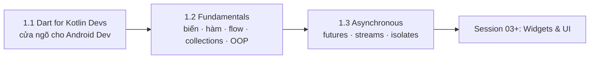

# Session 01: Dart Foundations

## Giới thiệu

Session 01 trả lời hai câu hỏi nền tảng trước khi viết Widget đầu tiên: **Dart biểu diễn dữ liệu và logic thế nào**, và **Dart chạy việc bất đồng bộ thế nào khi mỗi isolate chỉ có một thread**.

Flutter được viết gần như hoàn toàn bằng Dart: mỗi Widget là một class Dart, mỗi lời gọi API chạy trên event loop của Dart. Thiếu nền tảng ngôn ngữ thì bug ở các Session sau trông như "ma thuật": list `final` vẫn bị thêm phần tử, hai model giống hệt nhau so `==` ra `false`, màn hình giật khi parse một file JSON lớn.

Lộ trình này có hai điểm cần biết:

- **Bất đồng bộ nằm ngay Session 01**, trước Networking (Session 05). Gọi API, đọc file, lắng nghe dữ liệu đều đòi hỏi hiểu `Future`, `Stream` và event loop trước.
- **Session mở đầu bằng một bản đồ chuyển đổi cho Kotlin developer**: người đã biết Kotlin không cần học lại "biến", "hàm", "class" từ đầu, mà cần biết chỗ nào giống, chỗ nào giống tên nhưng khác nghĩa, chỗ nào phải đổi tư duy.

<!-- dd: flutter-learning-path -->

## Nội dung Session

- **1.1 Dart cho Kotlin Developer**:
  - [1.1.1 Dart for Kotlin Developers](dart/dart_for_kotlin_devs.md): bản đồ chuyển đổi Kotlin → Dart, runtime và biên dịch (JIT với hot reload khi dev, AOT native khi release), đổi tư duy concurrency, hệ sinh thái `pubspec`/pub/`dart` CLI, các bẫy Kotlin developer hay mắc.
- **1.2 Dart Fundamentals**:
  - [1.2.1 Variables and Types](dart/variables_and_types.md): `var`/`final`/`const`/`late`, sound type system, kiểu built-in, records, generics, null safety và type promotion.
  - [1.2.2 Functions and Operators](dart/functions_operators.md): các loại tham số (positional, optional, named, `required`), closure, tear-off, `typedef`, toán tử, cascade `..`, operator overloading.
  - [1.2.3 Control Flow and Patterns](dart/control_flow_patterns.md): `switch` expression, pattern matching và destructuring, exhaustiveness checking, exception đồng bộ.
  - [1.2.4 Collections and Functional APIs](dart/collections_functional.md): `List`/`Set`/`Map`, collection `if`/`for`, spread, `Iterable` lazy, `sync*`, mutability và equality của collection.
  - [1.2.5 Classes, Mixins and Sealed Types](dart/classes_mixins_sealed.md): constructor, implicit interface, mixin, class modifiers, enhanced enum, extension, extension types, `==`/`hashCode`, immutability.
- **1.3 Asynchronous Dart**:
  - [1.3.1 Futures and Async/Await](async/futures_async_await.md): event loop (microtask queue và event queue), `Future`, `async`/`await`, xử lý lỗi bất đồng bộ, `Completer`, `unawaited`.
  - [1.3.2 Streams](async/streams.md): single-subscription và broadcast, `async*`, `StreamController`, biến đổi stream, `StreamSubscription` và leak.
  - [1.3.3 Isolates](async/isolates.md): heap riêng và message passing, `Isolate.run`, `compute`, worker sống lâu với `SendPort`/`ReceivePort`, chi phí copy dữ liệu.

## Ba trụ cột cần nắm

### Hệ thống kiểu và null safety

Dart là ngôn ngữ kiểu tĩnh với **sound type system** và **sound null safety**: nếu chương trình biên dịch được thì một biến kiểu `String` không bao giờ chứa `null` lúc chạy. Cùng với đó là ba cách "khoá" giá trị khác nhau (`final`, `const`, `late`) mà Kotlin developer dễ hiểu nhầm. Học ở [1.2.1 Variables and Types](dart/variables_and_types.md); `const` còn là nền tảng tối ưu rebuild Widget ở 10.2.2 Build Cost Optimization and Const (chưa có bài).

### Mô hình dữ liệu: sealed type và pattern matching

Từ Dart 3.0, trạng thái của một màn hình (đang tải, thành công, lỗi) được mô hình hoá bằng `sealed class` và xử lý bằng `switch` expression. Compiler kiểm tra đã xử lý đủ mọi trường hợp: thêm trạng thái mới mà quên xử lý thì lỗi lúc biên dịch, không phải lúc người dùng gặp. Học ở [1.2.5 Classes, Mixins and Sealed Types](dart/classes_mixins_sealed.md) (khai báo type) và [1.2.3 Control Flow and Patterns](dart/control_flow_patterns.md) (cơ chế pattern và exhaustiveness).

### Bất đồng bộ: event loop, Future, Stream, isolate

Mỗi isolate có bộ nhớ riêng và một thread chạy event loop. IO (mạng, file) không chặn event loop nên chỉ cần `await`; tính toán nặng CPU thì chặn, nên phải chuyển sang isolate khác. Đây là phần khác Kotlin nhiều nhất và là nguồn của phần lớn bug giật UI. Học theo thứ tự [1.3.1 Futures and Async/Await](async/futures_async_await.md) → [1.3.2 Streams](async/streams.md) → [1.3.3 Isolates](async/isolates.md).

## Thứ tự học đề xuất

- **Đã biết Kotlin (Android developer)**: đọc [1.1.1 Dart for Kotlin Developers](dart/dart_for_kotlin_devs.md) trước để có bản đồ, rồi đọc 1.2.1 → 1.2.5 tập trung vào các mục bản đồ đánh dấu "khác nghĩa" hoặc "không có tương đương", sau cùng đọc kỹ 1.3.1 → 1.3.3.
- **Chưa biết Kotlin**: trong 1.1.1 chỉ đọc hai mục "Runtime và biên dịch" và "Hệ sinh thái" (không bài nào khác dạy chúng), rồi đi tuần tự 1.2.1 → 1.3.3 theo mục lục.
- **Đã biết Dart, cần tra cứu**: dùng bảng ánh xạ trong 1.1.1 như cheatsheet và nhảy tới Topic được link.

1.2.1 → 1.2.5 đi từ giá trị đơn lẻ tới hàm, luồng điều khiển, collection rồi class, nên bài sau dùng lại bài trước. Isolate (1.3.3) chỉ có ý nghĩa khi đã hiểu vì sao event loop (1.3.1) bị chặn.

## Tiêu chí hoàn thành

Bạn sẵn sàng sang Session 02 khi làm được các việc sau mà không cần tra cứu:

- Giải thích vì sao `final cart = <String>[]; cart.add('KB-01');` hợp lệ, và cách tạo một list thật sự không sửa được (1.2.1, 1.2.4).
- Khai báo một hàm với named parameter `required` và giải thích tham số named không `required` thì người gọi được phép bỏ qua (1.2.2).
- Viết một `sealed class` cho trạng thái màn hình và một `switch` expression mà compiler xác nhận đủ nhánh (1.2.3, 1.2.5).
- Viết model có `==` và `hashCode` đúng, hoặc chọn record khi chỉ cần nhóm giá trị (1.2.1, 1.2.5).
- Đoán đúng thứ tự `print` của một đoạn code trộn code đồng bộ, microtask và `Future` (1.3.1).
- Giải thích vì sao `await` một request mạng không làm đơ UI nhưng parse một file JSON lớn thì có, và chuyển việc parse đó sang `Isolate.run` (1.3.1, 1.3.3).
- Hủy đúng `StreamSubscription` khi không cần nghe nữa (1.3.2).

## Học tiếp

Session 02 dựng môi trường làm việc: 2.1.1 Flutter CLI and FVM (chưa có bài), 2.1.2 IDEs and Editor Setup (chưa có bài), 2.2.1 pub.dev and Package Management (chưa có bài) và 2.2.2 DevTools and Debugging (chưa có bài). Sau đó Session 03 bắt đầu với 3.1.1 Stateless and Stateful Widgets (chưa có bài), nơi mọi kiến thức Dart của Session 01 được dùng hằng ngày.
