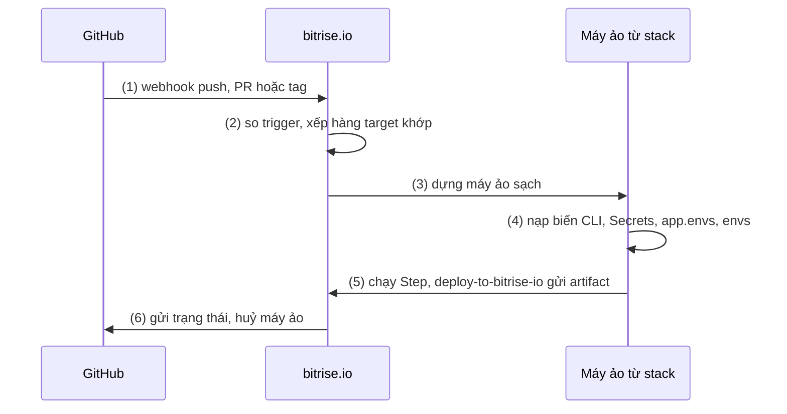
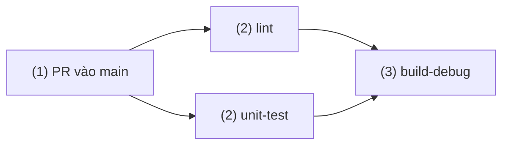
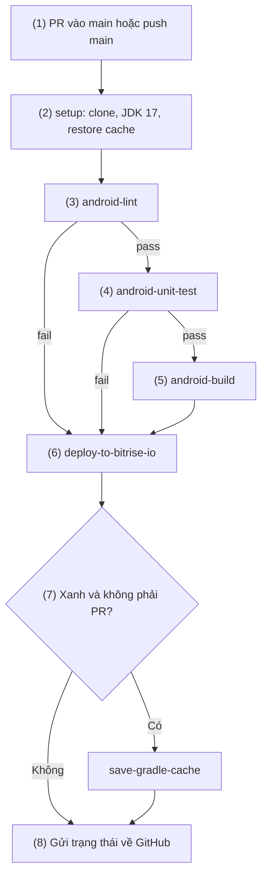
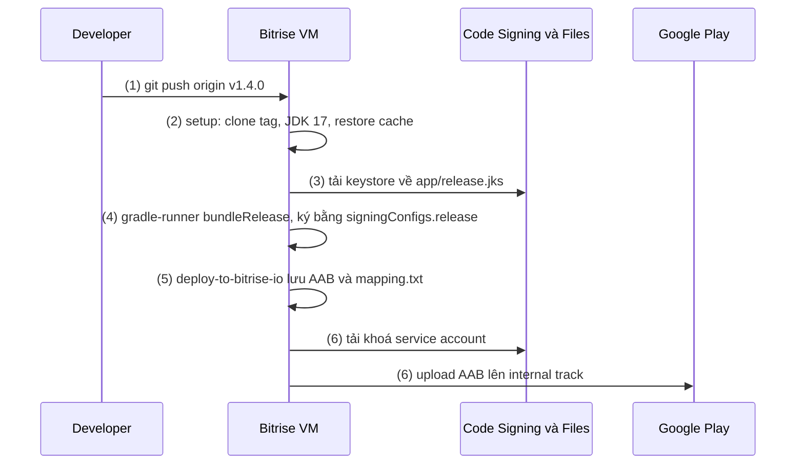

# Bitrise

## Vấn đề cần giải quyết

[11.4 Github CI](github_ci.md) dựng pipeline Android ([11.0](index.md)) bằng GitHub Actions. Với team mobile, cách đó vẫn phải tự ghép:

- **Máy build** đa dụng: Android SDK, emulator tự cài hoặc nhờ action cộng đồng; app có cả iOS cần thêm máy macOS.
- **Bước đặc thù mobile** (ký AAB, upload Play, gom report test, trang cài APK cho QA): mỗi việc là một action bên thứ ba hoặc một đoạn script.

Cần nơi chạy pipeline có máy build sẵn công cụ mobile, các bước mobile đóng gói thành khối có version, team chỉ chọn khối và thông số.

## Sau khi học xong

- Giải thích được mô hình của Bitrise gồm bitrise.yml, Workflow, Step từ Step Library, stack, trigger và Pipeline.
- Triển khai được pipeline PR check bằng bitrise.yml với các Step lint, unit test, build, cache Gradle và Deploy to Bitrise.io.
- Xử lý được secret và code signing trên Bitrise bằng Secrets, Code Signing & Files và các biến BITRISEIO_ANDROID_KEYSTORE_*.
- Triển khai được pipeline Release trên tag v* để build AAB đã ký và upload lên internal track bằng Step Google Play Deploy.
- Biết khi nào nên chọn Bitrise thay vì GitHub Actions hoặc Jenkins, và cái giá phải trả.

## Bitrise là gì?

**Bitrise** là nền tảng CI/CD dạng **SaaS** chuyên cho mobile: pipeline được mô tả trong file **`bitrise.yml`** gồm các **Workflow**, mỗi Workflow là một chuỗi **Step** có version lấy từ **Step Library**, và Bitrise chạy chúng trên một máy ảo sạch dựng từ **stack** (image có sẵn JDK, Android SDK hoặc Xcode).

Mental model, nối với dây chuyền của [11.0](index.md): Bitrise là **xưởng đã lắp sẵn máy (stack), mỗi cổng ráp từ linh kiện đúc sẵn**. Step là linh kiện có mã và số phiên bản (`android-build@1`), Workflow là một đoạn dây chuyền chạy trên một máy, Pipeline nối nhiều Workflow. Bạn chỉ chọn linh kiện và chỉnh thông số (input).

## Cách hoạt động

### Cấu trúc `bitrise.yml`

Các khoá cấp cao nhất hay dùng:

- `format_version`: bắt buộc, Bitrise CLI dùng để kiểm tra tương thích (ví dụ trong docs hiện là `'25'`).
- `default_step_lib_source`: Step Library dùng khi Step không ghi nguồn, `https://github.com/bitrise-io/bitrise-steplib.git`.
- `meta` → `bitrise.io`: `stack` và `machine_type_id` mặc định; Workflow ghi đè bằng `meta` riêng.
- `app` → `envs`: biến môi trường cấp project.
- `workflows`: mỗi Workflow có `steps`, `envs`, `triggers`, `meta`, `status_report_name`.
- `step_bundles`: nhóm Step dùng lại, chèn bằng `bundle::<tên>`.
- `pipelines`: nhóm Workflow có phụ thuộc.
- `trigger_map`: trigger kiểu cũ (legacy) cấp project.

**Stack** là image của máy ảo: stack Linux có Android SDK và nhiều bản JDK, stack macOS có Xcode và cả công cụ Android. Alias `ubuntu-latest-stable` đổi theo stack Stable hiện tại; muốn tái lập thì ghi ID cụ thể ([stack reports](https://bitrise.io/stacks/stack_reports/)) và nâng định kỳ, vì mỗi stack đi qua edge → stable → frozen → bị gỡ, mỗi giai đoạn khoảng một năm.

**Workflow Editor và YAML trong repo:** mặc định `bitrise.yml` nằm trên bitrise.io, sửa bằng Workflow Editor. Nên **lưu trong repo** (mặc định ở gốc): build của nhánh nào đọc `bitrise.yml` của nhánh đó, thay đổi CI được review qua Pull Request. Nhánh mặc định luôn phải có file hợp lệ.

### Step và Step Library

Step là chương trình nhỏ có `step.yml` khai báo **input**, **output** và điều kiện chạy; Step Library (`bitrise-io/bitrise-steplib`) giữ mọi version đã phát hành. Cú pháp: `<nguồn>::<step-id>@<version>`. Bỏ nguồn thì dùng `default_step_lib_source`; **bỏ version thì lấy bản mới nhất**, kể cả major có thay đổi phá vỡ. Nên **pin major**: `android-build@1` nhận các bản 1.x, không tự lên 2.0.

| Step (major hiện hành) | Chạy gì | Output, ghi chú |
|---|---|---|
| `git-clone@8`, `set-java-version@1` | Checkout (PR thì lấy trạng thái đã merge); chọn JDK | `JAVA_HOME` |
| `android-lint@1` | `lint<Variant>` | Copy report vào `$BITRISE_DEPLOY_DIR` rồi mới báo đỏ nếu task Gradle đỏ |
| `android-unit-test@1` | `test<Variant>UnitTest` | Report HTML/XML, tab Test Reports |
| `android-build@1` | `assemble<Variant>` hoặc `bundle<Variant>` (`build_type`) | `BITRISE_APK_PATH`, `BITRISE_AAB_PATH`, `BITRISE_MAPPING_PATH` |
| `gradle-runner@6` | Task bất kỳ (`gradle_task`) | Copy APK/AAB/`mapping.txt` vào `$BITRISE_DEPLOY_DIR`, output như trên |
| `deploy-to-bitrise-io@2` | Đưa `$BITRISE_DEPLOY_DIR` lên trang build: artifact, test report, trang cài APK cho QA (`is_enable_public_page`) | Mặc định `is_always_run: true` |
| `google-play-deploy@4` | Upload APK/AAB lên Google Play | |

Task theo variant học ở [Flavor](../session_04/android_manifest/package_build_gradle/flavor.md), task lint/test ở [10.3 Lint](../coding_analyst_and_testing/lint.md) và [10.2 Unit Testing](../coding_analyst_and_testing/unit_testing.md). `gradle-runner` không gom report như Step chuyên dụng. Stack thiếu thành phần SDK thì thêm `install-missing-android-tools@3`.

Step thất bại thì **các Step sau bị bỏ qua**, trừ Step có `is_always_run: true`. `run_if` nhận biểu thức Go template: `.IsCI | and (not .IsPR)` chỉ đúng khi build không đến từ Pull Request. Output là biến môi trường cho Step sau: `android-build` ghi `BITRISE_AAB_PATH`, `google-play-deploy` mặc định đọc nó.

### Một build chạy thế nào

1. Git provider gửi webhook (push, Pull Request, tag).
2. Bitrise so với trigger, xếp hàng mọi target khớp.
3. Mỗi target được dựng một máy ảo sạch từ stack.
4. Bitrise CLI nạp biến theo thứ tự: biến của CLI (`BITRISE_BUILD_NUMBER`, `BITRISE_DEPLOY_DIR`...), Secrets, `app.envs`, `envs` của Workflow, rồi input của từng Step.
5. Chạy Step tuần tự; `deploy-to-bitrise-io` đưa artifact và report lên trang build.
6. Gửi trạng thái về Git provider, huỷ máy ảo.



Máy ảo bị huỷ sau mỗi build: file tải về (keystore) không sống sang build sau; thứ cần giữ phải qua cache hoặc artifact.

### Trigger

- **Target-based trigger** (khuyến nghị): khoá `triggers` trong Workflow hoặc Pipeline; Bitrise xét mọi trigger và **mọi target khớp đều chạy**.
- **`trigger_map`** (legacy, cấp project): trigger khớp đầu tiên chạy **một** build.

Loại trigger: `push` (`branch`, `commit_message`, `changed_files`), `pull_request` (`source_branch`, `target_branch`, `label`, `draft_enabled`, `comment`...), `tag` (`name`). Mọi điều kiện trong một mục phải cùng khớp; điều kiện bỏ trống mặc định là `*` (riêng `draft_enabled` mặc định `true`). Chuỗi là wildcard; cần biểu thức chính quy thì đặt khoá `regex:` dưới điều kiện (ví dụ ở pipeline Release).

### Pipeline: nhiều Workflow có phụ thuộc

**Pipeline** (viết hoa: đối tượng `pipelines` của Bitrise, khác pipeline theo nghĩa 11.0) gom nhiều Workflow, thứ tự khai báo bằng `depends_on`; Workflow không phụ thuộc nhau chạy song song, mỗi Workflow một máy ảo. Workflow chỉ chạy khi mọi Workflow nó phụ thuộc thành công (trừ khi `should_always_run: workflow`); `abort_on_fail: true` dừng cả Pipeline; `parallel: N` chạy N bản sao để chia shard test. Dạng cũ chia theo **stages** sẽ không được cập nhật nữa.

#### Ví dụ: chạy lint và unit test song song trước khi build

**Bài toán:** lint 6 phút, unit test 8 phút; chạy tuần tự thì PR chờ 14 phút.

**Luồng chạy:**

1. PR vào `main` khớp trigger của Pipeline.
2. `lint` và `unit-test` chạy song song trên hai máy ảo.
3. `build-debug` chỉ chạy khi cả hai xanh; một cái đỏ thì Pipeline đỏ.



**Code:**

```yaml
# bitrise.yml: trích pipelines (mỗi Workflow tự có bundle::setup và deploy-to-bitrise-io)
pipelines:
  pr-pipeline:
    triggers:
      pull_request:
      - target_branch: main               # (1)
    workflows:
      lint: {}                            # (2)
      unit-test: {}                       # (2)
      build-debug:
        depends_on: [lint, unit-test]     # (3)
```

**Kết quả:** trang build hiện đồ thị ba Workflow, PR chờ khoảng 8 phút cộng bước build. Đổi lại, mỗi Workflow tự clone, restore cache; chuyển file giữa Workflow phải qua input `pipeline_intermediate_files` của `deploy-to-bitrise-io` và Step `pull-intermediate-files`.

### Cache cho Gradle

- **Key-based caching:** `restore-gradle-cache@3` ở đầu, `save-gradle-cache@1` ở cuối; Step tự đặt key và đường dẫn cho dependency Gradle; archive không dùng 7 ngày liên tục thì bị xoá. Bitrise khuyến nghị **không để build PR ghi cache**: đặt `run_if: ".IsCI | and (not .IsPR)"` cho Step save.
- **Bitrise Build Cache for Gradle** (Step `activate-build-cache-for-gradle`, đặt trước mọi Step chạy Gradle): remote build cache cho output task, dùng chung giữa các build và máy local; là sản phẩm riêng.

`cache-pull`/`cache-push` (branch-based caching) là cơ chế legacy.

### Secrets, Env Vars và Code Signing & Files

Khái niệm secret học ở [github_ci.md](github_ci.md). Bitrise có ba nơi giữ giá trị:

| Nơi | Dùng cho | Đọc trong build |
|---|---|---|
| **Env Vars** (`app.envs`, `envs`) | Giá trị không bí mật | `$PACKAGE_NAME` |
| **Secrets** (Workflow Editor → Secrets) | Mật khẩu, token | `$TÊN`; log hiện `[REDACTED]` |
| **Code Signing & Files** (Project settings → Code signing, Files) | Keystore, file khoá | Biến `BITRISEIO_..._URL` chứa URL tải file |

Mặc định **build từ Pull Request không thấy Secrets** (kể cả PR từ fork), trừ khi bật **Expose for Pull Requests?** cho từng secret; vì vậy PR check phải chạy được không cần secret. Secret **Protected** không ai xem hay sửa lại được (muốn đổi phải xoá rồi tạo lại).

**Keystore** tải lên ở **Project settings → Code signing → Android → Add keystore file**, kèm Keystore password, Key alias, Private key password. Bitrise sinh `BITRISEIO_ANDROID_KEYSTORE_URL` (URL tải chỉ đọc, **có hạn dùng**, không phải đường dẫn file), `BITRISEIO_ANDROID_KEYSTORE_PASSWORD`, `BITRISEIO_ANDROID_KEYSTORE_ALIAS`, `BITRISEIO_ANDROID_KEYSTORE_PRIVATE_KEY_PASSWORD`. Bitrise giữ chính file, không cần base64 như `RELEASE_KEYSTORE_BASE64` của 11.4.

**File khác** tải ở **Project settings → Files → Add file** với một **File Storage ID** (tối đa 5 MB); URL tải nằm trong `BITRISEIO_<ID>_URL`, ví dụ ID `PLAY_SERVICE_ACCOUNT_JSON` cho khoá service account thì biến là `BITRISEIO_PLAY_SERVICE_ACCOUNT_JSON_URL`.

> [!WARNING]
> File trong **Files** mặc định **mở cho build Pull Request**. Với file khoá, bật **Make protected**: không ai tải lại được file từ tài khoản, biến của file được coi như Secret nên không mở cho PR và dùng được cho input nhạy cảm `service_account_json_key_path` (input này đòi giá trị là Secret).

Hai cách ký AAB:

- **Ký trong Gradle** (bài này chọn): `file-downloader@2` tải keystore về `app/release.jks`, `envs` của Workflow ánh xạ `BITRISEIO_ANDROID_KEYSTORE_*` sang tên chuẩn mà `signingConfigs.release` của 11.4 đọc; cùng `build.gradle.kts` chạy trên mọi tool.
- **Step `sign-apk@2`:** build AAB chưa ký rồi Step ký bằng keystore trong Code signing. Không dùng chung với ký trong Gradle: AAB đã ký thì `sign-apk` thất bại.

## Ví dụ thực tế

Hai pipeline chuẩn của Session 11 trong một `bitrise.yml` ở gốc repo. Chuẩn bị Google Play (service account, AAB đầu tiên upload tay) học ở [github_ci.md](github_ci.md).

### Pipeline PR check

**Bài toán:** mọi Pull Request vào `main` phải qua lint, unit test, build debug; report và APK debug lưu cho người review; check đỏ thì không merge.

**Luồng chạy:**

1. PR vào `main` (không phải nháp) khớp trigger `pr-check`; push vào `main` cũng chạy, để ghi cache cho PR sau.
2. `bundle::setup`: clone, chọn JDK 17, khôi phục cache Gradle.
3. `android-lint` chạy `lintDebug`.
4. `android-unit-test` chạy unit test variant debug.
5. `android-build` chạy `assembleDebug`.
6. `deploy-to-bitrise-io` luôn chạy, kể cả khi bước 3–5 đỏ, đưa report và APK lên trang build.
7. `save-gradle-cache` chỉ chạy khi build xanh và không phải PR.
8. Bitrise gửi trạng thái `bitrise-pr-check` về GitHub.



**Code:**

```yaml
# bitrise.yml (gốc repo): phần chung và Workflow pr-check
format_version: '25'
default_step_lib_source: https://github.com/bitrise-io/bitrise-steplib.git
project_type: android

meta:
  bitrise.io:
    stack: ubuntu-noble-24.04-bitrise-2025-android

app:
  envs:
  - PACKAGE_NAME: com.example.bookstore

step_bundles:
  setup:                                           # (2)
    steps:
    - git-clone@8: {}
    - set-java-version@1:
        inputs:
        - set_java_version: "17"
    - restore-gradle-cache@3: {}

workflows:
  pr-check:
    status_report_name: bitrise-pr-check           # (8) tên check cố định
    triggers:
      pull_request:
      - target_branch: main                        # (1)
        draft_enabled: false
      push:
      - branch: main                               # (1)
    steps:
    - bundle::setup: {}                            # (2)
    - android-lint@1:                              # (3)
        inputs:
        - variant: debug
    - android-unit-test@1:                         # (4)
        inputs:
        - variant: debug
    - android-build@1:                             # (5)
        inputs:
        - variant: debug
        - build_type: apk
    - deploy-to-bitrise-io@2: {}                   # (6)
    - save-gradle-cache@1:                         # (7)
        run_if: ".IsCI | and (not .IsPR)"
```

Gộp ba task vào một `gradle-runner@6` cũng được, nhưng phải tự gom report và mất tab Test Reports.

**Kết quả:** PR có check `bitrise-pr-check`; tab **Artifacts** có `lint-results-debug.html`, report test, `app-debug.apk`; tab **Test Reports** liệt kê từng test case. Đặt `bitrise-pr-check` làm required status check ([github_ci.md](github_ci.md)) thì PR đỏ không merge được.

### Pipeline Release

**Bài toán:** push tag `v1.4.0` thì build AAB đã ký, versionCode tự tăng, lưu AAB và `mapping.txt`, upload lên internal track.

**Luồng chạy:**

1. Push tag khớp `v*` kích hoạt `release` (không phải PR nên Secrets dùng được).
2. `bundle::setup` clone commit của tag, chọn JDK 17, khôi phục cache.
3. `file-downloader` tải keystore về `app/release.jks`, quyền `600`.
4. `gradle-runner` chạy `bundleRelease`, ký bằng các biến đã ánh xạ ở `envs`, versionCode từ `BITRISE_BUILD_NUMBER`; Step copy AAB và `mapping.txt` vào `$BITRISE_DEPLOY_DIR`, ghi `BITRISE_AAB_PATH`.
5. `deploy-to-bitrise-io` lưu AAB và `mapping.txt` làm artifact.
6. `google-play-deploy` tải khoá service account (file đã Make protected), upload AAB lên track `internal`.



**Code:**

```yaml
# bitrise.yml (gốc repo): thêm Workflow release vào khối workflows ở trên
workflows:
  release:
    triggers:
      tag:
      - name: "v*"                                 # (1) v1.4.0, v2.0.0-rc1
      # chặt hơn: - name: { regex: '^v\d+\.\d+\.\d+$' }
    envs:                                          # (4) ánh xạ sang tên chuẩn của 11.4
    - RELEASE_STORE_FILE: release.jks
    - RELEASE_STORE_PASSWORD: $BITRISEIO_ANDROID_KEYSTORE_PASSWORD
    - RELEASE_KEY_ALIAS: $BITRISEIO_ANDROID_KEYSTORE_ALIAS
    - RELEASE_KEY_PASSWORD: $BITRISEIO_ANDROID_KEYSTORE_PRIVATE_KEY_PASSWORD
    steps:
    - bundle::setup: {}                            # (2)
    - file-downloader@2:                           # (3)
        inputs:
        - source: $BITRISEIO_ANDROID_KEYSTORE_URL
        - destination: app/release.jks
        - file_permission: "600"
    - gradle-runner@6:                             # (4)
        inputs:
        - gradle_task: bundleRelease
        - gradle_options: --stacktrace -PversionCode=$BITRISE_BUILD_NUMBER
    - deploy-to-bitrise-io@2: {}                   # (5)
    - google-play-deploy@4:                        # (6)
        inputs:
        - service_account_json_key_path: $BITRISEIO_PLAY_SERVICE_ACCOUNT_JSON_URL
        - package_name: $PACKAGE_NAME
        - app_path: $BITRISE_AAB_PATH
        - track: internal
        - status: completed
```

Gradle dùng đúng `signingConfigs.release` và property `versionCode` chuẩn ở [github_ci.md](github_ci.md). Input của Step chỉ thay biến, không tính biểu thức shell: muốn cộng offset như 11.4 (`1000 +` số build) thì gọi Gradle bằng `script@1` hoặc để Gradle tự cộng. Mọi Workflow trong một lần chạy Pipeline dùng chung một `BITRISE_BUILD_NUMBER`.

Input khác của `google-play-deploy@4`: `user_fraction` (staged rollout, khi `status` là `inProgress` hoặc `halted`), `whatsnews_dir` (file `whatsnew-<locale>` làm release notes), `dry_run`. Từ 4.0.0, `mapping_file` mặc định trống vì AAB có minify đã chứa mapping; `mapping.txt` vẫn lưu làm artifact cho Crashlytics ([10.4](../coding_analyst_and_testing/fit_bug_optimization.md)).

**Kết quả:** trang build có artifact AAB và `mapping.txt`, log `gradle-runner` có `BUILD SUCCESSFUL`; **Play Console → Testing → Internal testing** có release mới với versionCode bằng số build Bitrise.

> [!IMPORTANT]
> Ví dụ không có bước duyệt tay như environment có required reviewer của GitHub Actions. Bù lại: giới hạn người được push tag `v*` bằng ruleset, chỉ tự động lên internal track, promote lên production làm tay trên Play Console.

## Khi nào nên và không nên dùng

**Nên:** team mobile không muốn vận hành máy build; app có cả iOS (Workflow iOS đặt `meta` với stack macOS) cần ký hai nền tảng ở một chỗ; muốn bước mobile có sẵn dạng Step có version.

**Không nên:** mã nguồn không được rời mạng công ty ([Jenkins](jenkins.md)); code ở GitHub, chỉ build Android, team quen GitHub Actions ([Github CI](github_ci.md)); cần phần cứng mà stack không có.

**Cái giá:** chi phí theo gói (thời gian và loại máy; Workspace secrets chỉ có ở gói Enterprise; Build Cache là sản phẩm riêng; xem trang giá), và **lệ thuộc nền tảng**: Step, trigger, Code Signing & Files là của riêng Bitrise. Giữ logic build (ký, versionCode) trong Gradle để khi chuyển đi chỉ viết lại lớp điều phối.

## Sai lầm thường gặp

### 1. Không pin version Step

```yaml
- google-play-deploy: {}        # không @version: luôn lấy bản mới nhất
```

**Lỗi lộ ra thế nào:** build đổi hành vi dù không ai sửa `bitrise.yml`. Ví dụ `google-play-deploy` 4.0.0 thôi gửi `mapping_file` mặc định: upload APK bỗng không còn mapping trên Play.

**Cách sửa:** pin major (`google-play-deploy@4`), đọc release notes của Step trước khi nâng major.

### 2. Đưa URL keystore vào Gradle như đường dẫn file

```kotlin
storeFile = file(System.getenv("BITRISEIO_ANDROID_KEYSTORE_URL"))   // sai: đây là URL https
```

**Lỗi lộ ra thế nào:** `bundleRelease` thất bại vì không tìm thấy keystore.

**Cách sửa:** tải về bằng `file-downloader` trong cùng build (URL có hạn dùng), Gradle đọc đường dẫn file.

### 3. Mở secret hoặc file khoá cho build Pull Request

**Lỗi lộ ra thế nào:** bật Expose for Pull Requests cho PR check "chạy được", hoặc để khoá service account trong Files không Make protected: ai mở được PR cũng sửa code để gửi giá trị ra ngoài; `[REDACTED]` chỉ che log.

**Cách sửa:** PR check không dùng secret; file khoá luôn Make protected; việc cần secret chạy trên nhánh bảo vệ hoặc tag.

### 4. Lưu cache từ build PR

```yaml
- save-gradle-cache@1: {}       # thiếu run_if: build PR cũng ghi cache
```

**Lỗi lộ ra thế nào:** cache do code PR chưa review tạo ra được build `main` và release tải về.

**Cách sửa:** thêm `run_if: ".IsCI | and (not .IsPR)"`.

## Lịch sử phát triển

- **10/2014:** Bitrise thành lập ở Budapest; Bitrise CLI và Step Library là mã nguồn mở.
- **Sau đó (không rõ năm):** key-based caching ra khỏi beta, branch-based caching thành legacy.
- **Khoảng cuối 2024:** Pipeline chuyển từ stages sang đồ thị `depends_on`.
- **01/2025:** target-based trigger trong Workflow/Pipeline, thay cho `trigger_map`.
- **2026:** Ubuntu Noble 24.04 (Bitrise 2025 Edition) thành stack Linux Stable, `linux-docker-android-22.04` bị đóng băng; `gradle-runner` 6.0.0 và `google-play-deploy` 4.0.0 (08/2026) đổi cách xử lý `mapping.txt`; `android-lint` 1.0.0 (10/2026) bỏ tích hợp cache legacy.

## Kết nối hệ thống

- **Tiên quyết:** [11.0 Tổng quan](index.md) (pipeline Android); [11.4 Github CI](github_ci.md) (secret, `signingConfigs.release`, versionCode, service account, track, required status check); [Build Types](../session_04/android_manifest/package_build_gradle/build_types.md) (variant release, `mapping.txt`).
- **Liên quan:** [AAB](../session_01/output_packages/aab_files.md) (upload key, Play App Signing); [Flavor](../session_04/android_manifest/package_build_gradle/flavor.md) (task theo variant); [10.3 Lint](../coding_analyst_and_testing/lint.md), [10.2 Unit Testing](../coding_analyst_and_testing/unit_testing.md) (task mà Step lint, unit test gọi); [10.4 Fit / Bug Optimization](../coding_analyst_and_testing/fit_bug_optimization.md) (`mapping.txt` để đọc crash).
- **Học tiếp:** [11.1 Jenkins](jenkins.md) (hạ tầng tự quản), [11.3 Travis CI](travis_ci.md) (công cụ cũ và cách migrate).

## Tham khảo

- Bitrise Docs: [Configuration YAML reference](https://docs.bitrise.io/en/bitrise-ci/references/configuration-yaml-reference), [YAML syntax for build triggers](https://docs.bitrise.io/en/bitrise-ci/run-and-analyze-builds/build-triggers/yaml-syntax-for-build-triggers), [Configuring a Bitrise Pipeline](https://docs.bitrise.io/en/bitrise-ci/workflows-and-pipelines/build-pipelines/configuring-a-bitrise-pipeline), [Step bundles](https://docs.bitrise.io/en/bitrise-ci/workflows-and-pipelines/steps/step-bundles), [Storing an app's configuration YAML](https://docs.bitrise.io/en/bitrise-ci/configure-builds/configuration-yaml/storing-an-apps-configuration-yaml), [Setting the stack for your builds](https://docs.bitrise.io/en/bitrise-ci/configure-builds/configuring-build-settings/setting-the-stack-for-your-builds), [Linux stack update policy](https://docs.bitrise.io/en/bitrise-platform/infrastructure/build-stacks/linux-stack-update-policy)
- Bitrise Docs: [Environment variables](https://docs.bitrise.io/en/bitrise-ci/configure-builds/environment-variables), [Available environment variables](https://docs.bitrise.io/en/bitrise-ci/references/available-environment-variables), [Secrets](https://docs.bitrise.io/en/bitrise-ci/configure-builds/secrets), [Uploading Android keystore files to Bitrise](https://docs.bitrise.io/en/bitrise-ci/code-signing/android-code-signing/uploading-android-keystore-files-to-bitrise), [Android code signing in Gradle](https://docs.bitrise.io/en/bitrise-ci/code-signing/android-code-signing/android-code-signing-in-gradle), [Uploading files for your builds](https://docs.bitrise.io/en/bitrise-ci/run-and-analyze-builds/managing-build-files/uploading-files-for-your-builds), [Getting started with Android projects](https://docs.bitrise.io/en/bitrise-ci/getting-started/quick-start-guides/getting-started-with-android-projects)
- Bitrise Docs: [Using key-based caching](https://docs.bitrise.io/en/bitrise-ci/dependencies-and-caching/key-based-caching/using-key-based-caching), [Make caching efficient for pull request builds](https://docs.bitrise.io/en/bitrise-ci/workflows-and-pipelines/workflows/generic-workflow-recipes/make-caching-efficient-for-pull-request-builds), [Build Cache for Gradle](https://docs.bitrise.io/en/bitrise-build-cache/build-cache-for-gradle/configuring-the-build-cache-for-gradle-in-the-bitrise-ci-environment)
- [bitrise-io/bitrise-steplib](https://github.com/bitrise-io/bitrise-steplib) (`step.yml` và version của từng Step); release notes [steps-google-play-deploy](https://github.com/bitrise-steplib/steps-google-play-deploy/releases), [steps-gradle-runner](https://github.com/bitrise-steplib/steps-gradle-runner/releases), [bitrise-step-android-lint](https://github.com/bitrise-steplib/bitrise-step-android-lint/releases), [steps-sign-apk](https://github.com/bitrise-steplib/steps-sign-apk)
- Diễn đàn Bitrise: [Target-based build triggers](https://discuss.bitrise.io/t/new-feature-alert-target-based-build-triggers/24714), [BITRISE_BUILD_NUMBER trong Pipeline](https://discuss.bitrise.io/t/pipeline-build-number-as-bitrise-build-number/22370)
