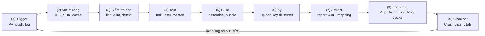
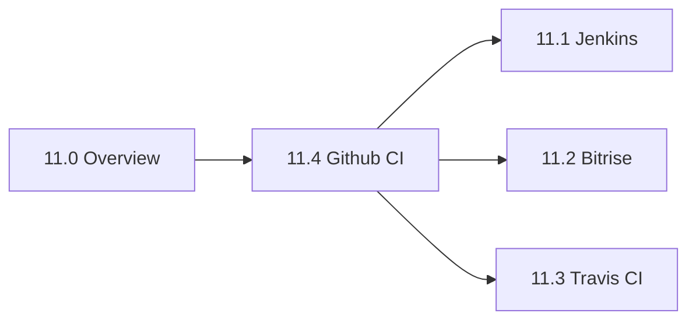

# Session 11 Overview

## Vấn đề cần giải quyết

Session 10 cho bạn lint, test và cách đọc crash. Nếu tất cả chạy **bằng tay, trên máy một người**:

1. Pull Request được merge khi chưa ai chạy lint và test.
2. Bản release build từ nhánh lạ, keystore trên laptop, quên tăng `versionCode` nên Play từ chối.
3. Không ai giữ `mapping.txt`, crash ở production không đọc được.
4. Bản lỗi tới thẳng 100% người dùng.

Session 11 trả lời: **làm sao để mỗi thay đổi tự động qua cùng một chuỗi kiểm tra, và mỗi bản phát hành được tạo, ký, phân phối theo quy trình lặp lại được**.

## Sau khi học xong

- Phân biệt được Continuous Integration, Continuous Delivery và Continuous Deployment, và vì sao app Android thường dừng ở Continuous Delivery cho production.
- Giải thích được các stage của pipeline Android từ trigger tới giám sát sau phát hành, và Session nào dạy nội dung của từng stage.
- Phân biệt được Jenkins, Bitrise, Travis CI và GitHub Actions theo kiểu hosting, file cấu hình, hiện trạng và trường hợp nên chọn.
- Áp dụng được thứ tự học đề xuất và nơi dạy chính của các kiến thức dễ chồng lấn trong Session 11.

## CI/CD là gì?

**Continuous Integration (CI, tích hợp liên tục)** là thực hành mỗi developer tích hợp thay đổi vào nhánh chính thường xuyên (ít nhất mỗi ngày), và **mỗi lần tích hợp được build và test tự động** để lỗi lộ ra ngay khi vừa đưa vào. **CD** có hai nghĩa:

- **Continuous Delivery (chuyển giao liên tục):** mọi bản đã qua pipeline luôn ở trạng thái **phát hành được bất cứ lúc nào**; đưa lên production là **quyết định của người**, thường chỉ là một nút bấm.
- **Continuous Deployment (triển khai liên tục):** mọi bản qua pipeline **tự động** lên production, không có bước duyệt tay.

Mental model: **pipeline là dây chuyền có các cổng nối tiếp**; mỗi cổng (lint, test, build, ký) cho thay đổi đi tiếp hoặc dừng dây chuyền và báo đỏ. CI là đoạn chạy cho mọi Pull Request, CD kéo dài tới tay người dùng. Tool CI chỉ là **nơi chạy** dây chuyền.

## Cách hoạt động

### Continuous Delivery và Continuous Deployment trên Android

Web rollback bằng cách deploy lại bản cũ; app Android đã cài chỉ sửa được bằng **bản mới** có `versionCode` cao hơn. Vì vậy app Android thường dừng ở **Continuous Delivery**: tự động lên **internal track** hoặc Firebase App Distribution; lên production có người duyệt và đi qua **staged rollout (phát hành theo tỉ lệ)**.

### Pipeline Android

Trên tool nào, pipeline Android cũng gồm các stage sau:

1. **Trigger:** mở hoặc cập nhật Pull Request, push lên `main`, push tag phát hành, chạy tay.
2. **Môi trường:** máy build sạch có JDK đúng version AGP cần ([Plugin](../session_04/android_manifest/package_build_gradle/plugin.md)), Android SDK, **cache** Gradle.
3. **Kiểm tra tĩnh:** Android Lint, ktlint, detekt ([10.3](../coding_analyst_and_testing/lint.md)).
4. **Test:** unit test cho mọi PR; instrumented test trên emulator khi cần ([10.2](../coding_analyst_and_testing/unit_testing.md)).
5. **Build:** `assemble<Variant>` ra APK, `bundle<Variant>` ra AAB ([Build Types](../session_04/android_manifest/package_build_gradle/build_types.md), [Flavor](../session_04/android_manifest/package_build_gradle/flavor.md)).
6. **Ký:** bản release ký bằng upload key lấy từ **secret** của tool CI, không nằm trong repo ([AAB và Play App Signing](../session_01/output_packages/aab_files.md)).
7. **Artifact:** lưu report, APK, AAB, `mapping.txt` để tải về và truy vết.
8. **Phân phối:** bản QA qua Firebase App Distribution; bản phát hành lên các **track** của Google Play: internal (tối đa 100 tester, có sau vài phút), closed (tester được mời), open (ai cũng tham gia được), production. **Staged rollout** phát cho một tỉ lệ người dùng rồi tăng dần, dừng được khi có lỗi. Chi tiết ở [11.4](github_ci.md).
9. **Giám sát:** Crashlytics và Android vitals quyết định tăng rollout hay dừng ([10.4](../coding_analyst_and_testing/fit_bug_optimization.md)).

<!-- archify: s11-android-cicd-pipeline | Pipeline CI/CD của một app Android -->

Mũi tên quay lại là vòng chất lượng của [Session 10](../coding_analyst_and_testing/index.md), giờ chạy tự động.

### Hai pipeline chuẩn của Session 11

Mỗi bài viết lại **cùng hai pipeline** bằng tool của mình:

| Pipeline | Trigger | Stage | Kiểm chứng |
|---|---|---|---|
| **PR check** | Mỗi Pull Request vào `main` | (2) JDK 17, cache → (3)(4)(5) `./gradlew lintDebug testDebugUnitTest assembleDebug` → (7) report, APK debug | Check trên PR; đỏ thì chặn merge |
| **Release** | Push tag `v*` | (2) → giải mã keystore từ secret → (5)(6) `bundleRelease` đã ký → (7) AAB, `mapping.txt` → (8) internal track | Bản mới trên internal track |

Secret dùng chung tên ở mọi bài: `RELEASE_KEYSTORE_BASE64`, `RELEASE_STORE_PASSWORD`, `RELEASE_KEY_ALIAS`, `RELEASE_KEY_PASSWORD`, `PLAY_SERVICE_ACCOUNT_JSON`.

### Session 11 học những gì?

| | [11.1 Jenkins](jenkins.md) | [11.2 Bitrise](bitrise.md) | [11.3 Travis CI](travis_ci.md) | [11.4 Github CI](github_ci.md) |
|---|---|---|---|---|
| Hosting | Tự host, open source | SaaS chuyên mobile | SaaS, có bản tự host | SaaS trong GitHub, có self-hosted runner |
| File cấu hình | `Jenkinsfile` | `bitrise.yml` | `.travis.yml` | `.github/workflows/*.yml` |
| Đơn vị pipeline | `stages` → `stage` → `steps`, chạy trên agent | Workflow gồm Step; Pipeline nối Workflow | Build → job → phase cố định | Workflow → job → step, chạy trên runner |
| Điểm mạnh với Android | Toàn quyền máy build, dữ liệu ở mạng nội bộ | Stack có Android SDK, Step ký và deploy Play, chạy cả iOS | `language: android` cài SDK component | Gắn với PR, runner có Android SDK |
| Hiện trạng | Đang phát triển; phải tự vận hành | Đang phát triển, tính phí theo gói | `travis-ci.org` tắt từ 06/2021, Free Trial không mở, không có macOS | Lựa chọn mặc định với repo GitHub |
| Khi nào chọn | Đã có Jenkins, dữ liệu phải ở mạng công ty | Team mobile không muốn vận hành máy build | Duy trì dự án đang dùng Travis | Code ở GitHub, muốn bắt đầu nhanh |

11.4 là **bài chính**, gồm toàn bộ **Publish Store**; ba bài còn lại chỉ dạy phần riêng của tool.

### Nơi dạy chính của các kiến thức dễ chồng lấn

| Kiến thức | Dạy chính ở | Bài khác chỉ nhắc |
|---|---|---|
| Secret, keystore base64, `signingConfigs.release` đọc biến môi trường | 11.4 | 11.1 Credentials, 11.2 Code Signing, 11.3 `encrypt-file` |
| versionCode lấy từ số build của CI | 11.4 (`GITHUB_RUN_NUMBER`) | `BUILD_NUMBER`, `BITRISE_BUILD_NUMBER`, `TRAVIS_BUILD_NUMBER` |
| Service account, track, staged rollout, promote, release notes | 11.4 | 11.1, 11.2 dùng plugin hoặc Step của tool |
| Tên task theo variant, matrix theo flavor | [Flavor](../session_04/android_manifest/package_build_gradle/flavor.md) | 11.4 nhắc matrix |
| Ký app, Play App Signing; R8, `mapping.txt`, Firebase App Distribution | [APK](../session_01/output_packages/apk_files.md), [AAB](../session_01/output_packages/aab_files.md); [Build Types](../session_04/android_manifest/package_build_gradle/build_types.md) | 11.x dùng lại |

### Thứ tự học đề xuất

1. **11.4 trước:** bài chính, dạy khái niệm dùng chung và Publish Store.
2. **11.1, 11.2:** tự host và SaaS chuyên mobile; đọc khi team dùng hoặc cân nhắc.
3. **11.3 cuối:** bài ngắn, để đọc cấu hình cũ và migrate.

## Ví dụ thực tế

Một bản sửa lỗi đi trọn pipeline, ở tool nào cũng vậy:

1. **PR check:** PR sửa lỗi tính phí ship có test đỏ nên bị chặn; sửa xong, check xanh, merge.
2. **Bản cho QA:** push lên `main` build variant `staging`, đẩy qua Firebase App Distribution.
3. **Release:** push tag `v2.4.0`; pipeline ký AAB bằng keystore từ secret, versionCode từ số build, lưu AAB và `mapping.txt`, upload lên internal track.
4. **Promote:** nhóm nội bộ thử xong, promote lên production với staged rollout 10%.
5. **Giám sát:** chỉ số ổn định thì tăng dần lên 100%; crash tăng thì dừng rollout.

## Sai lầm thường gặp

### 1. Coi CI chỉ là "máy build hộ"

**Lỗi lộ ra thế nào:** pipeline chỉ chạy `assembleDebug`; CI xanh nhưng lỗi vẫn lọt.

**Cách sửa:** PR check có kiểm tra tĩnh, unit test và build; đỏ thì **chặn merge** (11.4).

### 2. Nhầm Continuous Delivery với tự động lên production

**Lỗi lộ ra thế nào:** mọi tag lên thẳng production 100%; bản lỗi tới toàn bộ người dùng.

**Cách sửa:** tự động tới internal track; lên production có người duyệt, dùng staged rollout.

### 3. Để bước phát hành phụ thuộc vào một máy cá nhân

**Lỗi lộ ra thế nào:** keystore chỉ có trên laptop một người; người đó nghỉ là không phát hành được.

**Cách sửa:** keystore và khoá service account nằm trong secret của tool CI; bản release chỉ build trên CI từ tag.

## Lịch sử phát triển

- **1991:** Grady Booch dùng cụm từ "continuous integration"; cuối thập niên 1990, Extreme Programming đưa CI vào thực hành hằng ngày.
- **2000:** bài "Continuous Integration" của Martin Fowler phổ biến khái niệm; CruiseControl (2001) là một trong những CI server đầu tiên.
- **2010:** sách *Continuous Delivery* (Jez Humble, David Farley) định nghĩa deployment pipeline.
- **2011:** Hudson đổi tên thành Jenkins; Travis CI ra đời.
- **2013:** Google Play thêm alpha/beta testing và staged rollout.
- **2014:** Bitrise thành lập, CI/CD chuyên cho mobile.
- **11/2019:** GitHub Actions hỗ trợ CI/CD chính thức (GA).
- **2021:** `travis-ci.org` tắt; từ 08/2021 Google Play yêu cầu app mới dùng AAB.

## Kết nối hệ thống

- **Tiên quyết:**
  - [Session 10 Overview](../coding_analyst_and_testing/index.md): bước "cổng trước khi merge" chính là PR check.
  - [Build Types](../session_04/android_manifest/package_build_gradle/build_types.md), [Flavor](../session_04/android_manifest/package_build_gradle/flavor.md): variant, ký release, `mapping.txt`.
  - [Android App Bundle (AAB)](../session_01/output_packages/aab_files.md): Play App Signing, upload key.
- **Trong session:** [11.4 Github CI](github_ci.md) (học trước), [11.1 Jenkins](jenkins.md), [11.2 Bitrise](bitrise.md), [11.3 Travis CI](travis_ci.md).

## Tham khảo

- [Continuous Integration - Martin Fowler](https://martinfowler.com/articles/continuousIntegration.html)
- [Continuous Delivery - Martin Fowler](https://martinfowler.com/bliki/ContinuousDelivery.html)
- [Set up and manage testing tracks (internal, closed, open) - Play Console Help](https://support.google.com/googleplay/android-developer/answer/9845334)
- [Release app updates with staged rollouts - Play Console Help](https://support.google.com/googleplay/android-developer/answer/6346149)
- [Jenkins Pipeline - Jenkins User Documentation](https://www.jenkins.io/doc/book/pipeline/)
- [Bitrise Docs](https://docs.bitrise.io/)
- [Build an Android Project - Travis CI Docs](https://docs.travis-ci.com/user/languages/android/)
- [GitHub Actions documentation - GitHub Docs](https://docs.github.com/en/actions)
