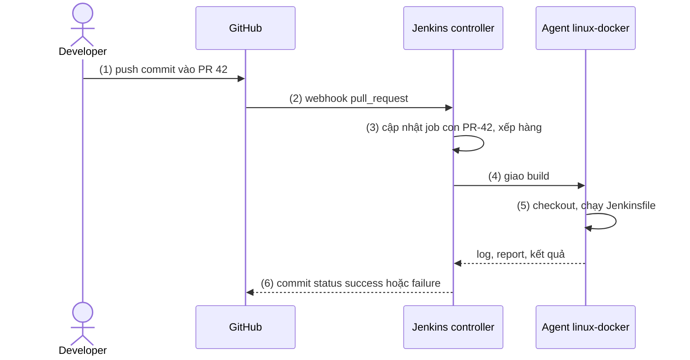
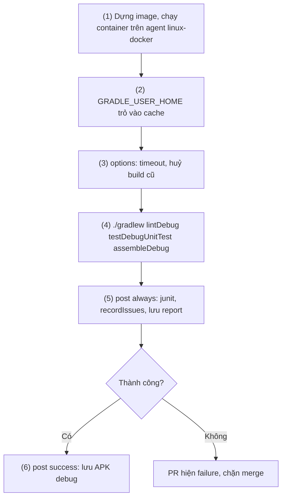
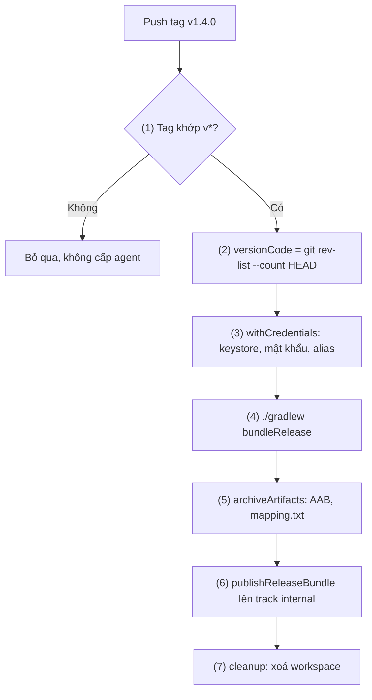

# Jenkins

## Vấn đề cần giải quyết

[11.4 Github CI](github_ci.md) chạy hai pipeline chuẩn trên máy build GitHub cho thuê. Cách đó bị loại khi mã nguồn và keystore **không được rời mạng công ty**, repo trên GitLab tự host hay Bitbucket Data Center, cần **phần cứng riêng** (KVM chạy emulator, thiết bị thật), hoặc công ty **đã có Jenkins**.

Khi đó cần CI **tự host**, và việc SaaS lo sẵn thành việc của bạn: máy build có Android SDK, chỗ cất secret, ai đọc được nó. Khái niệm pipeline, secret, track của Play ở [11.0](index.md) và [11.4](github_ci.md); bài này chỉ dạy phần riêng của Jenkins.

## Sau khi học xong

- Giải thích được kiến trúc controller, agent và plugin của Jenkins, và vì sao không chạy build trên built-in node.
- Triển khai được Multibranch Pipeline nhận webhook từ GitHub hoặc GitLab để build mỗi Pull Request và báo trạng thái về đó.
- Triển khai được Declarative Pipeline trong Jenkinsfile chạy trên agent có Android SDK, với agent, environment, options, stages, when, parallel và post.
- Áp dụng được Jenkins Credentials với withCredentials để ký AAB và upload lên Play internal track mà không lộ secret.
- Biết khi nào nên chọn Jenkins thay cho CI dạng SaaS và cái giá vận hành phải trả.

## Jenkins là gì?

**Jenkins** là một **automation server (máy chủ tự động hoá)** mã nguồn mở, **tự host**: một **controller** nhận sự kiện, lên lịch build và lưu kết quả, còn các **agent** thực thi pipeline viết bằng code trong `Jenkinsfile` nằm cùng repo; mọi khả năng ngoài phần lõi (Git, Docker, credentials, báo trạng thái lên GitHub) đến từ **plugin**.

Mental model: Jenkins là **một xưởng build do bạn tự xây**. Controller là **phòng điều phối** nhận đơn (webhook, lịch), phát phiếu, giữ sổ sách (log, artifact, kết quả test); agent là **máy trong xưởng** làm theo phiếu `Jenkinsfile`; plugin là **đồ nghề lắp thêm**, cũng phải bảo trì.

## Cách hoạt động

### Controller, agent và plugin

| Thành phần | Vai trò |
|---|---|
| **Controller** | Giao diện web, cấu hình job, hàng đợi, log, artifact, credentials; không cần Android SDK |
| **Agent** | Máy thực thi build, có **executor** (khe chạy song song) và **label** để pipeline chọn; cần JDK, Android SDK hoặc Docker |
| **Built-in node** | Executor nằm ngay trên controller, không dùng để build |
| **Plugin** | Pipeline, Git, GitHub Branch Source, Docker Pipeline, Credentials Binding, JUnit...; phải tương thích với version Jenkins |

Java 17 dừng ở weekly 2.544 và LTS 2.541.3; bản sau cần **Java 21 hoặc 25** cho cả controller lẫn agent. Đó là JDK **chạy Jenkins**; JDK **chạy Gradle** vẫn có thể là JDK 17 trong image build.

> [!WARNING]
> Build trên built-in node đọc được mọi file của tiến trình Jenkins, kể cả credentials của toàn hệ thống. Tài liệu Jenkins khuyên đặt executor của built-in node về **0** (Manage Jenkins > Nodes > Built-In Node), chỉ build trên agent.

Agent cố định giữ cache nhưng tích tụ trạng thái; agent **dùng xong bỏ** (plugin Kubernetes, EC2) hoặc **container mới** mỗi build cho môi trường sạch, như bài này dùng.

### Multibranch Pipeline và webhook

**Multibranch Pipeline** là một thư mục job: Jenkins quét repo qua một **branch source** (plugin GitHub Branch Source, GitLab Branch Source, Bitbucket Branch Source) và tự tạo **một job con cho mỗi nhánh, mỗi Pull Request, và mỗi tag nếu bật** có `Jenkinsfile`. Job con của PR tên dạng `PR-42`; build có sẵn biến `BRANCH_NAME`, `CHANGE_ID` (số PR), `CHANGE_TARGET` (nhánh đích), `TAG_NAME`.

Luồng một PR được kiểm tra:

1. Developer push commit vào PR 42.
2. GitHub gửi **webhook** tới `/github-webhook/` của Jenkins (GitLab gửi tới endpoint của plugin GitLab).
3. Branch source cập nhật job con `PR-42`, xếp build vào hàng đợi.
4. Controller giao build cho agent có label phù hợp.
5. Agent checkout (mặc định là kết quả merge PR vào nhánh đích), chạy `Jenkinsfile`.
6. Controller báo commit status về PR, mặc định tên `continuous-integration/jenkins/pr-merge`; đặt nó làm required status check để chặn Merge khi đỏ ([11.4](github_ci.md)).



Ba điểm riêng của Jenkins:

- **Webhook phải tới được controller.** Jenkins trong mạng nội bộ thì GitHub.com không gọi vào được: dùng Git server cùng mạng, webhook relay, hoặc quét định kỳ.
- **Tag được phát hiện nhưng không tự build.** Cần build strategy cho tag (plugin Basic Branch Build Strategies); thêm strategy là thay mặc định "build mọi thứ trừ tag", nên khai báo lại cho nhánh và PR.
- **PR từ fork là code không tin cậy.** Trust policy của GitHub Branch Source cho PR của người không đủ quyền chạy `Jenkinsfile` của nhánh đích; đừng nới nó. Credential gọi GitHub API nên là **GitHub App** thay vì token cá nhân.

### Agent có Android SDK

Gradle cần JDK, Android SDK (tìm qua `ANDROID_HOME`; `ANDROID_SDK_ROOT` đã deprecated) và **license của các gói SDK đã được chấp nhận** (`sdkmanager --licenses` trên máy không giao diện). SDK có thể **cài sẵn trên agent** (đặt `ANDROID_HOME` trong cấu hình node, hợp với máy cắm thiết bị, chạy emulator), hoặc nằm trong **Docker agent** `agent { dockerfile { ... } }` (plugin Docker Pipeline) để version SDK được review cùng code.

#### Ví dụ: image build chứa JDK 17 và Android SDK

**Bài toán:** mọi build dùng cùng JDK 17 và `compileSdk`, bất kể agent nào nhận việc; đổi `compileSdk` thì sửa Dockerfile trong cùng PR.

**Code:**

```dockerfile
# ci/android-sdk.Dockerfile
FROM eclipse-temurin:17-jdk

ENV ANDROID_HOME=/opt/android-sdk
ENV PATH=$PATH:$ANDROID_HOME/cmdline-tools/latest/bin:$ANDROID_HOME/platform-tools

# Tên file ở mục "Command line tools only" trên developer.android.com/studio; ghim cố định để build tái lập
ARG CMDLINE_TOOLS_ZIP=commandlinetools-linux-15859902_latest.zip

RUN apt-get update && apt-get install -y --no-install-recommends git unzip curl \
    && rm -rf /var/lib/apt/lists/* \
    && mkdir -p $ANDROID_HOME/cmdline-tools \
    && curl -fsSL -o /tmp/tools.zip https://dl.google.com/android/repository/$CMDLINE_TOOLS_ZIP \
    && unzip -q /tmp/tools.zip -d /tmp/tools \
    && mv /tmp/tools/cmdline-tools $ANDROID_HOME/cmdline-tools/latest \
    && rm -rf /tmp/tools /tmp/tools.zip

# Chấp nhận license lúc dựng image, rồi cài đúng gói app cần
RUN yes | sdkmanager --licenses > /dev/null \
    && sdkmanager "platform-tools" "platforms;android-36" "build-tools;36.0.0" \
    && chmod -R a+rwX $ANDROID_HOME
```

`chmod` cần vì Jenkins chạy container bằng user id của agent, không phải root.

> [!NOTE]
> Trang `sdkmanager` trên developer.android.com hiện ghi công cụ này deprecated, thay bằng `android sdk install` của Android CLI (vd `android sdk install platforms/android-36`). Tài liệu Android CLI chưa nói cách chấp nhận license trên CI, nên image vẫn dùng `sdkmanager --licenses`.

**Kết quả:** `docker build -f ci/android-sdk.Dockerfile .` thành công; `sdkmanager --list_installed` trong container liệt kê đúng ba gói.

### Declarative Pipeline trong Jenkinsfile

Jenkins có hai cú pháp: **Scripted** (Groovy tự do trong `node {}`) và **Declarative** (cấu trúc cố định, kiểm tra trước khi chạy, nên dùng; cần Groovy thì bọc trong `script {}`). Các khối chính:

| Khối | Ý nghĩa |
|---|---|
| `agent` | Chạy ở đâu: `any`, `none`, `label '...'`, `docker { image '...' }`, `dockerfile { filename '...' }`; đặt ở gốc hoặc từng `stage` |
| `environment` | Biến môi trường cho pipeline hoặc stage; `credentials('id')` lấy secret |
| `options` | `timeout(time:, unit:)`, `disableConcurrentBuilds(abortPrevious: true)`, `buildDiscarder(logRotator(...))` |
| `stages` / `stage` / `steps` | Các bước; mỗi `stage` là một cột trong giao diện |
| `when` | Điều kiện chạy stage: `branch 'main'`, `changeRequest()`, `buildingTag()`, `tag pattern: 'v*', comparator: 'GLOB'`, `expression { ... }`; `beforeAgent true` xét điều kiện trước khi cấp agent |
| `parallel` | Các stage con chạy song song, mỗi stage có thể có agent riêng |
| `post` | Chạy theo kết quả: `always`, `success`, `failure`, `unstable`, `cleanup` |

Step hay dùng: `sh`, `junit` (đọc report XML của test), `archiveArtifacts` (lưu file lên controller), `recordIssues` với `androidLintParser` (plugin Warnings Next Generation, hiện issue của Android Lint).

#### Ví dụ: kiểm tra mỗi Pull Request

**Bài toán:** pipeline PR check chuẩn: mỗi PR vào `main` qua lint, unit test, build debug; lưu report và APK; chặn merge khi đỏ. Job Multibranch Pipeline `android-app-pr` discover nhánh và PR.

**Luồng chạy:**

1. Agent label `linux-docker` dựng image, chạy build trong container có gắn thư mục cache của agent.
2. `GRADLE_USER_HOME` trỏ vào cache đó, build sau không tải lại dependency.
3. `options` giới hạn 30 phút, huỷ build cũ của cùng PR khi có commit mới.
4. Một lệnh Gradle chạy `lintDebug testDebugUnitTest assembleDebug` ([10.3](../coding_analyst_and_testing/lint.md), [10.2](../coding_analyst_and_testing/unit_testing.md)).
5. `post { always }` ghi kết quả test và lint **cả khi đỏ**.
6. `post { success }` lưu APK debug.



**Code:**

```groovy
// Jenkinsfile (job android-app-pr)
pipeline {
    agent {
        dockerfile {                                            // (1)
            filename 'ci/android-sdk.Dockerfile'
            label 'linux-docker'
            args '-v $HOME/.gradle-ci:/gradle-cache'
        }
    }
    environment {
        GRADLE_USER_HOME = '/gradle-cache'                      // (2)
    }
    options {
        timeout(time: 30, unit: 'MINUTES')                      // (3)
        disableConcurrentBuilds(abortPrevious: true)
        buildDiscarder(logRotator(numToKeepStr: '30'))
    }
    stages {
        stage('Lint, test, build') {
            steps {
                sh './gradlew lintDebug testDebugUnitTest assembleDebug'   // (4)
            }
        }
    }
    post {
        always {                                                // (5)
            junit testResults: '**/build/test-results/testDebugUnitTest/*.xml', allowEmptyResults: true
            recordIssues tools: [androidLintParser(pattern: '**/build/reports/lint-results-debug.xml')]
            archiveArtifacts artifacts: '**/build/reports/lint-results-debug.html', allowEmptyArchive: true
        }
        success {
            archiveArtifacts artifacts: 'app/build/outputs/apk/debug/*.apk', fingerprint: true   // (6)
        }
    }
}
```

Declarative Pipeline tự `checkout scm` khi vào agent. Tạo trước `$HOME/.gradle-ci` trên agent; để Docker tự tạo thì nó thuộc `root`, Gradle trong container không ghi được.

**Kết quả:** PR có unit test hỏng → check `continuous-integration/jenkins/pr-merge` failure; build `PR-42` có tab Tests chỉ đúng test hỏng, mục lint liệt kê issue. Push bản sửa → build cũ bị huỷ, build mới xanh, có APK debug trong Build Artifacts.

#### `parallel`: chỉ khi các nhánh chạy trên agent khác nhau

Hai lệnh `./gradlew` song song trong **cùng workspace** tranh nhau thư mục `build/`, mà Gradle đã tự chạy song song task độc lập. `parallel` chỉ có ích khi mỗi nhánh có agent riêng:

```groovy
// Jenkinsfile: stage thay cho stage 'Lint, test, build'
stage('Test') {
    parallel {
        stage('Unit test') {
            steps { sh './gradlew testDebugUnitTest' }
        }
        stage('Instrumented test') {
            agent { label 'android-emulator' }    // máy có SDK, emulator, KVM (task ở 10.2)
            environment {
                GRADLE_USER_HOME = '/var/cache/gradle'   // máy này không có /gradle-cache của container
            }
            steps { sh './gradlew connectedDebugAndroidTest' }
        }
    }
}
```

### Credentials và `withCredentials`

**Credentials** là kho secret mã hoá trên controller. Mỗi credential có **id** và **phạm vi**: **Global** cho mọi job; trong một **folder** (Multibranch Pipeline cũng là folder) thì chỉ job trong folder đó. Android dùng hai loại: **Secret file** (keystore `.jks`, JSON của service account Play; pipeline nhận **đường dẫn file tạm**, bị xoá khi hết khối) và **Secret text** (mật khẩu keystore, key alias, mật khẩu key).

Secret file giữ được file nhị phân nên **không cần base64** như 11.4: upload thẳng `release.jks`, credential này thay `RELEASE_KEYSTORE_BASE64`. `withCredentials([file(credentialsId: '...', variable: '...'), string(...)]) { ... }` (plugin Credentials Binding) gắn secret thành biến môi trường **chỉ trong khối của nó** (code ở Ví dụ thực tế).

Lệnh `sh` dùng secret phải viết bằng **nháy đơn** để shell đọc biến, không để Groovy chèn giá trị (Sai lầm 2). **Masking chỉ là lớp cuối**: Jenkins thay secret nguyên văn trong log bằng `****`, nhưng `base64` là qua mặt; tài liệu Jenkins coi ai sửa được job (hay Jenkinsfile của nó) là người được tin với secret của job. Vì vậy credential release **đặt trong folder của job release**, không Global (Sai lầm 4).

### Upload lên Play

Service account, quyền trên Play Console, track, staged rollout: xem [11.4](github_ci.md). Bài dùng cách chính của 11.4: task **Gradle Play Publisher** `./gradlew publishReleaseBundle`, khoá JSON qua biến `ANDROID_PUBLISHER_CREDENTIALS`; Jenkins chỉ đổi chỗ lấy secret.

Cách thứ hai là plugin **Google Play Android Publisher** (step `androidApkUpload`, tham số `googleCredentialsId`, `filesPattern`, `trackName`), nhưng bản mới nhất 4.2 ra từ 08/2021; dùng thì thử tương thích trước. Gradle Play Publisher cũng ở chế độ bảo trì, nhưng là một phần của build, chạy như nhau trên mọi CI.

App phải **đã tồn tại** trên Play Console. Mỗi tài khoản chỉ mở được một edit của Play API mỗi lúc (edit mới làm edit cũ mất hiệu lực): đừng để hai job upload cùng app chạy song song.

## Ví dụ thực tế

### Pipeline Release: tag `v*` thành bản trên Play internal track

**Bài toán:** pipeline Release chuẩn: push tag `v1.4.0` → AAB đã ký, lưu AAB và `mapping.txt`, upload lên internal track. Job Multibranch `android-app-release` chỉ discover tag, có build strategy cho tag, Script Path `Jenkinsfile.release`, giữ credential release trong folder của nó.

**Luồng chạy:**

1. `when` chỉ cho stage chạy với tag khớp `v*`; nhờ `agent none` ở gốc và `beforeAgent true`, điều kiện sai thì không tốn agent.
2. `versionCode` = số commit tới tag (`git rev-list --count HEAD`), vì `BUILD_NUMBER` của Multibranch đếm riêng cho từng tag (Sai lầm 3).
3. `withCredentials` gắn keystore và ba secret text thành đúng các biến `signingConfigs.release` đọc (đoạn chuẩn ở [11.4](github_ci.md)); file tạm tự xoá khi hết khối.
4. `bundleRelease` với `versionCode` vừa tính, `versionName` là tag bỏ chữ `v` (hai Gradle property của 11.4).
5. Lưu AAB và `mapping.txt` làm artifact ([10.4](../coding_analyst_and_testing/fit_bug_optimization.md)).
6. `withCredentials` gắn JSON của service account; Gradle Play Publisher upload AAB lên track `internal`.
7. `post { cleanup }` xoá workspace, AAB đã ký không nằm lại trên agent.



**Code:**

```groovy
// Jenkinsfile.release (job android-app-release)
pipeline {
    agent none
    environment {
        GRADLE_USER_HOME = '/gradle-cache'
    }
    options {
        timeout(time: 45, unit: 'MINUTES')
        buildDiscarder(logRotator(numToKeepStr: '50', artifactNumToKeepStr: '20'))
    }
    stages {
        stage('Release') {
            when {
                beforeAgent true
                tag pattern: 'v*', comparator: 'GLOB'                           // (1)
            }
            agent {
                dockerfile {
                    filename 'ci/android-sdk.Dockerfile'
                    label 'linux-docker'
                    args '-v $HOME/.gradle-ci:/gradle-cache'
                }
            }
            stages {
                stage('Build signed AAB') {
                    steps {
                        script {
                            env.VERSION_CODE = sh(script: 'git rev-list --count HEAD', returnStdout: true).trim()   // (2)
                        }
                        withCredentials([                                       // (3)
                            file(credentialsId: 'android-release-keystore', variable: 'RELEASE_STORE_FILE'),
                            string(credentialsId: 'android-release-store-password', variable: 'RELEASE_STORE_PASSWORD'),
                            string(credentialsId: 'android-release-key-alias', variable: 'RELEASE_KEY_ALIAS'),
                            string(credentialsId: 'android-release-key-password', variable: 'RELEASE_KEY_PASSWORD')
                        ]) {
                            sh './gradlew bundleRelease -PversionCode="$VERSION_CODE" -PversionName="${TAG_NAME#v}"'   // (4)
                        }
                        archiveArtifacts artifacts: 'app/build/outputs/bundle/release/*.aab, app/build/outputs/mapping/release/mapping.txt',
                            fingerprint: true                                   // (5)
                    }
                }
                stage('Upload to Play internal') {
                    steps {
                        withCredentials([file(credentialsId: 'play-service-account', variable: 'PLAY_SERVICE_ACCOUNT_JSON')]) {   // (6)
                            sh '''
                                ANDROID_PUBLISHER_CREDENTIALS="$(cat "$PLAY_SERVICE_ACCOUNT_JSON")" \
                                    ./gradlew publishReleaseBundle --artifact-dir app/build/outputs/bundle/release
                            '''
                        }
                    }
                }
            }
            post {
                cleanup {
                    cleanWs()                                                  // (7) plugin Workspace Cleanup
                }
            }
        }
    }
}
```

`RELEASE_STORE_FILE` là đường dẫn tuyệt đối tới file tạm, `file()` của `signingConfigs.release` dùng thẳng. `--artifact-dir` upload đúng AAB đã lưu ở bước (5).

**Kết quả:** push tag `v1.4.0` → job con `v1.4.0` chạy; Build Artifacts có AAB và `mapping.txt`; log stage upload báo thành công và **Play Console > Testing > Internal testing** có bản mới. Job `android-app-pr` không thấy credential release nào.

## Khi nào nên và không nên dùng

**Nên chọn** khi mã nguồn và keystore không được rời hạ tầng nội bộ, Git server trong mạng công ty, tổ chức đã vận hành Jenkins, hoặc cần phần cứng riêng (KVM, thiết bị thật).

**Không nên** khi team nhỏ, repo trên GitHub.com, không ràng buộc dữ liệu ([11.4](github_ci.md)); cần cả iOS mà không muốn nuôi máy Mac ([11.2 Bitrise](bitrise.md)); hoặc không ai được giao cập nhật Jenkins định kỳ.

**Cái giá:** không trả theo phút build, nhưng trả bằng máy chủ và thời gian quản trị: vá controller, agent, plugin; backup `JENKINS_HOME`; thay plugin ngừng phát triển (như plugin upload Play).

## Sai lầm thường gặp

### 1. Build ngay trên controller

**Lỗi lộ ra thế nào:** một PR thêm `sh 'cat $JENKINS_HOME/credentials.xml'` là đọc được credentials đã mã hoá, khoá giải mã nằm cùng máy; build Gradle nặng còn làm giao diện treo.

**Cách sửa:** executor của built-in node về 0, build trên agent.

### 2. Chèn secret bằng nháy kép

```groovy
sh "./gradlew bundleRelease -Pandroid.injected.signing.store.password=${RELEASE_STORE_PASSWORD}"   // sai
```

**Lỗi lộ ra thế nào:** Jenkins cảnh báo secret bị truyền vào `sh` qua Groovy String interpolation; mật khẩu nằm trong dòng lệnh, `ps` trên agent là thấy.

**Cách sửa:** nháy đơn, để `signingConfigs` đọc biến môi trường.

### 3. Lấy `BUILD_NUMBER` làm versionCode trong Multibranch

**Lỗi lộ ra thế nào:** mỗi nhánh, PR, tag là một job con có bộ đếm riêng; build đầu của tag `v1.4.0` có `BUILD_NUMBER` là 1, giống tag `v1.3.0`. Play từ chối vì versionCode đã dùng.

**Cách sửa:** dùng nguồn tăng đơn điệu: số commit tới tag (tag luôn tạo trên `main`; không bật shallow clone, vì khi đó số đếm chỉ bằng độ sâu clone), quy đổi từ tên tag, hoặc `BUILD_NUMBER` của một job Pipeline thường chuyên release. App đã có `versionCode` cao hơn thì cộng offset như 11.4.

### 4. Credential release đặt Global

**Lỗi lộ ra thế nào:** người có quyền push mở PR thêm `withCredentials` vào `Jenkinsfile`, in `base64` của keystore ra log; masking không bắt vì chuỗi đã khác.

**Cách sửa:** credential release trong folder của job release, tách job PR và release, giới hạn ai được tạo tag `v*` và ai được cấu hình job release (Matrix Authorization, Role-based Authorization Strategy).

## Lịch sử phát triển

- **2004–2005:** Kohsuke Kawaguchi viết **Hudson** tại Sun Microsystems.
- **2011:** sau tranh chấp tên với Oracle, cộng đồng tách dự án thành **Jenkins**.
- **2014–2017:** plugin Workflow (sau là Pipeline) đưa pipeline thành code; Jenkins 2.0 (04/2016) lấy `Jenkinsfile` làm cách dùng chính; Declarative Pipeline 1.0 ra 02/2017.
- **2024–2026:** Java 17 là tối thiểu từ LTS 2.479.1 (10/2024); sau LTS 2.541.3 và weekly 2.544 cần Java 21 hoặc 25.

## Kết nối hệ thống

- **Tiên quyết:** [11.0 Tổng quan Session 11](index.md); [11.4 Github CI](github_ci.md) (hai pipeline chuẩn, `signingConfigs.release`, versionCode, service account, track); [Build Types](../session_04/android_manifest/package_build_gradle/build_types.md), [AAB](../session_01/output_packages/aab_files.md) (ký app, Play App Signing).
- **Liên quan:** [10.3 Lint](../coding_analyst_and_testing/lint.md), [10.2 Unit Testing](../coding_analyst_and_testing/unit_testing.md) (task của PR check); [Flavor](../session_04/android_manifest/package_build_gradle/flavor.md) (task theo variant); [10.4 Fit / Bug Optimization](../coding_analyst_and_testing/fit_bug_optimization.md) (đọc crash bằng `mapping.txt`).
- **Học tiếp:** [11.2 Bitrise](bitrise.md) (hai pipeline trên CI SaaS chuyên mobile), [11.3 Travis CI](travis_ci.md).

## Tham khảo

- [Pipeline Syntax - Jenkins User Documentation](https://www.jenkins.io/doc/book/pipeline/syntax/)
- [Branches and Pull Requests - Jenkins User Documentation](https://www.jenkins.io/doc/book/pipeline/multibranch/)
- [Using Docker with Pipeline - Jenkins User Documentation](https://www.jenkins.io/doc/book/pipeline/docker/)
- [Controller Isolation - Jenkins User Documentation](https://www.jenkins.io/doc/book/security/controller-isolation/)
- [Java Support Policy - Jenkins](https://www.jenkins.io/doc/book/platform-information/support-policy-java/)
- [Credentials Binding plugin steps - Jenkins](https://www.jenkins.io/doc/pipeline/steps/credentials-binding/)
- [GitHub Branch Source plugin - Jenkins Plugins](https://plugins.jenkins.io/github-branch-source/)
- [Google Play Android Publisher plugin - Jenkins Plugins](https://plugins.jenkins.io/google-play-android-publisher/)
- [Edits - Google Play Developer API](https://developers.google.com/android-publisher/edits)
- [sdkmanager - Android Developers](https://developer.android.com/tools/sdkmanager)
- [android sdk install - Android CLI](https://developer.android.com/tools/agents/android-cli/commands/sdk_install)
- [Gradle Play Publisher - GitHub](https://github.com/Triple-T/gradle-play-publisher)
