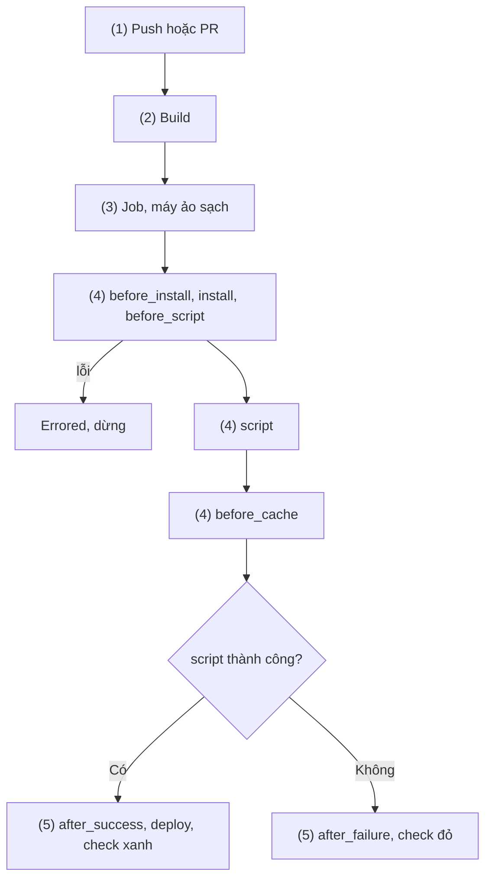
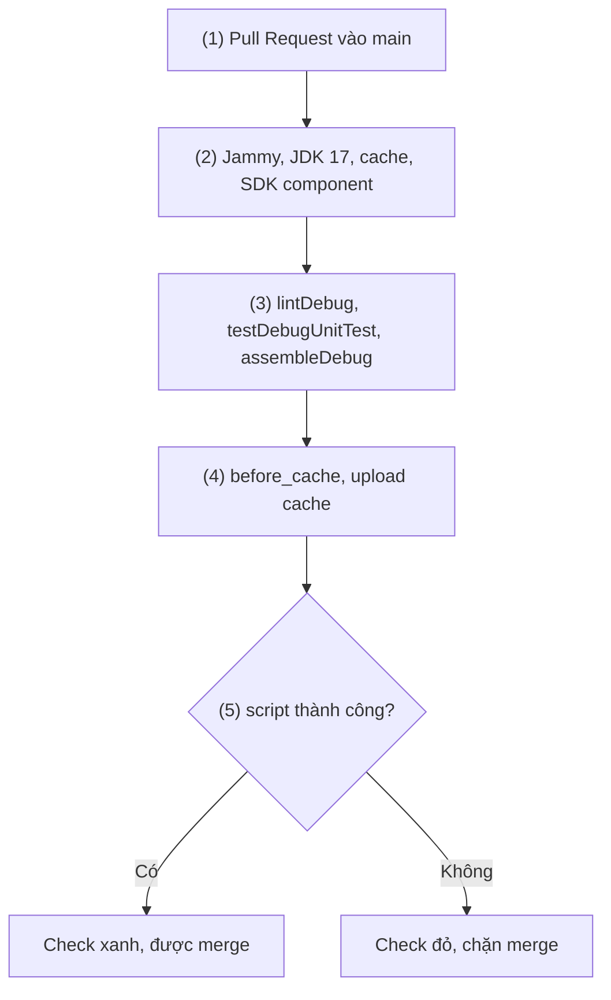

# Travis CI

## Vấn đề cần giải quyết

Bạn nhận một repo Android cũ có `.travis.yml` và badge `build passing`:

```yaml
# .travis.yml còn sót lại trong nhiều repo Android cũ
language: android
dist: trusty
android:
  components:
    - tools
    - build-tools-28.0.3
    - android-28
script: ./gradlew build
```

Badge trỏ tới `travis-ci.org` (đã ngừng build từ 2021), `trusty` không còn hỗ trợ Android, `android-28` quá cũ so với `compileSdk`, và Pull Request đang merge mà không có cổng kiểm tra. Bạn cần biết cấu hình này **nghĩa là gì**, **còn chạy được không**, và nếu chuyển đi thì **mang theo những gì**.

## Sau khi học xong

- Giải thích được mô hình build, stage, job và phase của Travis CI cùng hiện trạng của dịch vụ với dự án Android.
- Triển khai được pipeline PR check cho dự án Android bằng .travis.yml với language android, JDK 17, SDK component và cache Gradle.
- Xử lý được secret trên Travis CI bằng biến trong Repository Settings, giá trị secure và travis encrypt-file cho keystore.
- Áp dụng được bảng ánh xạ khái niệm để migrate một .travis.yml sang workflow GitHub Actions.

## Travis CI là gì?

**Travis CI** là dịch vụ CI dạng SaaS đọc file `.travis.yml` ở gốc repo; mỗi lần có push hoặc Pull Request, nó tạo một **build** gồm một hay nhiều **job**, mỗi job chạy trong một máy ảo sạch và đi qua một chuỗi **phase** cố định gọi là **job lifecycle (vòng đời job)**.

Mental model: mỗi job là **dây chuyền có các trạm cố định** (`before_install` → `install` → `script` → ...); bạn chỉ điền lệnh vào trạm, trạm trống thì dùng lệnh mặc định của `language`. Ở GitHub Actions ([11.4 Github CI](github_ci.md)) bạn tự sắp các step.

## Cách hoạt động

### Hiện trạng của dịch vụ

Khi viết bài (11/2026), Travis CI chạy ở `travis-ci.com` và bản tự host Travis CI Server:

- `travis-ci.org` (miễn phí cho repo public) **đã tắt từ 06/2021**.
- Build tính theo **credit**; trang Billing ghi "Free Trial Plans are currently unavailable", credit open source chỉ cấp theo yêu cầu. Thực tế cần gói trả phí.
- Android chạy trên `dist: bionic | focal | jammy`, **không có macOS**; component cài sẵn dừng ở API 30.

Vì vậy Travis chủ yếu còn ở dự án cũ.

### Build, stage, job và phase

1. **Trigger:** push tạo **branch build**; Pull Request tạo **PR build** trên merge commit với nhánh đích.
2. **Build:** đọc `.travis.yml`, tạo job từ matrix hoặc `jobs.include`.
3. **Job:** chạy trên máy ảo mới, **không chia sẻ file** với job khác.
4. **Phase:** chạy theo bảng dưới.
5. **Báo kết quả:** thành check trên PR; đặt làm required status check ([11.4](github_ci.md)) thì đỏ chặn merge.

| Phase | Dùng để | Lệnh lỗi thì |
|---|---|---|
| `before_install`, `install`, `before_script` | Giải mã secret, cài công cụ | Build **errored**, dừng ngay |
| `script` | Build và test chính | Build **failed**, lệnh còn lại của `script` vẫn chạy |
| `before_cache` | Dọn file không nên vào cache | Chỉ chạy khi có cache |
| `after_success` / `after_failure` | Thông báo | Không đổi kết quả |
| `before_deploy`, `deploy`, `after_deploy` | Phát hành; bỏ qua khi build hỏng hoặc PR build | `before_deploy` lỗi thì errored |
| `after_script` | Dọn dẹp cuối | Không đổi kết quả |



**Errored** là môi trường hỏng (cài, giải mã không được): sửa `.travis.yml`. **Failed** là lint hay test đỏ: sửa code.

### Môi trường Android

- **`language: android`**: SDK ở `/usr/local/android-sdk`, set sẵn `ANDROID_HOME`, `ANDROID_SDK_ROOT`.
- **`dist`**: `bionic` (cảnh báo deprecated), `focal` (mặc định), `jammy` (nên chọn).
- **`jdk: openjdk17`**: Jammy có openjdk 8–11 và 17 nhưng **mặc định 11**, còn AGP 8.x cần JDK 17.
- **`android.components`**: tên package theo `sdkmanager` (`platforms;android-35`). Theo mã nguồn `travis-build`, Travis chấp nhận license bằng `yes | sdkmanager --licenses` rồi cài từng component; cài lỗi **chỉ in dòng đỏ, job chạy tiếp**.
- **`script` mặc định** khi có `gradlew` là `./gradlew build connectedCheck`; `connectedCheck` cần emulator nên PR check phải ghi đè.

Cần môi trường khác thì docs có ví dụ `language: java` tự cài SDK bằng `sdkmanager`.

**Cache** tải về đầu job, upload lại cuối job nếu đổi; lock file Gradle đổi mỗi lần chạy nên phải xoá trong `before_cache`.

### Biến môi trường và secret

| Nơi đặt | Dùng cho | Ghi chú |
|---|---|---|
| `env` trong `.travis.yml` | Giá trị công khai | Fork cũng thấy |
| `secure: "..."` trong `.travis.yml` | Secret giống nhau mọi nhánh | Tạo bằng `travis encrypt` (public key của repo) |
| Repository Settings | Mật khẩu keystore, token | Tắt "Display value in build log" |

- Travis thay secret dài hơn 3 ký tự bằng `[secure]` trong log, nhưng không che giá trị đã biến đổi (base64, cắt chuỗi); tránh `set -x`, `env`, `printenv`.
- Secret **không có** cho PR build từ fork (trừ khi bật chia sẻ), nên PR check không được cần secret.
- `travis encrypt-file` mã hoá file (AES-256, giải mã bằng `openssl aes-256-cbc`), lưu khoá vào hai biến `encrypted_<id>_key`, `encrypted_<id>_iv` của repo; file `.enc` được commit. Mã hoá file thứ hai ghi đè cặp khoá, nên gộp nhiều file vào một `tar`.

#### Ví dụ: đưa keystore release và khoá service account lên Travis CI

**Bài toán:** job release cần `app/release.jks` và khoá service account của Google Play ([11.4](github_ci.md)), nhưng không file nào được commit ở dạng gốc.

**Luồng chạy:**

1. Gộp hai file thành `secrets.tar`.
2. `travis encrypt-file secrets.tar --add`: tạo `secrets.tar.enc`, lưu cặp khoá vào Repository Settings, thêm lệnh `openssl` vào `.travis.yml`.
3. Commit `secrets.tar.enc`; file gốc vào `.gitignore`, cất ở kho secret của team.
4. Thêm `RELEASE_STORE_PASSWORD`, `RELEASE_KEY_ALIAS`, `RELEASE_KEY_PASSWORD` và `GITHUB_RELEASE_TOKEN` vào Repository Settings.
5. Job release giải mã bằng `openssl`, giải nén ra đúng hai file.

**Code:**

```bash
# Gốc repo, macOS hoặc Linux (Windows: dùng WSL)
tar cvf secrets.tar app/release.jks play-service-account.json      # (1)
travis login --com
travis encrypt-file secrets.tar --add                              # (2)
printf '%s\n' secrets.tar app/release.jks play-service-account.json >> .gitignore   # (3)
git add secrets.tar.enc .travis.yml .gitignore
```

**Kết quả:** Repository Settings có cặp `encrypted_...` và các biến bước (4), giá trị ẩn; log job release chỉ hiện tên biến, không có giá trị khoá.

### Build stage và điều kiện

- **`stages:`** định thứ tự stage; job cùng stage chạy song song, stage sau chỉ chạy khi stage trước xanh. Job không ghi stage rơi vào stage mặc định `test`.
- **`if:`** đặt điều kiện cho build, stage hoặc job: `if: type = pull_request`, `if: tag =~ ^v`. Với PR, `branch` là nhánh đích.
- **`branches.only`** cũng lọc tag: chỉ ghi `main` thì build trên tag `v*` không chạy.
- **`deploy:`** dùng provider (`releases` cho GitHub Releases, `script` cho lệnh tuỳ ý; không có provider Google Play). Docs provider vẫn ghi `edge: true` để opt in dpl v2 (không dọn working directory); dpl v1 chạy `git stash --all`, xoá file build, trừ khi `skip_cleanup: true`.
- **Artifact:** không có kho tích hợp; addon `artifacts` upload lên Amazon S3, không chạy cho PR build.

### Migrate sang GitHub Actions

| `.travis.yml` | GitHub Actions ([11.4 Github CI](github_ci.md)) |
|---|---|
| Push, PR build | `on: pull_request`, `on: push` với `tags` |
| Job, matrix, `jobs.include` | `jobs:`, `strategy.matrix` |
| Phase cố định | `steps` tự sắp (`uses:` hoặc `run:`) |
| `language: android`, `jdk`, `android.components` | Runner có sẵn Android SDK + `actions/setup-java` |
| `cache` + `before_cache` | `gradle/actions/setup-gradle` |
| `env`, `secure:`, Repository Settings | `env:`, repository/environment secrets |
| `travis encrypt-file` | Secret `RELEASE_KEYSTORE_BASE64`, giải mã bằng `base64 --decode` |
| `stages` + `if:` | `needs:` + `if:` |
| `deploy` trên tag | Job release trên tag, environment có reviewer |
| `TRAVIS_BUILD_NUMBER` | `GITHUB_RUN_NUMBER` |

Các bước chuyển:

1. **Kiểm kê** job, điều kiện, secret, provider. `gh actions-importer audit travis-ci --output-dir tmp/audit` sinh báo cáo và bản nháp workflow; secret phải chuyển tay.
2. **Lấy secret gốc:** cặp `encrypted_*` không đọc lại được, `secrets.tar.enc` vô dụng ngoài Travis. Tạo `RELEASE_KEYSTORE_BASE64`, `PLAY_SERVICE_ACCOUNT_JSON` từ bản gốc.
3. **Chạy song song** PR check mới với Travis vài ngày, rồi đổi required status check của `main` sang check mới.
4. **Chuyển release:** `GITHUB_RUN_NUMBER` bắt đầu từ 1, nên cộng offset lớn hơn versionCode cuối đã lên Play (11.4).
5. **Dọn dẹp:** xoá `.travis.yml`, `secrets.tar.enc`, badge; tắt repo trên Travis; xoay vòng secret từng nằm trên Travis.

## Ví dụ thực tế

Bài toán chính là PR check, kèm phác thảo release; migrate theo năm bước ở trên.

### PR check cho app Android

**Bài toán:** mỗi Pull Request vào `main` chạy lint, unit test và build APK debug; đỏ thì không merge; không cần secret để PR từ fork cũng chạy.

**Luồng chạy:**

1. PR build chạy trên merge commit; push chỉ build `main` và tag `v*`.
2. Jammy, JDK 17; tải cache Gradle, cài platform và build-tools khớp `compileSdk`.
3. `script` chạy lint, unit test, build; `--continue` để lint lỗi vẫn chạy test.
4. `before_cache` xoá lock file, upload cache nếu đổi.
5. Kết quả thành check trên PR; đỏ thì chặn merge.



**Code:**

```yaml
# .travis.yml
language: android
dist: jammy                          # (2)
jdk: openjdk17                       # (2) Jammy mặc định JDK 11

android:
  components:                        # (2) khớp compileSdk của dự án
    - platform-tools
    - platforms;android-35
    - build-tools;35.0.0

branches:
  only:                              # (1) push: main và tag v*; PR: nhánh đích main
    - main
    - /^v\d+\.\d+\.\d+.*$/

script:                              # (3) ghi đè "build connectedCheck"
  - ./gradlew lintDebug testDebugUnitTest assembleDebug --continue

before_cache:                        # (4)
  - rm -f  $HOME/.gradle/caches/modules-2/modules-2.lock
  - rm -fr $HOME/.gradle/caches/*/plugin-resolution/
cache:
  directories:
    - $HOME/.gradle/caches/
    - $HOME/.gradle/wrapper/
    - $HOME/.android/build-cache
```

Task: [10.3 Lint](../coding_analyst_and_testing/lint.md), [10.2 Unit Testing](../coding_analyst_and_testing/unit_testing.md); có flavor thì theo [Flavor](../session_04/android_manifest/package_build_gradle/flavor.md).

**Kết quả:** PR có test sai thì log hiện `testDebugUnitTest FAILED`, check đỏ, nút merge bị khoá (khi đã đặt required check); push bản sửa thì xanh. Build sau nhanh hơn nhờ cache.

> [!NOTE]
> Khác PR check chuẩn, Travis không lưu report và APK debug của PR build làm artifact; report lint đầy đủ phải chạy lại ở local.

### Phác thảo: release khi push tag `v*`

App cấu hình như [11.4](github_ci.md): ký bằng biến `RELEASE_*`, `versionCode` từ Gradle property, Gradle Play Publisher (track `internal`, khoá từ `ANDROID_PUBLISHER_CREDENTIALS`). Thêm vào file trên:

```yaml
stages:
  - test                             # job PR check ở cấp gốc (jdk là key matrix) rơi vào stage mặc định này
  - name: release
    if: tag =~ ^v

jobs:
  include:
    - stage: release
      before_install:                # giải mã chỉ trong job này
        - openssl aes-256-cbc -K $encrypted_0a6446eb3ae3_key -iv $encrypted_0a6446eb3ae3_iv -in secrets.tar.enc -out secrets.tar -d
        - tar xf secrets.tar
      script: ./gradlew bundleRelease -PversionCode=$TRAVIS_BUILD_NUMBER
      before_deploy:
        - export ANDROID_PUBLISHER_CREDENTIALS="$(cat play-service-account.json)"
      deploy:
        - provider: releases         # AAB và mapping.txt lên GitHub Release
          token: $GITHUB_RELEASE_TOKEN
          file:
            - app/build/outputs/bundle/release/app-release.aab
            - app/build/outputs/mapping/release/mapping.txt
          edge: true
          on:
            tags: true
        - provider: script           # upload AAB đã build lên internal track, không build lại
          script: ./gradlew publishReleaseBundle --artifact-dir app/build/outputs/bundle/release
          edge: true
          on:
            tags: true
      after_script:
        - rm -f secrets.tar app/release.jks play-service-account.json
```

Job release build lại từ đầu vì không chia sẻ file với stage `test`. Kiểm chứng: push tag `v2.4.0`, build có hai stage, GitHub Release có AAB và `mapping.txt`, internal track có bản mới.

## Khi nào nên và không nên dùng

**Nên (hoặc chấp nhận được):** dự án đang chạy ổn trên `travis-ci.com` có trả phí, chỉ cần nâng `dist`, JDK, component; tổ chức đã dùng Travis CI Server.

**Không nên:** dự án Android mới ([11.4](github_ci.md) hoặc [11.2 Bitrise](bitrise.md) phù hợp hơn); cần artifact mỗi PR, emulator thường xuyên hay upload Play có sẵn (trên Travis phải tự dựng); repo open source cần CI miễn phí.

## Sai lầm thường gặp

### 1. Tưởng repo vẫn đang được build

**Lỗi lộ ra thế nào:** badge `travis-ci.org` vẫn hiện trạng thái cũ; PR merge không có check nào.

**Cách sửa:** xem tab Checks của PR gần nhất; không có check Travis thì migrate hoặc kích hoạt lại trên `travis-ci.com`.

### 2. Tin rằng component đã cài xong

**Lỗi lộ ra thế nào:** gõ sai `platform;android-35`, log chỉ có dòng `installation failed` rồi chạy tiếp; lỗi lộ muộn ở Gradle, hoặc AGP tự tải package.

**Cách sửa:** đối chiếu tên với `sdkmanager --list`; đọc phần `android.install` của log khi đổi component.

### 3. `branches.only` chặn build trên tag

**Lỗi lộ ra thế nào:** push tag `v2.4.0` mà không có build.

**Cách sửa:** thêm regex tag vào `branches.only` như ví dụ PR check.

### 4. Để lệnh giải mã ở `before_install` cấp gốc

**Lỗi lộ ra thế nào:** `--add` chèn lệnh giải mã vào `before_install` cấp gốc, chạy cho mọi job; PR từ fork không có khoá nên errored ở `openssl`.

**Cách sửa:** chuyển lệnh giải mã vào riêng job release như phác thảo release.

## Lịch sử phát triển

- **2011:** Travis CI ra đời, miễn phí cho repo public qua `travis-ci.org`.
- **05/2018:** repo public được build trên `travis-ci.com`.
- **01/2019:** Idera mua lại Travis CI.
- **02/11/2020:** tính phí theo credit.
- **06/2021:** `travis-ci.org` bị tắt.
- **09/2021:** CVE-2021-41077 làm lộ secret của repo public cho build từ fork.
- **03/2025:** `travis-build` hỗ trợ `language: android` trên Bionic, Focal, Jammy và bỏ Trusty.

## Kết nối hệ thống

- **Tiên quyết:** [Session 11 Overview](index.md); [11.4 Github CI](github_ci.md) (secret, ký release, versionCode, track); [Build Types](../session_04/android_manifest/package_build_gradle/build_types.md).
- **Liên quan:** [10.3 Lint](../coding_analyst_and_testing/lint.md), [10.2 Unit Testing](../coding_analyst_and_testing/unit_testing.md), [AAB](../session_01/output_packages/aab_files.md), [11.1 Jenkins](jenkins.md), [11.2 Bitrise](bitrise.md).
- **Học tiếp:** [11.4 Github CI](github_ci.md) khi migrate.

## Tham khảo

- [Build an Android Project - Travis CI Docs](https://docs.travis-ci.com/user/languages/android/)
- [Job Lifecycle - Travis CI Docs](https://docs.travis-ci.com/user/job-lifecycle/)
- [Ubuntu Jammy Build Environment - Travis CI Docs](https://docs.travis-ci.com/user/reference/jammy/)
- [Environment Variables - Travis CI Docs](https://docs.travis-ci.com/user/environment-variables/)
- [Encrypting Files - Travis CI Docs](https://docs.travis-ci.com/user/encrypting-files/)
- [Best Practices in Securing Your Data - Travis CI Docs](https://docs.travis-ci.com/user/best-practices-security/)
- [Build Stages - Travis CI Docs](https://docs.travis-ci.com/user/build-stages/)
- [GitHub Releases provider (dpl v2) - Travis CI Docs](https://docs.travis-ci.com/user/deployment-v2/providers/releases/)
- [Billing Overview - Travis CI Docs](https://docs.travis-ci.com/user/billing-overview/)
- [Migrating repositories to travis-ci.com - Travis CI Docs](https://docs.travis-ci.com/user/migrate/open-source-repository-migration)
- [travis-build: script/android.rb - GitHub](https://github.com/travis-ci/travis-build/blob/master/lib/travis/build/script/android.rb)
- [Migrating from Travis CI to GitHub Actions - GitHub Docs](https://docs.github.com/en/actions/tutorials/migrate-to-github-actions/manual-migrations/migrate-from-travis-ci)
- [Migrating from Travis CI with GitHub Actions Importer - GitHub Docs](https://docs.github.com/en/actions/tutorials/migrate-to-github-actions/automated-migrations/travis-ci-migration)
