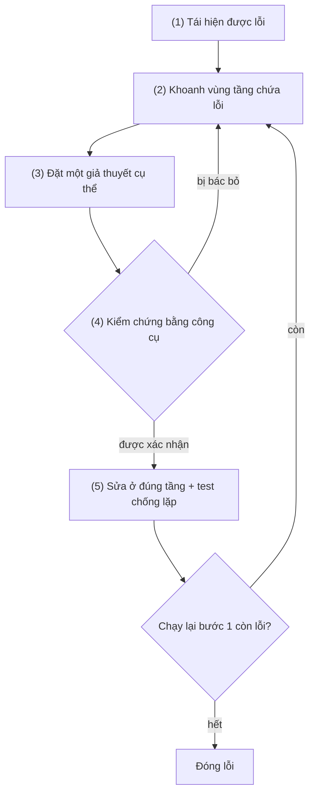
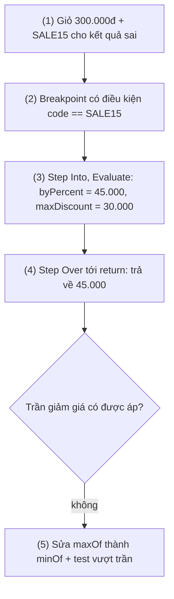
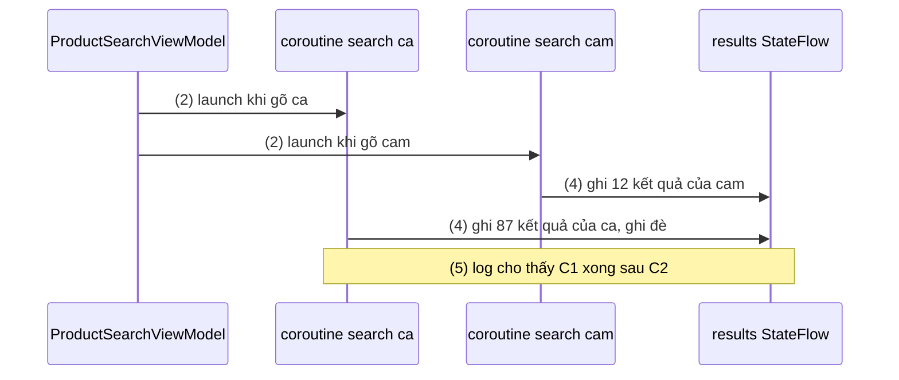
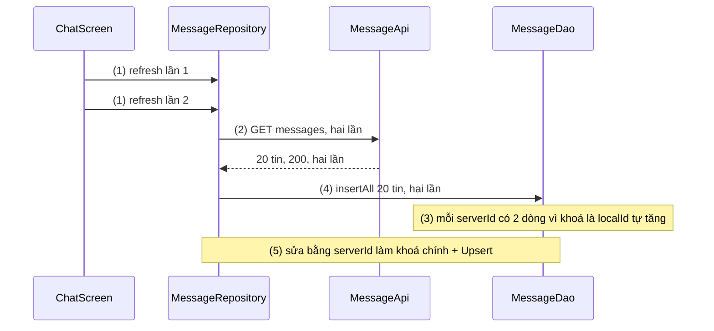

# Debugging

## Vấn đề cần giải quyết

Báo cáo lỗi thường đến dưới dạng triệu chứng: "tin nhắn đôi khi bị trùng", "bấm thông báo thì app văng", "giảm giá tính sai với vài giỏ hàng". Triệu chứng nằm ở UI, còn nguyên nhân có thể ở bất kỳ tầng nào: dữ liệu server, cách ghi database, thứ tự hai coroutine, một extra thiếu trong `Intent`.

Cách xử lý phổ biến là đoán: `println` in cả response, bọc `try/catch` rỗng cho app khỏi văng, sửa thử rồi chạy lại. Đoán không cho biết đã sửa đúng chưa (lỗi "đôi khi" không thấy vài lần chưa có nghĩa là hết), hay sửa triệu chứng (thêm `distinctBy` ở UI trong khi database vẫn đầy bản ghi trùng), làm mất stack trace khi nuốt exception, và để log chứa dữ liệu người dùng đi theo bản release.

Vấn đề cần giải quyết là: **đi từ triệu chứng tới nguyên nhân gốc bằng quan sát và kiểm chứng**, rồi sửa sao cho lỗi không quay lại.

## Sau khi học xong

- Áp dụng được quy trình debug năm bước tái hiện, khoanh vùng, đặt giả thuyết, kiểm chứng, sửa kèm test chống lặp thay vì sửa theo phỏng đoán.
- Debug được bằng Logcat và debugger của Android Studio: truy vấn log theo package, tag, level, breakpoint có điều kiện, exception breakpoint, logpoint, Evaluate Expression, attach vào process đang chạy và đặt tên coroutine.
- Giải thích được cấu trúc một stack trace (exception ngoài cùng, chuỗi Caused by, frame của app và của framework) và cách khôi phục stack trace bị R8 làm rối bằng mapping.txt.
- Biết khi nào dùng Database Inspector, Network Inspector, Background Task Inspector và adb (logcat, am, dumpsys, bugreport) để quan sát dữ liệu thật thay vì đoán.
- Nhận diện được các sai lầm như sửa khi chưa tái hiện được lỗi, log dữ liệu nhạy cảm, nuốt exception và chỉ đọc dòng đầu của stack trace.

## Debugging là gì?

**Debugging** là quá trình tìm nguyên nhân gốc của một hành vi sai bằng cách **quan sát trạng thái thật của app** và **kiểm chứng từng giả thuyết**, rồi sửa và chứng minh lỗi không quay lại.

Mental model: debug là **làm thí nghiệm**. Mỗi lần chạy app là một thí nghiệm xác nhận hoặc loại bỏ đúng một giả thuyết; Logcat, debugger, App Inspection và adb là **dụng cụ đo**. Dụng cụ chỉ trả lời câu hỏi bạn đặt ra; câu hỏi càng hẹp ("`insertAll` có bị gọi hai lần không?") thì câu trả lời càng rõ.

## Cách hoạt động

### Quy trình debug năm bước

1. **Tái hiện:** tìm chuỗi thao tác làm lỗi xảy ra, ghi lại thiết bị, phiên bản Android, build variant, dữ liệu. Lỗi "đôi khi" cần tìm điều kiện làm nó xảy ra thường xuyên: mạng chậm, bấm nhanh hai lần, xoay màn hình, app bị kill ở background.
2. **Khoanh vùng:** chia đôi đường đi của dữ liệu: server trả đúng chưa, ghi database đúng chưa, ViewModel đưa ra state đúng chưa. Mỗi câu trả lời loại một nửa không gian tìm kiếm.
3. **Đặt giả thuyết:** một nguyên nhân cụ thể kiểm chứng được, như "hai lần refresh chạy song song, mỗi lần chèn toàn bộ danh sách". "Chắc do Room" không dẫn tới thí nghiệm nào.
4. **Kiểm chứng:** dùng công cụ để xác nhận hoặc bác bỏ. Bị bác bỏ thì quay lại bước 2 với thông tin mới.
5. **Sửa và chống lặp:** sửa ở đúng tầng chứa nguyên nhân, viết test tái hiện lỗi (đỏ trước khi sửa, xanh sau khi sửa), chạy lại bước 1. Cách viết test ở [Unit Testing](unit_testing.md).



Dụng cụ đo: Logcat (app đã làm gì), debugger (trạng thái tại một thời điểm), stack trace (lời khai của crash), App Inspection (dữ liệu), adb (điều khiển thiết bị).

### Logcat: nhật ký của app và hệ thống

**Logcat** là các bộ đệm log vòng (circular buffer) do `logd` quản lý; log của app (`android.util.Log`), framework và crash đều ghi vào đây (bộ đệm `main`, `system`, `crash`).

Mỗi dòng có thời gian, PID/TID, **tag**, package, **mức (priority)** và nội dung. Sáu mức từ thấp tới cao: `VERBOSE` (`Log.v`, rất chi tiết), `DEBUG` (`Log.d`, cho developer), `INFO` (`Log.i`, mốc bình thường), `WARN` (`Log.w`, bất thường nhưng tự xử lý được), `ERROR` (`Log.e`, thao tác thất bại), `ASSERT` (`Log.wtf`, điều "không bao giờ được xảy ra", luôn kèm call stack).

Tag nên cố định theo class hoặc tính năng (`private const val TAG = "MessageSync"`) để lọc được; trên API 25 trở xuống, `Log.isLoggable` ném exception nếu tag dài hơn 23 ký tự. Khi log lỗi, truyền `Throwable` làm tham số cuối (`Log.e(TAG, "sync failed", e)`) để có stack trace; nối `e.message` vào chuỗi sẽ làm mất nó.

#### Truy vấn trong cửa sổ Logcat

Từ Android Studio Electric Eel, cửa sổ Logcat lọc bằng **truy vấn key-value** (bấm `Ctrl` + `Space` để xem gợi ý):

| Truy vấn | Ý nghĩa |
|---|---|
| `package:mine` | Log của mọi package thuộc project đang mở |
| `tag:MessageSync` | Tag chứa chuỗi `MessageSync` |
| `tag~:Message.*` | Tag khớp biểu thức chính quy |
| `-tag:OkHttp` | Loại bỏ tag chứa `OkHttp` |
| `level:WARN` | Mức `WARN` trở lên |
| `age:5m` | Log trong 5 phút gần nhất (theo đồng hồ máy tính) |
| `is:crash` | Crash của app (Java hoặc native) |

Nhiều điều kiện **cùng key, không phủ định** ghép bằng OR, còn lại ghép bằng AND: `tag:Sync tag:Api -tag:Retry package:mine` nghĩa là `(tag:Sync | tag:Api) & -tag:Retry & package:mine`. Có thể viết tường minh bằng `&`, `|` và ngoặc; `&` ưu tiên hơn `|`.

`package:mine` lọc theo package chứ không theo PID, nên vẫn bắt được log sau khi process chết và khởi động lại; Logcat chèn `PROCESS ENDED` và `PROCESS STARTED` để đánh dấu.

#### Log trong bản release

Log nằm trong bộ đệm chung của thiết bị. Từ Android 4.1 chỉ app hệ thống có `READ_LOGS` mới đọc log của app khác, nhưng vài app cài sẵn có quyền này, và ai cắm cáp với USB debugging cũng đọc được. Hướng dẫn bảo mật của Android khuyên:

- **Không log dữ liệu nhạy cảm:** token, mật khẩu, email, số điện thoại, nội dung tin nhắn, toàn bộ response. Log id và số lượng (`orderId=A1029`, `count=20`).
- **Bỏ log khỏi bản release bằng R8**, không xoá tay, với rule `-assumenosideeffects` (cần bật minify, xem [Build Types](../session_04/android_manifest/package_build_gradle/build_types.md)):

```text
# proguard-rules.pro: xoá Log.v/d/i khỏi bản đã minify, giữ Log.w/e
-assumenosideeffects class android.util.Log {
    public static int v(...);
    public static int d(...);
    public static int i(...);
}
```

- Lỗi cần biết ở production thì gửi lên Crashlytics ([Fit / Bug Optimization](fit_bug_optimization.md)).

Thư viện **Timber** gói `Log`, tự lấy tag theo tên class; chỉ `Timber.plant(Timber.DebugTree())` ở bản debug thì bản release không in gì.

### Debugger của Android Studio: dừng thời gian để xem trạng thái

Log cho biết app **đã** làm gì. **Debugger** **dừng** app ở một dòng code để xem biến, call stack, thread, rồi chạy tiếp từng bước; chỉ gắn được vào build **debuggable** (`isDebuggable = true`, mặc định ở build type `debug`).

| Loại breakpoint | Dừng khi | Dùng khi |
|---|---|---|
| Line | Chạy tới một dòng | Thường gặp nhất |
| Method | Vào hoặc ra khỏi một hàm | Biết hàm, chưa biết dòng; đặt trên composable thì debugger liệt kê tham số và state của nó |
| Field | Một field bị đọc hoặc ghi | Tìm "ai đã đổi giá trị này" |
| Exception | Một exception bị ném | Tìm nơi exception sinh ra, kể cả khi nó bị `catch` và nuốt ở chỗ khác |

Cấu hình thêm cho mỗi breakpoint (chuột phải vào chấm đỏ, hoặc **Run > View Breakpoints**):

- **Condition:** chỉ dừng khi biểu thức đúng, ví dụ `voucher.code == "SALE15"`; cần khi dòng code chạy hàng trăm lần.
- **Logpoint:** bỏ chọn **Suspend** và bật **Log** ("Breakpoint hit", stack trace, hoặc **Evaluate and log** một biểu thức) thì breakpoint chỉ in ra console của debugger, không dừng app, không phải build lại. `Shift` + bấm vào lề để tạo nhanh.
- **Exception breakpoint** đặt ở mục **Java Exception Breakpoints** (dùng được cho Kotlin), chọn **Caught** và/hoặc **Uncaught exception**; thêm class filter theo package của app để không dừng trong code thư viện.

Khi app đang dừng: **Frames** là call stack (bấm từng frame để xem biến ở đó, thread selector để đổi thread); **Variables** là cây object; **Step Over** (`F8`), **Step Into** (`F7`), **Force Step Into** (vào cả code thư viện), **Step Out** (`Shift+F8`), **Resume Program**; **Evaluate Expression** chạy một biểu thức Kotlin trong ngữ cảnh frame hiện tại để thử giả thuyết ngay; **Watches** được tính lại mỗi lần dừng hoặc step.

**Attach Debugger to Android Process** gắn debugger vào app **đang chạy**, giữ nguyên trạng thái khó tái hiện. Debug type mặc định **Detect Automatically** chọn Java Only, hoặc Dual (Java + LLDB) khi project có C/C++.

> [!WARNING]
> Debugger thay đổi hành vi của app. Máy ảo giữ mọi object mà debugger biết tới cho tới khi ngắt kết nối, nên đo bộ nhớ khi đang gắn debugger cho số sai. Dừng ở breakpoint cũng đổi thứ tự các thread, có thể làm lỗi race condition biến mất; khi đó dùng logpoint.

#### Ví dụ: tìm vì sao một mã giảm giá tính sai

**Bài toán:** mã `SALE15` giảm 15%, tối đa 30.000đ. Giỏ 300.000đ bị giảm 45.000đ; giỏ nhỏ thì đúng. Hàm tính giá chạy cho mọi giỏ, nên breakpoint thường dừng liên tục.

**Luồng chạy:**

1. Tái hiện: giỏ 300.000đ, áp `SALE15`, tổng sai.
2. Đặt breakpoint ở dòng gọi `calculateDiscount` với Condition `voucher != null && voucher.code == "SALE15"`.
3. Khi dừng, Step Into `calculateDiscount`; Evaluate `byPercent` ra 45.000, `voucher.maxDiscount` là 30.000.
4. Step Over tới `return`: hàm trả về 45.000, trần không được áp.
5. Dòng đó dùng `maxOf` thay vì `minOf`. Sửa, thêm test giỏ vượt trần, chạy lại bước 1.



**Code:**

```kotlin
// CartPriceCalculator.kt
class CartPriceCalculator {

    fun total(items: List<CartItem>, voucher: Voucher?): Long {
        val subtotal = items.sumOf { it.unitPrice * it.quantity }
        val discount = voucher?.let { calculateDiscount(subtotal, it) } ?: 0L   // (2) breakpoint có điều kiện
        return subtotal - discount
    }

    private fun calculateDiscount(subtotal: Long, voucher: Voucher): Long {
        val byPercent = subtotal * voucher.percent / 100                         // (3) Step Into tới đây, Evaluate
        return maxOf(byPercent, voucher.maxDiscount)                             // (4)(5) lỗi: phải là minOf
    }
}
```

**Kết quả:** chỉ một lần dừng, đúng giỏ có lỗi; Evaluate xác nhận giả thuyết trước khi sửa. Sau khi đổi thành `minOf`, test giỏ vượt trần chuyển từ đỏ sang xanh.

### Debug coroutine

Một coroutine có thể tạm dừng trên thread này, chạy tiếp trên thread khác, và nhiều coroutine chạy xen kẽ trên `Dispatchers.Main`, nên tên thread hay call stack không đủ biết "coroutine nào đang chạy". Cơ chế coroutine ở [Coroutines](../session_08/async_threads/coroutines.md); `kotlinx.coroutines` có các công cụ quan sát:

- **Debug mode:** gán id cho mỗi coroutine, và khi coroutine chạy thì **tên thread** được nối thêm tên coroutine, như `main @search:cam#42`. Bật bằng system property `kotlinx.coroutines.debug` (giá trị `on`); tự bật khi JVM chạy với assertion (unit test đã có sẵn). Chi phí không đáng kể.
- **`CoroutineName`:** đặt tên dễ đọc cho coroutine, hiện trong tên thread khi debug mode bật.
- **Stack trace recovery:** exception nhận qua hàm suspend (như `await()`) được sao lại kèm frame của coroutine nhận; exception gốc thành `Caused by`.

Trên Android không truyền được tham số JVM, nên bật debug mode bằng `System.setProperty`. Thư viện chỉ đọc property này **một lần**, nên phải gán trước coroutine đầu tiên; nếu `ContentProvider` hay initializer của App Startup (chạy trước `Application.onCreate`) đã dùng coroutine thì gán trong khối `init` của `Application`.

> [!NOTE]
> Docs của `kotlinx.coroutines` ghi **debug agent** (module `kotlinx-coroutines-debug`) không hỗ trợ Android, và README của module ghi coroutine debugger không dùng được với Android emulator; vì vậy đừng trông vào tab Coroutines của debugger, còn tên coroutine, Frames và Threads vẫn dùng được. Biến hiện "was optimized out" trong hàm suspend là do compiler rút ngắn vòng đời biến; cờ `-Xdebug` tắt việc này nhưng không được dùng cho production.

#### Ví dụ: kết quả tìm kiếm cũ ghi đè kết quả mới

**Bài toán:** ô tìm kiếm gọi API mỗi khi gõ. Gõ nhanh "ca" rồi "cam", đôi khi danh sách hiện kết quả của "ca". Coroutine nào ghi kết quả cuối?

**Luồng chạy:**

1. `Application.onCreate` bật debug mode trong bản debug.
2. Mỗi lần gõ, ViewModel `launch` một coroutine tên `search:<từ khoá>`.
3. Coroutine log tên thread lúc bắt đầu và lúc có kết quả.
4. Coroutine ghi kết quả vào `StateFlow`.
5. Log cho thấy coroutine "ca" xong **sau** coroutine "cam" và ghi đè.



**Code:**

```kotlin
// ShopApp.kt
class ShopApp : Application() {
    override fun onCreate() {
        if (BuildConfig.DEBUG) {
            System.setProperty("kotlinx.coroutines.debug", "on")                 // (1) trước coroutine đầu tiên
        }
        super.onCreate()
    }
}

// ProductSearchViewModel.kt
class ProductSearchViewModel(private val repository: ProductRepository) : ViewModel() {

    private val _results = MutableStateFlow<List<Product>>(emptyList())
    val results: StateFlow<List<Product>> = _results.asStateFlow()

    fun onQueryChange(query: String) {
        viewModelScope.launch(CoroutineName("search:$query")) {                 // (2)
            Log.d(TAG, "[${Thread.currentThread().name}] start")                 // (3)
            val items = repository.search(query)
            Log.d(TAG, "[${Thread.currentThread().name}] done ${items.size}")    // (3)
            _results.value = items                                               // (4)
        }
    }

    private companion object { const val TAG = "ProductSearch" }
}
```

`BuildConfig.DEBUG` cần `buildFeatures { buildConfig = true }` từ AGP 8.

**Kết quả:** lọc `tag:ProductSearch`, Logcat cho thấy thứ tự kết thúc:

```text
D  [main @search:ca#41] start
D  [main @search:cam#42] start
D  [main @search:cam#42] done 12
D  [main @search:ca#41] done 87
```

Giả thuyết được xác nhận. Sửa: huỷ `Job` của lần tìm trước khi `launch` lần mới, hoặc dùng `Flow` với `debounce` + `flatMapLatest` ([Flow](../session_07/design_pattern/observer/flow.md)); chạy lại thì dòng `done 87` của `#41` không còn.

### Đọc stack trace

**Stack trace** là danh sách các frame (lời gọi hàm) đang mở khi exception được ném, frame trên cùng là nơi ném:

```text
FATAL EXCEPTION: main
Process: com.example.shop, PID: 18342
java.lang.RuntimeException: Unable to start activity ComponentInfo{com.example.shop/com.example.shop.order.OrderDetailActivity}: java.lang.IllegalArgumentException: Missing orderId
    at android.app.ActivityThread.performLaunchActivity(ActivityThread.java:3782)
    ...
    at android.app.ActivityThread.main(ActivityThread.java:8705)
    ...
Caused by: java.lang.IllegalArgumentException: Missing orderId
    at com.example.shop.order.OrderDetailActivity.onCreate(OrderDetailActivity.kt:27)
    at android.app.Activity.performCreate(Activity.java:8974)
    ... 13 more
```

1. **Dòng tiêu đề:** `FATAL EXCEPTION: main` cho biết thread bị crash.
2. **Exception ngoài cùng** (`Unable to start activity`) thường là framework **bọc** lỗi thật.
3. **`Caused by` cuối cùng** là nguyên nhân gốc: `IllegalArgumentException: Missing orderId`.
4. **Frame đầu tiên của app** trong khối đó (dòng đầu có package của bạn): `OrderDetailActivity.kt:27`. Frame `android.*`, `java.*`, `kotlinx.coroutines.*` cho biết **ai gọi** code của bạn; `BaseContinuationImpl.resumeWith`, `DispatchedTask.run` là chỗ coroutine được tiếp tục, không phải lỗi.
5. **`... 13 more`:** các frame giống phần cuối của exception bọc ngoài, được rút gọn.

Crash trên xảy ra khi bấm thông báo đơn hàng: dòng 27 là `requireNotNull(intent.getStringExtra(EXTRA_ORDER_ID)) { "Missing orderId" }`. Breakpoint tại dòng đó cho thấy `intent.extras` chỉ có key `order_id`, khác giá trị của `EXTRA_ORDER_ID`, vì nơi tạo `PendingIntent` gõ tay key. Sửa bằng hàm `newIntent(context, orderId)` của Activity dùng chung hằng `EXTRA_ORDER_ID`, thông báo gọi hàm đó ([Pending Intent](../session_04/intent/pending_intent.md)).

#### Stack trace bị R8 làm rối

Bản release bật minify thì R8 đổi tên, gộp và inline hàm, nên stack trace từ người dùng trông như `at a.b.c.onCreate(SourceFile:12)`. AGP sinh `app/build/outputs/mapping/<variant>/mapping.txt` (bảng tên thật và tên rối) ở mỗi lần build có minify; file bị ghi đè mỗi lần build nên phải lưu riêng cho từng bản phát hành ([Build Types](../session_04/android_manifest/package_build_gradle/build_types.md), mục "Đọc crash bản release: mapping.txt"). Cách khôi phục:

- Logcat của Android Studio **tự retrace** ở bản mới; docs ghi hai mốc khác nhau: AGP 8.12 (bảng thay đổi ở trang shrink-code) và Android Studio Otter 3 Feature Drop cùng AGP 9.0 (trang troubleshoot). Bản cũ hơn phải retrace tay.
- Công cụ dòng lệnh **`retrace`** trong command-line tools của SDK, dùng được cho stack trace nhận từ người dùng:

```bash
# trace.txt là stack trace dán từ báo cáo lỗi
$ANDROID_HOME/cmdline-tools/latest/bin/retrace \
    app/build/outputs/mapping/release/mapping.txt trace.txt
```

- Play Console và Crashlytics tự retrace khi có mapping của đúng phiên bản ([Fit / Bug Optimization](fit_bug_optimization.md)).

Crash chỉ có ở bản release thường do R8 xoá hoặc đổi tên thứ được dùng qua reflection (dấu hiệu: `ClassNotFoundException`, `NoSuchMethodException`, `NoSuchFieldException`); sửa bằng keep rule.

### App Inspection: nhìn thẳng vào dữ liệu của app đang chạy

Cửa sổ **App Inspection** (**View > Tool Windows > App Inspection**) gắn vào process đang chạy và cho xem dữ liệu mà log khó thể hiện:

| Inspector | Cho xem | Yêu cầu |
|---|---|---|
| **Database Inspector** | Bảng SQLite/Room, sửa ô, chạy SQL, chạy `@Query` của DAO từ lề editor, Live updates, xuất DB/SQL/CSV | API 26+, SQLite của hệ điều hành |
| **Network Inspector** | Timeline request, header và body, call stack nơi gọi, thread gửi; tab **Rules** sửa status code, header, body của response | API 26+, `HttpsURLConnection` hoặc OkHttp (nên cả Retrofit) |
| **Background Task Inspector** | Worker của WorkManager (trạng thái, ràng buộc, retry, output, đồ thị chuỗi, huỷ worker; worker kẹt `ENQUEUED` hay `FAILED` vì đâu), cùng Job, Alarm, Wakelock | API 26+, WorkManager 2.5.0+ |

Với Database Inspector: UI quan sát Room qua `Flow`/`LiveData` thì sửa dữ liệu trong inspector là UI cập nhật ngay, tiện để thử dữ liệu khó tạo; process vừa crash thì inspector giữ bản tải về ở **offline mode**; app mở đóng database liên tục thì bật **Keep database connections open**.

**Layout Inspector** cho xem cây View hoặc composable đang chạy, kèm đếm recomposition; cách dùng ở [Remember and Recomposition](../jetpack_compose_ui/remember_and_recomposition.md), mục "Debug recomposition: Layout Inspector và compiler reports".

Tab **Rules** của Network Inspector kiểm tra nhanh nhánh lỗi server hiếm khi trả: rule với Origin là host và path của API, đổi status `200` thành `503`, thay body, bật **Active**, làm mới màn hình xem UI hiện đúng trạng thái lỗi không; xong thì tắt **Active**. Hành vi đúng nên được chốt bằng test MockWebServer ([Unit Testing](unit_testing.md)).

### adb cho debug

**adb** (Android Debug Bridge) là công cụ dòng lệnh nói chuyện với thiết bị; làm được việc IDE không có nút bấm, chạy được trong script và trên máy tester.

| Lệnh | Dùng để |
|---|---|
| `adb logcat` | Xem log từ terminal. `*:W` chỉ mức WARN trở lên; `MessageSync:D *:S` chỉ tag `MessageSync`; `-b crash` chỉ bộ đệm crash; `-d` in rồi thoát; `-c` xoá bộ đệm |
| `adb shell am start` | Mở Activity (`-n <package>/<activity>`) hoặc deep link (`-a android.intent.action.VIEW -d <uri>`); `-W` chờ mở xong, `-S` force-stop trước |
| `adb shell am force-stop <package>` | Dừng hẳn app |
| `adb shell am kill <package>` | Kill process khi app ở background, mô phỏng hệ thống thu hồi process: bấm Home, `am kill`, mở lại từ Recents để kiểm tra khôi phục state ([Activity State Changes](../session_04/components/activity/state_changes.md)) |
| `adb shell am set-debug-app -w <package>` | Lần mở app tiếp theo chờ debugger gắn vào; `clear-debug-app` để bỏ |
| `adb shell dumpsys <service>` | Trạng thái dịch vụ hệ thống: `activity activities` (task, back stack), `meminfo <package>` (bộ nhớ, số Activity đang sống), `jobscheduler`, `package <package>`; phân tích sâu ở [Fit / Bug Optimization](fit_bug_optimization.md) |
| `adb bugreport <thư mục>` | File zip gồm `dumpsys`, `dumpstate`, `logcat`, để phân tích sau hoặc đính kèm báo cáo lỗi |

Lỗi lúc khởi động lạnh (mở deep link khi app chưa chạy) xảy ra quá sớm để kịp Attach Debugger: `am force-stop`, `am set-debug-app -w`, rồi `am start` deep link; app hiện "Waiting For Debugger" tới khi bạn Attach, xong thì `am clear-debug-app`.

## Ví dụ thực tế

Bài toán dưới đi qua đủ năm bước với Logcat, Network Inspector, Database Inspector và logpoint.

### Tin nhắn bị trùng sau khi kéo để làm mới

**Bài toán:** kéo để làm mới màn chat hai lần liên tiếp, đôi khi mỗi tin nhắn hiện hai lần, vào lại vẫn trùng.

**Luồng chạy:**

1. **Tái hiện:** giả lập mạng chậm trên emulator, kéo làm mới hai lần trong một giây: gần như lần nào cũng trùng. "Vào lại vẫn trùng" gợi ý dữ liệu sai đã nằm trong database.
2. **Khoanh vùng tầng mạng:** Logcat `package:mine tag:MessageSync` có hai `start` trước một `done`. Network Inspector có hai request `GET .../messages`, cả hai `200`, body không có tin trùng. Server đúng.
3. **Khoanh vùng tầng database:** câu SQL bên dưới trong Database Inspector cho thấy mỗi `serverId` có hai dòng với `localId` khác nhau. Lỗi ở bước ghi.
4. **Giả thuyết và kiểm chứng:** "hai lần refresh chạy song song, mỗi lần chèn toàn bộ danh sách, và bảng không có ràng buộc ngăn trùng". Logpoint (bỏ Suspend, Evaluate and log) ở dòng ghi in hai lần `insert 20` từ hai coroutine; khoá chính là `localId` tự tăng, `serverId` không unique. Giả thuyết đúng.
5. **Sửa và chống lặp:** `serverId` thành khoá chính và ghi bằng `@Upsert`, để ghi bao nhiêu lần cũng ra cùng kết quả. Thêm test DAO: ghi cùng danh sách hai lần, số dòng không đổi.



**Code:**

Câu SQL ở bước 3 (tab New Query của Database Inspector) và biểu thức của logpoint ở bước 4:

```sql
SELECT serverId, COUNT(*) AS copies
FROM messages
GROUP BY serverId
HAVING copies > 1;
```

```text
"insert " + remote.size + " on " + Thread.currentThread().name
```

Entity, DAO và repository sau khi sửa:

```kotlin
// MessageEntity.kt
@Entity(tableName = "messages")
data class MessageEntity(
    // (3) trước: @PrimaryKey(autoGenerate = true) val localId: Long, mỗi lần insert là một dòng mới
    @PrimaryKey val serverId: String,                         // (5) id của server là danh tính tin nhắn
    val conversationId: String,
    val body: String,
    val sentAt: Long,
)

// MessageDao.kt
@Dao
interface MessageDao {
    @Upsert                                                   // (5) đã có thì cập nhật, chưa có thì chèn
    suspend fun upsertAll(messages: List<MessageEntity>)
}

// MessageRepository.kt
suspend fun refresh(conversationId: String) {
    Log.i(TAG, "start conv=$conversationId")                  // (2) chỉ log id
    val remote = api.getMessages(conversationId)
    messageDao.upsertAll(remote.map { it.toEntity() })        // (4) logpoint đặt ở dòng này; (5) ghi lặp vẫn đúng
    Log.i(TAG, "done conv=$conversationId count=${remote.size}")
}
```

`@Upsert` có từ Room 2.5.0. Đổi khoá chính là đổi schema: tăng `version` và viết migration (dọn bản ghi trùng trong đó), xem [Advanced Room (Migration & Indexing)](../session_05/data_store/room_advanced.md). Cờ "đang làm mới" ở ViewModel chỉ là tối ưu; ghi idempotent ở database mới sửa nguyên nhân, vì refresh còn đến từ push, worker.

**Kết quả:**

- Câu SQL ở bước 3 trả về 0 dòng sau khi lặp lại bước 1.
- Logpoint vẫn in hai lần `insert 20`, nhưng bảng chỉ có 20 dòng: ghi lặp giờ an toàn.
- Test DAO với Room in-memory đỏ với entity cũ, xanh với entity mới ([Unit Testing](unit_testing.md)).

## Khi nào nên và không nên dùng

- **Nên** đi đủ năm bước với lỗi không hiển nhiên, lỗi "đôi khi", lỗi đã sửa mà quay lại; lỗi hiển nhiên (stack trace chỉ thẳng một dòng `!!`) thì sửa ngay.
- **Nên** dùng breakpoint có điều kiện và logpoint thay vì thêm `if` và `Log` tạm; **không nên** dùng breakpoint dừng để điều tra race condition.
- **Nên** dùng exception breakpoint (Caught) khi nghi exception bị nuốt; **không nên** bật "Any Exception" mà không có class filter, vì framework và thư viện ném rồi tự bắt exception liên tục.
- **Nên** dùng adb cho chỗ IDE không với tới (khởi động lạnh, process death, máy tester, script); **không nên** dùng debugger hay `dumpsys` để đo bộ nhớ, hiệu năng: đó là việc của Profiler.

## Sai lầm thường gặp

### 1. Sửa khi chưa tái hiện được lỗi

```kotlin
// "Chắc danh sách chưa kịp cập nhật", thêm delay rồi coi là xong
viewModelScope.launch {
    delay(500)                    // che lỗi, không sửa lỗi
    repository.refresh(conversationId)
}
```

**Lỗi lộ ra:** lỗi biến mất trên máy developer (mạng nhanh), quay lại ở máy người dùng (mạng chậm).

**Cách sửa:** tìm điều kiện tái hiện ổn định trước; "đã sửa" nghĩa là chuỗi thao tác đó hết lỗi và test tái hiện chuyển xanh.

### 2. Log dữ liệu nhạy cảm

```kotlin
Log.d(TAG, "login ok token=${session.accessToken} user=${user.email}")
```

**Lỗi lộ ra:** token và email nằm trong bộ đệm log, đọc được qua USB debugging hoặc bởi app cài sẵn có `READ_LOGS`.

**Cách sửa:** chỉ log id và số lượng; bỏ log mức thấp khỏi bản release bằng `-assumenosideeffects` hoặc chỉ trồng `Timber.DebugTree` ở bản debug; class chứa dữ liệu nhạy cảm override `toString()` để không vô tình bị in ra.

### 3. Nuốt exception hoặc log mất stack trace

```kotlin
try {
    messageDao.upsertAll(entities)
} catch (e: Exception) {
    Log.e(TAG, "insert failed: " + e.message)   // mất stack trace và loại exception gốc
}
```

**Lỗi lộ ra:** app không văng nhưng dữ liệu không được ghi, log chỉ có `insert failed: null`. Trong coroutine, `catch (e: Exception)` còn bắt cả `CancellationException`, phá cơ chế huỷ ([Coroutines](../session_08/async_threads/coroutines.md), mục "Nuốt `CancellationException`").

**Cách sửa:** chỉ bắt exception xử lý được (như `SQLiteException`), log bằng `Log.e(TAG, "insert failed", e)`, ném lại nếu tầng trên cần biết. Điều tra chỗ đang nuốt lỗi bằng exception breakpoint **Caught**.

### 4. Chỉ đọc dòng đầu của stack trace

**Lỗi lộ ra:** thấy `Unable to start activity` thì đi sửa manifest hay theme, trong khi nguyên nhân là `Caused by: IllegalArgumentException: Missing orderId`; thấy frame trên cùng là `ArrayList.get` thì kết luận "lỗi của Java".

**Cách sửa:** đọc `Caused by` cuối cùng, rồi frame **đầu tiên thuộc package của app** trong khối đó.

## Lịch sử phát triển

- **Những năm đầu:** `adb logcat` và DDMS trong Eclipse ADT, sau gom vào Android Device Monitor; 12/2014 Android Studio 1.0 thay Eclipse ADT, debugger kế thừa từ IntelliJ IDEA.
- **2018:** Android Device Monitor bị deprecate ở Android Studio 3.1, gỡ ở 3.2; thay bằng Profiler, Layout Inspector, Device File Explorer.
- **2020:** Kotlin 1.4 đưa coroutine debugger vào IntelliJ; Android Studio 4.1 có Database Inspector.
- **2021:** command-line tools 4.0 (cùng Android Studio 4.2) có `retrace`. Arctic Fox (2020.3.1) ra cửa sổ App Inspection với Database Inspector, Background Task Inspector; Layout Inspector hỗ trợ Compose.
- **01/2022, Bumblebee (2021.1.1):** Network Profiler chuyển vào App Inspection thành Network Inspector.
- **2023, Electric Eel (2022.1.1):** Logcat mới bật mặc định với truy vấn key-value.
- **Hiện nay:** AGP 8.6 retrace được tên file và số dòng với mọi `minSdk`; Logcat tự retrace (mốc ở mục "Stack trace bị R8 làm rối").

## Kết nối hệ thống

- **Tiên quyết:**
  - [Working with Thread in Android](../session_05/working_with_thread.md): ANR, StrictMode, Profiler đa luồng.
  - [Coroutines](../session_08/async_threads/coroutines.md): `CoroutineContext`, `CoroutineName`, exception trong coroutine.
  - [Build Types](../session_04/android_manifest/package_build_gradle/build_types.md): build debuggable, R8 và `mapping.txt`.
- **Liên quan:**
  - [Remember and Recomposition](../jetpack_compose_ui/remember_and_recomposition.md): Layout Inspector và đếm recomposition.
  - [Relational Database (Room Architecture)](../session_05/data_store/room_architecture.md), [Advanced Room (Migration & Indexing)](../session_05/data_store/room_advanced.md): dữ liệu Database Inspector cho xem, migration.
  - [OkHttp](../session_08/networks/okhttp.md), [Networking](../session_05/networking.md): request mà Network Inspector bắt được.
  - [Activity State Changes](../session_04/components/activity/state_changes.md): kiểm tra khôi phục state sau `am kill`.
- **Học tiếp (Session 10):**
  - [Unit Testing](unit_testing.md): test tái hiện lỗi ở bước 5.
  - [Lint](lint.md): bắt một số lỗi trước khi phải debug.
  - [Fit / Bug Optimization](fit_bug_optimization.md): crash, ANR ở production, memory leak, hiệu năng.
  - [11.4 Github CI](../cicd_and_publish_store/github_ci.md): chạy test và lint tự động trên mỗi thay đổi.

## Tham khảo

- [Debug your app - Android Developers](https://developer.android.com/studio/debug)
- [View logs with Logcat - Android Developers](https://developer.android.com/studio/debug/logcat)
- [Logcat command-line tool - Android Developers](https://developer.android.com/tools/logcat)
- [Log (API reference) - Android Developers](https://developer.android.com/reference/android/util/Log)
- [Log info disclosure - Android Developers](https://developer.android.com/privacy-and-security/risks/log-info-disclosure)
- [Using breakpoints - IntelliJ IDEA Help](https://www.jetbrains.com/help/idea/using-breakpoints.html)
- [Debug coroutines - Kotlin Documentation](https://kotlinlang.org/docs/coroutines-debugging.html)
- [kotlinx-coroutines-debug README - GitHub](https://github.com/Kotlin/kotlinx.coroutines/blob/master/kotlinx-coroutines-debug/README.md)
- [Test and troubleshoot the optimization - Android Developers](https://developer.android.com/topic/performance/app-optimization/test-and-troubleshoot-the-optimization)
- [Enable app optimization (AGP and R8 version behavior changes) - Android Developers](https://developer.android.com/build/shrink-code)
- [retrace - Android Developers](https://developer.android.com/tools/retrace)
- [Database Inspector - Android Developers](https://developer.android.com/studio/inspect/database)
- [Network Inspector - Android Developers](https://developer.android.com/studio/debug/network-profiler)
- [Background Task Inspector - Android Developers](https://developer.android.com/studio/inspect/task)
- [Android Debug Bridge (adb) - Android Developers](https://developer.android.com/tools/adb)
- [dumpsys - Android Developers](https://developer.android.com/tools/dumpsys)
- [Capture and read bug reports - Android Developers](https://developer.android.com/studio/debug/bug-report)
- [Android Studio Arctic Fox release notes - Android Developers](https://developer.android.com/studio/releases/past-releases/as-arctic-fox-release-notes)
- [Android Studio Bumblebee release notes - Android Developers](https://developer.android.com/studio/releases/past-releases/as-bumblebee-release-notes)
- [Android Studio Electric Eel release notes - Android Developers](https://developer.android.com/studio/releases/past-releases/as-electric-eel-release-notes)
- [Android Device Monitor - Android Developers](https://developer.android.com/studio/profile/monitor)
