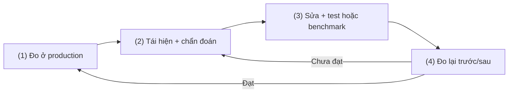
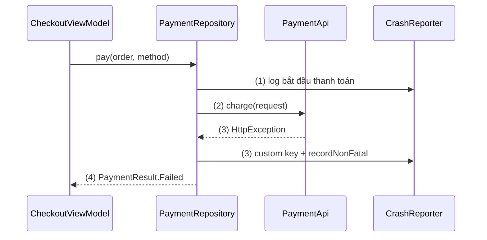
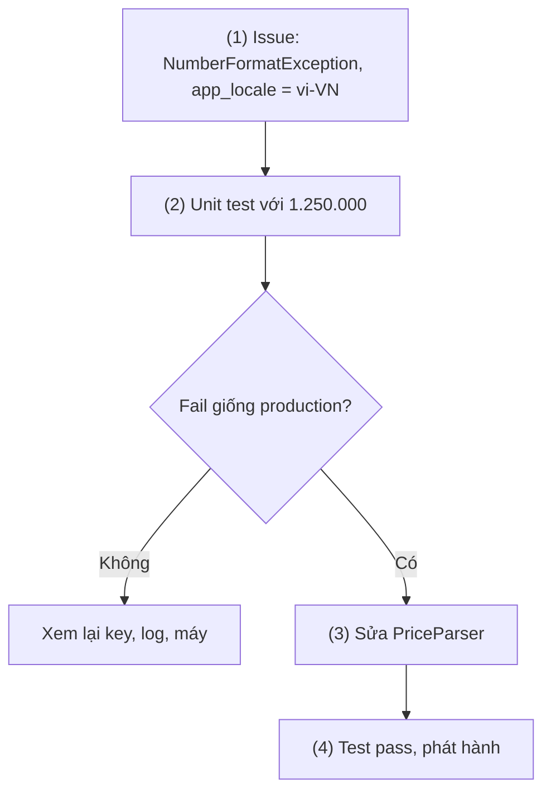
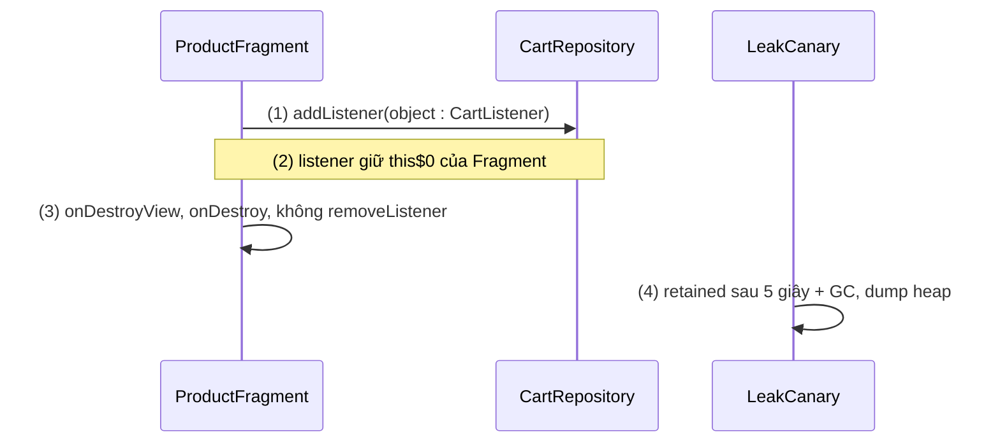
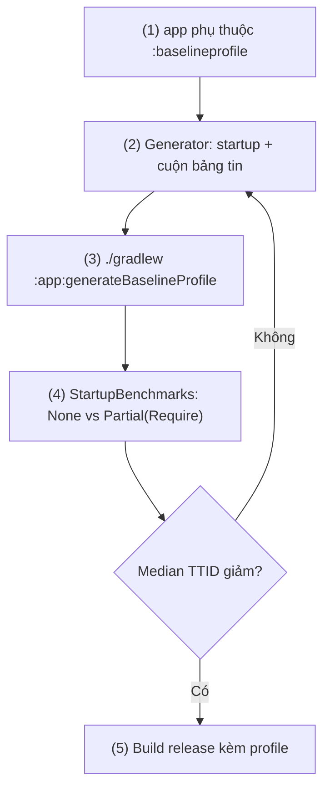
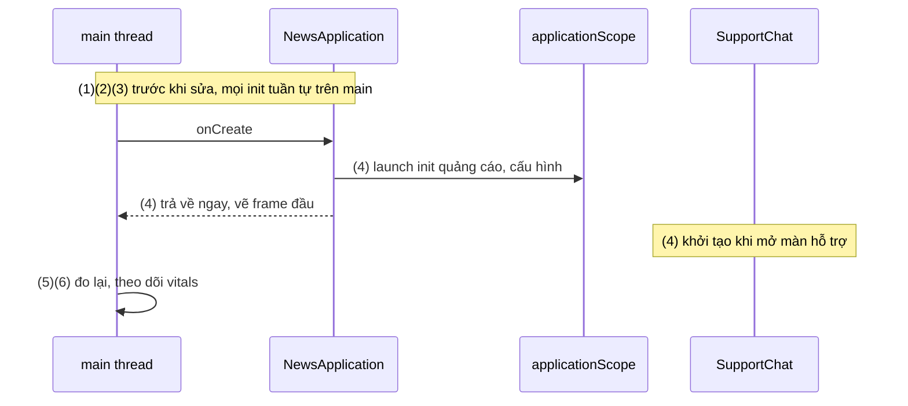

# Fit / Bug Optimization

Theo mục lục, tiêu đề là "Fit / Bug Optimization"; "Fit" được hiểu là **Fix**. Phạm vi gồm hai việc: **sửa bug ở production** (crash, ANR, memory leak) và **tối ưu hiệu năng** (jank, app startup, kích thước app). Logcat, debugger ([10.1 Debugging](debugging.md)) và cách viết test ([10.2 Unit Testing](unit_testing.md)) chỉ được dùng như công cụ.

## Vấn đề cần giải quyết

App đã qua lint, qua test, chạy mượt trên máy dev. Sau khi phát hành:

- Crash chỉ xảy ra trên vài dòng máy, một Android version hay một locale, máy dev không tái hiện được.
- Stack trace của bản release toàn tên `a.b.c` vì R8 đã làm rối code.
- App đơ vài giây rồi hiện hộp thoại ANR, không có exception nào để bắt.
- Bộ nhớ tăng dần sau khi mở đi mở lại một màn hình, rồi process bị hệ thống kill.
- App mở chậm, cuộn giật; developer sửa vài chỗ "có vẻ nặng" nhưng không ai biết nhanh hơn bao nhiêu.

Gốc chung: **không gắn được debugger vào máy người dùng**, và **cảm giác không phải số đo**. Cần dữ liệu production để biết sửa gì trước, công cụ ở máy dev để tái hiện và đo, và cách chứng minh bản sửa có tác dụng; Google Play còn dùng các chỉ số chất lượng để quyết định mức hiển thị app.

## Sau khi học xong

- Giải thích được vòng lặp đo, khoanh vùng, sửa, đo lại và vai trò khác nhau của dữ liệu production (Crashlytics, Android vitals) với công cụ đo ở máy dev.
- Triển khai được Firebase Crashlytics để báo crash và non-fatal kèm custom key, log, user ID không chứa PII, và stack trace đã giải mã bằng mapping của R8.
- Debug được crash, ANR và memory leak từ report production bằng stack trace, trace ANR, leak trace của LeakCanary và heap dump của Profiler.
- Tối ưu được app startup và jank bằng TTID/TTFD, JankStats, Baseline Profiles, và chứng minh kết quả bằng Macrobenchmark.
- Nhận diện được ngưỡng bad behavior của Android vitals và ưu tiên bug theo số người dùng bị ảnh hưởng.

## Fit / Bug Optimization là gì?

**Fit / Bug Optimization** (sửa bug và tối ưu hiệu năng) là vòng lặp **đo → khoanh vùng → sửa → đo lại** áp dụng cho chất lượng app trên thiết bị người dùng thật: dữ liệu production cho biết vấn đề nào ảnh hưởng nhiều người nhất, công cụ ở máy dev tái hiện và đo vấn đề đó, và bản sửa chỉ được coi là xong khi số đo sau tốt hơn số đo trước.

Mental model: **khám bệnh theo chỉ số**. Crashlytics và vitals là chỉ số sức khoẻ đo liên tục trên "người bệnh" thật; stack trace, trace ANR, leak trace, System Trace là xét nghiệm; bản sửa là điều trị; Macrobenchmark và số liệu của bản phát hành sau là tái khám.

## Cách hoạt động

### 1. Vòng lặp và bản đồ công cụ

1. **Đo ở production:** vấn đề gì, bao nhiêu người, máy nào, từ phiên bản nào.
2. **Khoanh vùng ở máy dev:** tái hiện đúng điều kiện report chỉ ra, chẩn đoán bằng công cụ phù hợp.
3. **Sửa và khoá lại:** sửa nguyên nhân, thêm test hoặc benchmark tái hiện vấn đề.
4. **Đo lại:** so trước/sau ở máy dev, rồi theo dõi production của bản mới.



| Vấn đề | Tín hiệu ở production | Khoanh vùng bằng | Bằng chứng đã sửa |
|---|---|---|---|
| Crash | Crashlytics, crash rate | Stack trace, custom key, log | Test tái hiện bug pass |
| ANR | ANR rate, cụm ANR | Trace ANR, System Trace | Main không còn bị chặn |
| Memory leak | Memory vitals, `OutOfMemoryError` | LeakCanary, heap dump | Hết leak trace |
| Jank | Slow/frozen frames, JankStats | System Trace, Layout Inspector | `FrameTimingMetric` tốt hơn |
| Startup chậm | Startup trong vitals | TTID/TTFD, System Trace | `StartupTimingMetric` tốt hơn |
| App nặng | Kích thước tải về | APK Analyzer | So hai APK/AAB |

### 2. Firebase Crashlytics: báo crash và non-fatal

**Crashlytics** là SDK chạy trong process của app: bắt exception chưa được xử lý, lưu report xuống máy, gửi lên Firebase ở lần mở app sau, gom report cùng nguyên nhân thành một **issue** kèm số người bị ảnh hưởng, phân bố theo máy, Android version, phiên bản app. Tích hợp Firebase (project, `google-services.json`, BoM) đã học ở [Google Service](../session_04/components/services/google_service.md); ở đây thêm plugin `com.google.firebase.crashlytics` 3.0.8 (cạnh `com.google.gms.google-services` 4.5.0, theo docs lúc viết) và dependency:

```kotlin
// app/build.gradle.kts (plugins: com.google.gms.google-services, com.google.firebase.crashlytics)
dependencies {
    implementation(platform("com.google.firebase:firebase-bom:35.1.0"))
    implementation("com.google.firebase:firebase-crashlytics")
    implementation("com.google.firebase:firebase-analytics") // breadcrumb: chuỗi event trước khi crash
}
```

Những gì cần biết (giới hạn theo docs):

- **Fatal:** exception không ai bắt làm app kết thúc, Crashlytics tự ghi. **Non-fatal:** lỗi đã bắt nhưng cần đo, ghi bằng `recordException(e)`; mỗi phiên giữ **8 exception gần nhất**.
- **Custom key:** trạng thái lúc lỗi (màn hình, cờ tính năng), tối đa **64 cặp**, mỗi cặp **1 kB**. **Log:** breadcrumb bằng `log(...)`, tối đa **64 kB** mỗi phiên, vượt thì xoá log cũ nhất. **User ID:** `setUserId(...)` để tìm report của một người.
- **Mapping của R8:** Crashlytics Gradle plugin **tự upload** `mapping.txt` khi build, nên stack trace trên console đã được giải mã (vì sao cần mapping từng bản: [Build Types](../session_04/android_manifest/package_build_gradle/build_types.md), mục "Đọc crash bản release: mapping.txt").

> [!WARNING]
> Custom key, log và user ID được gửi lên server bên thứ ba: không ghi email, số điện thoại, họ tên, token hay nội dung người dùng nhập; user ID là ID nội bộ không suy ra được danh tính (xem "Sai lầm thường gặp").

#### Ví dụ: ghi non-fatal khi cổng thanh toán từ chối giao dịch

**Bài toán:** cổng thanh toán trả HTTP lỗi, app hiện "Thanh toán thất bại", không crash. Nếu tỉ lệ thất bại tăng sau một bản phát hành, đội cần biết nó tập trung ở phương thức nào: đúng việc của non-fatal.

**Luồng chạy:**

1. `PaymentRepository.pay()` ghi breadcrumb "bắt đầu thanh toán".
2. Repository gọi API của cổng thanh toán.
3. API ném `HttpException`; repository gắn custom key rồi ghi non-fatal.
4. Repository trả `PaymentResult.Failed` cho UI; app không crash.



**Code:** Crashlytics nằm sau interface `CrashReporter` (`log`, `recordNonFatal`) để test dùng fake ([Dependency Injection](../session_07/design_pattern/di/overview.md), [10.2 Unit Testing](unit_testing.md)):

```kotlin
// FirebaseCrashReporter.kt
import com.google.firebase.Firebase
import com.google.firebase.crashlytics.crashlytics

class FirebaseCrashReporter : CrashReporter {
    private val crashlytics = Firebase.crashlytics
    override fun log(message: String) = crashlytics.log(message)
    override fun recordNonFatal(error: Throwable, keys: Map<String, String>) {
        keys.forEach { (key, value) -> crashlytics.setCustomKey(key, value) }
        crashlytics.recordException(error)
    }
}

// PaymentRepository.kt
import retrofit2.HttpException

class PaymentRepository(
    private val paymentApi: PaymentApi,
    private val crashReporter: CrashReporter,
) {
    suspend fun pay(order: Order, method: PaymentMethod): PaymentResult {
        crashReporter.log("payment: start, method=${method.code}")              // (1) không chứa PII
        return try {
            val response = paymentApi.charge(ChargeRequest(order.id, method.code)) // (2)
            PaymentResult.Success(response.transactionId)
        } catch (e: HttpException) {
            crashReporter.recordNonFatal(                                       // (3)
                error = e,
                keys = mapOf("payment_method" to method.code, "http_code" to e.code().toString()),
            )
            PaymentResult.Failed(e.code())                                      // (4)
        }
    }
}
```

`setCustomKey` có hiệu lực cả phiên; key chỉ cho một lần ghi thì dùng `recordException(e) { key("payment_method", method.code) }`.

**Kết quả:** ở bản debug, cho fake `PaymentApi` ném lỗi rồi mở lại app: issue non-fatal trên Crashlytics console có tab **Keys** (`payment_method`, `http_code`) và **Logs** ("payment: start"). Ở production, lọc issue theo `payment_method`.

### 3. Android vitals và ngưỡng bad behavior

**Android vitals** là bộ chỉ số chất lượng Google Play thu từ **hệ điều hành** trên thiết bị của người dùng đã đồng ý chia sẻ dữ liệu (nên có cả crash xảy ra trước khi SDK trong app khởi tạo), xem trên Play Console. **Core vitals** ảnh hưởng tới mức hiển thị trên Play: user-perceived crash rate, user-perceived ANR rate, excessive partial wake locks, memory usage, bitmap memory usage. **User-perceived crash rate** là phần trăm người dùng hoạt động trong ngày (DAU) gặp ít nhất một crash **khi đang dùng app** (Activity hiển thị hoặc foreground service); ANR rate tương tự. Ngưỡng **bad behavior** theo docs lúc viết:

| Chỉ số | Trung bình mọi thiết bị | Từng dòng điện thoại |
|---|---|---|
| User-perceived crash rate | 1,09% | 8% |
| User-perceived ANR rate | 0,47% | 8% |
| Excessive partial wake locks | 5% | - |

Vượt ngưỡng, Play có thể giảm hiển thị của app và hiện cảnh báo trên store listing. Ngưỡng memory chia theo mức RAM và trạng thái app; docs ghi vượt ngưỡng memory, bitmap memory hay DEX code optimization có thể bị ảnh hưởng hiển thị từ 02/2027. Ngưỡng có thể đổi, hãy đối chiếu docs.

Các chỉ số khác có ngưỡng "quá mức" để tìm việc tối ưu: cold start từ **5 giây**, warm start từ **2 giây**, hot start từ **1,5 giây** (đo bằng TTID); **slow frame** là frame lâu hơn **16 ms**, **frozen frame** lâu hơn **700 ms**.

Khi đọc vitals:

- **Play tính trung bình 28 ngày gần nhất**, nên bản sửa cần thời gian mới kéo chỉ số xuống; crash, ANR kéo dài quá 7 ngày được đánh dấu "emerging issue".
- **Đơn vị là người dùng mỗi ngày, không phải phiên:** mở app ba lần trong ngày, crash một lần, vitals tính 100%, Crashlytics tính 33% (ví dụ của docs).
- **Ưu tiên cụm lớn nhất:** sửa cụm crash, ANR ảnh hưởng nhiều người nhất trước; vượt ngưỡng ở vài dòng máy thì sửa cụm lớn nhất trên các dòng đó. **App Quality Insights** của Android Studio hiện issue Crashlytics và vitals cạnh code.

### 4. Sửa crash: từ report tới test chống lặp

Issue crash cho biết **chỗ chết** nhưng chưa chắc cho biết **nguyên nhân**. Đọc frame đầu tiên thuộc code của app, `Caused by` cuối chuỗi, phân bố máy và phiên bản, custom key và log (đọc stack trace, retrace: [10.1 Debugging](debugging.md)). Rồi tái hiện đúng điều kiện, sửa nguyên nhân thay vì bọc `try/catch` quanh triệu chứng, khoá lại bằng test fail trước và pass sau khi sửa, phát hành từng phần (staged rollout). Issue quay lại ở phiên bản đã đóng được Crashlytics đánh dấu **regressed**.

#### Ví dụ: crash khi đọc giá tiền theo locale tiếng Việt

**Bài toán:** server bắt đầu định dạng giá theo ngôn ngữ người dùng; Crashlytics báo issue fatal mới `NumberFormatException: For input string: "1.250.000"` tại `PriceParser.parse`; custom key `app_locale` của mọi report là `vi-VN`.

**Luồng chạy:**

1. Đọc issue: frame đầu của app là `PriceParser.parse`, input có dấu chấm phân cách hàng nghìn.
2. Tái hiện bằng unit test với đúng chuỗi đó: test ném cùng exception.
3. Sửa: chỉ giữ chữ số; chuỗi không có số (như "Liên hệ") trả `null`.
4. Test pass, phát hành, theo dõi issue.



**Code:**

```kotlin
// PriceParser.kt (trước khi sửa)
object PriceParser {
    fun parse(raw: String): Long = raw.replace(",", "").toLong() // chỉ đúng với định dạng en-US
}

// PriceParserTest.kt (src/test)
class PriceParserTest {
    @Test
    fun parse_viGrouping_returnsAmount() =
        assertEquals(1_250_000L, PriceParser.parse("1.250.000"))   // (2) trước khi sửa: NumberFormatException

    @Test
    fun parse_noDigits_returnsNull() = assertNull(PriceParser.parse("Liên hệ"))
}

// PriceParser.kt (sau khi sửa)
object PriceParser {
    // (3) giá VND không có phần thập phân: bỏ ký tự phân cách, chuỗi không có số trả null
    fun parse(raw: String): Long? = raw.filter(Char::isDigit).toLongOrNull()
}
```

**Kết quả:** `./gradlew testDebugUnitTest`: `parse_viGrouping_returnsAmount` fail trước khi sửa, cả hai test pass sau khi sửa; bản mới không còn report cho issue. Về lâu dài server nên trả số.

### 5. ANR: đọc trace thay vì đoán

Cơ chế ANR (main thread bị chặn, input không được phản hồi trong 5 giây...) đã học ở [5.2 Working with Thread](../session_05/working_with_thread.md), mục "ANR (Application Not Responding)". Ở đây chỉ bàn cách **phân tích**: ANR không có exception, thứ có giá trị là **trace các thread lúc ANR**, lấy từ:

- **Android vitals:** cụm ANR kèm trace main thread.
- **Crashlytics** (chỉ thiết bị Android 11 trở lên, report gửi ở lần mở app sau): gắn tag cho thread như `Triggered ANR` (thread bị chặn, thường là main), `Deadlocked`, `Root blocking`, `IO Root blocking`, `Waiting for binder call`; docs lưu ý thread `Triggered ANR` chưa chắc là nguyên nhân.
- **Máy test:** `/data/anr/` (cần `adb root`) hoặc `adb bugreport`.
- **Trong app, từ Android 11 (API 30):** `ActivityManager.getHistoricalProcessExitReasons()` trả về `ApplicationExitInfo`; với `REASON_ANR`, `traceInputStream` chứa trace.

Mẫu ANR thường gặp theo docs: I/O hoặc tính toán dài trên main thread, binder đồng bộ chờ lâu, main chờ `synchronized` mà thread khác giữ lâu, deadlock. Trace (rút gọn) của một cụm ANR ở danh sách tin tức:

```text
"main" prio=5 tid=1 Blocked
  at com.example.news.data.ArticleCache.get(ArticleCache.kt:21)
  - waiting to lock <0x0b1c2d3e> (a java.lang.Object) held by thread 23
  at com.example.news.ui.ArticleAdapter.onBindViewHolder(ArticleAdapter.kt:58)

"DefaultDispatcher-worker-3" prio=5 tid=23 Native
  at java.io.FileOutputStream.writeBytes(Native method)
  at com.example.news.data.ArticleCache.put(ArticleCache.kt:30)
  - locked <0x0b1c2d3e> (a java.lang.Object)
```

Cách đọc: `"main"` ở trạng thái `Blocked`, tức đang **chờ** chứ không tính toán; `waiting to lock <0x0b1c2d3e> ... held by thread 23` cho biết chờ khoá nào, ai giữ; `tid=23` giữ đúng khoá đó trong lúc ghi file, nên suốt lúc ghi main không vẽ được frame nào. Thủ phạm: `get()` và `put()` (gồm ghi file) của `ArticleCache` dùng chung một `synchronized`. Sửa: `get()` đọc một snapshot bất biến (`@Volatile` `Map`) không cần khoá; `put()` chạy trên `Dispatchers.IO`, các lần ghi chờ nhau bằng `Mutex.withLock`, vốn treo coroutine thay vì chặn thread ([8.4.3 Coroutines](../session_08/async_threads/coroutines.md)). Kiểm chứng bằng System Trace lúc vừa cuộn vừa lưu bài (main không còn slice chờ khoá dài), rồi bằng vitals của bản mới.

### 6. Memory leak: LeakCanary và heap dump

**Memory leak** là khi object đã hết vòng đời (Activity đã `onDestroy`, View của Fragment đã `onDestroyView`, ViewModel đã `onCleared`) vẫn được tham chiếu từ một **GC root** (biến static, thread đang chạy...), nên GC không thu hồi được nó và mọi thứ nó giữ, như cả cây View của một Activity. Leak tích tụ làm GC chạy nhiều (jank), rồi `OutOfMemoryError` hoặc process bị kill.

**LeakCanary** phát hiện leak ở bản debug, không cần code khởi tạo:

```kotlin
// app/build.gradle.kts
dependencies {
    debugImplementation("com.squareup.leakcanary:leakcanary-android:2.14")
}
```

Theo docs: LeakCanary theo dõi Activity, Fragment, View của Fragment đã destroy và ViewModel đã clear bằng weak reference; sau **5 giây và một lần GC**, object chưa được thu hồi là **retained**; khi số object retained đạt **5** (app đang hiển thị) hoặc **1** (app không hiển thị) thì dump heap, tìm đường tham chiếu mạnh ngắn nhất từ GC root tới object (**leak trace**), rồi phân loại **Application Leak** (code của bạn) hay **Library Leak** (bug đã biết của thư viện).

Leak trace đọc từ GC root (trên) xuống object bị leak (dưới). Mỗi node có `Leaking: NO`, `YES` hoặc `UNKNOWN`; thủ phạm nằm giữa node `NO` cuối và node `YES` đầu, tham chiếu bị nghi được gạch chân bằng `~~~`.

Nguồn leak thường gặp: singleton giữ `Context` của Activity ([Singleton Pattern](../session_07/design_pattern/singleton_pattern.md)), Fragment giữ binding sau `onDestroyView()` ([View Binding](../session_06/view_binding.md)), listener vào object sống lâu mà không gỡ (ví dụ dưới; Compose gỡ trong `onDispose` của [DisposableEffect](../jetpack_compose_ui/side_effects/disposable_effect.md)), coroutine hoặc `Handler` chạy lâu giữ Activity.

**Heap dump** của Profiler (task **Analyze Memory Usage (Heap Dump)**, cần bản debuggable): **Shallow Size** là bộ nhớ của chính object, **Retained Size** là bộ nhớ được giải phóng nếu object bị thu hồi, bộ lọc **Show activity/fragment leaks** liệt kê Activity, Fragment bị nghi leak, tab **References** cho biết ai giữ nó. Android Studio Quail 2 thêm task phân tích leak bằng LeakCanary ngay trong Profiler.

#### Ví dụ: listener của giỏ hàng giữ Fragment đã đóng

**Bài toán:** badge giỏ hàng của màn hình sản phẩm đăng ký listener vào `CartRepository` (sống bằng process); mở, đóng màn hình vài lần thì LeakCanary báo leak.

**Luồng chạy:**

1. `ProductFragment` đăng ký một anonymous listener vào `CartRepository`.
2. Anonymous object giữ tham chiếu ngầm `this$0` tới Fragment.
3. Màn hình đóng, listener không được gỡ.
4. LeakCanary thấy Fragment retained, dump heap, in leak trace.
5. Sửa: thay listener bằng `StateFlow`, thu thập theo vòng đời View.



```text
├─ com.example.shop.data.CartRepository instance
│    Leaking: NO (CartRepository↑ is not leaking)
│    ↓ CartRepository.listeners
│                     ~~~~~~~~~
├─ java.util.ArrayList instance
│    Leaking: UNKNOWN
│    ↓ ArrayList[0]
├─ com.example.shop.ui.ProductFragment$onViewCreated$1 instance
│    Leaking: UNKNOWN
│    ↓ ProductFragment$onViewCreated$1.this$0
│                                      ~~~~~~
╰→ com.example.shop.ui.ProductFragment instance
     Leaking: YES (Fragment#onDestroy() was called)
```

Leak trace (rút gọn): `listeners` → phần tử 0 → `this$0`, thủ phạm là listener chưa gỡ.

**Code:**

```kotlin
// ProductFragment.kt (trước khi sửa)
CartRepository.addListener(object : CartListener {               // (1)(2) giữ this$0
    override fun onCartChanged(count: Int) { binding.cartBadge.text = count.toString() }
})                                                               // (3) không gỡ ở onDestroyView

// CartRepository.kt (sau khi sửa)
object CartRepository {
    private val _itemCount = MutableStateFlow(0)
    val itemCount: StateFlow<Int> = _itemCount.asStateFlow()     // (5) không giữ người quan sát
}

// ProductFragment.kt (sau khi sửa)
override fun onViewCreated(view: View, savedInstanceState: Bundle?) {
    viewLifecycleOwner.lifecycleScope.launch {
        viewLifecycleOwner.repeatOnLifecycle(Lifecycle.State.STARTED) {
            CartRepository.itemCount.collect { binding.cartBadge.text = it.toString() } // (5) tự huỷ theo View
        }
    }
}
```

**Kết quả:** mở và đóng màn hình khoảng mười lần, LeakCanary không còn báo, heap dump không còn `ProductFragment` trong **Show activity/fragment leaks**. Buộc dùng listener thì gỡ ở `onDestroyView()`, đối xứng với chỗ đăng ký.

### 7. Jank: đo bằng System Trace và JankStats

Ở 60 fps mỗi frame có khoảng **16 ms**, 120 fps khoảng 8 ms; frame không kịp mốc thì màn hình giữ frame cũ thêm một chu kỳ: đó là **jank**. Slow frame, frozen frame và ANR là các mức của cùng hiện tượng. Frame budget đã học ở [5.2 Working with Thread](../session_05/working_with_thread.md), nguyên nhân riêng của Compose và Layout Inspector ở [Remember và Recomposition](../jetpack_compose_ui/remember_and_recomposition.md); phần này nói về **đo**.

**Ở máy dev:** đo trên bản non-debuggable (ART tắt nhiều tối ưu khi app debuggable), ưu tiên máy yếu. Trong Profiler, chạy **Profile 'app' with low overhead** và ghi **System Trace**: tìm frame đỏ, mở slice `Choreographer#doFrame` của main thread, với Compose xem `Compose:recompose`, `Compose:layout`, `Compose:draw`. **Find CPU Hotspots** chỉ ra hàm tốn CPU nhất nhưng overhead lớn, không dùng để kết luận về jank; trace nhiều process thì mở bằng Perfetto.

**Ở production:** **JankStats** (`androidx.metrics:metrics-performance:1.0.0`) nhận dữ liệu từng frame của một `Window`, tự đánh dấu jank (mặc định: lâu gấp đôi chu kỳ làm tươi màn hình, chỉnh bằng `jankHeuristicMultiplier`), và gắn **UI state** do app khai báo qua `PerformanceMetricsState` để biết jank xảy ra lúc đang làm gì.

Code tối thiểu: listener đếm frame theo màn hình, màn hình tự khai báo state.

```kotlin
// MainActivity.kt (trong onCreate; onResume/onPause bật tắt jankStats.isTrackingEnabled)
jankStats = JankStats.createAndTrack(window) { frame ->     // chạy trên thread FrameMetrics: chỉ đọc, trả về nhanh
    val screen = frame.states.firstOrNull { it.key == "screen" }?.value ?: "unknown"
    jankCounter.record(screen, isJank = frame.isJank)        // đếm theo màn hình, gửi định kỳ về analytics
}

// ProductListScreen.kt: mọi frame khi màn hình này hiển thị mang state "screen"
val view = LocalView.current
DisposableEffect(view) {
    val holder = PerformanceMetricsState.getHolderForHierarchy(view)
    holder.state?.putState("screen", "ProductList")
    onDispose { holder.state?.removeState("screen") }
}
```

`FrameData` được dùng lại cho mọi frame: chỉ đọc giá trị trong listener, không giữ object. Hạ `jankHeuristicMultiplier` trên máy test để ép có jank khi kiểm tra; ở production, tỉ lệ jank theo màn hình và dòng máy cho biết chọn máy nào để ghi System Trace.

### 8. App startup: cold, warm, hot và TTID, TTFD

- **Cold start:** process chưa tồn tại; hệ thống tạo process, app tạo `Application`, Activity rồi vẽ frame đầu. Tốn nhất, nên tối ưu theo giả định cold start.
- **Warm start:** process còn nhưng Activity phải tạo lại.
- **Hot start:** Activity còn trong bộ nhớ, chỉ đưa lên foreground.

**TTID** (Time to initial display) là thời gian tới frame đầu tiên; hệ thống tự đo, Logcat (bỏ bộ lọc app, dòng này do system server in) có `Displayed com.example.news/.MainActivity: +1s380ms`. **TTFD** (Time to full display) là thời gian tới khi nội dung chính dùng được; app phải tự báo bằng `reportFullyDrawn()`, Logcat in `Fully drawn ...`. Với Compose, `activity-compose` có `ReportDrawn()`, `ReportDrawnWhen { }`, `ReportDrawnAfter { }`.

```kotlin
// NewsFeedScreen.kt
@Composable
fun NewsFeedScreen(viewModel: NewsFeedViewModel = hiltViewModel()) {
    val uiState by viewModel.uiState.collectAsStateWithLifecycle()
    ReportDrawnWhen { uiState is FeedUiState.Success }   // chỉ báo fully drawn khi đã có bài để đọc
    // ... skeleton khi Loading, danh sách khi Success
}
```

> [!WARNING]
> Gọi `ReportDrawn()` ngay khi vào màn hình làm TTFD gần bằng TTID trong khi người dùng vẫn thấy khung xương; Baseline Profile cũng bỏ sót đường code tải dữ liệu, vì code chạy sau thời điểm fully drawn không vào profile.

Đo nhanh cold start (`-S` dừng app trước, `-W` chờ tới khi xong):

```bash
adb shell am start -S -W com.example.news/.MainActivity
```

Nguyên nhân chậm thường gặp theo docs: `Application.onCreate()` khởi tạo thứ chưa cần, I/O hay giải mã ảnh trên main thread, cây UI quá sâu, composition đầu nặng, splash screen là Activity riêng (từ Android 12 dùng `SplashScreen` API). Hướng sửa: **khởi tạo lười** (DI như [Hilt](../session_07/design_pattern/di/hilt.md) chỉ tạo object khi được inject), dời việc không cần cho frame đầu sang nền, hiện placeholder trước; ví dụ đầy đủ ở "Ví dụ thực tế". Thư viện **App Startup** (`androidx.startup`) gom việc khởi tạo của các thư viện vào một ContentProvider chung; bài không đi sâu.

### 9. Baseline Profiles và Macrobenchmark

Sau khi cài hoặc cập nhật, code chạy bằng interpreter rồi mới được JIT dần, nên những lần mở đầu chậm nhất. **Baseline Profile** là danh sách class và method trên các hành trình quan trọng, đóng gói cùng app (`assets/dexopt/baseline.prof`), để **ART biên dịch trước (AOT) đúng phần code đó khi cài đặt**; docs ghi nó giúp code được liệt kê chạy nhanh hơn khoảng 30% từ lần mở đầu. Play gửi profile kèm APK; ngoài Play hoặc trên Android 7–8.1, `profileinstaller` cài nó ở lần chạy đầu. Profile **không có tác dụng với app debuggable**. **Startup Profile** là tập con dùng lúc build để R8 xếp code khởi động vào DEX chính.

**Macrobenchmark** (`androidx.benchmark:benchmark-macro-junit4`) đo hành trình lớn bằng cách chạy app thật nhiều lần từ một module `com.android.test`, ghi System Trace mỗi lần và rút metric (`StartupTimingMetric`, `FrameTimingMetric`, `TraceSectionMetric`). App được đo phải profileable, không debuggable, đo trên **máy thật**. `compilationMode` mô phỏng trạng thái biên dịch: `None()` (không AOT), `Partial(baselineProfileMode = BaselineProfileMode.Require)` (bắt buộc có Baseline Profile), `Full()`.

Cách tạo khuyến nghị: template **File > New > New Module > Baseline Profile Generator** (Android Studio Iguana, AGP 8.2+) tạo module test, áp plugin `androidx.baselineprofile` cho module đó và module app, sinh sẵn generator và benchmark startup.

#### Ví dụ: chứng minh Baseline Profile làm app tin tức mở nhanh hơn

**Bài toán:** cold start gần ngưỡng quá mức trên máy yếu; cần Baseline Profile cho khởi động và cuộn bảng tin, chứng minh bằng số.

**Luồng chạy:**

1. Module app phụ thuộc module `:baselineprofile` qua cấu hình `baselineProfile(...)`.
2. Generator gồm test khởi động (đưa vào Startup Profile) và test cuộn bảng tin.
3. Task Gradle build bản release không làm rối code, chạy generator (máy root, emulator, hoặc Android 13+ không cần root), chép profile vào `app/src/release/generated/baselineProfiles/`.
4. Benchmark `None` và `Partial(Require)` trên máy thật, so median `timeToInitialDisplayMs`.
5. Build release: R8 tự viết lại tên trong profile cho khớp code đã làm rối.



**Code:**

```kotlin
// app/build.gradle.kts
plugins {
    id("com.android.application")
    id("androidx.baselineprofile")              // cùng version với androidx.benchmark
}
dependencies {
    implementation("androidx.profileinstaller:profileinstaller:1.4.1")
    baselineProfile(project(":baselineprofile"))  // (1)
}

// baselineprofile/.../BaselineProfileGenerator.kt
@RunWith(AndroidJUnit4::class)
@LargeTest
class BaselineProfileGenerator {
    @get:Rule val rule = BaselineProfileRule()

    @Test
    fun startup() = rule.collect(packageName = "com.example.news", includeInStartupProfile = true) { // (2)
        pressHome()
        startActivityAndWait()
    }

    // (2) hành trình cuộn bảng tin: thêm @Test thứ hai, không bật includeInStartupProfile
}

// baselineprofile/.../StartupBenchmarks.kt
@RunWith(AndroidJUnit4::class)
@LargeTest
class StartupBenchmarks {
    @get:Rule val rule = MacrobenchmarkRule()

    @Test fun startupCompilationNone() = startup(CompilationMode.None())                       // (4) trước
    @Test fun startupCompilationBaselineProfiles() =
        startup(CompilationMode.Partial(baselineProfileMode = BaselineProfileMode.Require))    // (4) sau

    private fun startup(mode: CompilationMode) = rule.measureRepeated(
        packageName = "com.example.news",
        metrics = listOf(StartupTimingMetric()),
        compilationMode = mode,
        startupMode = StartupMode.COLD,
        iterations = 10,
        setupBlock = { pressHome() },
    ) {
        startActivityAndWait()
    }
}
```

```bash
./gradlew :app:generateBaselineProfile   # (3)
```

Trong hành trình cuộn, UI Automator tìm `LazyColumn` qua `By.res("feed_list")` chỉ khi composable gốc bật `Modifier.semantics { testTagsAsResourceId = true }`. Từ Macrobenchmark 1.5, docs viết hành trình bằng DSL `uiAutomator { startApp(packageName) }`; `startActivityAndWait()` vẫn dùng được.

**Kết quả:** chạy `StartupBenchmarks` từ gutter trên máy thật, output có dạng (số của output mẫu trong docs):

```text
StartupBenchmarks_startupCompilationBaselineProfiles
timeToInitialDisplayMs   min 161.8,   median 178.9,   max 194.6
StartupBenchmarks_startupCompilationNone
timeToInitialDisplayMs   min 184.7,   median 196.9,   max 202.9
```

So **median**, không so một lần chạy (docs có số đo app mẫu Now in Android trên Pixel 7: 324,8 ms không biên dịch, 229,0 ms có Baseline Profile). Commit `baseline-prof.txt`, sinh lại khi hành trình chính đổi. Kết quả còn được xuất JSON trong `build/outputs/connected_android_test_additional_output/` để CI so với bản trước (11.4 Github CI, chưa có bài).

### 10. StrictMode VmPolicy: cảnh báo sớm ở bản debug

`StrictMode.ThreadPolicy` (I/O, network trên main thread) đã học ở [5.2 Working with Thread](../session_05/working_with_thread.md), mục "Bật StrictMode phát hiện vi phạm luồng trong lúc Debug". **`VmPolicy`** áp cho cả process, bắt lỗi tài nguyên dẫn tới leak: `Closeable`, `Cursor` bị GC mà chưa đóng, receiver hay service connection còn đăng ký khi `Context` đã huỷ, số instance Activity bất thường, và (API 31) mở Intent lấy từ dữ liệu ngoài mà không kiểm tra.

```kotlin
// NewsApplication.kt
if (BuildConfig.DEBUG) {
    StrictMode.setVmPolicy(
        StrictMode.VmPolicy.Builder()
            .detectLeakedClosableObjects()
            .detectLeakedRegistrationObjects()
            .detectActivityLeaks()
            .apply { if (Build.VERSION.SDK_INT >= Build.VERSION_CODES.S) detectUnsafeIntentLaunch() }
            .penaltyLog()            // hoặc penaltyDeath(), penaltyListener() (API 28)
            .build()
    )
}
```

Ví dụ: quên đóng `Cursor` ở một nhánh `return` sớm; sau vài lần GC, Logcat (tag `StrictMode`) in "A resource was acquired at attached stack trace but never released" kèm nơi cursor được tạo; sửa bằng `cursor.use { ... }`.

### 11. Kích thước app: R8, shrink resources, APK Analyzer

- **R8** (`isMinifyEnabled = true`) bỏ code không dùng, làm rối tên, tối ưu bytecode; `isShrinkResources = true` bỏ resource không ai tham chiếu. Cấu hình và keep rule ở [Build Types](../session_04/android_manifest/package_build_gradle/build_types.md). Vitals còn cảnh báo **DEX code optimization**: app có hơn 10 MB DEX cần bật tối ưu, làm rối, rút gọn đạt tối thiểu 25%.
- **APK Analyzer** (**Build > Analyze APK**) cho thấy dung lượng `classes*.dex`, `res/`, `lib/` theo ABI, `assets/`; **Compare with previous APK** chỉ ra bản mới nặng thêm vì đâu. Cấu trúc APK: [APK](../session_01/output_packages/apk_files.md).
- **Android App Bundle** giúp Play chỉ gửi resource và ABI hợp với từng máy ([AAB](../session_01/output_packages/aab_files.md)).

So hai bản, tìm phần tăng nhiều nhất (thư viện mới, ảnh lớn, native lib thừa ABI), sửa rồi so tiếp.

## Ví dụ thực tế

### Bản phát hành làm cold start chậm và tăng ANR

**Bài toán:** bản 3.2 thêm SDK chat hỗ trợ và SDK quảng cáo; vitals báo cold start quá mức trên máy yếu, cụm ANR mới trong `Application.onCreate`.

**Luồng chạy:**

1. Bọc từng bước khởi tạo trong `Application.onCreate()` bằng trace section.
2. Đo bằng Macrobenchmark với `StartupTimingMetric` và `TraceSectionMetric` từng section: số "trước".
3. Phân loại: SDK chat chỉ cần khi mở màn hỗ trợ; quảng cáo và đọc cấu hình không cần cho frame đầu.
4. Sửa: SDK chat khởi tạo lười; quảng cáo và cấu hình chuyển sang coroutine nền.
5. Đo lại cùng benchmark, so median TTID và từng section.
6. Phát hành từng phần, theo dõi startup và ANR rate trong vitals.



**Code:**

```kotlin
// NewsApplication.kt (sau khi sửa; bản trước chạy cả ba trace("init_...") tuần tự trên main)
@HiltAndroidApp
class NewsApplication : Application() {
    @Inject lateinit var applicationScope: CoroutineScope    // SupervisorJob() + Dispatchers.Default, từ module Hilt

    override fun onCreate() {
        super.onCreate()
        applicationScope.launch {                              // (4) không chặn frame đầu
            trace("init_remote_config") { RemoteConfigLoader.loadFromDisk(this@NewsApplication) }
            trace("init_ads") { AdsSdk.initialize(this@NewsApplication) }
        }
    }
}

// SupportChat.kt
@Singleton
class SupportChat @Inject constructor(@ApplicationContext private val context: Context) {
    private val sdk by lazy { SupportChatSdk.initialize(context, CHAT_KEY) } // (4) khởi tạo khi dùng lần đầu
    fun open(activity: Activity) = sdk.openConversation(activity)
}

// AppInitBenchmark.kt: giống StartupBenchmarks ở mục 9, chỉ thêm metric cho từng section
@OptIn(ExperimentalMetricApi::class)
val metrics = listOf(                                         // (2) trước, (5) sau: cùng một benchmark
    StartupTimingMetric(),
    TraceSectionMetric("init_remote_config"),
    TraceSectionMetric("init_ads"),
    TraceSectionMetric("init_support_chat"),
)
```

`trace(name) { }` (import `androidx.tracing.trace`) thuộc `androidx.tracing:tracing` (trước 1.3.0 ở `tracing-ktx`); section hiện trong System Trace và được `TraceSectionMetric` đo. Code hiện quảng cáo giờ phải chịu được lúc SDK chưa sẵn sàng.

**Kết quả:** trước khi sửa, ba section chiếm phần lớn TTID; sau khi sửa, `init_support_chat` không còn lúc khởi động, hai section kia chạy nền, median `timeToInitialDisplayMs` giảm. Ghi số trước/sau vào pull request.

### Process bị kill trên máy RAM thấp vì bitmap quá lớn

Vitals báo bitmap memory vượt ngưỡng, Crashlytics có `OutOfMemoryError` ở màn thư viện ảnh. Heap dump cho thấy `Bitmap` chiếm phần lớn **Native Size**; Android Studio (từ Narwhal 4) còn đánh dấu bitmap trùng lặp. Nguyên nhân thường là giải mã ảnh gốc 4000 px cho ô 200 dp; sửa bằng thư viện tải ảnh với kích thước đích đúng ô hiển thị ([Coil](../session_08/loading_image/coil.md)), rồi chụp heap dump lại để so.

## So sánh với các cách tiếp cận khác

| Tiêu chí | Firebase Crashlytics | Android vitals |
|---|---|---|
| Nguồn dữ liệu | SDK trong app | Hệ điều hành, qua Google Play |
| Crash trước khi SDK khởi tạo | Không thấy | Thấy |
| ANR | Chỉ Android 11 trở lên, gửi ở lần mở sau | Có, gửi ngay |
| Đơn vị tỉ lệ | Theo phiên | Theo người dùng mỗi ngày |
| Custom key, log, user ID | Có | Không |
| Ảnh hưởng hiển thị trên Play, chỉ số startup/frame/memory | Không | Có |

Vitals cho biết app có vượt ngưỡng không và cụm nào lớn nhất; Crashlytics cho ngữ cảnh để sửa.

## Khi nào nên và không nên dùng

**Nên:**

- Tích hợp Crashlytics từ bản phát hành đầu (kiểm tra mapping được upload), bật email cảnh báo của vitals; bật LeakCanary và StrictMode ở bản debug.
- Tạo Baseline Profile khi khởi động hoặc cuộn là trải nghiệm chính, đo bằng Macrobenchmark; dùng JankStats khi jank chỉ xảy ra trên máy người dùng.

**Không nên:**

- Tối ưu khi chưa có số đo cho thấy đó là vấn đề.
- Dùng `recordException` cho mọi lỗi mạng thông thường (mất mạng, timeout): nó làm loãng dashboard.
- Đưa LeakCanary (`implementation` thay vì `debugImplementation`) hay `penaltyDeath()` vào bản release: app đơ khi dump heap hoặc crash vì vi phạm StrictMode.
- Kết luận từ benchmark trên emulator, bản debuggable, một lần chạy, hay một ngày vitals.

## Sai lầm thường gặp

### 1. Đo hiệu năng trên bản debug

```kotlin
// Sai: app được benchmark là bản debug
create("benchmark") { initWith(getByName("debug")) }
```

**Lỗi lộ ra thế nào:** Macrobenchmark báo lỗi vì app debuggable; đo tay bằng Profiler cho số chậm hơn người dùng thật, Baseline Profile không thấy tác dụng.

**Cách sửa:** `initWith(getByName("release"))`, ký bằng debug key, giữ R8 (template Baseline Profile tự tạo variant phù hợp). Với Profiler, dùng **Profile 'app' with low overhead**; bản debuggable chỉ cho task cần nó như heap dump.

### 2. Đưa PII hoặc giá trị duy nhất vào report

```kotlin
// Sai
crashlytics.setUserId(user.email)
crashlytics.recordException(IllegalStateException("Order ${order.id} failed at ${System.currentTimeMillis()}"))
```

**Lỗi lộ ra thế nào:** email người dùng nằm trên server bên thứ ba, vi phạm chính sách quyền riêng tư; message khác nhau mỗi lần làm report không gom được thành issue, dashboard đầy issue một report.

**Cách sửa:** `setUserId(user.internalId)`; message cố định ("Order payment failed"), giá trị thay đổi đưa vào custom key.

### 3. Dời việc chậm sang thread khác nhưng main vẫn chờ

```kotlin
// Sai: đọc file đã ở Dispatchers.IO nhưng main thread vẫn chặn chờ kết quả
val config = runBlocking { withContext(Dispatchers.IO) { configRepository.load() } }
```

**Lỗi lộ ra thế nào:** StrictMode không còn báo disk read trên main, nhưng trace ANR cho thấy main đang chờ trong `runBlocking`; ANR rate không giảm.

**Cách sửa:** main thread không chờ việc chậm theo bất kỳ cách nào (`runBlocking`, `Future.get()`, `synchronized` chờ thread I/O); hiện loading, nhận kết quả qua `uiState` của ViewModel.

## Lịch sử phát triển

- **2015:** Square phát hành LeakCanary; bản 2.0 (2019) viết lại bằng Kotlin với bộ phân tích heap Shark.
- **2017:** Google mua Fabric, Crashlytics thành Firebase Crashlytics (Fabric SDK ngừng cuối 2020); Android vitals ra mắt.
- **Android 11 (2020):** `ApplicationExitInfo` cho biết lý do process kết thúc lần trước, kèm trace ANR (Crashlytics dùng để báo ANR).
- **2020–2023:** Macrobenchmark (alpha 06/2020, stable 06/2022 kèm `BaselineProfileRule`), JankStats (alpha 02/2022); Baseline Profile Gradle plugin có từ Benchmark 1.2.0 (10/2023, cần AGP 8.0), AGP 8.2 thêm Startup Profile.
- **10/2022:** Play chuyển sang user-perceived crash rate và ANR rate, giữ ngưỡng 1,09% và 0,47%, thêm ngưỡng 8% theo dòng điện thoại; cảnh báo trên store listing từ 30/11/2022.
- **Gần đây:** Profiler tổ chức theo task; JankStats 1.0.0 (10/2025); core vitals thêm memory, bitmap memory; Macrobenchmark 1.5 dùng DSL UI Automator mới; Android Studio Quail 2 đưa LeakCanary vào Profiler.

## Kết nối hệ thống

- **Tiên quyết:**
  - [10.1 Debugging](debugging.md): stack trace, retrace, Logcat, debugger, adb.
  - [5.2 Working with Thread](../session_05/working_with_thread.md): main thread, frame budget, ANR, StrictMode ThreadPolicy.
  - [Build Types](../session_04/android_manifest/package_build_gradle/build_types.md): R8, `isShrinkResources`, `mapping.txt`, `initWith`.
- **Liên quan:** [10.2 Unit Testing](unit_testing.md) (test chống lặp, fake), [10.3 Lint](lint.md) (bắt lỗi trước khi thành crash), [Google Service](../session_04/components/services/google_service.md) (tích hợp Firebase), [Remember và Recomposition](../jetpack_compose_ui/remember_and_recomposition.md) (jank của Compose), [Singleton Pattern](../session_07/design_pattern/singleton_pattern.md) và [View Binding](../session_06/view_binding.md) (nguồn leak), [APK](../session_01/output_packages/apk_files.md) và [AAB](../session_01/output_packages/aab_files.md) (kích thước gói), [Session 10 Overview](index.md).
- **Học tiếp:**
  - 11.4 Github CI (chưa có bài): chạy lint, test, benchmark trước khi merge.

## Tham khảo

- [Android vitals](https://developer.android.com/topic/performance/vitals)
- [App startup time in Android vitals](https://developer.android.com/google/play/vitals/launch-time)
- [Slow rendering in Android vitals](https://developer.android.com/google/play/vitals/render)
- [ANRs](https://developer.android.com/topic/performance/vitals/anr)
- [App startup time](https://developer.android.com/topic/performance/vitals/launch-time)
- [JankStats library](https://developer.android.com/topic/performance/jankstats)
- [Baseline Profiles overview](https://developer.android.com/topic/performance/baselineprofiles/overview)
- [Create Baseline Profiles](https://developer.android.com/topic/performance/baselineprofiles/create-baselineprofile)
- [Benchmark Baseline Profiles](https://developer.android.com/topic/performance/baselineprofiles/measure-baselineprofile)
- [Benchmark release notes](https://developer.android.com/jetpack/androidx/releases/benchmark)
- [Capture a heap dump](https://developer.android.com/studio/profile/capture-heap-dump)
- [Android Studio Quail 2 release notes](https://developer.android.com/studio/releases/past-releases/as-quail-2-release-notes)
- [StrictMode.VmPolicy.Builder](https://developer.android.com/reference/android/os/StrictMode.VmPolicy.Builder)
- [Get started with Firebase Crashlytics](https://firebase.google.com/docs/crashlytics/android/get-started)
- [Customize your Crashlytics crash reports](https://firebase.google.com/docs/crashlytics/android/customize-crash-reports)
- [Debug ANR errors - Firebase Crashlytics](https://firebase.google.com/docs/crashlytics/debug-anr-errors)
- [Crashlytics troubleshooting](https://firebase.google.com/docs/crashlytics/troubleshooting)
- [How LeakCanary works](https://square.github.io/leakcanary/fundamentals-how-leakcanary-works/)
- [Raising the bar on technical quality on Google Play](https://android-developers.googleblog.com/2022/10/raising-bar-on-technical-quality-on-google-play.html)
