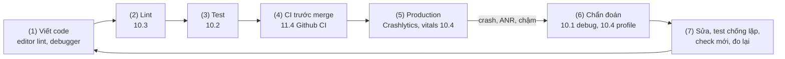
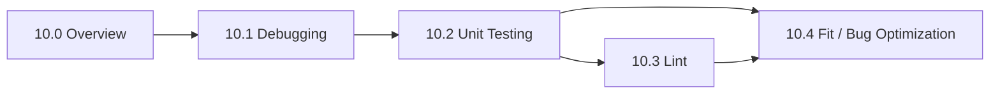

# Session 10 Overview

## Vấn đề cần giải quyết

Viết được app rồi, câu hỏi tiếp theo là **làm sao biết nó đúng và giữ nó đúng**:

1. Lỗi đọc code là thấy (gọi API cao hơn `minSdk`, log token) có bị chặn trước khi merge không?
2. Hành vi có đúng, và vẫn đúng sau mỗi lần sửa?
3. Khi app chạy sai, tìm nguyên nhân thế nào thay vì đoán rồi thử?
4. Trên máy người dùng, app có crash, treo, rò bộ nhớ, giật không, và bản sửa có làm số đo tốt lên?

Không công cụ nào trả lời cả bốn câu; Session 10 dạy bốn nhóm công cụ và cách nối chúng thành một vòng.

## Sau khi học xong

- Giải thích được vòng chất lượng code (viết, lint, test, debug, giám sát và tối ưu ở production) và vai trò của từng Topic trong Session 10.
- Phân biệt được câu hỏi mà Debugging, Unit Testing, Lint và Fit / Bug Optimization trả lời, cùng công cụ chính của từng Topic.
- Áp dụng được thứ tự học đề xuất và nơi dạy chính của các kiến thức dễ chồng lấn trong session.

## Vòng chất lượng code là gì?

**Vòng chất lượng code** là chuỗi các lớp kiểm tra nối tiếp nhau, mỗi lớp bắt một loại lỗi ở thời điểm rẻ nhất có thể; lỗi nào lọt tới lớp sau thì được đưa ngược về lớp trước dưới dạng một test hoặc một check mới.

Mental model: **lưới lọc nhiều lớp** (lint đọc code chưa chạy, test chạy code trong điều kiện kiểm soát, debug quan sát app đang chạy, giám sát đo app trên máy người dùng). Không lớp nào bắt hết; lỗi lọt tới người dùng thì vá lỗ ở lớp sớm hơn, vì bắt càng sớm càng rẻ.

## Cách hoạt động

### Vòng chất lượng code

1. **Viết code:** editor chạy lint trên file đang mở; debugger và Logcat dùng khi thử tính năng (10.1).
2. **Lint:** quét toàn module, chặn lỗi có mẫu và vi phạm quy ước (10.3).
3. **Test:** unit test trên JVM cho logic, instrumented và UI test cho phần cần thiết bị (10.2).
4. **Cổng trước khi merge:** CI chạy lại lint và test cho mỗi Pull Request ([11.4 Github CI](../cicd_and_publish_store/github_ci.md)).
5. **Production:** Crashlytics và Android vitals đo crash, ANR, hiệu năng trên máy người dùng (10.4).
6. **Chẩn đoán:** tái hiện, khoanh vùng bằng debugger, stack trace, Profiler, LeakCanary (10.1, 10.4).
7. **Sửa và vá lưới:** sửa nguyên nhân, thêm test (10.2), lint check (10.3) hoặc đo lại (10.4); quay về bước 1.

Điểm cần nhớ là **mũi tên quay lại**: bug chỉ xong khi có test, check hoặc benchmark đỏ nếu nó quay lại.

### Session 10 học những gì?

| Topic | Câu hỏi trả lời | Công cụ chính | Khi nào dùng |
|---|---|---|---|
| [10.1 Debugging](debugging.md) | App đang chạy sai ở đâu, vì sao? | Logcat, debugger, stack trace và retrace R8, App Inspection, adb | Đã thấy hành vi sai, cần nguyên nhân gốc |
| [10.2 Unit Testing](unit_testing.md) | Code có làm đúng hành vi mong đợi, và vẫn đúng sau mỗi lần sửa? | JUnit 4, fake, `runTest`, Turbine, MockWebServer, Robolectric, Espresso, Compose UI test | Viết logic mới, sửa bug, trước khi refactor |
| [10.3 Lint](lint.md) | Không cần chạy, code có khớp mẫu lỗi đã biết hoặc vi phạm quy ước không? | Android Lint, baseline, custom lint rule, ktlint, detekt | Mỗi PR, tự động |
| [10.4 Fit / Bug Optimization](fit_bug_optimization.md) | Trên máy người dùng, app có crash, ANR, leak, giật, chậm không; bản sửa có làm số đo tốt lên? | Crashlytics, Android vitals, LeakCanary, Profiler, JankStats, Macrobenchmark, Baseline Profiles | Sau khi phát hành; khi tối ưu hiệu năng |

Bốn Topic chia theo **thời điểm**: Lint và Unit Testing chạy **trước** khi code tới người dùng, Debugging dùng **bất kỳ lúc nào** có hành vi sai, Fit / Bug Optimization dùng dữ liệu **sau** khi phát hành.

> [!NOTE]
> Bài 10.4 "Fit / Bug Optimization" hiểu "Fit" là "Fix": sửa bug ở production và tối ưu hiệu năng.

### Nơi dạy chính của các kiến thức dễ chồng lấn

| Kiến thức | Dạy chính ở | Bài khác chỉ nhắc |
|---|---|---|
| ANR, Main Thread, StrictMode `ThreadPolicy` | [5.2 Working with Thread](../session_05/working_with_thread.md) | 10.4: trace ANR, StrictMode `VmPolicy` |
| Layout Inspector, đếm recomposition | [9.1 Remember and Recomposition](../jetpack_compose_ui/remember_and_recomposition.md) | 10.1 tóm tắt; 10.4 trỏ về khi xử lý jank |
| Logcat, debugger, stack trace, retrace bằng `mapping.txt` | 10.1 | 10.4: Crashlytics tự upload mapping |
| Viết test, test double, test coroutine, UI test | 10.2 | 10.1, 10.4: test chống lặp khi sửa bug |
| Profiler, LeakCanary, Crashlytics, Macrobenchmark | 10.4 | 10.1 chỉ trỏ sang |
| Lint, baseline, custom lint rule | 10.3 | 10.1, 10.4: lint là lớp bắt lỗi sớm hơn |
| Thay dependency bằng fake qua DI | [7.x Dependency Injection](../session_07/design_pattern/di/overview.md) | 10.2 thay repository bằng fake |
| Build type, R8, lưu `mapping.txt` | [Build Types](../session_04/android_manifest/package_build_gradle/build_types.md) | 10.1 retrace; 10.4 giảm kích thước app |

### Thứ tự học đề xuất

1. **10.1 trước:** quy trình debug là nền; bước cuối "chứng minh lỗi không quay lại" dẫn sang 10.2.
2. **10.2 tiếp theo:** test chống lặp dùng ở cả 10.1 và 10.4; custom lint rule ở 10.3 cũng test bằng JUnit.
3. **10.3 rồi 10.4:** 10.4 nặng nhất nên để cuối, trùng thứ tự mục lục.

## Ví dụ thực tế

Một bug đi trọn vòng: sau một bản phát hành, **app crash khi mở màn chi tiết đơn hàng, chỉ trên máy dưới Android 13 (API 33)**.

1. **Production (10.4):** Crashlytics báo `NoSuchMethodError` mới trên máy API 32 trở xuống.
2. **Chẩn đoán (10.1):** stack trace (đã retrace) chỉ tới `Bundle.getParcelable(key, Order::class.java)`, overload chỉ có từ API 33; tái hiện ngay trên emulator API 31.
3. **Sửa và test chống lặp (10.2):** đổi sang `BundleCompat.getParcelable(...)` của AndroidX; test đọc đơn hàng từ `Bundle` chạy bằng Robolectric với SDK 31, đỏ trước khi sửa, xanh sau khi sửa.
4. **Vá lưới ở lớp sớm hơn (10.3):** `NewApi` vốn bắt được lỗi này nhưng bị `@SuppressLint("NewApi")` tắt trên cả class; bỏ suppress, nâng `NewApi` thành `fatal`.
5. **Cổng trước khi merge ([11.4 Github CI](../cicd_and_publish_store/github_ci.md)):** lint và test chạy trong CI cho mọi PR.

Kết quả là **lưới dày hơn** ở hai lớp: thêm một test, và một check không còn bị tắt.

## Sai lầm thường gặp

### 1. Chỉ dựa vào một lớp kiểm tra

**Lỗi lộ ra thế nào:** team chỉ test tay, hoặc chỉ chờ Crashlytics báo; lỗi trên máy cũ hay ở luồng ít người thử tới thẳng người dùng.

**Cách sửa:** tối thiểu cần lint và unit test tự động cho mỗi PR, cộng giám sát production.

### 2. Sửa bug mà không vá lưới

**Lỗi lộ ra thế nào:** bug cũ quay lại sau một refactor, không gì báo đỏ.

**Cách sửa:** bản sửa luôn kèm test tái hiện bug (10.2), lint check nếu lỗi có mẫu chung (10.3), hoặc benchmark nếu là hiệu năng (10.4).

### 3. Tối ưu theo cảm giác

**Lỗi lộ ra thế nào:** sửa vài chỗ rồi "thấy nhanh hơn" trên bản debug, nhưng startup trên Android vitals không đổi.

**Cách sửa:** đo trước và sau bằng công cụ của 10.4 (Macrobenchmark trên bản release, chỉ số production).

## Lịch sử phát triển

- **2011:** Android Lint ra đời (ADT 16).
- **2013–2018:** Espresso và Android Testing Support Library chuẩn hoá test trên thiết bị; 2018 chuyển thành AndroidX Test.
- **2017:** Google ra mắt Android vitals trên Play Console và mua lại Crashlytics (nay là Firebase Crashlytics).
- **2021–2022:** Compose 1.0 ra mắt cùng API test UI; Macrobenchmark và Baseline Profiles đưa đo và tối ưu hiệu năng vào quy trình build.

## Kết nối hệ thống

- **Tiên quyết:**
  - [5.2 Working with Thread](../session_05/working_with_thread.md): Main Thread, ANR, StrictMode cơ bản.
  - [7.2.3 MVVM](../session_07/architecture/mvvm.md), [Dependency Injection Overview](../session_07/design_pattern/di/overview.md): tách tầng, inject dependency để thay bằng fake khi test.
  - [8.4.3 Coroutines](../session_08/async_threads/coroutines.md): nền của debug và test coroutine.
  - [Session 09 Overview](../jetpack_compose_ui/index.md): UI Compose, được test ở 10.2 và tối ưu ở 10.4.
- **Trong session:** [10.1 Debugging](debugging.md), [10.2 Unit Testing](unit_testing.md), [10.3 Lint](lint.md), [10.4 Fit / Bug Optimization](fit_bug_optimization.md).
- **Học tiếp:** [Session 11](../cicd_and_publish_store/index.md), đặc biệt [11.4 Github CI](../cicd_and_publish_store/github_ci.md): tự động hoá bước 4 của vòng.

## Tham khảo

- [Test apps on Android - Android Developers](https://developer.android.com/training/testing)
- [Debug your app - Android Developers](https://developer.android.com/studio/debug)
- [Improve your code with lint checks - Android Developers](https://developer.android.com/studio/write/lint)
- [App performance guide - Android Developers](https://developer.android.com/topic/performance/overview)
- [Android vitals - Android Developers](https://developer.android.com/topic/performance/vitals)
- [Firebase Crashlytics - Firebase](https://firebase.google.com/docs/crashlytics)
