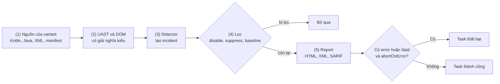
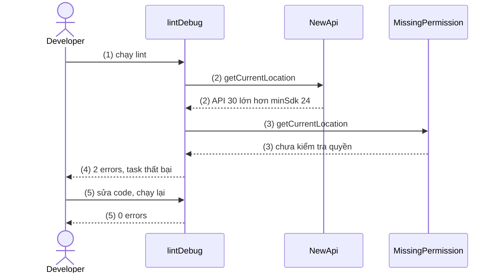
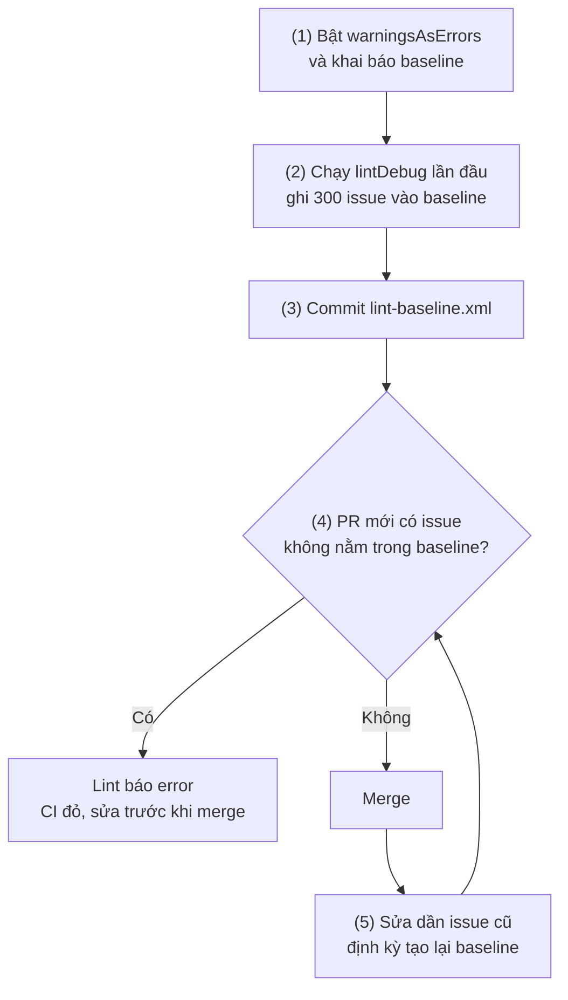
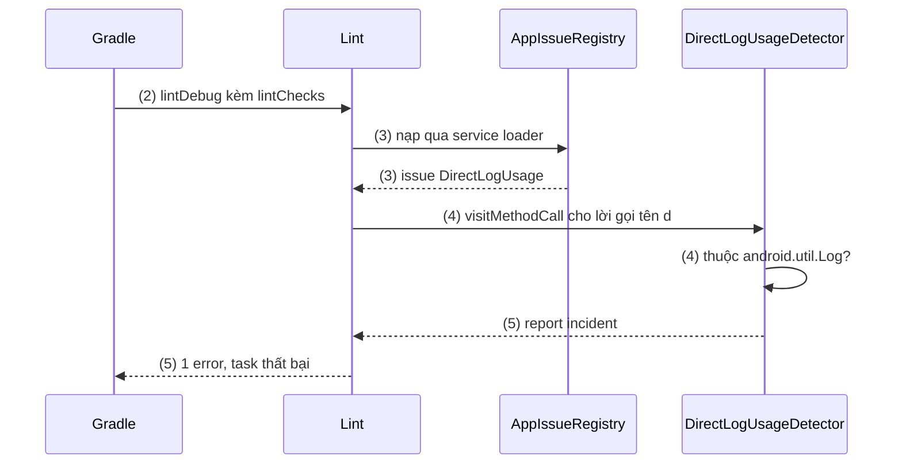
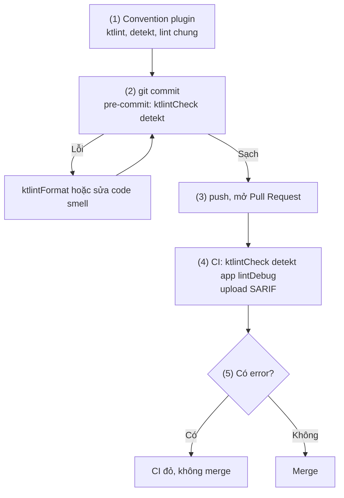

# Lint

## Vấn đề cần giải quyết

Có một nhóm bug **đọc code là thấy**, nhưng compiler không bắt, và test thường cũng không:

```kotlin
// NearbyStoreFinder.kt (minSdk = 24): biên dịch được, unit test vẫn xanh
fun findNearestStore(onResult: (Location?) -> Unit) {
    Log.d("NearbyStore", "user=$userEmail token=$authToken")   // ghi email và token ra Logcat
    locationManager.getCurrentLocation(                          // API 30: crash trên Android 7–10
        LocationManager.GPS_PROVIDER, null, mainExecutor,        // chưa kiểm tra quyền vị trí
    ) { location -> onResult(location) }
}
```

- **Compiler** biên dịch với `compileSdk` (bản mới nhất), nên `getCurrentLocation()` hợp lệ dù máy Android 10 không có hàm đó.
- **Unit test** chỉ kiểm tra hành vi bạn đã nghĩ tới ([10.2 Unit Testing](unit_testing.md)), không ai viết test "không crash trên API 29".
- **Code review** chỉ bắt được nếu người review nhớ quy ước "không log token".

Ở production, chúng thành `NoSuchMethodError` trên máy cũ, `SecurityException` khi người dùng từ chối quyền, token nằm trong bug report. Vấn đề cần giải quyết: **tự động soát mọi dòng code theo các mẫu lỗi đã biết, ở mọi PR**, để lỗi bị chặn trước khi tới người dùng và quy ước của team được máy kiểm tra thay vì trí nhớ.

## Sau khi học xong

- Phân biệt được static analysis với compiler và test, và phạm vi của Android Lint, ktlint, detekt.
- Triển khai được Android Lint trong dự án, gồm chạy bằng Gradle và IDE, đọc report, cấu hình severity bằng lint {} và lint.xml.
- Áp dụng được baseline và suppress đúng phạm vi để đưa lint vào codebase cũ mà không che giấu lỗi mới.
- Thiết kế được một custom lint rule với Detector, Issue, IssueRegistry và kiểm thử nó bằng lint-tests.
- Áp dụng được ktlint, detekt và lint check của Compose thành cổng kiểm tra chạy trước khi merge.

## Lint là gì?

**Lint** là một dạng **static analysis (phân tích tĩnh)**: đọc mã nguồn và tài nguyên của app **mà không chạy nó**, đối chiếu với một tập luật (mỗi luật gọi là một **check**, phát hiện một **issue**) để báo những chỗ có thể gây crash, chậm, lộ dữ liệu hoặc sai quy ước, kèm vị trí và **severity (mức độ nghiêm trọng)**.

Mental model: lint là **một reviewer tự động đọc từng dòng code theo một checklist cố định**. Mỗi check là một mục trong checklist; severity là mức reviewer gán cho mục đó (nhắc hay chặn merge); baseline là danh sách "nợ cũ đã ghi nhận" reviewer tạm bỏ qua; custom lint rule là mục riêng của team thêm vào checklist.

Trên Android có ba "reviewer" phổ biến, mỗi người một checklist:

- **Android Lint**: đi kèm Android Gradle Plugin (AGP) và Android Studio, đọc Kotlin, Java, XML, manifest, resource; tập trung lỗi đặc thù Android.
- **ktlint**: chỉ đọc Kotlin, kiểm tra format và style.
- **detekt**: chỉ đọc Kotlin, tìm **code smell** (hàm quá dài, quá phức tạp).

## Cách hoạt động

### Static analysis đứng ở đâu so với compiler và test

| | Compiler | Static analysis (lint) | Test |
|---|---|---|---|
| Câu hỏi | Code có hợp lệ về ngữ pháp và kiểu không? | Code có khớp mẫu lỗi hoặc vi phạm quy ước đã biết không? (không chạy code) | Code có làm đúng hành vi mong đợi không? (chạy code) |
| Bắt được | Sai kiểu, thiếu import, gọi hàm không tồn tại trong `compileSdk` | API cao hơn `minSdk`, thiếu kiểm tra quyền, resource không dùng, chuỗi cứng, code smell, quy ước riêng | Sai logic nghiệp vụ, sai luồng trạng thái |

Lint **không thay test** (nó không biết giá đơn hàng làm tròn thế nào), test cũng **không thay lint** (test không chạy trên mọi API level, mọi cấu hình quyền). Lint suy luận từ mẫu nên có **false positive** (báo nhầm), vì vậy cần suppress có kỷ luật.

### Android Lint chạy thế nào

Android Lint quét theo **module** và **variant**, qua các bước:

1. **Thu thập nguồn của variant:** Kotlin/Java, XML, resource, manifest, file Gradle; kèm `minSdk`, `targetSdk` và dependency.
2. **Dựng cây cú pháp có giải nghĩa kiểu:** Kotlin và Java thành **UAST (Universal Abstract Syntax Tree)**, cây chung cho cả hai ngôn ngữ; XML thành DOM.
3. **Chạy các detector:** mỗi detector đăng ký loại phần tử nó quan tâm (lời gọi hàm, thẻ XML, annotation); tìm thấy vấn đề thì tạo một **incident** gắn với một issue.
4. **Lọc theo cấu hình:** bỏ incident của issue bị tắt, bị suppress tại chỗ hoặc đã có trong baseline; ghi đè severity theo `lint {}` và `lint.xml`.
5. **Ghi report và quyết định kết quả:** ghi report; còn incident mức **error** hoặc **fatal** và `abortOnError = true` (mặc định) thì task thất bại.



Mỗi issue có **id** (`NewApi`, `HardcodedText`) để cấu hình và suppress; **severity** `fatal`, `error`, `warning`, `informational` hoặc `ignore` (tắt), trong đó `fatal` chặn cả bản release (phần sau); và **category** (Correctness, Security, Performance...) để nhóm trong report.

Nhiều check dựa vào **annotation** của `androidx.annotation` (`@RequiresApi`, `@RequiresPermission`, `@WorkerThread`, `@StringRes`, `@CheckResult`): gắn chúng cho hàm của mình là cách rẻ nhất để lint kiểm tra cả nơi gọi. Một số check đáng biết:

| Issue id | Severity mặc định | Bắt lỗi gì |
|---|---|---|
| `NewApi` | Error | Gọi API cao hơn `minSdk` mà không kiểm tra `Build.VERSION.SDK_INT` |
| `MissingPermission` | Error | Gọi API có `@RequiresPermission` mà thiếu khai báo quyền hoặc thiếu kiểm tra quyền lúc chạy |
| `HardcodedText` | Warning | Chuỗi viết thẳng trong XML layout thay vì `@string/...` (không áp dụng cho `Text("...")` của Compose) |
| `UnusedResources` | Warning | Resource không được tham chiếu, làm tăng kích thước APK |
| `WrongThread` | Error | Gọi hàm `@MainThread` từ hàm `@WorkerThread` hoặc ngược lại |
| `SetJavaScriptEnabled` | Warning | Bật JavaScript cho `WebView`, rủi ro XSS |

#### Ví dụ: tìm cửa hàng gần nhất bằng vị trí hiện tại

**Bài toán:** màn "Cửa hàng gần bạn" lấy vị trí hiện tại. App có `minSdk = 24`; developer dùng `LocationManager.getCurrentLocation()` (từ API 30) và chỉ thử trên máy Android 14.

**Luồng chạy:**

1. Developer chạy `./gradlew :feature:store:lintDebug`.
2. Detector `NewApi` thấy `getCurrentLocation()` có API level 30 > `minSdk` 24 và không nằm trong nhánh `if (Build.VERSION.SDK_INT >= Build.VERSION_CODES.R)` → incident `NewApi`.
3. Detector `MissingPermission` thấy hàm này có `@RequiresPermission(anyOf = [ACCESS_COARSE_LOCATION, ACCESS_FINE_LOCATION])` nhưng hàm gọi nó không kiểm tra quyền → incident `MissingPermission`.
4. Có error và `abortOnError = true` → task thất bại, report chỉ đúng dòng.
5. Developer sửa: kiểm tra quyền trước, rẽ nhánh theo `SDK_INT`, dùng `getLastKnownLocation()` cho máy cũ; chạy lại thì hai incident biến mất.



**Code:**

```kotlin
// feature/store/src/main/java/com/example/store/NearbyStoreFinder.kt
class NearbyStoreFinder(
    private val context: Context,
    private val locationManager: LocationManager,
) {
    fun findCurrentLocation(onResult: (Location?) -> Unit) {
        val granted = ContextCompat.checkSelfPermission(
            context, Manifest.permission.ACCESS_COARSE_LOCATION,
        ) == PackageManager.PERMISSION_GRANTED
        if (!granted) {                                        // (5) kiểm tra quyền, MissingPermission hết báo
            onResult(null)
            return
        }

        if (Build.VERSION.SDK_INT >= Build.VERSION_CODES.R) {  // (5) lint hiểu nhánh này chỉ chạy từ API 30
            locationManager.getCurrentLocation(
                LocationManager.NETWORK_PROVIDER,
                null,                                          // CancellationSignal: không huỷ giữa chừng
                ContextCompat.getMainExecutor(context),
            ) { location -> onResult(location) }
        } else {
            onResult(locationManager.getLastKnownLocation(LocationManager.NETWORK_PROVIDER))
        }
    }
}
```

**Kết quả:** trước khi sửa, `:feature:store:lintDebug` thất bại; report dạng text (rút gọn):

```text
NearbyStoreFinder.kt:14: Error: Call requires API level 30 (current min is 24): android.location.LocationManager#getCurrentLocation [NewApi]
    locationManager.getCurrentLocation(
                    ~~~~~~~~~~~~~~~~~~
NearbyStoreFinder.kt:14: Error: Call requires permission which may be rejected by user: code should explicitly check to see if permission is available (...) [MissingPermission]
2 errors, 0 warnings
```

Sau khi sửa, task thành công; trên emulator API 29, màn hình lấy vị trí qua nhánh `getLastKnownLocation()` thay vì crash `NoSuchMethodError`.

### Chạy lint và đọc report

Android Lint chạy ở hai chỗ:

- **Trong editor:** lint chạy trên file đang mở, gạch vàng (warning) hoặc đỏ (error), `Alt+Enter` để xem quick fix.
- **Cả dự án:** **Code > Inspect Code**, hoặc Gradle. **Gradle là nguồn sự thật** vì CI chạy đúng lệnh đó.

| Lệnh Gradle | Làm gì |
|---|---|
| `./gradlew lint` | Chạy lint cho **variant mặc định** (thường là debug) của mọi module |
| `./gradlew :app:lintDebug`, `lintRelease` | Chạy cho một variant cụ thể của một module |
| `./gradlew lintFix` | Chạy lint và áp các quick fix được đánh dấu an toàn vào source |
| `lintVitalRelease` | Tự chạy khi build release, chỉ kiểm issue mức **fatal**; tắt bằng `checkReleaseBuilds = false` |

Lint **không** tự chạy khi build debug; docs khuyến nghị chạy tường minh trong CI.

Report nằm trong thư mục build của module, ví dụ `app/build/reports/lint-results-debug.html`:

- **HTML:** mỗi issue có giải thích, vị trí, đoạn code và cách suppress.
- **XML:** cho công cụ khác đọc (plugin CI, script đếm issue).
- **SARIF (Static Analysis Results Interchange Format):** định dạng chuẩn, bật bằng `sarifReport = true`; GitHub code scanning dùng nó để hiện issue trên dòng code của PR.

### Cấu hình: `lint {}` và `lint.xml`

Cấu hình lint nằm trong block `lint {}` bên trong `android {}` của từng module (AGP 8.x, Kotlin DSL):

```kotlin
// app/build.gradle.kts
android {
    lint {
        abortOnError = true                 // mặc định: còn error thì task thất bại
        warningsAsErrors = false            // true: mọi warning được tính là error
        checkDependencies = true            // lint cả các module library app phụ thuộc, gộp một report
        checkReleaseBuilds = true           // giữ lintVitalRelease khi build release

        fatal += "NewApi"                   // nâng severity: chặn cả bản release
        error += "MissingPermission"
        informational += "GradleDependency" // hạ severity: có bản thư viện mới chỉ là thông tin
        disable += listOf("TypographyFractions", "TypographyQuotes")   // tắt check không hợp dự án
        enable += "UnusedIds"               // bật check mặc định đang tắt

        lintConfig = file("lint.xml")       // cấu hình chi tiết theo file
        baseline = file("lint-baseline.xml")
        sarifReport = true
    }
}
```

> [!WARNING]
> `fatal`, `error`, `disable`, `checkOnly`... là `MutableSet<String>`. Thêm nhiều id thì dùng `+= listOf("A", "B")`; viết `+= "A" + "B"` là nối chuỗi trong Kotlin, thành một id `"AB"` không tồn tại, nên cả hai check vẫn chạy.

- `checkDependencies = true` ở module app được docs khuyến nghị cho dự án một app nhiều library.
- `checkOnly += "NewApi"` chỉ chạy đúng các check liệt kê; hợp khi đưa lint vào dần từng check.
- Module thuần Kotlin/JVM không có `android {}`: áp plugin `com.android.lint` và dùng block `lint {}` ở cấp cao nhất.

`lint.xml` dùng khi cần chi tiết hơn DSL, nhất là **bỏ qua một issue chỉ ở một số đường dẫn**:

```xml
<?xml version="1.0" encoding="UTF-8"?>
<!-- app/lint.xml -->
<lint>
    <!-- Chuỗi cứng là lỗi chặn merge, trừ màn debug nội bộ không cần dịch -->
    <issue id="HardcodedText" severity="error">
        <ignore path="src/debug/res/layout/" />
    </issue>

    <!-- App chỉ dùng vector drawable, check này không có ý nghĩa -->
    <issue id="IconMissingDensityFolder" severity="ignore" />
</lint>
```

Nên đặt **severity chung của team** trong DSL (hoặc convention plugin, xem [Plugin](../session_04/android_manifest/package_build_gradle/plugin.md) mục "Convention Plugin") và **ngoại lệ theo đường dẫn** trong `lint.xml`.

### Baseline: đưa lint vào codebase cũ

Bật lint chặt trên dự án lâu năm thường ra vài trăm issue; không ai sửa hết trong một PR, và build đỏ mãi thì team sẽ tắt lint. **Baseline** chụp toàn bộ issue hiện có vào một file XML; các lần chạy sau lint **chỉ báo issue không có trong baseline**, tức là issue mới. Theo docs:

- Khai báo `baseline = file("lint-baseline.xml")`. Lần chạy đầu khi file chưa tồn tại, lint tạo file đó; docs chạy `./gradlew lintDebug -Dlint.baselines.continue=true` để lần tạo baseline không làm task thất bại.
- Khi baseline có hiệu lực, report có một cảnh báo informational: có issue bị lọc vì nằm trong baseline, và issue nào trong baseline đã không còn (đã sửa).
- Tạo lại baseline: docs hướng dẫn xoá file rồi chạy lint lại; từ AGP 7.3 có thêm task `updateLintBaseline` để tạo hoặc cập nhật baseline.

> [!NOTE]
> Baseline chỉ áp dụng khi chạy theo batch (Gradle, Inspect Code), **không** áp dụng trong editor: developer vẫn thấy issue cũ trong file đang sửa, để sửa dần khi chạm vào code đó.

#### Ví dụ: bật warningsAsErrors cho dự án có 300 cảnh báo cũ

**Bài toán:** team muốn mọi warning mới đều chặn merge, nhưng module `app` đang có khoảng 300 warning cũ, phải trả dần.

**Luồng chạy:**

1. Thêm `warningsAsErrors = true` và `baseline = file("lint-baseline.xml")` vào `lint {}`.
2. Chạy `./gradlew :app:lintDebug -Dlint.baselines.continue=true`: lint ghi 300 issue hiện có vào `lint-baseline.xml`.
3. Commit file baseline cùng thay đổi cấu hình, để CI và mọi máy dùng chung.
4. Một PR sau thêm chuỗi cứng vào layout XML: issue mới không có trong baseline nên lint báo error, CI đỏ.
5. Issue cũ được sửa dần; định kỳ tạo lại baseline để file nhỏ lại và lỗi đã sửa không quay lại mà không bị bắt.



**Code:**

```kotlin
// app/build.gradle.kts
android {
    lint {
        warningsAsErrors = true                 // (1) warning mới chặn merge
        baseline = file("lint-baseline.xml")    // (1) tạo ở bước (2), commit ở bước (3)
    }
}
```

**Kết quả:** CI của PR bật luật xanh; PR thử thêm `android:text="Thanh toán"` vào layout thì `:app:lintDebug` thất bại với `HardcodedText`. Số dòng `<issue` trong baseline là thước đo nợ kỹ thuật.

### Suppress: khi nào được phép

Suppress là bảo lint "chỗ này tôi biết, đừng báo". Bốn cách, từ hẹp tới rộng:

| Cách | Phạm vi | Ví dụ |
|---|---|---|
| `//noinspection IssueId` | Một câu lệnh Kotlin/Java | `//noinspection NewApi` ngay trên dòng |
| `@SuppressLint("IssueId")` | Một hàm, property hoặc class, kể cả composable | `@SuppressLint("NewApi")` |
| `tools:ignore="IssueId"` | Một phần tử XML và mọi phần tử con | `tools:ignore="UnusedResources"` |
| `lint.xml` `<ignore path>` hoặc `disable` | Thư mục, module, cả dự án | Ví dụ ở phần cấu hình |

Suppress chỉ được phép khi **lint sai** (false positive: chứng minh được lỗi không thể xảy ra) hoặc **lỗi được chấp nhận có chủ ý** (màn debug nội bộ không cần dịch), và phải: **phạm vi hẹp nhất** (một hàm, không cả class, không bao giờ `"all"`), **ghi lý do** ngay cạnh. Tốt hơn suppress là **cho lint thêm thông tin**. Với `NewApi`: kiểm tra `SDK_INT`, hoặc gắn `@RequiresApi` để đẩy việc kiểm tra lên nơi gọi; helper kiểu `isAtLeastR()` thì gắn `@ChecksSdkIntAtLeast(api = Build.VERSION_CODES.R)`. Với `MissingPermission`: gắn `@RequiresPermission` lên hàm của bạn.

```kotlin
// NotificationChannels.kt
@RequiresApi(Build.VERSION_CODES.O)   // thay cho @SuppressLint("NewApi"): nơi gọi bị nhắc kiểm tra SDK_INT
fun createOrderChannel(manager: NotificationManager) =
    manager.createNotificationChannel(NotificationChannel("orders", "Đơn hàng", NotificationManager.IMPORTANCE_DEFAULT))
```

### Custom lint rule: đưa quy ước của team vào checklist

Check có sẵn chỉ biết lỗi chung của Android; quy ước riêng của team cần **custom lint rule**. Các thành phần, theo [Android Lint API Guide](https://googlesamples.github.io/android-custom-lint-rules/api-guide.html):

- **Module `lint-checks`:** module Kotlin/JVM thuần, phụ thuộc `com.android.tools.lint:lint-api` dạng `compileOnly`. Version lint = version AGP **cộng 23** ở số major: AGP 8.7.3 đi với lint 31.7.3.
- **`Detector`:** class chứa logic kiểm tra, làm việc trên UAST. Detector cho mã nguồn implement `SourceCodeScanner` và chọn callback: `getApplicableMethodNames()` + `visitMethodCall()` cho lời gọi hàm, `getApplicableUastTypes()` + `createUastHandler()` cho loại node bất kỳ.
- **`Issue`:** id, mô tả, giải thích, category, priority (1–10), severity, và `Implementation` nối issue với detector cùng **scope** (loại file cần đọc, ví dụ `Scope.JAVA_FILE_SCOPE` cho Kotlin/Java).
- **`IssueRegistry`:** danh sách issue của module, đăng ký bằng service loader trong `META-INF/services/`.
- **Đưa rule vào dự án:** `lintChecks(project(":lint-checks"))` chạy rule khi lint module khai báo; `lintPublish(...)` ở module library đóng rule thành `lint.jar` trong AAR, để cả người dùng thư viện được kiểm tra.
- **Test:** `com.android.tools.lint:lint-tests` chạy detector trên file nguồn mẫu viết dạng chuỗi và so kết quả.

Đánh đổi: lint API không cam kết ổn định; nâng AGP thì nâng `lint-api` theo và chạy lại test của rule.

#### Ví dụ: cấm gọi android.util.Log trực tiếp ở module feature

**Bài toán:** module `:core:logging` bọc Logcat thành `AppLogger` (tắt log ở release, che email và token), nhưng ở các module `:feature:*` vẫn có người gọi `Log.d(...)` vì quen tay. Phải chặn lời gọi này ở mọi module feature, trừ chính `:core:logging`.

**Luồng chạy:**

1. Tạo module `:lint-checks` (JVM) chứa `DirectLogUsageDetector`, issue `DirectLogUsage` và `AppIssueRegistry`.
2. Mỗi module feature khai báo `lintChecks(project(":lint-checks"))`; `:core:logging` không khai báo nên rule không chạy ở đó.
3. Khi `:feature:checkout:lintDebug` chạy, lint nạp `AppIssueRegistry` qua service loader.
4. Lint duyệt UAST, chuyển mỗi lời gọi hàm tên `v`, `d`, `i`, `w`, `e`, `wtf` cho `visitMethodCall()`. Lint chỉ lọc theo **tên**, nên detector phải tự kiểm tra hàm có thuộc `android.util.Log` không (bỏ qua `Timber.d`, `AppLogger.d`).
5. Đúng là `android.util.Log` thì detector báo incident `DirectLogUsage` (error) tại lời gọi; task thất bại.
6. Test bằng `lint-tests`: một file gọi `Log.d` phải ra 1 error.



**Code:**

```kotlin
// lint-checks/build.gradle.kts                                  (1)
// Version của plugin khai báo ở build.gradle.kts gốc
plugins {
    `java-library`
    kotlin("jvm")
    id("com.android.lint")              // tuỳ chọn: lint chính code của rule
}

val lintVersion = "31.7.3"              // = AGP + 23, ở đây AGP 8.7.3

kotlin { jvmToolchain(17) }

dependencies {
    compileOnly("com.android.tools.lint:lint-api:$lintVersion")   // lint cung cấp lúc chạy, không đóng gói
    testImplementation("com.android.tools.lint:lint-tests:$lintVersion")
    testImplementation("junit:junit:4.13.2")
}
```

```kotlin
// lint-checks/src/main/java/com/example/lint/DirectLogUsageDetector.kt
package com.example.lint

import com.android.tools.lint.detector.api.Category
import com.android.tools.lint.detector.api.Detector
import com.android.tools.lint.detector.api.Implementation
import com.android.tools.lint.detector.api.Issue
import com.android.tools.lint.detector.api.JavaContext
import com.android.tools.lint.detector.api.Scope
import com.android.tools.lint.detector.api.Severity
import com.android.tools.lint.detector.api.SourceCodeScanner
import com.intellij.psi.PsiMethod
import org.jetbrains.uast.UCallExpression

class DirectLogUsageDetector : Detector(), SourceCodeScanner {

    // (4) lint chỉ gọi visitMethodCall cho lời gọi có các tên này
    override fun getApplicableMethodNames(): List<String> =
        listOf("v", "d", "i", "w", "e", "wtf")

    override fun visitMethodCall(context: JavaContext, node: UCallExpression, method: PsiMethod) {
        // (4) tên trùng chưa đủ: Timber.d, AppLogger.d cũng tên "d"
        if (!context.evaluator.isMemberInClass(method, "android.util.Log")) return

        // (5) báo đúng vị trí lời gọi
        context.report(
            ISSUE,
            node,
            context.getLocation(node),
            "Dùng `AppLogger` thay vì gọi `android.util.Log` trực tiếp",
        )
    }

    companion object {
        val ISSUE: Issue = Issue.create(
            id = "DirectLogUsage",
            briefDescription = "Gọi android.util.Log trực tiếp trong module feature",
            explanation = "android.util.Log vẫn chạy ở bản release và không che dữ liệu nhạy cảm; dùng AppLogger.",
            category = Category.SECURITY,
            priority = 6,
            severity = Severity.ERROR,
            implementation = Implementation(DirectLogUsageDetector::class.java, Scope.JAVA_FILE_SCOPE),
        )
    }
}
```

```kotlin
// lint-checks/src/main/java/com/example/lint/AppIssueRegistry.kt
package com.example.lint

import com.android.tools.lint.client.api.IssueRegistry
import com.android.tools.lint.client.api.Vendor
import com.android.tools.lint.detector.api.CURRENT_API

class AppIssueRegistry : IssueRegistry() {
    override val issues = listOf(DirectLogUsageDetector.ISSUE)   // (3) danh sách issue của module
    override val api: Int get() = CURRENT_API                    // API lint lúc biên dịch rule
    override val minApi: Int get() = 8                           // bản lint cũ nhất rule còn chạy được
    override val vendor = Vendor(
        vendorName = "Mobile Platform Team",
        feedbackUrl = "https://example.com/mobile-platform/lint-issues",
    )
}
```

```text
# lint-checks/src/main/resources/META-INF/services/com.android.tools.lint.client.api.IssueRegistry
com.example.lint.AppIssueRegistry
```

```kotlin
// feature/checkout/build.gradle.kts                             (2)
dependencies {
    lintChecks(project(":lint-checks"))
    implementation(project(":core:logging"))
}
```

Test detector bằng `lint-tests`. Để test không phụ thuộc Android SDK trên máy chạy test, test khai báo một **stub** của `android.util.Log` (chỉ chữ ký hàm, đủ để lint giải nghĩa kiểu) và gọi `allowMissingSdk()`:

```kotlin
// lint-checks/src/test/java/com/example/lint/DirectLogUsageDetectorTest.kt
package com.example.lint

import com.android.tools.lint.checks.infrastructure.TestFiles.java
import com.android.tools.lint.checks.infrastructure.TestFiles.kotlin
import com.android.tools.lint.checks.infrastructure.TestLintTask.lint
import org.junit.Test

class DirectLogUsageDetectorTest {

    private val logStub = java(
        """
        package android.util;
        public final class Log {
            public static int d(String tag, String msg) { return 0; }
        }
        """,
    ).indented()

    @Test
    fun directLogCallInFeatureIsError() {                        // (6) gọi Log.d phải bị báo
        lint()
            .files(
                logStub,
                kotlin(
                    """
                    package com.example.checkout
                    import android.util.Log
                    class CheckoutViewModel {
                        fun onPay(orderId: String) {
                            Log.d("Checkout", "Thanh toán đơn " + orderId)
                        }
                    }
                    """,
                ).indented(),
            )
            .issues(DirectLogUsageDetector.ISSUE)
            .allowMissingSdk()
            .run()
            .expectErrorCount(1)
    }
}
```

**Kết quả:** `./gradlew :lint-checks:test` xanh. Nên thêm test thứ hai: file gọi `AppLogger.d(...)` (cùng tên, khác class) phải `.expectClean()`. Chạy `:feature:checkout:lintDebug` trên code có `Log.d` thì task thất bại, report có dòng:

```text
CheckoutViewModel.kt:21: Error: Dùng AppLogger thay vì gọi android.util.Log trực tiếp [DirectLogUsage]
```

> [!TIP]
> `expectErrorCount(1)` chỉ đếm; docs của lint khuyên so cả nội dung: viết `.expect("")`, chạy cho test đỏ, kiểm tra rồi chép output thật vào. lint-tests còn tự chạy lại detector ở nhiều **test mode** (thêm ngoặc, tên đầy đủ, import alias...).

> [!NOTE]
> Timber đã kèm lint check `LogNotTimber` cho đúng mục đích này; dùng Timber thì chỉ cần `error += "LogNotTimber"`.

### ktlint, detekt và lint check của Compose

Android Lint không kiểm tra format và ít kiểm tra độ phức tạp của Kotlin. ktlint và detekt lấp khoảng trống đó; cả hai chỉ đọc `.kt`/`.kts`, nhanh hơn Android Lint nhiều nên hợp để chạy trước khi commit.

**ktlint** kiểm tra và **tự sửa** format theo một code style: `ktlint_official` (mặc định), `intellij_idea` hoặc `android_studio`, cấu hình bằng `.editorconfig` (IDE cũng đọc file này). Plugin Gradle phổ biến là `org.jlleitschuh.gradle.ktlint` (cộng đồng), có task `ktlintCheck` và `ktlintFormat`.

```text
# .editorconfig (gốc dự án)
[*.{kt,kts}]
ktlint_code_style = android_studio
ktlint_function_naming_ignore_when_annotated_with = Composable
```

Dòng thứ hai cần cho Compose: composable đặt tên PascalCase (`CheckoutScreen`).

**detekt** (plugin `io.gitlab.arturbosch.detekt`) tìm **code smell**: hàm quá dài (`LongMethod`), quá nhiều tham số (`LongParameterList`), rẽ nhánh phức tạp (`CyclomaticComplexMethod`), magic number, exception bị nuốt. Ngưỡng chỉnh trong file YAML; `buildUponDefaultConfig = true` cho phép file đó chỉ chứa phần khác mặc định (cấu hình Gradle ở phần Ví dụ thực tế). detekt có **baseline** riêng (`./gradlew detektBaseline`), cùng ý nghĩa như baseline của Android Lint.

```yaml
# config/detekt/detekt.yml: chỉ phần khác mặc định
naming:
  FunctionNaming:
    ignoreAnnotated: ['Composable']
complexity:
  LongParameterList:
    functionThreshold: 8
    ignoreDefaultParameters: true     # composable thường có nhiều tham số mặc định
style:
  MagicNumber:
    ignorePropertyDeclaration: true
```

> [!NOTE]
> Tại thời điểm viết (11/2026), detekt 1.23.x là bản ổn định; detekt 2.0 vẫn ở giai đoạn alpha, đổi plugin id sang `dev.detekt` và đổi tên một số cấu hình. Xem migration guide của detekt trước khi nâng cấp.

**Lint check của Compose** không cần cài: chúng nằm sẵn trong AAR của thư viện Compose (`runtime`, `ui`, `foundation`, `material3`...) và chạy cùng `./gradlew lint`. Một số check (nhiều cái đã nhắc ở Session 09):

- `UnrememberedMutableState`: `mutableStateOf()` trong composable không bọc `remember`.
- `CoroutineCreationDuringComposition`: `launch`/`async` ngay trong thân composable thay vì trong effect ([LaunchedEffect](../jetpack_compose_ui/side_effects/launched_effect.md)).
- `StateFlowValueCalledInComposition`: đọc `stateFlow.value` trong composable, không recompose khi giá trị đổi.
- `AutoboxingStateCreation`: `mutableStateOf<Int>` thay vì `mutableIntStateOf` ([MutableState](../jetpack_compose_ui/state/mutable_state.md)).
- `ModifierParameter`: tham số `modifier` sai tên, kiểu hoặc vị trí ([Chaining](../jetpack_compose_ui/modifier/chaining.md)).
- `UnusedMaterial3ScaffoldPaddingParameter`: bỏ qua `innerPadding` của `Scaffold` ([Layout and View](../jetpack_compose_ui/layout_and_view.md)).

Bộ rule cộng đồng (Slack `compose-lints` cho Android Lint, `compose-rules` cho ktlint và detekt) có quy ước chặt hơn, dùng nếu team muốn.

Cuối cùng, **warning của Kotlin compiler** (deprecated API, biến không dùng) nâng thành lỗi bằng `kotlin { compilerOptions { allWarningsAsErrors = true } }`; cờ này khác `warningsAsErrors` của Android Lint, vốn chỉ áp dụng cho warning của lint.

## Ví dụ thực tế

1. **Cổng chất lượng trước khi merge** (bài toán chính, code dưới đây).
2. **Đưa lint vào codebase cũ theo đợt:** bắt đầu với `checkOnly += listOf("NewApi", "MissingPermission")` kèm baseline, rồi mở dần sang mọi check và `warningsAsErrors`.
3. **Quy ước kiến trúc bằng custom rule:** cấm module feature import class của feature khác, cấm `GlobalScope.launch`.

### Cổng chất lượng: ktlint và detekt trước khi commit, Android Lint trước khi merge

**Bài toán:** dự án nhiều module, nhiều người. Format và code smell bị bắt ngay trên máy developer (vài giây); Android Lint đầy đủ (vài phút) chạy ở CI và chặn merge khi có error.

**Luồng chạy:**

1. Convention plugin áp ktlint và detekt, cấu hình lint chung cho mọi module Android.
2. Developer `git commit`: hook `pre-commit` chạy `ktlintCheck detekt`. Lỗi format thì chạy `ktlintFormat`; code smell thì sửa hoặc giải thích trong PR.
3. Commit thành công, developer push và mở Pull Request.
4. CI chạy `./gradlew ktlintCheck detekt :app:lintDebug` (app có `checkDependencies = true` nên lint gộp mọi module) và upload report SARIF (`app/build/reports/lint-results-debug.sarif`).
5. Có error ở bất kỳ bước nào thì CI đỏ, PR không merge được; xanh thì merge.



**Code:**

```kotlin
// build-logic/convention/src/main/kotlin/CodeQualityConventionPlugin.kt     (1)
import com.android.build.api.dsl.CommonExtension
import io.gitlab.arturbosch.detekt.extensions.DetektExtension
import org.gradle.api.Plugin
import org.gradle.api.Project
import org.gradle.kotlin.dsl.configure

// Áp plugin này SAU com.android.application hoặc com.android.library,
// nếu không findByType trả về null và phần lint bị bỏ qua
class CodeQualityConventionPlugin : Plugin<Project> {
    override fun apply(target: Project): Unit = with(target) {
        pluginManager.apply("org.jlleitschuh.gradle.ktlint")
        pluginManager.apply("io.gitlab.arturbosch.detekt")

        extensions.configure<DetektExtension> {
            buildUponDefaultConfig = true
            config.setFrom(rootProject.file("config/detekt/detekt.yml"))
            baseline = file("detekt-baseline.xml")
        }

        // Cấu hình lint chung cho module app và library
        extensions.findByType(CommonExtension::class.java)?.lint {
            abortOnError = true
            warningsAsErrors = true
            fatal += "NewApi"
            error += "MissingPermission"
            sarifReport = true
            baseline = file("lint-baseline.xml")
        }
    }
}
```

```bash
#!/usr/bin/env bash
# .githooks/pre-commit                                                       (2)
# Bật một lần cho repo: git config core.hooksPath .githooks
if ! ./gradlew ktlintCheck detekt --quiet; then
  echo "Có lỗi. Chạy ./gradlew ktlintFormat để tự sửa format, rồi commit lại."
  exit 1
fi
```

Cách viết workflow CI cho bước (4) (job, cache Gradle, upload SARIF) thuộc 11.4 Github CI (chưa có bài).

**Kết quả:** kiểm chứng bằng cách thêm một hàm 10 tham số và một `Log.d` vào module feature: hook chặn commit với detekt `LongParameterList` trong vài giây; sửa xong, CI chặn PR với lint `DirectLogUsage`.

> [!WARNING]
> Không đưa Android Lint đầy đủ vào `pre-commit`: hook chậm thì developer sẽ `git commit --no-verify` và cổng mất tác dụng. Hook giữ việc nhanh, CI giữ việc đầy đủ.

## Khi nào nên và không nên dùng

**Nên:**

- Chạy Android Lint trong CI cho **mọi** Pull Request, với `abortOnError = true`; ít nhất các check gây crash (`NewApi`, `MissingPermission`, `WrongThread`) ở mức error hoặc fatal.
- Bật baseline ngay khi đưa lint vào dự án cũ, thay vì hạ severity hay tắt check.
- Dùng ktlint và detekt khi team có từ hai người: máy quyết định format.
- Viết custom rule khi một quy ước bị nhắc lại nhiều lần trong review và **nhận dạng được bằng cấu trúc code** (lời gọi hàm, import, annotation).

**Không nên:**

- Viết custom rule cho quy ước cần hiểu ý đồ ("tên biến phải có nghĩa"): báo nhầm nhiều, bị suppress tràn lan.
- Bật mọi rule của detekt (`allRules = true`) ngay từ đầu: nhiễu lớn làm team bỏ qua cả cảnh báo thật.
- Dùng lint thay test.

## Sai lầm thường gặp

### 1. Tắt `abortOnError` để build qua

```kotlin
lint { abortOnError = false }    // "tạm thời" để CI xanh
```

**Lỗi lộ ra thế nào:** CI luôn xanh, report không ai mở; vài tháng sau số issue tăng từ 50 lên 400, trong đó có `NewApi` gây crash trên Android 9.

**Cách sửa:** giữ `abortOnError = true`, tạo baseline cho issue hiện có: lỗi cũ được ghi nhận, lỗi mới bị chặn.

### 2. Suppress quá rộng hoặc không ghi lý do

```kotlin
@SuppressLint("all")          // sai: tắt mọi check cho cả class
class PaymentRepository(...) { ... }
```

**Lỗi lộ ra thế nào:** có người thêm lời gọi API 31 vào class này; lint im lặng, crash ra production.

**Cách sửa:** suppress đúng id, ở phạm vi nhỏ nhất, kèm comment lý do; tốt hơn là cho lint thêm thông tin (`@RequiresApi`, kiểm tra `SDK_INT`, `@RequiresPermission`).

### 3. Tạo lại baseline mỗi khi CI đỏ

**Lỗi lộ ra thế nào:** PR có lỗi mới, developer tạo lại baseline cho CI xanh; lỗi mới thành "nợ cũ", baseline chỉ lớn lên.

**Cách sửa:** chỉ tạo lại baseline trong PR riêng để **thu nhỏ** nó; diff của `lint-baseline.xml` khi đó chỉ được có dòng bị xoá.

### 4. Chỉ nhìn cảnh báo trong editor

**Lỗi lộ ra thế nào:** editor không gạch gì, nhưng `UnusedResources` và các check cần nhìn nhiều file chỉ chạy khi quét cả module; `./gradlew lint` cũng bỏ qua code trong `src/release/` hay flavor khác variant mặc định.

**Cách sửa:** CI chạy lint bằng Gradle, thêm lint của variant có code riêng ([Build Types](../session_04/android_manifest/package_build_gradle/build_types.md), [Flavor](../session_04/android_manifest/package_build_gradle/flavor.md)).

### 5. Custom rule chỉ so tên hàm

**Lỗi lộ ra thế nào:** detector ở ví dụ trên bỏ dòng `isMemberInClass(...)`, nên mọi lời gọi tên `d` (`AppLogger.d()`, `Timber.d()`) đều bị báo; team suppress hàng loạt và mất niềm tin vào rule.

**Cách sửa:** giữ kiểm tra class bằng `context.evaluator.isMemberInClass(...)`, kèm test `expectClean()` cho trường hợp cùng tên khác class.

## Lịch sử phát triển

- **12/2011 (ADT 16):** Android Lint ra đời trong Eclipse ADT, kèm lệnh `lint` độc lập.
- **2013–2016:** lint tích hợp vào Android Studio và Android Gradle Plugin (block `lintOptions {}`).
- **Android Studio 3.0–3.1 (2017–2018):** lint chuyển sang UAST, nên một check chạy cho cả Kotlin lẫn Java; từ 3.1 lint phân tích Kotlin cả khi chạy bằng Gradle.
- **AGP 7.x (2021–2022):** block `lint {}` thay cho `lintOptions {}`; lint phân tích từng module riêng và kết quả cache được; AGP 7.3 thêm task `updateLintBaseline`.
- **Từ Compose 1.0 (07/2021):** thư viện Compose đóng gói lint check trong AAR, các bản sau bổ sung dần.
- **2019 và 2023:** detekt 1.0 (2019) và ktlint 1.0 (2023, `ktlint_official` thành code style mặc định) ra bản ổn định.

## Kết nối hệ thống

- **Tiên quyết:**
  - [Plugin](../session_04/android_manifest/package_build_gradle/plugin.md): AGP, convention plugin, nơi đặt cấu hình lint chung.
  - [Build Types](../session_04/android_manifest/package_build_gradle/build_types.md): variant, vì sao lint chạy theo variant.
  - [Kotlin trong Android](../session_01/languages/kotlin.md): annotation và cú pháp mà detector đọc qua UAST.
- **Liên quan:**
  - [10.0 Tổng quan Session 10](index.md): vị trí của lint trong vòng chất lượng code.
  - [10.2 Unit Testing](unit_testing.md): kiểm tra hành vi, thứ lint không thay được; JUnit cho test của custom rule.
  - [10.1 Debugging](debugging.md): khi lỗi đã lọt qua lint và test.
  - [Message (Toast, Snackbar, Notification)](../session_08/view_layout/message.md): `MissingPermission` với `notify()` trên Android 13.
  - [Working with Thread](../session_05/working_with_thread.md): Main Thread, nền của check `WrongThread`.
- **Học tiếp:**
  - [10.4 Fit / Bug Optimization](fit_bug_optimization.md): lỗi không có mẫu tĩnh (memory leak, jank, crash ở production).
  - 11.4 Github CI (chưa có bài): đưa `ktlintCheck`, `detekt`, `lintDebug` vào workflow CI.

## Tham khảo

- [Improve your code with lint checks - Android Developers](https://developer.android.com/studio/write/lint)
- [Improve code inspection with annotations - Android Developers](https://developer.android.com/studio/write/annotations)
- [Lint DSL reference (`com.android.build.api.dsl.Lint`) - Android Developers](https://developer.android.com/reference/tools/gradle-api/current/com/android/build/api/dsl/Lint)
- [Android Lint API Guide - googlesamples/android-custom-lint-rules](https://googlesamples.github.io/android-custom-lint-rules/api-guide.html)
- [Lint baselines - Android Lint documentation](https://googlesamples.github.io/android-custom-lint-rules/usage/baselines.md.html)
- [Lint recent changes (updateLintBaseline, lint 7.3) - Android Lint documentation](https://googlesamples.github.io/android-custom-lint-rules/usage/changes.md.html)
- [ktlint - Code styles](https://pinterest.github.io/ktlint/latest/rules/code-styles/)
- [ktlint-gradle plugin - GitHub](https://github.com/JLLeitschuh/ktlint-gradle)
- [detekt - Gradle setup and configuration](https://detekt.dev/docs/gettingstarted/gradle)
- [detekt - Compose configuration](https://detekt.dev/docs/introduction/compose)
- [detekt - Migration guide to 2.0](https://detekt.dev/docs/introduction/migration)
- [Kotlin Gradle compiler options - kotlinlang.org](https://kotlinlang.org/docs/gradle-compiler-options.html)
