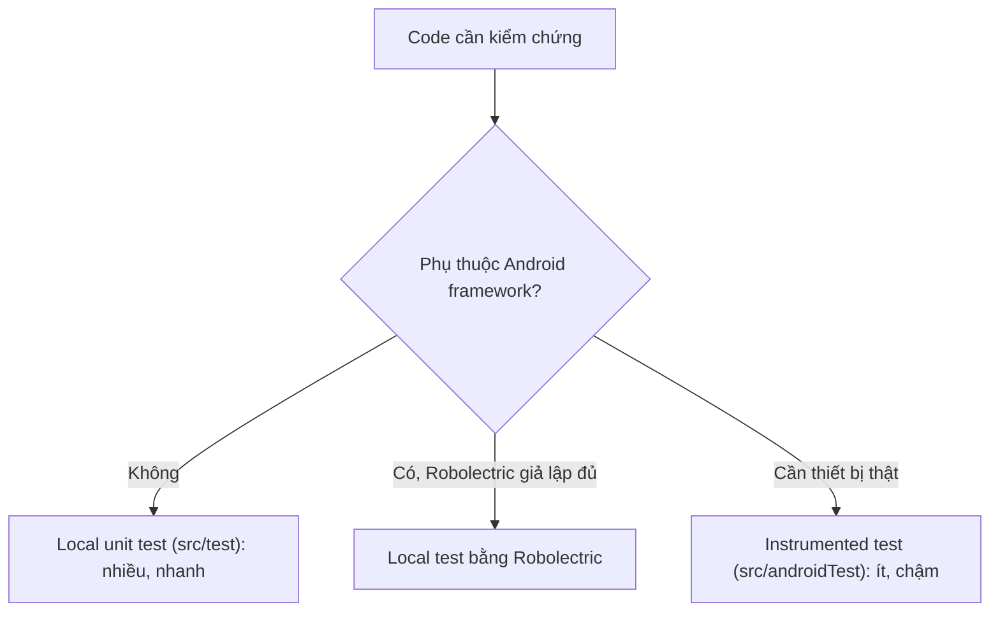
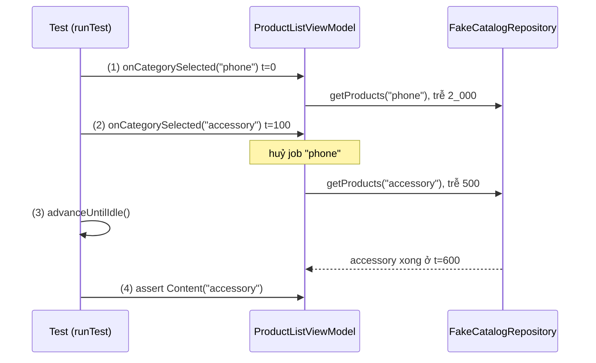
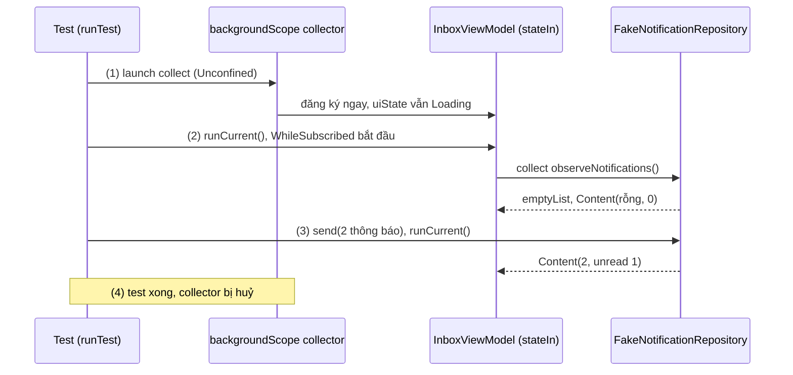
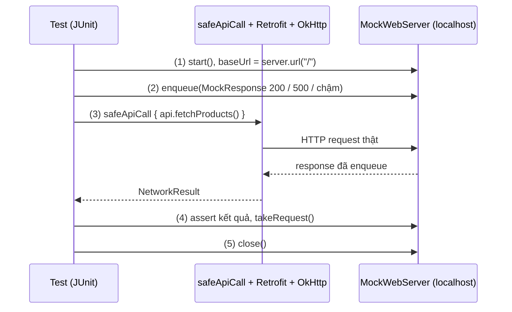
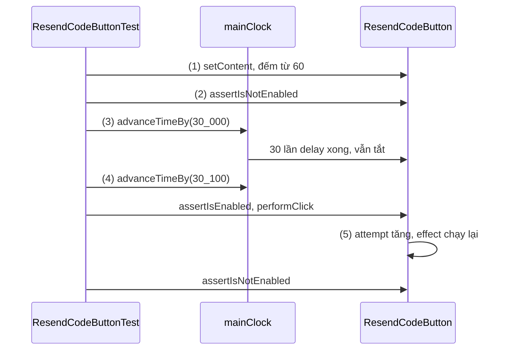

# Unit Testing

## Vấn đề cần giải quyết

Mỗi lần sửa code là một lần có thể làm hỏng thứ đang chạy đúng. Một tính năng có hàng chục tình huống (mất mạng, server trả 500, bấm hai lần, xoay màn hình), không ai bấm tay lại đủ mỗi lần merge. Test tự động chỉ giải quyết được việc này khi nó **bắt được bug thật** và **đủ nhanh để được chạy thường xuyên**. Hai kiểu test hay gặp không đạt điều đó. Kiểu thứ nhất xanh mãi nhưng vô nghĩa:

```kotlin
// ProductRepositoryTest.kt (cách làm có vấn đề): mock thẳng interface Retrofit
val api = mockk<ProductApiService>()
coEvery { api.fetchProducts() } returns listOf(ProductDto(101, "Bàn phím cơ", 150.0))
// Test chỉ kiểm tra mock trả đúng thứ vừa dặn.
```

Đoạn này bỏ qua toàn bộ tầng mạng (interceptor, parse JSON, mã lỗi HTTP, timeout): server đổi tên một trường JSON thì app crash, test vẫn xanh. Kiểu thứ hai chạm code thật nhưng phụ thuộc thứ test không kiểm soát:

```kotlin
// OrderViewModelTest.kt (cách làm có vấn đề): chờ bằng thời gian thật
viewModel.loadOrders()          // viewModelScope + Dispatchers.IO + server thật
Thread.sleep(3_000)             // hy vọng 3 giây là đủ
assertEquals(5, viewModel.uiState.value.orders.size)
```

Test này chậm, cần mạng và đúng 5 đơn trên server, đỏ ngẫu nhiên (flaky) khi server chậm; team dần quen bỏ qua.

Vấn đề cần giải quyết: **kiểm chứng tự động rằng code làm đúng việc của nó, bằng test nhanh, tất định (cùng input luôn cho cùng kết quả) và chạm đúng phần code có thể sai**.

## Sau khi học xong

- Phân biệt được local test với instrumented test và chọn được tầng test thấp nhất đủ thông tin.
- Triển khai được unit test JUnit 4 theo Arrange-Act-Assert, ưu tiên fake và chỉ dùng mock để kiểm tra tương tác.
- Áp dụng được runTest, TestDispatcher, MainDispatcherRule, backgroundScope và Turbine để test coroutine và StateFlow của ViewModel một cách tất định.
- Triển khai được test tầng mạng bằng MockWebServer cho response thành công, lỗi HTTP và timeout.
- Triển khai được Compose UI test bằng finder, action, assertion, mainClock và Espresso test cơ bản cho View.

## Unit Testing là gì?

**Unit test** là test tự động kiểm tra một đơn vị code (hàm, class) trong cô lập: dependency chậm hoặc không kiểm soát được (mạng, database, thời gian, thread) được thay bằng **test double**, nên test chạy nhanh trên JVM của máy dev và cho cùng kết quả mỗi lần chạy.

Mental model: mỗi test là **một thí nghiệm có kiểm soát**: cố định mọi biến số (dependency bằng fake, thời gian bằng đồng hồ ảo, server bằng MockWebServer, khung hình UI bằng `mainClock`), chỉ để lại đúng thứ đang xét. Càng ít biến số, test càng nhanh và chỉ rõ chỗ sai; càng giống môi trường thật, test càng bắt được lỗi tích hợp nhưng càng chậm. Test trên thiết bị và UI test dùng cùng ý tưởng, nên bài dạy cả chúng.

## Cách hoạt động

### Local test và instrumented test: test chạy ở đâu

Cách phân loại quan trọng nhất là **test chạy ở đâu**:

| | Local test | Instrumented test |
|---|---|---|
| Thư mục | `src/test/` | `src/androidTest/` |
| Chạy trên | JVM của máy dev hoặc CI | Thiết bị thật hoặc emulator |
| Android framework | Bản stub của `android.jar`, trừ khi dùng Robolectric | Đầy đủ |
| Tốc độ | Mili giây mỗi test | Phải build, cài APK test, khởi động process |
| Dùng cho | Logic, ViewModel, Repository, tầng mạng, UI test bằng Robolectric | DAO Room, UI test, tích hợp hệ thống |

Cách phân loại thứ hai là **kích thước** (phạm vi): **small test** (unit test) kiểm tra một hàm hoặc class, **medium test** kiểm tra tích hợp vài unit, **big test** (end-to-end) kiểm tra cả luồng người dùng. Hai cách độc lập nhau: test DAO nhỏ nhưng chạy trên thiết bị; UI test cả màn hình có thể chạy local bằng Robolectric.

Docs Android khuyên phân bố theo hình **kim tự tháp**: nhiều small test ở đáy, ít big test ở đỉnh, vì bug do unit test bắt thường sửa trong vài phút, còn để test end-to-end phát hiện có khi mất vài ngày. Quy tắc chọn: **dùng tầng thấp nhất cho đủ thông tin**.



Dependency khai báo theo source set (`testImplementation`, `androidTestImplementation`). Thư viện dùng trong bài (stable mới nhất lúc viết, 11/2026; dự án thật gom vào version catalog):

```kotlin
// app/build.gradle.kts
android {
    defaultConfig { testInstrumentationRunner = "androidx.test.runner.AndroidJUnitRunner" }
    testOptions { unitTests.isIncludeAndroidResources = true }   // Robolectric cần resource của app
}
dependencies {
    testImplementation("junit:junit:4.13.2")
    testImplementation("com.google.truth:truth:1.4.5")
    testImplementation("org.jetbrains.kotlinx:kotlinx-coroutines-test:1.11.0")
    testImplementation("app.cash.turbine:turbine:1.2.1")
    testImplementation("io.mockk:mockk:1.14.12")
    testImplementation("com.squareup.okhttp3:mockwebserver3:5.5.1")
    testImplementation("org.robolectric:robolectric:4.17")
    androidTestImplementation("androidx.test.ext:junit:1.3.0")
    androidTestImplementation("androidx.test.espresso:espresso-core:3.7.0")
    androidTestImplementation(platform("androidx.compose:compose-bom:2026.09.00"))
    androidTestImplementation("androidx.compose.ui:ui-test-junit4")
    debugImplementation("androidx.compose.ui:ui-test-manifest")   // Activity rỗng cho createComposeRule()
}
```

Chạy Compose UI test bằng Robolectric (`src/test`) thì khai báo BOM và `ui-test-junit4` cho cả `testImplementation`; dùng `runTest` trong `src/androidTest` thì thêm `kotlinx-coroutines-test` cho `androidTestImplementation`.

### JUnit 4: cấu trúc một test

JUnit 4 là test framework mặc định của AndroidX Test và Robolectric. Mỗi hàm `@Test` là một thí nghiệm độc lập: **JUnit tạo instance mới của class test cho mỗi hàm `@Test`**, nên property của class không bị chia sẻ giữa các test.

- `@Before` chạy trước mỗi test (dựng object cần test), `@After` chạy sau mỗi test kể cả khi test đỏ (đóng database, tắt server).
- **Rule** (`@get:Rule`; Kotlin cần `get:` để annotation gắn vào getter) gói logic `@Before`/`@After` thành object dùng lại được: `MainDispatcherRule`, `ActivityScenarioRule`, `createComposeRule()`.
- Tên test nói **tình huống và kết quả mong đợi**, thứ hiện ra khi test đỏ: `orderBelowMinimum_isRejected`. Tên có dấu cách trong backtick chạy được trong `src/test`, nhưng Android runtime chỉ hỗ trợ từ API 30, nên `src/androidTest` dùng gạch dưới.
- Thân test chia ba phần **Arrange-Act-Assert** (Given-When-Then): dựng điều kiện, thực hiện **một** hành động, kiểm tra kết quả.

Assertion: `org.junit.Assert` (`assertEquals(expected, actual)`) dễ đảo nhầm thứ tự tham số và thông báo lỗi nghèo. **Truth** (của Google, docs AndroidX Test dùng) viết `assertThat(actual).isEqualTo(expected)`, có assertion theo kiểu dữ liệu (`containsExactly(...).inOrder()`, `contains("...")`, `isInstanceOf(...)`) và khi đỏ in `expected: ...` / `but was: ...`. Bài dùng Truth.

### Test double: fake, stub, mock

ViewModel cần Repository, Repository cần API và DAO. Muốn test trong cô lập thì đưa vào một **test double**: object hành xử như dependency thật nhưng do test tạo, với hành vi biết trước. Điều kiện là dependency được truyền từ ngoài vào (constructor), tức là [Dependency Injection](../session_07/design_pattern/di/overview.md); hàm test đóng vai composition root.

Docs Android phân biệt:

| Loại | Là gì | Ví dụ |
|---|---|---|
| **Fake** | Bản cài đặt "chạy được" của interface, đơn giản hơn bản thật, không dùng cho production | Repository giữ dữ liệu trong `MutableList` |
| **Stub** | Trả giá trị lập trình sẵn, không kiểm tra tương tác | `every { api.getUser() } returns user` |
| **Mock** | Như stub, kèm kỳ vọng về tương tác; không khớp thì test đỏ | `logEvent` được gọi đúng một lần |

Ngoài ra có dummy (cho đủ tham số), spy (bọc object thật, nên tránh) và shadow (fake class Android của Robolectric). Docs khuyên **ưu tiên fake**: không cần mocking framework, test kiểm tra **kết quả** (state) thay vì **cách làm** (thứ tự lời gọi), nên vẫn xanh khi refactor bên trong. Fake đặt trong `src/test` (hoặc module `testing` dùng chung), không vào APK. Mock (Kotlin thường dùng MockK) chỉ đáng dùng khi điều cần kiểm chứng **chính là tương tác** không để lại state quan sát được: gửi analytics, gọi SDK bên thứ ba.

#### Ví dụ: áp mã giảm giá và ghi analytics

**Bài toán:** `CheckoutCalculator` tra mã giảm giá trong `CouponRepository`, kiểm tra đơn tối thiểu, tính tổng mới và ghi sự kiện `coupon_applied`. Tiền tính ra kiểm tra được qua giá trị trả về, nên Repository dùng fake; sự kiện analytics không trả gì về, nên dùng mock để `verify`.

**Luồng chạy:**

1. Test dựng `FakeCouponRepository` chứa mã `TET2026` (giảm 10%, đơn tối thiểu 200.000 đ) và mock `AnalyticsTracker`.
2. `applyCoupon` chuẩn hoá mã, tra trong fake; không thấy trả `Invalid`, chưa đủ tối thiểu trả `BelowMinimum`.
3. Mã hợp lệ: tính giảm giá, gọi `analytics.logEvent(...)`, trả `Applied`.
4. Test assert kết quả (state) và `verify` lời gọi analytics (tương tác).

**Code:**

```kotlin
// CheckoutCalculator.kt (src/main)
data class Coupon(val code: String, val percentOff: Int, val minOrderTotal: Long)
interface CouponRepository { fun findCoupon(code: String): Coupon? }
interface AnalyticsTracker { fun logEvent(name: String, params: Map<String, String>) }

sealed interface CouponResult {
    data object Invalid : CouponResult
    data class BelowMinimum(val minOrderTotal: Long) : CouponResult
    data class Applied(val total: Long, val discount: Long) : CouponResult
}

class CheckoutCalculator(private val coupons: CouponRepository, private val analytics: AnalyticsTracker) {
    fun applyCoupon(subtotal: Long, rawCode: String): CouponResult {
        val coupon = coupons.findCoupon(rawCode.trim().uppercase())      // (2)
            ?: return CouponResult.Invalid
        if (subtotal < coupon.minOrderTotal) return CouponResult.BelowMinimum(coupon.minOrderTotal)
        val discount = subtotal * coupon.percentOff / 100                // (3)
        analytics.logEvent("coupon_applied", mapOf("code" to coupon.code))
        return CouponResult.Applied(total = subtotal - discount, discount = discount)
    }
}
```

```kotlin
// CheckoutCalculatorTest.kt (src/test)
import com.google.common.truth.Truth.assertThat
import io.mockk.mockk
import io.mockk.verify
import org.junit.Test

class FakeCouponRepository(vararg coupons: Coupon) : CouponRepository {
    private val byCode = coupons.associateBy { it.code }
    override fun findCoupon(code: String) = byCode[code]
}

class CheckoutCalculatorTest {
    private val analytics = mockk<AnalyticsTracker>(relaxed = true)       // (1) relaxed: hàm Unit không cần khai báo
    private val calculator = CheckoutCalculator(
        FakeCouponRepository(Coupon("TET2026", percentOff = 10, minOrderTotal = 200_000)),
        analytics,
    )

    @Test
    fun validCoupon_appliesDiscount_andLogsEventOnce() {
        val result = calculator.applyCoupon(subtotal = 300_000, rawCode = " tet2026 ")

        assertThat(result).isEqualTo(CouponResult.Applied(total = 270_000, discount = 30_000)) // (4) state
        verify(exactly = 1) { analytics.logEvent("coupon_applied", mapOf("code" to "TET2026")) } // (4) tương tác
    }
}
```

**Kết quả:** `./gradlew testDebugUnitTest` chạy test trong vài mili giây. Quên `trim()` thì kết quả là `Invalid` và Truth báo `expected: Applied(...)` / `but was: Invalid`. Test cho đơn dưới tối thiểu kết thúc bằng `verify(exactly = 0) { analytics.logEvent(any(), any()) }`. Fake chỉ vài dòng, không có `every { ... }` nào phải giữ cho khớp cài đặt.

### Test coroutine: `runTest` và TestDispatcher

Hàm `@Test` không phải hàm `suspend`, nên cần coroutine builder dành cho test là `runTest` (`kotlinx-coroutines-test`). Nó chạy thân test trong một `TestScope` với **`TestDispatcher`**; mọi `TestDispatcher` của một test dùng chung một **`TestCoroutineScheduler`** giữ **thời gian ảo**: `delay(2_000)` không chờ 2 giây thật, scheduler nhảy đồng hồ khi không còn việc nào chạy trước được. Cơ chế dispatcher và `delay` ở [Coroutines](../session_08/async_threads/coroutines.md).

| | `StandardTestDispatcher` | `UnconfinedTestDispatcher` |
|---|---|---|
| Coroutine mới | Xếp hàng, chỉ chạy khi test nhường thread | Chạy ngay tới điểm suspend đầu tiên |
| Giống production | Có | Không: có thể che lỗi thứ tự, race condition |
| Dùng khi | Mặc định của `runTest`; test có đồng thời, thời gian | Collector cần đăng ký ngay, test đơn giản |

Với `StandardTestDispatcher`, test nhường thread bằng hàm của scheduler, gọi trực tiếp trong `runTest`:

- `advanceUntilIdle()`: chạy mọi việc đang chờ, nhảy thời gian ảo tới khi hàng đợi rỗng.
- `advanceTimeBy(ms)`: tiến đồng hồ thêm `ms`, chạy việc lên lịch **trước** thời điểm đó (việc đúng thời điểm đó chưa chạy).
- `runCurrent()`: chạy việc lên lịch tại thời điểm hiện tại, không tiến đồng hồ.

Để thời gian ảo áp dụng cho code thật:

1. **Thay `Dispatchers.Main`.** Local test không có main looper, nên `viewModelScope` ném `IllegalStateException: Module with the Main dispatcher had failed to initialize`. `Dispatchers.setMain(testDispatcher)` thay nó; `runTest` và mọi `TestDispatcher` tạo **sau** lời gọi này tự dùng chung scheduler của Main. Instrumented test có main thread thật, không cần thay.
2. **Inject dispatcher khác.** `withContext(Dispatchers.IO)` chạy trên thread pool thật, `delay` không còn được bỏ qua. Nhận `CoroutineDispatcher` qua constructor, trong test truyền `StandardTestDispatcher(testScheduler)`.

```kotlin
// MainDispatcherRule.kt (src/test, dùng chung cho mọi test ViewModel)
import kotlinx.coroutines.Dispatchers
import kotlinx.coroutines.ExperimentalCoroutinesApi
import kotlinx.coroutines.test.StandardTestDispatcher
import kotlinx.coroutines.test.TestDispatcher
import kotlinx.coroutines.test.resetMain
import kotlinx.coroutines.test.setMain
import org.junit.rules.TestWatcher
import org.junit.runner.Description

@OptIn(ExperimentalCoroutinesApi::class)
class MainDispatcherRule(
    val testDispatcher: TestDispatcher = StandardTestDispatcher(),
) : TestWatcher() {
    override fun starting(description: Description) = Dispatchers.setMain(testDispatcher)
    override fun finished(description: Description) = Dispatchers.resetMain()
}
```

Bản mẫu trong docs Android mặc định `UnconfinedTestDispatcher()`. Bản dùng chung của repo (test ở [MVVM](../session_07/architecture/mvvm.md) và Session 07 dựa vào nó) mặc định `StandardTestDispatcher()`: `launch` trong `viewModelScope` không chạy ngay, giống production, nên test phải chủ động `advanceUntilIdle()`/`runCurrent()`; cần chạy ngay thì truyền `MainDispatcherRule(UnconfinedTestDispatcher())`.

#### Ví dụ: đổi danh mục nhanh, kết quả cũ ghi đè kết quả mới

**Bài toán:** bấm chip "Điện thoại" rồi bấm ngay "Phụ kiện", màn hình hiện chip "Phụ kiện" nhưng danh sách là điện thoại. Bug chỉ xảy ra khi request đầu chậm hơn request sau, nên trên máy thật lúc có lúc không; fake có độ trễ ảo theo danh mục tái hiện nó ở **mọi lần chạy**.

**Luồng chạy:**

1. Fake trả "phone" sau 2.000 ms, "accessory" sau 500 ms. Test chọn "phone" ở t = 0.
2. Ở t = 100 ms, test chọn "accessory"; bản đúng huỷ job "phone" trước khi `launch` job mới.
3. `advanceUntilIdle()`: "accessory" xong ở t = 600 ms; job "phone" nếu còn sống sẽ xong ở t = 2.000 ms và ghi đè.
4. Test kiểm tra state cuối là "accessory".



**Code:**

```kotlin
// ProductListViewModel.kt (src/main)
sealed interface ProductListUiState {
    data object Loading : ProductListUiState
    data class Content(val category: String, val products: List<Product>) : ProductListUiState
}

class ProductListViewModel(private val repository: CatalogRepository) : ViewModel() {
    private val _uiState = MutableStateFlow<ProductListUiState>(ProductListUiState.Loading)
    val uiState: StateFlow<ProductListUiState> = _uiState.asStateFlow()
    private var loadJob: Job? = null

    fun onCategorySelected(category: String) {
        loadJob?.cancel()                                  // (2) bỏ request của chip cũ
        loadJob = viewModelScope.launch {
            _uiState.value = ProductListUiState.Loading
            _uiState.value = ProductListUiState.Content(category, repository.getProducts(category))
        }
    }
}
```

```kotlin
// ProductListViewModelTest.kt (src/test)
class FakeCatalogRepository(
    private val catalog: Map<String, List<Product>>,
    private val latencyMs: Map<String, Long>,
) : CatalogRepository {
    override suspend fun getProducts(category: String): List<Product> {
        delay(latencyMs.getValue(category))                // thời gian ảo
        return catalog.getValue(category)
    }
}

@OptIn(ExperimentalCoroutinesApi::class)
class ProductListViewModelTest {
    @get:Rule val mainDispatcherRule = MainDispatcherRule()
    private val phones = listOf(Product(1, "Điện thoại A", 7_990_000.0))
    private val accessories = listOf(Product(2, "Ốp lưng", 150_000.0))

    @Test
    fun switchingCategoryBeforeFirstLoadFinishes_showsLatestCategory() = runTest {
        val repository = FakeCatalogRepository(
            catalog = mapOf("phone" to phones, "accessory" to accessories),
            latencyMs = mapOf("phone" to 2_000L, "accessory" to 500L),
        )
        val viewModel = ProductListViewModel(repository)

        viewModel.onCategorySelected("phone")                                   // (1)
        advanceTimeBy(100)
        viewModel.onCategorySelected("accessory")                               // (2)
        advanceUntilIdle()                                                      // (3)

        assertThat(viewModel.uiState.value)                                     // (4)
            .isEqualTo(ProductListUiState.Content("accessory", accessories))
        assertThat(currentTime).isEqualTo(600)
    }
}
```

**Kết quả:** xoá `loadJob?.cancel()` thì Truth báo `expected: Content(category=accessory, ...)` / `but was: Content(category=phone, ...)` ở mọi lần chạy. Đây là **test chống lặp** (regression test): đỏ khi có bug, xanh sau khi sửa. Đổi sang `flatMapLatest` thì test không đổi, vì nó kiểm tra hành vi chứ không kiểm tra cách cài đặt.

### Test Flow và StateFlow trong ViewModel

Khi class cần test **nhận** Flow (ViewModel quan sát Repository), fake Repository giữ một `MutableStateFlow` để test đẩy giá trị vào ([Flow](../session_07/design_pattern/observer/flow.md)). Flow hữu hạn thì lấy giá trị bằng `first()` hoặc `toList()`. Flow không kết thúc (StateFlow, Flow của Room) thì `toList()` treo mãi: thu thập trong **`backgroundScope`** của `TestScope`, scope tự huỷ khi test xong; collect trong scope thường thì `runTest` chờ coroutine đó và test treo tới timeout.

Với `StateFlow`, docs khuyên assert trên `.value` tại từng thời điểm, vì StateFlow là conflated: giá trị đổi nhanh thì collector có thể chỉ thấy giá trị cuối. Bẫy hay gặp: `stateIn(viewModelScope, SharingStarted.WhileSubscribed(5_000), initial)` **chỉ chạy upstream khi có ít nhất một collector**, nên test chỉ đọc `.value` thì mãi thấy giá trị khởi tạo; cần mở collector rỗng trong `backgroundScope` với `UnconfinedTestDispatcher(testScheduler)` để nó đăng ký ngay.

Muốn kiểm tra **chuỗi** giá trị (Loading rồi Content), **Turbine** gói việc collect thành `flow.test { ... }`: `awaitItem()` treo tới giá trị tiếp theo, `awaitComplete()`/`awaitError()` chờ Flow kết thúc, `cancelAndIgnoreRemainingEvents()` bỏ phần còn lại; còn sự kiện chưa đọc khi hết khối thì test đỏ. Timeout mặc định của Turbine là 3 giây **thời gian thật**.

#### Ví dụ: hộp thư thông báo với số chưa đọc

**Bài toán:** màn thông báo hiện danh sách và số chưa đọc; ViewModel biến Flow của Repository thành `uiState` bằng `stateIn(WhileSubscribed)`. Test đẩy thông báo mới và phải thấy số chưa đọc tăng.

**Luồng chạy:**

1. Test mở collector rỗng trong `backgroundScope` (Unconfined nên đăng ký ngay). Coroutine chia sẻ của `stateIn` nằm trong hàng đợi của Main (`StandardTestDispatcher`), nên `uiState` vẫn là `Loading`.
2. `runCurrent()` chạy coroutine đó: thấy có subscriber, `WhileSubscribed` bắt đầu collect upstream; fake phát danh sách rỗng, `uiState` thành `Content(rỗng, 0)`.
3. Test `send(...)` hai thông báo, một chưa đọc, rồi `runCurrent()`: số chưa đọc là 1.
4. Hết test, `backgroundScope` tự huỷ collector.



**Code:**

```kotlin
// InboxViewModel.kt (src/main)
data class AppNotification(val id: String, val title: String, val isRead: Boolean)

sealed interface InboxUiState {
    data object Loading : InboxUiState
    data class Content(val notifications: List<AppNotification>, val unreadCount: Int) : InboxUiState
}

class InboxViewModel(repository: NotificationRepository) : ViewModel() {
    val uiState: StateFlow<InboxUiState> = repository.observeNotifications()
        .map { list -> InboxUiState.Content(list, unreadCount = list.count { !it.isRead }) }
        .stateIn(viewModelScope, SharingStarted.WhileSubscribed(5_000), InboxUiState.Loading)
}
```

```kotlin
// InboxViewModelTest.kt (src/test)
class FakeNotificationRepository : NotificationRepository {
    private val notifications = MutableStateFlow<List<AppNotification>>(emptyList())
    fun send(list: List<AppNotification>) { notifications.value = list }
    override fun observeNotifications(): Flow<List<AppNotification>> = notifications
}

@OptIn(ExperimentalCoroutinesApi::class)
class InboxViewModelTest {
    @get:Rule val mainDispatcherRule = MainDispatcherRule()
    private val shipped = AppNotification("n1", "Đơn DH-1001 đã giao", isRead = true)
    private val promo = AppNotification("n2", "Giảm 20% cuối tuần", isRead = false)

    @Test
    fun newUnreadNotification_increasesUnreadCount() = runTest {
        val repository = FakeNotificationRepository()
        val viewModel = InboxViewModel(repository)
        backgroundScope.launch(UnconfinedTestDispatcher(testScheduler)) { viewModel.uiState.collect() } // (1)
        assertThat(viewModel.uiState.value).isEqualTo(InboxUiState.Loading)

        runCurrent()                                                                 // (2)
        assertThat(viewModel.uiState.value).isEqualTo(InboxUiState.Content(emptyList(), 0))

        repository.send(listOf(shipped, promo))                                      // (3)
        runCurrent()
        assertThat((viewModel.uiState.value as InboxUiState.Content).unreadCount).isEqualTo(1)
    }                                                                                // (4)

    @Test
    fun uiState_emitsLoadingThenContent() = runTest {
        val repository = FakeNotificationRepository()
        val viewModel = InboxViewModel(repository)

        viewModel.uiState.test {                                                     // Turbine
            assertThat(awaitItem()).isEqualTo(InboxUiState.Loading)
            assertThat(awaitItem()).isEqualTo(InboxUiState.Content(emptyList(), 0))
            repository.send(listOf(promo))
            assertThat((awaitItem() as InboxUiState.Content).unreadCount).isEqualTo(1)
        }
    }
}
```

**Kết quả:** hai test xanh. Bỏ collector ở test đầu thì bước (2) đỏ vì `uiState` mãi là `Loading`; bỏ `runCurrent()` cũng đỏ, vì upstream còn trong hàng đợi. Ở test Turbine, `awaitItem()` treo test coroutine nên scheduler tự chạy upstream.

### Test tầng mạng với MockWebServer

Phần dễ sai của tầng mạng nằm giữa interface Retrofit và server: đường dẫn và query, header do interceptor gắn, converter parse JSON, cách Retrofit biến 4xx/5xx thành `HttpException`, timeout của OkHttp. Muốn kiểm tra phần đó thì không giả lập **code gọi API** mà giả lập **server**: `MockWebServer` (module của OkHttp) mở một **HTTP server thật trên localhost** trong JVM của test. Code app chạy thật từ đầu tới cuối, chỉ server do test điều khiển; vẫn là local test, không cần thiết bị hay mạng ngoài.

Một test đi qua năm bước:

1. Khởi động server, trỏ `baseUrl` của Retrofit vào `server.url("/")`.
2. `enqueue()` response (mã trạng thái, header, body, độ trễ), trả theo thứ tự enqueue.
3. Gọi code thật của app; request đi qua OkHttp như trên máy người dùng.
4. Kiểm tra kết quả, và nếu cần, **request app đã gửi** (`takeRequest()`).
5. Đóng server trong `@After`; mỗi test một server mới.



Hai artifact, chọn theo dòng OkHttp của app (MockWebServer kéo OkHttp vào classpath test, nên dùng cùng version):

| | `com.squareup.okhttp3:mockwebserver3` | `com.squareup.okhttp3:mockwebserver` |
|---|---|---|
| Package | `mockwebserver3` | `okhttp3.mockwebserver` |
| Dòng OkHttp | 5.x | 4.x (vẫn phát hành ở 5.x, là API cũ) |
| Tạo response | `MockResponse(code = 200, body = "...")`, `MockResponse.Builder().code(500).body("...").build()` | `MockResponse().setResponseCode(500).setBody("...")` |
| Đóng server | `close()` | `shutdown()` |
| Phụ thuộc JUnit 4 | Không | Có |

Code đầy đủ cho `safeApiCall` ở mục "Ví dụ thực tế".

### Test DAO Room với database in-memory

DAO là chỗ **không nên fake**: thứ cần kiểm chứng chính là câu SQL, và chỉ SQLite thật chạy được nó. `Room.inMemoryDatabaseBuilder` tạo database chỉ nằm trong RAM, nên mỗi test bắt đầu sạch. Docs Room khuyên test DAO trên thiết bị (`src/androidTest`); muốn chạy trên JVM thì dùng Room KMP với `BundledSQLiteDriver` (SQLite biên dịch kèm thư viện, cùng version trên máy dev và thiết bị), và **không khuyên** dùng Robolectric. Test DAO đầy đủ ở [Room Architecture](../session_05/data_store/room_architecture.md), mục "Kiểm thử DAO với In-Memory Database"; mẫu ngắn:

```kotlin
// CartDaoTest.kt (src/androidTest)
@RunWith(AndroidJUnit4::class)
class CartDaoTest {
    private lateinit var db: ShopDatabase
    private lateinit var cartDao: CartDao

    @Before
    fun createDb() {
        val context = ApplicationProvider.getApplicationContext<Context>()
        db = Room.inMemoryDatabaseBuilder<ShopDatabase>(context).build()
        cartDao = db.cartDao()
    }

    @After
    fun closeDb() = db.close()

    @Test
    fun itemCount_sumsQuantityOfAllRows() = runTest {
        cartDao.upsert(CartItemEntity(productId = 101, quantity = 2))
        cartDao.upsert(CartItemEntity(productId = 102, quantity = 1))

        // @Query("SELECT COALESCE(SUM(quantity), 0) FROM cart_items") fun observeItemCount(): Flow<Int>
        assertThat(cartDao.observeItemCount().first()).isEqualTo(3)
    }
}
```

### Robolectric: khi nào cần

Local test chạy với bản `android.jar` chỉ có chữ ký hàm: gọi `Intent.putExtra` trong `src/test` ném `RuntimeException: Method ... not mocked`. **Robolectric** (do Google duy trì) giả lập framework Android trong JVM, với fake cho class hệ thống gọi là **shadow**. Test viết bằng API AndroidX Test (`@RunWith(AndroidJUnit4::class)`, `ApplicationProvider`, `ActivityScenario`) chạy được cả trên Robolectric lẫn thiết bị.

- **Với unit test, Robolectric là phương án cuối**: code legacy, hoặc class buộc phải dùng API Android (như hàm dựng `Intent` chia sẻ sản phẩm). Kiến trúc tốt đưa logic ra khỏi framework nên không cần nó.
- **Với UI behavior test, Robolectric rất hợp**: Espresso và Compose test đặt trong `src/test` chạy bằng Robolectric, nhanh và ổn định hơn emulator; phần lớn app của Google dựa nhiều vào nó.
- **Không thay được thiết bị** với system UI (edge-to-edge, picture-in-picture), `WebView`, hay khi cần pixel chính xác.

### Instrumented test và Espresso cho View

Instrumented test chạy trên thiết bị qua `AndroidJUnitRunner` (`testInstrumentationRunner`); class test gắn `@RunWith(AndroidJUnit4::class)`, Activity mở bằng `ActivityScenarioRule` (khởi động trước mỗi test, đóng sau test). **Espresso** là API test UI cho View theo mẫu `onView(matcher).perform(action).check(assertion)`:

- Matcher: `withId(R.id.x)`, `withText("...")`, `isDisplayed()`, kết hợp bằng `allOf(...)`.
- Action: `click()`, `typeText("...")`, `replaceText("...")`, `closeSoftKeyboard()`, `scrollTo()`.
- Assertion: `matches(...)` với một matcher (`isDisplayed()`, `withText("...")`, `hasErrorText("...")`), `doesNotExist()`.

Espresso tự **đồng bộ** với main thread: trước mỗi action và assertion, nó chờ hàng đợi message của main looper rỗng. Việc ở thread khác (coroutine trên `Dispatchers.IO`, thread của OkHttp) thì Espresso không biết: đăng ký bằng `IdlingResource`, hoặc tốt hơn, thay bằng fake trả kết quả ngay. Tắt animation trên máy test (`testOptions { animationsDisabled = true }`) để tránh đỏ ngẫu nhiên.

#### Ví dụ: form đổi mật khẩu báo lỗi khi hai ô không khớp

**Bài toán:** màn đổi mật khẩu (View/XML) phải hiện lỗi "Mật khẩu không khớp" ở ô xác nhận khi bấm "Lưu" với hai ô khác nhau. Lỗi hiện qua `EditText.error`, phụ thuộc View thật, nên đây là việc của UI test.

**Luồng chạy:** (1) `ActivityScenarioRule` mở `ChangePasswordActivity`; (2) Espresso gõ hai mật khẩu khác nhau, đóng bàn phím; (3) bấm "Lưu", Activity gán `error` cho ô xác nhận; (4) Espresso chờ main thread rảnh rồi kiểm tra lỗi.

**Code:**

```kotlin
// ChangePasswordActivityTest.kt (src/androidTest)
// import androidx.test.espresso.Espresso.onView, androidx.test.espresso.action.ViewActions.*,
//        androidx.test.espresso.assertion.ViewAssertions.matches, androidx.test.espresso.matcher.ViewMatchers.*,
//        androidx.test.ext.junit.rules.ActivityScenarioRule, androidx.test.ext.junit.runners.AndroidJUnit4
@RunWith(AndroidJUnit4::class)
class ChangePasswordActivityTest {

    @get:Rule val activityRule = ActivityScenarioRule(ChangePasswordActivity::class.java)   // (1)

    @Test
    fun mismatchedPasswords_showErrorOnConfirmField() {
        onView(withId(R.id.new_password)).perform(typeText("Matkhau@2026"))                  // (2)
        onView(withId(R.id.confirm_password)).perform(typeText("Matkhau@2025"), closeSoftKeyboard())

        onView(withId(R.id.save_button)).perform(click())                                     // (3)

        onView(withId(R.id.confirm_password)).check(matches(hasErrorText("Mật khẩu không khớp"))) // (4)
    }
}
```

**Kết quả:** `./gradlew connectedDebugAndroidTest` cài app và APK test lên emulator, test xanh; chuyển sang `src/test` thì chạy bằng Robolectric. Màn hình có dependency do Hilt tạo thì thay binding theo [Hilt](../session_07/design_pattern/di/hilt.md), mục "Test UI đăng nhập với `AuthRepository` giả".

### Compose UI test

Compose không có cây View cho `onView` tìm. Test làm việc với **semantics tree**: cây song song với UI, mô tả ý nghĩa từng phần (text, vai trò button, trạng thái enabled, action như click). TalkBack cũng đọc cây này.

**Rule.** `createComposeRule()` cho `setContent { ... }` với một composable bất kỳ và state giả; `createAndroidComposeRule<MainActivity>()` mở Activity thật khi cần cả màn hình. Từ Compose UI 1.11 có bản **v2** trong package `androidx.compose.ui.test.junit4.v2`, bản v1 cùng tên trong `androidx.compose.ui.test.junit4` bị deprecated: v2 chạy composition trên `StandardTestDispatcher` (coroutine trong effect xếp hàng, giống `runTest`), v1 dùng `UnconfinedTestDispatcher`. Assertion và `waitForIdle()` đã chạy việc đang chờ, nên đa số test không phải sửa; test đọc state ngay sau hành động thì thêm `waitForIdle()` hoặc `runOnIdle { ... }`.

- **Finder**: `onNodeWithText`, `onNodeWithContentDescription`, `onNodeWithTag`, `onNode(matcher)`, `onAllNodes...`. Tag gắn bằng `Modifier.testTag("...")` (hằng số dùng chung giữa UI và test) cho node không có text ổn định như ô nhập, item danh sách; dùng text cho thứ người dùng thật sự thấy.
- **Action**: `performClick()`, `performTextInput("...")`, `performScrollTo()` (trong `Column` có `verticalScroll`), `performScrollToNode(matcher)` (gọi trên `LazyColumn`), `performTouchInput { swipeLeft() }`.
- **Assertion**: `assertIsDisplayed()`, `assertExists()`, `assertDoesNotExist()`, `assertTextEquals(...)`, `assertTextContains(...)`, `assertIsEnabled()`, `assertIsNotEnabled()`, `assertCountEquals(n)`.

**Merged và unmerged tree.** `Button`, hoặc `Row` có `Modifier.clickable`, gộp semantics của các `Text` con thành một node; finder mặc định tìm trên cây đã gộp, nên không thấy `Text` con có `testTag` riêng. Truyền `useUnmergedTree = true`; xem cây bằng `composeTestRule.onRoot().printToLog("CartTest")`:

```kotlin
// Row(Modifier.clickable { onOpen(item) }) { Text(item.name); Text(price, Modifier.testTag("cart_item_price")) }
composeTestRule.onNodeWithTag("cart_item_price", useUnmergedTree = true).assertTextEquals("250.000 đ")
```

**Đồng bộ và thời gian.** Mỗi action và assertion chờ UI **idle** trước (hết recomposition, layout, animation). Compose test chạy theo **`mainClock`** ảo, cùng ý tưởng với scheduler của `runTest`:

- Mặc định `mainClock.autoAdvance = true`: khi chờ idle, đồng hồ tự tiến từng frame tới khi hết animation và recomposition, nhưng **không** tự nhảy qua `delay` đang chờ trong effect.
- `mainClock.advanceTimeBy(ms)` tiến đồng hồ, chạy các `delay` và frame trong khoảng đó; `advanceTimeByFrame()` tiến một frame. Đặt `autoAdvance = false` để assert trạng thái giữa chừng của animation.
- Việc ngoài Compose (dữ liệu tải ở thread khác) thì chờ bằng `waitUntil(timeoutMillis) { điều kiện }` (mặc định 1.000 ms) hoặc họ hàm `waitUntilExactlyOneExists(matcher)`; `Thread.sleep` không tiến `mainClock`.

#### Ví dụ: đếm ngược "Gửi lại mã" bằng `mainClock`

**Bài toán:** `ResendCodeButton` ở [LaunchedEffect](../jetpack_compose_ui/side_effects/launched_effect.md), mục "Ví dụ: đếm ngược Gửi lại mã OTP", dùng `LaunchedEffect(attempt)` với vòng lặp `delay(1_000)` để khoá nút 60 giây; bấm gửi lại thì đếm lại. Test không chờ 60 giây thật mà tiến `mainClock` ảo.

**Luồng chạy:**

1. `setContent` dựng nút; `LaunchedEffect` bắt đầu đếm từ 60.
2. Nút hiện "Gửi lại mã sau 60 giây" và tắt.
3. `advanceTimeBy(30_000)`: 30 vòng `delay` xong, nút vẫn tắt.
4. `advanceTimeBy(30_100)`: đủ 60 giây (dư 100 ms vì effect bắt đầu sau frame đầu, và cần một frame để recompose), nút hiện "Gửi lại mã" và bật; bấm thì `onResend` được gọi.
5. Key `attempt` đổi nên effect chạy lại: nút lại hiện "sau 60 giây" và tắt.



**Code:**

```kotlin
// ResendCodeButtonTest.kt (src/androidTest, hoặc src/test để chạy bằng Robolectric)
import androidx.compose.ui.test.assertIsEnabled
import androidx.compose.ui.test.assertIsNotEnabled
import androidx.compose.ui.test.junit4.v2.createComposeRule   // v2, không phải androidx.compose.ui.test.junit4
import androidx.compose.ui.test.onNodeWithText
import androidx.compose.ui.test.performClick
import com.google.common.truth.Truth.assertThat
import org.junit.Rule
import org.junit.Test

class ResendCodeButtonTest {
    @get:Rule val composeTestRule = createComposeRule()

    @Test
    fun button_unlocksAfterSixtySeconds_andRestartsAfterResend() {
        var resendCount = 0
        composeTestRule.setContent { ResendCodeButton(onResend = { resendCount++ }) }        // (1)

        composeTestRule.onNodeWithText("Gửi lại mã sau 60 giây").assertIsNotEnabled()       // (2)

        composeTestRule.mainClock.advanceTimeBy(30_000)                                      // (3)
        composeTestRule.onNodeWithText("Gửi lại mã sau", substring = true).assertIsNotEnabled()

        composeTestRule.mainClock.advanceTimeBy(30_100)                                      // (4)
        composeTestRule.onNodeWithText("Gửi lại mã").assertIsEnabled().performClick()
        assertThat(resendCount).isEqualTo(1)

        composeTestRule.onNodeWithText("Gửi lại mã sau 60 giây").assertIsNotEnabled()       // (5)
    }
}
```

**Kết quả:** test mô phỏng hơn một phút nhưng chạy khoảng một giây. `onNodeWithText` mặc định so khớp **cả chuỗi**, nên `"Gửi lại mã"` không khớp nhầm `"Gửi lại mã sau 1 giây"`. Đổi key của `LaunchedEffect` thành `Unit` thì bước (5) đỏ vì đếm ngược không chạy lại.

### Chạy test bằng Gradle và đo coverage

| Lệnh | Chạy gì |
|---|---|
| `./gradlew testDebugUnitTest` | Mọi local test của variant debug, gồm test Robolectric |
| `./gradlew :app:testDebugUnitTest --tests "*.InboxViewModelTest"` | Một class hoặc nhóm test |
| `./gradlew connectedDebugAndroidTest` | Instrumented test trên mọi thiết bị/emulator đang kết nối |

Report HTML ở `app/build/reports/tests/testDebugUnitTest/` (local) và `app/build/reports/androidTests/connected/` (instrumented). Coverage bật bằng `enableUnitTestCoverage = true` / `enableAndroidTestCoverage = true` trong `buildTypes { debug { ... } }`; report JaCoCo sinh bằng `createDebugUnitTestCoverageReport` / `createDebugAndroidTestCoverageReport`. Coverage chỉ cho biết **đoạn nào chưa được test chạm tới**: test không có assertion vẫn tăng coverage.

## Ví dụ thực tế

Áp vào một tính năng mới như đăng nhập, bộ test xếp theo kim tự tháp: validator là unit test thuần; `LoginViewModel` dùng fake và `MainDispatcherRule` ([MVVM](../session_07/architecture/mvvm.md), mục "Ví dụ thực tế"); `AuthApi` là test MockWebServer cho 200, 401, timeout; hành vi form là Compose UI test chạy bằng Robolectric; chỉ luồng trọn vẹn với server staging chạy end-to-end trên thiết bị. Mỗi bug sửa xong (tìm ra bằng [10.1 Debugging](debugging.md) hoặc từ crash report ở [10.4](fit_bug_optimization.md)) thêm một test chống lặp. Phần dưới là bài toán MockWebServer đầy đủ.

### Test `safeApiCall` với MockWebServer

**Bài toán:** `safeApiCall` của [5.3 Networking](../session_05/networking.md) không ném exception mà trả `NetworkResult`: `Success` khi 2xx, `Error.Http` khi 4xx/5xx, `Error.NetworkTimeout` khi quá thời gian chờ. Test chứng minh điều đó với request thật đi qua OkHttp, và kiểm tra luôn request app đã gửi.

> [!NOTE]
> Kiến thức dùng trước: `safeApiCall`, `NetworkResult`, `ProductApiService` (`@GET("/api/v1/products")`) ở [5.3 Networking](../session_05/networking.md), mục "Chuẩn hóa Error Handling & Result Pattern trong Clean Architecture"; Retrofit ở [8.1.1](../session_08/networks/retrofit.md); timeout của OkHttp ở [8.1.3](../session_08/networks/okhttp.md).

**Luồng chạy:** đúng năm bước ở mục "Test tầng mạng với MockWebServer". Test timeout đặt `readTimeout` 1 giây và enqueue response có `headersDelay` 2 giây: OkHttp chờ header quá hạn, ném `SocketTimeoutException`, `safeApiCall` đổi thành `Error.NetworkTimeout`.

**Code:**

```kotlin
// ProductApiTest.kt (src/test)
import com.google.common.truth.Truth.assertThat
import java.util.concurrent.TimeUnit
import kotlinx.coroutines.test.runTest
import mockwebserver3.MockResponse
import mockwebserver3.MockWebServer
import okhttp3.OkHttpClient
import org.junit.After
import org.junit.Before
import org.junit.Test
import retrofit2.Retrofit
import retrofit2.converter.gson.GsonConverterFactory

class ProductApiTest {

    private val server = MockWebServer()
    private lateinit var api: ProductApiService

    @Before
    fun setUp() {
        server.start()                                                         // (1)
        val client = OkHttpClient.Builder()
            .readTimeout(1, TimeUnit.SECONDS)                                  // ngắn để test timeout nhanh
            .build()
        api = Retrofit.Builder()
            .baseUrl(server.url("/"))                                          // (1) trỏ vào localhost
            .client(client)
            .addConverterFactory(GsonConverterFactory.create())
            .build()
            .create(ProductApiService::class.java)
    }

    @After
    fun tearDown() = server.close()                                            // (5)

    @Test
    fun status200_returnsParsedList_andSendsExpectedRequest() = runTest {
        server.enqueue(                                                        // (2)
            MockResponse(code = 200, body = """[{"id":101,"name":"Bàn phím cơ","price":150.0}]""")
        )

        val result = safeApiCall { api.fetchProducts() }                       // (3)

        assertThat(result).isEqualTo(                                          // (4)
            NetworkResult.Success(listOf(ProductDto(101, "Bàn phím cơ", 150.0)))
        )
        val request = server.takeRequest()                                     // (4) request app đã gửi
        assertThat(request.method).isEqualTo("GET")
        assertThat(request.url.encodedPath).isEqualTo("/api/v1/products")
    }

    @Test
    fun status500_returnsHttpError() = runTest {
        server.enqueue(MockResponse.Builder().code(500).body("""{"error":"Database down"}""").build())

        val result = safeApiCall { api.fetchProducts() }

        assertThat(result).isInstanceOf(NetworkResult.Error.Http::class.java)
        val error = result as NetworkResult.Error.Http
        assertThat(error.code).isEqualTo(500)
        assertThat(error.errorBody).contains("Database down")
    }

    @Test
    fun slowServer_returnsNetworkTimeout() = runTest {
        server.enqueue(MockResponse.Builder().body("[]").headersDelay(2, TimeUnit.SECONDS).build())

        val result = safeApiCall { api.fetchProducts() }

        assertThat(result).isInstanceOf(NetworkResult.Error.NetworkTimeout::class.java)
    }
}
```

**Kết quả:** ba test xanh; test timeout mất khoảng 1 giây **thật**, vì socket timeout của OkHttp không theo đồng hồ ảo của `runTest`. Đổi `@GET` thành `"/api/v1/product"` thì test đầu đỏ ở assert đường dẫn; đổi tên trường `name` trong JSON thì đỏ ở assert kết quả. Cả hai lỗi đều lọt qua test mock interface. Với OkHttp 4.x, đổi sang package `okhttp3.mockwebserver` và cú pháp cũ trong bảng.

## Khi nào nên và không nên dùng

- **Unit test local** cho mọi logic có nhánh (tính tiền, kiểm tra input, reducer, ViewModel, Repository với fake): phần lớn bộ test.
- **MockWebServer** cho tầng mạng (Retrofit service, interceptor, `Authenticator`, phân loại lỗi); test ViewModel thì fake Repository là đủ.
- **Database in-memory** cho DAO; không dùng Room thật trong test ViewModel.
- **Robolectric** cho UI behavior test và code legacy buộc chạm class Android; không dùng để né việc tách logic khỏi framework.
- **Instrumented test** cho thứ cần thiết bị thật: SQLite của máy, quyền, system UI, `WebView`, luồng end-to-end quan trọng.
- **Mock** chỉ cho tương tác không để lại state quan sát được; không mock `data class` hay `List`.
- **Không cần test** code chỉ chuyển tiếp lời gọi, getter/setter, code sinh tự động.

## Sai lầm thường gặp

### 1. Mock thẳng interface Retrofit

**Lỗi lộ ra thế nào:** test xanh nhưng app crash khi server đổi JSON, trả 401 hay chậm; sửa sai đường dẫn API mà không test nào đỏ.

**Cách sửa:** MockWebServer cho request đi qua code thật, `takeRequest()` kiểm tra request đã gửi.

### 2. Dùng chung MockWebServer giữa các test

**Lỗi lộ ra thế nào:** test sau nhận response enqueue của test trước, kết quả đổi theo thứ tự chạy; `mockwebserver3.MockWebServer` đã `close()` thì không `start()` lại được.

**Cách sửa:** mỗi test một server (property của class), `start()` trong `@Before`, `close()` (API cũ: `shutdown()`) trong `@After`.

### 3. Chờ bằng `Thread.sleep` và dispatcher thật

**Lỗi lộ ra thế nào:** code cố định `withContext(Dispatchers.IO)`, test chờ bằng `Thread.sleep`: chậm, lúc xanh lúc đỏ tuỳ máy CI bận hay rảnh.

**Cách sửa:** inject `CoroutineDispatcher`, trong test truyền `StandardTestDispatcher(testScheduler)` và dùng `advanceUntilIdle()`. Mọi `TestDispatcher` của một test phải chung scheduler: tạo sau khi `MainDispatcherRule` đặt Main, hoặc truyền `testScheduler`.

### 4. Đọc `.value` của `stateIn(WhileSubscribed)` mà không có collector

**Lỗi lộ ra thế nào:** `uiState.value` mãi là `Loading` dù fake đã phát dữ liệu; developer tưởng ViewModel lỗi.

**Cách sửa:** mở collector rỗng trong `backgroundScope`, hoặc test bằng Turbine; với `StandardTestDispatcher` ở Main thì `runCurrent()` để upstream chạy (ví dụ hộp thư thông báo).

### 5. Test kiểm tra cách làm thay vì kết quả

**Lỗi lộ ra thế nào:** test mock Repository rồi `verifyOrder { getCart(); getCoupons() }`; gộp hai lời gọi thành một, hành vi không đổi, mà hàng loạt test đỏ, team quen sửa test cho khớp code.

**Cách sửa:** dùng fake và assert trên kết quả quan sát được (`uiState`, giá trị trả về, dữ liệu trong fake); chỉ `verify` tương tác không có kết quả quan sát được.

### 6. Tìm node trên cây đã gộp, hoặc dồn mọi thứ lên UI test

**Lỗi lộ ra thế nào:** `onNodeWithTag("cart_item_price")` báo `Expected exactly '1' node but could not find any` dù tag có trong code; hoặc quy tắc giảm giá được kiểm tra bằng cách bấm UI trên emulator, bộ test chậm hàng chục phút và đỏ ngẫu nhiên.

**Cách sửa:** `useUnmergedTree = true` (xem cây bằng `printToLog`); logic thì test ở tầng thấp nhất đủ thông tin, UI behavior test chuyển sang Robolectric.

## Lịch sử phát triển

- **2006, JUnit 4:** chuyển từ kế thừa `TestCase` sang annotation (`@Test`, `@Before`, `@After`).
- **2013, Espresso:** test UI tự đồng bộ với main thread, thay cho chờ bằng `sleep`.
- **2018, AndroidX Test:** Testing Support Library thành `androidx.test`; Robolectric 4.0 hỗ trợ cùng API, một test chạy được cả trên JVM lẫn thiết bị.
- **07/2021, Compose 1.0:** ra mắt cùng `ui-test-junit4` (`createComposeRule`, semantics tree, `mainClock`).
- **12/2021, kotlinx-coroutines-test 1.6.0:** `runTest`, `StandardTestDispatcher`, `UnconfinedTestDispatcher` thay `runBlockingTest` và `TestCoroutineDispatcher`.
- **02/07/2025, OkHttp 5.0.0 stable:** `mockwebserver3` (package mới, không phụ thuộc JUnit 4, có từ các bản alpha 5.x) thành lựa chọn chính; `okhttp3.mockwebserver` vẫn phát hành.
- **14/01/2026, Compose UI 1.11.0-alpha03:** thêm API test v2 dùng `StandardTestDispatcher`; v1 bị deprecated nhưng giữ `UnconfinedTestDispatcher` để không vỡ test cũ. Stable 1.11.0 ra 22/04/2026.

## Kết nối hệ thống

- **Tiên quyết:** [ViewModel](../session_06/viewmodel.md), [Coroutines](../session_08/async_threads/coroutines.md), [Flow](../session_07/design_pattern/observer/flow.md), [Dependency Injection Overview](../session_07/design_pattern/di/overview.md).
- **Liên quan:** [5.3 Networking](../session_05/networking.md), [8.1.1 Retrofit](../session_08/networks/retrofit.md), [8.1.3 OkHttp](../session_08/networks/okhttp.md); [Room Architecture](../session_05/data_store/room_architecture.md), [Async Transactions & Flow](../session_05/data_store/room_transactions.md) (test DAO, Flow của Room); [MVVM](../session_07/architecture/mvvm.md), [Hilt](../session_07/design_pattern/di/hilt.md) (thay binding trong instrumented test); [LaunchedEffect](../jetpack_compose_ui/side_effects/launched_effect.md), [Remember and rememberSaveable](../jetpack_compose_ui/state/remember_saveable.md).
- **Trong Session 10:** [Tổng quan](index.md); [10.1 Debugging](debugging.md) tìm ra bug, bài này khoá nó bằng test chống lặp; [10.3 Lint](lint.md) bắt lỗi không cần chạy code; [10.4 Fit / Bug Optimization](fit_bug_optimization.md) đưa bug từ production về và đo hiệu năng.
- **Học tiếp:** 11.4 Github CI (chưa có bài): chạy `testDebugUnitTest` và instrumented test tự động trước mỗi lần merge.

## Tham khảo

- [Fundamentals of testing Android apps](https://developer.android.com/training/testing/fundamentals)
- [Testing strategies](https://developer.android.com/training/testing/fundamentals/strategies)
- [Use test doubles in Android](https://developer.android.com/training/testing/fundamentals/test-doubles)
- [Testing Kotlin coroutines on Android](https://developer.android.com/kotlin/coroutines/test)
- [Testing Kotlin flows on Android](https://developer.android.com/kotlin/flow/test)
- [Turbine README](https://github.com/cashapp/turbine)
- [MockWebServer README](https://github.com/square/okhttp/blob/master/mockwebserver/README.md)
- [OkHttp CHANGELOG (5.0.0, mockwebserver3)](https://github.com/square/okhttp/blob/master/CHANGELOG.md)
- [Test and debug your Room database](https://developer.android.com/training/data-storage/room/testing-db)
- [Robolectric strategies](https://developer.android.com/training/testing/local-tests/robolectric)
- [Espresso](https://developer.android.com/training/testing/espresso)
- [Test your Compose layout](https://developer.android.com/develop/ui/compose/testing)
- [Compose testing APIs](https://developer.android.com/develop/ui/compose/testing/apis)
- [Compose testing synchronization](https://developer.android.com/develop/ui/compose/testing/synchronization)
- [Migrate to v2 testing APIs (Compose)](https://developer.android.com/develop/ui/compose/testing/migrate-v2)
- [Compose UI release notes](https://developer.android.com/jetpack/androidx/releases/compose-ui)
- [View code coverage reports](https://developer.android.com/studio/test/coverage-report)
- [Kotlin coding conventions: tên hàm test](https://kotlinlang.org/docs/coding-conventions.html#names-for-test-methods)
