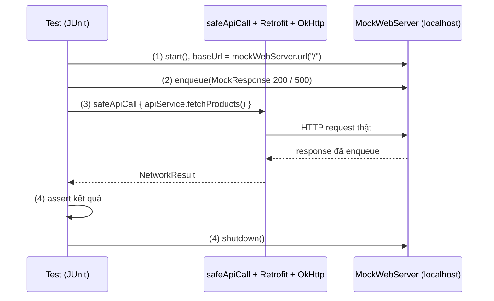

# Unit Testing

> [!NOTE]
> Bản nháp: phần dưới đây là kiến thức chuyển từ [5.3 Networking](../session_05/networking.md), nơi nó từng được dạy trước. Phần còn thiếu của Topic (JUnit, test ViewModel và coroutine, fake và mock, test các tầng khác) sẽ viết khi làm Session 10.

## Vấn đề cần giải quyết

Một sai lầm phổ biến khi viết Unit Test cho tầng Data là **dùng Mockito để mock trực tiếp Retrofit Interface**:
```kotlin
// KIỂU TEST VÔ NGHĨA:
val mockApi = mock(ProductApiService::class.java)
`when`(mockApi.fetchProducts()).thenReturn(listOf(...))
```
Cách test trên hoàn toàn vô nghĩa vì nó **bỏ qua 100% logic của tầng mạng**: không test được Interceptor, không test được logic parse JSON của Moshi/Serialization, không test được mã lỗi HTTP (401, 500) và không test được lỗi Timeout!

## Sau khi học xong

- Giải thích được vì sao mock interface Retrofit không kiểm tra được tầng mạng.
- Áp dụng được MockWebServer để trả response giả lập (thành công, lỗi HTTP) cho request thật từ OkHttp.
- Triển khai được test cho safeApiCall với cả trường hợp thành công và lỗi server.

## Unit Testing là gì?

**Unit test** là test tự động chạy trên JVM của máy phát triển, kiểm tra một đơn vị code (hàm, class) tách khỏi thiết bị và các phụ thuộc chậm hoặc không ổn định như network thật.

Mental model cho tầng mạng: thay vì giả lập code gọi API, test **giả lập server**. Code của app vẫn chạy thật từ đầu tới cuối, chỉ có đầu bên kia là server do test điều khiển.

## Cách hoạt động

### MockWebServer

`MockWebServer` khởi tạo một HTTP Server thật sự chạy trên cổng cục bộ (localhost) trong JVM test. Nó nhận HTTP request thật từ OkHttp và trả về response thật.

Một test đi qua 4 bước:

1. Khởi động `MockWebServer` và trỏ `baseUrl` của Retrofit vào `mockWebServer.url("/")`.
2. `enqueue()` response mà server sẽ trả cho request tiếp theo (mã trạng thái, body).
3. Gọi code thật của app; request đi qua OkHttp, interceptor, converter như khi chạy trên máy thật.
4. Kiểm tra kết quả (`NetworkResult.Success`, `NetworkResult.Error.Http`...), rồi `shutdown()` server.



## Ví dụ thực tế: test safeApiCall với MockWebServer

> [!NOTE]
> Kiến thức dùng trước: `safeApiCall`, `NetworkResult` và `ProductApiService` ở [5.3 Networking](../session_05/networking.md), mục "Chuẩn hóa Error Handling & Result Pattern trong Clean Architecture" và mục "Ví dụ thực tế"; Retrofit ở mục [8.1.1 Retrofit](../session_08/networks/retrofit.md).

```kotlin
import kotlinx.coroutines.runBlocking
import okhttp3.OkHttpClient
import okhttp3.mockwebserver.MockResponse
import okhttp3.mockwebserver.MockWebServer
import org.junit.After
import org.junit.Assert.assertEquals
import org.junit.Assert.assertTrue
import org.junit.Before
import org.junit.Test
import retrofit2.Retrofit
import retrofit2.converter.gson.GsonConverterFactory
import java.util.concurrent.TimeUnit

class NetworkIntegrationTest {

    private lateinit var mockWebServer: MockWebServer
    private lateinit var apiService: ProductApiService

    @Before
    fun setup() {
        mockWebServer = MockWebServer()
        mockWebServer.start()

        val okHttpClient = OkHttpClient.Builder()
            .connectTimeout(1, TimeUnit.SECONDS)
            .readTimeout(1, TimeUnit.SECONDS)
            .build()

        val retrofit = Retrofit.Builder()
            .baseUrl(mockWebServer.url("/")) // Trỏ tới localhost của mock server
            .client(okHttpClient)
            .addConverterFactory(GsonConverterFactory.create())
            .build()

        apiService = retrofit.create(ProductApiService::class.java)
    }

    @After
    fun tearDown() {
        mockWebServer.shutdown()
    }

    @Test
    fun fetchProducts_success_returns_parsed_list() = runBlocking {
        // 1. Giả lập Server trả về JSON hợp lệ với mã 200 OK
        val mockJson = """
            [
                {"id": 101, "name": "Bàn phím cơ", "price": 150.0},
                {"id": 102, "name": "Chuột Gaming", "price": 75.0}
            ]
        """.trimIndent()
        
        mockWebServer.enqueue(
            MockResponse()
                .setResponseCode(200)
                .setBody(mockJson)
        )

        // 2. Thực thi hàm gọi API
        val result = safeApiCall { apiService.fetchProducts() }

        // 3. Kiểm chứng
        assertTrue(result is NetworkResult.Success)
        val data = (result as NetworkResult.Success).data
        assertEquals(2, data.size)
        assertEquals("Bàn phím cơ", data[0].name)
    }

    @Test
    fun fetchProducts_serverError_returns_httpError() = runBlocking {
        // Giả lập Server trả về lỗi 500 Internal Server Error
        mockWebServer.enqueue(
            MockResponse()
                .setResponseCode(500)
                .setBody("""{"error": "Database down"}""")
        )

        val result = safeApiCall { apiService.fetchProducts() }

        assertTrue(result is NetworkResult.Error.Http)
        val httpError = result as NetworkResult.Error.Http
        assertEquals(500, httpError.code)
    }
}
```

> [!NOTE]
> Ví dụ dùng package `okhttp3.mockwebserver` (artifact `com.squareup.okhttp3:mockwebserver`). Từ OkHttp 5.0.0, module chính là `mockwebserver3` (`com.squareup.okhttp3:mockwebserver3`, không phụ thuộc JUnit); artifact cũ bị ghi là "Obsolete" nhưng vẫn được phát hành, nên chưa cần chuyển gấp.

## Sai lầm thường gặp

### 1. Mock thẳng interface Retrofit

**Triệu chứng:**
- Test luôn xanh nhưng app vẫn crash khi server trả JSON khác hoặc trả lỗi.

**Nguyên nhân:**
- Mock bỏ qua toàn bộ tầng mạng: interceptor, parse JSON, mã lỗi HTTP, timeout.

**Giải pháp:**
- Dùng MockWebServer để request đi qua đúng code thật.

### 2. Không shutdown server sau mỗi test

**Triệu chứng:**
- Test sau nhận response của test trước, hoặc lỗi cổng đang bị dùng.

**Nguyên nhân:**
- Server và hàng đợi response còn sống giữa các test.

**Giải pháp:**
- Tạo server mới trong `@Before`, gọi `shutdown()` trong `@After`, như ví dụ ở trên.

## Lịch sử phát triển

- MockWebServer là một module của OkHttp do Square phát triển.
- **02/07/2025:** OkHttp 5.0.0 tách `mockwebserver3` thành module chính không phụ thuộc JUnit; `okhttp3.mockwebserver` cũ vẫn được phát hành.

## Kết nối hệ thống

- **5.3 Networking:** test ở đây kiểm tra `safeApiCall` và phân loại lỗi của bài đó. Xem [5.3 Networking](../session_05/networking.md).
- **8.1.3 OkHttp:** MockWebServer nhận request thật từ OkHttp, nên interceptor và `Authenticator` cũng được kiểm tra. Xem [OkHttp](../session_08/networks/okhttp.md).

## Nguồn tham khảo

- [MockWebServer README](https://github.com/square/okhttp/blob/master/mockwebserver/README.md)
- [OkHttp CHANGELOG (5.0.0, mockwebserver3)](https://github.com/square/okhttp/blob/master/CHANGELOG.md)
