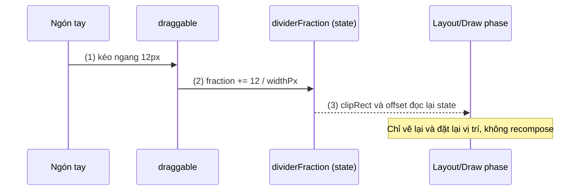
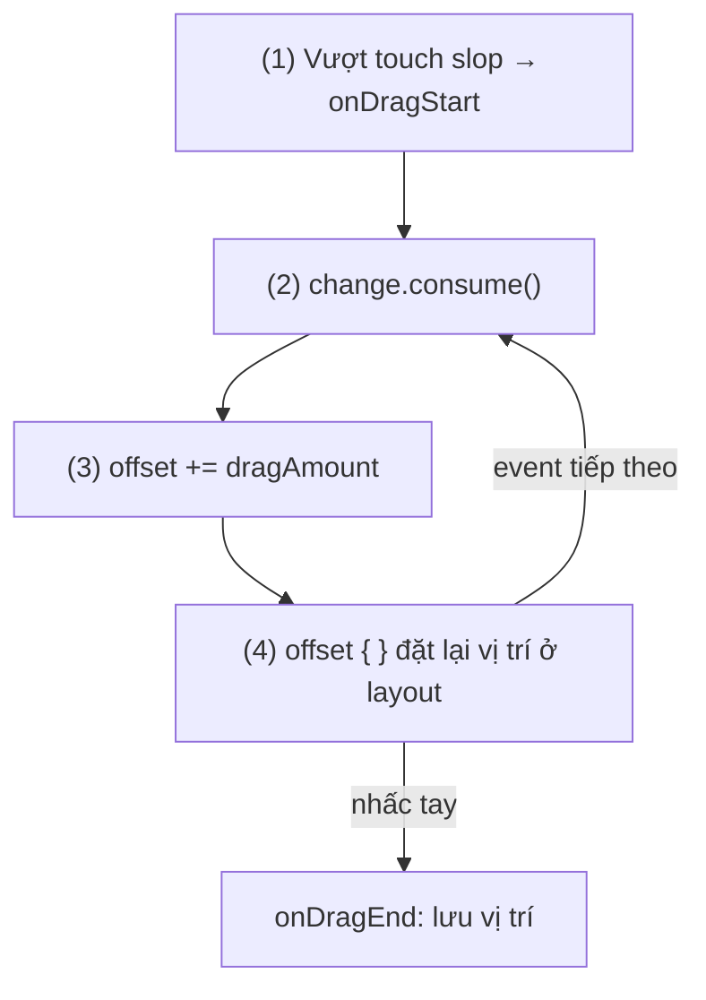
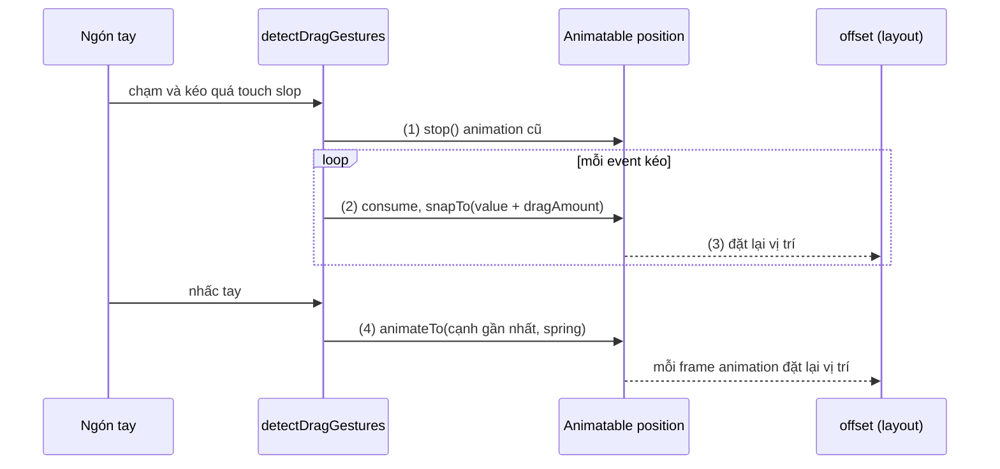

# Dragging

## Vấn đề cần giải quyết

Nhiều UI cần phần tử **đi theo ngón tay**: thanh so sánh ảnh trước/sau, nhãn dán trên ảnh, bong bóng chat nổi, sắp xếp lại danh sách. Tự đọc pointer event thô thì phải tự lo touch slop (phân biệt chạm với kéo), nhiều ngón tay, huỷ gesture.

Cách viết đầu tiên thường gặp chạy được nhưng sai:

```kotlin
// SAI: kéo được, nhưng recompose ở mỗi pixel và vùng chạm không đi theo phần tử
var offsetX by remember { mutableFloatStateOf(0f) }
Box(
    Modifier
        .draggable(rememberDraggableState { offsetX += it }, Orientation.Horizontal)
        .offset(x = with(LocalDensity.current) { offsetX.toDp() })
        .size(48.dp)
)
```

Vấn đề cần giải quyết: nhận được quãng đường kéo một cách đúng chuẩn, lưu vào state, và dịch phần tử theo state đó **rẻ nhất có thể** để kéo mượt 60–120 fps.

## Sau khi học xong

- Giải thích được vì sao draggable và detectDragGestures chỉ báo delta mà không tự di chuyển phần tử, và vai trò của touch slop.
- Phân biệt được Modifier.draggable (một trục, có nested scroll và fling velocity) với detectDragGestures và draggable2D (hai trục).
- Áp dụng được Modifier.offset { } để dịch phần tử theo state ở layout phase, không recompose mỗi frame kéo.
- Triển khai được phần tử kéo tự do rồi hút về vị trí đích khi thả tay bằng Animatable, có consume để cha không phản ứng cùng.

## Dragging là gì?

**Dragging** là gesture đặt một ngón tay xuống, di chuyển vượt **touch slop** (khoảng cách tối thiểu để hệ thống coi là kéo chứ không phải chạm) rồi tiếp tục di chuyển; Compose báo cho bạn **từng delta vị trí**, còn việc lưu offset trong state và dịch phần tử theo offset là việc của bạn.

Mental model: API kéo là **đồng hồ đo quãng đường**, không phải động cơ. Nó chỉ báo "ngón tay vừa đi thêm 12 px sang phải"; phần tử đứng yên cho tới khi bạn cộng 12 px vào state và đọc state đó trong `offset`.

Cùng tinh thần với `Modifier.scrollable`: gesture modifier đo, state giữ, layout hiển thị. Ba tầng xử lý gesture, hit-testing và consume được giải thích ở [9.8.1 Scrolling](scrolling.md), mục "Tổng quan gesture".

## Cách hoạt động

### 1. Modifier.draggable: kéo theo một trục

`Modifier.draggable(state, orientation)` là gesture modifier cho kéo **một trục** (ngang hoặc dọc). State tạo bằng `rememberDraggableState { delta -> }`, lambda nhận delta `Float` theo pixel (sang phải/xuống là dương) và không trả gì, khác `scrollable` vốn phải trả phần đã tiêu. Các tham số đáng biết:

- `onDragStarted: suspend CoroutineScope.(startedPosition: Offset) -> Unit` và `onDragStopped: suspend CoroutineScope.(velocity: Float) -> Unit`: chạy trong coroutine nên gọi animation ngay được; `velocity` là vận tốc lúc thả (px/s).
- `enabled`, `reverseDirection`, `interactionSource` (biết đang kéo để đổi màu tay nắm), `startDragImmediately` (không đợi touch slop, để "bắt" phần tử đang chạy animation).

`draggable` tự xử lý touch slop, tự consume và chỉ báo thành phần theo `orientation`, nên đặt trong danh sách cuộn khác hướng vẫn đúng.

#### Ví dụ: thanh trượt so sánh ảnh trước và sau khi chỉnh

**Bài toán:** app chỉnh ảnh hiển thị ảnh gốc và ảnh đã chỉnh chồng lên nhau, với một đường chia dọc. Kéo đường chia sang trái/phải để xem nhiều hơn bên nào. Chỉ cần trục ngang, nên `draggable` là đủ.

**Luồng chạy:**

1. `draggable(Orientation.Horizontal)` nhận cú kéo ngang trên toàn khung ảnh.
2. Lambda của `rememberDraggableState` đổi delta px thành tỉ lệ `0..1` của chiều rộng và lưu vào `dividerFraction`.
3. Ảnh gốc chỉ vẽ phần bên trái đường chia nhờ `drawWithContent` + `clipRect`; đường chia dịch bằng `offset { }`. Cả hai đọc `dividerFraction` trong lambda chạy ở draw/layout phase, nên kéo không gây recomposition.



```kotlin
// BeforeAfterSlider.kt
@Composable
fun BeforeAfterSlider(
    before: Painter,
    after: Painter,
    modifier: Modifier = Modifier,
) {
    var widthPx by remember { mutableIntStateOf(0) }
    var dividerFraction by remember { mutableFloatStateOf(0.5f) }
    val dragState = rememberDraggableState { delta ->                        // (2)
        if (widthPx > 0) {
            dividerFraction = (dividerFraction + delta / widthPx).coerceIn(0f, 1f)
        }
    }

    Box(
        modifier = modifier
            .aspectRatio(4f / 3f)
            .onSizeChanged { widthPx = it.width }
            .draggable(dragState, Orientation.Horizontal),                    // (1)
    ) {
        Image(after, "Ảnh sau khi chỉnh", Modifier.fillMaxSize(), contentScale = ContentScale.Crop)
        Image(
            painter = before,
            contentDescription = "Ảnh gốc",
            contentScale = ContentScale.Crop,
            modifier = Modifier
                .fillMaxSize()
                .drawWithContent {                                            // (3) draw phase
                    clipRect(right = size.width * dividerFraction) {
                        this@drawWithContent.drawContent()
                    }
                },
        )
        Box(
            Modifier
                .offset { IntOffset((widthPx * dividerFraction).roundToInt(), 0) } // (3) layout phase
                .width(3.dp)
                .fillMaxHeight()
                .background(Color.White),
        )
    }
}
```

**Kết quả:** kéo bất kỳ đâu trên ảnh, đường chia đi theo ngón tay và dừng ở hai mép. Layout Inspector (recomposition counts) cho thấy `BeforeAfterSlider` không recompose trong lúc kéo. `drawWithContent` được học ở [9.7.1 Surface and Canvas](../graphics_animations/surface_and_canvas.md). Vì đây là gesture tự định nghĩa, app thật nên thêm semantics (ví dụ hành động `setProgress`) để TalkBack dùng được.

### 2. detectDragGestures: kéo hai trục và kiểm soát cả gesture

Khi phần tử phải đi theo ngón tay **cả hai trục**, dùng `pointerInput` với `detectDragGestures`:

```kotlin
// Chữ ký thường dùng (rút gọn)
suspend fun PointerInputScope.detectDragGestures(
    onDragStart: (Offset) -> Unit = {},
    onDragEnd: () -> Unit = {},
    onDragCancel: () -> Unit = {},
    onDrag: (change: PointerInputChange, dragAmount: Offset) -> Unit,
)
```

- `dragAmount` là delta `Offset` (x, y) kể từ event trước.
- `change` là `PointerInputChange` của event; gọi `change.consume()` để báo các handler khác (ví dụ danh sách cha) rằng chuyển động này đã có chủ. Không consume thì cha cuộn có thể cùng phản ứng.
- `onDragEnd` khi nhấc tay bình thường, `onDragCancel` khi gesture bị huỷ (ví dụ một handler khác consume trước).
- Biến thể: `detectHorizontalDragGestures`, `detectVerticalDragGestures`, và `detectDragGesturesAfterLongPress` (chỉ bắt đầu kéo sau khi nhấn giữ; dùng cho sắp xếp lại item trong danh sách dọc để không giành cú kéo với cuộn).

Một detector chiếm trọn khối `pointerInput` (nó chạy vòng lặp tới khi bị huỷ), nên muốn vừa tap vừa kéo thì dùng hai `pointerInput` riêng.

Các bản Compose từ khoảng foundation 1.7 có thêm `Modifier.draggable2D` + `rememberDraggable2DState { delta: Offset -> }`: tầng modifier cho kéo hai trục, gọn hơn `pointerInput` khi bạn không cần `onDragCancel` hay đọc `change`. Bài dùng `detectDragGestures` vì nó có mặt ở mọi bản và cho thấy rõ consume.

### 3. Đặt offset ở layout phase

`Modifier.offset` có hai dạng, và chọn sai là lỗi hiệu năng phổ biến nhất của gesture kéo:

| Dạng | State được đọc ở | Mỗi pixel kéo gây ra |
|---|---|---|
| `offset(x: Dp, y: Dp)` | Composition (thân composable) | Recompose scope + layout + draw |
| `offset { IntOffset }` | Layout phase (trong lambda) | Chỉ đặt lại vị trí + draw |

Đây là quy tắc "state đọc ở phase nào thì chạy lại từ phase đó" của [ba phase một frame](../overview.md). Cùng lý do, `graphicsLayer { translationX = ... }` (đọc ở draw phase) cũng là lựa chọn tốt khi chỉ cần dịch hình mà không cần vị trí layout đổi; xem [9.8.4 Zooming](zooming.md).

Thứ tự modifier cũng quan trọng: đặt `offset { }` **trước** `pointerInput`/`draggable` trong chuỗi để vùng nhận chạm đi theo phần tử. Đặt ngược lại thì phần tử hiển thị đã dời đi nhưng vùng chạm vẫn ở chỗ cũ ([9.5.1 Thứ tự Modifier](../modifier/modifier_order.md)).

#### Ví dụ: nhãn dán kéo tự do trên ảnh

**Bài toán:** màn chỉnh ảnh cho phép thả nhãn dán (sticker) lên ảnh rồi kéo tới vị trí bất kỳ. Cần hai trục, và cú kéo trên sticker không được làm màn hình cuộn.

**Luồng chạy:**

1. `detectDragGestures` chờ ngón tay vượt touch slop rồi gọi `onDragStart`.
2. Mỗi event di chuyển: `change.consume()` để cha không dùng chuyển động này.
3. Cộng `dragAmount` vào `offset` (state `Offset`).
4. `Modifier.offset { offset.round() }` đọc state ở layout phase; vì nó đứng trước `pointerInput`, vùng chạm đi cùng sticker.



```kotlin
// DraggableSticker.kt
@Composable
fun DraggableSticker(
    sticker: Painter,
    onPositionCommitted: (Offset) -> Unit,
    modifier: Modifier = Modifier,
) {
    var offset by remember { mutableStateOf(Offset.Zero) }
    Image(
        painter = sticker,
        contentDescription = "Nhãn dán",
        modifier = modifier
            .offset { offset.round() }                                // (4) trước pointerInput
            .size(96.dp)
            .pointerInput(onPositionCommitted) {
                detectDragGestures(
                    onDragStart = { /* (1) ví dụ: phóng to nhẹ sticker */ },
                    onDragEnd = { onPositionCommitted(offset) },
                ) { change, dragAmount ->
                    change.consume()                                  // (2)
                    offset += dragAmount                              // (3)
                }
            },
    )
}
```

**Kết quả:** kéo sticker theo mọi hướng, sticker bám ngón tay; thả tay thì `onPositionCommitted` nhận vị trí cuối để lưu vào ViewModel. Đặt sticker trong một `Column(Modifier.verticalScroll(...))`: kéo sticker không làm màn hình cuộn. Xoá `change.consume()` thì kéo dọc trên sticker có thể khiến cả hai cùng chạy.

### 4. Thả tay: animate về vị trí đích bằng Animatable

Thả tay thường không dừng ngay chỗ ngón tay: bong bóng chat hút vào cạnh, item kéo quá xa quay về chỗ cũ. Lúc đó offset do một **animation** quyết định. `Animatable` hợp nhất hai nguồn (ngón tay và animation) vào một giá trị:

- Trong lúc kéo: `snapTo(value + dragAmount)` đặt giá trị tức thì.
- Khi thả: `animateTo(target, animationSpec)` chạy animation tới đích.
- Khi ngón tay chạm lại giữa lúc animation đang chạy: `stop()` để người dùng "bắt" được phần tử.

Các hàm này là `suspend`, nên gọi trong `rememberCoroutineScope().launch { }` (học ở [9.3.1 LaunchedEffect](../side_effects/launched_effect.md)). Tổng quan các API animation và khi nào chọn `Animatable` nằm ở [9.7.2 AnimatedVisibility](../graphics_animations/animated_visibility.md); ở đây chỉ dùng phần tối thiểu.

## Ví dụ thực tế

Ba bài toán kéo hay gặp:

1. **Bong bóng chat nổi hút vào cạnh màn hình**: kéo tự do hai trục, thả ra thì hút về cạnh trái hoặc phải gần nhất. Đây là bài toán chính, code đầy đủ bên dưới.
2. **Sắp xếp lại danh sách việc cần làm**: `detectDragGesturesAfterLongPress` để cú kéo thường vẫn là cuộn; tính item đích từ `LazyListState.layoutInfo` ([9.5.4 LazyColumn](../modifier/lazy_column.md)).
3. **Bottom sheet tự làm** dừng ở vài vị trí cố định: dùng `anchoredDraggable` thay vì `draggable` + `Animatable` ([9.8.3 Swiping](swipping.md)).

### Bong bóng chat nổi hút vào cạnh màn hình

**Bài toán:** app nhắn tin hiển thị avatar người đang chat dưới dạng bong bóng nổi trên màn hình. Người dùng kéo bong bóng đi đâu cũng được; khi thả, bong bóng trượt mượt về cạnh trái hoặc phải gần nhất để không che nội dung. Chạm vào bong bóng mở cuộc trò chuyện.

**Luồng chạy:**

1. Ngón tay chạm khi bong bóng còn đang trượt: `onDragStart` gọi `position.stop()` để bắt lấy nó.
2. Mỗi event kéo: consume, rồi `snapTo` vị trí mới, giới hạn trong khung màn hình.
3. `offset { position.value.round() }` đọc giá trị của `Animatable` ở layout phase.
4. Thả tay: chọn cạnh gần hơn theo tâm bong bóng, `animateTo` với `spring` tới cạnh đó, giữ nguyên toạ độ y.
5. Chạm (không kéo): `clickable` gọi `onClick`; vì chưa vượt touch slop nên `detectDragGestures` không bắt đầu.



```kotlin
// FloatingChatHead.kt
@Composable
fun FloatingChatHead(
    avatar: Painter,
    onClick: () -> Unit,
    modifier: Modifier = Modifier,
) {
    val scope = rememberCoroutineScope()
    val position = remember { Animatable(Offset.Zero, Offset.VectorConverter) }
    var containerSize by remember { mutableStateOf(IntSize.Zero) }
    val headSizePx = with(LocalDensity.current) { 56.dp.toPx() }

    Box(modifier.fillMaxSize().onSizeChanged { containerSize = it }) {
        Image(
            painter = avatar,
            contentDescription = "Mở cuộc trò chuyện",
            contentScale = ContentScale.Crop,
            modifier = Modifier
                .offset { position.value.round() }                              // (3)
                .size(56.dp)
                .clip(CircleShape)
                .pointerInput(Unit) {
                    detectDragGestures(
                        onDragStart = { scope.launch { position.stop() } },     // (1)
                        onDragEnd = {
                            val maxX = containerSize.width - headSizePx
                            val centerX = position.value.x + headSizePx / 2
                            val targetX = if (centerX < containerSize.width / 2f) 0f else maxX
                            scope.launch {                                       // (4)
                                position.animateTo(
                                    targetValue = Offset(targetX, position.value.y),
                                    animationSpec = spring(dampingRatio = Spring.DampingRatioMediumBouncy),
                                )
                            }
                        },
                    ) { change, dragAmount ->
                        change.consume()                                         // (2)
                        val maxX = containerSize.width - headSizePx
                        val maxY = containerSize.height - headSizePx
                        val next = position.value + dragAmount
                        scope.launch {
                            position.snapTo(Offset(next.x.coerceIn(0f, maxX), next.y.coerceIn(0f, maxY)))
                        }
                    }
                }
                .clickable(onClick = onClick),                                   // (5)
        )
    }
}
```

**Kết quả:** kéo bong bóng ra giữa rồi thả: nó nảy nhẹ về cạnh gần nhất. Chạm vào lúc nó đang trượt: nó dừng dưới ngón tay. Chạm nhanh không kéo: mở cuộc trò chuyện. `containerSize` đọc qua delegate lúc callback chạy, nên xoay màn hình vẫn giới hạn đúng khung mới.

## Khi nào nên và không nên dùng

| Tình huống | Nên dùng | Không nên dùng |
|---|---|---|
| Kéo theo một trục (thanh trượt tuỳ chỉnh, đường chia) | `draggable` | `detectDragGestures` rồi bỏ một trục |
| Kéo tự do hai trục | `detectDragGestures` hoặc `draggable2D` | Hai `draggable` lồng nhau |
| Kéo rồi dừng ở vài vị trí cố định | `anchoredDraggable` ([9.8.3](swipping.md)) | `draggable` + tự tính ngưỡng và vận tốc |
| Giá trị chuẩn (`Slider`, `RangeSlider`) | Component Material | Tự viết bằng `draggable` (mất semantics) |
| Kéo dữ liệu sang app khác | `dragAndDropSource`/`dragAndDropTarget` | `detectDragGestures` (chỉ trong cùng cây UI) |

## Sai lầm thường gặp

### 1. Dùng offset dạng Dp cho giá trị đổi mỗi frame

```kotlin
// SAI: recompose ở mỗi pixel kéo
Modifier.offset(x = with(density) { offsetX.toDp() })
// ĐÚNG: chỉ đặt lại vị trí ở layout phase
Modifier.offset { IntOffset(offsetX.roundToInt(), 0) }
```

Triệu chứng: kéo giật trên máy yếu, Layout Inspector thấy số recompose tăng theo từng event.

### 2. Đặt gesture modifier trước offset

`Modifier.pointerInput { ... }.offset { ... }`: phần tử vẽ ở vị trí mới nhưng vùng chạm vẫn ở chỗ cũ, kéo được một lần rồi "mất" phần tử. Sửa: `offset` đứng trước gesture modifier trong chuỗi.

### 3. Quên consume trong detectDragGestures

Phần tử kéo nằm trong danh sách cuộn cùng hướng: không consume thì danh sách cũng nhận chuyển động, cả hai cùng chạy hoặc gesture bị huỷ giữa chừng (`onDragCancel`). Sửa: `change.consume()` ở đầu `onDrag`. `draggable` tự consume nên không gặp lỗi này.

### 4. pointerInput(Unit) bắt callback cũ

```kotlin
// SAI: onPositionCommitted đổi (ví dụ đổi item) nhưng gesture vẫn gọi lambda cũ
.pointerInput(Unit) { detectDragGestures(onDragEnd = { onPositionCommitted(offset) }) { ... } }
```

Khối `pointerInput` chỉ khởi động lại khi key đổi. Sửa: đưa callback (hoặc id của item) vào key như ví dụ sticker, hoặc dùng `rememberUpdatedState` ([9.3.1 LaunchedEffect](../side_effects/launched_effect.md)).

## Lịch sử phát triển

- **Compose 1.0 (07/2021)**: `Modifier.draggable`, `rememberDraggableState`, `pointerInput` với `detectDragGestures` và `detectDragGesturesAfterLongPress`, cùng `Modifier.offset { }` dạng lambda. Hai dạng `offset` tồn tại từ đầu chính vì bài toán kéo và animation cần đổi vị trí mà không recompose.
- **Khoảng Compose 1.5–1.7**: `draggable` được viết lại trên `Modifier.Node` để giảm chi phí cấp phát; hành vi với người dùng không đổi.
- **Khoảng foundation 1.7**: thêm `Modifier.draggable2D` cho kéo hai trục ở tầng modifier, lấp khoảng trống giữa `draggable` một trục và `pointerInput`.

## Kết nối hệ thống

- **Prerequisites**: [9.8.1 Scrolling](scrolling.md) (ba tầng gesture, consume, `scrollable`), [9.2.1 Mutable State](../state/mutable_state.md) (`mutableFloatStateOf`, `mutableStateOf<Offset>`).
- **Related**: [9.0 Overview](../overview.md) (ba phase, vì sao `offset { }` rẻ), [9.5.1 Thứ tự Modifier](../modifier/modifier_order.md), [9.7.2 AnimatedVisibility](../graphics_animations/animated_visibility.md) (bảng chọn API animation, `Animatable`), [9.7.1 Surface and Canvas](../graphics_animations/surface_and_canvas.md) (`drawWithContent`).
- **Học tiếp**: [9.8.3 Swiping](swipping.md) cho kéo có điểm dừng; [9.8.4 Zooming](zooming.md) cho gesture nhiều ngón. Coroutine dùng trong `scope.launch` được học ở 8.4.3 Coroutines (chưa có bài).

## Tham khảo

- [Drag, swipe, and fling — Android Developers](https://developer.android.com/develop/ui/compose/touch-input/pointer-input/drag-swipe-fling)
- [Understand gestures — Android Developers](https://developer.android.com/develop/ui/compose/touch-input/pointer-input/understand-gestures)
- [Jetpack Compose phases — Android Developers](https://developer.android.com/develop/ui/compose/phases)
- [Advanced animation example: Gestures — Android Developers](https://developer.android.com/develop/ui/compose/animation/advanced)
- [Drag and drop — Android Developers](https://developer.android.com/develop/ui/compose/touch-input/user-interactions/drag-and-drop)
