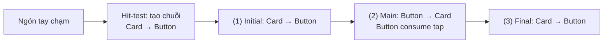
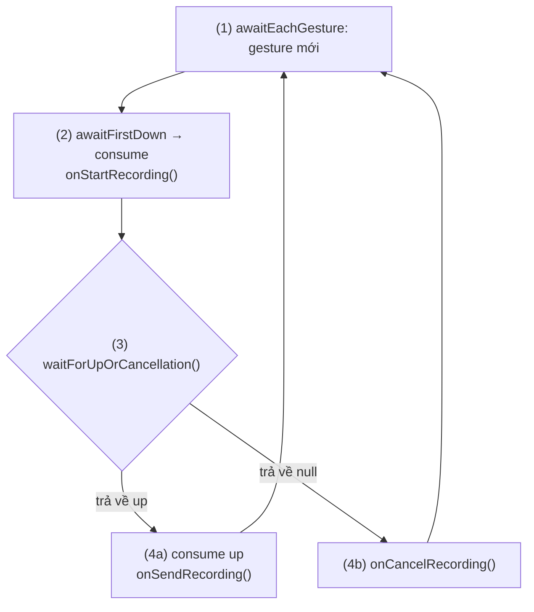
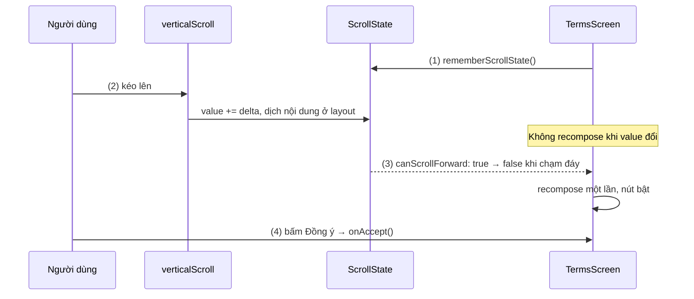
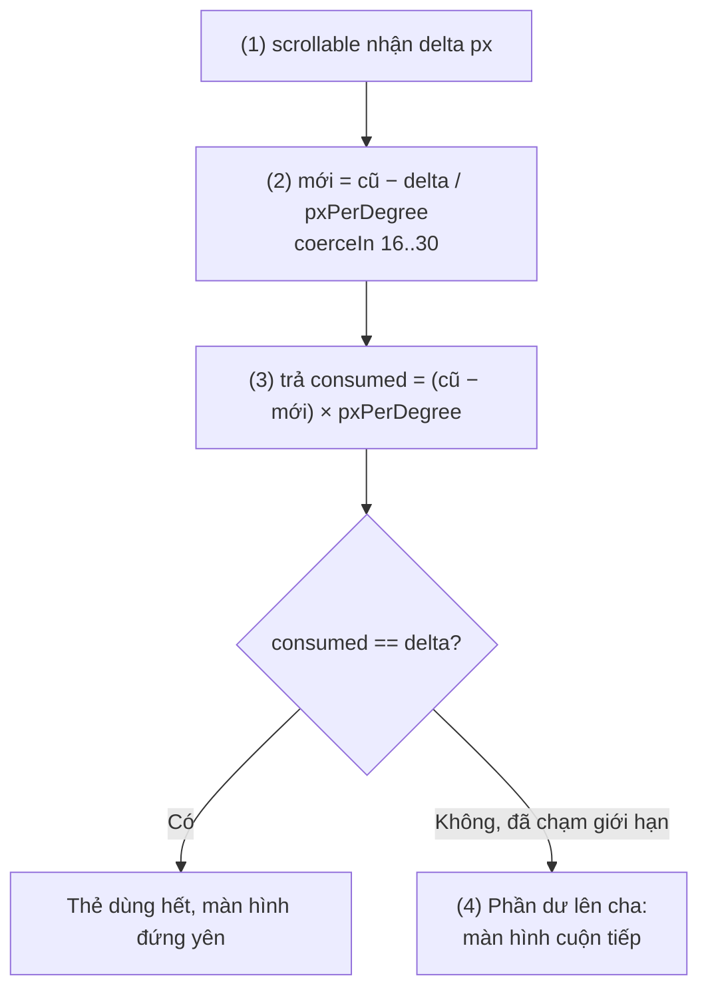
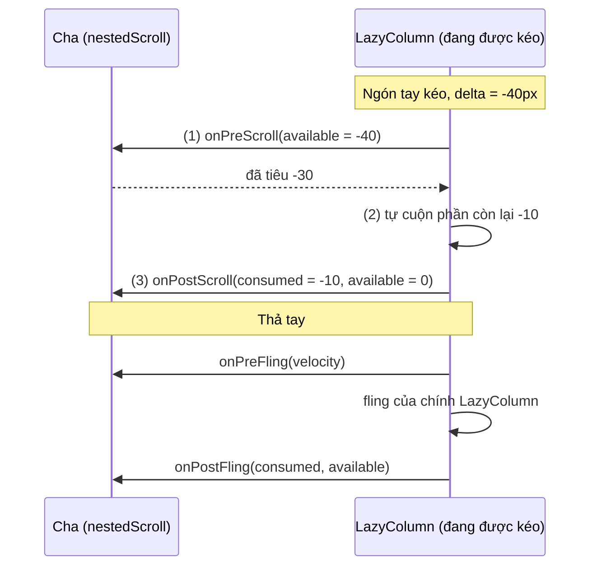
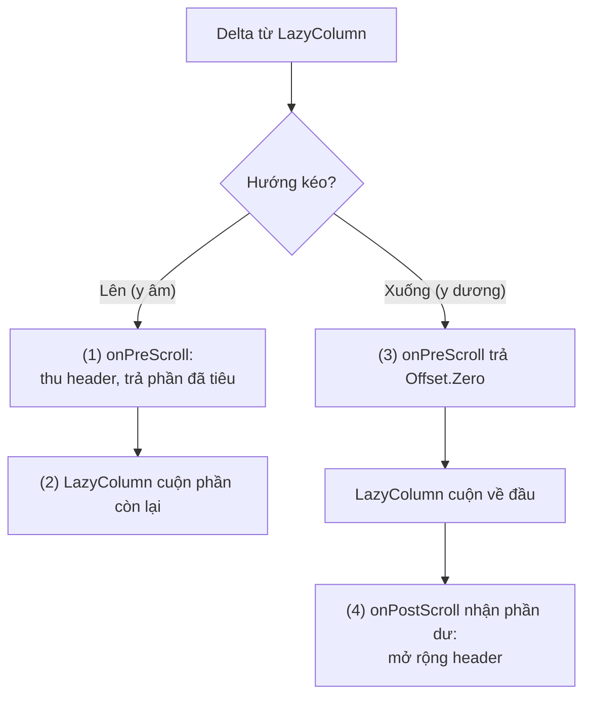
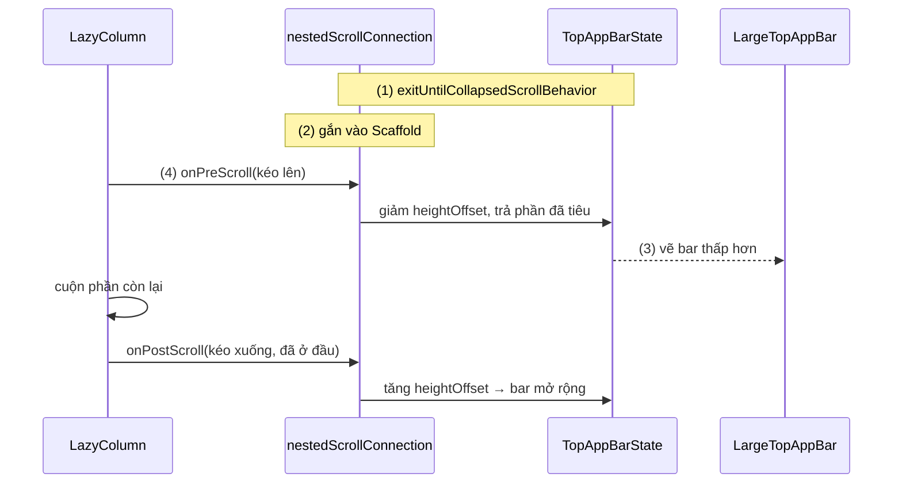

# Scrolling

## Vấn đề cần giải quyết

Nội dung thường dài hơn màn hình: form đăng ký, điều khoản, chi tiết sản phẩm. Trong Compose, `Column` chỉ xếp con theo chiều dọc, **không** tự cuộn; phần vượt quá chiều cao được cấp bị cắt mất:

```kotlin
// SignUpScreen.kt — form dài bị cắt, kéo không có tác dụng
@Composable
fun SignUpScreen() {
    Column(Modifier.fillMaxSize().padding(16.dp)) {
        repeat(12) { index ->
            OutlinedTextField(value = "", onValueChange = {}, label = { Text("Trường $index") })
        }
        Button(onClick = {}) { Text("Đăng ký") } // nằm ngoài màn hình, không bao giờ bấm được
    }
}
```

Bài toán thật ra có hai tầng:

1. **Biến cú kéo thành cuộn**: đổi quãng đường kéo thành vị trí cuộn, tiếp tục trôi (fling) khi người dùng vung tay rồi thả.
2. **Nhiều thành phần cùng muốn một cú kéo**: toolbar thu gọn trước rồi danh sách mới cuộn; carousel ngang trong danh sách dọc; nút bấm được trong một thẻ bấm được. Ai được dùng cú kéo, dùng bao nhiêu, phần còn lại đi đâu?

View system giải quyết tầng 2 bằng ba cơ chế rời nhau: `onInterceptTouchEvent`, `NestedScrollingParent`/`Child` và `CoordinatorLayout.Behavior`. Compose có một mô hình thống nhất: một chuỗi pointer cho mọi gesture, một chu trình delta cho mọi container cuộn.

## Sau khi học xong

- Giải thích được ba tầng xử lý gesture trong Compose (component, gesture modifier, pointerInput) và cách một pointer event được hit-test, đi qua ba pass và bị consume.
- Phân biệt được verticalScroll/horizontalScroll (tự dịch nội dung) với Modifier.scrollable (chỉ báo delta) và chọn đúng API cho từng bài toán.
- Giải thích được chu trình nested scroll (pre-scroll, node consumption, post-scroll, fling) và vai trò của NestedScrollConnection.
- Triển khai được header hoặc top app bar thu gọn khi cuộn bằng NestedScrollConnection tự viết hoặc TopAppBarScrollBehavior.
- Nhận diện được các lỗi cuộn thường gặp như lồng hai container cuộn cùng hướng, trả sai lượng delta đã consume và đọc ScrollState trong composition khiến màn hình recompose mỗi frame.

## Scrolling là gì?

**Scrolling** trong Compose là việc biến các **delta** (độ dịch tính bằng pixel) của cú kéo và fling thành vị trí cuộn lưu trong một **scroll state**; khi có nhiều container cuộn lồng nhau, mỗi delta được chia giữa chúng qua hệ thống **nested scroll** (cuộn lồng nhau).

Mental model: **mỗi delta là một khoản ngân sách được chuyển qua các tầng**. Tầng cha được quyền lấy trước một phần (pre-scroll), container đang được kéo tiêu phần còn lại để cuộn, phần nó không tiêu hết được trả lại cho cha (post-scroll). Mỗi bên phải **báo đúng mình đã tiêu bao nhiêu**, nếu không bên sau sẽ nhận sai số dư.

Bài dùng mental model này xuyên suốt: `scrollable` hỏi "anh tiêu bao nhiêu?", `NestedScrollConnection` là chỗ cha lấy phần của mình, và lỗi cuộn phổ biến nhất là báo sai số đã tiêu.

## Cách hoạt động

### 1. Tổng quan gesture: ba tầng xử lý

Cuộn chỉ là một loại gesture. Trước khi đi vào cuộn, cần nắm mô hình chung mà mọi bài gesture của Session 09 ([Dragging](dragging.md), [Swiping](swipping.md), [Zooming](zooming.md)) đều dựa vào. Ba thuật ngữ:

- **Pointer** (con trỏ): vật thể chỉ vào một toạ độ trên màn hình: ngón tay, bút stylus, chuột. Bàn phím không phải pointer.
- **Pointer event**: mô tả trạng thái của một hoặc nhiều pointer tại một thời điểm (đặt xuống, di chuyển, nhấc lên), chứa trong class `PointerEvent`, mỗi pointer là một `PointerInputChange`.
- **Gesture**: một chuỗi pointer event được hiểu là một hành động: tap là "xuống rồi lên", drag là "xuống, di chuyển quá touch slop, di chuyển tiếp, lên".

Compose cho ba tầng để xử lý gesture, từ cao xuống thấp:

| Tầng | Ví dụ | Bạn nhận được gì |
|---|---|---|
| **Component** | `Button`, `Slider`, `LazyColumn`, `SwipeToDismissBox` | Gesture đã xử lý sẵn; bạn chỉ truyền callback (`onClick`, `onValueChange`) |
| **Gesture modifier** | `clickable`, `verticalScroll`, `scrollable`, `draggable`, `anchoredDraggable`, `transformable` | Gesture một loại trên composable bất kỳ, kèm semantics, focus, ripple, nested scroll |
| **`pointerInput`** | `detectTapGestures`, `detectDragGestures`, `detectTransformGestures`; thấp nhất là `awaitEachGesture` / `awaitPointerEventScope` | Pointer event thô hoặc gesture đã nhận diện; bạn tự consume, tự lo accessibility |

Quy tắc của tài liệu chính thức: **dùng tầng cao nhất đủ cho nhu cầu**. `Button` có semantics "nút" cho TalkBack; `clickable` có ripple, hover, bàn phím; `pointerInput` chỉ có sự kiện thô, xuống tầng thấp nghĩa là tự viết lại những thứ đó. Bài này dạy cuộn; kéo (`draggable`, `detectDragGestures`), vuốt (`anchoredDraggable`) và pinch (`transformable`, `detectTransformGestures`) ở ba bài tiếp theo của 9.8. CompositionLocal (nửa sau tên nhóm 9.8, như `LocalDensity` dùng dưới đây để đổi dp sang px) được dạy ở [9.4.2 Custom Theme](../theming/custom_theme.md).

#### Hit-testing, ba pass và consume

Khi một pointer chạm xuống, Compose làm **hit-testing** từ gốc cây UI xuống lá: mọi composable có xử lý pointer mà chứa toạ độ chạm sẽ vào một **chuỗi** (chain). Mọi event sau đó của pointer này chỉ đi tới đúng chuỗi đó, kể cả khi ngón tay trượt ra ngoài biên của composable. Hai composable chồng nhau cùng cấp thì chỉ composable vẽ trên cùng được hit.

Mỗi event đi qua chuỗi **ba lần** (ba pass):

1. **Initial**: từ cha xuống con. Cha có cơ hội chặn trước khi con thấy (tooltip chặn long press).
2. **Main**: từ con lên cha. Đây là pass mặc định và là nơi gesture thường được consume, nên **con được ưu tiên hơn cha**: nút trong thẻ nhận tap trước thẻ.
3. **Final**: từ cha xuống con lần nữa, để con biết cha đã consume gì (nút bỏ ripple khi cú chạm biến thành cuộn của danh sách cha).



**Consume** (`PointerInputChange.consume()`) là cách một handler nói "phần này tôi đã dùng". Consume **không chặn** event đi tiếp; nó chỉ đánh dấu. Các gesture modifier và `detect*Gestures` có sẵn đều tự consume và tự bỏ qua change đã bị consume. Khi tự viết bằng `awaitPointerEventScope`, bạn phải tự làm cả hai việc: consume phần mình dùng, và kiểm tra `isConsumed` trước khi phản ứng.

#### Ví dụ: nút "giữ để ghi âm" trong màn chat

**Bài toán:** nút micro trong màn chat: nhấn giữ thì bắt đầu ghi âm, nhấc tay thì gửi, trượt ngón tay ra khỏi nút thì huỷ. Không gesture modifier nào có sẵn hành vi "giữ – thả – huỷ" này, nên phải xuống tầng `pointerInput`.

**Luồng chạy:**

1. `awaitEachGesture` chạy khối bên trong cho **mỗi** gesture, và tự bắt đầu lại khi mọi pointer đã nhấc lên.
2. `awaitFirstDown()` treo coroutine tới khi ngón tay chạm; consume cú chạm để cha không coi đó là tap của nó, rồi bắt đầu ghi âm.
3. `waitForUpOrCancellation()` treo tới khi ngón tay nhấc lên. Nó trả `null` nếu gesture bị huỷ: ngón tay trượt ra khỏi nút, hoặc một handler khác đã consume chuyển động.
4. Có `up` → consume và gửi bản ghi (4a); `null` → huỷ bản ghi (4b).



```kotlin
// VoiceRecordButton.kt
@Composable
fun VoiceRecordButton(
    onStartRecording: () -> Unit,
    onSendRecording: () -> Unit,
    onCancelRecording: () -> Unit,
    modifier: Modifier = Modifier,
) {
    Box(
        modifier = modifier
            .size(56.dp)
            .clip(CircleShape)
            .background(MaterialTheme.colorScheme.primary)
            // Key là các callback: callback đổi thì khối gesture được khởi động lại
            .pointerInput(onStartRecording, onSendRecording, onCancelRecording) {
                awaitEachGesture {                              // (1)
                    awaitFirstDown().consume()                  // (2)
                    onStartRecording()
                    val up = waitForUpOrCancellation()          // (3)
                    if (up != null) {
                        up.consume()
                        onSendRecording()                       // (4a)
                    } else {
                        onCancelRecording()                     // (4b)
                    }
                }
            },
        contentAlignment = Alignment.Center,
    ) {
        Icon(
            painter = painterResource(R.drawable.ic_mic),
            contentDescription = "Giữ để ghi âm",
            tint = MaterialTheme.colorScheme.onPrimary,
        )
    }
}
```

**Kết quả:** giữ rồi thả → log "start", "send"; giữ rồi trượt ra ngoài nút → "start", "cancel". UI test kiểm chứng hai nhánh bằng `performTouchInput { down(center); up() }` và `performTouchInput { down(center); moveBy(Offset(500f, 0f)); up() }`. `pointerInput` không có semantics, nên app thật cần thêm `Modifier.semantics` với hành động thay thế cho TalkBack.

### 2. verticalScroll và horizontalScroll: cuộn có sẵn

`Modifier.verticalScroll(state)` và `horizontalScroll(state)` làm trọn ba việc: nhận diện cú kéo và fling, lưu vị trí vào `ScrollState`, và **tự dịch nội dung** khi đặt vị trí (placement). `ScrollState` có:

- `value` (vị trí hiện tại, pixel) và `maxValue` (phần nội dung vượt viewport).
- `isScrollInProgress`, `canScrollForward`, `canScrollBackward` để UI phản ứng.
- `scrollTo(px)`, `animateScrollTo(px)`: hàm `suspend`, gọi trong `rememberCoroutineScope`/`LaunchedEffect` ([9.3.1 LaunchedEffect](../side_effects/launched_effect.md)).
- `rememberScrollState()` lưu vị trí bằng `rememberSaveable`, xoay màn hình vẫn giữ chỗ đang đọc ([9.2.2 rememberSaveable](../state/remember_saveable.md)).

Hai hệ quả về đo đạc: container có `verticalScroll` đo con với **chiều cao tối đa vô hạn**, nên con của nó không được là một container cuộn cùng hướng như `LazyColumn` (crash, xem Sai lầm 1); ngược lại, đặt `verticalScroll` bên trong item của `LazyColumn` cũng crash vì chính nó nhận chiều cao vô hạn. Và nó compose **toàn bộ** con; danh sách dài thì dùng `LazyColumn` ([9.5.4 LazyColumn](../modifier/lazy_column.md)). Thứ tự `.verticalScroll().padding()` hay ngược lại quyết định padding cuộn theo nội dung hay đứng yên ([9.5.1 Thứ tự Modifier](../modifier/modifier_order.md)).

#### Ví dụ: chỉ bật nút "Đồng ý" khi đã đọc hết điều khoản

**Bài toán:** màn điều khoản sử dụng dài vài màn hình; nút "Đồng ý" chỉ bật khi người dùng đã cuộn tới cuối. Nội dung là văn bản có độ dài cố định, nên `verticalScroll` là đủ, không cần lazy list.

**Luồng chạy:**

1. `rememberScrollState()` tạo state cuộn, được lưu qua xoay màn hình.
2. Người dùng kéo: `verticalScroll` cập nhật `scrollState.value` và dịch nội dung ở layout phase. Việc này **không** gây recomposition.
3. Màn hình chỉ đọc `scrollState.canScrollForward` trong composition. Giá trị này chỉ đổi khi chạm hoặc rời đáy, nên composable chỉ recompose ở đúng thời điểm đó, không phải mỗi frame.
4. Khi đã ở đáy, nút bật; bấm nút gọi `onAccept`.



```kotlin
// TermsScreen.kt
@Composable
fun TermsScreen(termsText: String, onAccept: () -> Unit) {
    val scrollState = rememberScrollState()                     // (1)
    // (3) Chỉ đọc giá trị đổi hiếm, không đọc scrollState.value
    val reachedEnd = !scrollState.canScrollForward

    Column(Modifier.fillMaxSize()) {
        Text(
            text = termsText,
            modifier = Modifier
                .weight(1f)
                .verticalScroll(scrollState)                    // (2)
                .padding(16.dp),
        )
        Button(
            onClick = onAccept,                                 // (4)
            enabled = reachedEnd,
            modifier = Modifier.fillMaxWidth().padding(16.dp),
        ) {
            Text(if (reachedEnd) "Đồng ý" else "Cuộn để đọc hết điều khoản")
        }
    }
}
```

**Kết quả:** nút mờ cho tới khi cuộn hết văn bản. Layout Inspector (recomposition counts) cho thấy `TermsScreen` chỉ recompose một lần khi chạm đáy. Đổi `reachedEnd` thành `scrollState.value >= scrollState.maxValue` thì UI giống hệt nhưng số recompose tăng liên tục, vì `value` đổi mỗi frame.

### 3. Modifier.scrollable: chỉ đo delta, bạn tự quyết làm gì

`Modifier.scrollable(state, orientation)` nhận diện cú kéo và fling theo một hướng, đưa từng delta cho `ScrollableState`, nhưng **không dịch gì cả**. State tạo bằng `rememberScrollableState { delta -> consumed }`:

- `delta` là độ dịch của ngón tay (pixel): kéo xuống/sang phải dương, kéo lên âm.
- Lambda phải **trả về lượng delta đã tiêu**; phần không tiêu được chuyển cho cha qua nested scroll.
- Lambda chạy cho cả kéo, fling và cuộn bằng code (`scrollBy`, `animateScrollBy`). Fling mặc định dừng sớm khi cả chuỗi (lambda và các cha nhận phần dư) không tiêu hết delta của frame đó.

Dùng `scrollable` khi thứ đổi theo cú kéo **không phải vị trí nội dung**: giá trị núm vặn, kích thước header. Tự dựng một container cuộn thật thì từ Foundation 1.10 có `Modifier.scrollableArea`, lo sẵn việc cắt nội dung theo biên và tự xử lý hướng cuộn theo `Orientation`, RTL và `reverseScrolling`.

#### Ví dụ: vuốt dọc trên thẻ để chỉnh nhiệt độ điều hoà

**Bài toán:** thẻ điều khiển điều hoà trong app nhà thông minh: vuốt lên tăng nhiệt độ, vuốt xuống giảm, giới hạn 16–30 °C. Thẻ nằm trong một màn hình cuộn dọc; khi đã chạm giới hạn, cú vuốt phải chuyển sang cuộn màn hình chứ không bị "nuốt mất".

**Luồng chạy:**

1. `scrollable` phát hiện kéo dọc và gọi lambda với `delta` theo pixel.
2. Đổi delta sang độ (24 dp kéo = 1 °C), đảo dấu vì kéo lên (delta âm) phải tăng nhiệt, rồi giới hạn trong 16–30.
3. Trả về **đúng phần delta đã dùng**: `(cũ − mới) × pxPerDegree`. Đã ở 30 °C mà vẫn vuốt lên thì trả 0.
4. Phần không dùng đi lên cha qua post-scroll: màn hình chứa thẻ cuộn tiếp. Khi thả tay có vận tốc, mỗi frame fling đi qua đúng chu trình này: lambda tiêu trước, phần dư lên cha.



```kotlin
// ThermostatCard.kt
private const val MIN_TEMP = 16f
private const val MAX_TEMP = 30f

@Composable
fun ThermostatCard(modifier: Modifier = Modifier) {
    var temperature by remember { mutableFloatStateOf(24f) }
    val pxPerDegree = with(LocalDensity.current) { 24.dp.toPx() }

    val scrollableState = rememberScrollableState { delta ->        // (1)
        val old = temperature
        val new = (old - delta / pxPerDegree).coerceIn(MIN_TEMP, MAX_TEMP) // (2)
        temperature = new
        (old - new) * pxPerDegree                                    // (3) phần đã tiêu
    }

    Card(
        modifier = modifier
            .fillMaxWidth()
            .height(160.dp)
            .scrollable(scrollableState, Orientation.Vertical),     // (4) dư → cha
    ) {
        Box(Modifier.fillMaxSize(), contentAlignment = Alignment.Center) {
            Text("%.1f °C".format(temperature), style = MaterialTheme.typography.displayMedium)
        }
    }
}
```

**Kết quả:** đặt thẻ trong một `Column(Modifier.verticalScroll(...))` cao hơn màn hình. Vuốt trên thẻ: nhiệt độ đổi, màn hình đứng yên. Vuốt tiếp khi đã 30 °C: màn hình bắt đầu cuộn. Đổi dòng (3) thành `delta` (luôn báo tiêu hết) thì ở 30 °C màn hình không cuộn được nữa khi ngón tay bắt đầu trên thẻ, đó là triệu chứng của "báo sai số đã tiêu".

### 4. Nested scroll: chia delta giữa các container lồng nhau

#### Nested scroll tự động

Với trường hợp đơn giản, bạn không phải làm gì: `verticalScroll`, `horizontalScroll`, `scrollable`, các lazy layout và `TextField` đều tham gia nested scroll sẵn. Khi con đã cuộn tới biên, phần delta dư tự đi lên cha gần nhất cùng hướng. Ví dụ ở mục 3 chính là nested scroll tự động: thẻ là con, `Column.verticalScroll` là cha.

#### Chu trình nested scroll

Mỗi delta do container đang được kéo tạo ra đi qua ba giai đoạn:

1. **Pre-scroll**: delta được gửi lên tận gốc của chuỗi nested scroll, rồi đi xuống lại, cho từng cha cơ hội **lấy trước** một phần.
2. **Node consumption**: container đang được kéo tiêu phần còn lại để cuộn chính nó. Đây là lúc nội dung thật sự dịch.
3. **Post-scroll**: phần nó không tiêu hết được gửi lên các cha lần nữa; cha nào muốn thì lấy.

Khi thả tay, vận tốc đi qua chu trình tương tự: **pre-fling**, fling của chính node, **post-fling**. Fling chỉ sinh ra từ cú chạm, không từ cuộn bằng accessibility hay chuột.



#### NestedScrollConnection và Modifier.nestedScroll

Để một composable cha tham gia chu trình, gắn `Modifier.nestedScroll(connection)` vào nó. `NestedScrollConnection` có bốn callback ứng với bốn giai đoạn, đều mặc định "không lấy gì": `onPreScroll(available, source)`, `onPostScroll(consumed, available, source)` trả `Offset`; `onPreFling(available)`, `onPostFling(consumed, available)` là hàm `suspend` trả `Velocity`.

- `available` là ngân sách còn lại; `consumed` là phần các giai đoạn trước đã dùng. Giá trị trả về là phần **bạn** tiêu, cùng dấu với `available`.
- `NestedScrollSource` là `UserInput` (ngón tay, chuột, bàn phím) hay `SideEffect` (fling, animation, cuộn bằng code); hai tên này thay `Drag`/`Fling` cũ từ Compose 1.7 (09/2024).
- Connection chỉ nhận delta từ **con cháu** của composable mang modifier. `Box`/`Column` không tự sinh delta nếu không có modifier cuộn.
- `NestedScrollDispatcher` dùng khi bạn tự tạo delta mới và muốn khởi động chu trình; container cuộn có sẵn đã có dispatcher bên trong.

#### Ví dụ: ảnh bìa cửa hàng thu nhỏ khi cuộn danh sách món

**Bài toán:** trang cửa hàng trong app giao đồ ăn có ảnh bìa cao 240 dp phía trên danh sách món. Cuộn lên: ảnh bìa thu dần về 72 dp **trước**, rồi danh sách mới cuộn. Cuộn xuống: danh sách cuộn về đầu **trước**, rồi ảnh bìa mới mở rộng. Đây đúng là hai giai đoạn pre-scroll và post-scroll.

**Luồng chạy:**

1. Kéo lên (delta âm): `LazyColumn` gửi pre-scroll; `onPreScroll` thu header trong khoảng 72–240 dp và trả về phần đã tiêu.
2. `LazyColumn` cuộn phần delta còn lại. Header đã nhỏ nhất thì nó nhận cả delta.
3. Kéo xuống (delta dương): `onPreScroll` không lấy gì, để danh sách cuộn về đầu trước.
4. Danh sách đã ở đầu thì delta dư vào `onPostScroll`; header lấy phần đó để mở rộng.



```kotlin
// StoreProfileScreen.kt
@Composable
fun StoreProfileScreen(store: Store, dishes: List<Dish>) {
    val density = LocalDensity.current
    val maxHeaderPx = with(density) { 240.dp.toPx() }
    val minHeaderPx = with(density) { 72.dp.toPx() }
    var headerHeightPx by remember { mutableFloatStateOf(maxHeaderPx) }

    val connection = remember(maxHeaderPx, minHeaderPx) {
        object : NestedScrollConnection {
            override fun onPreScroll(available: Offset, source: NestedScrollSource): Offset {
                if (available.y >= 0f) return Offset.Zero                      // (3) kéo xuống: nhường list
                val old = headerHeightPx
                headerHeightPx = (old + available.y).coerceIn(minHeaderPx, maxHeaderPx)
                return Offset(0f, headerHeightPx - old)                        // (1) phần đã tiêu, âm
            }

            override fun onPostScroll(
                consumed: Offset,
                available: Offset,
                source: NestedScrollSource,
            ): Offset {
                if (available.y <= 0f) return Offset.Zero
                val old = headerHeightPx
                headerHeightPx = (old + available.y).coerceIn(minHeaderPx, maxHeaderPx)
                return Offset(0f, headerHeightPx - old)                        // (4) mở rộng header
            }
        }
    }

    Column(Modifier.fillMaxSize().nestedScroll(connection)) {
        StoreHeader(
            store = store,
            modifier = Modifier
                .fillMaxWidth()
                // Đọc headerHeightPx trong lambda của layout: chỉ đo lại, không recompose
                .layout { measurable, constraints ->
                    val height = headerHeightPx.roundToInt()
                    val placeable = measurable.measure(Constraints.fixed(constraints.maxWidth, height))
                    layout(placeable.width, placeable.height) { placeable.place(0, 0) }
                },
        )
        LazyColumn(Modifier.weight(1f)) {                                     // (2)
            items(dishes, key = { it.id }) { dish -> DishRow(dish) }
        }
    }
}
```

`Modifier.layout {}` (custom layout cơ bản ở [9.6 Layout and View](../layout_and_view.md)) được dùng vì state đọc trong lambda của nó chỉ chạy lại phase Layout, không chạy lại Composition ([ba phase của một frame](../overview.md)). Fling cũng đi qua hai callback với `source = SideEffect`.

**Kết quả:** cuộn lên thì ảnh bìa thu tới 72 dp rồi danh sách mới chạy; cuộn xuống giữa danh sách thì ảnh bìa đứng yên cho tới khi món đầu tiên hiện ra. Layout Inspector cho thấy `StoreProfileScreen` không recompose trong lúc cuộn; `Log.d` trong hai callback cho thấy thứ tự pre → post khớp sơ đồ.

## Ví dụ thực tế

Ba bài toán cuộn lồng nhau hay gặp:

1. **Top app bar thu gọn trong màn danh sách**: dùng Material 3 `TopAppBarScrollBehavior` thay vì tự viết connection như mục 4. Đây là bài toán chính, code đầy đủ bên dưới.
2. **Carousel ngang trong danh sách dọc** (trang chủ có nhiều hàng "Gợi ý", "Mới về"): `LazyRow` trong `LazyColumn` khác hướng nên nested scroll tự động lo, không cần code thêm. Giữ vị trí cuộn của từng hàng được bàn ở [9.5.5 LazyRow](../modifier/lazy_row.md).
3. **Màn hình Compose trong `CoordinatorLayout` cũ** (toolbar vẫn là `CollapsingToolbarLayout` XML): `ComposeView` không tự báo delta cho View cha. Gắn `Modifier.nestedScroll(rememberNestedScrollInteropConnection())` vào composable cuộn cấp cao nhất trong `ComposeView`. Chiều ngược lại (View cuộn trong `AndroidView`) cần `ViewCompat.setNestedScrollingEnabled(view, true)`. `RecyclerView` và `ViewPager2` không phải nested scroll parent hợp tác, nên làm cha của Compose sẽ không cuộn liền mạch.

### Top app bar thu gọn bằng exitUntilCollapsedScrollBehavior

**Bài toán:** màn danh sách tin tức có tiêu đề lớn "Tin tức". Cuộn lên thì tiêu đề thu về thanh nhỏ; chỉ mở rộng lại khi cuộn về đầu danh sách. Đây đúng là hành vi của mục 4, và Material 3 đã đóng gói sẵn.

Ba loại `TopAppBarScrollBehavior` trong `TopAppBarDefaults`:

| Behavior | Cuộn lên | Cuộn xuống |
|---|---|---|
| `pinnedScrollBehavior` | Bar đứng yên (chỉ đổi màu nền khi nội dung cuộn dưới nó) | Đứng yên |
| `enterAlwaysScrollBehavior` | Bar thu lại | Bar hiện lại **ngay** khi bắt đầu kéo xuống |
| `exitUntilCollapsedScrollBehavior` | Bar thu tới kích thước nhỏ nhất | Chỉ mở rộng khi nội dung đã về đầu |

**Luồng chạy:**

1. `exitUntilCollapsedScrollBehavior(rememberTopAppBarState())` tạo behavior; `TopAppBarState` giữ độ cao đã thu và được lưu qua xoay màn hình.
2. `Modifier.nestedScroll(scrollBehavior.nestedScrollConnection)` trên `Scaffold`: connection của behavior trở thành cha của mọi container cuộn trong nội dung.
3. `LargeTopAppBar(scrollBehavior = scrollBehavior)` đọc state đó để vẽ chiều cao và độ mờ tiêu đề.
4. `LazyColumn` nhận `innerPadding` làm `contentPadding`; mỗi delta của nó đi qua connection như sơ đồ mục 4.



```kotlin
// NewsListScreen.kt
@OptIn(ExperimentalMaterial3Api::class) // cần tới Material 3 1.4; từ 1.5 các API này đã stable
@Composable
fun NewsListScreen(
    articles: List<Article>,
    onArticleClick: (Article) -> Unit,
) {
    val scrollBehavior =
        TopAppBarDefaults.exitUntilCollapsedScrollBehavior(rememberTopAppBarState()) // (1)

    Scaffold(
        modifier = Modifier.nestedScroll(scrollBehavior.nestedScrollConnection),     // (2)
        topBar = {
            LargeTopAppBar(
                title = { Text("Tin tức", maxLines = 1, overflow = TextOverflow.Ellipsis) },
                scrollBehavior = scrollBehavior,                                     // (3)
            )
        },
    ) { innerPadding ->
        LazyColumn(contentPadding = innerPadding) {                                  // (4)
            items(articles, key = { it.id }) { article ->
                ArticleRow(article = article, onClick = { onArticleClick(article) })
            }
        }
    }
}
```

**Kết quả:** cuộn lên thì tiêu đề lớn mờ dần và bar thu về chiều cao của `TopAppBar` thường; cuộn xuống giữa danh sách thì bar giữ nguyên, về tới bài đầu tiên mới mở rộng. Xoá dòng (2) thì danh sách vẫn cuộn nhưng bar đứng yên: connection không nằm trên tổ tiên của `LazyColumn` nên không nhận được delta nào.

## Khi nào nên và không nên dùng

| Tình huống | Nên dùng | Không nên dùng |
|---|---|---|
| Nội dung độ dài cố định (form, điều khoản) | `verticalScroll` | `LazyColumn` cho vài item cố định |
| Danh sách dài hoặc không biết trước độ dài | `LazyColumn`/`LazyRow` | `Column.verticalScroll` + `forEach` (compose hết mọi item) |
| Giá trị thay đổi theo cú vuốt, không phải vị trí nội dung | `scrollable` | `verticalScroll` rồi đọc `value` để suy ra giá trị |
| Phần tử di chuyển theo ngón tay | `draggable` ([Dragging](dragging.md)) | `scrollable` (kéo theo fling, nested scroll không cần) |
| Top app bar thu gọn theo chuẩn Material | `TopAppBarScrollBehavior` | Tự viết connection |
| Header, ảnh bìa, FAB phản ứng theo cuộn kiểu riêng | `NestedScrollConnection` | Đọc `scrollState.value`/`firstVisibleItemScrollOffset` trong composition |
| Gesture không có modifier sẵn | `pointerInput` + `awaitEachGesture` | `pointerInput` cho tap/cuộn thường (mất semantics, ripple) |

## Sai lầm thường gặp

### 1. Lồng LazyColumn trong Column.verticalScroll

```kotlin
// SAI: crash "Vertically scrollable component was measured with an infinity maximum height constraints"
Column(Modifier.verticalScroll(rememberScrollState())) {
    ProductHeader(product)
    LazyColumn { items(reviews) { ReviewRow(it) } }
}
```

`LazyColumn` cần chiều cao hữu hạn để biết compose bao nhiêu item, mà `verticalScroll` cho chiều cao vô hạn. Sửa: bỏ `verticalScroll`, đưa header vào `LazyColumn` bằng `item { ProductHeader(product) }`.

### 2. Đọc vị trí cuộn trong composition để làm hiệu ứng

```kotlin
// SAI: parallax ảnh bìa — cả màn hình recompose mỗi frame cuộn
val offset = scrollState.value
Image(painter, null, Modifier.offset(y = with(density) { (offset / 2).toDp() }))
```

`value` đổi mỗi frame nên scope đọc nó recompose liên tục. Sửa: đọc trong lambda của layout/draw phase, `Modifier.graphicsLayer { translationY = scrollState.value / 2f }`. Cần giá trị đổi hiếm (đã cuộn qua 100 px chưa) thì dùng `canScrollForward` hoặc [9.3.4 derivedStateOf](../side_effects/derived_state_of.md).

### 3. Báo sai lượng delta đã tiêu

```kotlin
// SAI: luôn trả delta, kể cả khi giá trị đã chạm giới hạn
rememberScrollableState { delta ->
    volume = (volume - delta / pxPerStep).coerceIn(0f, 100f)
    delta
}
```

Triệu chứng: vuốt bắt đầu trên control thì màn hình cha không cuộn được nữa. Sửa: trả phần thực sự dùng sau `coerceIn`, như ví dụ nhiệt độ. Trong `NestedScrollConnection`, trả `available` khi chỉ dùng một phần sẽ khiến danh sách con không cuộn đủ.

### 4. Gắn nestedScroll sai chỗ

Connection chỉ nhận delta từ con cháu. Gắn `nestedScroll(scrollBehavior.nestedScrollConnection)` vào `LargeTopAppBar` hoặc vào một `Box` anh em của danh sách thì không có callback nào chạy. Sửa: gắn vào tổ tiên chung, thường là `Scaffold` hoặc root của màn hình.

## Lịch sử phát triển

- **Compose 1.0 (07/2021)**: đã có `verticalScroll`, `scrollable`, `nestedScroll` với `NestedScrollConnection`/`Dispatcher`, và `pointerInput` với `detect*Gestures`. "Container cuộn nào cũng tham gia nested scroll" có từ đầu, khác View system nơi `NestedScrollingChild` là tuỳ chọn.
- **Material 3 Compose 1.0 (10/2022)**: `TopAppBarScrollBehavior` (`pinned`, `enterAlways`, `exitUntilCollapsed`) thay tổ hợp `CoordinatorLayout` + `AppBarLayout`, nhưng mang `@ExperimentalMaterial3Api` tới hết Material 3 1.4. `rememberNestedScrollInteropConnection()` phục vụ giai đoạn chuyển dần từ XML.
- **Compose 1.5 (08/2023)**: `clickable`, `draggable`, `scrollable` và nhiều modifier nền tảng được viết lại trên `Modifier.Node` ([9.5.3 composed](../modifier/composed.md)), giảm chi phí composition lần đầu.
- **Compose 1.7 (09/2024)**: `NestedScrollSource.Drag`/`Fling` được thay bằng `UserInput`/`SideEffect` vì delta không chỉ đến từ ngón tay mà còn từ chuột, bàn phím và animation.
- **Foundation 1.10 (12/2025)**: thêm `Modifier.scrollableArea` làm khối xây dựng cho container cuộn tuỳ chỉnh.
- **Material 3 1.5 (đang ở bản rc, 11/2026)**: `TopAppBarScrollBehavior` và các API liên quan thành stable, không cần opt-in; `pinnedScrollBehavior`/`enterAlwaysScrollBehavior` có overload nhận `ScrollableState`.

## Kết nối hệ thống

- **Prerequisites**: [9.0 Jetpack Compose Overview](../overview.md) (ba phase, nền của "đọc state ở layout phase"), [9.2.1 Mutable State](../state/mutable_state.md).
- **Related**: [9.5.4 LazyColumn](../modifier/lazy_column.md) (container cuộn cho danh sách), [9.5.5 LazyRow](../modifier/lazy_row.md), [9.3.1 LaunchedEffect](../side_effects/launched_effect.md) (`rememberCoroutineScope`), [9.4.2 Custom Theme](../theming/custom_theme.md) (CompositionLocal, `LocalDensity`).
- **Học tiếp trong 9.8**: [9.8.2 Dragging](dragging.md) (kéo theo ngón tay), [9.8.3 Swiping](swipping.md) (kéo rồi settle về vị trí cố định), [9.8.4 Zooming](zooming.md) (pinch-zoom, xung đột với pager).
- **Session sau**: [10.2 Unit Testing](../../coding_analyst_and_testing/unit_testing.md) cho nền tảng test tự động; UI test gesture của Compose bằng `performTouchInput` chưa có bài trong repo.

## Tham khảo

- [Understand gestures — Android Developers](https://developer.android.com/develop/ui/compose/touch-input/pointer-input/understand-gestures)
- [Scroll — Android Developers](https://developer.android.com/develop/ui/compose/touch-input/pointer-input/scroll)
- [Nested scrolling — Android Developers](https://developer.android.com/develop/ui/compose/touch-input/pointer-input/nested-scroll)
- [App bars — Android Developers](https://developer.android.com/develop/ui/compose/components/app-bars)
- [NestedScrollConnection — API reference](https://developer.android.com/reference/kotlin/androidx/compose/ui/input/nestedscroll/NestedScrollConnection)
- [Migrate CoordinatorLayout to Compose — Android Developers](https://developer.android.com/develop/ui/compose/migrate/migration-scenarios/coordinator-layout)
- [Compose architectural layering — Android Developers](https://developer.android.com/develop/ui/compose/layering)
