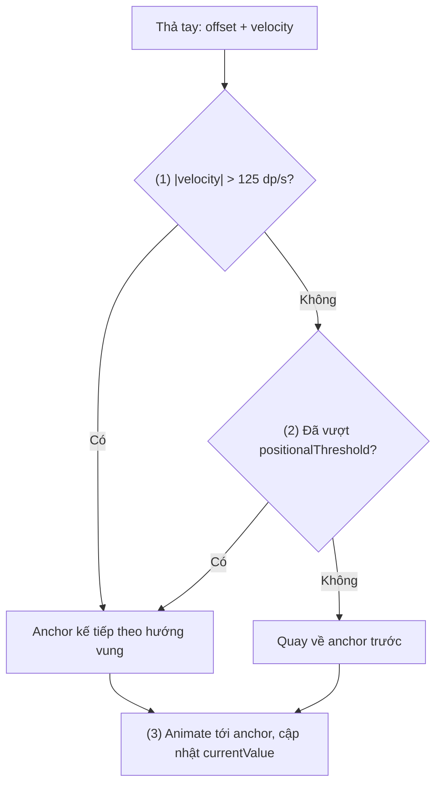
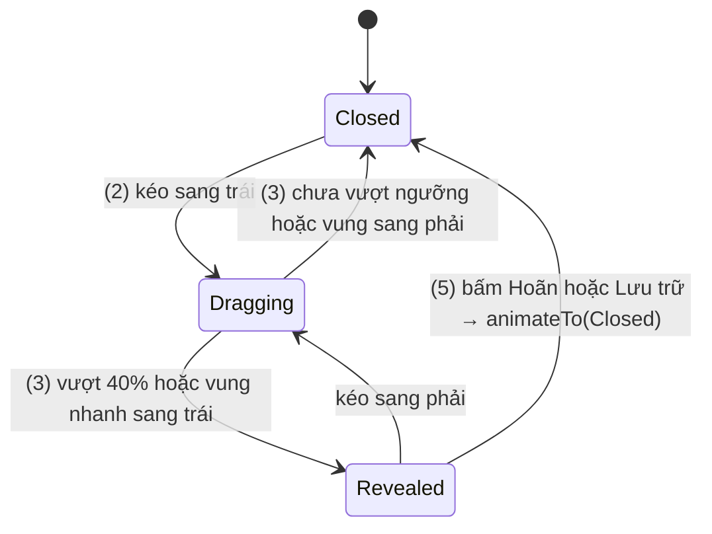
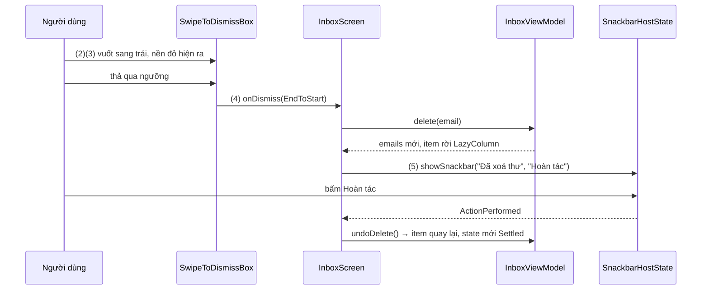

# Swiping

## Vấn đề cần giải quyết

Nhiều tương tác trên mobile là "vuốt rồi thả": vuốt thư sang trái để xoá, vuốt một hàng để lộ nút "Lưu trữ", kéo bottom sheet lên nửa hay hết màn hình, vuốt thẻ trong app hẹn hò. Điểm chung: khi thả tay, phần tử **không được dừng lơ lửng** ở chỗ ngón tay. Nó phải về một trong vài vị trí có nghĩa (đóng, mở, đã xoá), và việc chọn vị trí nào phải "cảm" đúng ý người dùng:

- Kéo quá nửa đường rồi thả chậm → đi tiếp tới vị trí kế.
- Kéo một chút nhưng vung nhanh → vẫn đi tiếp, vì người dùng rõ ràng muốn thế.
- Kéo một chút, thả chậm → quay về chỗ cũ.

Tự làm bằng [`draggable`](dragging.md) nghĩa là tự đo vận tốc, tự viết ngưỡng, tự chạy animation, tự xử lý khi người dùng chạm lại giữa animation, tự lưu trạng thái qua xoay màn hình. Mỗi màn hình viết một kiểu và "cảm giác vuốt" không nhất quán giữa các màn.

## Sau khi học xong

- Giải thích được cách một swipe được settle về anchor dựa trên positional threshold và vận tốc fling.
- Triển khai được thành phần vuốt giữa các vị trí cố định bằng DraggableAnchors, AnchoredDraggableState và Modifier.anchoredDraggable theo API hiện hành.
- Triển khai được vuốt để xoá item trong LazyColumn bằng SwipeToDismissBox, kèm hoàn tác bằng Snackbar.
- Phân biệt được anchoredDraggable, SwipeToDismissBox, draggable và HorizontalPager để chọn đúng cho từng bài toán vuốt.
- Nhận diện được các lỗi thường gặp như dùng swipeable hoặc constructor đã deprecated, quên key khiến trạng thái vuốt dính sang item khác, khôi phục state đã vuốt khi hoàn tác, và gọi requireOffset trước khi có anchor.

## Swiping là gì?

**Swipe** là một cú kéo mà khi thả tay, phần tử không dừng ở chỗ ngón tay mà **settle** (ổn định) về một trong vài vị trí định trước gọi là **anchor**, được chọn dựa trên quãng đã kéo và vận tốc vung.

Mental model: **anchor là những thanh nam châm** đặt dọc đường kéo. Trong lúc kéo, phần tử theo ngón tay. Khi thả, nó bị hút về một nam châm: vung đủ mạnh thì về nam châm kế tiếp theo hướng vung; vung nhẹ thì về nam châm mà nó đã kéo vượt ngưỡng tới gần.

Phần "theo ngón tay" chính là dragging ở [9.8.2](dragging.md). Swipe thêm đúng một thứ: **tập anchor và luật chọn anchor khi thả**.

## Cách hoạt động

### 1. Luật settle: positional threshold và vận tốc

Khi ngón tay nhấc lên, Compose có hai thông tin: offset hiện tại và vận tốc lúc thả. Luật của `AnchoredDraggableDefaults.flingBehavior` (theo tài liệu API hiện hành):

1. Nếu vận tốc lớn hơn ngưỡng vận tốc tối thiểu (`AnchoredDraggableMinFlingVelocity`, 125 dp/s) → đi tới **anchor kế tiếp theo hướng vung**.
2. Nếu vận tốc nhỏ hơn → xét **positional threshold**: offset đã vượt ngưỡng (mặc định 50% khoảng cách giữa hai anchor) chưa? Vượt → đi tới anchor kế tiếp; chưa → quay về anchor trước.
3. Animation settle chạy bằng `animationSpec` (mặc định là một tween). Trong lúc chạy, chạm lại sẽ "bắt" phần tử và kéo tiếp.



Luật này giống cách `BottomSheetBehavior` hay `ItemTouchHelper` của View system cảm nhận cú vuốt, nhưng ở Compose nó là một khối dùng chung cho mọi component vuốt: Material 3 dùng nó cho bottom sheet, navigation drawer và `SwipeToDismissBox`.

### 2. DraggableAnchors và AnchoredDraggableState

Ba thành phần của API (gói `androidx.compose.foundation.gestures`):

- **Giá trị** `T`: thường là một `enum class` mô tả các vị trí có nghĩa, ví dụ `Closed`, `Revealed`.
- **`DraggableAnchors<T>`**: ánh xạ từ giá trị sang offset pixel, viết bằng DSL `DraggableAnchors { Closed at 0f; Revealed at -widthPx }`.
- **`AnchoredDraggableState<T>`**: state holder giữ offset hiện tại và anchor.

Các thuộc tính và hàm chính của state:

| Thành phần | Ý nghĩa |
|---|---|
| `currentValue` | Anchor gần nhất mà offset đã **đi qua** (đổi khi offset chạm một anchor, kể cả anchor trung gian) |
| `settledValue` | Anchor đã thật sự dừng lại; đi qua nhiều anchor A → B → C thì giữ nguyên tới khi settle xong |
| `targetValue` | Anchor gần nhất với offset hiện tại (đổi ở điểm giữa hai anchor); khi không kéo hay animate thì bằng `currentValue` |
| `offset` / `requireOffset()` | Offset hiện tại; `offset` là `NaN` khi chưa có anchor, `requireOffset()` thì ném lỗi. Đổi mỗi frame, không đọc trong composition |
| `progress(from, to)` | Tiến độ 0..1 giữa hai anchor, dùng để làm mờ, đổi màu theo cú vuốt |
| `isAnimationRunning` | Đang settle hay không |
| `updateAnchors(newAnchors)` | Đổi tập anchor (khi kích thước đổi) |
| `animateTo(value)`, `snapTo(value)` | Extension `suspend` để đổi vị trí bằng code (nút "Đóng") |

Tạo state theo API hiện hành:

- `AnchoredDraggableState(initialValue, anchors)` khi anchor biết được ngay trong composition (kích thước cố định theo dp).
- `AnchoredDraggableState(initialValue)` rồi gọi `updateAnchors` trong `Modifier.layout { }` hoặc `onSizeChanged { }` khi anchor phụ thuộc kích thước đo được. Muốn giữ vị trí qua xoay màn hình thì bọc trong `rememberSaveable(saver = AnchoredDraggableState.Saver()) { ... }` ([9.2.2 rememberSaveable](../state/remember_saveable.md)).

> [!WARNING]
> API này đã đổi nhiều lần. Các constructor nhận `positionalThreshold`, `velocityThreshold`, `snapAnimationSpec`, `decayAnimationSpec` và tham số `confirmValueChange` đều **đã deprecated** (từ foundation 1.8). Ngưỡng và animation giờ truyền qua `AnchoredDraggableDefaults.flingBehavior(state, positionalThreshold, animationSpec)` vào modifier. Muốn cấm một vị trí, bỏ anchor đó khỏi tập anchor thay vì "phủ quyết" bằng callback.

### 3. Modifier.anchoredDraggable: nối gesture với state

```kotlin
// Chữ ký hiện hành (rút gọn)
fun <T> Modifier.anchoredDraggable(
    state: AnchoredDraggableState<T>,
    orientation: Orientation,
    enabled: Boolean = true,
    interactionSource: MutableInteractionSource? = null,
    overscrollEffect: OverscrollEffect? = null,
    flingBehavior: FlingBehavior? = null,
): Modifier
```

- Modifier nhận cú kéo theo `orientation`, cộng delta vào offset của state (bị giới hạn giữa anchor nhỏ nhất và lớn nhất), và khi thả thì dùng `flingBehavior` để settle. `null` nghĩa là dùng luật mặc định ở mục 1.
- Như mọi API kéo, nó **không tự dịch phần tử**. Bạn đọc `state.requireOffset()` trong `Modifier.offset { }` hoặc `graphicsLayer { }` để dịch ở layout/draw phase ([9.8.2 Dragging](dragging.md), mục 3).
- Với `Orientation.Horizontal` và layout RTL, delta tự đảo chiều; muốn tự quyết thì dùng overload có `reverseDirection`.
- `overscrollEffect` (kèm `Modifier.overscroll` cùng instance) để vẽ hiệu ứng kéo giãn khi người dùng kéo quá anchor biên.

#### Ví dụ: vuốt hàng công việc để lộ nút "Hoãn" và "Lưu trữ"

**Bài toán:** app quản lý công việc cho phép vuốt một hàng sang trái để lộ hai nút hành động phía sau. Hàng phải dừng ở **một trong hai** vị trí: đóng hoặc mở hết nút; không bao giờ dừng nửa chừng. Bấm một nút thì hàng tự đóng lại.

**Luồng chạy:**

1. Định nghĩa `RevealValue { Closed, Revealed }` và anchor: `Closed` ở 0, `Revealed` ở `-actionsWidthPx` (dịch sang trái đúng bằng bề rộng hai nút). Kích thước nút cố định theo dp nên anchor biết ngay trong composition.
2. `anchoredDraggable` nhận cú kéo ngang, offset theo ngón tay trong khoảng `-actionsWidthPx..0`.
3. Thả tay: `flingBehavior` với ngưỡng 40% quyết định về `Closed` hay `Revealed` theo luật ở mục 1.
4. Nội dung hàng đọc `state.requireOffset()` trong `offset { }`, chỉ đặt lại vị trí, không recompose.
5. Bấm "Hoãn": gọi `onSnooze()` rồi `state.animateTo(Closed)` trong coroutine.



```kotlin
// SwipeRevealTaskRow.kt
enum class RevealValue { Closed, Revealed }

@Composable
fun SwipeRevealTaskRow(
    task: Task,
    onSnooze: () -> Unit,
    onArchive: () -> Unit,
    modifier: Modifier = Modifier,
) {
    val actionsWidth = 160.dp
    val actionsWidthPx = with(LocalDensity.current) { actionsWidth.toPx() }
    val scope = rememberCoroutineScope()

    val state = remember(actionsWidthPx) {                                    // (1)
        AnchoredDraggableState(
            initialValue = RevealValue.Closed,
            anchors = DraggableAnchors {
                RevealValue.Closed at 0f
                RevealValue.Revealed at -actionsWidthPx
            },
        )
    }

    fun closeAfter(action: () -> Unit) {
        action()
        scope.launch { state.animateTo(RevealValue.Closed) }                  // (5)
    }

    Box(modifier.fillMaxWidth().height(72.dp)) {
        // Lớp dưới: hai nút nằm sát mép phải, lộ ra khi hàng trượt sang trái
        Row(Modifier.align(Alignment.CenterEnd).width(actionsWidth).fillMaxHeight()) {
            TextButton(onClick = { closeAfter(onSnooze) }, Modifier.weight(1f).fillMaxHeight()) {
                Text("Hoãn")
            }
            TextButton(onClick = { closeAfter(onArchive) }, Modifier.weight(1f).fillMaxHeight()) {
                Text("Lưu trữ")
            }
        }
        // Lớp trên: nội dung hàng, trượt theo ngón tay
        Surface(
            modifier = Modifier
                .fillMaxSize()
                .offset { IntOffset(state.requireOffset().roundToInt(), 0) }   // (4)
                .anchoredDraggable(
                    state = state,
                    orientation = Orientation.Horizontal,                       // (2)
                    flingBehavior = AnchoredDraggableDefaults.flingBehavior(
                        state = state,
                        positionalThreshold = { distance -> distance * 0.4f },  // (3)
                    ),
                ),
        ) {
            TaskRowContent(task)
        }
    }
}
```

**Kết quả:** vuốt nhẹ sang trái rồi thả: hàng quay về đóng. Vuốt quá 40% bề rộng nút, hoặc vung nhanh: hàng mở hết, hai nút lộ ra. Bấm "Hoãn": callback chạy và hàng trượt về đóng. Log `state.settledValue` và `state.targetValue` bằng `snapshotFlow` ([9.3.5](../side_effects/flow_with_snapshot.md)) để thấy `targetValue` đổi ngay khi kéo qua điểm giữa, còn `settledValue` chỉ đổi khi animation kết thúc. Vì anchor được tạo trong constructor nên `requireOffset()` luôn có giá trị từ frame đầu.

### 4. SwipeToDismissBox: vuốt để xoá theo chuẩn Material 3

Bài toán "vuốt để xoá" phổ biến tới mức Material 3 có sẵn component `SwipeToDismissBox`, xây trên chính cơ chế anchor ở trên với ba giá trị `SwipeToDismissBoxValue`:

- `Settled`: nằm yên.
- `StartToEnd`: đã vuốt từ đầu dòng sang cuối (trái → phải trong LTR).
- `EndToStart`: đã vuốt từ cuối về đầu (phải → trái trong LTR).

Chữ ký hiện hành (Material 3 1.4 trở đi):

```kotlin
@Composable
fun SwipeToDismissBox(
    state: SwipeToDismissBoxState,
    backgroundContent: @Composable RowScope.() -> Unit,
    modifier: Modifier = Modifier,
    enableDismissFromStartToEnd: Boolean = true,
    enableDismissFromEndToStart: Boolean = true,
    gesturesEnabled: Boolean = true,
    onDismiss: (SwipeToDismissBoxValue) -> Unit = {},
    content: @Composable RowScope.() -> Unit,
)
```

- `rememberSwipeToDismissBoxState(initialValue = Settled, positionalThreshold = ...)` tạo state và lưu nó bằng `rememberSaveable` (mặc định `positionalThreshold` là 56 dp). Item có thể "hoàn tác" thì tạo bằng `remember { SwipeToDismissBoxState(...) }` (Sai lầm 4). State có `currentValue`, `targetValue`, `settledValue`, `dismissDirection`, `progress` và các hàm `suspend` `reset()`, `snapTo()`, `dismiss(direction)`.
- `backgroundContent` là lớp lộ ra phía sau khi vuốt (nền đỏ và icon thùng rác). Đọc `state.dismissDirection` hoặc `targetValue` để đổi màu/icon theo hướng.
- `onDismiss(direction)` được gọi khi `settledValue` của state rời `Settled`, tức item đã settle ở trạng thái bị bỏ. Đây là chỗ đúng để xoá item. Muốn "không cho xoá" ở một hướng thì tắt hướng đó bằng `enableDismissFrom...`, hoặc trong `onDismiss` gọi `scope.launch { state.reset() }` (`reset()` là hàm `suspend`, còn `onDismiss` thì không).

> [!NOTE]
> `onDismiss` có từ Material 3 1.4 (09/2025). Code mẫu cũ hơn xoá item trong `confirmValueChange` của `rememberSwipeToDismissBoxState`; tham số đó deprecated từ 1.4 "không có thay thế": tài liệu khuyên bỏ anchor không được phép khỏi tập anchor thay vì phủ quyết bằng callback. Callback đó được thiết kế để phủ quyết một thay đổi, không phải để báo sự kiện, nên không có đảm bảo chỉ chạy một lần mỗi cú vuốt.

## Ví dụ thực tế

Ba bài toán vuốt hay gặp:

1. **Vuốt để xoá thư trong hộp thư, có hoàn tác**: `SwipeToDismissBox` trong `LazyColumn` + `Snackbar`. Đây là bài toán chính, code đầy đủ bên dưới.
2. **Hàng vuốt lộ nút hành động**: `anchoredDraggable` hai anchor như ví dụ ở mục 3.
3. **Lật giữa các trang toàn màn hình** (ảnh sản phẩm, onboarding): dùng `HorizontalPager`, không dùng `anchoredDraggable`. Pager cũng "settle" về trang gần nhất, nhưng nó là lazy layout có snapping riêng (`PagerState`), lo luôn việc compose trang lân cận. `HorizontalPager` được nhắc cùng `LazyRow` ở [9.5.5 LazyRow](../modifier/lazy_row.md); xung đột giữa pager và pinch-zoom ở [9.8.4 Zooming](zooming.md).

### Vuốt để xoá thư, hoàn tác bằng Snackbar

**Bài toán:** hộp thư hiển thị danh sách email. Vuốt một thư sang trái để xoá; Snackbar "Đã xoá thư" hiện ra kèm nút "Hoàn tác" để lấy lại thư nếu vuốt nhầm. Vuốt sang phải không làm gì.

**Luồng chạy:**

1. `LazyColumn` dùng `key = { it.id }`, nên mỗi item (và state vuốt của nó) gắn với **thư**, không gắn với vị trí trong danh sách.
2. Mỗi hàng tạo `SwipeToDismissBoxState` riêng bằng `remember` (không dùng `rememberSwipeToDismissBoxState()`, lý do ở Sai lầm 4) và tắt hướng `StartToEnd`.
3. Khi vuốt, `backgroundContent` đọc `targetValue` để chuyển nền sang màu lỗi và hiện icon xoá.
4. Thả qua ngưỡng: hàng trượt hết ra ngoài, `onDismiss` gọi `viewModel.delete(email)`; `LazyColumn` bỏ item khỏi danh sách.
5. Màn hình hiện Snackbar; nếu người dùng bấm "Hoàn tác" (`SnackbarResult.ActionPerformed`), gọi `viewModel.undoDelete()` để chèn thư lại đúng vị trí cũ. Item mới vào composition nên có state vuốt mới ở `Settled`.



```kotlin
// InboxViewModel.kt
class InboxViewModel(initialEmails: List<Email>) : ViewModel() {
    private val _emails = MutableStateFlow(initialEmails)
    val emails: StateFlow<List<Email>> = _emails.asStateFlow()

    private var lastDeleted: Pair<Int, Email>? = null

    fun delete(email: Email) {                                            // (4)
        val index = _emails.value.indexOfFirst { it.id == email.id }
        if (index < 0) return
        lastDeleted = index to email
        _emails.update { list -> list.filterNot { it.id == email.id } }
    }

    fun undoDelete() {                                                    // (5)
        val (index, email) = lastDeleted ?: return
        _emails.update { list -> list.toMutableList().apply { add(index.coerceAtMost(size), email) } }
        lastDeleted = null
    }
}
```

```kotlin
// InboxScreen.kt
@Composable
fun InboxScreen(viewModel: InboxViewModel) {
    val emails by viewModel.emails.collectAsStateWithLifecycle()
    val snackbarHostState = remember { SnackbarHostState() }
    val scope = rememberCoroutineScope()

    Scaffold(snackbarHost = { SnackbarHost(snackbarHostState) }) { innerPadding ->
        LazyColumn(contentPadding = innerPadding) {
            items(emails, key = { it.id }) { email ->                         // (1)
                SwipeToDeleteEmailRow(
                    email = email,
                    onDelete = {
                        viewModel.delete(email)                               // (4)
                        scope.launch {
                            val result = snackbarHostState.showSnackbar(      // (5)
                                message = "Đã xoá thư",
                                actionLabel = "Hoàn tác",
                                duration = SnackbarDuration.Short,
                            )
                            if (result == SnackbarResult.ActionPerformed) viewModel.undoDelete()
                        }
                    },
                )
            }
        }
    }
}

@Composable
private fun SwipeToDeleteEmailRow(
    email: Email,
    onDelete: () -> Unit,
    modifier: Modifier = Modifier,
) {
    val positionalThreshold = SwipeToDismissBoxDefaults.positionalThreshold
    // (2) remember thường: thư được hoàn tác luôn quay lại ở Settled (Sai lầm 4)
    val dismissState = remember {
        SwipeToDismissBoxState(SwipeToDismissBoxValue.Settled, positionalThreshold)
    }
    SwipeToDismissBox(
        state = dismissState,
        modifier = modifier,
        enableDismissFromStartToEnd = false,                                  // (2) chỉ cho vuốt sang trái
        backgroundContent = {                                                 // (3)
            val color = when (dismissState.targetValue) {
                SwipeToDismissBoxValue.EndToStart -> MaterialTheme.colorScheme.errorContainer
                else -> MaterialTheme.colorScheme.surfaceVariant
            }
            Box(
                Modifier.fillMaxSize().background(color).padding(horizontal = 24.dp),
                contentAlignment = Alignment.CenterEnd,
            ) {
                Icon(painterResource(R.drawable.ic_delete), contentDescription = "Xoá")
            }
        },
        onDismiss = { onDelete() },                                           // (4)
    ) {
        EmailRow(email)
    }
}
```

`StateFlow` là Flow nóng giữ một giá trị hiện tại và phát giá trị mới cho mọi collector khi giá trị đổi ([7.1.4.2 Flow](../../session_07/design_pattern/observer/flow.md)); `collectAsStateWithLifecycle` chuyển nó thành State trong Compose ([9.3.5 Flow with Snapshot](../side_effects/flow_with_snapshot.md)). ViewModel giữ danh sách qua xoay màn hình ([6.4 ViewModel](../../session_06/viewmodel.md)).

**Kết quả:** vuốt thư sang trái, nền đỏ và icon thùng rác hiện ra; thả qua ngưỡng thì thư biến mất và Snackbar hiện. Bấm "Hoàn tác" thì thư quay lại đúng vị trí, ở trạng thái nằm yên. Vuốt sang phải thì hàng không di chuyển. Vì state dùng `remember` thường, xoay màn hình giữa cú vuốt sẽ đưa hàng về `Settled`; với hàng chỉ có hai trạng thái "nằm yên" và "đã xoá", đó là đánh đổi chấp nhận được. Kiểm chứng lỗi key: bỏ `key = { it.id }` rồi xoá thư đầu tiên, thư thứ hai (giờ ở vị trí đầu) sẽ hiện ra ở trạng thái đã bị vuốt. App thật thường xoá mềm (đánh dấu) trong lúc Snackbar còn hiện, và chỉ xoá hẳn ở repository khi Snackbar hết hạn.

## So sánh với các cách tiếp cận khác

| | `draggable` + `Animatable` | `anchoredDraggable` | `SwipeToDismissBox` | `HorizontalPager` |
|---|---|---|---|---|
| Bản chất | Tự viết ngưỡng, vận tốc, animation | Khối dựng sẵn: anchor + luật settle | Component Material trên cơ chế anchor | Lazy layout lật trang có snapping |
| Vị trí dừng | Tuỳ code | Tập anchor do bạn định nghĩa | `Settled`, `StartToEnd`, `EndToStart` | Từng trang |
| Giao diện | Tự làm | Tự làm | Chuẩn Material (nền + nội dung) | Tự làm từng trang |
| Dùng khi | Hành vi thả tay không phải "về vị trí cố định" (hút cạnh tự do) | Bottom sheet, drawer, hàng lộ nút, slider bậc | Vuốt để xoá / lưu trữ item | Ảnh sản phẩm, onboarding, tab nội dung |

Trong View system, các vai trò tương ứng là `ItemTouchHelper` (vuốt item `RecyclerView`), `BottomSheetBehavior`, `DrawerLayout` và `ViewPager2`, mỗi cái một cơ chế riêng. Compose gom phần chung (anchor + settle) vào một API của Foundation.

## Khi nào nên và không nên dùng

| Tình huống | Nên dùng | Không nên dùng |
|---|---|---|
| Vuốt item để xoá/lưu trữ theo chuẩn Material | `SwipeToDismissBox` | Tự viết bằng `anchoredDraggable` |
| Component tuỳ chỉnh dừng ở 2+ vị trí | `anchoredDraggable` | `draggable` + tự tính ngưỡng |
| Bottom sheet, drawer chuẩn | `ModalBottomSheet`, `ModalNavigationDrawer` | Tự viết lại |
| Lật trang toàn màn hình | `HorizontalPager` | `anchoredDraggable` với một anchor mỗi trang |
| Hành động duy nhất để xoá dữ liệu quan trọng | Thêm nút/menu xoá, swipe chỉ là lối tắt | Chỉ có swipe (người dùng TalkBack và người không biết cử chỉ không xoá được) |

## Sai lầm thường gặp

### 1. Dùng swipeable hoặc API AnchoredDraggable cũ

```kotlin
// SAI (deprecated): Material swipeable
Modifier.swipeable(
    state = swipeableState,
    anchors = mapOf(0f to RevealValue.Closed, -actionsWidthPx to RevealValue.Revealed),
    orientation = Orientation.Horizontal,
)
// SAI (deprecated): threshold và animation trong constructor
AnchoredDraggableState(
    initialValue = RevealValue.Closed,
    positionalThreshold = { it * 0.5f },
    velocityThreshold = { 125f },
    snapAnimationSpec = tween(),
    decayAnimationSpec = exponentialDecay(),
)
```

Cả hai còn compile được nhưng báo deprecation và sẽ bị gỡ. Sửa: `AnchoredDraggableState(initialValue, anchors)` + `Modifier.anchoredDraggable(..., flingBehavior = AnchoredDraggableDefaults.flingBehavior(state, positionalThreshold))` như mục 3.

### 2. Không đặt key cho item có state vuốt

`items(emails) { ... }` không có `key`: state vuốt gắn theo **vị trí** trong danh sách. Xoá item ở vị trí 0 thì item kế tiếp dời lên vị trí 0 và thừa hưởng state "đã bị vuốt": nó hiện ra ở vị trí đã trượt khỏi màn hình, và vì `onDismiss` chạy theo `settledValue`, nó có thể bị xoá dây chuyền. Sửa: `items(emails, key = { it.id })` ([9.5.4 LazyColumn](../modifier/lazy_column.md)).

### 3. Xoá item trong confirmValueChange

```kotlin
// SAI (deprecated và có thể chạy nhiều lần)
rememberSwipeToDismissBoxState(confirmValueChange = { value ->
    if (value == SwipeToDismissBoxValue.EndToStart) viewModel.delete(email)
    true
})
```

Callback "xác nhận" dùng để phủ quyết, không có đảm bảo chỉ chạy một lần mỗi cú vuốt; đặt việc xoá vào đó có thể xoá hai lần hoặc hiện Snackbar hai lần, và nó đã deprecated. Sửa: dùng `onDismiss` của `SwipeToDismissBox`.

### 4. Khôi phục state đã vuốt khi hoàn tác

```kotlin
// SAI cho item có "Hoàn tác": state được lưu bằng rememberSaveable
val dismissState = rememberSwipeToDismissBoxState()
```

`rememberSwipeToDismissBoxState()` lưu state bằng `rememberSaveable`, và `LazyColumn` giữ saved state của item theo `key` cả khi item đã rời danh sách (để khôi phục khi cuộn lại). Bấm "Hoàn tác" chèn lại thư **cùng id** thì state được khôi phục ở `EndToStart`; `SwipeToDismissBox` thấy `settledValue` đã ở trạng thái bị bỏ và gọi `onDismiss` ngay, thư bị xoá lần nữa. Sửa: tạo state bằng `remember { SwipeToDismissBoxState(Settled, positionalThreshold) }` như ví dụ chính; `remember` thường mất khi item rời composition nên thư quay lại luôn ở `Settled`.

### 5. Gọi requireOffset khi chưa có anchor

State tạo bằng `AnchoredDraggableState(initialValue)` mà anchor chỉ được đặt trong `onSizeChanged` của một phần tử **khác**: nếu `offset { state.requireOffset() }` chạy trước khi anchor được đặt, app crash với `IllegalStateException`. Sửa: tạo state cùng anchor khi anchor biết trước; hoặc gọi `updateAnchors` trong `Modifier.layout { }` của **chính** phần tử đọc offset (mẫu trong tài liệu chính thức); hoặc đọc `state.offset` và xử lý `NaN`.

### 6. Đọc offset trong composition

`Text("Đã kéo: " + state.requireOffset())` hoặc `Modifier.offset(x = state.requireOffset().dp)` trong thân composable: recompose ở mỗi frame vuốt. Sửa: đọc offset trong lambda `offset { }`/`graphicsLayer { }`; giá trị đổi hiếm (đã qua ngưỡng chưa) thì đọc `targetValue`/`currentValue`, như `backgroundContent` ở ví dụ chính.

## Lịch sử phát triển

- **Compose 1.0 (07/2021)**: Material (Material 2) có `Modifier.swipeable` với `SwipeableState`, `FractionalThreshold`, đánh dấu `@ExperimentalMaterialApi`; `SwipeToDismiss`, `BottomSheetScaffold`, `ModalDrawer` dùng nó bên trong. Mỗi thư viện (Material, Material 3, Wear) giữ một bản sao riêng của logic này.
- **Foundation 1.6 (01/2024)**: `AnchoredDraggableState` và `Modifier.anchoredDraggable` được đưa vào Foundation làm khối dùng chung, thay thế `swipeable` của Material (sau đó `swipeable` bị deprecated); anchor tách thành `DraggableAnchors` cập nhật được khi kích thước đổi.
- **Foundation 1.7 (09/2024)**: `currentValue` đổi khi offset đi qua một anchor, thêm `settledValue` cho nghĩa cũ "chỉ đổi khi settle"; `progress` thành hàm `progress(from, to)`; `targetValue` không còn tính positional threshold (đổi ở điểm giữa hai anchor); `anchoredDraggable` tự đảo delta ngang trong layout RTL.
- **Material 3 1.2 (2024)**: `SwipeToDismiss`/`DismissState` được đổi tên thành `SwipeToDismissBox`/`SwipeToDismissBoxState`, cùng tham số `backgroundContent`. **Material 3 1.3 (09/2024)**: các API này thành stable, thêm `gesturesEnabled`.
- **Foundation 1.8 (04/2025)**: constructor của `AnchoredDraggableState` được rút gọn còn `initialValue` (và `anchors`); ngưỡng, animation chuyển sang `AnchoredDraggableDefaults.flingBehavior`; thêm `AnchoredDraggableState.Saver()`; `confirmValueChange` và `startDragImmediately` bị deprecated. Lý do: tách "state ở đâu" khỏi "thả tay thì đi đâu", và bỏ callback phủ quyết dễ dùng sai.
- **Material 3 1.4 (09/2025)**: `SwipeToDismissBox` thêm `onDismiss`, `confirmValueChange` của `SwipeToDismissBoxState` bị deprecated theo Foundation.

## Kết nối hệ thống

- **Prerequisites**: [9.8.2 Dragging](dragging.md) (delta, `offset { }`, `Animatable`), [9.8.1 Scrolling](scrolling.md) (ba tầng gesture, fling).
- **Related**: [9.5.4 LazyColumn](../modifier/lazy_column.md) (key, `animateItem`), [9.2.2 rememberSaveable](../state/remember_saveable.md) (`AnchoredDraggableState.Saver`), [6.4 ViewModel](../../session_06/viewmodel.md), [9.3.1 LaunchedEffect](../side_effects/launched_effect.md) (`rememberCoroutineScope` cho `animateTo`), [9.7.2 AnimatedVisibility](../graphics_animations/animated_visibility.md) (chọn API animation).
- **Học tiếp**: [9.8.4 Zooming](zooming.md) cho gesture nhiều ngón và xung đột với `HorizontalPager`. Flow ở [7.1.4.2 Flow](../../session_07/design_pattern/observer/flow.md), coroutine (`scope.launch`, hàm `suspend`) ở [8.4.3 Coroutines](../../session_08/async_threads/coroutines.md).

## Tham khảo

- [Drag, swipe, and fling — Android Developers](https://developer.android.com/develop/ui/compose/touch-input/pointer-input/drag-swipe-fling)
- [AnchoredDraggableState — API reference](https://developer.android.com/reference/kotlin/androidx/compose/foundation/gestures/AnchoredDraggableState)
- [Modifier.anchoredDraggable — API reference](https://developer.android.com/reference/kotlin/androidx/compose/foundation/gestures/anchoredDraggable.modifier)
- [AnchoredDraggableDefaults — API reference](https://developer.android.com/reference/kotlin/androidx/compose/foundation/gestures/AnchoredDraggableDefaults)
- [SwipeToDismissBox — API reference](https://developer.android.com/reference/kotlin/androidx/compose/material3/SwipeToDismissBox.composable)
- [SwipeToDismissBoxState — API reference](https://developer.android.com/reference/kotlin/androidx/compose/material3/SwipeToDismissBoxState)
