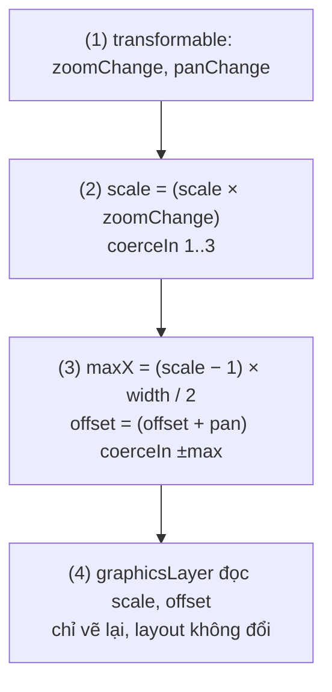
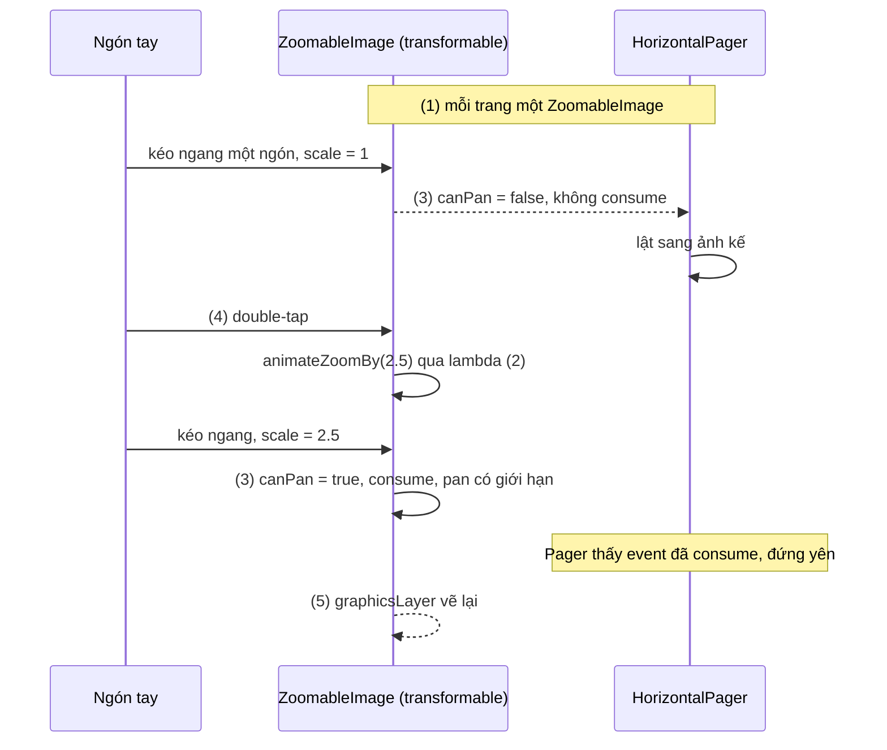

# Zooming

## Vấn đề cần giải quyết

Ảnh sản phẩm, bản đồ tầng, sơ đồ chỗ ngồi, ảnh tài liệu quét đều cần người dùng **pinch** (chụm/mở hai ngón) để phóng to, kéo để xem chỗ khác, và thường là double-tap để phóng nhanh. Cách làm đầu tiên nhiều người nghĩ tới là đổi kích thước phần tử theo tỉ lệ:

```kotlin
// SAI: phóng bằng cách đổi kích thước layout
Image(
    painter = productPhoto,
    contentDescription = null,
    modifier = Modifier.size(300.dp * scale), // scale đổi mỗi frame pinch
)
```

Cách này có ba vấn đề: mỗi frame pinch là một lần recompose và đo lại; phần tử to ra **đẩy** các phần tử xung quanh; và vẫn chưa có gì đọc được cử chỉ hai ngón. Vấn đề cần giải quyết là: đọc được cử chỉ nhiều ngón một cách chuẩn, và phóng/dịch hình ảnh mà layout không hề biết.

## Sau khi học xong

- Giải thích được vì sao transformable chỉ báo zoomChange, panChange, rotationChange và vì sao scale phải nhân dồn còn offset cộng dồn.
- Áp dụng được graphicsLayer dạng lambda để phóng to và dịch phần tử ở draw phase mà không đổi layout hay recompose.
- Triển khai được trình xem ảnh pinch-zoom có giới hạn scale, giới hạn pan theo kích thước và double-tap để phóng to hoặc thu nhỏ.
- Xử lý được xung đột giữa zoom và HorizontalPager hoặc container cuộn bằng canPan và vị trí đặt modifier.

## Zooming là gì?

**Zooming** trong Compose là việc đọc hệ số pinch (`zoomChange`), độ dịch (`panChange`) và góc xoay (`rotationChange`) từ gesture nhiều ngón, cộng dồn vào state `scale`/`offset`, rồi áp lên phần tử bằng `graphicsLayer` ở draw phase; bản thân gesture không phóng to gì cả.

Mental model: **kính lúp đặt lên bức ảnh**. Bức ảnh (layout) vẫn nằm nguyên chỗ, nguyên kích thước; chỉ hình bạn nhìn qua kính được phóng và dịch. Gesture là bàn tay điều khiển kính, state là vị trí và độ phóng của kính, `graphicsLayer` là mặt kính.

Giống [Dragging](dragging.md) và [Scrolling](scrolling.md): gesture modifier đo, state giữ, phần hiển thị đọc state ở phase muộn nhất có thể.

## Cách hoạt động

### 1. Modifier.transformable: đọc pinch, pan, xoay

`Modifier.transformable(state)` nhận diện cử chỉ hai ngón (và kéo một ngón cho pan). State tạo bằng:

```kotlin
val state = rememberTransformableState { zoomChange: Float, panChange: Offset, rotationChange: Float ->
    // cập nhật state của bạn
}
```

- `zoomChange` là **hệ số** so với event trước: `1.05f` nghĩa là to thêm 5%. Vì vậy scale phải **nhân**: `scale *= zoomChange`. Cộng (`scale += zoomChange`) là sai, vì mỗi event không pinch vẫn báo `1f`.
- `panChange` là delta `Offset` theo pixel, **cộng**: `offset += panChange`.
- `rotationChange` là góc (độ) so với event trước, cộng dồn.
- Các bản Compose gần đây có thêm overload nhận `centroid` (điểm giữa các ngón) làm tham số đầu, dùng khi muốn phóng quanh chỗ ngón tay thay vì quanh tâm phần tử.

Tham số của modifier:

- `lockRotationOnZoomPan = true`: nếu cử chỉ bắt đầu bằng zoom hoặc pan thì không xoay. Trình xem ảnh thường không cần xoay thì bỏ qua `rotationChange` luôn.
- `canPan: (Offset) -> Boolean` (overload từ foundation 1.6): quyết định có bắt đầu pan hay không. Đây là chìa khoá để sống chung với pager và container cuộn (mục 4).
- `enabled`.

State còn có `isTransformInProgress` và các hàm `suspend` `animateZoomBy`, `animatePanBy`, `animateRotateBy` để biến đổi bằng code, đi qua đúng lambda của bạn nên các giới hạn vẫn được áp.

### 2. graphicsLayer: phóng và dịch ở draw phase

`Modifier.graphicsLayer { }` vẽ phần tử vào một layer riêng rồi áp biến đổi lên layer đó: `scaleX`, `scaleY`, `translationX`, `translationY`, `rotationZ`, `transformOrigin` (mặc định là tâm). Layout của phần tử **không đổi**: kích thước, vị trí, các phần tử xung quanh đều như cũ, đúng hình ảnh "kính lúp".

Có hai dạng, và chỉ một dạng hợp với gesture:

| Dạng | State đọc ở | Mỗi frame pinch gây ra |
|---|---|---|
| `graphicsLayer(scaleX = scale, ...)` | Composition | Recompose + vẽ lại |
| `graphicsLayer { scaleX = scale }` | Draw phase (lambda) | Chỉ cập nhật layer, không recompose |

Đây vẫn là quy tắc "state đọc ở phase nào thì chạy lại từ phase đó" ([ba phase của một frame](../overview.md)). Ảnh phóng to sẽ tràn ra ngoài khung; thêm `Modifier.clipToBounds()` ở khung ngoài để cắt.

Đặt modifier ở đâu cũng quan trọng: đặt `transformable` ở **khung ngoài** và `graphicsLayer` ở **phần tử con**. Nếu đặt `transformable` sau `graphicsLayer` trên cùng một phần tử, toạ độ pointer nằm trong không gian đã bị phóng, nên `panChange` bị chia theo scale: ở 2x, ngón tay đi 100 px nhưng ảnh chỉ đi 50 px.

### 3. Giới hạn scale và pan

Không giới hạn thì người dùng thu ảnh nhỏ như con kiến hoặc kéo ảnh trôi hẳn khỏi khung. Hai giới hạn chuẩn:

- **Scale** trong một khoảng, ví dụ `1f..4f`: `newScale = (scale * zoomChange).coerceIn(1f, 4f)`.
- **Pan** sao cho mép ảnh không lùi vào trong khung. Với `transformOrigin` ở tâm, ảnh phóng `s` lần tràn ra mỗi bên `(s − 1) × width / 2`, nên `translationX` phải nằm trong `±(s − 1) × width / 2` (tương tự với chiều cao). Ở `s = 1`, khoảng này bằng 0: không pan được.

#### Ví dụ: sơ đồ chỗ ngồi rạp chiếu phim

**Bài toán:** màn chọn ghế hiển thị sơ đồ cả phòng chiếu; ghế nhỏ nên người dùng cần pinch phóng tới 3x rồi kéo tới hàng ghế muốn chọn. Sơ đồ không được thu nhỏ hơn khung, không được kéo lộ khoảng trống.

**Luồng chạy:**

1. `transformable` trên khung ngoài gọi lambda với `zoomChange` và `panChange`.
2. Nhân `scale` với `zoomChange`, giới hạn `1f..3f`.
3. Cộng `panChange` vào `offset`, giới hạn theo công thức `±(scale − 1) × size / 2` của scale mới.
4. `graphicsLayer { }` trên ảnh con đọc `scale`, `offset` ở draw phase.



```kotlin
// SeatMapViewer.kt
private const val MIN_SCALE = 1f
private const val MAX_SCALE = 3f

@Composable
fun SeatMapViewer(seatMap: Painter, modifier: Modifier = Modifier) {
    var size by remember { mutableStateOf(IntSize.Zero) }
    var scale by remember { mutableFloatStateOf(1f) }
    var offset by remember { mutableStateOf(Offset.Zero) }

    val state = rememberTransformableState { zoomChange, panChange, _ ->    // (1)
        val newScale = (scale * zoomChange).coerceIn(MIN_SCALE, MAX_SCALE) // (2)
        val maxX = (newScale - 1f) * size.width / 2f
        val maxY = (newScale - 1f) * size.height / 2f
        offset = Offset(                                                    // (3)
            (offset.x + panChange.x).coerceIn(-maxX, maxX),
            (offset.y + panChange.y).coerceIn(-maxY, maxY),
        )
        scale = newScale
    }

    Box(
        modifier = modifier
            .clipToBounds()
            .onSizeChanged { size = it }
            .transformable(state = state),                                  // (1) khung ngoài
    ) {
        Image(
            painter = seatMap,
            contentDescription = "Sơ đồ chỗ ngồi phòng chiếu",
            modifier = Modifier
                .fillMaxSize()
                .graphicsLayer {                                            // (4) draw phase
                    scaleX = scale
                    scaleY = scale
                    translationX = offset.x
                    translationY = offset.y
                },
        )
    }
}
```

**Kết quả:** pinch mở thì sơ đồ to dần và dừng ở 3x; pinch chụm thì về đúng khung và không nhỏ hơn. Kéo ở 3x thì mép sơ đồ dừng đúng mép khung. Trên emulator, giữ Ctrl (Cmd trên macOS) rồi kéo chuột để giả lập pinch. Layout Inspector cho thấy `SeatMapViewer` không recompose trong lúc pinch.

### 4. Double tap, detectTransformGestures và xung đột với pager

**Double tap để phóng.** Thêm một `pointerInput` riêng với `detectTapGestures(onDoubleTap = { ... })`, rồi gọi `state.animateZoomBy(factor)` trong coroutine. Vì animation đi qua lambda của `rememberTransformableState`, giới hạn scale và pan ở mục 3 vẫn áp. Tap và transform phải ở hai `pointerInput`/modifier khác nhau, vì mỗi detector chiếm trọn khối của nó.

**`detectTransformGestures`.** Bản ở tầng `pointerInput`:

```kotlin
suspend fun PointerInputScope.detectTransformGestures(
    panZoomLock: Boolean = false,
    onGesture: (centroid: Offset, pan: Offset, zoom: Float, rotation: Float) -> Unit,
)
```

Nó cho `centroid` ở mọi bản và tiện khi cần ghép với logic pointer khác trong cùng handler. Nhưng nó **consume mọi chuyển động** sau touch slop, kể cả kéo một ngón khi chưa phóng, và không có `canPan`. Đặt nó trong `HorizontalPager` thì pager không bao giờ nhận được cú vuốt ngang.

**Xung đột với pager và container cuộn.** Ở Main pass, phần tử con nhận event trước cha ([9.8.1 Scrolling](scrolling.md), mục "Hit-testing, ba pass và consume"). Nếu `transformable` (con) consume cú kéo một ngón, pager hoặc `LazyRow` (cha) thấy chuyển động đã bị consume và không cuộn. Cách tài liệu chính thức khuyên: `transformable(state, canPan = { scale != 1f })`. Chưa phóng thì không pan, cú kéo đi lên cha và pager lật trang; đã phóng thì pan ảnh, pager đứng yên. Pinch hai ngón vẫn luôn hoạt động.

## Ví dụ thực tế

Ba bài toán zoom hay gặp:

1. **Trình xem ảnh sản phẩm toàn màn hình trong `HorizontalPager`**: pinch 1x–4x, pan có giới hạn, double-tap 1x ↔ 2.5x, vuốt sang ảnh khác khi chưa phóng. Đây là bài toán chính, code đầy đủ bên dưới.
2. **Sơ đồ chỗ ngồi, bản đồ tầng**: chỉ pinch + pan có giới hạn, như ví dụ ở mục 3.
3. **Xoay và phóng nhãn dán trên ảnh**: dùng cả `rotationChange` (`rotationZ` trong `graphicsLayer`), thường kèm kéo hai trục ([9.8.2 Dragging](dragging.md)). Khi phần tử vừa xoay vừa phóng, muốn phóng đúng quanh điểm giữa hai ngón thì cần overload có `centroid` và công thức đổi hệ toạ độ như sample của `Modifier.transformable` trong API reference.

### Trình xem ảnh sản phẩm trong HorizontalPager

**Bài toán:** trang chi tiết sản phẩm mở gallery ảnh toàn màn hình. Người dùng vuốt ngang để xem ảnh khác; pinch hoặc double-tap để xem chi tiết đường may. Khi đang phóng, kéo ngang phải dịch ảnh chứ không lật trang.

**Luồng chạy:**

1. `HorizontalPager` hiển thị mỗi ảnh trong một `ZoomableImage`; mỗi trang có state zoom riêng, rời trang thì state bị huỷ và ảnh về 1x.
2. Pinch: lambda của `rememberTransformableState` nhân scale (giới hạn 1x–4x) và cộng pan (giới hạn theo kích thước), như mục 3.
3. `canPan = { scale > 1f }`: chưa phóng thì kéo một ngón không bị `transformable` consume, đi lên `HorizontalPager` để lật trang.
4. Double-tap: đang phóng thì `animateZoomBy(1f / scale)` về 1x; chưa phóng thì `animateZoomBy(2.5f)`. Animation đi qua lambda ở bước 2 nên pan tự co về 0 khi thu nhỏ.
5. `graphicsLayer { }` trên ảnh con áp scale và offset ở draw phase.



```kotlin
// ZoomableImage.kt
private const val MIN_SCALE = 1f
private const val MAX_SCALE = 4f
private const val DOUBLE_TAP_SCALE = 2.5f

@Composable
fun ZoomableImage(
    painter: Painter,
    contentDescription: String?,
    modifier: Modifier = Modifier,
) {
    var size by remember { mutableStateOf(IntSize.Zero) }
    var scale by remember { mutableFloatStateOf(1f) }
    var offset by remember { mutableStateOf(Offset.Zero) }
    val scope = rememberCoroutineScope()

    val state = rememberTransformableState { zoomChange, panChange, _ ->     // (2)
        val newScale = (scale * zoomChange).coerceIn(MIN_SCALE, MAX_SCALE)
        val maxX = (newScale - 1f) * size.width / 2f
        val maxY = (newScale - 1f) * size.height / 2f
        offset = Offset(
            (offset.x + panChange.x).coerceIn(-maxX, maxX),
            (offset.y + panChange.y).coerceIn(-maxY, maxY),
        )
        scale = newScale
    }

    Box(
        modifier = modifier
            .clipToBounds()
            .onSizeChanged { size = it }
            .transformable(state = state, canPan = { scale > 1f })            // (3)
            .pointerInput(Unit) {
                detectTapGestures(
                    onDoubleTap = {                                           // (4)
                        val factor = if (scale > 1f) 1f / scale else DOUBLE_TAP_SCALE
                        scope.launch { state.animateZoomBy(factor) }
                    },
                )
            },
    ) {
        Image(
            painter = painter,
            contentDescription = contentDescription,
            contentScale = ContentScale.Fit,
            modifier = Modifier
                .fillMaxSize()
                .graphicsLayer {                                              // (5)
                    scaleX = scale
                    scaleY = scale
                    translationX = offset.x
                    translationY = offset.y
                },
        )
    }
}
```

```kotlin
// ProductGalleryScreen.kt
@Composable
fun ProductGalleryScreen(imageResIds: List<Int>) {
    val pagerState = rememberPagerState(pageCount = { imageResIds.size })
    HorizontalPager(state = pagerState, modifier = Modifier.fillMaxSize()) { page ->  // (1)
        ZoomableImage(
            painter = painterResource(imageResIds[page]),
            contentDescription = "Ảnh sản phẩm " + (page + 1),
            modifier = Modifier.fillMaxSize(),
        )
    }
}
```

**Kết quả:** chưa phóng thì vuốt ngang lật ảnh bình thường. Double-tap: ảnh phóng mượt lên 2.5x; lúc này vuốt ngang dịch ảnh tới mép rồi dừng, pager không lật. Double-tap lần nữa: ảnh về 1x và về giữa. Đổi `canPan` thành bỏ trống (dùng overload không có `canPan`) để thấy lỗi: ở 1x vuốt ngang không lật được trang nữa vì `transformable` đã consume. Double-tap phóng quanh tâm ảnh chứ không quanh điểm chạm; muốn phóng quanh điểm chạm thì cần overload `animateZoomBy` có `centroid` ở các bản mới, kèm công thức offset tương ứng.

## Khi nào nên và không nên dùng

| Tình huống | Nên dùng | Không nên dùng |
|---|---|---|
| Pinch-zoom, pan, xoay một phần tử | `transformable` + `graphicsLayer { }` | Đổi `Modifier.size` theo scale |
| Zoom trong pager, `LazyRow`, container cuộn | `transformable(canPan = { scale > 1f })` | `detectTransformGestures` (consume hết, chặn cha) |
| Cần ghép transform với logic pointer tuỳ chỉnh trong cùng handler | `detectTransformGestures` | Hai `pointerInput` cùng đọc transform |
| Bản đồ thật (tile, nhiều mức chi tiết) | SDK bản đồ (Maps Compose) | Tự phóng một ảnh lớn (tốn bộ nhớ, mờ) |
| Ảnh độ phân giải rất cao (scan tài liệu) | Thư viện subsampling hoặc giải mã theo vùng | Phóng một bitmap kích thước màn hình lên 4x (vỡ hình) |

`graphicsLayer` phóng **hình đã vẽ**, không giải mã lại ảnh ở độ phân giải cao hơn. Ảnh nạp vừa kích thước màn hình rồi phóng 4x sẽ mờ; khi cần chi tiết thật, nạp ảnh lớn hơn hoặc dùng thư viện giải mã theo vùng.

## Sai lầm thường gặp

### 1. Cộng zoomChange thay vì nhân

```kotlin
// SAI: event pan không pinch vẫn báo zoomChange = 1f → scale tăng 1 mỗi event
scale += zoomChange
// ĐÚNG
scale = (scale * zoomChange).coerceIn(MIN_SCALE, MAX_SCALE)
```

### 2. Dùng graphicsLayer dạng tham số

`Modifier.graphicsLayer(scaleX = scale, scaleY = scale)` đọc `scale` trong composition, nên mỗi frame pinch là một lần recompose. Sửa: dạng lambda `graphicsLayer { scaleX = scale }`.

### 3. Đặt transformable sau graphicsLayer trên cùng phần tử

`Modifier.graphicsLayer { ... }.transformable(state)`: toạ độ pointer nằm trong layer đã phóng, `panChange` bị chia theo scale, ảnh "trôi chậm" hơn ngón tay khi đã phóng. Sửa: `transformable` ở khung ngoài, `graphicsLayer` ở con, như các ví dụ trong bài.

### 4. Không giới hạn pan theo scale

Chỉ giới hạn scale mà không giới hạn offset: kéo mạnh là ảnh bay khỏi khung, thu về 1x vẫn lệch. Sửa: tính lại giới hạn `±(scale − 1) × size / 2` theo scale **mới** mỗi lần, như mục 3.

### 5. detectTransformGestures trong HorizontalPager

Pager không lật trang được nữa, vì detector consume cả cú kéo một ngón ở 1x. Sửa: dùng `transformable(canPan = { scale > 1f })`, hoặc tự viết bằng `awaitEachGesture` và chỉ consume khi có hai ngón hoặc đã phóng.

## Lịch sử phát triển

- **Compose 1.0 (07/2021)**: `Modifier.transformable`, `rememberTransformableState`, `detectTransformGestures` và `Modifier.graphicsLayer` đã có. Từ đầu, transform được thiết kế như mọi gesture khác của Compose: chỉ báo thay đổi, state do người dùng giữ.
- **Foundation 1.6 (đầu 2024)**: thêm overload `transformable(state, canPan, ...)` để zoom sống chung với pager và container cuộn mà không phải tự viết pointer handler.
- **Các bản gần đây**: `rememberTransformableState` có overload nhận `centroid`, và `animateZoomBy`/`animatePanBy` nhận `centroid`, để phóng quanh điểm giữa các ngón (hoặc điểm double-tap) mà không cần xuống `detectTransformGestures`.

## Kết nối hệ thống

- **Prerequisites**: [9.8.2 Dragging](dragging.md) (đọc state ở phase muộn, consume), [9.8.1 Scrolling](scrolling.md) (ba pass, vì sao con consume thì cha không cuộn).
- **Related**: [9.7.1 Surface and Canvas](../graphics_animations/surface_and_canvas.md) (draw phase, `graphicsLayer` trong bối cảnh vẽ), [9.8.3 Swiping](swipping.md) (`HorizontalPager` so với `anchoredDraggable`), [9.5.5 LazyRow](../modifier/lazy_row.md) (`HorizontalPager` được nhắc cùng `LazyRow`).
- **Liên quan khác**: ảnh mạng trong trình xem ảnh thường nạp bằng Coil, học ở 8.2.4 Coil (chưa có bài); UI test pinch bằng `performTouchInput { pinch(...) }` ở 10.2 Unit Testing (chưa có bài).

## Tham khảo

- [Multitouch: Panning, zooming, rotating — Android Developers](https://developer.android.com/develop/ui/compose/touch-input/pointer-input/multi-touch)
- [Modifier.transformable — API reference](https://developer.android.com/reference/kotlin/androidx/compose/foundation/gestures/transformable.modifier)
- [Understand gestures — Android Developers](https://developer.android.com/develop/ui/compose/touch-input/pointer-input/understand-gestures)
- [Graphics modifiers — Android Developers](https://developer.android.com/develop/ui/compose/graphics/draw/modifiers)
- [Jetpack Compose phases — Android Developers](https://developer.android.com/develop/ui/compose/phases)
