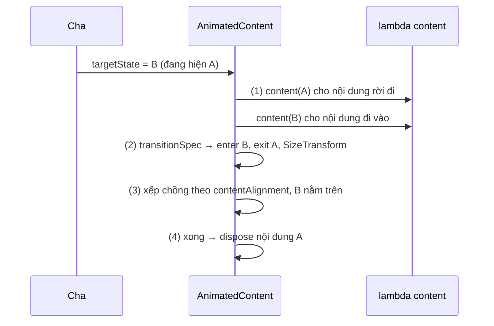
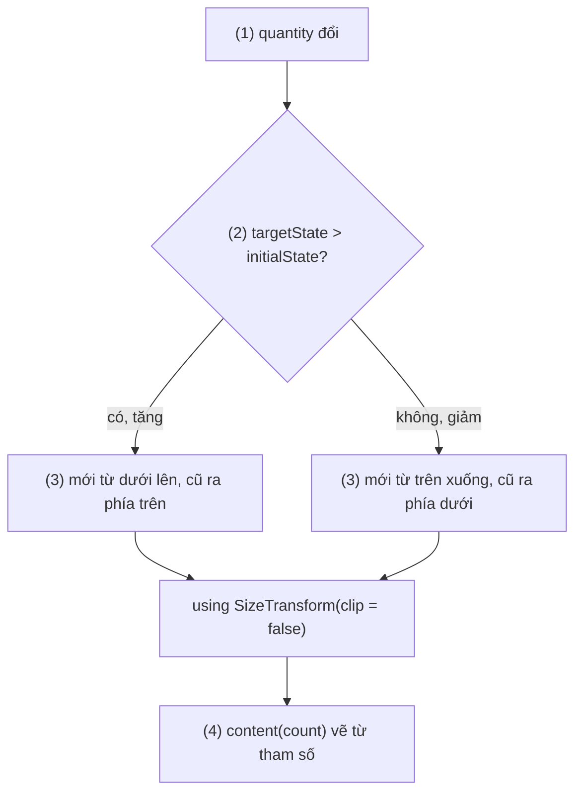
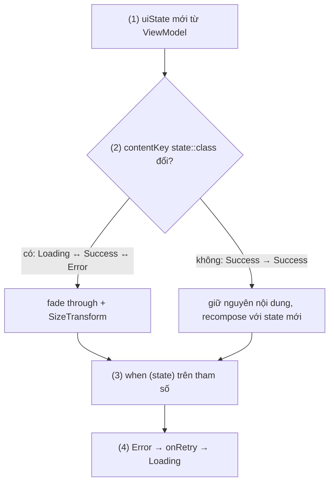
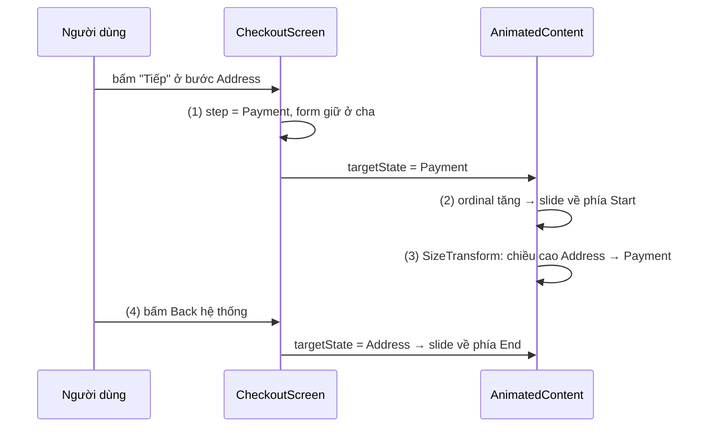

# AnimatedContent

## Vấn đề cần giải quyết

Màn chi tiết đơn hàng đi qua các trạng thái loại trừ nhau: đang tải, có dữ liệu, lỗi. Cách viết thẳng là `when`:

```kotlin
when (uiState) {
    OrderDetailUiState.Loading -> CircularProgressIndicator()
    is OrderDetailUiState.Success -> OrderDetail(uiState.order)
    is OrderDetailUiState.Error -> ErrorPanel(uiState.message, onRetry)
}
```

Nội dung đổi **tức thì**: vòng tải biến mất, cả khối chi tiết bật ra, chiều cao vùng chứa nhảy từ 48dp lên 600dp trong một frame.

Thử ghép bằng nhiều `AnimatedVisibility` ([AnimatedVisibility](animated_visibility.md)):

```kotlin
Column {
    AnimatedVisibility(uiState is OrderDetailUiState.Loading) { CircularProgressIndicator() }
    AnimatedVisibility(uiState is OrderDetailUiState.Success) {
        OrderDetail((uiState as OrderDetailUiState.Success).order)   // lỗi cast khi đang exit
    }
}
```

Trong lúc chuyển, hai khối cùng có mặt và **xếp chồng theo chiều dọc** trong `Column`, nên layout vẫn nhảy. Tệ hơn, khối `Success` đang chạy exit đọc `uiState` đã thành `Loading`, phép cast ném `ClassCastException`.

Vấn đề tổng quát: **chuyển giữa các nội dung khác nhau cần một container giữ đồng thời nội dung cũ và nội dung mới, mỗi nội dung mang đúng giá trị state của nó, đặt chúng chồng lên nhau và animate kích thước từ nội dung cũ sang nội dung mới.**

## Sau khi học xong

- Giải thích được cách AnimatedContent giữ đồng thời nội dung cũ và mới trong lúc chuyển, và vì sao lambda nội dung phải dùng tham số targetState thay vì state bên ngoài.
- Triển khai được transitionSpec bằng togetherWith, using SizeTransform, slideIntoContainer và targetContentZIndex, chọn hiệu ứng theo initialState và targetState.
- Áp dụng được contentKey để chỉ animate khi loại nội dung đổi, không animate khi dữ liệu bên trong cùng một loại thay đổi.
- Nhận diện được các lỗi như đọc state bên ngoài trong lambda nội dung, SizeTransform clip làm cắt hiệu ứng slide và mất state cục bộ của nội dung sau khi chuyển.

## AnimatedContent là gì?

**`AnimatedContent`** là container nhận `targetState` và một lambda ánh xạ **state sang nội dung**. Khi `targetState` đổi (so theo `contentKey`), nó giữ đồng thời nội dung của state cũ và state mới, chạy exit cho nội dung cũ và enter cho nội dung mới **cùng lúc**, animate kích thước container bằng `SizeTransform`, rồi dispose nội dung cũ.

Mental model: **sân khấu đổi cảnh**. Cảnh cũ lui vào cánh gà trong khi cảnh mới bước ra; mỗi cảnh cầm đúng kịch bản của mình (giá trị state được truyền cho lambda), không nhìn sang kịch bản của cảnh kia; sân khấu co giãn theo kích thước cảnh mới.

## Cách hoạt động

### 1. `targetState` và lambda nội dung

Chữ ký chính (Compose Animation 1.5 trở đi):

```kotlin
@Composable
fun <S> AnimatedContent(
    targetState: S,
    modifier: Modifier = Modifier,
    transitionSpec: AnimatedContentTransitionScope<S>.() -> ContentTransform = {
        AnimatedContentDefaults.ContentTransform
    },
    contentAlignment: Alignment = Alignment.TopStart,
    label: String = "AnimatedContent",
    contentKey: (targetState: S) -> Any? = { it },
    content: @Composable AnimatedContentScope.(targetState: S) -> Unit
)
```

Khi `targetState` đổi từ A sang B:

1. `AnimatedContent` gọi lambda `content` **hai lần** trong cùng frame: một lần với A (nội dung đang rời đi), một lần với B (nội dung đang vào). Mỗi nội dung được nhận diện bằng `contentKey` của state nó mang.
2. `transitionSpec` trả `ContentTransform`: enter cho nội dung B, exit cho nội dung A, `SizeTransform` cho kích thước container.
3. Hai nội dung được đặt **chồng lên nhau** theo `contentAlignment`; nội dung đích được đặt sau nên nằm trên, trừ khi đặt `targetContentZIndex`.
4. Khi transform xong, nội dung A bị dispose; chỉ còn B.



Bước 1 là lý do của quy tắc quan trọng nhất: **lambda phải dùng tham số của nó**, không đọc state bên ngoài. Tài liệu ghi rõ tham số đó là key để tra nội dung đang hiện; nội dung của A chỉ đúng là A nếu nó vẽ từ tham số `A`, không phải từ biến bên ngoài đã thành `B`.

Mặc định, `AnimatedContent` dùng kiểu **fade through**: nội dung cũ fade out, nội dung mới fade in (kèm scale in nhẹ) sau một khoảng trễ ngắn, và kích thước container chạy bằng spring. Receiver của lambda là `AnimatedContentScope`, cũng là một `AnimatedVisibilityScope`, nên dùng được `Modifier.animateEnterExit` và `transition` cho từng con như ở [AnimatedVisibility](animated_visibility.md).

#### Ví dụ: bộ đếm số lượng trong giỏ hàng

**Bài toán:** mỗi dòng trong giỏ hàng có nút trừ, số lượng, nút cộng. Tăng thì số mới **trượt lên** từ dưới, giảm thì **trượt xuống** từ trên, để người dùng cảm nhận được chiều thay đổi.

**Luồng chạy:**

1. `quantity` được hoist ra ngoài; `AnimatedContent` nhận `targetState = quantity`.
2. `transitionSpec` so `targetState` với `initialState` để biết tăng hay giảm.
3. Tăng: số mới trượt vào từ dưới (`height`), số cũ trượt ra phía trên (`-height`); giảm thì ngược lại. `SizeTransform(clip = false)` để phần trượt ra ngoài không bị cắt.
4. Lambda vẽ `Text` từ tham số `count`.



```kotlin
// QuantityStepper.kt
@Composable
fun QuantityStepper(quantity: Int, onQuantityChange: (Int) -> Unit, modifier: Modifier = Modifier) {
    Row(modifier, verticalAlignment = Alignment.CenterVertically) {
        IconButton(onClick = { onQuantityChange(quantity - 1) }, enabled = quantity > 1) {
            Icon(painterResource(R.drawable.ic_remove), contentDescription = "Giảm số lượng")
        }
        AnimatedContent(
            targetState = quantity,                                                    // (1)
            transitionSpec = {
                val slide = if (targetState > initialState) {                          // (2)
                    slideInVertically { height -> height } + fadeIn() togetherWith       // (3)
                        slideOutVertically { height -> -height } + fadeOut()
                } else {
                    slideInVertically { height -> -height } + fadeIn() togetherWith
                        slideOutVertically { height -> height } + fadeOut()
                }
                slide using SizeTransform(clip = false)
            },
            label = "cartQuantity"
        ) { count ->                                                                   // (4)
            Text(
                text = "$count",
                modifier = Modifier.widthIn(min = 32.dp),
                textAlign = TextAlign.Center,
                style = MaterialTheme.typography.titleMedium
            )
        }
        IconButton(onClick = { onQuantityChange(quantity + 1) }) {
            Icon(painterResource(R.drawable.ic_add), contentDescription = "Tăng số lượng")
        }
    }
}
```

Toán tử `+` ưu tiên hơn hàm infix `togetherWith`, nên `a + b togetherWith c + d` nghĩa là `(a + b) togetherWith (c + d)`. Gán kết quả của `if` vào `slide` rồi mới `using` giúp `SizeTransform` áp cho cả hai nhánh.

**Kết quả:** bấm cộng từ 2 lên 3, số 3 trượt lên từ dưới trong khi số 2 trượt lên và mờ đi; bấm trừ thì ngược lại. Số 9 lên 10 rộng hơn, container nới chiều rộng mượt nhờ `SizeTransform`.

### 2. `transitionSpec`: ContentTransform và SizeTransform

`transitionSpec` có receiver `AnimatedContentTransitionScope<S>`, cho biết `initialState` và `targetState` của lần chuyển đang chạy, và trả về một `ContentTransform` gồm bốn phần:

| Phần | Tạo bằng | Ý nghĩa |
|---|---|---|
| Enter của nội dung mới | Mọi `EnterTransition` của [AnimatedVisibility](animated_visibility.md), thêm `slideIntoContainer(towards)` | Nội dung đích xuất hiện thế nào |
| Exit của nội dung cũ | Mọi `ExitTransition`, thêm `slideOutOfContainer(towards)` | Nội dung cũ rời đi thế nào |
| Kích thước | `using SizeTransform(clip, sizeAnimationSpec)` | Container chạy từ kích thước cũ sang mới thế nào, có clip không |
| Thứ tự chồng | `targetContentZIndex` | Nội dung nào nằm trên trong lúc chồng nhau |

Ghép enter và exit bằng `enter togetherWith exit`. Một vài điểm cần nắm:

- **`slideIntoContainer` / `slideOutOfContainer`** nhận hướng `AnimatedContentTransitionScope.SlideDirection` (`Start`, `End`, `Up`, `Down`, `Left`, `Right`) và tự tính quãng trượt theo kích thước của container và nội dung, thay cho việc tự viết `slideInHorizontally { it }`. `Start`/`End` tự đảo theo hướng ngôn ngữ (RTL).
- **`SizeTransform`** mặc định `clip = true` (nội dung bị cắt theo kích thước đang animate) và dùng spring. Lambda `SizeTransform { initialSize, targetSize -> keyframes { … } }` cho phép animate chiều rộng và chiều cao theo thứ tự khác nhau, ví dụ mở ngang trước, dọc sau. Truyền `using(null)` để không animate kích thước.
- **`targetContentZIndex`** mặc định 0; vì nội dung đích được đặt sau nên mặc định nó nằm trên. Đặt giá trị khi muốn nội dung cũ nằm đè lên trong lúc rời đi.

### 3. `contentKey`: khi nào được coi là "nội dung khác"

Mặc định `contentKey = { it }`: mỗi giá trị `targetState` khác nhau (theo `equals`) là một nội dung khác và kích hoạt animation. Với UI state dạng sealed interface, điều đó thường không đúng ý:

- `Loading → Success(order)`: nên animate.
- `Success(order v1) → Success(order v2)` (làm mới, trạng thái giao hàng đổi): **không nên** fade cả màn hình, chỉ cần chữ trạng thái đổi.

Đặt `contentKey = { it::class }` (hoặc một ánh xạ khác) để chỉ animate khi **key** đổi. Khi key giữ nguyên, nội dung giữ nguyên chỗ trong composition và lambda nhận giá trị state mới, giống một lần recompose bình thường.

#### Ví dụ: màn chi tiết đơn hàng Loading/Success/Error

**Bài toán:** màn chi tiết đơn hàng lấy `uiState` từ ViewModel ([MVVM](../../session_07/architecture/mvvm.md)). Chuyển giữa tải, có dữ liệu và lỗi phải có hiệu ứng; khi kéo để làm mới và đơn hàng đổi trạng thái, chỉ chữ trạng thái đổi, màn hình không nháy.

**Luồng chạy:**

1. ViewModel phát `uiState`; màn hình truyền nó làm `targetState`.
2. `contentKey = { it::class }`: `Loading → Success` đổi key nên animate; `Success → Success` cùng key nên không.
3. Lambda `when` trên tham số `state`, không trên `uiState` bên ngoài.
4. Lỗi: bấm "Thử lại", ViewModel phát `Loading`, key đổi, animate sang vòng tải.



```kotlin
// OrderDetailUiState.kt
sealed interface OrderDetailUiState {
    data object Loading : OrderDetailUiState
    data class Success(val order: Order) : OrderDetailUiState
    data class Error(val message: String) : OrderDetailUiState
}

// OrderDetailContent.kt
@Composable
fun OrderDetailContent(uiState: OrderDetailUiState, onRetry: () -> Unit, modifier: Modifier = Modifier) {
    AnimatedContent(
        targetState = uiState,                                                       // (1)
        modifier = modifier,
        contentKey = { state -> state::class },                                      // (2)
        contentAlignment = Alignment.Center,
        label = "orderDetail"
    ) { state ->
        when (state) {                                                               // (3) dùng tham số
            OrderDetailUiState.Loading -> CircularProgressIndicator()
            is OrderDetailUiState.Success -> OrderDetail(state.order)
            is OrderDetailUiState.Error -> ErrorPanel(state.message, onRetry)        // (4)
        }
    }
}
```

`OrderDetail` và `ErrorPanel` là composable vẽ chi tiết đơn và thông báo lỗi kèm nút "Thử lại".

**Kết quả:** mở màn hình, vòng tải mờ đi và khối chi tiết hiện dần trong khi vùng chứa nới chiều cao. Kéo để làm mới khi đơn chuyển từ "Đang giao" sang "Đã giao": chỉ chữ trạng thái đổi, không có fade. Tắt mạng rồi làm mới: chuyển sang khối lỗi có hiệu ứng.

## Ví dụ thực tế

Ba bài toán hay gặp:

1. **Form thanh toán nhiều bước** (địa chỉ, thanh toán, xác nhận): tiến thì trượt sang trái, lùi thì trượt sang phải, chiều cao đổi mượt giữa các bước. Đây là bài toán chính, code đầy đủ bên dưới.
2. **Trạng thái tải dữ liệu:** như ví dụ ở mục 3.
3. **Nút đổi nhãn theo trạng thái:** "Theo dõi" thành "Đang theo dõi", chiều rộng nút nới dần nhờ `SizeTransform`.

### Form thanh toán ba bước

**Bài toán:** luồng thanh toán có ba bước có chiều cao khác nhau. Bấm "Tiếp" thì bước mới trượt vào từ phía cuối dòng (bên phải với tiếng Việt), bấm "Quay lại" hoặc nút Back của hệ thống thì trượt ngược lại. Quay lại bước trước, dữ liệu đã nhập phải còn nguyên.

**Luồng chạy:**

1. `step` (enum) và `form` (dữ liệu đã nhập) được hoist lên cha. Dữ liệu không nằm trong nội dung của từng bước, vì nội dung rời đi sẽ bị dispose.
2. `transitionSpec` so `ordinal`: tiến thì `SlideDirection.Start`, lùi thì `SlideDirection.End`; `slideIntoContainer` và `slideOutOfContainer` tự tính quãng trượt.
3. `SizeTransform` mặc định (đi kèm `togetherWith`) animate chiều cao giữa các bước; `clip = true` cắt phần trượt ở mép container, đúng ý cho hiệu ứng chuyển trang.
4. `BackHandler` bắt nút Back của hệ thống khi không ở bước đầu và gọi `onBack`.



```kotlin
// CheckoutScreen.kt
enum class CheckoutStep { Address, Payment, Review }

@Composable
fun CheckoutFlow(
    step: CheckoutStep,
    form: CheckoutForm,
    onFormChange: (CheckoutForm) -> Unit,
    onNext: () -> Unit,
    onBack: () -> Unit,
    modifier: Modifier = Modifier
) {
    BackHandler(enabled = step != CheckoutStep.Address, onBack = onBack)               // (4)

    AnimatedContent(
        targetState = step,
        modifier = modifier,
        transitionSpec = {
            val direction = if (targetState.ordinal > initialState.ordinal) {          // (2)
                AnimatedContentTransitionScope.SlideDirection.Start
            } else {
                AnimatedContentTransitionScope.SlideDirection.End
            }
            slideIntoContainer(towards = direction) togetherWith                       // (3) kèm SizeTransform mặc định
                slideOutOfContainer(towards = direction)
        },
        label = "checkoutStep"
    ) { current ->
        when (current) {
            CheckoutStep.Address -> AddressStep(
                address = form.address,                                                // (1) dữ liệu từ cha
                onAddressChange = { onFormChange(form.copy(address = it)) },
                onNext = onNext
            )
            CheckoutStep.Payment -> PaymentStep(
                method = form.paymentMethod,
                onMethodChange = { onFormChange(form.copy(paymentMethod = it)) },
                onNext = onNext,
                onBack = onBack
            )
            CheckoutStep.Review -> ReviewStep(form = form, onBack = onBack)
        }
    }
}
```

`BackHandler` thuộc thư viện `activity-compose`. `CheckoutForm` là data class chứa địa chỉ và phương thức thanh toán, thường nằm trong UI state của ViewModel.

**Kết quả:** bấm "Tiếp", bước Thanh toán trượt vào từ bên phải trong khi bước Địa chỉ trượt ra bên trái, vùng chứa co chiều cao mượt. Bấm Back hệ thống, bước Địa chỉ trượt về và địa chỉ đã nhập vẫn còn. Viết UI test bằng `composeTestRule`: bấm "Tiếp", chờ idle, kiểm tra node "Phương thức thanh toán" hiển thị và node của bước Địa chỉ không còn trong cây (Compose UI test học ở 10.2 Unit Testing, chưa có bài).

## So sánh với các cách tiếp cận khác

| Cách | Hiệu ứng | Animate kích thước | Hợp với |
|---|---|---|---|
| `AnimatedContent` | Enter/exit tuỳ ý theo cặp state | Có (`SizeTransform`) | Nội dung khác nhau, kích thước khác nhau, cần hiệu ứng có hướng |
| [Crossfade](crossfade.md) | Chỉ fade đồng thời | Không | Nội dung cùng kích thước, chỉ cần hoà tan |
| Nhiều `AnimatedVisibility` | Enter/exit riêng từng khối | Mỗi khối tự lo | Các khối **độc lập**, có thể cùng hiện |
| Transition của Navigation Compose | `enterTransition`/`exitTransition` của destination | Theo màn hình | Chuyển giữa các **màn hình** có back stack |
| `HorizontalPager` | Vuốt ngang theo tay | Không | Trang người dùng vuốt qua lại |

`AnimatedContent` chuyển giữa các trạng thái của **một** vùng UI. Khi các bước là các màn hình riêng có back stack, deep link, ViewModel riêng, dùng Navigation thay vì một `AnimatedContent` lớn.

## Khi nào nên và không nên dùng

- **Nên dùng** khi một vùng UI chuyển giữa các trạng thái loại trừ nhau (Loading/Success/Error, các bước của form, nhãn của nút) và cần hiệu ứng có hướng hoặc kích thước đổi mượt.
- **Nên đặt `contentKey`** khi `targetState` là object chứa dữ liệu thay đổi trong cùng một loại nội dung.
- **Không cần** khi chỉ cần fade giữa hai nội dung cùng kích thước: [Crossfade](crossfade.md) gọn hơn.
- **Không nên** bọc vùng có state đổi theo frame hoặc mỗi giây (đồng hồ đếm ngược, giá cổ phiếu) bằng một `AnimatedContent` lớn: mỗi lần đổi là một lần compose hai bản nội dung.

## Sai lầm thường gặp

### 1. Đọc state bên ngoài trong lambda

```kotlin
AnimatedContent(targetState = uiState, label = "order") {
    when (uiState) {   // sai: đọc biến bên ngoài
        // …
    }
}
```

Trong lúc chuyển, lambda được gọi cho cả nội dung cũ và mới, nhưng cả hai đều đọc `uiState` đã là giá trị mới: nội dung đang rời đi vẽ dữ liệu mới, hiệu ứng trông như nháy, và nếu có ép kiểu thì crash. Sửa: luôn dùng tham số, `{ state -> when (state) { … } }`.

### 2. Mỗi lần dữ liệu đổi lại animate

`targetState` là `Success(order)` và `order` đổi mỗi lần làm mới: với `contentKey` mặc định, mỗi lần đổi là một lần fade cả màn hình. Sửa: `contentKey = { it::class }` như mục 3.

### 3. `SizeTransform` clip cắt hiệu ứng slide

Bộ đếm số lượng nhỏ hơn quãng trượt; với `clip = true` mặc định, số đang trượt ra bị cắt cụt ở mép container, trông như biến mất đột ngột. Sửa: `using SizeTransform(clip = false)` khi hiệu ứng cần vẽ ra ngoài vùng chứa.

### 4. Giữ state của form bên trong nội dung

```kotlin
CheckoutStep.Address -> {
    var address by rememberSaveable { mutableStateOf("") }   // mất khi chuyển bước
    AddressStep(address, onAddressChange = { address = it }, onNext)
}
```

Nội dung rời đi bị dispose sau khi transform xong, mọi `remember` (kể cả `rememberSaveable`) bên trong mất. Quay lại bước Địa chỉ thì ô nhập trống. Sửa: hoist dữ liệu lên cha hoặc ViewModel ([State và State Hoisting](../state/mutable_state.md)).

### 5. Dùng hàm `with` cũ

Code từ trước 2023 viết `fadeIn() with fadeOut()`. Hàm infix `with` đã deprecated, thay bằng `togetherWith`; tên mới cũng tránh nhầm với hàm scope `with` của Kotlin.

## Lịch sử phát triển

- **Compose 1.0 (07/2021):** `AnimatedContent` có mặt nhưng là API experimental (`@ExperimentalAnimationApi`); enter và exit ghép bằng hàm infix `with`.
- **Compose Animation 1.5 (2023):** `AnimatedContent` ổn định. Overload hiện hành có `label` và `contentKey`; `togetherWith` thay `with` (deprecated). Cùng đợt có `Transition.AnimatedContent` để gom chuyển nội dung vào một `Transition` chung ([MutableTransitionState](mutable_transition_state.md)).

## Kết nối hệ thống

- **Prerequisites:**
  - [AnimatedVisibility](animated_visibility.md) — bản đồ API animation, các nhóm `EnterTransition`/`ExitTransition` dùng lại trong `ContentTransform`.
- **Related:**
  - [Crossfade](crossfade.md) — phiên bản chỉ fade, không animate kích thước.
  - [MutableTransitionState](mutable_transition_state.md) — `Transition.AnimatedContent`, gom vào transition cha.
  - [MVVM](../../session_07/architecture/mvvm.md) — `uiState` dạng sealed interface làm `targetState`.
  - [State và State Hoisting](../state/mutable_state.md) — hoist dữ liệu ra khỏi nội dung sẽ bị dispose.
- **Học tiếp (theo nav):** [Crossfade](crossfade.md).

## Tham khảo

- [Animation modifiers and composables: AnimatedContent — Android Developers](https://developer.android.com/develop/ui/compose/animation/composables-modifiers)
- [AnimatedContent — API reference](https://developer.android.com/reference/kotlin/androidx/compose/animation/AnimatedContent.composable)
- [Value-based animations: Transition.AnimatedContent — Android Developers](https://developer.android.com/develop/ui/compose/animation/value-based)
