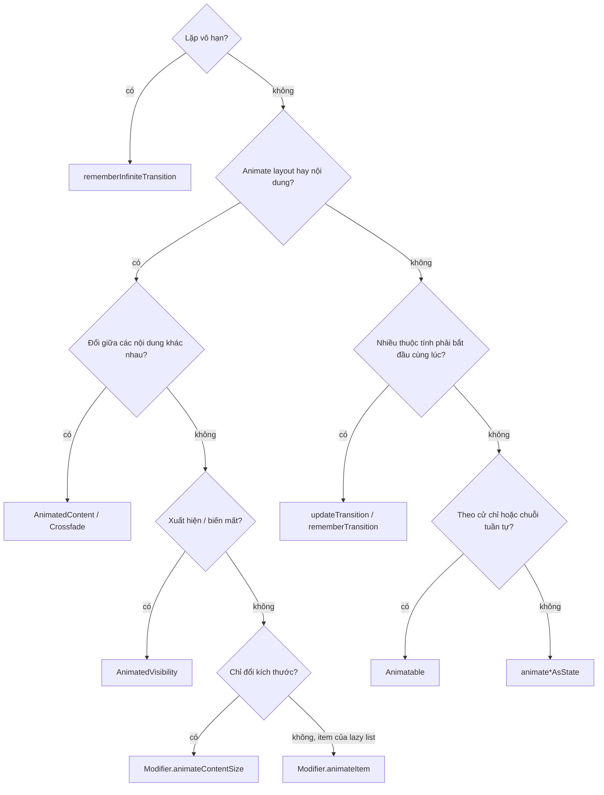
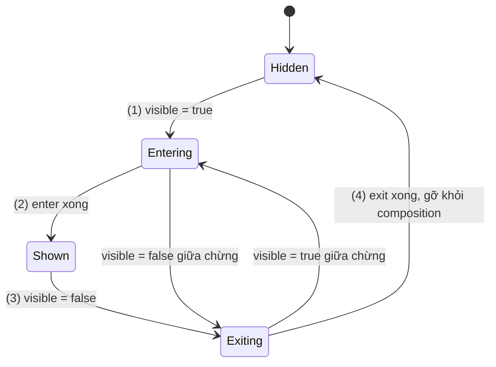
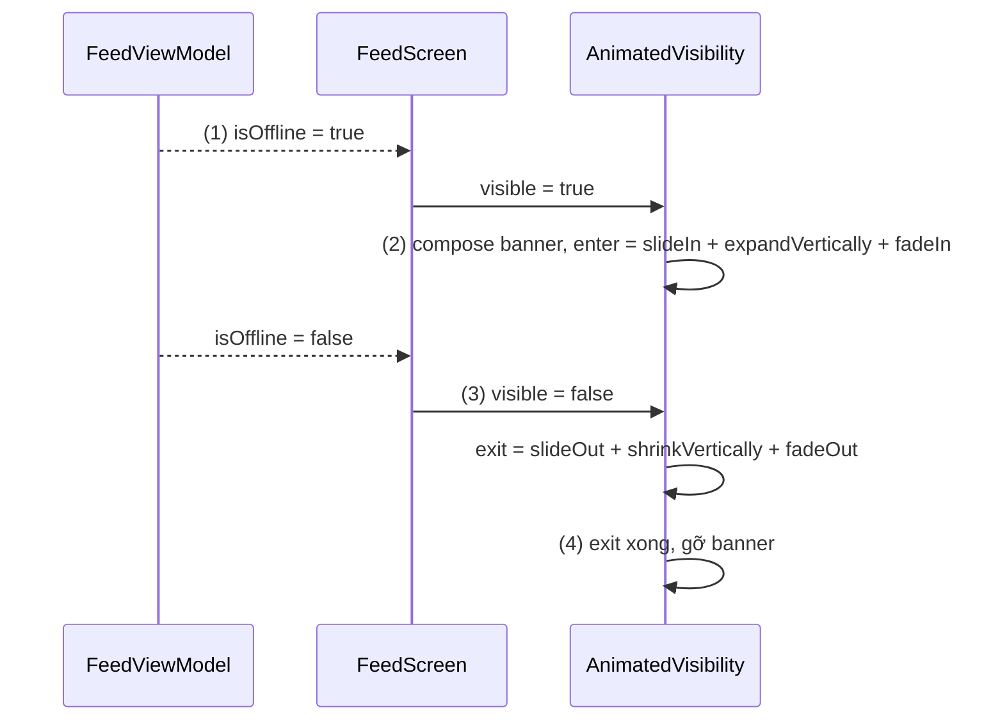
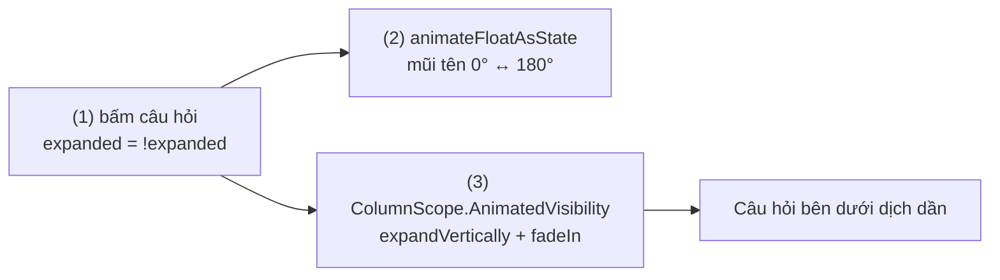
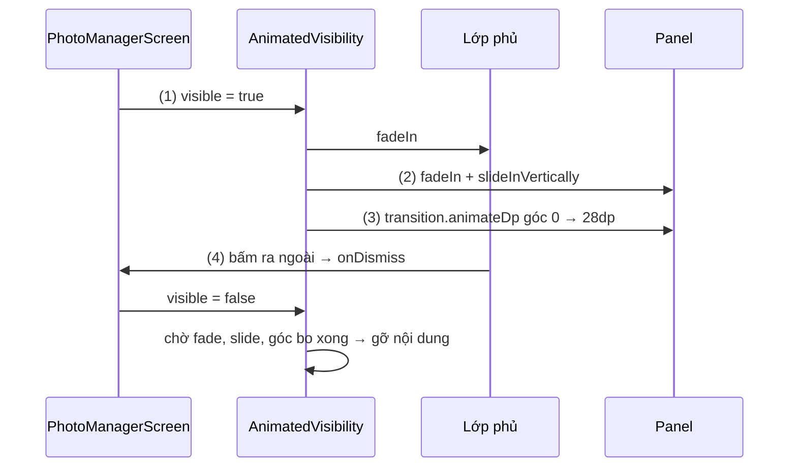
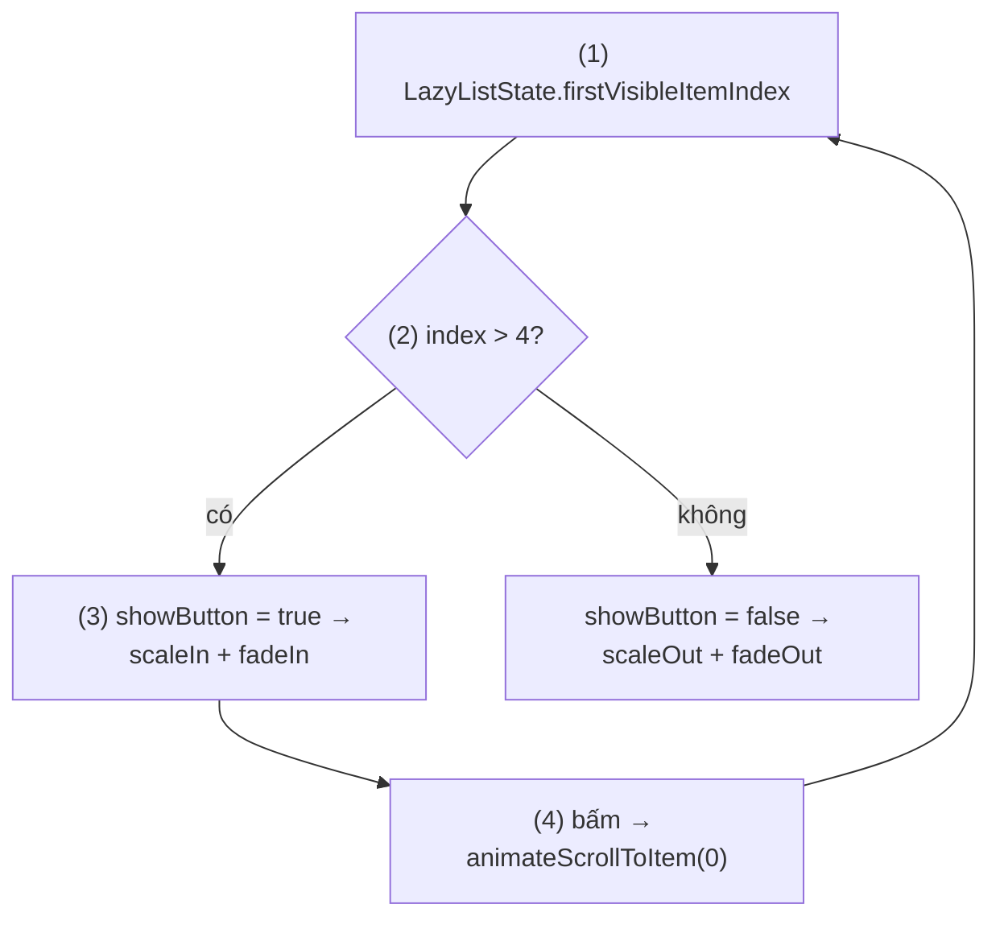

# AnimatedVisibility

## Vấn đề cần giải quyết

Ẩn hiện một phần UI theo state là việc rất thường gặp: banner "mất kết nối", câu trả lời của mục FAQ, nút "lên đầu trang", thông báo lỗi dưới ô nhập. Cách viết thẳng là một câu `if`:

```kotlin
Column {
    if (isOffline) OfflineBanner()
    FeedList()
}
```

Banner xuất hiện và biến mất **tức thì**, danh sách bên dưới giật lên giật xuống một đoạn bằng chiều cao banner. Người dùng thấy UI "nhảy", không hiểu chuyện gì vừa xảy ra.

Thử tự thêm animation bằng alpha:

```kotlin
val alpha by animateFloatAsState(if (isOffline) 1f else 0f, label = "bannerAlpha")
OfflineBanner(Modifier.graphicsLayer { this.alpha = alpha })
```

Giờ banner mờ dần, nhưng khi alpha bằng 0 nó **vẫn chiếm chỗ**, vẫn nhận chạm và vẫn nằm trong composition. Muốn gỡ nó sau khi mờ xong thì phải tự chờ animation kết thúc rồi đổi một cờ thứ hai.

Vấn đề tổng quát: **xuất hiện và biến mất có animation cần một thứ giữ nội dung sống trong lúc nó đang biến mất, rồi gỡ nó đúng lúc animation xong.** Ngoài ra, Compose có khá nhiều API animation; chọn sai API làm code phức tạp hơn cần thiết. Bài này bắt đầu bằng bản đồ các API đó.

## Sau khi học xong

- Biết khi nào dùng animate*AsState, AnimatedVisibility, AnimatedContent, Crossfade, updateTransition, rememberInfiniteTransition, Animatable và animateContentSize theo bản đồ API animation của Compose.
- Giải thích được vòng đời nội dung bên trong AnimatedVisibility, từ lúc enter tới khi exit xong và bị gỡ khỏi composition.
- Triển khai được hiệu ứng xuất hiện, biến mất bằng cách kết hợp EnterTransition và ExitTransition, và phân biệt được nhóm làm đổi kích thước layout (expand, shrink) với nhóm chỉ đổi cách vẽ (fade, slide, scale).
- Áp dụng được Modifier.animateEnterExit và transition của AnimatedVisibilityScope để từng phần con có animation riêng.
- Nhận diện được các lỗi như đọc dữ liệu đã null trong lúc exit, dùng animate*AsState cho exit bên trong nội dung và kỳ vọng animation chạy ở lần composition đầu tiên.

## AnimatedVisibility là gì?

**`AnimatedVisibility`** là composable bọc một phần nội dung và nối tham số `visible` với vòng đời của nội dung đó: khi `visible` chuyển sang `true`, nội dung được đưa vào composition và chạy **enter transition**; khi `visible` chuyển sang `false`, nội dung **vẫn còn** trong lúc chạy **exit transition**, và chỉ bị gỡ khỏi composition khi exit xong.

Mental model: **cánh cửa có người gác**. Nội dung không hiện ra hay biến mất tại chỗ mà luôn đi qua cửa: đi vào theo kiểu `enter`, đi ra theo kiểu `exit`. Người gác chỉ đóng cửa (gỡ khỏi composition) khi nội dung đã đi ra hết.

## Cách hoạt động

### 1. Bản đồ API animation của Compose

Compose chia API animation thành ba tầng. Tầng cao là composable và modifier làm trọn một việc (`AnimatedVisibility`, `AnimatedContent`, `Crossfade`, `animateContentSize`). Tầng giữa animate **giá trị** (`animate*AsState`, `Transition`, `InfiniteTransition`). Tầng thấp là `Animatable`, một giá trị animate được điều khiển bằng coroutine. Tầng cao dựng trên tầng giữa, tầng giữa dựng trên `Animatable` và `Animation`.

| API | Animate cái gì | Dùng khi | Học ở |
|---|---|---|---|
| `animate*AsState` | Một giá trị (`Float`, `Dp`, `Color`, `Offset`…) chạy tới target | Thuộc tính độc lập có target rõ: màu nút khi bật, góc xoay mũi tên | Bài này (mục 3) |
| `AnimatedVisibility` | Sự xuất hiện, biến mất của nội dung | Banner, phần mở rộng, nút nổi | Bài này |
| `AnimatedContent` | Chuyển giữa các nội dung khác nhau theo `targetState` | Loading/Success/Error, bộ đếm, bước của form | [AnimatedContent](animated_content.md) |
| `Crossfade` | Chuyển nội dung chỉ bằng fade | Đổi ảnh bìa, đổi tab đơn giản | [Crossfade](crossfade.md) |
| `updateTransition` / `rememberTransition` | Nhiều giá trị cùng theo một state, bắt đầu cùng lúc | Thẻ được chọn: viền, độ nổi, màu đổi cùng nhau | [MutableTransitionState](mutable_transition_state.md) |
| `rememberInfiniteTransition` | Giá trị lặp vô hạn | Chấm "đang ghi âm" nhấp nháy, shimmer | Bài này (chỉ nhắc) |
| `Animatable` | Một giá trị, điều khiển bằng `animateTo`, `snapTo`, `animateDecay` | Theo cử chỉ, chuỗi tuần tự, giá trị đầu khác target | [Dragging](../gesture/dragging.md) |
| `Modifier.animateContentSize()` | Kích thước của một composable | Đoạn mô tả "xem thêm" | Bài này (chỉ nhắc) |
| `Modifier.animateItem()` | Thêm, xoá, đổi chỗ item trong lazy list | Danh sách việc cần làm | [LazyColumn](../modifier/lazy_column.md) |

Tài liệu chính thức có một cây quyết định để chọn API; dưới đây là phần cốt lõi của nó:



Hai khái niệm dùng chung cho mọi API trên:

- **`AnimationSpec`** quyết định giá trị chạy thế nào theo thời gian. `spring()` (mô phỏng lò xo, là mặc định của phần lớn API) không có thời lượng cố định; `tween(durationMillis, delayMillis, easing)` chạy theo thời lượng và đường cong easing; `keyframes { }` định giá trị tại từng mốc thời gian.
- **Bị ngắt giữa chừng:** khi target đổi lúc animation đang chạy, animation mới bắt đầu từ **giá trị và vận tốc hiện tại**, không nhảy về đầu. Đây là lý do UI Compose không giật khi người dùng bấm liên tục.

Hầu hết API có tham số `label` để phân biệt các animation trong công cụ Animation Preview của Android Studio.

### 2. Vòng đời nội dung trong AnimatedVisibility

Bên trong, `AnimatedVisibility` là một `Transition<EnterExitState>` với ba giá trị: `PreEnter` (trước khi vào), `Visible` (đã vào), `PostExit` (đã ra). Từ góc nhìn của nội dung, vòng đời như sau:

1. `visible = true`: nội dung được compose, transition chạy từ `PreEnter` tới `Visible` theo `enter`.
2. Enter xong: nội dung hiển thị bình thường.
3. `visible = false`: transition chạy từ `Visible` tới `PostExit` theo `exit`. Nội dung **vẫn đang được compose và vẽ**.
4. Exit xong: nội dung bị gỡ khỏi composition, mọi `remember` bên trong mất.

Nếu `visible` đổi lại giữa chừng, transition quay đầu từ giá trị hiện tại. Lần composition đầu tiên với `visible = true` **không có enter**: nội dung hiện ngay ở trạng thái `Visible`. Muốn chạy enter ngay khi vừa vào màn hình thì cần `MutableTransitionState` ([MutableTransitionState](mutable_transition_state.md)).



Về layout, `AnimatedVisibility` là một `Layout` riêng: kích thước của nó bằng chiều rộng lớn nhất và chiều cao lớn nhất của các con, các con căn ở góc trên bên trái.

#### Ví dụ: banner "Mất kết nối" trượt xuống từ đỉnh màn hình

**Bài toán:** màn bảng tin hiện banner báo mất mạng ở đầu danh sách. Banner phải trượt xuống, đẩy danh sách xuống **dần dần**, và khi có mạng lại thì trượt lên, kéo danh sách lên theo.

**Luồng chạy:**

1. Màn hình đọc `isOffline` từ ViewModel và truyền vào `ConnectivityBanner`.
2. `isOffline = true`: banner được compose, enter chạy: trượt từ phía trên (`-fullHeight`), đồng thời chiều cao layout mở dần từ 0 nên danh sách bị đẩy xuống mượt.
3. `isOffline = false`: exit chạy ngược lại; banner vẫn hiện và co dần.
4. Exit xong, banner bị gỡ khỏi composition.



```kotlin
// ConnectivityBanner.kt
@Composable
fun ConnectivityBanner(isOffline: Boolean, modifier: Modifier = Modifier) {
    AnimatedVisibility(
        visible = isOffline,                                                    // (2)(3)
        modifier = modifier,
        enter = slideInVertically { fullHeight -> -fullHeight } +              // (2) từ trên xuống
            expandVertically(expandFrom = Alignment.Top) + fadeIn(),
        exit = slideOutVertically { fullHeight -> -fullHeight } +               // (3)
            shrinkVertically(shrinkTowards = Alignment.Top) + fadeOut(),
        label = "offlineBanner"
    ) {
        Surface(color = MaterialTheme.colorScheme.errorContainer) {
            Text(
                text = "Không có kết nối mạng. Đang hiện dữ liệu đã lưu.",
                modifier = Modifier.fillMaxWidth().padding(12.dp),
                style = MaterialTheme.typography.bodyMedium
            )
        }
    }
}

// FeedScreen.kt
@Composable
fun FeedScreen(viewModel: FeedViewModel, modifier: Modifier = Modifier) {
    val isOffline by viewModel.isOffline.collectAsStateWithLifecycle()          // (1)
    Column(modifier) {
        ConnectivityBanner(isOffline = isOffline)
        FeedList(modifier = Modifier.weight(1f))
    }
}
```

`collectAsStateWithLifecycle()` chuyển `StateFlow` của ViewModel thành `State`, học ở [State và Flow](../side_effects/flow_with_snapshot.md). `FeedList` là danh sách bài viết của màn hình.

`enter` và `exit` được ghi rõ vì `ConnectivityBanner` là một composable riêng, không có `ColumnScope` làm receiver, nên overload được chọn là bản thường với mặc định `fadeIn() + expandIn()` (mở theo cả hai chiều). Mục 3 giải thích chuyện này.

**Kết quả:** bật chế độ máy bay, banner trượt xuống và danh sách dịch xuống mượt; tắt chế độ máy bay, banner trượt lên. Trong Layout Inspector, node của banner chỉ biến khỏi cây sau khi animation thu lại kết thúc.

### 3. EnterTransition và ExitTransition

Enter và exit được dựng từ bốn nhóm, mỗi nhóm có bản `In` cho enter và `Out` cho exit:

| Nhóm | Enter / Exit | Thay đổi gì | Ảnh hưởng layout |
|---|---|---|---|
| Fade | `fadeIn` / `fadeOut` | Alpha | Không |
| Slide | `slideIn`, `slideInHorizontally`, `slideInVertically` / bản `Out` | Vị trí vẽ, tính theo kích thước nội dung | Không |
| Scale | `scaleIn` / `scaleOut` | Tỉ lệ vẽ quanh `transformOrigin` | Không |
| Expand / Shrink | `expandIn`, `expandHorizontally`, `expandVertically` / `shrinkOut`, `shrinkHorizontally`, `shrinkVertically` | Kích thước layout, nội dung bị clip theo kích thước đang animate | **Có** |

Cột cuối là điểm quan trọng nhất:

- **Expand/shrink** làm kích thước mà `AnimatedVisibility` báo cho cha đổi dần, nên nội dung xung quanh **dịch chuyển dần** theo.
- **Fade/slide/scale** chỉ tác động lúc vẽ. Chỗ trống của nội dung xuất hiện **ngay** khi enter bắt đầu và biến mất **ngay** khi exit xong, nên nếu nội dung nằm trong `Column`, các phần bên dưới vẫn nhảy. Chúng hợp với nội dung nằm đè lên UI khác (nút nổi, overlay trong `Box`).

Kết hợp nhiều hiệu ứng bằng toán tử `+`; mỗi hàm nhận `animationSpec` và tham số riêng (`initialAlpha`, `initialOffsetY`, `expandFrom`…). `EnterTransition.None` và `ExitTransition.None` nghĩa là không có hiệu ứng.

**Mặc định phụ thuộc vào nơi gọi.** `AnimatedVisibility` có các overload với receiver `ColumnScope` và `RowScope`, được chọn tự động khi gọi trực tiếp trong lambda nội dung của `Column` hay `Row`:

| Nơi gọi | `enter` mặc định | `exit` mặc định |
|---|---|---|
| Trong `Column { }` | `fadeIn() + expandVertically()` | `fadeOut() + shrinkVertically()` |
| Trong `Row { }` | `fadeIn() + expandHorizontally()` | `fadeOut() + shrinkHorizontally()` |
| Nơi khác | `fadeIn() + expandIn()` | `shrinkOut() + fadeOut()` |

Phần animate một giá trị đơn lẻ, như góc xoay của mũi tên trong ví dụ dưới, dùng `animate*AsState`: truyền target, nhận về `State` chạy dần tới target mỗi khi target đổi.

#### Ví dụ: mục FAQ mở rộng câu trả lời

**Bài toán:** trang trợ giúp có danh sách câu hỏi. Bấm vào câu hỏi thì câu trả lời mở ra bên dưới, đẩy các câu hỏi sau xuống dần; mũi tên bên phải quay 180°.

**Luồng chạy:**

1. Bấm vào hàng câu hỏi: `expanded` đảo giá trị.
2. `animateFloatAsState` chạy góc xoay mũi tên tới 180° hoặc 0°; góc được đọc trong `graphicsLayer { }` nên chỉ vẽ lại.
3. `AnimatedVisibility` được gọi trực tiếp trong `Column`, nên dùng mặc định `fadeIn() + expandVertically()`: câu trả lời mở từ chiều cao 0, các câu hỏi bên dưới bị đẩy dần.



```kotlin
// FaqItem.kt
@Composable
fun FaqItem(question: String, answer: String, modifier: Modifier = Modifier) {
    var expanded by rememberSaveable { mutableStateOf(false) }
    val arrowRotation by animateFloatAsState(                                   // (2)
        targetValue = if (expanded) 180f else 0f,
        label = "faqArrow"
    )
    Column(modifier.fillMaxWidth()) {
        Row(
            modifier = Modifier
                .fillMaxWidth()
                .clickable { expanded = !expanded }                              // (1)
                .padding(16.dp),
            verticalAlignment = Alignment.CenterVertically
        ) {
            Text(question, Modifier.weight(1f), style = MaterialTheme.typography.titleSmall)
            Icon(
                painter = painterResource(R.drawable.ic_expand_more),
                contentDescription = null,
                modifier = Modifier.graphicsLayer { rotationZ = arrowRotation }
            )
        }
        AnimatedVisibility(visible = expanded) {                                 // (3) mặc định của ColumnScope
            Text(
                text = answer,
                modifier = Modifier.padding(start = 16.dp, end = 16.dp, bottom = 16.dp),
                style = MaterialTheme.typography.bodyMedium
            )
        }
    }
}
```

`rememberSaveable` giữ trạng thái mở qua xoay màn hình, học ở [remember và rememberSaveable](../state/remember_saveable.md).

**Kết quả:** bấm câu hỏi, câu trả lời mở ra từ trên xuống, các câu hỏi bên dưới trượt xuống theo, mũi tên quay mượt. Bấm liên tục khi đang mở dở, phần trả lời đổi chiều ngay từ chiều cao hiện tại, không nhảy về đầu.

### 4. `animateEnterExit` cho từng con và `transition` của scope

Lambda nội dung của `AnimatedVisibility` có receiver `AnimatedVisibilityScope`, cho thêm hai công cụ:

- **`Modifier.animateEnterExit(enter, exit)`** đặt trên một con (trực tiếp hoặc gián tiếp) để con đó có enter/exit riêng. Hiệu ứng nhìn thấy là **kết hợp** của hiệu ứng ở `AnimatedVisibility` và hiệu ứng của con. Muốn chỉ con có animation, đặt `enter = EnterTransition.None`, `exit = ExitTransition.None` ở `AnimatedVisibility`.
- **`transition`** là `Transition<EnterExitState>` đứng sau `AnimatedVisibility`. Thêm animation tuỳ chỉnh bằng `transition.animateDp`, `transition.animateColor`…; chúng chạy song song với enter/exit, và `AnimatedVisibility` **chờ chúng xong** mới gỡ nội dung. Animation tạo bằng `animate*AsState` bên trong nội dung thì không được chờ: nội dung có thể bị gỡ trước khi nó chạy xong.

#### Ví dụ: hộp xác nhận xoá trượt từ đáy lên

**Bài toán:** màn quản lý ảnh cần hộp xác nhận "Xoá 12 ảnh?" tuỳ chỉnh: lớp phủ tối **mờ dần**, panel **trượt từ đáy lên**, góc trên của panel **bo dần** từ 0 tới 28dp khi vào. Bấm ra ngoài panel thì đóng.

**Luồng chạy:**

1. `visible = true`: `AnimatedVisibility` chạy `fadeIn()` cho toàn bộ nội dung, tức lớp phủ mờ dần.
2. Panel có `animateEnterExit(slideInVertically { it })` nên trượt lên, cộng với fade của cha.
3. Góc bo lấy từ `transition.animateDp`: `PreEnter`/`PostExit` là 0dp, `Visible` là 28dp.
4. Bấm ra ngoài: `onDismiss` đặt `visible = false`; lớp phủ mờ đi, panel trượt xuống, góc bo về 0. `AnimatedVisibility` chờ cả ba xong mới gỡ nội dung.



```kotlin
// DeleteConfirmSheet.kt
@Composable
fun DeleteConfirmSheet(
    visible: Boolean,
    photoCount: Int,
    onConfirm: () -> Unit,
    onDismiss: () -> Unit
) {
    AnimatedVisibility(
        visible = visible,
        enter = fadeIn(),                                                       // (1) lớp phủ
        exit = fadeOut(),
        label = "deleteSheet"
    ) {
        val corner by transition.animateDp(label = "sheetCorner") { state ->    // (3)
            if (state == EnterExitState.Visible) 28.dp else 0.dp
        }
        Box(
            Modifier
                .fillMaxSize()
                .background(Color.Black.copy(alpha = 0.4f))
                .clickable(
                    interactionSource = remember { MutableInteractionSource() },
                    indication = null,
                    onClick = onDismiss                                          // (4)
                )
        ) {
            Surface(
                modifier = Modifier
                    .align(Alignment.BottomCenter)
                    .fillMaxWidth()
                    .animateEnterExit(                                           // (2)
                        enter = slideInVertically { fullHeight -> fullHeight },
                        exit = slideOutVertically { fullHeight -> fullHeight }
                    ),
                shape = RoundedCornerShape(topStart = corner, topEnd = corner)
            ) {
                Column(Modifier.padding(24.dp)) {
                    Text("Xoá $photoCount ảnh?", style = MaterialTheme.typography.titleLarge)
                    Spacer(Modifier.height(16.dp))
                    Button(onClick = onConfirm, modifier = Modifier.fillMaxWidth()) { Text("Xoá") }
                }
            }
        }
    }
}
```

Bấm vào panel không đóng hộp, vì `Surface` chặn chạm xuyên xuống lớp phủ phía sau ([Surface and Canvas](surface_and_canvas.md)). Nếu không cần hiệu ứng riêng, Material 3 đã có `ModalBottomSheet`.

**Kết quả:** lớp phủ mờ dần trong khi panel trượt lên và góc bo tròn dần. Bấm ra ngoài, panel trượt xuống; Layout Inspector cho thấy node của hộp chỉ biến mất sau khi cả ba animation kết thúc.

## Ví dụ thực tế

Ba bài toán hay gặp:

1. **Nút "Lên đầu trang"** hiện khi người dùng cuộn qua vài item, bấm vào thì cuộn về đầu và nút tự ẩn. Đây là bài toán chính, code đầy đủ bên dưới.
2. **Thông báo lỗi dưới ô nhập** hiện khi dữ liệu không hợp lệ. Cẩn thận lỗi đọc dữ liệu đã null trong lúc exit (Sai lầm 1).
3. **Thanh công cụ ẩn khi cuộn xuống, hiện khi cuộn lên.** Phần hiện/ẩn dùng `AnimatedVisibility` với slide; phần nhận biết hướng cuộn học ở [Scrolling](../gesture/scrolling.md).

### Nút "Lên đầu trang" cho danh sách dài

**Bài toán:** danh sách sản phẩm dài; khi người dùng đã cuộn qua item thứ 5, một nút nổi ở góc dưới bên phải hiện ra bằng hiệu ứng phóng to và mờ dần; bấm vào thì cuộn mượt về đầu, và nút tự ẩn khi về tới đầu.

**Luồng chạy:**

1. `rememberLazyListState()` cho biết `firstVisibleItemIndex` ([LazyColumn](../modifier/lazy_column.md)).
2. `showButton` bọc trong `derivedStateOf`: chỉ đổi khi vượt ngưỡng 4, không đổi theo từng pixel cuộn ([derivedStateOf](../side_effects/derived_state_of.md)).
3. `AnimatedVisibility(showButton)` với `scaleIn() + fadeIn()`: nút nằm đè lên danh sách trong `Box`, nên dùng nhóm không ảnh hưởng layout.
4. Bấm nút: `rememberCoroutineScope` chạy `animateScrollToItem(0)`. Khi index về dưới ngưỡng, `showButton = false`, exit chạy.



```kotlin
// ProductListScreen.kt
@Composable
fun ProductListScreen(products: List<Product>, modifier: Modifier = Modifier) {
    val listState = rememberLazyListState()                                     // (1)
    val showButton by remember {
        derivedStateOf { listState.firstVisibleItemIndex > 4 }                  // (2)
    }
    val scope = rememberCoroutineScope()

    Box(modifier.fillMaxSize()) {
        LazyColumn(state = listState) {
            items(products, key = { it.id }) { product -> ProductRow(product) }
        }
        AnimatedVisibility(
            visible = showButton,                                               // (3)
            modifier = Modifier
                .align(Alignment.BottomEnd)
                .padding(16.dp),
            enter = scaleIn() + fadeIn(),
            exit = scaleOut() + fadeOut(),
            label = "scrollToTop"
        ) {
            SmallFloatingActionButton(
                onClick = { scope.launch { listState.animateScrollToItem(0) } } // (4)
            ) {
                Icon(painterResource(R.drawable.ic_arrow_upward), contentDescription = "Lên đầu trang")
            }
        }
    }
}
```

`rememberCoroutineScope` cho coroutine chạy từ callback của sự kiện, học ở [LaunchedEffect](../side_effects/launched_effect.md). `ProductRow` là hàng sản phẩm của danh sách.

**Kết quả:** cuộn qua item thứ 5, nút phóng to từ góc dưới; bấm vào, danh sách cuộn mượt về đầu và nút thu nhỏ biến mất. Layout Inspector cho thấy `ProductListScreen` chỉ recompose khi vượt ngưỡng, không phải khi cuộn từng pixel; khi nút ẩn, node của nó không còn trong cây.

## So sánh với các cách tiếp cận khác

| Cách | Có animation | Gỡ khỏi composition khi ẩn | Nội dung xung quanh |
|---|---|---|---|
| `if (visible) { … }` | Không | Ngay lập tức | Nhảy |
| `animateFloatAsState` + `alpha` | Chỉ alpha | Không bao giờ (vẫn chiếm chỗ, vẫn nhận chạm) | Không đổi |
| `AnimatedVisibility` | Enter/exit tuỳ chọn | Sau khi exit xong | Dịch dần nếu dùng expand/shrink |
| `Modifier.animateContentSize()` | Chỉ kích thước | Tuỳ code bên trong | Dịch dần |

`animateFloatAsState` + `alpha` vẫn có chỗ dùng: khi nội dung phải **giữ chỗ** dù đang ẩn (ví dụ placeholder để layout không đổi). Tài liệu chính thức cũng xếp nó cạnh `AnimatedVisibility` cho bài toán xuất hiện/biến mất.

## Khi nào nên và không nên dùng

- **Nên dùng** khi một phần UI xuất hiện hoặc biến mất theo state và cần nhìn thấy quá trình đó: banner, phần mở rộng, nút nổi, hộp thoại tuỳ chỉnh.
- **Nên dùng expand/shrink** khi nội dung nằm trong `Column`/`Row` và phần xung quanh phải dịch theo; **fade/slide/scale** khi nội dung nằm đè lên UI khác.
- **Không dùng** để chuyển giữa **hai nội dung khác nhau** (spinner thành danh sách): hai `AnimatedVisibility` cạnh nhau dễ chồng và lệch thời điểm; dùng [AnimatedContent](animated_content.md) hoặc [Crossfade](crossfade.md).
- **Không dùng** để animate thêm/xoá item trong `LazyColumn`: khi dữ liệu xoá item, item biến khỏi danh sách ngay, không còn gì để chạy exit. Dùng `Modifier.animateItem()` ([LazyColumn](../modifier/lazy_column.md)).
- **Không cần** khi nội dung phải giữ chỗ dù ẩn: dùng `alpha`.

## Sai lầm thường gặp

### 1. Đọc dữ liệu đã null trong lúc exit

```kotlin
AnimatedVisibility(visible = errorMessage != null) {
    Text(errorMessage!!)   // crash khi errorMessage vừa thành null
}
```

Khi `errorMessage` thành `null`, `visible` thành `false` nhưng nội dung **vẫn được compose** trong suốt exit, nên `errorMessage!!` ném `NullPointerException`. Sửa: tách cờ hiển thị khỏi dữ liệu (UI state giữ `message` cuối và một cờ `isErrorVisible`), hoặc dùng `AnimatedContent(targetState = errorMessage)`, vì lambda của nó nhận đúng giá trị cũ cho nội dung đang ra ([AnimatedContent](animated_content.md)).

### 2. Dùng `animate*AsState` cho hiệu ứng exit bên trong nội dung

```kotlin
AnimatedVisibility(visible) {
    val corner by animateDpAsState(if (visible) 28.dp else 0.dp, label = "corner")
    Surface(shape = RoundedCornerShape(corner)) { /* … */ }
}
```

`AnimatedVisibility` không biết animation này tồn tại, nên có thể gỡ nội dung khi góc bo chưa chạy xong; hiệu ứng bị cắt ngang. Sửa: dùng `transition.animateDp { state -> … }` như ví dụ hộp xác nhận.

### 3. Kỳ vọng enter chạy ở lần composition đầu tiên

```kotlin
AnimatedVisibility(visible = true) { WelcomeCard() }   // hiện ngay, không có hiệu ứng
```

Ở lần compose đầu, trạng thái bắt đầu đã là `visible`, nên không có gì để animate. Sửa: dùng overload nhận `MutableTransitionState(false)` rồi đặt `targetState = true` ([MutableTransitionState](mutable_transition_state.md)).

### 4. Tách ra composable riêng và mất mặc định của `Column`

Gọi `AnimatedVisibility` trực tiếp trong `Column` dùng `expandVertically`; chuyển nó vào một composable riêng (như `ConnectivityBanner`) thì receiver `ColumnScope` không còn, mặc định đổi thành `expandIn()`, nội dung mở theo cả chiều ngang. Sửa: khi tách composable, ghi rõ `enter` và `exit`.

### 5. Muốn chỉ con chạy animation nhưng cha vẫn fade

Đặt `animateEnterExit` cho panel mà quên rằng `AnimatedVisibility` vẫn dùng mặc định: panel vừa trượt vừa mờ và mở kích thước. Sửa: `enter = EnterTransition.None`, `exit = ExitTransition.None` ở `AnimatedVisibility` nếu chỉ muốn hiệu ứng của con.

## Lịch sử phát triển

- **Compose 1.0 (07/2021):** bộ animation đã gồm `animate*AsState`, `updateTransition`, `rememberInfiniteTransition`, `Animatable`, `Crossfade`, `AnimatedVisibility` và `AnimatedContent`. Một phần `AnimatedVisibility` và toàn bộ `AnimatedContent` khi đó cần opt-in `@ExperimentalAnimationApi`.
- **Các bản 1.x sau:** các API này dần ổn định; overload theo `ColumnScope`/`RowScope` với mặc định phù hợp chiều của container, tham số `label` cho công cụ Animation Preview. `AnimatedContent` ổn định ở 1.5 ([AnimatedContent](animated_content.md)).
- **Compose 1.7 (2024):** `Modifier.animateItem()` thay `animateItemPlacement()` cho item của lazy list, animate cả xuất hiện, biến mất và đổi chỗ; `rememberTransition` thay `updateTransition(MutableTransitionState)`. Cùng thời gian, shared element transition (`SharedTransitionLayout`) xuất hiện ở dạng experimental cho chuyển cảnh giữa hai màn hình.

## Kết nối hệ thống

- **Prerequisites:**
  - [Jetpack Compose Overview](../overview.md) — recomposition và ba phase; animation là state đổi theo frame.
  - [State và State Hoisting](../state/mutable_state.md) — `visible` là state được hoist từ cha.
- **Related:**
  - [MutableTransitionState](mutable_transition_state.md) — chạy enter ngay khi vào composition, biết khi nào exit xong.
  - [AnimatedContent](animated_content.md) và [Crossfade](crossfade.md) — chuyển giữa các nội dung thay vì ẩn/hiện một nội dung.
  - [LazyColumn](../modifier/lazy_column.md) — `animateItem()` cho item của danh sách.
  - [derivedStateOf](../side_effects/derived_state_of.md) — tính `visible` từ state đổi liên tục.
  - [Surface and Canvas](surface_and_canvas.md) — đọc giá trị animation ở phase Drawing.
  - 8.5.6 Animation (chưa có bài) — animation của View system (`ViewPropertyAnimator`, `MotionLayout`).
- **Học tiếp (theo nav):** [MutableTransitionState](mutable_transition_state.md).

## Developer Curiosity Checklist

- [ ] Trong lúc exit, nội dung của `AnimatedVisibility` còn được compose không? Hệ quả với dữ liệu nullable?
- [ ] Vì sao `fadeOut()` một mình vẫn làm các phần bên dưới nhảy khi exit xong?
- [ ] Gọi `AnimatedVisibility` trong `Column` và trong một composable riêng thì mặc định khác nhau thế nào?
- [ ] Vì sao animation tạo bằng `transition.animateDp` được chờ, còn `animateDpAsState` thì không?
- [ ] Khi nào chọn `Animatable` thay vì `animate*AsState`?

## Tham khảo

- [Choose an animation API — Android Developers](https://developer.android.com/develop/ui/compose/animation/choose-api)
- [Animation modifiers and composables — Android Developers](https://developer.android.com/develop/ui/compose/animation/composables-modifiers)
- [Value-based animations — Android Developers](https://developer.android.com/develop/ui/compose/animation/value-based)
- [AnimatedVisibility — API reference](https://developer.android.com/reference/kotlin/androidx/compose/animation/AnimatedVisibility.composable)
