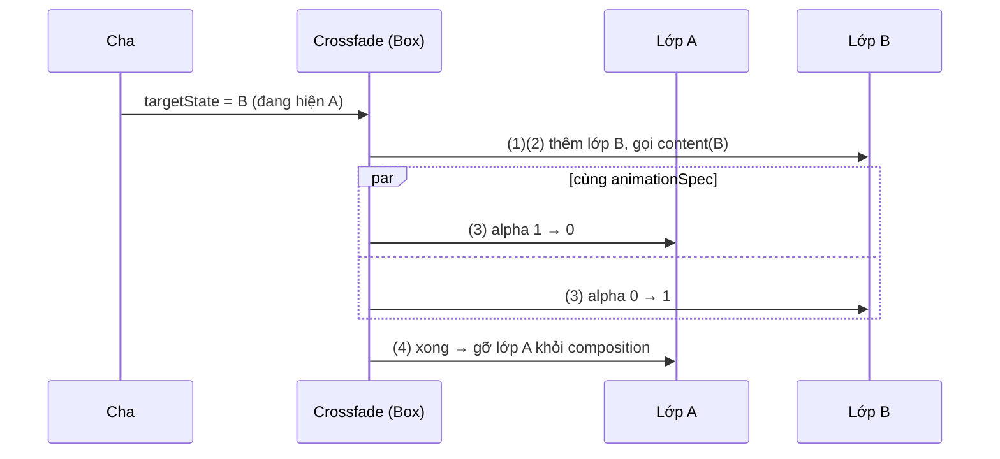
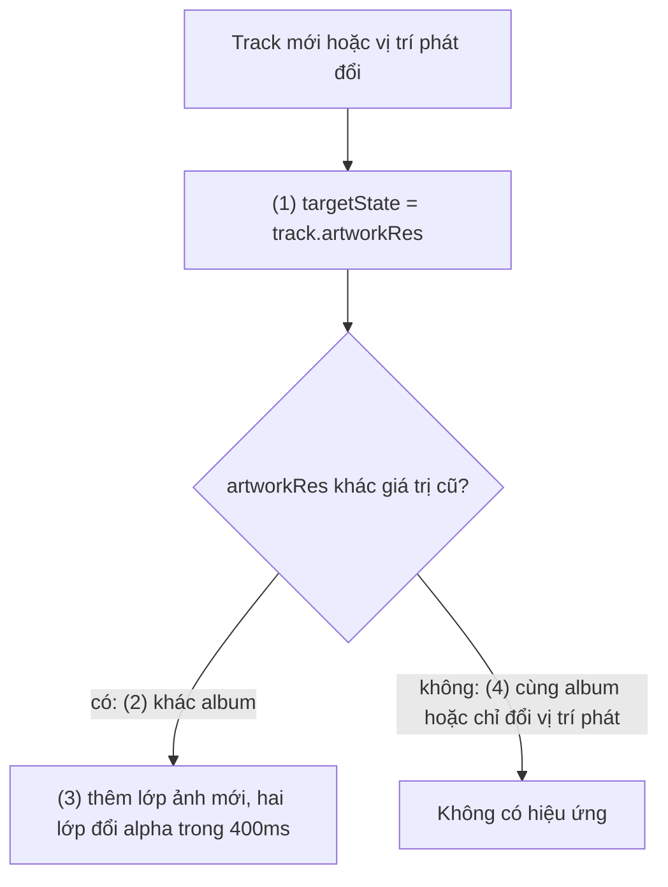
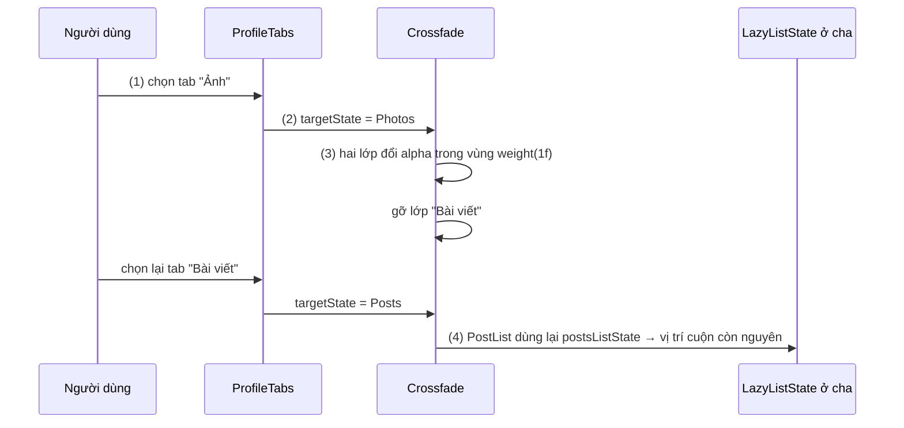

# Crossfade

## Vấn đề cần giải quyết

Có những chỗ nội dung chỉ **thay** cho nhau tại cùng một vị trí, cùng kích thước: ảnh bìa album khi chuyển bài, nội dung của các tab, ảnh minh hoạ thời tiết theo trạng thái nắng hay mưa. Đổi thẳng thì giật:

```kotlin
Image(painter = painterResource(track.artworkRes), contentDescription = null)
```

Ảnh mới thay ảnh cũ trong một frame. Mắt người dùng nhận ra một cú "chớp", nhất là khi hai ảnh khác màu hẳn nhau.

[AnimatedContent](animated_content.md) giải quyết được, nhưng mặc định của nó là fade out rồi mới fade in kèm scale nhẹ, cộng animate kích thước; với hai ảnh cùng khung, các phần đó không cần, và muốn tắt thì phải viết `transitionSpec`.

Vấn đề cần giải quyết: **một cách tối giản để hoà tan nội dung cũ sang nội dung mới tại chỗ**, không có gì khác ngoài fade.

## Sau khi học xong

- Giải thích được cách Crossfade chồng nội dung cũ và mới trong một Box và đổi alpha của chúng cùng lúc.
- Phân biệt được Crossfade với AnimatedContent về kiểu hiệu ứng, kích thước container và khả năng tuỳ biến, để chọn đúng API.
- Triển khai được Crossfade với targetState là giá trị nhận diện nội dung (id, enum, resource) và animationSpec phù hợp.
- Nhận diện được các lỗi như truyền object đổi liên tục làm targetState, nội dung khác kích thước làm layout nhảy và mất state cục bộ khi chuyển.

## Crossfade là gì?

**`Crossfade`** là composable chuyển giữa các nội dung theo `targetState` bằng đúng một hiệu ứng: nội dung cũ giảm alpha từ 1 về 0 **đồng thời** nội dung mới tăng alpha từ 0 lên 1, hai lớp chồng lên nhau trong cùng một `Box`. Nó không slide, không scale và không animate kích thước.

Mental model: **chuyển cảnh hoà tan (dissolve) trong dựng phim**. Hai khung hình chồng lên nhau; khung sau đậm dần trong khi khung trước nhạt dần, rồi khung trước biến mất.

## Cách hoạt động

### 1. Hai lớp alpha trong một Box

Chữ ký:

```kotlin
@Composable
fun <T> Crossfade(
    targetState: T,
    modifier: Modifier = Modifier,
    animationSpec: FiniteAnimationSpec<Float> = tween(),
    label: String = "Crossfade",
    content: @Composable (T) -> Unit
)
```

Khi `targetState` đổi từ A sang B:

1. `Crossfade` giữ danh sách các state đang hiển thị: A (đang rời đi) và B (đang vào).
2. Mỗi state được bọc trong một lớp riêng, nhận diện bằng chính giá trị state; lambda `content` được gọi với A cho lớp A và với B cho lớp B.
3. Alpha của lớp A chạy từ 1 về 0, alpha của lớp B chạy từ 0 lên 1, **cùng lúc** và cùng `animationSpec`. Alpha được áp ở lúc vẽ, nên mỗi frame chỉ vẽ lại, không compose lại nội dung.
4. Hiệu ứng xong, lớp A bị gỡ khỏi composition; mọi `remember` bên trong A mất.



Vì các lớp nằm trong một `Box`, kích thước của `Crossfade` bằng kích thước lớn nhất của các lớp **đang có mặt**. Trong lúc fade, đó là kích thước lớn hơn trong A và B; khi A bị gỡ, kích thước nhảy về kích thước của B. Với nội dung cùng kích thước thì không ai thấy; với nội dung khác kích thước thì đây là chỗ layout nhảy (Sai lầm 2).

Như `AnimatedContent`, lambda phải vẽ từ **tham số** của nó: lớp A phải vẽ A, không vẽ biến bên ngoài đã là B.

#### Ví dụ: ảnh bìa album khi chuyển bài

**Bài toán:** màn đang phát có ảnh bìa vuông 280dp. Chuyển bài thì ảnh mới hiện dần đè lên ảnh cũ trong 400ms. Hai bài liên tiếp cùng album (cùng ảnh bìa) thì không có hiệu ứng nào. Vị trí phát cập nhật mỗi giây không được làm ảnh nháy.

**Luồng chạy:**

1. `targetState` là `track.artworkRes`, tức chỉ giá trị **nhận diện ảnh**, không phải cả object `Track` (có vị trí phát đổi mỗi giây).
2. Bài mới khác album: `artworkRes` đổi, `Crossfade` thêm lớp ảnh mới.
3. Hai lớp đổi alpha cùng lúc trong 400ms.
4. Bài mới cùng album: `artworkRes` bằng giá trị cũ, không có gì xảy ra.



```kotlin
// NowPlayingArtwork.kt
@Composable
fun NowPlayingArtwork(track: Track, modifier: Modifier = Modifier) {
    Crossfade(
        targetState = track.artworkRes,                                       // (1) chỉ giá trị nhận diện ảnh
        modifier = modifier
            .size(280.dp)
            .clip(MaterialTheme.shapes.large),
        animationSpec = tween(durationMillis = 400),                          // (3)
        label = "albumArtwork"
    ) { artworkRes ->                                                         // (2) mỗi lớp vẽ đúng ảnh của nó
        Image(
            painter = painterResource(artworkRes),
            contentDescription = null,
            contentScale = ContentScale.Crop,
            modifier = Modifier.fillMaxSize()
        )
    }
}
```

`Track` có `@DrawableRes val artworkRes: Int`; tên bài được đọc ở `Text` bên dưới nên ảnh để `contentDescription = null`. Với ảnh tải từ mạng, `AsyncImage` của Coil có tuỳ chọn crossfade riêng (`ImageRequest.Builder.crossfade(true)`, học ở [8.2.4 Coil](../../session_08/loading_image/coil.md)).

**Kết quả:** chuyển sang bài của album khác, ảnh mới hiện dần đè ảnh cũ; chuyển sang bài cùng album, ảnh đứng yên. Trong lúc phát, ảnh không nháy dù vị trí phát cập nhật mỗi giây. Layout Inspector cho thấy trong 400ms có hai node `Image` chồng nhau, sau đó chỉ còn một.

### 2. `animationSpec` và khi bị ngắt

`animationSpec` là `FiniteAnimationSpec<Float>`: `tween`, `spring`, `keyframes` đều dùng được, `infiniteRepeatable` thì không (fade phải kết thúc). Mặc định `tween()` chạy 300ms với easing `FastOutSlowInEasing`. Spec này áp cho **cả** lớp vào và lớp ra; không có cách cho lớp ra nhanh hơn lớp vào như `AnimatedContent`.

Khi `targetState` đổi trong lúc đang fade (bấm "bài tiếp" ba lần liên tục), `Crossfade` thêm lớp cho state mới nhất; các lớp cũ tiếp tục mờ đi từ alpha hiện tại rồi bị gỡ. Nội dung không nhảy về đầu, nhưng trong khoảnh khắc có thể có hơn hai lớp cùng hiện.

`Crossfade` bản thường **không có `contentKey`**: mọi giá trị `targetState` khác nhau theo `equals` đều kích hoạt fade. Vì vậy hãy truyền giá trị nhận diện nội dung (id, enum, resource id) thay vì truyền cả object. Bản mở rộng `Transition<T>.Crossfade(modifier, animationSpec, contentKey, content)` có `contentKey`, dùng khi fade là một phần của `Transition` lớn hơn ([MutableTransitionState](mutable_transition_state.md)), hoặc khi object state bị tạo lại sau save/restore mà cần một key bền hơn để khôi phục state bên trong nội dung (theo tài liệu API). Tới bản ổn định 1.12, bản mở rộng này còn experimental (cần `@OptIn(ExperimentalAnimationApi::class)`); ghi chú phát hành 1.13 đưa nó lên stable.

### 3. Crossfade hay AnimatedContent

| Tiêu chí | `Crossfade` | `AnimatedContent` |
|---|---|---|
| Hiệu ứng | Chỉ fade | Bất kỳ `EnterTransition`/`ExitTransition` |
| Thứ tự fade | Ra và vào **cùng lúc** | Mặc định fade through: ra trước, vào sau, kèm scale nhẹ |
| Kích thước container | Không animate; bằng lớp lớn nhất đang có mặt, nhảy khi lớp cũ bị gỡ | Animate bằng `SizeTransform` |
| Hiệu ứng theo cặp state | Không | Có (`initialState`, `targetState`) |
| `contentKey` | Chỉ ở `Transition.Crossfade` (experimental tới 1.12) | Có |
| Scope trong lambda | Không (`(T) -> Unit`) | `AnimatedContentScope`: dùng được `animateEnterExit`, `transition` |

Quy tắc chọn: nội dung **cùng kích thước** và chỉ cần **hoà tan** thì dùng `Crossfade`; cần hướng, cần kích thước đổi mượt, hoặc cần hiệu ứng khác nhau theo cặp trạng thái thì dùng [AnimatedContent](animated_content.md).

Hai lớp chồng nhau ở 50% alpha giữa chừng có thể trông "đục" khi hai nội dung khác hẳn nhau về bố cục (danh sách chữ và lưới ảnh). Đó là lúc kiểu fade through của `AnimatedContent` (ra trước, vào sau) cho cảm giác sạch hơn. Viết `AnimatedContent` gần tương đương `Crossfade` như sau:

```kotlin
AnimatedContent(
    targetState = selectedTab,
    transitionSpec = { fadeIn(animationSpec = tween()) togetherWith fadeOut(animationSpec = tween()) using null },
    label = "tabContent"
) { tab -> TabContent(tab) }
```

`using null` tắt animate kích thước; enter và exit cùng `tween()` nên hai lớp đổi alpha cùng lúc như `Crossfade`.

## Ví dụ thực tế

Ba bài toán hay gặp:

1. **Nội dung các tab của màn hồ sơ** (Bài viết, Ảnh, Đã lưu): đây là bài toán chính, code đầy đủ bên dưới.
2. **Ảnh bìa album:** như ví dụ ở mục 1.
3. **Ảnh minh hoạ thời tiết** theo enum `Sunny`, `Rainy`, `Cloudy`: cùng khung, chỉ cần hoà tan.

### Nội dung các tab của màn hồ sơ

**Bài toán:** màn hồ sơ có `PrimaryTabRow` ba tab; đổi tab thì nội dung hoà tan sang tab mới. Mỗi tab là một danh sách cuộn được; quay lại tab cũ thì vị trí cuộn phải còn nguyên.

**Luồng chạy:**

1. `selectedTab` (enum) được giữ bằng `rememberSaveable` ở cha.
2. `Crossfade(targetState = selectedTab)`; lambda vẽ nội dung theo tham số `tab`.
3. `Crossfade` nhận `Modifier.weight(1f)` nên có kích thước cố định (phần còn lại dưới thanh tab), nội dung các tab không làm layout nhảy.
4. State cuộn của từng tab được tạo ở **cha**, ngoài `Crossfade`, vì lớp của tab cũ bị gỡ sau khi fade xong và mọi `remember` bên trong nó mất.



```kotlin
// ProfileTabs.kt
enum class ProfileTab(val title: String) { Posts("Bài viết"), Photos("Ảnh"), Saved("Đã lưu") }

@Composable
fun ProfileTabs(
    posts: List<Post>,
    photos: List<Photo>,
    savedPosts: List<Post>,
    modifier: Modifier = Modifier
) {
    var selectedTab by rememberSaveable { mutableStateOf(ProfileTab.Posts) }          // (1)
    val postsListState = rememberLazyListState()                                       // (4) sống ngoài Crossfade
    val photosGridState = rememberLazyGridState()
    val savedListState = rememberLazyListState()

    Column(modifier.fillMaxSize()) {
        PrimaryTabRow(selectedTabIndex = selectedTab.ordinal) {
            ProfileTab.entries.forEach { tab ->
                Tab(
                    selected = tab == selectedTab,
                    onClick = { selectedTab = tab },
                    text = { Text(tab.title) }
                )
            }
        }
        Crossfade(
            targetState = selectedTab,                                                 // (2)
            modifier = Modifier.weight(1f),                                            // (3) kích thước cố định
            label = "profileTab"
        ) { tab ->
            when (tab) {
                ProfileTab.Posts -> PostList(posts, state = postsListState)
                ProfileTab.Photos -> PhotoGrid(photos, state = photosGridState)
                ProfileTab.Saved -> PostList(savedPosts, state = savedListState)
            }
        }
    }
}
```

`PostList` và `PhotoGrid` là `LazyColumn` và `LazyVerticalGrid` nhận state từ ngoài; cách hoist `LazyListState` học ở [LazyColumn](../modifier/lazy_column.md). `rememberLazyListState` đã tự lưu vị trí qua xoay màn hình.

**Kết quả:** đổi tab, nội dung hoà tan trong 300ms, thanh tab và vùng nội dung không đổi kích thước. Cuộn tab "Bài viết" xuống bài thứ 20, sang tab "Ảnh" rồi quay lại: danh sách vẫn ở bài thứ 20. Chuyển `rememberLazyListState()` vào trong lambda của `Crossfade` thì quay lại tab sẽ về đầu danh sách.

## Khi nào nên và không nên dùng

- **Nên dùng** khi nội dung thay nhau tại chỗ, cùng kích thước, và chỉ cần hoà tan: ảnh, nội dung tab, minh hoạ theo trạng thái.
- **Nên truyền** giá trị nhận diện nội dung làm `targetState` (id, enum, resource id), không truyền object chứa dữ liệu đổi thường xuyên.
- **Không nên dùng** khi nội dung khác kích thước và vùng xung quanh phải dịch mượt, hoặc khi cần hướng chuyển: dùng [AnimatedContent](animated_content.md).
- **Không nên dùng** để chuyển giữa các màn hình có back stack: dùng transition của Navigation.

## Sai lầm thường gặp

### 1. Truyền object đổi liên tục làm `targetState`

```kotlin
Crossfade(targetState = track, label = "artwork") { current ->
    Image(painterResource(current.artworkRes), contentDescription = null)
}
```

`Track` là data class có `positionMs` cập nhật mỗi giây; mỗi lần nó đổi, `track` khác giá trị cũ theo `equals` và ảnh lại mờ đi rồi hiện lại. Sửa: `targetState = track.artworkRes`.

### 2. Nội dung khác kích thước

Crossfade giữa một dòng "Chưa có bài viết" cao 48dp và một danh sách cao 600dp trong một `Column`: trong lúc fade, container cao 600dp; khi lớp lớn hơn bị gỡ (hoặc ngược lại), chiều cao nhảy trong một frame và mọi thứ bên dưới giật theo. Sửa: cho `Crossfade` kích thước cố định (`weight(1f)`, `fillMaxSize()`, `size(...)`), hoặc dùng `AnimatedContent` để có `SizeTransform`.

### 3. Đọc state bên ngoài trong lambda

```kotlin
Crossfade(targetState = selectedTab, label = "tab") {
    TabContent(selectedTab)   // sai: cả hai lớp đều vẽ tab mới
}
```

Hai lớp cùng vẽ nội dung mới, nên mắt thấy một nội dung mờ đi rồi hiện lại chính nó. Sửa: dùng tham số, `{ tab -> TabContent(tab) }`.

### 4. Giữ state cục bộ trong nội dung

`rememberLazyListState()` hay `rememberSaveable` đặt **trong** lambda bị mất khi lớp đó bị gỡ sau khi fade xong. Sửa: hoist state lên cha như ví dụ thực tế.

### 5. Kỳ vọng hiệu ứng có hướng

`Crossfade` không có `transitionSpec`; mọi chuyển đổi đều là fade. Muốn tab bên phải trượt vào từ bên phải, dùng `AnimatedContent` với `slideIntoContainer`.

## Lịch sử phát triển

- **Compose 1.0 (07/2021):** `Crossfade` có từ bản ổn định đầu tiên, là API chuyển nội dung đơn giản nhất và không cần opt-in experimental như `AnimatedContent` lúc đó.
- **Compose Animation 1.1:** thêm `contentKey` cho `Crossfade` dạng mở rộng `Transition<T>.Crossfade`, để fade trở thành một phần của `Transition` chung; bản này là experimental (`@ExperimentalAnimationApi`).
- **Compose Animation 1.3:** overload hiện hành có tham số `label` để nhận diện animation trong công cụ Animation Preview của Android Studio.
- **Compose Animation 1.13 (đang ở bản rc, 11/2026):** ghi chú phát hành đưa `Transition.Crossfade` lên stable.

## Kết nối hệ thống

- **Prerequisites:**
  - [AnimatedVisibility](animated_visibility.md) — bản đồ API animation, `AnimationSpec`.
- **Related:**
  - [AnimatedContent](animated_content.md) — chuyển nội dung với hiệu ứng tuỳ ý và `SizeTransform`.
  - [MutableTransitionState](mutable_transition_state.md) — `Transition.Crossfade` trong một transition chung.
  - [LazyColumn](../modifier/lazy_column.md) — hoist `LazyListState` để giữ vị trí cuộn.
  - [Surface and Canvas](surface_and_canvas.md) — vì sao đổi alpha ở lúc vẽ không làm recompose.
  - [8.2.4 Coil](../../session_08/loading_image/coil.md) — crossfade cho ảnh tải từ mạng.
- **Học tiếp (theo nav):** 9.8 Gesture, bắt đầu từ [Scrolling](../gesture/scrolling.md).

## Tham khảo

- [Animation modifiers and composables: Crossfade — Android Developers](https://developer.android.com/develop/ui/compose/animation/composables-modifiers)
- [Crossfade — API reference](https://developer.android.com/reference/kotlin/androidx/compose/animation/Crossfade.composable)
- [Choose an animation API — Android Developers](https://developer.android.com/develop/ui/compose/animation/choose-api)
- [Compose Animation release notes — AndroidX](https://developer.android.com/jetpack/androidx/releases/compose-animation)
