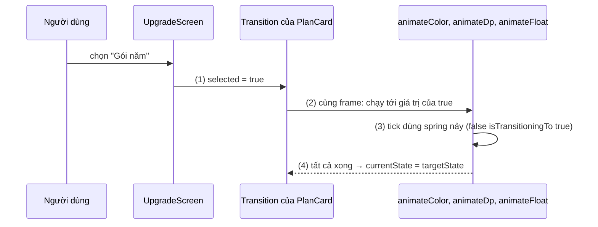
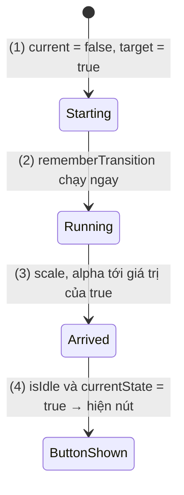
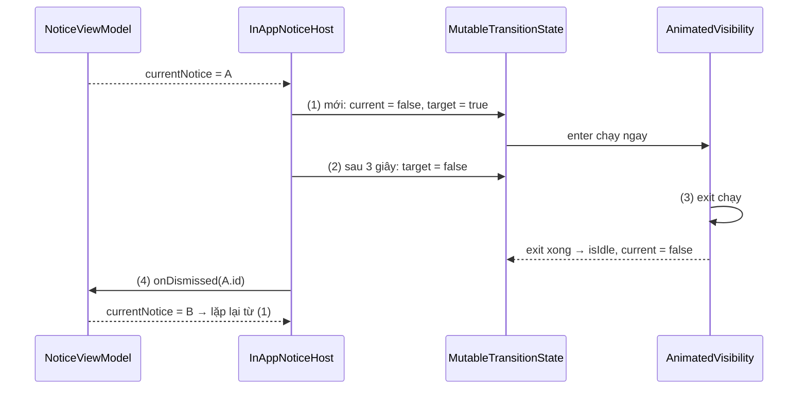
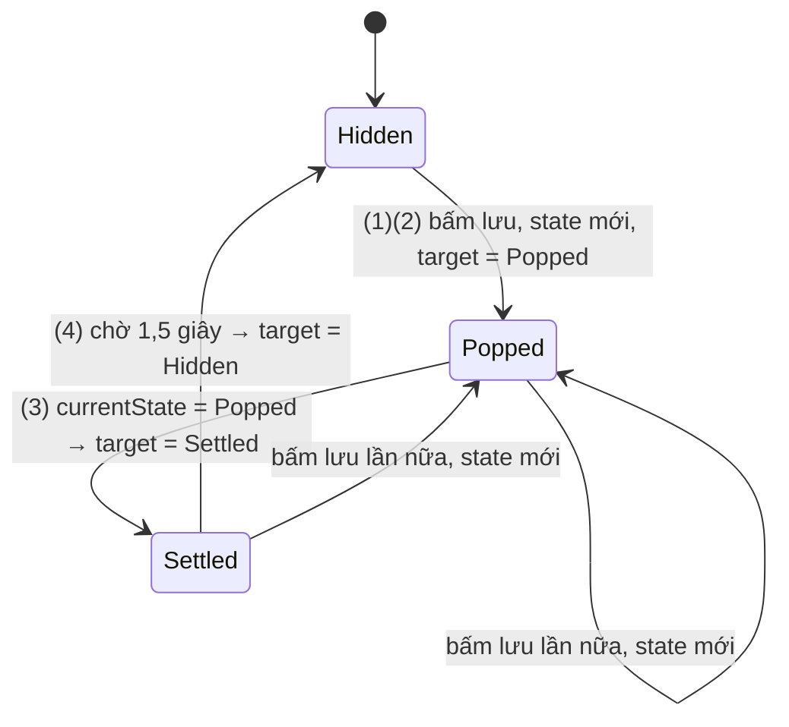

# MutableTransitionState

## Vấn đề cần giải quyết

`animate*AsState` ([AnimatedVisibility](animated_visibility.md), mục "Bản đồ API animation của Compose") giải quyết tốt một giá trị độc lập. Ba tình huống sau vượt quá nó:

**Nhiều thuộc tính phải đổi cùng nhau.** Một thẻ chọn gói cước khi được chọn thì viền đổi màu, thẻ nổi lên, dấu tick bật ra:

```kotlin
val borderColor by animateColorAsState(if (selected) primary else outline, label = "border")
val elevation by animateDpAsState(if (selected) 6.dp else 0.dp, label = "elevation")
val checkScale by animateFloatAsState(if (selected) 1f else 0f, label = "check")
```

Ba animation chạy độc lập: không có chỗ nào nói "thẻ đang chuyển từ bỏ chọn sang chọn", không chọn được spec riêng cho từng chiều chuyển, và không có cách hỏi "cả thẻ đã chuyển xong chưa".

**Animation phải chạy ngay khi vừa xuất hiện.** `animate*AsState` lấy target đầu tiên làm giá trị khởi đầu, và `AnimatedVisibility(visible = true)` không chạy enter ở lần compose đầu. Thẻ chào mừng muốn "bật lên" khi màn hình mở thì không có gì để animate.

**Cần biết lúc animation xong để làm bước tiếp.** Thông báo trong app phải trượt ra hết rồi mới bị xoá khỏi hàng đợi để thông báo sau hiện lên. Đoán bằng `delay(300)` thì lệch ngay khi đổi `AnimationSpec` hoặc khi animation bị ngắt giữa chừng.

Vấn đề tổng quát: **gom nhiều animation vào một state chung, cho phép state khởi đầu khác state đích, và quan sát được tiến trình của nó.**

## Sau khi học xong

- Giải thích được cách Transition điều phối nhiều animation con theo một state đích, và vai trò của currentState, targetState trong đó.
- Triển khai được nhiều thuộc tính animate đồng bộ bằng updateTransition kết hợp transition.animateFloat, animateDp, animateColor và transitionSpec theo từng cặp trạng thái.
- Áp dụng được MutableTransitionState với rememberTransition và AnimatedVisibility(visibleState) để chạy animation ngay khi vào composition và biết khi nào animation kết thúc.
- Phân biệt được updateTransition(targetState), rememberTransition(MutableTransitionState) và bản updateTransition(MutableTransitionState) đã deprecated.
- Nhận diện được các lỗi như không remember MutableTransitionState, dùng currentState để biết nội dung đang hiện và đọc isIdle mà không xét currentState.

## MutableTransitionState là gì?

**`Transition<S>`** là object quản lý một nhóm animation con; tất cả cùng hướng về một state đích kiểu `S` và cùng bắt đầu khi state đích đổi. **`MutableTransitionState<S>`** là trạng thái ghi được của một `Transition`: nó giữ riêng **`currentState`** (trạng thái transition đã tới gần nhất, chỉ `Transition` được cập nhật) và **`targetState`** (đích bạn đặt, đổi được bất kỳ lúc nào), kèm **`isIdle`** cho biết transition đã chạy xong.

Mental model: **bảng tàu ở sân ga**. `targetState` là ga đích ghi trên vé, bạn đổi vé bất kỳ lúc nào. `currentState` là ga cuối cùng tàu đã thật sự dừng. `isIdle` là tàu đang đứng yên ở ga. `Transition` là đầu máy kéo mọi toa (animation con) chạy cùng nhau; các toa không tự chạy riêng.

## Cách hoạt động

### 1. Transition: nhiều animation con theo một state

`updateTransition(targetState, label)` tạo và `remember` một `Transition`, rồi mỗi lần recompose cập nhật đích của nó bằng `targetState` mới. Animation con được khai báo bằng các hàm mở rộng của `Transition`:

- `transition.animateFloat`, `animateDp`, `animateInt`, `animateOffset`, `animateSize`, `animateRect`, `animateValue`, và `animateColor` (ở gói `androidx.compose.animation`).
- Mỗi hàm nhận một lambda **ánh xạ state sang giá trị** (`{ state -> if (state) 6.dp else 0.dp }`) và trả về `State<T>` chạy dần tới giá trị của state đích.
- Tham số `transitionSpec` là lambda có receiver `Transition.Segment<S>`, biết `initialState` và `targetState` của lần chuyển đang chạy; toán tử `isTransitioningTo` giúp chọn spec theo từng chiều: `Unselected isTransitioningTo Selected`.

Khi state đích đổi, mọi animation con bắt đầu **cùng một frame**. Khi tất cả xong, `transition.currentState` bằng `transition.targetState`; đây là tín hiệu "đã chuyển xong" mà tài liệu khuyên dùng. State nên là `enum` hoặc `Boolean` để ánh xạ rõ ràng.

Tham số `label` hiện trong Animation Preview của Android Studio: công cụ này liệt kê `Transition` cùng các animation con và cho kéo thanh thời gian để xem từng frame.

#### Ví dụ: thẻ chọn gói thuê bao

**Bài toán:** màn nâng cấp có hai thẻ "Gói tháng" và "Gói năm". Thẻ được chọn có viền màu primary, nổi lên, và dấu tick **bật nảy** ra; thẻ bỏ chọn thì tick thu lại **nhanh, không nảy**. Mọi thay đổi trên một thẻ phải bắt đầu cùng lúc.

**Luồng chạy:**

1. Màn hình giữ `selectedPlanId`; mỗi `PlanCard` nhận `selected = plan.id == selectedPlanId` và tạo `updateTransition(selected)`.
2. Ba animation con (màu viền, độ nổi, tỉ lệ tick) khai báo giá trị cho `true` và `false`.
3. `transitionSpec` của tick: `false → true` dùng spring nảy, chiều ngược lại dùng `tween(150)`.
4. Người dùng chọn gói khác: `selected` của hai thẻ đổi; trong mỗi thẻ, ba animation con bắt đầu cùng frame. Khi xong, `currentState == targetState`.



```kotlin
// PlanCard.kt
@Composable
fun PlanCard(
    plan: SubscriptionPlan,
    selected: Boolean,
    onSelect: () -> Unit,
    modifier: Modifier = Modifier
) {
    val transition = updateTransition(targetState = selected, label = "planSelection")   // (1)

    val borderColor by transition.animateColor(label = "border") { isSelected ->        // (2)
        if (isSelected) MaterialTheme.colorScheme.primary else MaterialTheme.colorScheme.outlineVariant
    }
    val elevation by transition.animateDp(label = "elevation") { isSelected ->
        if (isSelected) 6.dp else 0.dp
    }
    val checkScale by transition.animateFloat(
        label = "checkScale",
        transitionSpec = {                                                                // (3)
            if (false isTransitioningTo true) spring(dampingRatio = Spring.DampingRatioMediumBouncy)
            else tween(durationMillis = 150)
        }
    ) { isSelected -> if (isSelected) 1f else 0f }

    Surface(
        onClick = onSelect,
        modifier = modifier.fillMaxWidth(),
        shape = MaterialTheme.shapes.large,
        border = BorderStroke(2.dp, borderColor),
        tonalElevation = elevation
    ) {
        Row(Modifier.padding(16.dp), verticalAlignment = Alignment.CenterVertically) {
            Column(Modifier.weight(1f)) {
                Text(plan.title, style = MaterialTheme.typography.titleMedium)
                Text(plan.priceLabel, style = MaterialTheme.typography.bodyMedium)
            }
            Icon(
                painter = painterResource(R.drawable.ic_check_circle),
                contentDescription = null,
                tint = MaterialTheme.colorScheme.primary,
                modifier = Modifier.graphicsLayer { scaleX = checkScale; scaleY = checkScale }
            )
        }
    }
}

// UpgradeScreen.kt (phần chọn gói)
var selectedPlanId by rememberSaveable { mutableStateOf(plans.first().id) }
plans.forEach { plan ->
    PlanCard(plan, selected = plan.id == selectedPlanId, onSelect = { selectedPlanId = plan.id })  // (4)
}
```

Lambda ánh xạ của `animateColor` là composable, nên đọc được `MaterialTheme`. `checkScale` chỉ được đọc trong `graphicsLayer { }` nên tick nảy mà không recompose thẻ ([Surface and Canvas](surface_and_canvas.md), mục "Đọc state trong phase Drawing").

**Kết quả:** chọn "Gói năm", viền xanh, thẻ nổi lên và tick bật nảy cùng lúc; thẻ "Gói tháng" thu tick nhanh. Mở Animation Preview trong Android Studio, chọn transition `planSelection`: thấy ba đường `border`, `elevation`, `checkScale` bắt đầu cùng mốc 0ms.

### 2. MutableTransitionState: tách đích khỏi trạng thái đã tới

`updateTransition(targetState)` luôn bắt đầu ở đúng target đầu tiên, nên ở lần compose đầu không có gì để chạy. `MutableTransitionState` gỡ ràng buộc đó:

- `MutableTransitionState(initialState)` khởi tạo **cả** `currentState` và `targetState` bằng `initialState`.
- `targetState` là `var`: đặt giá trị khác `currentState` là transition bắt đầu chạy.
- `currentState` là `val` với bên ngoài: chỉ `Transition` cập nhật nó, khi đã **tới** state mới.
- `isIdle` trả `false` ngay khi `targetState` khác `currentState`, và `true` khi transition chạy xong.
- Cả `currentState` và `targetState` đều được hậu thuẫn bởi `State`, nên đọc chúng trong composition thì composable tự recompose khi chúng đổi.

Truyền nó cho **`rememberTransition(transitionState, label)`** để có `Transition`. Object `MutableTransitionState` phải được `remember`, nếu không mỗi lần recompose là một transition mới.

| | `updateTransition(targetState)` | `rememberTransition(MutableTransitionState)` |
|---|---|---|
| State khởi đầu | Bằng target đầu tiên | Bất kỳ, khác target được |
| Chạy ngay khi vào composition | Không | Có, nếu đặt `targetState` khác `initialState` |
| Đổi đích | Truyền giá trị mới khi recompose | Gán `targetState` (kể cả ngoài composition, ví dụ trong coroutine) |
| Quan sát tiến trình | `transition.currentState`, `targetState`, `isRunning` | Như bên trái, cộng `isIdle` ngay trên state object |
| Khởi động lại từ đầu | Không | Tạo `MutableTransitionState` mới |

Trước Compose Animation 1.7, việc này làm bằng `updateTransition(transitionState: MutableTransitionState)`. Bản đó đã **deprecated**, tài liệu API hướng dẫn thay bằng `rememberTransition(transitionState, label)`.

#### Ví dụ: thẻ chào mừng bật lên khi mở màn hình

**Bài toán:** màn chào mừng của app quản lý chi tiêu có một thẻ phải **phóng to và hiện dần** ngay khi màn hình mở; nút "Bắt đầu" chỉ xuất hiện **sau khi** thẻ đã hiện xong.

**Luồng chạy:**

1. `remember { MutableTransitionState(false).apply { targetState = true } }`: state khởi đầu `false`, đích `true`, đặt một lần duy nhất.
2. `rememberTransition` nhận state đó; vì `currentState` khác `targetState`, transition chạy ngay frame đầu.
3. Tỉ lệ và alpha của thẻ là animation con, đọc trong `graphicsLayer`.
4. Khi transition xong, `isIdle = true` và `currentState = true`: `AnimatedVisibility` của nút nhận `visible = true` và chạy enter.



```kotlin
// WelcomeScreen.kt
@Composable
fun WelcomeScreen(onStart: () -> Unit, modifier: Modifier = Modifier) {
    val appearState = remember {
        MutableTransitionState(false).apply { targetState = true }                        // (1)
    }
    val transition = rememberTransition(appearState, label = "welcomeAppear")             // (2)
    val cardScale by transition.animateFloat(
        label = "cardScale",
        transitionSpec = { spring(dampingRatio = Spring.DampingRatioMediumBouncy, stiffness = Spring.StiffnessLow) }
    ) { shown -> if (shown) 1f else 0.8f }
    val cardAlpha by transition.animateFloat(label = "cardAlpha") { shown -> if (shown) 1f else 0f }

    Column(
        modifier = modifier.fillMaxSize().padding(24.dp),
        verticalArrangement = Arrangement.Center,
        horizontalAlignment = Alignment.CenterHorizontally
    ) {
        Surface(
            modifier = Modifier.graphicsLayer {                                           // (3)
                scaleX = cardScale
                scaleY = cardScale
                alpha = cardAlpha
            },
            shape = MaterialTheme.shapes.extraLarge,
            tonalElevation = 3.dp
        ) {
            Text("Ghi chi tiêu mỗi ngày, xem báo cáo mỗi tuần", Modifier.padding(32.dp),
                style = MaterialTheme.typography.headlineSmall)
        }
        Spacer(Modifier.height(24.dp))
        AnimatedVisibility(visible = appearState.isIdle && appearState.currentState) {   // (4)
            Button(onClick = onStart) { Text("Bắt đầu") }
        }
    }
}
```

Đặt `targetState` trong `apply` của `remember` giúp nó chỉ được gán một lần. Ví dụ trong tài liệu chính thức gán `targetState = true` thẳng trong thân composable; cách đó cũng đúng vì phép gán lặp lại cùng giá trị không đổi gì, nhưng gán trong `remember` thể hiện rõ ý "chỉ khi vào composition".

**Kết quả:** mở màn hình, thẻ nảy từ 80% lên 100% và hiện dần; khoảng nửa giây sau, khi lò xo dừng hẳn, nút "Bắt đầu" mới mở ra. Đổi `stiffness` sang `Spring.StiffnessVeryLow`: nút tự hiện muộn hơn theo, không phải sửa thời lượng nào.

### 3. Dùng với `AnimatedVisibility(visibleState)`

`AnimatedVisibility` có overload nhận `visibleState: MutableTransitionState<Boolean>` thay cho `visible: Boolean`. Ngoài việc chạy enter ngay khi vào composition (như mục 2), nó cho đọc được nội dung đang ở pha nào:

| `isIdle` | `currentState` | Ý nghĩa |
|---|---|---|
| `true` | `true` | Đã hiện xong |
| `false` | `true` | Đang biến mất (exit đang chạy) |
| `true` | `false` | Đã ẩn hẳn (exit xong, nội dung đã bị gỡ) |
| `false` | `false` | Đang xuất hiện (enter đang chạy) |

Theo tài liệu API, sau khi exit xong, cả `currentState` và `targetState` đều là `false`.

#### Ví dụ: hàng đợi thông báo trong app

**Bài toán:** app nhận nhiều thông báo ngắn ("Đã đồng bộ 12 giao dịch", "Có bản cập nhật"). Mỗi lần chỉ hiện một thông báo ở đỉnh màn hình, tự ẩn sau 3 giây; thông báo sau chỉ hiện khi thông báo trước đã **trượt ra hết**, không chồng lên nhau.

**Luồng chạy:**

1. Với mỗi thông báo (theo `id`), tạo một `MutableTransitionState(false)` mới với `targetState = true`, nên enter chạy ngay.
2. `LaunchedEffect(notice.id)` chờ 3 giây rồi đặt `targetState = false`. `LaunchedEffect` chạy coroutine theo vòng đời composition, học ở [LaunchedEffect](../side_effects/launched_effect.md).
3. `AnimatedVisibility(visibleState)` chạy exit.
4. Khi `isIdle && !currentState` (đã ẩn hẳn), báo `onDismissed(id)`; ViewModel bỏ thông báo khỏi hàng đợi, thông báo kế tiếp đi vào bước 1.



```kotlin
// InAppNoticeHost.kt
@Composable
fun InAppNoticeHost(notice: InAppNotice?, onDismissed: (Long) -> Unit, modifier: Modifier = Modifier) {
    if (notice == null) return
    val visibleState = remember(notice.id) {                                    // (1) mỗi thông báo một state
        MutableTransitionState(false).apply { targetState = true }
    }
    LaunchedEffect(notice.id) {                                                 // (2)
        delay(3_000)
        visibleState.targetState = false
    }
    AnimatedVisibility(
        visibleState = visibleState,                                            // (3)
        modifier = modifier,
        enter = slideInVertically { fullHeight -> -fullHeight } + fadeIn(),
        exit = slideOutVertically { fullHeight -> -fullHeight } + fadeOut(),
        label = "inAppNotice"
    ) {
        Surface(shape = MaterialTheme.shapes.medium, tonalElevation = 3.dp, shadowElevation = 2.dp) {
            Text(notice.message, Modifier.padding(16.dp))
        }
    }
    if (visibleState.isIdle && !visibleState.currentState) {                    // (4) exit đã xong
        LaunchedEffect(notice.id) { onDismissed(notice.id) }
    }
}

// NoticeViewModel.kt
class NoticeViewModel : ViewModel() {
    private val queue = MutableStateFlow<List<InAppNotice>>(emptyList())
    val currentNotice: StateFlow<InAppNotice?> = queue
        .map { it.firstOrNull() }
        .stateIn(viewModelScope, SharingStarted.WhileSubscribed(5_000), null)

    fun show(notice: InAppNotice) = queue.update { it + notice }
    fun onNoticeDismissed(id: Long) = queue.update { list -> list.filterNot { it.id == id } }
}
```

`onDismissed` được gọi trong `LaunchedEffect` chứ không gọi thẳng trong thân composable, vì gọi hàm có tác dụng phụ trong composition sẽ chạy lại mỗi lần recompose. `map`, `stateIn` là toán tử của Flow, học ở 7.1.4.2 Flow (chưa có bài).

**Kết quả:** gọi `show()` ba lần liên tiếp: ba thông báo lần lượt trượt xuống, đứng 3 giây, trượt lên; thông báo sau chỉ bắt đầu khi thông báo trước đã ra hết. Ghi log trong `onNoticeDismissed`: các mốc thời gian cách nhau khoảng 3 giây cộng thời lượng enter và exit, dù đổi spec cũng không cần sửa con số nào.

### 4. Chia sẻ một Transition cho nhiều phần

Khi một component phức tạp có nhiều phần cùng phản ứng với một state, giữ **một** `Transition` và chia nó xuống:

- **`transition.AnimatedVisibility(visible = { state -> … })`** và **`transition.AnimatedContent { state -> … }`**: phiên bản mở rộng của `Transition`. Enter, exit và size animation của chúng trở thành animation con của transition cha, nên `currentState == targetState` chỉ khi **mọi** phần đã xong.
- **`transition.createChildTransition { state -> … }`**: tạo `Transition` con kiểu khác (thường `Boolean`) để truyền cho composable con, con chỉ cần biết "mình có đang hiện không", không cần biết toàn bộ enum của cha.
- **Gói giá trị vào một class:** tài liệu gợi ý một hàm `@Composable` tạo transition và trả về object chứa các `State` (màu, kích thước), để tách logic animation khỏi UI và dùng lại.

Ví dụ, thêm dòng "Tiết kiệm 20%" chỉ hiện khi thẻ gói năm được chọn, như một phần của cùng transition `planSelection` ở mục 1:

```kotlin
// PlanCard.kt (bên trong Column của thẻ)
transition.AnimatedVisibility(visible = { isSelected -> isSelected && plan.savingsLabel != null }) {
    Text(plan.savingsLabel.orEmpty(), color = MaterialTheme.colorScheme.primary)
}
```

## Deep Dive: rememberTransition và họ TransitionState

`rememberTransition` nhận kiểu trừu tượng `TransitionState<S>`, không chỉ `MutableTransitionState`. Hiện có hai hiện thực:

- **`MutableTransitionState`**: đích được gán, transition tự chạy tới đích theo `AnimationSpec`. Đây là trường hợp của bài này.
- **`SeekableTransitionState`** (khoảng Compose Animation 1.7): tiến trình được **điều khiển từ bên ngoài** bằng `seekTo(fraction, targetState)`, hoặc chạy tiếp bằng `animateTo(targetState)`. Dùng khi transition đi theo cử chỉ, ví dụ cử chỉ predictive back kéo tới đâu thì animation chuyển màn hình tới đó. Các hàm này là `suspend`.

Hai điểm về vòng đời cần nhớ:

- **Cùng một object, đổi đích:** transition giữ **liên tục**, animation mới bắt đầu từ giá trị và vận tốc hiện tại. Đây là cách dùng mặc định.
- **Object mới:** `rememberTransition` nhận một `MutableTransitionState` khác thì tạo transition mới, giá trị và vận tốc cũ bị bỏ. Tài liệu API nêu đây là cách **cố ý** khởi động lại từ đầu khi phản hồi tức thì với thao tác quan trọng hơn tính liên tục.

## Ví dụ thực tế

Ba bài toán hay gặp:

1. **Huy hiệu "Đã lưu" có chuỗi nhiều bước và khởi động lại khi bấm lần nữa.** Đây là bài toán chính, code đầy đủ bên dưới.
2. **Hàng đợi thông báo trong app:** như ví dụ ở mục 3; cùng mẫu này dùng cho xoá một phần tử UI sau khi exit xong.
3. **Onboarding nhiều bước tự chuyển:** mỗi bước là một giá trị enum; khi `currentState` tới bước N và `isIdle`, đặt `targetState` sang bước N+1.

### Huy hiệu "Đã lưu vào bộ sưu tập"

**Bài toán:** trên màn đọc bài, bấm nút lưu thì một huy hiệu "Đã lưu vào bộ sưu tập" **phóng quá cỡ** (120%), **co về** 100%, giữ 1,5 giây rồi **thu lại** và mờ đi. Nếu người dùng bấm lưu lần nữa khi huy hiệu còn đang hiện (lưu sang bộ sưu tập khác), huy hiệu phải **bật lại từ đầu** để người dùng thấy có phản hồi mới.

**Luồng chạy:**

1. Bấm lưu: gán `badgeState` bằng một `MutableTransitionState(Hidden)` **mới** với `targetState = Popped`; object mới nên transition khởi động lại từ `Hidden`.
2. `rememberTransition(badgeState)` chạy tỉ lệ và alpha tới giá trị của `Popped`.
3. Khi `currentState` tới `Popped`, đặt `targetState = Settled`: tỉ lệ co về 1.
4. Khi `currentState` tới `Settled`, `LaunchedEffect` chờ 1,5 giây rồi đặt `targetState = Hidden`.



```kotlin
// SavedBadge.kt
enum class SavedBadge { Hidden, Popped, Settled }

@Composable
fun SaveArticleButton(onSave: () -> Unit, modifier: Modifier = Modifier) {
    var badgeState by remember { mutableStateOf(MutableTransitionState(SavedBadge.Hidden)) }

    // (3) dùng currentState làm tín hiệu cho bước kế tiếp
    if (badgeState.currentState == SavedBadge.Popped) badgeState.targetState = SavedBadge.Settled

    LaunchedEffect(badgeState, badgeState.currentState) {                                   // (4)
        if (badgeState.currentState == SavedBadge.Settled) {
            delay(1_500)
            badgeState.targetState = SavedBadge.Hidden
        }
    }

    val transition = rememberTransition(badgeState, label = "savedBadge")                   // (2)
    val scale by transition.animateFloat(
        label = "badgeScale",
        transitionSpec = {
            when {
                SavedBadge.Hidden isTransitioningTo SavedBadge.Popped -> tween(durationMillis = 150)
                SavedBadge.Popped isTransitioningTo SavedBadge.Settled ->
                    spring(dampingRatio = Spring.DampingRatioMediumBouncy)
                else -> tween(durationMillis = 200)
            }
        }
    ) { state ->
        when (state) {
            SavedBadge.Hidden -> 0f
            SavedBadge.Popped -> 1.2f
            SavedBadge.Settled -> 1f
        }
    }
    val badgeAlpha by transition.animateFloat(label = "badgeAlpha") { state ->
        if (state == SavedBadge.Hidden) 0f else 1f
    }

    Box(modifier, contentAlignment = Alignment.TopCenter) {
        IconButton(onClick = {
            onSave()
            badgeState = MutableTransitionState(SavedBadge.Hidden).apply {                  // (1) khởi động lại
                targetState = SavedBadge.Popped
            }
        }) {
            Icon(painterResource(R.drawable.ic_bookmark), contentDescription = "Lưu bài")
        }
        Surface(
            modifier = Modifier
                .offset(y = (-40).dp)
                .graphicsLayer { scaleX = scale; scaleY = scale; alpha = badgeAlpha },
            shape = CircleShape,
            color = MaterialTheme.colorScheme.inverseSurface
        ) {
            Text("Đã lưu vào bộ sưu tập", Modifier.padding(horizontal = 12.dp, vertical = 6.dp),
                style = MaterialTheme.typography.labelMedium)
        }
    }
}
```

Bước (3) gán `targetState` ngay trong thân composable, giống mẫu `doubleTapToLike` trong tài liệu API của `rememberTransition`: phép gán chỉ xảy ra khi `currentState` vừa tới `Popped` và lặp lại cùng giá trị thì không đổi gì. Bước (4) cần chờ thời gian nên phải nằm trong coroutine của `LaunchedEffect`, với key gồm cả object state (khởi động lại thì huỷ lần chờ cũ) và `currentState`.

**Kết quả:** bấm lưu, huy hiệu vọt lên 120%, nảy về 100%, đứng 1,5 giây rồi thu lại. Bấm lưu lần hai khi huy hiệu đang đứng: nó biến mất tức thì và bật lại từ đầu, lần chờ 1,5 giây cũ bị huỷ. Trong Animation Preview, transition `savedBadge` hiện đủ ba trạng thái để kéo thử từng chặng.

## So sánh với các cách tiếp cận khác

| Cách | Đồng bộ nhiều thuộc tính | Chạy ngay khi vào composition | Biết khi xong | Chuỗi nhiều bước |
|---|---|---|---|---|
| Nhiều `animate*AsState` | Không | Không | Chỉ qua `finishedListener` của từng cái | Khó |
| `updateTransition(targetState)` | Có | Không | `currentState == targetState` | Qua state ngoài |
| `rememberTransition(MutableTransitionState)` | Có | Có | `isIdle` + `currentState` | Qua `currentState` |
| `Animatable` + `LaunchedEffect` | Phải tự phối hợp nhiều `Animatable` | Có | Hàm `animateTo` trả về khi xong | Tự nhiên: gọi tuần tự các hàm `suspend` |

`Animatable` mạnh hơn khi chuỗi animation mang tính **mệnh lệnh** ("chạy cái này, xong rồi chạy cái kia") hoặc đi theo cử chỉ ([Dragging](../gesture/dragging.md)). `Transition` mạnh hơn khi UI được mô tả **theo trạng thái** ("ở trạng thái X thì các thuộc tính có giá trị Y") và cần xem trong Animation Preview.

## Khi nào nên và không nên dùng

- **Nên dùng `updateTransition`** khi nhiều thuộc tính của cùng một phần UI phụ thuộc vào cùng một state và cần bắt đầu cùng lúc, hoặc cần spec khác nhau theo chiều chuyển.
- **Nên dùng `MutableTransitionState`** khi animation phải chạy ngay khi vào composition, khi cần biết lúc animation xong để làm bước kế tiếp, khi đổi đích từ ngoài composition, hoặc khi cần khởi động lại từ đầu.
- **Không cần** cho một thuộc tính độc lập: `animate*AsState` đủ và ngắn hơn.
- **Không nên** dựng logic nghiệp vụ dựa trên `isIdle` (ví dụ chỉ gửi request sau khi animation xong): animation có thể bị tắt trong cài đặt nhà phát triển hoặc bị ngắt; logic nghiệp vụ thuộc về ViewModel. Dùng `isIdle` cho việc của UI: hiện bước tiếp, gỡ phần tử.

## Sai lầm thường gặp

### 1. Không `remember` MutableTransitionState

```kotlin
val appearState = MutableTransitionState(false).apply { targetState = true }   // mới mỗi lần recompose
val transition = rememberTransition(appearState, label = "appear")
```

Mỗi lần recompose là một object mới, `rememberTransition` coi đó là yêu cầu khởi động lại: thẻ cứ giật về trạng thái đầu và không bao giờ tới đích. Sửa: bọc trong `remember { … }` (hoặc `remember(key)` khi cần một state cho mỗi đối tượng, như hàng đợi thông báo).

### 2. Dùng `currentState` để biết nội dung "đang hiện"

Trong lúc enter đang chạy, `currentState` vẫn là `false`. Hiện nút "Bỏ qua" theo `if (state.currentState)` thì nút chỉ hiện khi enter đã xong, và vẫn còn trong lúc exit chạy. Sửa: dùng `targetState` cho câu hỏi "đang hướng tới đâu", và `currentState` + `isIdle` cho câu hỏi "đã tới chưa".

### 3. Đọc `isIdle` mà không xét `currentState`

`isIdle` cũng là `true` khi nội dung đã ẩn hẳn, và cả ở trạng thái ban đầu nếu `targetState` bằng `initialState`. `if (state.isIdle) onAnimationDone()` gọi nhầm ở cả hai đầu. Sửa: kết hợp như bảng ở mục 3 (`isIdle && currentState` hoặc `isIdle && !currentState`).

### 4. Dùng `updateTransition(MutableTransitionState)`

Code cũ hoặc bài viết cũ dùng `updateTransition(visibleState)`. Bản này deprecated từ Compose Animation 1.7 và IDE sẽ cảnh báo. Sửa: `rememberTransition(visibleState, label)`.

### 5. Tạo object mới khi chỉ muốn đổi đích

Gán `badgeState = MutableTransitionState(...)` mỗi lần đổi trạng thái làm mọi animation nhảy về giá trị đầu, mất vận tốc, UI giật. Sửa: đổi đích bằng `state.targetState = …`; chỉ tạo object mới khi **cố ý** khởi động lại.

### 6. Trộn `animate*AsState` vào một transition và chờ nó

Một `animateDpAsState` đặt cạnh các `transition.animate*` không thuộc transition, nên `isIdle` có thể là `true` khi nó vẫn còn chạy. Sửa: khai báo mọi animation cần chờ bằng `transition.animate*`.

## Lịch sử phát triển

- **Compose 1.0 (07/2021):** `Transition`, `updateTransition`, `MutableTransitionState` (cùng `currentState`, `targetState`, `isIdle`) và `AnimatedVisibility(visibleState)` có từ bản ổn định đầu tiên. Bản `updateTransition(MutableTransitionState)` là cách dùng state khởi đầu khác đích.
- **Các bản 1.x:** `Transition.AnimatedVisibility`, `Transition.AnimatedContent`, `Transition.Crossfade` và `createChildTransition` cho phép gom animation của nhiều composable vào một transition; Android Studio có Animation Preview để xem và kéo thời gian của từng `Transition` theo `label`.
- **Compose Animation 1.7 (2024):** thêm `rememberTransition(TransitionState)`; `updateTransition(MutableTransitionState)` bị deprecated và hướng dẫn chuyển sang `rememberTransition`. Khoảng cùng thời gian có `SeekableTransitionState` cho transition điều khiển theo tiến trình, phục vụ các cử chỉ như predictive back.

## Kết nối hệ thống

- **Prerequisites:**
  - [AnimatedVisibility](animated_visibility.md) — bản đồ API animation, `AnimationSpec`, vòng đời enter/exit.
  - [State và State Hoisting](../state/mutable_state.md) — `currentState`, `targetState` là state được Compose theo dõi.
- **Related:**
  - [LaunchedEffect](../side_effects/launched_effect.md) — chờ thời gian rồi đổi `targetState`, gọi callback khi animation xong.
  - [AnimatedContent](animated_content.md) — `Transition.AnimatedContent` gom chuyển nội dung vào cùng transition.
  - [Surface and Canvas](surface_and_canvas.md) — đọc giá trị animation trong `graphicsLayer` để không recompose.
  - [Dragging](../gesture/dragging.md) — `Animatable` cho animation theo cử chỉ.
- **Học tiếp (theo nav):** [AnimatedContent](animated_content.md), [Crossfade](crossfade.md).

## Developer Curiosity Checklist

- [ ] Vì sao `updateTransition(targetState)` không chạy gì ở lần compose đầu, còn `rememberTransition(MutableTransitionState(false).apply { targetState = true })` thì có?
- [ ] Trong lúc enter đang chạy, `currentState` và `targetState` có giá trị gì?
- [ ] Bốn tổ hợp `isIdle` × `currentState` của `AnimatedVisibility(visibleState)` nghĩa là gì?
- [ ] Đổi `targetState` trên cùng object và tạo object mới khác nhau thế nào về giá trị và vận tốc?
- [ ] Khi nào chọn `Animatable` thay vì `Transition` cho một chuỗi animation?

## Tham khảo

- [Value-based animations: Transition — Android Developers](https://developer.android.com/develop/ui/compose/animation/value-based)
- [Animation modifiers and composables — Android Developers](https://developer.android.com/develop/ui/compose/animation/composables-modifiers)
- [MutableTransitionState — API reference](https://developer.android.com/reference/kotlin/androidx/compose/animation/core/MutableTransitionState)
- [updateTransition — API reference](https://developer.android.com/reference/kotlin/androidx/compose/animation/core/updateTransition.composable)
