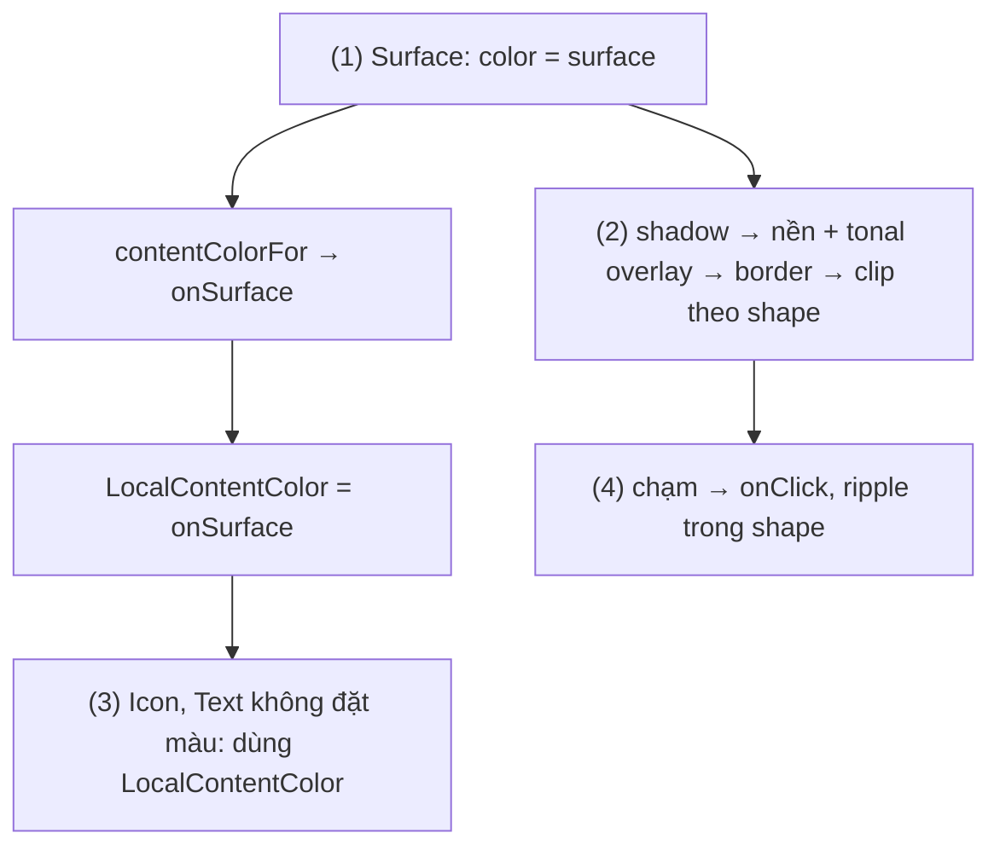
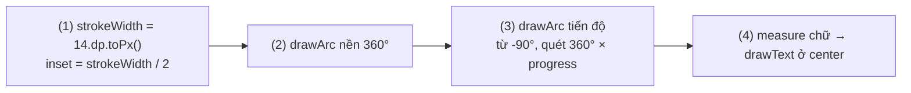
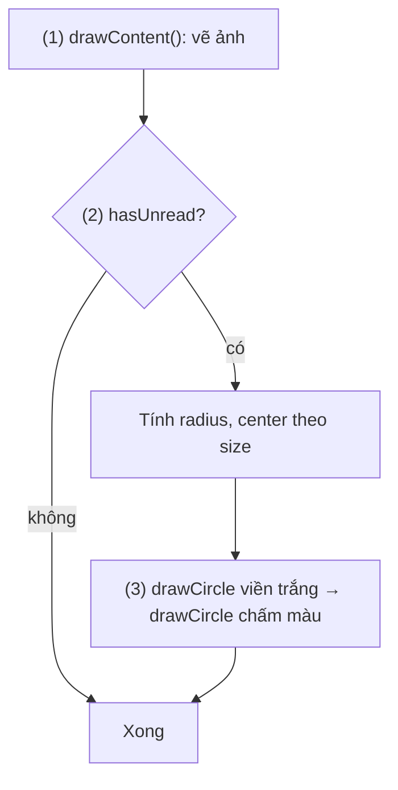
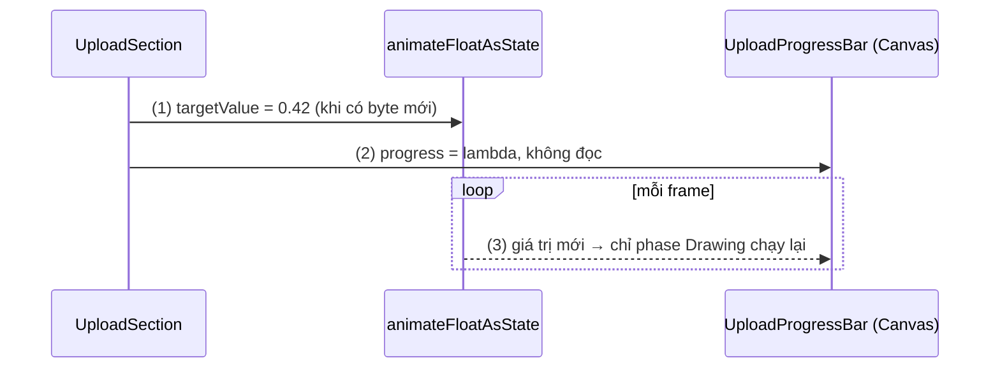
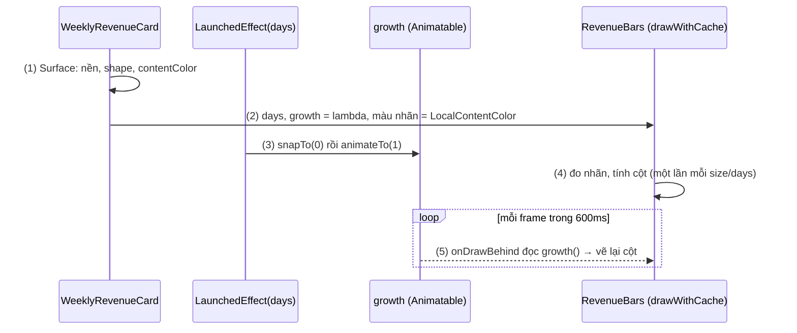

# Surface and Canvas

## Vấn đề cần giải quyết

Một màn hình Compose thường cần hai kiểu "vẽ" khác hẳn nhau.

**Kiểu thứ nhất: các khối nền có hình dạng.** Thẻ đơn hàng, ô thông báo, bảng chọn đều là một tấm nền bo góc, có viền, hơi nổi lên khỏi nền màn hình, chữ bên trong có màu tương phản với nền. Nếu tự ghép bằng modifier cho từng thẻ:

```kotlin
// OrderCard.kt (cách làm có vấn đề)
Column(
    Modifier
        .shadow(2.dp, RoundedCornerShape(12.dp))
        .clip(RoundedCornerShape(12.dp))
        .background(Color.White)
        .border(1.dp, Color(0xFFE0E0E0), RoundedCornerShape(12.dp))
        .clickable { onClick() }
) {
    Text(order.code, color = Color.Black)
}
```

Đoạn này có ba vấn đề: màu cứng nên sang dark mode thì thẻ vẫn trắng, chữ vẫn đen; mỗi thẻ ghép modifier một kiểu nên các thẻ lệch nhau; và mọi `Text` bên trong phải tự nhớ đặt màu.

**Kiểu thứ hai: hình không dựng được từ `Row`, `Column`, `Text`.** Vòng tiến độ, biểu đồ cột, đường giá, chấm "chưa đọc" trên ảnh đại diện. Chồng nhiều `Box` để giả lập thì vừa nặng (mỗi `Box` là một node layout) vừa không vẽ được cung hay đường cong.

Kiểu thứ hai còn có bẫy hiệu năng: hình vẽ thường có animation, giá trị đổi mỗi frame; nếu nó đi qua tham số composable, cả cây phía dưới recompose mỗi frame.

Vấn đề cần giải quyết là: **có một khối nền chuẩn Material tự theo theme cho kiểu thứ nhất, một bề mặt vẽ tự do cho kiểu thứ hai, và cách vẽ lại theo animation mà không phải chạy lại composition.**

## Sau khi học xong

- Giải thích được những việc Surface làm cho nội dung con (clip theo shape, nền, border, tonal và shadow elevation, content color, chặn chạm xuyên) và vì sao nó là nền của hầu hết component Material 3.
- Triển khai được hình vẽ tuỳ chỉnh bằng Canvas và DrawScope (hình cơ bản, cung, Path, chữ qua TextMeasurer) với toạ độ pixel đúng mật độ màn hình.
- Phân biệt được Canvas, Modifier.drawBehind, Modifier.drawWithContent và Modifier.drawWithCache, và chọn đúng modifier theo thứ tự vẽ và nhu cầu cache.
- Tối ưu được phần vẽ có animation bằng cách đọc state trong phase Drawing thay vì trong composition.
- Nhận diện được các lỗi thường gặp như Canvas không có kích thước, nhầm dp với px, tạo Path hay đo chữ mỗi frame và quên gọi drawContent.

## Surface và Canvas là gì?

**`Surface`** là composable Material đóng gói một **tấm vật liệu**: nó clip nội dung theo `shape`, tô nền bằng `color`, vẽ `border`, thể hiện độ nổi bằng `tonalElevation` và `shadowElevation`, và cung cấp `contentColor` làm màu mặc định cho nội dung con. **`Canvas`** (cùng các draw modifier `drawBehind`, `drawWithContent`, `drawWithCache`) là chỗ tự vẽ: một lambda chạy trên `DrawScope` trong phase Drawing, ra lệnh vẽ hình, path, chữ bằng toạ độ pixel.

Mental model: **tấm vật liệu và cây bút**. `Surface` là tấm vật liệu được cắt theo hình, sơn màu theo theme và đặt ở một độ cao; bạn chọn tấm, không tự sơn. `Canvas` là cây bút: bạn tự quyết định nét nào vẽ ở đâu, Compose chỉ đưa cho bạn kích thước tấm và bộ lệnh vẽ.

Hai thứ thường đi cùng nhau: một thẻ thống kê là một `Surface`, bên trong có một vùng `Canvas` vẽ biểu đồ.

## Cách hoạt động

### 1. Surface: tấm vật liệu Material

Theo tài liệu API của Material 3, `Surface` chịu trách nhiệm cho sáu việc:

| Việc | Tham số | Ý nghĩa |
|---|---|---|
| Clip | `shape` (mặc định `RectangleShape`) | Nội dung con, ripple và nền đều bị cắt theo shape |
| Nền | `color` (mặc định `MaterialTheme.colorScheme.surface`) | Tô kín shape |
| Border | `border: BorderStroke?` | Vẽ viền theo shape |
| Tonal elevation | `tonalElevation` (mặc định `0.dp`) | Khi `color` là `colorScheme.surface`, phủ một lớp tông màu primary; càng cao càng đậm |
| Shadow elevation | `shadowElevation` (mặc định `0.dp`) | Vẽ bóng đổ theo shape |
| Content color | `contentColor` (mặc định `contentColorFor(color)`) | Cung cấp qua `LocalContentColor`; `Text`, `Icon` không đặt màu sẽ dùng màu này |

Ngoài ra `Surface` **chặn chạm xuyên**: cú chạm vào vùng của nó không lọt xuống composable nằm phía sau.

**Hai loại elevation.** Material 3 thể hiện độ nổi chủ yếu bằng **tông màu**, bóng đổ là phụ. `tonalElevation` chỉ đổi màu nền và chỉ có tác dụng khi `color` là `colorScheme.surface`; đặt `color = Color.White` thì tonal elevation không còn gì để phủ. Surface lồng nhau cộng dồn tonal elevation qua `LocalAbsoluteTonalElevation`, nên Surface con không bao giờ trông "thấp hơn" Surface cha. `shadowElevation` vẽ bóng thật, dùng khi khối nằm đè lên nội dung khác (menu, thanh nổi).

**Content color.** `contentColorFor(color)` tra màu nền trong `ColorScheme`: nền `surface` thì nội dung `onSurface`, nền `primaryContainer` thì `onPrimaryContainer`. Màu đó được đặt vào `LocalContentColor` (một CompositionLocal, học ở [Custom Theme](../theming/custom_theme.md)) cho toàn bộ nội dung bên trong. Vì vậy đổi theme hoặc sang dark mode thì chữ tự đổi theo nền. Cách định nghĩa `ColorScheme` và các role màu học ở [Material Design Theme](../theming/material_design_theme.md).

**Bản có thể bấm.** `Surface(onClick = …)` thêm click, ripple clip theo `shape`, semantics và `enabled`; có thêm bản `selected`/`checked`. Phần lớn component Material 3 (`Card`, `Button`, `NavigationBar`) dựng trên `Surface`, nên chúng tự theo theme.

#### Ví dụ: thẻ trạng thái đơn hàng có thể bấm

**Bài toán:** danh sách đơn hàng cần mỗi đơn là một thẻ bo góc, có viền nhẹ, nổi khỏi nền, bấm vào để mở chi tiết, và tự đúng màu ở dark mode mà không đặt màu cho từng `Text`.

**Luồng chạy:**

1. `Surface` nhận `color = surface`, tính `contentColorFor(surface) = onSurface` và đặt vào `LocalContentColor` cho nội dung con.
2. `Surface` vẽ bóng, tô nền đã phủ tông theo `tonalElevation`, vẽ viền, rồi clip nội dung theo `shape`.
3. `Icon` và `Text` bên trong không đặt màu nên lấy `LocalContentColor`.
4. Người dùng chạm: `Surface` gọi `onClick`, ripple hiện trong đúng hình bo góc.



```kotlin
// OrderStatusCard.kt
@Composable
fun OrderStatusCard(
    order: OrderSummary,
    onClick: () -> Unit,
    modifier: Modifier = Modifier
) {
    Surface(
        onClick = onClick,                                         // (4)
        modifier = modifier.fillMaxWidth(),
        shape = MaterialTheme.shapes.medium,                       // (2) clip, ripple theo shape
        color = MaterialTheme.colorScheme.surface,                 // (1) contentColor = onSurface
        tonalElevation = 2.dp,                                     // (2) phủ tông màu
        shadowElevation = 1.dp,
        border = BorderStroke(1.dp, MaterialTheme.colorScheme.outlineVariant)
    ) {
        Row(
            modifier = Modifier.padding(16.dp),
            verticalAlignment = Alignment.CenterVertically
        ) {
            Icon(
                painter = painterResource(R.drawable.ic_local_shipping),
                contentDescription = null                          // (3) tint = LocalContentColor
            )
            Spacer(Modifier.width(12.dp))
            Column {
                Text(order.code, style = MaterialTheme.typography.titleMedium)       // (3)
                Text(order.statusLabel, style = MaterialTheme.typography.bodyMedium)
            }
        }
    }
}
```

`OrderSummary` là data class của màn danh sách, có `code` và `statusLabel`.

**Kết quả:** chuyển máy sang dark mode, thẻ đổi sang nền tối và chữ sáng mà không sửa dòng nào. Bấm vào thẻ, ripple không tràn ra ngoài góc bo. Mở Layout Inspector: nội dung thẻ nằm dưới một node `Surface`, các `Text` không có `color` riêng.

### 2. Canvas và DrawScope: tự vẽ bằng toạ độ pixel

`Canvas(modifier) { … }` là composable chỉ để vẽ. Theo tài liệu, nó là lớp bọc tiện lợi quanh `Modifier.drawBehind`: một `Spacer` với lambda vẽ. Vì là `Spacer`, `Canvas` **không có kích thước riêng**; kích thước đến từ `modifier` (`size`, `fillMaxWidth().height(…)`) hoặc từ constraints của cha.

Lambda vẽ có receiver là `DrawScope`. Những điều cần nắm:

- **Toạ độ:** gốc `(0, 0)` ở góc trên bên trái vùng vẽ, `x` tăng sang phải, `y` tăng xuống dưới.
- **Đơn vị là pixel.** `DrawScope` cũng là `Density`, nên đổi `dp` sang px bằng `12.dp.toPx()`. Hoặc tính theo tỉ lệ của `size`.
- **`size` và `center`:** kích thước vùng vẽ (`Size`, đơn vị px) và tâm của nó.
- **Hàm vẽ:** `drawRect`, `drawRoundRect`, `drawCircle`, `drawOval`, `drawLine`, `drawArc`, `drawPath`, `drawPoints`, `drawImage`. Phần lớn tham số có mặc định "bắt đầu ở `(0, 0)`, phủ kín vùng vẽ".
- **Kiểu nét:** `style = Fill` (mặc định, tô kín) hoặc `style = Stroke(width, cap = StrokeCap.Round)` (chỉ vẽ nét).
- **Biến đổi:** `rotate`, `translate`, `scale`, `inset` áp cho mọi lệnh trong khối của chúng; `withTransform { … }` gộp nhiều biến đổi thành một lần, hiệu quả hơn lồng nhau. Biến đổi chỉ tác động lúc vẽ, không đổi kích thước hay vị trí layout.
- **Chữ:** `Text` composable vẫn là cách hiển thị chữ thông thường. Trong `DrawScope`, chữ cần đo trước: `rememberTextMeasurer()` tạo `TextMeasurer`, `measure(...)` trả `TextLayoutResult` (biết kích thước chữ), rồi `drawText(layoutResult, topLeft = …)` vẽ nó.
- **`Path`:** chuỗi lệnh `moveTo`, `lineTo`, `cubicTo`, `close` mô tả một hình bất kỳ; `drawPath(path, color, style)` vẽ nó.

Khác với `onDraw(Canvas)` của View system (8.5.2 View Custom, chưa có bài), `DrawScope` không bắt bạn quản lý `Paint`: màu, nét, blend mode là tham số của từng lệnh vẽ.

#### Ví dụ: vòng tiến độ mục tiêu bước chân

**Bài toán:** màn sức khoẻ hiện một vòng tròn: phần nền xám là cả mục tiêu, phần màu là số bước đã đi, giữa vòng là phần trăm. `CircularProgressIndicator` không cho đặt chữ ở giữa và đổi độ dày tuỳ ý, nên tự vẽ.

**Luồng chạy:**

1. Đổi độ dày nét từ `dp` sang px, tính hình vuông chứa cung lùi vào nửa độ dày để nét không bị cắt ở mép.
2. Vẽ cung nền 360° bằng `Stroke`.
3. Vẽ cung tiến độ, bắt đầu từ -90° (đỉnh vòng), quét `360° × progress`, đầu nét bo tròn.
4. Đo chữ phần trăm bằng `TextMeasurer`, vẽ sao cho tâm chữ trùng `center`.



```kotlin
// StepGoalRing.kt
@Composable
fun StepGoalRing(steps: Int, goal: Int, modifier: Modifier = Modifier) {
    val textMeasurer = rememberTextMeasurer()
    val trackColor = MaterialTheme.colorScheme.surfaceVariant
    val progressColor = MaterialTheme.colorScheme.primary
    val labelStyle = MaterialTheme.typography.titleLarge.copy(color = MaterialTheme.colorScheme.onSurface)
    val progress = if (goal > 0) (steps.toFloat() / goal).coerceIn(0f, 1f) else 0f
    val label = "${(progress * 100).roundToInt()}%"

    Canvas(
        modifier = modifier
            .size(160.dp)                                              // Canvas cần kích thước
            .semantics { contentDescription = "Đã đi $steps trên $goal bước" }
    ) {
        val strokeWidth = 14.dp.toPx()                                 // (1) dp → px
        val topLeft = Offset(strokeWidth / 2, strokeWidth / 2)
        val arcSize = Size(size.width - strokeWidth, size.height - strokeWidth)

        drawArc(                                                       // (2)
            color = trackColor, startAngle = 0f, sweepAngle = 360f, useCenter = false,
            topLeft = topLeft, size = arcSize, style = Stroke(width = strokeWidth)
        )
        drawArc(                                                       // (3)
            color = progressColor, startAngle = -90f, sweepAngle = 360f * progress, useCenter = false,
            topLeft = topLeft, size = arcSize, style = Stroke(width = strokeWidth, cap = StrokeCap.Round)
        )
        val layout = textMeasurer.measure(AnnotatedString(label), style = labelStyle)   // (4)
        drawText(
            textLayoutResult = layout,
            topLeft = Offset(center.x - layout.size.width / 2f, center.y - layout.size.height / 2f)
        )
    }
}
```

Màu và kiểu chữ lấy từ `MaterialTheme` **bên ngoài** lambda vẽ, vì `MaterialTheme.colorScheme` là lời gọi composable, không gọi được trong `DrawScope`.

**Kết quả:** với 6.500/10.000 bước, vòng màu chạy từ đỉnh theo chiều kim đồng hồ khoảng hai phần ba vòng, giữa vòng hiện "65%". Trên máy mật độ khác nhau, độ dày nét bằng nhau về mặt thị giác nhờ `toPx()`. TalkBack đọc "Đã đi 6500 trên 10000 bước" nhờ `semantics`, vì `Canvas` tự nó không có nội dung cho trình đọc màn hình.

Đoạn này đo chữ ngay trong lambda vẽ. Điều đó chấp nhận được khi hình hiếm khi vẽ lại; nếu vòng có animation, mỗi frame sẽ đo chữ một lần. Phần tiếp theo giải quyết chuyện này.

### 3. Draw modifier: vẽ lên composable có sẵn

`Canvas` tạo một composable mới chỉ để vẽ. Khi muốn vẽ **thêm** lên một composable đã có (một `Text`, một `Image`), dùng draw modifier. Tài liệu nêu ba modifier chính:

| Modifier | Thứ tự vẽ | Dùng khi |
|---|---|---|
| `drawBehind { }` | Lệnh của bạn vẽ **trước**, nội dung composable vẽ đè lên | Nền tuỳ chỉnh sau chữ, gạch chân, lưới biểu đồ |
| `drawWithContent { }` | Bạn tự gọi `drawContent()`, đặt lệnh trước hoặc sau nó | Vẽ **đè lên** nội dung (chấm thông báo, lớp phủ), hoặc clip nội dung |
| `drawWithCache { … onDrawBehind { } }` / `onDrawWithContent { }` | Như hai modifier trên | Cần tạo object tốn kém (`Path`, `Brush`, chữ đã đo) và giữ lại giữa các lần vẽ |

`drawWithContent` là modifier gốc; `drawBehind` là bản rút gọn với thứ tự cố định "vẽ của bạn trước, nội dung sau". Quên gọi `drawContent()` trong `drawWithContent` thì nội dung gốc **không được vẽ**.

`drawWithCache` chia lambda làm hai tầng. Khối ngoài chạy khi **kích thước vùng vẽ đổi** hoặc **state đọc trong khối ngoài đổi**, nên là chỗ tạo object. Khối `onDrawBehind`/`onDrawWithContent` bên trong chạy mỗi lần vẽ và chỉ dùng lại object đã tạo. Tài liệu lưu ý chỉ dùng `drawWithCache` khi thật sự có object cần cache, vì nó tốn thêm cấp phát lambda.

Thứ tự của draw modifier trong chuỗi modifier cũng quyết định nó vẽ ở lớp nào so với `background`, `padding`, `clip`; quy tắc chung về thứ tự học ở [Modifier Order](../modifier/modifier_order.md). Khi một hiệu ứng vẽ cần dùng lại ở nhiều nơi, gói nó thành modifier riêng theo [Modifier.composed và Modifier.Node](../modifier/composed.md).

#### Ví dụ: chấm "chưa đọc" trên ảnh đại diện

**Bài toán:** trong danh sách hội thoại, ảnh đại diện của người có tin chưa đọc cần một chấm đỏ có viền trắng ở góc trên bên phải, **đè lên** ảnh. `drawBehind` không làm được vì nó vẽ dưới ảnh.

**Luồng chạy:**

1. Gọi `drawContent()` để ảnh đại diện được vẽ trước.
2. Nếu có tin chưa đọc, tính bán kính và tâm chấm theo `size` của ảnh.
3. Vẽ vòng trắng rồi chấm màu, cả hai đè lên ảnh.



```kotlin
// UnreadDotModifier.kt
fun Modifier.unreadDot(hasUnread: Boolean, dotColor: Color): Modifier =
    this.drawWithContent {
        drawContent()                                                  // (1)
        if (hasUnread) {                                               // (2)
            val radius = size.minDimension * 0.14f
            val dotCenter = Offset(size.width - radius, radius)
            drawCircle(Color.White, radius = radius * 1.35f, center = dotCenter)   // (3)
            drawCircle(dotColor, radius = radius, center = dotCenter)
        }
    }

// ConversationRow.kt
Image(
    painter = painterResource(R.drawable.avatar_placeholder),
    contentDescription = conversation.title,
    modifier = Modifier
        .size(48.dp)
        .clip(CircleShape)
        .unreadDot(conversation.unreadCount > 0, MaterialTheme.colorScheme.error)
)
```

**Kết quả:** người có tin chưa đọc có chấm đỏ đè lên góc ảnh. Đặt `unreadDot` **sau** `clip(CircleShape)` thì chấm bị cắt theo vòng tròn ở góc; muốn chấm tràn ra ngoài viền tròn, đặt `unreadDot` trước `clip`. Đây là hệ quả trực tiếp của thứ tự modifier.

### 4. Đọc state trong phase Drawing

[Jetpack Compose Overview](../overview.md), mục "Deep Dive: ba phase của một frame", đã nêu nguyên tắc: state được **đọc** ở phase nào thì khi đổi, Compose chạy lại từ phase đó. State chỉ đọc trong lambda vẽ thì khi đổi, Compose bỏ qua Composition và Layout, chỉ vẽ lại.

Áp vào hình vẽ có animation, điều quyết định là **chỗ giá trị được đọc**, không phải chỗ nó được tạo:

- `val p by animateFloatAsState(...)` rồi truyền `p` làm tham số `Float` cho composable con: `p` được đọc trong composition của cha, mỗi frame cha và con recompose.
- Truyền **lambda** `{ p }` cho con, con chỉ gọi lambda **bên trong** `Canvas`/`drawBehind`: lần đọc xảy ra trong phase Drawing, mỗi frame chỉ vẽ lại.

Cách đặt tham số dạng `() -> Float` này là quy ước Compose khuyên cho giá trị đổi theo frame. Nguyên tắc tương tự áp cho `Modifier.graphicsLayer { }` (bản lambda), dùng nhiều khi zoom ([Zooming](../gesture/zooming.md)), và `Modifier.offset { }` khi kéo ([Dragging](../gesture/dragging.md)). Cơ chế recompose scope chi tiết học ở [Remember and Recomposition](../remember_and_recomposition.md); bảng chọn API animation ở [AnimatedVisibility](animated_visibility.md).

#### Ví dụ: thanh tiến độ tải ảnh lên chạy mượt mà không recompose

**Bài toán:** khi tải ảnh lên, server báo số byte đã gửi khoảng nửa giây một lần. Thanh tiến độ cần chạy mượt giữa các lần báo (animation), nhưng màn hình chứa nó có nhiều thành phần khác không nên recompose 60 lần mỗi giây.

**Luồng chạy:**

1. `UploadSection` tạo `animatedProgress` bằng `animateFloatAsState` theo `uploadedBytes / totalBytes`. `UploadSection` chỉ recompose khi số byte mới đến.
2. `UploadSection` truyền `{ animatedProgress }` cho `UploadProgressBar`, không đọc giá trị.
3. Mỗi frame animation, giá trị đổi; nó chỉ được đọc trong lambda `Canvas`, nên Compose chỉ chạy lại phase Drawing của `UploadProgressBar`.



```kotlin
// UploadProgressBar.kt
@Composable
fun UploadProgressBar(progress: () -> Float, modifier: Modifier = Modifier) {
    val trackColor = MaterialTheme.colorScheme.surfaceVariant
    val barColor = MaterialTheme.colorScheme.primary
    Canvas(modifier.fillMaxWidth().height(8.dp)) {
        val value = progress()                                          // (3) đọc trong phase Drawing
        val corner = CornerRadius(size.height / 2)
        drawRoundRect(trackColor, cornerRadius = corner)
        drawRoundRect(barColor, size = Size(size.width * value, size.height), cornerRadius = corner)
    }
}

// UploadSection.kt
@Composable
fun UploadSection(uploadedBytes: Long, totalBytes: Long, modifier: Modifier = Modifier) {
    val animatedProgress by animateFloatAsState(                       // (1)
        targetValue = if (totalBytes > 0) uploadedBytes.toFloat() / totalBytes else 0f,
        label = "uploadProgress"
    )
    Column(modifier) {
        Text("Đang tải ảnh lên", style = MaterialTheme.typography.titleSmall)
        UploadProgressBar(progress = { animatedProgress })              // (2) truyền lambda
    }
}
```

**Kết quả:** mở Layout Inspector, bật recomposition counts. Trong lúc thanh chạy, số lần recompose của `UploadSection` và `UploadProgressBar` chỉ tăng mỗi khi có số byte mới (khoảng 2 lần mỗi giây), không phải mỗi frame. Đổi `UploadProgressBar` sang nhận `progress: Float` và truyền `animatedProgress`: số đếm tăng liên tục theo frame.

## Ví dụ thực tế

Ba bài toán hay gặp với Surface và Canvas:

1. **Thẻ biểu đồ doanh thu 7 ngày:** `Surface` làm thẻ, bên trong là biểu đồ cột tự vẽ, cột mọc lên khi dữ liệu đến, nhãn ngày đo bằng `TextMeasurer` và cache. Đây là bài toán chính, code đầy đủ bên dưới.
2. **Hiệu ứng skeleton khi đang tải:** các khối xám có dải sáng chạy ngang. Vẽ bằng `drawWithContent` với `Brush.linearGradient` có offset lấy từ `rememberInfiniteTransition`, đọc offset trong lambda vẽ để không recompose.
3. **Ô ký tên:** người dùng vẽ chữ ký bằng ngón tay, mỗi nét là một `Path` được nối điểm theo sự kiện chạm. Phần vẽ dùng `Canvas` + `drawPath`; phần nhận cử chỉ học ở [Dragging](../gesture/dragging.md).

### Thẻ biểu đồ doanh thu 7 ngày

**Bài toán:** màn tổng quan của app bán hàng có một thẻ "Doanh thu 7 ngày". Thẻ phải theo theme (dark mode, màu chữ), biểu đồ cột cao theo doanh thu, cột mọc từ đáy lên trong 600ms mỗi khi dữ liệu mới đến, và trình đọc màn hình đọc được số liệu.

**Luồng chạy:**

1. `Surface` dựng thẻ: nền theo theme, bo góc, tonal elevation; nội dung bên trong nhận `contentColor`.
2. `RevenueBars` lấy `LocalContentColor` cho nhãn ngày, nên nhãn cùng màu với tiêu đề thẻ.
3. Khi `days` đổi, `LaunchedEffect(days)` đưa `growth` về 0 rồi animate lên 1. `LaunchedEffect` chạy coroutine theo vòng đời composition, học ở [LaunchedEffect](../side_effects/launched_effect.md).
4. Khối ngoài `drawWithCache` đo nhãn và tính kích thước cột một lần cho mỗi `size`/`days`.
5. Khối `onDrawBehind` đọc `growth()` và vẽ cột cao `chiều cao tối đa × tỉ lệ doanh thu × growth`. Mỗi frame chỉ bước này chạy.



```kotlin
// WeeklyRevenueCard.kt
data class DailyRevenue(val dayLabel: String, val amount: Long)

@Composable
fun WeeklyRevenueCard(days: List<DailyRevenue>, modifier: Modifier = Modifier) {
    val growth = remember { Animatable(0f) }
    LaunchedEffect(days) {                                                       // (3)
        growth.snapTo(0f)
        growth.animateTo(1f, animationSpec = tween(durationMillis = 600))
    }
    Surface(                                                                     // (1)
        modifier = modifier.fillMaxWidth(),
        shape = MaterialTheme.shapes.large,
        tonalElevation = 1.dp
    ) {
        Column(Modifier.padding(16.dp)) {
            Text("Doanh thu 7 ngày", style = MaterialTheme.typography.titleMedium)
            Spacer(Modifier.height(12.dp))
            RevenueBars(
                days = days,
                growth = { growth.value },                                       // không đọc ở đây
                modifier = Modifier.fillMaxWidth().height(160.dp)
            )
        }
    }
}

@Composable
private fun RevenueBars(days: List<DailyRevenue>, growth: () -> Float, modifier: Modifier = Modifier) {
    val textMeasurer = rememberTextMeasurer()
    val barColor = MaterialTheme.colorScheme.primary
    val labelStyle = MaterialTheme.typography.labelSmall.copy(color = LocalContentColor.current)  // (2)
    val summary = days.joinToString { "${it.dayLabel} ${it.amount} đồng" }

    Spacer(
        modifier = modifier
            .semantics { contentDescription = "Doanh thu theo ngày: $summary" }
            .drawWithCache {
                val labels = days.map { textMeasurer.measure(AnnotatedString(it.dayLabel), style = labelStyle) } // (4)
                val labelHeight = labels.maxOfOrNull { it.size.height } ?: 0
                val chartHeight = size.height - labelHeight - 4.dp.toPx()
                val maxAmount = (days.maxOfOrNull { it.amount } ?: 1L).coerceAtLeast(1L)
                val slotWidth = size.width / days.size.coerceAtLeast(1)
                val barWidth = slotWidth * 0.6f
                val corner = CornerRadius(4.dp.toPx())

                onDrawBehind {
                    val factor = growth()                                        // (5) đọc trong phase Drawing
                    days.forEachIndexed { index, day ->
                        val barHeight = chartHeight * day.amount / maxAmount * factor
                        val left = index * slotWidth + (slotWidth - barWidth) / 2
                        drawRoundRect(
                            color = barColor,
                            topLeft = Offset(left, chartHeight - barHeight),
                            size = Size(barWidth, barHeight),
                            cornerRadius = corner
                        )
                        val label = labels[index]
                        drawText(
                            textLayoutResult = label,
                            topLeft = Offset(
                                index * slotWidth + (slotWidth - label.size.width) / 2,
                                size.height - label.size.height
                            )
                        )
                    }
                }
            }
    )
}
```

`Animatable` là API animation mức thấp dựa trên coroutine, được xếp chỗ trong bảng chọn API ở [AnimatedVisibility](animated_visibility.md). Nó là state, nên đọc `growth.value` trong `onDrawBehind` là đọc trong phase Drawing.

**Kết quả:** thẻ tự đổi màu theo dark mode, nhãn ngày cùng màu với tiêu đề. Khi dữ liệu mới đến, bảy cột mọc từ đáy lên cùng lúc. Trong Layout Inspector, recomposition count của `WeeklyRevenueCard` và `RevenueBars` không tăng trong 600ms animation; đặt log trong khối ngoài `drawWithCache` thì chỉ thấy một lần cho mỗi bộ dữ liệu. TalkBack đọc danh sách doanh thu theo ngày.

## So sánh với các cách tiếp cận khác

| Cách | Ưu điểm | Hạn chế |
|---|---|---|
| `Surface` | Một chỗ cho nền, shape, border, elevation, content color, click; theo theme | Gắn với Material |
| Chuỗi `shadow` + `clip` + `background` + `border` | Không phụ thuộc Material | Tự đặt màu chữ, dễ sai thứ tự, các khối lệch nhau |
| `Canvas` / draw modifier | Vẽ tự do, ít node, đọc state ở phase Drawing | Tự lo kích thước, semantics, RTL |
| Chồng nhiều `Box` | Không cần học `DrawScope` | Nhiều node layout, không vẽ được cung hay đường cong |

## Khi nào nên và không nên dùng

- **Nên dùng `Surface`** cho mọi khối nền mang ý nghĩa vật liệu: thẻ, panel, thanh nổi, vùng chọn. Nếu đã có component Material phù hợp (`Card`, `ElevatedCard`, `ListItem`), dùng component đó vì nó đã là `Surface` với giá trị mặc định đúng spec.
- **Không cần `Surface`** cho nền thuần trang trí không có nội dung chữ (một dải màu, một đường kẻ): `Modifier.background` là đủ.
- **Nên dùng `Canvas`/draw modifier** cho hình không ghép được từ layout: vòng, cung, biểu đồ, đường cong, hiệu ứng phủ.
- **Không nên tự vẽ** khi có composable sẵn làm đúng việc (`LinearProgressIndicator`, `HorizontalDivider`, `Text`): tự vẽ nghĩa là tự lo semantics, cỡ chữ theo cài đặt người dùng, RTL.
- **Nên dùng `drawWithCache`** khi khối vẽ tạo `Path`, `Brush`, `Shader` hay đo chữ; **không cần** khi chỉ gọi vài `drawRect`/`drawCircle` với màu có sẵn.

## Sai lầm thường gặp

### 1. `Canvas` không có kích thước

```kotlin
Row {
    Canvas(Modifier) { drawCircle(Color.Red) }   // không thấy gì
    Text("Online")
}
```

`Canvas` là `Spacer`, trong `Row` nó nhận kích thước 0 nên `size` bằng 0 và không có gì được vẽ. Sửa: luôn cho `Canvas` một kích thước, ví dụ `Modifier.size(8.dp)`.

### 2. Dùng giá trị dp như pixel

`drawCircle(color, radius = 12f)` vẽ bán kính 12 **pixel**: trên máy mật độ cao, chấm nhỏ xíu. Sửa: `radius = 12.dp.toPx()`, hoặc tính theo `size` (`size.minDimension / 2`).

### 3. Tạo `Path`, `Brush` hay đo chữ trong lambda vẽ có animation

```kotlin
Canvas(modifier) {
    val path = buildChartPath(points, size)        // tạo lại mỗi frame
    val label = textMeasurer.measure(text)         // đo lại mỗi frame
    drawPath(path, color)
}
```

Khi hình có animation, lambda vẽ chạy mỗi frame; cấp phát object và đo chữ mỗi frame gây GC và giật. Sửa: chuyển phần tạo object vào khối ngoài của `drawWithCache` (như thẻ biểu đồ ở mục "Ví dụ thực tế"), hoặc `remember` nó ngoài composition nếu không phụ thuộc `size`.

### 4. Đọc giá trị animation trong composition rồi truyền xuống

```kotlin
val progress by animateFloatAsState(target, label = "progress")
UploadProgressBar(progress = progress)   // đọc ở đây → recompose mỗi frame
```

Lỗi lộ ra trong Layout Inspector: recomposition count tăng liên tục khi animation chạy. Sửa: tham số dạng `() -> Float`, chỉ gọi trong lambda vẽ (mục 4).

### 5. Quên `drawContent()` trong `drawWithContent`

```kotlin
Modifier.drawWithContent {
    drawCircle(Color.Red, radius = 4.dp.toPx())   // ảnh gốc biến mất
}
```

`drawWithContent` giao toàn quyền thứ tự vẽ cho bạn; không gọi `drawContent()` thì nội dung gốc không được vẽ. Nếu chỉ cần vẽ phía sau, dùng `drawBehind`.

### 6. Đặt màu nền cứng rồi chờ tonal elevation có tác dụng

`Surface(color = Color.White, tonalElevation = 6.dp)` trông y như không có elevation, vì tonal overlay chỉ phủ khi `color` là `colorScheme.surface`. Sửa: dùng màu từ `ColorScheme` (`surface` hoặc các role surface container), hoặc dùng `shadowElevation` nếu cần bóng thật.

### 7. Quên semantics cho hình tự vẽ

`Canvas` không cung cấp nội dung cho TalkBack; biểu đồ thiếu `contentDescription` là vùng trống với trình đọc màn hình. Sửa: thêm `Modifier.semantics { contentDescription = … }`.

## Lịch sử phát triển

- **Compose 1.0 (07/2021):** `Canvas`, `DrawScope`, `drawBehind`, `drawWithContent`, `drawWithCache` và `Modifier.graphicsLayer` đã có từ bản ổn định đầu tiên; `Surface` lúc đó thuộc Material 2, thể hiện độ nổi bằng bóng (`elevation`) và lớp phủ sáng trong dark theme.
- **Material 3 cho Compose ổn định (10/2022):** `Surface` của `androidx.compose.material3` tách elevation làm hai, `tonalElevation` (tông màu, cách chính của Material 3) và `shadowElevation`. Lớp phủ dark theme cũ được thay bằng tông màu lấy từ primary.
- **Khoảng Compose UI 1.3 (cuối 2022):** có `TextMeasurer` và `DrawScope.drawText` (ban đầu ở dạng experimental), nên vẽ chữ trong `DrawScope` không còn phải đi qua `nativeCanvas` của nền tảng.
- **Compose 1.4:** `graphicsLayer` có `CompositingStrategy` (`Auto`, `Offscreen`, `ModulateAlpha`), cần cho các hiệu ứng `BlendMode`.
- **Compose 1.7:** `rememberGraphicsLayer()` cho phép ghi nội dung composable vào một layer để vẽ lại hoặc xuất ra bitmap.

## Kết nối hệ thống

- **Prerequisites:**
  - [Jetpack Compose Overview](../overview.md) — ba phase Composition → Layout → Drawing; mục 4 của bài này dựa trên nó.
  - [Material Design Theme](../theming/material_design_theme.md) — `ColorScheme`, `Shapes`, mà `Surface` dùng làm mặc định.
  - [Modifier Order](../modifier/modifier_order.md) — thứ tự draw modifier so với `clip`, `padding`, `background`.
- **Related:**
  - [Layout and View](../layout_and_view.md) — `Text`, `Image`, `Box`: dùng chúng trước khi nghĩ tới tự vẽ.
  - [Modifier.composed và Modifier.Node](../modifier/composed.md) — đóng gói hiệu ứng vẽ thành modifier tái sử dụng (`DrawModifierNode`).
  - [Custom Theme](../theming/custom_theme.md) — CompositionLocal, cơ chế đứng sau `LocalContentColor`.
  - [Zooming](../gesture/zooming.md) — `graphicsLayer` cho scale, translation đọc ở phase Drawing.
  - 8.5.2 View Custom (chưa có bài) — `onDraw(Canvas)` và `Paint` của View system.
- **Học tiếp (theo nav):**
  - [AnimatedVisibility](animated_visibility.md) — bản đồ API animation của Compose và cách cho nội dung xuất hiện, biến mất.
  - [MutableTransitionState](mutable_transition_state.md), [AnimatedContent](animated_content.md), [Crossfade](crossfade.md).

## Developer Curiosity Checklist

- [ ] Vì sao `Text` bên trong `Surface(color = primaryContainer)` tự có màu `onPrimaryContainer`?
- [ ] `Canvas` lấy kích thước từ đâu?
- [ ] Khối ngoài của `drawWithCache` chạy lại khi nào?
- [ ] Vì sao truyền `() -> Float` thay vì `Float` giúp animation không làm recompose?

## Tham khảo

- [Graphics in Compose — Android Developers](https://developer.android.com/develop/ui/compose/graphics/draw/overview)
- [Graphics modifiers — Android Developers](https://developer.android.com/develop/ui/compose/graphics/draw/modifiers)
- [Surface (Material 3) — API reference](https://developer.android.com/reference/kotlin/androidx/compose/material3/Surface.composable)
- [Material Design 3 in Compose — Android Developers](https://developer.android.com/develop/ui/compose/designsystems/material3)
- [Jetpack Compose phases — Android Developers](https://developer.android.com/develop/ui/compose/phases)
- [Value-based animations — Android Developers](https://developer.android.com/develop/ui/compose/animation/value-based)
