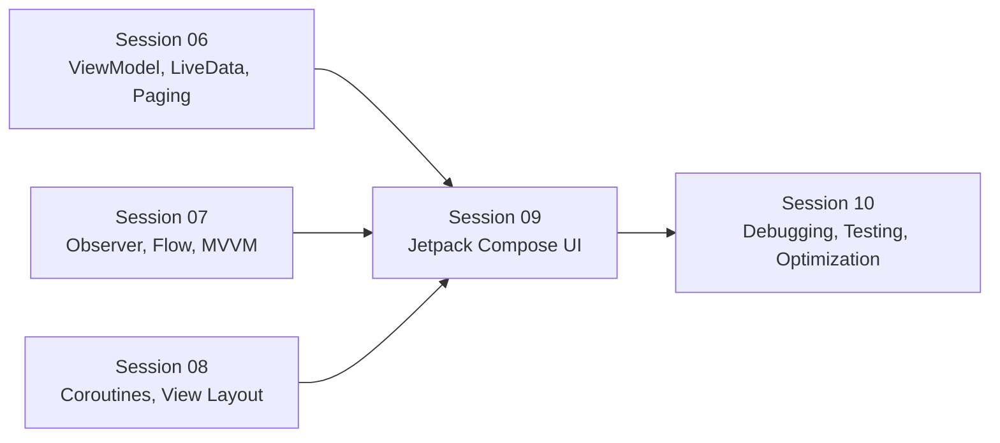
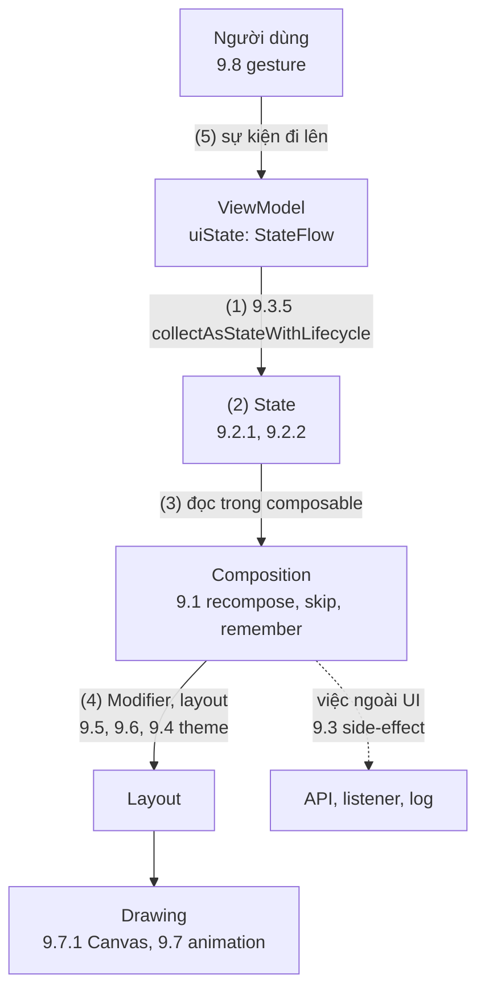
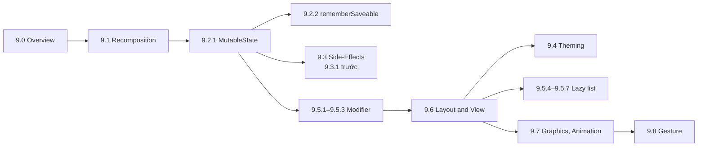

# Session 09 Overview

## Vấn đề cần giải quyết

Bài [9.0 Jetpack Compose Overview](overview.md) đã trả lời "Compose là gì": UI là hàm của state, runtime chỉ chạy lại phần đọc state đã đổi, mỗi frame đi qua Composition → Layout → Drawing. Khi bắt tay viết màn hình thật, người học gặp ngay các câu hỏi tiếp theo:

1. **State đặt ở đâu và sống bao lâu?** Giá trị nào mất khi recompose, khi xoay màn hình, khi process bị kill? Composable nào giữ state, composable nào chỉ nhận tham số?
2. **Việc không phải "vẽ UI" (gọi API, đăng ký listener, ghi log) đặt ở đâu?** Thân composable có thể chạy lại bất kỳ lúc nào.
3. **Giao diện nhất quán thế nào?** Màu, chữ, hình dạng, khoảng cách dùng chung cho cả app và đổi theo dark mode.
4. **Bố cục, danh sách dài, hình vẽ, chuyển động và cử chỉ** viết thế nào mà vẫn mượt?

Session 09 trả lời bốn nhóm câu hỏi này.

## Vị trí Session 09 trong lộ trình

- **Kế thừa:** ViewModel (6.4) giữ UI state, Flow (7.1.4.2) và Coroutines (8.4.3) đưa state ra và chạy việc bất đồng bộ, MVVM (7.2.3) quy định luồng dữ liệu một chiều. Session 09 là tầng "View" của luồng đó, viết bằng Compose thay cho XML.
- **Bắc cầu:** Session 10 test UI Compose và tối ưu recomposition bằng các công cụ đã giới thiệu ở 9.1.

## Session 09 học những gì?

| Nhóm | Topic | Câu hỏi trả lời |
|---|---|---|
| Nền | [9.0 Jetpack Compose Overview](overview.md) | Compose là gì, compiler và runtime làm gì, ba phase của một frame |
| Nền | [9.1 Remember and Recomposition](remember_and_recomposition.md) | Phạm vi nào chạy lại khi state đổi, khi nào được skip, `remember` nhớ giá trị theo gì |
| State | [9.2.1 MutableState](state/mutable_state.md) | State quan sát được hoạt động thế nào, và đưa state lên đâu (state hoisting) |
| State | [9.2.2 Remember and rememberSaveable](state/remember_saveable.md) | Giá trị nào sống qua xoay màn hình và process death |
| Side-effect | [9.3.1 LaunchedEffect](side_effects/launched_effect.md) | Chạy coroutine theo vòng đời composition, chọn API side-effect nào |
| Side-effect | [9.3.2 DisposableEffect](side_effects/disposable_effect.md) | Đăng ký và huỷ listener đúng lúc |
| Side-effect | [9.3.3 ProduceState](side_effects/produce_state.md) | Biến nguồn dữ liệu ngoài Compose thành `State` |
| Side-effect | [9.3.4 DerivedStateOf](side_effects/derived_state_of.md) | Giảm recompose khi state suy ra đổi ít hơn state gốc |
| Side-effect | [9.3.5 SnapShotFlow and flowWithSnapshot](side_effects/flow_with_snapshot.md) | Chuyển hai chiều State ↔ Flow |
| Theming | [9.4.1 Material Design Theme](theming/material_design_theme.md) | Color scheme, typography, shapes của Material 3 |
| Theming | [9.4.2 Custom Theme](theming/custom_theme.md) | Thêm token riêng của app qua CompositionLocal |
| Modifier | [9.5.1 Modifier Order](modifier/modifier_order.md) | Modifier là gì, vì sao thứ tự đổi kết quả |
| Modifier | [9.5.2 Chaining](modifier/chaining.md) | Nối, tái sử dụng và nhận `modifier` từ bên ngoài |
| Modifier | [9.5.3 Composed Modifier](modifier/composed.md) | Viết modifier tuỳ chỉnh: `composed` cũ và `Modifier.Node` |
| Lazy list | [9.5.4 Lazy Column](modifier/lazy_column.md) | Lazy layout: chỉ compose phần đang hiện, `key`, `LazyListState` |
| Lazy list | [9.5.5 Lazy Row](modifier/lazy_row.md) | Danh sách ngang, carousel lồng trong danh sách dọc |
| Lazy list | [9.5.6 Lazy Vertical Grid](modifier/lazy_vertical_grid.md) | Lưới cố định, lưới thích ứng, span |
| Lazy list | [9.5.7 Lazy Paging Items](modifier/lazy_paging_items.md) | Hiển thị `PagingData` trong lazy list kèm trạng thái tải |
| Layout | [9.6 Layout and View](layout_and_view.md) | `Text`, `Image`, `Row/Column/Box`, mô hình đo một lần |
| Đồ hoạ, animation | [9.7.1 Surface and Canvas](graphics_animations/surface_and_canvas.md) | Nền, elevation và tự vẽ bằng `DrawScope` |
| Đồ hoạ, animation | [9.7.2 AnimatedVisibility](graphics_animations/animated_visibility.md) | Chọn API animation, hiện/ẩn có hiệu ứng |
| Đồ hoạ, animation | [9.7.3 MutableTransitionState](graphics_animations/mutable_transition_state.md) | Một `Transition` điều khiển nhiều giá trị, biết khi nào animation xong |
| Đồ hoạ, animation | [9.7.4 AnimatedContent](graphics_animations/animated_content.md) | Chuyển giữa các nội dung theo state |
| Đồ hoạ, animation | [9.7.5 Crossfade](graphics_animations/crossfade.md) | Chuyển nội dung chỉ bằng fade |
| Gesture | [9.8.1 Scrolling](gesture/scrolling.md) | Các tầng API gesture, cuộn và nested scroll |
| Gesture | [9.8.2 Dragging](gesture/dragging.md) | Kéo một trục, hai trục, thả về chỗ cũ |
| Gesture | [9.8.3 Swiping](gesture/swipping.md) | Vuốt giữa các mốc, vuốt để xoá |
| Gesture | [9.8.4 Zooming](gesture/zooming.md) | Phóng to, kéo, xoay bằng nhiều ngón |

> [!NOTE]
> Mục lục có hai nhóm không có bài riêng: **9.2 State and State Hoisting** và phần **Composition Local** trong tên 9.8. State hoisting được dạy trong [9.2.1 MutableState](state/mutable_state.md); CompositionLocal được dạy trong [9.4.2 Custom Theme](theming/custom_theme.md), nơi nó được dùng để cung cấp token theme. Các bài khác chỉ nhắc và link về hai bài này.

## Mối liên hệ giữa các Topic

Mọi Topic trong session xoay quanh một vòng: state đổi → recompose → layout → draw.

1. ViewModel đưa UI state ra dưới dạng `StateFlow`; composable chuyển nó thành `State` (9.3.5).
2. State trong Compose là snapshot state (9.2.1); state cục bộ của UI nằm trong `remember`/`rememberSaveable` (9.2.2).
3. Composable đọc state; khi state đổi, chỉ scope đã đọc nó chạy lại, phần còn lại được skip (9.1).
4. Modifier, layout và theme quyết định đo, đặt và vẽ (9.4–9.6); đồ hoạ và animation nằm chủ yếu ở phase Drawing (9.7).
5. Gesture (9.8) và thao tác của người dùng đi lên thành event, đổi state, vòng lặp chạy lại. Việc nằm ngoài UI đi qua side-effect API (9.3), không nằm trong thân composable.

## Điều kiện tiên quyết

- [9.0 Jetpack Compose Overview](overview.md): đọc trước mọi bài khác trong session.
- [6.4 ViewModel](../session_06/viewmodel.md) và [7.2.3 MVVM](../session_07/architecture/mvvm.md): UI state và luồng dữ liệu một chiều.
- [Activity State Changes](../session_04/components/activity/state_changes.md): configuration change và process death, nền của 9.2.2.
- 7.1.4.2 Flow (chưa có bài) và 8.4.3 Coroutines (chưa có bài): side-effect API và `collectAsStateWithLifecycle` dùng coroutine và Flow.

## Sau khi học xong Session 09, bạn làm được gì?

- Giải thích được vị trí của Session 09 trong lộ trình và câu hỏi mà từng nhóm Topic (state, side-effect, theming, Modifier, lazy list, layout, animation, gesture) trả lời.
- Phân biệt được nơi dạy chính của các kiến thức dễ chồng lấn trong session, như remember với rememberSaveable, State hoisting, CompositionLocal và lazy layout.
- Áp dụng được thứ tự học đề xuất dựa trên phụ thuộc giữa các Topic.

## Thứ tự học đề xuất

1. **9.0 → 9.1 → 9.2.1 trước tiên:** mọi bài sau đều giả định đã hiểu recompose scope, `remember` và snapshot state.
2. **9.3.1 trước các bài 9.3 khác:** bài này giải thích side-effect là gì và có bảng chọn API.
3. **Modifier (9.5.1–9.5.3) trước 9.6:** layout và vẽ đều đi qua chuỗi Modifier.
4. **9.6 trước 9.4, lazy list, đồ hoạ:** cần biết `Row/Column/Box` và mô hình đo trước khi chỉnh theme, dựng danh sách hay vẽ.
5. **9.7.2 trước 9.7.3–9.7.5:** bảng chọn API animation nằm ở 9.7.2. **9.8.1 trước 9.8.2–9.8.4:** tổng quan các tầng API gesture nằm ở 9.8.1.

Thứ tự này khác số thứ tự trong mục lục; mục lục giữ nguyên, đây chỉ là gợi ý đọc.

## Nguồn tham khảo

- [Jetpack Compose documentation — Android Developers](https://developer.android.com/develop/ui/compose/documentation)
- [State and Jetpack Compose — Android Developers](https://developer.android.com/develop/ui/compose/state)
- [Side-effects in Compose — Android Developers](https://developer.android.com/develop/ui/compose/side-effects)
- [Compose modifiers — Android Developers](https://developer.android.com/develop/ui/compose/modifiers)
- [Lists and grids — Android Developers](https://developer.android.com/develop/ui/compose/lists)
- [Animations in Compose — Android Developers](https://developer.android.com/develop/ui/compose/animation/introduction)
- [Gestures — Android Developers](https://developer.android.com/develop/ui/compose/touch-input/pointer-input/understand-gestures)
