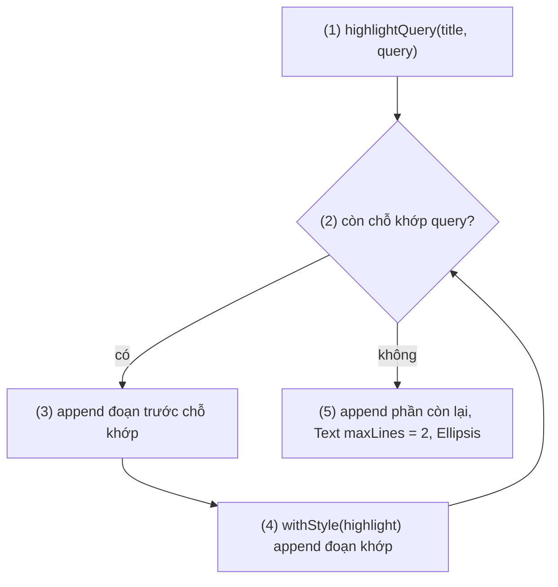
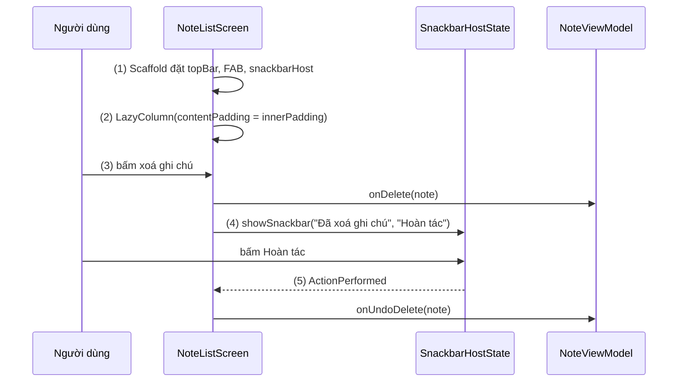
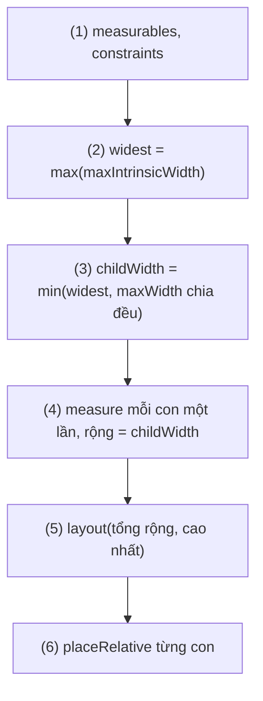
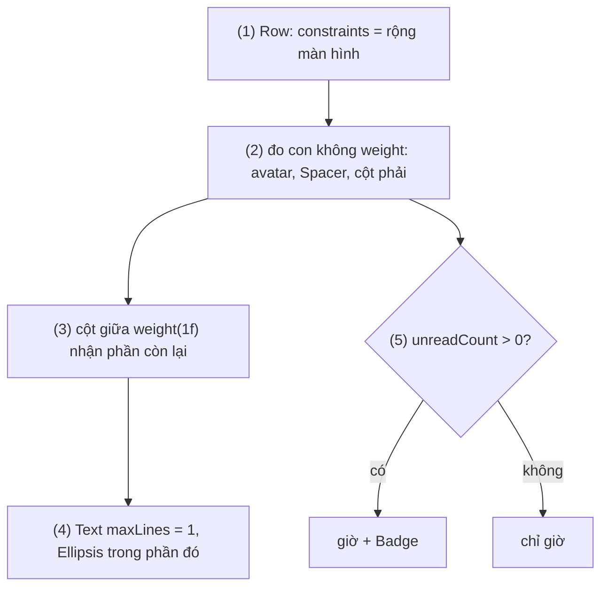

# Layout and View (Text, Image, Layout)

## Vấn đề cần giải quyết

Một composable có thể phát ra nhiều phần tử UI. Nếu không nói cách xếp, Compose chồng chúng lên nhau tại góc trên bên trái:

```kotlin
@Composable
fun ArtistCard() {
    Text("Mỹ Tâm")
    Text("Hoạt động 3 phút trước")   // hai dòng chữ đè lên nhau, không đọc được
}
```

Dựng một màn hình thật đòi hỏi trả lời nhiều câu hỏi cùng lúc:

- **Hiển thị nội dung:** chữ dài cắt thế nào, một đoạn chữ có phần in đậm và phần là link; ảnh lệch tỉ lệ khung thì cắt hay co.
- **Xếp phần tử:** ngang, dọc, chồng lớp; căn giữa, dồn hai đầu; phần tử nào được giãn ra.
- **Khung màn hình:** thanh trên cùng, nút nổi, Snackbar đặt ở đâu để không đè nội dung; cửa sổ rộng (tablet, foldable, chia đôi màn hình) thì đổi bố cục thế nào.
- **Hiệu năng:** trong View system, lồng `LinearLayout` có `weight` làm một View bị đo nhiều lần ([8.5.1 Layouts](../session_08/view_layout/layouts.md)); Compose có buộc "làm phẳng" layout như vậy không?

Vấn đề cần giải quyết là: **hiểu Compose đo và đặt phần tử thế nào**, để chọn đúng composable cơ bản cho từng nhu cầu, và tự viết layout khi các composable có sẵn không đủ.

## Sau khi học xong

- Giải thích được mô hình layout của Compose: constraints đi xuống, kích thước đi lên, mỗi con chỉ được đo một lần, và vì sao lồng layout không làm chậm như View system.
- Triển khai được giao diện bằng Text (style, maxLines, overflow, AnnotatedString), Image (painterResource, contentScale, contentDescription) và Icon.
- Áp dụng được Row, Column, Box, Spacer với arrangement và alignment, và dựng khung màn hình bằng Scaffold có xử lý innerPadding.
- Thiết kế được custom layout cơ bản bằng Layout {} với measurables, constraints và placeRelative.
- Thiết kế được layout thích ứng: dùng window size class (breakpoint theo kích thước cửa sổ) cho quyết định cấp màn hình và BoxWithConstraints cho quyết định cấp component.

## Layout trong Compose là gì?

**Layout** trong Compose là quá trình mỗi node của cây UI nhận **constraints** (giới hạn chiều rộng, chiều cao nhỏ nhất và lớn nhất) từ cha, **đo mỗi con đúng một lần**, tự chọn kích thước của mình trong giới hạn đó, rồi **đặt vị trí** các con. `Text`, `Image`, `Icon` là các node lá hiển thị nội dung; `Row`, `Column`, `Box`, `Scaffold` và `Layout {}` là các node quyết định cách xếp con.

Mental model: **constraints đi xuống, kích thước đi lên, vị trí do cha quyết.** Cha nói "con được rộng từ 0 đến 360dp"; con trả lời "con rộng 120dp, cao 48dp"; cha chọn chỗ đặt con. Không ai hỏi lại lần thứ hai.

Layout là phase thứ hai trong ba phase Composition → Layout → Drawing của một frame, đã giới thiệu ở [Jetpack Compose Overview](overview.md), mục "Deep Dive: ba phase của một frame". Bài này đi vào chi tiết phase đó và các composable dùng nó.

## Cách hoạt động

### Mô hình layout: constraints xuống, kích thước lên, đo một lần

Một `Constraints` gồm bốn số: `minWidth`, `maxWidth`, `minHeight`, `maxHeight` (pixel). `maxHeight` có thể là **vô hạn** (unbounded), ví dụ bên trong `Column` có `verticalScroll`, vì nội dung cuộn được thì cao bao nhiêu cũng được.

Mỗi node trong phase layout làm ba việc, theo thứ tự:

1. **Đo các con:** gọi `measure(constraints)` cho từng con, nhận về kích thước của con.
2. **Chọn kích thước bản thân:** trong constraints mà cha giao, thường dựa vào kích thước các con.
3. **Đặt các con:** quyết định toạ độ (x, y) của từng con so với mình.

Hệ quả: cha **bắt đầu đo trước** con, nhưng **có kích thước sau** con. Toàn bộ cây được layout trong **một lượt** (single pass).

Quy tắc quan trọng nhất: **Compose không cho đo một con hai lần** trong cùng một lượt layout. Nếu mỗi tầng đo con hai lần, chi phí tăng theo cấp số nhân với độ sâu của cây; vì mỗi node chỉ được đo một lần, **lồng `Row`, `Column` sâu bao nhiêu cũng không làm chậm**, khác kinh nghiệm "làm phẳng layout" của View system. Khi cần biết kích thước con trước khi đo (mọi nút rộng bằng nút rộng nhất), dùng **intrinsic measurements**: hỏi con "nếu được tự do thì cần rộng bao nhiêu" mà không tính là một lần đo. Đo và đặt tách rời, nên thay đổi chỉ ảnh hưởng vị trí có thể chạy lại riêng bước đặt.

Mục "Ví dụ thực tế" (dòng hội thoại) đi qua đầy đủ luồng đo này trên một `Row` có avatar, cột chữ và cột giờ.

### Text: hiển thị chữ

`Text` là composable hiển thị chữ. Các tham số hay dùng:

| Tham số | Tác dụng |
|---|---|
| `style` | `TextStyle` lấy từ theme, ví dụ `MaterialTheme.typography.bodyLarge` ([9.4.1](theming/material_design_theme.md)); không truyền thì dùng `LocalTextStyle` mà theme cung cấp |
| `color` | Màu chữ; không truyền thì lấy từ style, rồi tới content color của `Surface` bao quanh |
| `maxLines`, `overflow` | Giới hạn số dòng; vượt thì `TextOverflow.Clip`, `Ellipsis` (thêm "…") hoặc `Visible` |
| `softWrap`, `textAlign` | Có tự xuống dòng không; căn chữ trong khung |

Chữ cho người dùng nên lấy từ resource bằng `stringResource(R.string.order_title)` để dịch được. Cần cho bôi chọn, sao chép (mã đơn hàng) thì bọc trong `SelectionContainer`.

Khi một đoạn chữ cần **nhiều kiểu trong cùng một `Text`** (một phần in đậm, một phần là link), dùng **`AnnotatedString`**: chuỗi kèm danh sách các khoảng (range) có style. Dựng nó bằng builder `buildAnnotatedString { }`:

- `withStyle(SpanStyle(...)) { append("...") }`: style cho một đoạn ký tự (màu, độ đậm, gạch chân, nền).
- `withStyle(ParagraphStyle(...)) { ... }`: style cho cả đoạn văn (căn lề, line height, thụt đầu dòng).
- `withLink(LinkAnnotation.Url(url, styles)) { append("...") }`: đoạn bấm được, tự mở URL; `LinkAnnotation.Clickable(tag, styles, linkInteractionListener)` khi bấm cần chạy code của app. API này thay cho `ClickableText` đã deprecated.

#### Ví dụ: tô đậm từ khoá trong kết quả tìm kiếm

**Bài toán:** tìm "áo khoác" thì mỗi kết quả tô đậm đúng các chỗ khớp (không phân biệt hoa thường), tiêu đề dài cắt "…" sau hai dòng.

**Luồng chạy:**

1. `SearchResultTitle` nhận `title` và `query`, gọi `highlightQuery()` (được `remember` theo hai giá trị này).
2. Hàm tìm vị trí khớp tiếp theo của `query` trong `title`, bỏ qua hoa thường.
3. Đoạn trước chỗ khớp được thêm vào như chữ thường.
4. Đoạn khớp được thêm vào trong `withStyle(highlight)`.
5. Hết chỗ khớp: thêm phần còn lại; `Text` hiển thị `AnnotatedString` với `maxLines = 2` và `Ellipsis`.



**Code:**

```kotlin
// SearchHighlight.kt
fun highlightQuery(text: String, query: String, highlight: SpanStyle): AnnotatedString =
    buildAnnotatedString {
        if (query.isBlank()) {
            append(text)
            return@buildAnnotatedString
        }
        var start = 0
        while (true) {
            val index = text.indexOf(query, startIndex = start, ignoreCase = true)   // (2)
            if (index < 0) break
            append(text.substring(start, index))                                     // (3)
            withStyle(highlight) { append(text.substring(index, index + query.length)) } // (4)
            start = index + query.length
        }
        append(text.substring(start))                                                // (5)
    }

@Composable
fun SearchResultTitle(title: String, query: String, modifier: Modifier = Modifier) {
    val highlight = SpanStyle(fontWeight = FontWeight.Bold, color = MaterialTheme.colorScheme.primary)
    val annotated = remember(title, query, highlight) { highlightQuery(title, query, highlight) } // (1)
    Text(
        text = annotated,
        style = MaterialTheme.typography.bodyLarge,
        maxLines = 2,
        overflow = TextOverflow.Ellipsis,                                            // (5)
        modifier = modifier,
    )
}
```

`highlightQuery` là hàm thường, không `@Composable`, nên test được bằng unit test JVM; `remember(keys)` chỉ tính lại khi `title` hoặc `query` đổi (cơ chế ở [9.1 Remember and Recomposition](remember_and_recomposition.md)).

**Kết quả:** unit test `highlightQuery("Áo khoác gió", "áo", style).spanStyles` có đúng một range `0..2`; trên màn hình, tiêu đề dài ba dòng hiện hai dòng và kết thúc bằng "…".

### Image và Icon: hiển thị hình

`Image` vẽ một hình vào khung của nó. Các tham số chính:

- **Nguồn hình:** `painter = painterResource(R.drawable.banner)` cho drawable trong resource (cả bitmap lẫn vector drawable); ngoài ra có overload nhận `ImageBitmap` hoặc `ImageVector`.
- **`contentDescription`:** mô tả cho trình đọc màn hình (TalkBack). Hình mang thông tin (banner khuyến mãi) thì mô tả nội dung; hình trang trí hoặc đã có chữ bên cạnh thì truyền `null` để TalkBack bỏ qua. Tham số này bắt buộc để developer phải quyết định.
- **`contentScale`:** cách khớp hình vào khung khi tỉ lệ khác nhau.
- **`alignment`, `alpha`, `colorFilter`:** vị trí hình trong khung, độ trong suốt, bộ lọc màu.

| `ContentScale` | Kết quả |
|---|---|
| `Fit` (mặc định) | Co để thấy trọn hình, giữ tỉ lệ; có thể thừa khoảng trống |
| `Crop` | Phóng để lấp kín khung, giữ tỉ lệ; phần thừa bị cắt |
| `FillBounds` | Kéo giãn lấp kín khung, **không** giữ tỉ lệ (hình méo) |
| `FillWidth`, `FillHeight` | Giữ tỉ lệ, khớp theo chiều rộng hoặc chiều cao |
| `Inside` | Như `Fit` nhưng không phóng to hình nhỏ hơn khung |
| `None` | Giữ nguyên kích thước gốc |

`painterResource` chỉ dành cho hình trong app. Ảnh tải từ mạng cần thư viện image loading, phổ biến là Coil với composable `AsyncImage(model = url, ...)` (artifact `coil-compose`), có cùng các tham số `contentDescription`, `contentScale`; cách thiết lập và chọn giữa `AsyncImage`, `rememberAsyncImagePainter`, `SubcomposeAsyncImage` học ở [8.2.4 Coil](../session_08/loading_image/coil.md).

`Icon` là composable cho **icon một màu cỡ nhỏ**: mặc định 24dp và được tô bằng `LocalContentColor`, nên đặt trong `Button`, `TopAppBar` thì tự lấy đúng màu nội dung của component; đổi màu bằng `tint`. Docs **không còn duy trì và khuyên dùng** thư viện `material-icons` (`Icons.Default.Favorite`...) vì giao diện cũ và làm tăng đáng kể thời gian build; thay vào đó tải icon Material Symbols dạng XML từ Google Fonts rồi dùng `Icon(painterResource(R.drawable.ic_favorite), contentDescription = ...)`.

### Row, Column, Box và Spacer: xếp phần tử

Ba layout chuẩn xếp con theo ba cách: `Column` theo chiều dọc, `Row` theo chiều ngang, `Box` chồng lớp lên nhau (con sau nằm trên con trước). Mỗi layout có hai trục:

| | Trục chính (hướng xếp) | Trục phụ (vuông góc) |
|---|---|---|
| `Row` | `horizontalArrangement` | `verticalAlignment` |
| `Column` | `verticalArrangement` | `horizontalAlignment` |
| `Box` | không có (chồng lớp) | `contentAlignment` cho mọi con; `Modifier.align()` cho từng con |

- **Arrangement** chia khoảng trống trên trục chính: `Start`, `End`, `Center`, `SpaceBetween` (dồn hai đầu), `SpaceAround`, `SpaceEvenly`, và `Arrangement.spacedBy(8.dp)` (khoảng cách đều giữa các con, cách viết gọn nhất cho danh sách phần tử).
- **Alignment** căn trên trục phụ: `Alignment.Top`, `CenterVertically`, `Bottom` cho `Row`; `Start`, `CenterHorizontally`, `End` cho `Column`; chín vị trí như `TopStart`, `Center`, `BottomEnd` cho `Box`.
- **`Spacer`** là composable rỗng chiếm chỗ: `Spacer(Modifier.height(16.dp))` tạo khoảng cách; trong `Row`, `Spacer(Modifier.weight(1f))` chiếm hết phần còn lại, đẩy các con phía sau về cuối.

Một số modifier chỉ có trong scope của layout cha: `Modifier.weight()` trong `Row`/`Column` (con được chia phần chiều rộng hoặc cao còn lại), `Modifier.align()` và `Modifier.matchParentSize()` trong `Box`. Cơ chế scope-specific modifier học ở [9.5.2 Chaining](modifier/chaining.md).

#### Ví dụ: nhãn giảm giá đè lên ảnh sản phẩm

**Bài toán:** nhãn "-30%" phải nằm đè lên góc trên trái của ảnh sản phẩm, và biến mất khi không giảm giá mà ảnh không xê dịch.

```kotlin
// ProductImageWithBadge.kt
@Composable
fun ProductImageWithBadge(product: Product, modifier: Modifier = Modifier) {
    Box(modifier) {                                               // chồng lớp: ảnh dưới, nhãn trên
        Image(
            painter = painterResource(product.imageRes),
            contentDescription = product.name,
            contentScale = ContentScale.Crop,                     // ảnh vuông, cắt phần thừa
            modifier = Modifier.fillMaxWidth().aspectRatio(1f),
        )
        if (product.discountPercent > 0) {
            val discount = product.discountPercent
            Text(
                text = "-$discount%",
                color = MaterialTheme.colorScheme.onError,
                style = MaterialTheme.typography.labelMedium,
                modifier = Modifier
                    .align(Alignment.TopStart)                   // chỉ có trong BoxScope
                    .padding(8.dp)
                    .background(MaterialTheme.colorScheme.error, MaterialTheme.shapes.extraSmall)
                    .padding(horizontal = 6.dp, vertical = 2.dp),
            )
        }
    }
}
```

**Kết quả:** Preview với `discountPercent = 30` hiện nhãn đỏ ở góc ảnh; đặt `0` thì nhãn biến mất, ảnh giữ nguyên vị trí vì `Box` chồng lớp chứ không xếp nối tiếp. Vì sao `padding`/`background`/`padding` phải theo đúng thứ tự này học ở [9.5.1 Modifier Order](modifier/modifier_order.md).

### Scaffold: khung màn hình Material

`Scaffold` (Material 3) dựng cấu trúc chuẩn của một màn hình Material bằng **slot API**: mỗi vùng là một tham số nhận composable lambda, app điền gì vào slot cũng được.

| Slot | Thường chứa |
|---|---|
| `topBar` | `TopAppBar`, `CenterAlignedTopAppBar` |
| `bottomBar` | `NavigationBar`, `BottomAppBar` |
| `floatingActionButton` | `FloatingActionButton`, `ExtendedFloatingActionButton` |
| `snackbarHost` | `SnackbarHost(snackbarHostState)` |
| `content: (PaddingValues) -> Unit` | Nội dung chính |

Điểm mấu chốt là tham số `PaddingValues` của `content` (thường tên `innerPadding`): khoảng nội dung phải chừa ra để không bị `topBar`, `bottomBar` và vùng hệ thống (window insets như thanh trạng thái khi app vẽ tràn bằng `enableEdgeToEdge()`; từ Android 15, app target SDK 35 bị buộc vẽ tràn) che mất. Nội dung **phải** dùng nó, qua `Modifier.padding(innerPadding)` hoặc `contentPadding` của danh sách; Lint cảnh báo khi tham số này bị bỏ quên.

#### Ví dụ: màn hình ghi chú có nút thêm và Snackbar hoàn tác

**Bài toán:** danh sách ghi chú có thanh tiêu đề, nút nổi "Thêm"; xoá một ghi chú thì hiện Snackbar "Đã xoá ghi chú" kèm "Hoàn tác".

**Luồng chạy:**

1. `Scaffold` đặt `TopAppBar`, `FloatingActionButton`, `SnackbarHost` vào đúng vị trí.
2. `LazyColumn` dùng `innerPadding` làm `contentPadding`, mục đầu không nằm dưới thanh tiêu đề.
3. Bấm xoá: màn hình gọi `onDelete(note)`.
4. Màn hình gọi `showSnackbar(...)` trong coroutine; hàm treo tới khi Snackbar đóng.
5. Bấm "Hoàn tác": kết quả `ActionPerformed`, màn hình gọi `onUndoDelete(note)`.



**Code:**

```kotlin
// NoteListScreen.kt
@OptIn(ExperimentalMaterial3Api::class)
@Composable
fun NoteListScreen(
    notes: List<Note>,
    onAddNote: () -> Unit,
    onDelete: (Note) -> Unit,
    onUndoDelete: (Note) -> Unit,
) {
    val snackbarHostState = remember { SnackbarHostState() }
    val scope = rememberCoroutineScope()

    Scaffold(                                                                    // (1)
        topBar = { TopAppBar(title = { Text("Ghi chú") }) },
        floatingActionButton = {
            FloatingActionButton(onClick = onAddNote) {
                Icon(painterResource(R.drawable.ic_add), contentDescription = "Thêm ghi chú")
            }
        },
        snackbarHost = { SnackbarHost(snackbarHostState) },
    ) { innerPadding ->
        LazyColumn(contentPadding = innerPadding) {                              // (2)
            items(notes, key = { it.id }) { note ->
                NoteRow(note, onDeleteClick = {
                    onDelete(note)                                               // (3)
                    scope.launch {
                        val result = snackbarHostState.showSnackbar(             // (4)
                            message = "Đã xoá ghi chú",
                            actionLabel = "Hoàn tác",
                            duration = SnackbarDuration.Short,
                        )
                        if (result == SnackbarResult.ActionPerformed) onUndoDelete(note) // (5)
                    }
                })
            }
        }
    }
}
```

`rememberCoroutineScope` để chạy coroutine từ callback học ở [9.3.1 LaunchedEffect](side_effects/launched_effect.md); `LazyColumn` và `items(key = ...)` ở [9.5.4 Lazy Column](modifier/lazy_column.md); coroutine và hàm `suspend` ở [8.4.3 Coroutines](../session_08/async_threads/coroutines.md).

**Kết quả:** mục đầu tiên nằm ngay dưới thanh tiêu đề, mục cuối vẫn kéo lên được trên thanh điều hướng. Xoá một ghi chú: Snackbar hiện phía trên FAB; bấm "Hoàn tác" thì ghi chú trở lại.

### Custom layout với `Layout {}`

Khi `Row`, `Column`, `Box` không diễn đạt được cách xếp mong muốn, viết layout riêng bằng composable **`Layout`**. Chính `Row` và `Column` cũng được dựng trên `Layout`. Nó nhận `content` (các con) và một **measure policy** (lambda đo và đặt) với hai tham số:

- `measurables`: danh sách con **chưa đo**. Mỗi `Measurable` được gọi `measure(constraints)` **đúng một lần**, trả về `Placeable` (con đã đo, có `width`, `height`).
- `constraints`: constraints mà cha giao cho layout này.

Lambda kết thúc bằng `layout(width, height) { ... }`: khai báo kích thước của layout, và trong khối đó gọi `placeable.placeRelative(x, y)` để đặt từng con (`placeRelative` tự lật x khi ngôn ngữ viết từ phải sang trái, `place` thì không). Con không được đặt thì không hiện. Gọi `measure` hai lần trên cùng một `Measurable` ném exception lúc chạy: quy tắc đo một lần được thực thi thật.

Để đổi cách đo, đặt **một** composable (không phải nhiều con), dùng `Modifier.layout { measurable, constraints -> ... }` với cùng cấu trúc.

#### Ví dụ: hàng nút trong dialog rộng bằng nút rộng nhất

**Bài toán:** dialog xác nhận có hai nút "Huỷ" và "Xoá vĩnh viễn". Thiết kế yêu cầu hai nút rộng bằng nhau, bằng nút có chữ dài nhất, nhưng không vượt quá chiều rộng dialog. `Row` với `weight(1f)` luôn chia đều toàn bộ chiều rộng, không cho kết quả này.

**Luồng chạy:**

1. `Layout` nhận `measurables` (hai nút) và `constraints` từ dialog.
2. Hỏi **intrinsic width** của từng nút (chưa phải đo) và lấy giá trị lớn nhất.
3. Giới hạn giá trị đó bởi phần chiều rộng tối đa chia cho số nút.
4. Đo mỗi nút **một lần** với chiều rộng cố định vừa tính.
5. Chọn kích thước của layout: tổng chiều rộng các nút cộng khoảng cách, cao bằng nút cao nhất.
6. Đặt từng nút từ trái sang bằng `placeRelative`.



**Code:**

```kotlin
// EqualWidthRow.kt
@Composable
fun EqualWidthRow(
    modifier: Modifier = Modifier,
    spacing: Dp = 8.dp,
    content: @Composable () -> Unit,
) {
    Layout(content = content, modifier = modifier) { measurables, constraints ->      // (1)
        if (measurables.isEmpty()) return@Layout layout(constraints.minWidth, constraints.minHeight) {}
        val spacingPx = spacing.roundToPx()
        val totalSpacing = spacingPx * (measurables.size - 1)

        val widest = measurables.maxOf { it.maxIntrinsicWidth(constraints.maxHeight) } // (2) chưa phải đo
        val maxPerChild = if (constraints.hasBoundedWidth) {
            ((constraints.maxWidth - totalSpacing) / measurables.size).coerceAtLeast(0)
        } else {
            widest
        }
        val childWidth = widest.coerceAtMost(maxPerChild)                               // (3)

        val childConstraints = Constraints(
            minWidth = childWidth, maxWidth = childWidth, maxHeight = constraints.maxHeight,
        )
        val placeables = measurables.map { it.measure(childConstraints) }               // (4) đo đúng một lần

        val width = (childWidth * placeables.size + totalSpacing)
            .coerceIn(constraints.minWidth, constraints.maxWidth)
        val height = placeables.maxOf { it.height }
            .coerceIn(constraints.minHeight, constraints.maxHeight)
        layout(width, height) {                                                         // (5)
            var x = 0
            placeables.forEach { placeable ->
                placeable.placeRelative(x, (height - placeable.height) / 2)             // (6)
                x += childWidth + spacingPx
            }
        }
    }
}

// DeleteNoteDialog.kt (cách dùng)
EqualWidthRow {
    OutlinedButton(onClick = onCancel) { Text("Huỷ") }
    Button(
        onClick = onConfirm,
        colors = ButtonDefaults.buttonColors(containerColor = MaterialTheme.colorScheme.error),
    ) { Text("Xoá vĩnh viễn") }
}
```

**Kết quả:** Preview hiện hai nút cùng chiều rộng của nút "Xoá vĩnh viễn". Trong khung hẹp 200dp, mỗi nút co về 96dp và chữ xuống dòng, không tràn. Bật RTL trong Developer options: nút "Huỷ" chuyển sang bên phải nhờ `placeRelative`.

### Layout thích ứng cấp màn hình: window size class

**Layout thích ứng** (adaptive layout) là đổi *cấu trúc* UI theo không gian được cấp: một cột hay hai cột, thanh điều hướng dưới hay bên cạnh. Có hai cấp quyết định: window size class cho cả màn hình, `BoxWithConstraints` cho từng component (phần sau).

Window size class là các mốc (breakpoint) chia **kích thước cửa sổ của app** thành nhóm, tính riêng cho chiều rộng và chiều cao:

| Chiều rộng | Mốc | Chiều cao | Mốc |
|---|---|---|---|
| Compact | < 600dp | Compact | < 480dp |
| Medium | 600–840dp | Medium | 480–900dp |
| Expanded | 840–1200dp | Expanded | ≥ 900dp |
| Large / Extra-large | 1200–1600dp / ≥ 1600dp | | |

Lấy giá trị bằng `currentWindowAdaptiveInfo().windowSizeClass` (artifact `androidx.compose.material3.adaptive:adaptive`, kiểu `androidx.window.core.layout.WindowSizeClass`) và so bằng `isWidthAtLeastBreakpoint(WindowSizeClass.WIDTH_DP_MEDIUM_LOWER_BOUND)` hoặc `isHeightAtLeastBreakpoint(...)`. Hai mốc large, extra-large chỉ được tính khi gọi `currentWindowAdaptiveInfo(supportLargeAndXLargeWidth = true)`. Hai điều quyết định cách dùng:

- **Cửa sổ không phải màn hình:** chia đôi màn hình, cửa sổ tự do trên ChromeOS, foldable đều làm cửa sổ khác kích thước thiết bị, nên không viết logic "isTablet".
- **Giá trị đổi trong lúc chạy** (xoay, gập/mở, đổi cỡ cửa sổ) và phần đọc nó recompose theo. Đọc một lần ở composable gốc của màn hình rồi truyền xuống như state.

#### Ví dụ: app email đổi thanh điều hướng theo độ rộng cửa sổ

**Bài toán:** cửa sổ từ 600dp trở lên hiện thanh điều hướng bên cạnh (`NavigationRail`) và bố cục danh sách – chi tiết; hẹp hơn thì thanh điều hướng dưới và chỉ danh sách.

```kotlin
// MailApp.kt
import androidx.window.core.layout.WindowSizeClass

@Composable
fun MailApp(
    windowSizeClass: WindowSizeClass = currentWindowAdaptiveInfo().windowSizeClass,
) {
    val useRail = windowSizeClass.isWidthAtLeastBreakpoint(WindowSizeClass.WIDTH_DP_MEDIUM_LOWER_BOUND)
    if (useRail) {                                   // >= 600dp: thanh điều hướng bên cạnh, danh sách + chi tiết
        Row {
            MailNavigationRail()
            MailListDetail(Modifier.weight(1f))
        }
    } else {                                         // < 600dp: thanh điều hướng dưới, chỉ danh sách
        Scaffold(bottomBar = { MailNavigationBar() }) { innerPadding ->
            MailList(Modifier.padding(innerPadding))
        }
    }
}
```

**Kết quả:** mở foldable làm cửa sổ vượt 600dp thì `MailApp` recompose sang rail; chia đôi màn hình tablet làm cửa sổ hẹp lại thì quay về thanh dưới. Tham số có giá trị mặc định giúp Preview truyền thẳng một `WindowSizeClass`. Material 3 còn có scaffold dựng sẵn theo window size class (`NavigationSuiteScaffold`, `ListDetailPaneScaffold`); [9.4.2 Custom Theme](theming/custom_theme.md) dùng cùng API này để đổi token theo độ rộng cửa sổ.

### Layout thích ứng cấp component: `BoxWithConstraints`

Bình thường, composition chạy **trước** layout, nên một composable không biết mình sẽ được cấp bao nhiêu chỗ. `BoxWithConstraints` đảo thứ tự cho nội dung của nó: nội dung được compose **trong lúc layout**, khi đã biết constraints, và đọc được `maxWidth`, `maxHeight`, `minWidth`, `minHeight` (kiểu `Dp`) hoặc `constraints` ngay trong lambda. Cái giá là nó dùng **subcomposition** (compose một phần cây trong phase layout), đắt hơn `Box` thường. Dùng nó khi quyết định phụ thuộc chỗ **thật sự được cấp cho component**, không phải cửa sổ: một thẻ trong cột hẹp của tablet có thể hẹp hơn cả trên điện thoại.

#### Ví dụ: thẻ sản phẩm ngang khi đủ rộng, dọc khi hẹp

**Bài toán:** cùng một `ProductListItem` được dùng trong danh sách toàn màn hình và trong cột bên của màn hình chia đôi. Khi chỗ được cấp từ 360dp trở lên, ảnh nằm bên trái; hẹp hơn thì ảnh nằm trên.

**Code:**

```kotlin
// ProductListItem.kt
@Composable
fun ProductListItem(product: Product, modifier: Modifier = Modifier) {
    BoxWithConstraints(modifier) {
        if (maxWidth >= 360.dp) {                                    // đọc constraints ngay khi compose
            Row(horizontalArrangement = Arrangement.spacedBy(12.dp)) {
                ProductImage(product, Modifier.width(120.dp).aspectRatio(1f))
                ProductInfo(product)
            }
        } else {
            Column(verticalArrangement = Arrangement.spacedBy(8.dp)) {
                ProductImage(product, Modifier.fillMaxWidth().aspectRatio(4f / 3f))
                ProductInfo(product)
            }
        }
    }
}
```

**Kết quả:** Preview trong hai khung `Modifier.width(400.dp)` và `Modifier.width(300.dp)`: khung rộng hiện bản ngang, khung hẹp hiện bản dọc. Đặt trong một cột của bố cục hai cột trên cửa sổ expanded, item vẫn có thể hiện bản dọc, vì quyết định dựa trên chỗ được cấp chứ không dựa trên cửa sổ.

## Ví dụ thực tế

Ba bài toán thường gặp khi dựng UI bằng các composable cơ bản:

1. **Dòng hội thoại trong danh sách chat:** giờ và số tin chưa đọc luôn hiện đủ dù tên dài. Bài toán chính, code bên dưới.
2. **Dòng "Tôi đồng ý với Điều khoản sử dụng":** `buildAnnotatedString` với `withLink(LinkAnnotation.Clickable(tag = "terms", linkInteractionListener = { onTermsClick() }))` để phần "Điều khoản sử dụng" mở màn hình trong app.
3. **Màn chi tiết có nút "Mua ngay" cố định ở đáy:** `Scaffold(bottomBar = { ... })`, nội dung cuộn dùng `innerPadding`.

### Dòng hội thoại trong danh sách chat

**Bài toán:** mỗi dòng có avatar tròn 48dp, cột giữa gồm tên và tin nhắn cuối (một dòng, cắt "…"), cột phải gồm giờ và số tin chưa đọc. Tên dài thế nào thì giờ và huy hiệu vẫn phải hiện đủ.

**Luồng chạy:**

1. `Row` nhận chiều rộng màn hình làm constraints.
2. `Row` đo trước các con **không có** `weight`: avatar, hai `Spacer`, cột phải.
3. Phần rộng còn lại giao hết cho cột giữa có `Modifier.weight(1f)`.
4. Trong cột giữa, hai `Text` bị giới hạn bởi phần rộng đó; vượt thì `maxLines = 1` và `Ellipsis` cắt chữ.
5. Có tin chưa đọc thì cột phải hiện `Badge`, không thì chỉ hiện giờ.



**Code:**

```kotlin
// ConversationRow.kt
@Composable
fun ConversationRow(
    conversation: Conversation,
    onClick: () -> Unit,
    modifier: Modifier = Modifier,
) {
    Row(                                                                         // (1)
        modifier = modifier
            .fillMaxWidth()
            .clickable(onClick = onClick)
            .padding(horizontal = 16.dp, vertical = 12.dp),
        verticalAlignment = Alignment.CenterVertically,
    ) {
        Image(                                                                   // (2)
            painter = painterResource(conversation.avatarRes),
            contentDescription = null,                                           // tên đã hiện bên cạnh
            contentScale = ContentScale.Crop,
            modifier = Modifier.size(48.dp).clip(CircleShape),
        )
        Spacer(Modifier.width(12.dp))
        Column(Modifier.weight(1f)) {                                            // (3)
            Text(
                text = conversation.name,
                style = MaterialTheme.typography.titleMedium,
                maxLines = 1,
                overflow = TextOverflow.Ellipsis,                                // (4)
            )
            Text(
                text = conversation.lastMessage,
                style = MaterialTheme.typography.bodyMedium,
                color = MaterialTheme.colorScheme.onSurfaceVariant,
                maxLines = 1,
                overflow = TextOverflow.Ellipsis,
            )
        }
        Spacer(Modifier.width(8.dp))
        Column(horizontalAlignment = Alignment.End) {
            Text(conversation.timeLabel, style = MaterialTheme.typography.labelSmall)
            if (conversation.unreadCount > 0) {                                  // (5)
                Badge(Modifier.padding(top = 4.dp)) {
                    Text(if (conversation.unreadCount > 99) "99+" else conversation.unreadCount.toString())
                }
            }
        }
    }
}
```

`Badge` là composable Material 3 cho huy hiệu số, đúng kích thước và màu theo spec. `clickable` gộp ngữ nghĩa các con, nên TalkBack đọc tên, tin nhắn, giờ thành một mục.

**Kết quả:** Preview (`widthDp = 360`) với một hội thoại tên "Nhóm lớp 12A1 - Hội cựu học sinh khoá 2015" và 120 tin chưa đọc: tên và tin nhắn bị cắt "…", giờ và huy hiệu "99+" vẫn hiện đủ ở mép phải. Xoá `Modifier.weight(1f)` khỏi cột giữa rồi xem lại: cột giữa được đo trước theo chữ dài, chiếm hết chỗ và đẩy cột giờ ra khỏi màn hình. Đó là lý do phần co giãn phải là phần có `weight`.

## So sánh với các cách tiếp cận khác

| View system (XML) | Compose | Khác biệt chính |
|---|---|---|
| `TextView` (+ `Spannable`), `ImageView` | `Text` (+ `AnnotatedString`), `Image` | `contentDescription` bắt buộc |
| `LinearLayout` (+ `layout_weight`), `FrameLayout` | `Row` / `Column` (+ `weight`), `Box` | `weight` không gây đo hai lần |
| `CoordinatorLayout` + `AppBarLayout` + FAB | `Scaffold` | Slot API; padding cho bar và inset trả qua `innerPadding` |
| `ViewGroup.onMeasure`/`onLayout` ([8.5.2 View Custom](../session_08/view_layout/views.md)) | `Layout {}`, `Modifier.layout {}` | Không cần class con; đo hai lần bị cấm |

`ConstraintLayout` có bản cho Compose (artifact riêng), nhưng ở đây nó chỉ là công cụ **diễn đạt** ràng buộc phức tạp, không còn là công cụ **tối ưu hiệu năng** như ở [8.5.1 Layouts](../session_08/view_layout/layouts.md).

## Khi nào nên và không nên dùng

- **Nên** ưu tiên `Row`, `Column`, `Box`, `Spacer` và `Arrangement.spacedBy` cho mọi bố cục thông thường; lồng bao nhiêu cấp cũng được.
- **Nên** dùng `Scaffold` cho mọi màn hình có thanh trên, thanh dưới, FAB hoặc Snackbar, và luôn áp `innerPadding`.
- **Nên** dùng `Layout {}` khi cách xếp không diễn đạt được bằng layout có sẵn (rộng theo con rộng nhất, xếp vòng tròn); trước đó xem `FlowRow`/`FlowColumn` (tự xuống dòng) đã đủ chưa.
- **Không nên** dùng `BoxWithConstraints` chỉ để biết kích thước màn hình, hoặc đặt nó trong mọi item của danh sách dài khi không cần đổi cấu trúc: dùng window size class cho quyết định cấp màn hình.

## Sai lầm thường gặp

### 1. Bỏ quên `innerPadding` của `Scaffold`

```kotlin
Scaffold(topBar = { TopAppBar(title = { Text("Ghi chú") }) }) { innerPadding ->
    LazyColumn { /* ... */ }        // sai: innerPadding không được dùng
}
```

**Lỗi lộ ra:** mục đầu nằm dưới thanh tiêu đề, mục cuối nằm dưới thanh điều hướng; Lint báo `UnusedMaterial3ScaffoldPaddingParameter`. **Cách sửa:** `LazyColumn(contentPadding = innerPadding)` hoặc `Modifier.padding(innerPadding)`.

### 2. Chữ dài đẩy mất phần tử bên cạnh

`Text` tên trong `Row` không có `weight` và không giới hạn dòng. **Lỗi lộ ra:** tên dài đẩy nhãn giờ bên phải khỏi màn hình hoặc bóp còn 0dp. **Cách sửa:** phần co giãn nhận `Modifier.weight(1f)`, kèm `maxLines` và `TextOverflow.Ellipsis`, như `ConversationRow`.

### 3. Đặt sai `contentDescription`

Ghi `contentDescription = "Ảnh"` cho mọi hình, hoặc mô tả avatar ngay cạnh tên. **Lỗi lộ ra:** TalkBack đọc "Ảnh, Ảnh" hoặc đọc tên hai lần; banner chứa thông tin mà truyền `null` thì người khiếm thị không biết có khuyến mãi. **Cách sửa:** hình mang thông tin thì mô tả nội dung (chuỗi resource); hình trang trí hoặc đã có chữ đi kèm thì `null`.

### 4. Đo một con hai lần trong `Layout {}`

```kotlin
val first = measurable.measure(constraints)
val second = measurable.measure(Constraints.fixedWidth(first.width * 2))   // sai
```

**Lỗi lộ ra:** app ném exception ngay khi layout chạy, báo `measure` không được gọi nhiều lần trên cùng một `Measurable`. **Cách sửa:** hỏi trước bằng intrinsic (`maxIntrinsicWidth`, `minIntrinsicHeight`) rồi chỉ đo một lần, như `EqualWidthRow`; hoặc dùng `Modifier.width(IntrinsicSize.Max)` cho layout có sẵn.

## Lịch sử phát triển

- **Compose 1.0 (07/2021):** `Text`, `Image`, `Icon`, `Row`, `Column`, `Box`, `Layout`, `BoxWithConstraints`, `Scaffold` (Material 2) stable; mô hình đo một lượt và intrinsic measurements có từ đầu.
- **Compose Material 3:** `Scaffold` có `contentWindowInsets`, `innerPadding` tính cả window insets. Từ Android 15, app target SDK 35 bị buộc vẽ tràn (edge-to-edge), nên bỏ quên `innerPadding` lộ lỗi ngay.
- **Compose 1.4 (2023):** `FlowRow`/`FlowColumn` (lúc đầu experimental) cho bố cục tự xuống dòng.
- **Compose 1.7 (2024):** `LinkAnnotation` và `withLink` thay cho `ClickableText` (deprecated), thêm `AnnotatedString.fromHtml()`.
- **Compose 1.8 (2025):** `BasicText` có `autoSize` (tự co cỡ chữ theo khung), `TextOverflow.StartEllipsis` và `MiddleEllipsis`.
- **Adaptive:** `currentWindowAdaptiveInfo()` của `material3-adaptive` thay cho logic "isTablet"; `androidx.window` 1.4 chuyển sang so mốc bằng `isWidthAtLeastBreakpoint` và thêm mốc large, extra-large cho desktop. Docs ngừng khuyên dùng thư viện `material-icons`, chuyển sang Material Symbols.

## Kết nối hệ thống

- **Tiên quyết:**
  - [Jetpack Compose Overview](overview.md): ba phase Composition → Layout → Drawing; bài này đi sâu vào phase Layout.
  - [9.4.1 Material Design Theme](theming/material_design_theme.md): `Text` và `Icon` lấy style, content color từ theme.
- **Liên quan:**
  - [9.4.2 Custom Theme](theming/custom_theme.md): token spacing dùng trong `Row`, `Column`; token đổi theo window size class.
  - [9.1 Remember and Recomposition](remember_and_recomposition.md): `remember(keys)` cho `AnnotatedString` tính trước.
  - [9.5.1 Modifier Order](modifier/modifier_order.md) và [9.5.2 Chaining](modifier/chaining.md): `padding`, `clip`, `weight`, `align` trong các ví dụ.
  - [8.2.4 Coil](../session_08/loading_image/coil.md): `AsyncImage` cho ảnh mạng.
  - [8.5.1 Layouts](../session_08/view_layout/layouts.md) và [8.5.2 View Custom](../session_08/view_layout/views.md): measure/layout và custom view của View system mà bài này so sánh; [View Binding](../session_06/view_binding.md): nối XML với code.
- **Học tiếp:**
  - [9.5.4 Lazy Column](modifier/lazy_column.md): danh sách dài thay cho `Column` khi số phần tử lớn.
  - [9.7.1 Surface and Canvas](graphics_animations/surface_and_canvas.md): `Surface`, vẽ tự do bằng `Canvas`.

## Tham khảo

- [Compose layout basics - Android Developers](https://developer.android.com/develop/ui/compose/layouts/basics)
- [Custom layouts - Android Developers](https://developer.android.com/develop/ui/compose/layouts/custom)
- [Intrinsic measurements in Compose layouts - Android Developers](https://developer.android.com/develop/ui/compose/layouts/intrinsic-measurements)
- [Style text - Android Developers](https://developer.android.com/develop/ui/compose/text/style-text)
- [Enable user interactions (LinkAnnotation) - Android Developers](https://developer.android.com/develop/ui/compose/text/user-interactions)
- [Material icons (Icon composable) - Android Developers](https://developer.android.com/develop/ui/compose/graphics/images/material)
- [Customize an image (ContentScale) - Android Developers](https://developer.android.com/develop/ui/compose/graphics/images/customize)
- [Material Components and layouts (Scaffold) - Android Developers](https://developer.android.com/develop/ui/compose/layouts/material)
- [Use window size classes - Android Developers](https://developer.android.com/develop/ui/compose/layouts/adaptive/use-window-size-classes)
