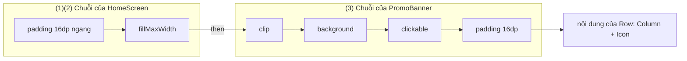
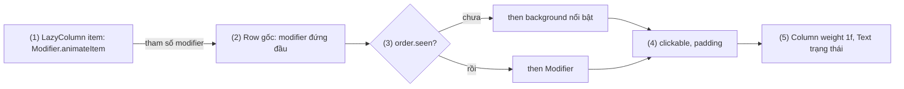

# Chaining

## Vấn đề cần giải quyết

[9.5.1 Modifier Order](modifier_order.md) cho thấy chuỗi modifier là các lớp bọc lồng nhau và thứ tự quyết định kết quả. Trong app thật, chuỗi được **ghép** từ nhiều nguồn: màn hình gọi component dùng chung và thêm khoảng cách từ bên ngoài, component thêm hiệu ứng khi có điều kiện, nhiều component dùng chung một kiểu khối, và layout cha cần thông tin riêng (`weight` trong `Row`). Ghép sai thì lỗi khó thấy, vì code vẫn compile và hiện "gần đúng":

```kotlin
// PromoBanner.kt (cách viết có vấn đề)
@Composable
fun PromoBanner(title: String, modifier: Modifier = Modifier) {
    Row(Modifier.background(Color(0xFFFFF3E0)).padding(16.dp)) {
        Text(title, modifier = modifier)   // modifier của người gọi rơi vào Text bên trong
    }
}
```

Người gọi truyền `Modifier.padding(horizontal = 16.dp)` để banner cách mép màn hình, nhưng khoảng cách lại xuất hiện **bên trong** nền, quanh chữ. Vấn đề cần giải quyết là: **ghép các mảnh chuỗi từ nhiều nơi mà vẫn kiểm soát được thứ tự**, để mỗi bên (người gọi, component, điều kiện, layout cha) đóng góp đúng lớp của mình.

## Sau khi học xong

- Giải thích được cách then nối hai chuỗi modifier mà giữ nguyên thứ tự, và vì sao mọi modifier factory đều là this then một phần tử mới.
- Thiết kế được composable tái sử dụng theo quy ước tham số modifier: Modifier = Modifier, là tham số tuỳ chọn đầu tiên và được áp một lần ở đầu chuỗi của phần tử gốc.
- Áp dụng được nối có điều kiện bằng then(if (...) Modifier.x() else Modifier) và tách chuỗi dùng lại thành biến hoặc extension function.
- Phân biệt được modifier dùng chung với modifier theo scope như weight, align, matchParentSize, và biết khi nào chúng có tác dụng.
- Nhận diện được các lỗi áp modifier vào phần tử con, quên this trong extension và dùng modifier theo scope ở phần tử không phải con trực tiếp.

## Chaining là gì?

**Chaining** (nối chuỗi modifier) là việc ghép các modifier thành một chuỗi duy nhất bằng `then`: `a.then(b)` cho một chuỗi gồm mọi phần tử của `a` rồi tới mọi phần tử của `b`, giữ nguyên thứ tự, trong đó `a` thành lớp ngoài và `b` thành lớp trong.

Mental model vẫn là **các lớp bọc lồng nhau** của [9.5.1](modifier_order.md): nối chuỗi là **đặt thêm lớp vào phía trong** của những lớp đã có. Ai đứng trước trong phép nối thì bọc ngoài, nên câu hỏi khi ghép luôn là: phần này nên nằm ngoài hay trong phần kia?

## Cách hoạt động

### then: phép nối duy nhất, mọi modifier factory đều dùng nó

`Modifier` định nghĩa `then` là một infix function:

```kotlin
// Ba cách viết cho cùng một chuỗi: padding (ngoài) → background (trong)
val a = Modifier.padding(8.dp).background(Color.LightGray)
val b = Modifier.padding(8.dp).then(Modifier.background(Color.LightGray))
val c = Modifier.padding(8.dp) then Modifier.background(Color.LightGray)
```

Hai tính chất làm `then` dễ dùng:

- **`Modifier` (object companion) là phần tử trung hoà:** `Modifier.then(x)` trả về `x`, và `x.then(Modifier)` trả về `x`. Nhờ vậy `Modifier` dùng được làm giá trị mặc định "không làm gì" và làm nhánh `else` khi nối có điều kiện.
- **Mọi modifier factory chỉ là `then` một phần tử mới vào chuỗi đang có:** `.padding(8.dp)` thực chất là `this then <phần tử padding>`. Đây cũng là cách tự viết modifier (học ở [9.5.3 Composed Modifier](composed.md)):

```kotlin
// Cách các modifier có sẵn được khai báo (dạng rút gọn)
fun Modifier.circle(color: Color): Modifier = this then CircleElement(color)
```

Vì factory luôn bắt đầu từ `this`, gọi liên tiếp `.a().b().c()` là nối dần vào trong.

### Tham số modifier: chuỗi của người gọi đứng ngoài cùng

Compose API guidelines quy định mọi composable phát ra UI nên có tham số modifier theo đúng một mẫu:

- Tên `modifier`, kiểu `Modifier`, mặc định `Modifier`, là tham số duy nhất kiểu `Modifier`, và là **tham số tuỳ chọn đầu tiên** (ngay sau các tham số bắt buộc).
- Được áp **một lần**, cho **phần tử gốc** (layout ngoài cùng), và đứng **đầu chuỗi** của phần tử đó; modifier riêng của component nối phía sau.
- Không thêm `iconModifier`, `titleModifier` cho phần tử con; cần tuỳ biến phần con thì dùng slot (tham số `@Composable () -> Unit`).

"Đứng đầu chuỗi" đến thẳng từ mô hình lớp bọc: chuỗi người gọi thành **lớp ngoài cùng**, nên padding người gọi truyền là khoảng cách bên ngoài component, `size` người gọi truyền có hiệu lực, `clickable` người gọi thêm phủ cả component. Component chỉ quyết định các lớp bên trong. Lint `ModifierParameter` của Compose cảnh báo khi tham số sai tên, kiểu, mặc định hoặc vị trí.

#### Ví dụ: banner khuyến mãi dùng lại ở nhiều màn

**Bài toán:** banner "Freeship" xuất hiện ở trang chủ (cách mép 16dp, rộng hết màn) và trong giỏ hàng (chỉ cách phía trên 8dp). Mỗi màn tự quyết định vị trí, kích thước; banner chỉ lo nền, góc bo, vùng bấm, nội dung.

**Luồng chạy** khi trang chủ gọi banner:

1. `HomeScreen` tạo chuỗi `A = Modifier.padding(horizontal = 16.dp).fillMaxWidth()`.
2. `PromoBanner` nhận `A` qua tham số `modifier`.
3. `PromoBanner` nối chuỗi riêng `B = clip → background → clickable → padding(16.dp)` vào **sau** `A`: chuỗi cuối là `A` rồi `B`.
4. Khi đo: `padding` của `A` là lớp ngoài cùng nên thành khoảng cách tới mép màn hình; `fillMaxWidth` làm banner rộng hết phần còn lại.
5. Khi vẽ và nhận chạm: các lớp của `B` nằm trong `A`, nên nền, góc bo và vùng bấm có đúng kích thước banner, không gồm khoảng cách 16dp bên ngoài.



**Code:**

```kotlin
// PromoBanner.kt
private val bannerShape = RoundedCornerShape(12.dp)

@Composable
fun PromoBanner(
    title: String,
    onClick: () -> Unit,                 // tham số bắt buộc đứng trước
    modifier: Modifier = Modifier,       // (2) tham số tuỳ chọn đầu tiên
    subtitle: String? = null,
) {
    Row(
        verticalAlignment = Alignment.CenterVertically,
        modifier = modifier              // (3) chuỗi người gọi đứng đầu, áp một lần cho phần tử gốc
            .clip(bannerShape)
            .background(MaterialTheme.colorScheme.tertiaryContainer)
            .clickable(onClick = onClick)
            .padding(16.dp)
    ) {
        Column(Modifier.weight(1f)) {
            Text(title, style = MaterialTheme.typography.titleMedium)
            if (subtitle != null) Text(subtitle, style = MaterialTheme.typography.bodySmall)
        }
        Icon(painterResource(R.drawable.ic_chevron_right), contentDescription = null) // icon Material Symbols (9.6)
    }
}

// HomeScreen.kt
PromoBanner(
    title = "Freeship đơn từ 0đ",
    onClick = onOpenPromo,
    modifier = Modifier
        .padding(horizontal = 16.dp)     // (1)(4) khoảng cách ngoài banner
        .fillMaxWidth()
)

// CartScreen.kt: cùng component, vị trí khác
PromoBanner(title = "Freeship đơn từ 0đ", onClick = onOpenPromo, modifier = Modifier.padding(top = 8.dp))
```

**Kết quả:** ở trang chủ, banner cách hai mép 16dp và chạm vào dải 16dp đó không mở khuyến mãi; trong giỏ hàng, banner chỉ cách phía trên 8dp. Không màn nào phải sửa code của `PromoBanner`. Với bản lỗi ở đầu bài, Layout Inspector cho thấy padding của người gọi nằm quanh `Text`, bên trong nền.

### Nối có điều kiện

Hiệu ứng chỉ cần khi có điều kiện (viền khi được chọn) viết thẳng nhất bằng `then` với biểu thức `if`, dùng `Modifier` làm nhánh "không làm gì":

```kotlin
Modifier
    .clip(shape)
    .then(if (selected) Modifier.border(2.dp, MaterialTheme.colorScheme.primary, shape) else Modifier)
    .padding(16.dp)
```

Dùng ở nhiều nơi thì gói thành extension nhỏ; lambda nhận `this` làm receiver nên nối tiếp vào chuỗi đang có:

```kotlin
// ModifierExt.kt
inline fun Modifier.thenIf(condition: Boolean, block: Modifier.() -> Modifier): Modifier =
    if (condition) this.block() else this
```

Hai lưu ý:

- **Ưu tiên tham số có sẵn của modifier nếu có:** `clickable(enabled = available)`, `alpha(if (available) 1f else 0.38f)`. Chuỗi giữ nguyên cấu trúc giữa các lần recompose, node bên trong giữ được trạng thái, và semantics nói đúng "bị vô hiệu hoá" (TalkBack đọc được, UI test kiểm tra được bằng `assertIsNotEnabled()`). Thêm/bớt hẳn `clickable` theo điều kiện làm chuỗi đổi cấu trúc và node của nó bị tạo lại (Deep Dive của [9.5.1](modifier_order.md)).
- **Đặt phần có điều kiện đúng lớp:** nhánh `then` vẫn là một lớp trong chuỗi, quy tắc thứ tự của 9.5.1 vẫn áp dụng: viền có điều kiện đặt sau `clip` để theo góc bo.

### Tách chuỗi dùng lại: biến hoặc extension function

Khi nhiều component cùng một tổ hợp modifier, có hai cách viết một lần:

- **Biến (thường ở top-level)** khi chuỗi không có tham số: chuỗi bất biến nên một instance dùng chung được mọi nơi, và đặt ngoài composable tránh tạo lại object ở mỗi lần recompose (có lợi khi recompose theo animation, theo cuộn, hoặc cho hàng trăm item của `LazyColumn`).
- **Extension function trên `Modifier`** khi chuỗi cần tham số. Hàm **phải** nối vào `this`, không bắt đầu lại từ `Modifier`, nếu không mọi modifier người gọi viết phía trước bị bỏ mất.

```kotlin
// SectionModifiers.kt
private val sectionShape = RoundedCornerShape(16.dp)

// Biến: không có tham số, dùng chung một instance
val SectionSpacing = Modifier.padding(horizontal = 16.dp, vertical = 8.dp)

// Extension: có tham số, nối vào this
fun Modifier.sectionContainer(color: Color): Modifier = this
    .fillMaxWidth()
    .clip(sectionShape)
    .background(color)
    .padding(16.dp)

// Dùng: SectionSpacing là lớp ngoài, sectionContainer nối vào trong
Column(SectionSpacing.sectionContainer(MaterialTheme.colorScheme.surfaceContainer)) { /* ... */ }
```

Extension trên chỉ ghép các modifier có sẵn. Khi modifier tuỳ chỉnh cần đọc theme, giữ trạng thái hoặc chạy animation, chuyển sang các cách ở [9.5.3 Composed Modifier](composed.md).

### Modifier theo scope: chỉ có nghĩa với layout cha nhất định

Một số modifier không mô tả bản thân phần tử mà **gửi thông tin cho layout cha** (parent data): "chia cho tôi phần còn lại", "căn tôi lên góc trên". Chúng là extension khai báo bên trong interface scope của layout cha, nên chỉ gọi được trong lambda nội dung của layout đó; gọi sai chỗ thì **không compile**. View system không có "scope safety" này: `layout_weight` trong `FrameLayout` vẫn build, chỉ không có tác dụng.

| Scope | Modifier | Ý nghĩa |
|---|---|---|
| `RowScope` | `weight(f)`, `align(Alignment.Vertical)`, `alignByBaseline()` | Chia phần rộng còn lại theo tỉ lệ; căn riêng phần tử theo chiều dọc; căn theo baseline chữ |
| `ColumnScope` | `weight(f)`, `align(Alignment.Horizontal)` | Chia phần cao còn lại; căn riêng theo chiều ngang |
| `BoxScope` | `align(Alignment)`, `matchParentSize()` | Đặt phần tử ở một góc/cạnh; lấy đúng kích thước `Box` mà không làm `Box` to ra |
| `LazyItemScope` | `animateItem()`, `fillParentMaxWidth()` | Animation khi item thêm/xoá/đổi chỗ; rộng theo `LazyColumn` (học ở [9.5.4 Lazy Column](lazy_column.md)) |

Hai điều kiện để modifier theo scope có tác dụng:

1. Nó phải nằm trên **con trực tiếp** của layout cha (xem Sai lầm số 3).
2. Truyền qua tham số `modifier` của composable con **vẫn hoạt động**, miễn composable đó áp `modifier` cho phần tử gốc: thêm một lý do để tuân quy ước ở phần trước.

Cơ chế chia `weight`, `Arrangement` và cách `Row`/`Column`/`Box` đo con học ở 9.6 [Layout and View](../layout_and_view.md).

Đoạn sau gom các modifier theo scope hay gặp trong một ô ảnh sản phẩm và một dòng giỏ hàng (khai báo, không có luồng logic):

```kotlin
// CartItemRow.kt (rút gọn)
Row(verticalAlignment = Alignment.CenterVertically, modifier = modifier.fillMaxWidth()) {
    Box(Modifier.size(64.dp)) {
        Image(painterResource(item.imageRes), contentDescription = null, Modifier.matchParentSize())
        DiscountBadge(item.discountLabel, Modifier.align(Alignment.TopStart))   // BoxScope, qua tham số modifier
        if (!item.inStock) {
            Box(Modifier.matchParentSize().background(Color.Black.copy(alpha = 0.4f))) // phủ đúng 64dp
        }
    }
    Column(Modifier.weight(1f).padding(horizontal = 12.dp)) {                  // RowScope: chiếm phần còn lại
        Text(item.name, maxLines = 2, overflow = TextOverflow.Ellipsis)
    }
    Text(item.priceText, Modifier.align(Alignment.Top))                         // RowScope: thoát CenterVertically
}
```

`DiscountBadge` nhận `Modifier.align(...)` qua tham số và chỉ đúng vị trí nếu nó áp `modifier` cho phần tử gốc. Đổi `matchParentSize()` của lớp phủ thành `fillMaxSize()` thì ở đây vẫn ra 64dp vì `Box` có `size(64.dp)`; nhưng nếu `Box` không có kích thước cố định, `fillMaxSize()` sẽ kéo `Box` to hết chỗ cha cho phép, còn `matchParentSize()` thì không.

## Ví dụ thực tế

1. **Item của `LazyColumn` có highlight và animation** (code đầy đủ bên dưới): modifier theo scope đi qua tham số, chuỗi component nối sau, nhánh có điều kiện.
2. **Ô chọn phương thức thanh toán:** ô đang chọn nối thêm `border` có điều kiện; ô không khả dụng dùng `selectable(selected, enabled = method.available, role = Role.RadioButton) { ... }` cộng `alpha(0.38f)` thay vì bỏ hẳn modifier bấm, để TalkBack vẫn đọc ô kèm trạng thái bị vô hiệu hoá.
3. **Khối giao diện lặp lại trên nhiều màn:** gom thành extension `Modifier.sectionContainer(color)` hoặc biến top-level.

### Dòng đơn hàng mới có highlight và animation

**Bài toán:** danh sách đơn hàng tô nổi bật đơn mới chưa xem; khi danh sách đổi (đơn mới đến, đơn bị huỷ), các dòng trượt mượt vào vị trí mới.

**Luồng chạy:**

1. `LazyColumn` gọi `OrderRow` cho từng đơn và truyền `Modifier.animateItem()` (tạo trong `LazyItemScope`) qua tham số `modifier`.
2. `OrderRow` đặt `modifier` ở đầu chuỗi của `Row` gốc: `animateItem` thành lớp ngoài cùng, nên animation áp cho cả dòng.
3. Nối có điều kiện: đơn chưa xem (`!order.seen`) thì thêm nền `secondaryContainer`, ngược lại nối `Modifier`.
4. `clickable` rồi `padding`: cả dòng bấm được để mở chi tiết, nền highlight phủ cả phần đệm.
5. Bên trong `Row`, `weight(1f)` cho phần thông tin đơn, trạng thái đơn nằm bên phải.



**Code:**

```kotlin
// OrderListScreen.kt
@Composable
fun OrderList(orders: List<OrderUi>, onOpenOrder: (String) -> Unit, modifier: Modifier = Modifier) {
    LazyColumn(modifier = modifier) {
        items(orders, key = { it.id }) { order ->
            OrderRow(
                order = order,
                onClick = { onOpenOrder(order.id) },
                modifier = Modifier.animateItem()                     // (1) chỉ gọi được trong LazyItemScope
            )
        }
    }
}

// OrderRow.kt
@Composable
fun OrderRow(order: OrderUi, onClick: () -> Unit, modifier: Modifier = Modifier) {
    Row(
        verticalAlignment = Alignment.CenterVertically,
        modifier = modifier                                           // (2) lớp ngoài cùng của dòng
            .fillMaxWidth()
            .thenIf(!order.seen) {                                    // (3) extension ở phần "Nối có điều kiện"
                background(MaterialTheme.colorScheme.secondaryContainer)
            }
            .clickable(onClick = onClick)                             // (4)
            .padding(horizontal = 16.dp, vertical = 12.dp)
    ) {
        Column(Modifier.weight(1f)) {                                 // (5)
            Text("Đơn #" + order.code, style = MaterialTheme.typography.titleSmall)
            Text(order.summary, style = MaterialTheme.typography.bodySmall, maxLines = 1)
        }
        Text(order.statusText, style = MaterialTheme.typography.labelLarge)
    }
}
```

Lambda của `thenIf` có receiver là chuỗi đang có, nên `background(...)` nối vào chuỗi đó; `MaterialTheme.colorScheme` đọc được vì lambda `inline` chạy ngay trong `OrderRow`.

**Kết quả:** đơn mới hiện nền nổi bật, mở chi tiết rồi quay lại thì nền trở về bình thường (ViewModel đánh dấu `seen`). Khi một đơn bị huỷ và biến khỏi danh sách, các dòng phía dưới trượt lên thay vì nhảy. Bỏ `modifier` khỏi `Row` (hoặc gắn nó cho `Column` con) thì danh sách vẫn đúng nhưng mất animation: đó là dấu hiệu tham số modifier không được áp ở phần tử gốc.

## Khi nào nên và không nên dùng

- **Nên** cho mọi composable phát ra UI một tham số `modifier: Modifier = Modifier`, kể cả khi chưa ai truyền: thêm sau thì phải sửa mọi nơi gọi.
- **Nên** dùng `then(if ...)` hoặc `thenIf` cho hiệu ứng không mang trạng thái (viền, nền); **không nên** dùng cho `clickable`, `focusable`, `scrollable` khi chúng có tham số `enabled`.
- **Nên** tách chuỗi lặp lại thành biến hoặc extension; **không nên** tách chuỗi chỉ dùng một lần, vì người đọc phải nhảy sang file khác mới thấy thứ tự thật.
- **Không nên** ghép thuần khi modifier cần đọc theme, giữ state hay chạy animation: dùng các cách ở [9.5.3 Composed Modifier](composed.md).

## Sai lầm thường gặp

### 1. Áp modifier vào phần tử con, áp hai lần hoặc nối vào cuối chuỗi

Lỗi thường không crash mà chỉ "lệch": khoảng cách nằm trong nền (như ở đầu bài), `weight` hay `animateItem` không có tác dụng, padding cộng đôi.

```kotlin
// Sai: modifier áp cho cả Row và Text → padding người gọi xuất hiện hai lần
Row(modifier.padding(16.dp)) { Text(title, modifier = modifier) }

// Sai: modifier nằm cuối chuỗi → size người gọi truyền bị size(48.dp) bên ngoài lấn át
Box(Modifier.size(48.dp).background(color).then(modifier))

// Đúng
Box(modifier.size(48.dp).background(color))
```

Với chuỗi thứ hai, người gọi truyền `Modifier.size(64.dp)` vẫn ra 48dp, vì lớp `size` ngoài đã ép constraints chính xác ([9.5.1](modifier_order.md), "Gọi size hai lần").

### 2. Extension quên nối vào this

```kotlin
// Sai: bắt đầu lại từ Modifier → mọi thứ người gọi viết trước .card() bị bỏ
fun Modifier.card(): Modifier = Modifier.clip(RoundedCornerShape(12.dp)).background(Color.White)

// Sai kiểu khác: padding(8.dp) ngầm dùng this, rồi lại then vào this → chuỗi bị nhân đôi
fun Modifier.cardPadding(): Modifier = this.then(padding(8.dp))

// Đúng
fun Modifier.card(): Modifier = this.clip(RoundedCornerShape(12.dp)).background(Color.White)
fun Modifier.cardPadding(): Modifier = this.padding(8.dp)
```

Lint của Compose bắt cả hai lỗi: `ModifierFactoryUnreferencedReceiver` cho trường hợp không dùng receiver, `SuspiciousModifierThen` cho trường hợp `then` với một factory gọi ngầm trên receiver.

### 3. Dùng modifier theo scope ở phần tử không phải con trực tiếp

Lấy `val itemWeight = Modifier.weight(1f)` trong `Column`, rồi gắn cho `Text` nằm trong một `Box` con: compile được, không có tác dụng. Gắn modifier theo scope ở đúng con trực tiếp, hoặc truyền qua tham số `modifier` của một composable áp nó cho phần tử gốc.

### 4. Bọc cả composable trong if/else chỉ để đổi modifier

```kotlin
// Sai: hai nhánh là hai vị trí khác nhau trong composition
if (selected) {
    PlanCard(plan, modifier = Modifier.border(2.dp, primary, shape))
} else {
    PlanCard(plan)
}

// Đúng: một lời gọi, chỉ chuỗi thay đổi
PlanCard(plan, modifier = Modifier.thenIf(selected) { border(2.dp, primary, shape) })
```

Mỗi nhánh `if` là một vị trí riêng trong composition, nên đổi `selected` làm `PlanCard` của nhánh cũ rời composition và một `PlanCard` mới được tạo: mọi `remember` bên trong bị reset (ví dụ trạng thái mở rộng của thẻ). Vì sao state gắn với vị trí gọi được giải thích ở 9.1 [Remember and Recomposition](../remember_and_recomposition.md).

## Lịch sử phát triển

| Thời điểm | Mốc |
|---|---|
| 07/2021 | Compose 1.0: `then`, `Modifier` làm giá trị trung hoà và các scope `RowScope`/`ColumnScope`/`BoxScope` có sẵn từ bản stable đầu tiên; Compose API guidelines quy định tham số `modifier` |
| 2021–2023 | Lint của Compose bổ sung dần các kiểm tra về modifier: `ModifierParameter`, `ModifierFactoryUnreferencedReceiver`, `SuspiciousModifierThen` |
| 2024 | Compose 1.7: `Modifier.animateItem()` trong `LazyItemScope` thay `animateItemPlacement()`, thêm animation khi item xuất hiện và biến mất |

Quy ước tham số `modifier` không đổi từ bản 1.0; thay đổi chủ yếu nằm ở lint và các modifier theo scope mới của lazy layout.

## Kết nối hệ thống

- **Prerequisites:**
  - [9.5.1 Modifier Order](modifier_order.md) — định nghĩa Modifier, mô hình lớp bọc, thứ tự đo/vẽ/nhận chạm.
  - [Jetpack Compose Overview](../overview.md) — composable, recomposition.
- **Related (Session 09):**
  - [9.5.3 Composed Modifier](composed.md) — khi ghép modifier có sẵn không đủ: `@Composable` modifier factory, `Modifier.Node`.
  - 9.6 [Layout and View](../layout_and_view.md) — `Row`/`Column`/`Box`, `Arrangement`, cách chia `weight`.
  - [9.5.4 Lazy Column](lazy_column.md) — `LazyItemScope`, `animateItem()`, `key`.
  - 9.1 [Remember and Recomposition](../remember_and_recomposition.md) — vì sao if/else quanh composable làm mất state.
- **Học tiếp:** [9.5.3 Composed Modifier](composed.md).

## Tham khảo

- [Compose modifiers — Android Developers](https://developer.android.com/develop/ui/compose/modifiers) (mục "Scope safety in Compose", "Extracting and reusing modifiers")
- [Create custom modifiers — Android Developers](https://developer.android.com/develop/ui/compose/custom-modifiers) (mục "Chain existing modifiers together")
- [Compose Component API guidelines — AndroidX](https://android.googlesource.com/platform/frameworks/support/+/androidx-main/compose/docs/compose-component-api-guidelines.md)
- [Modifier API reference — Android Developers](https://developer.android.com/reference/kotlin/androidx/compose/ui/Modifier)
- [List of Compose modifiers — Android Developers](https://developer.android.com/develop/ui/compose/modifiers-list)
