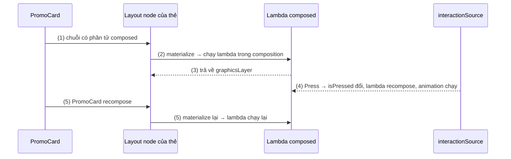
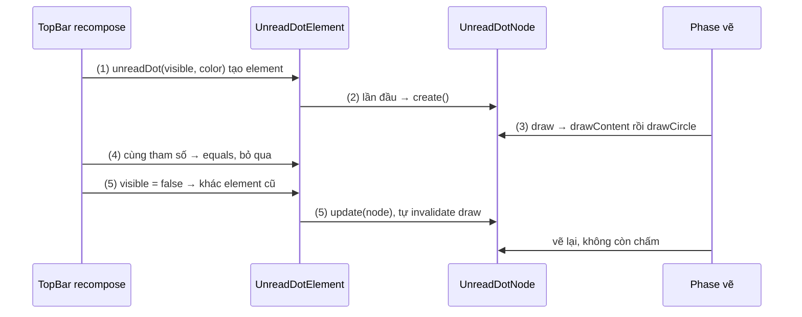
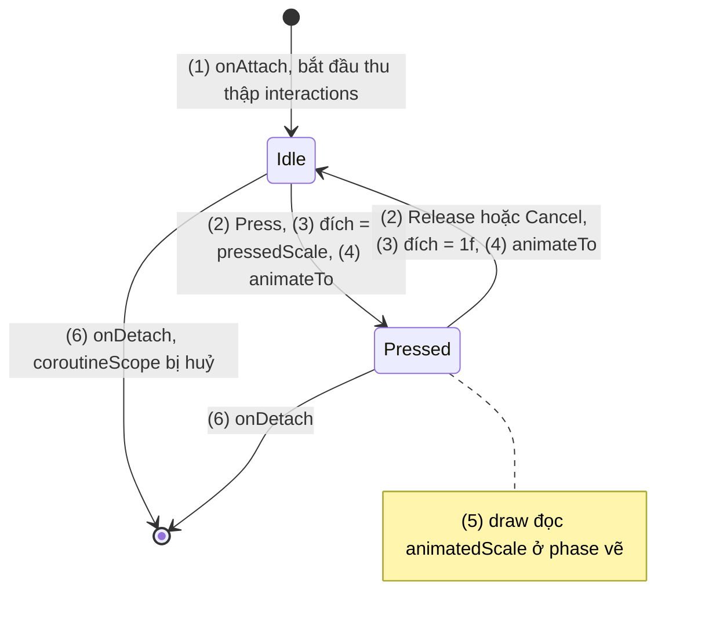
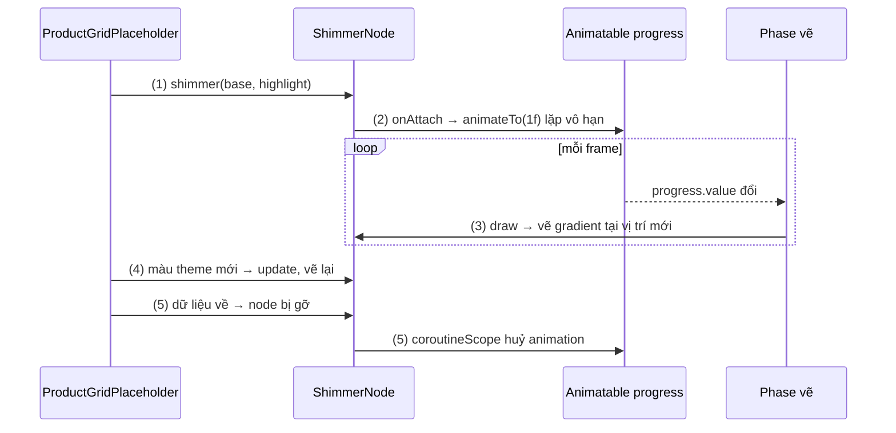

# Composed Modifier

## Vấn đề cần giải quyết

Ghép các modifier có sẵn ([9.5.2 Chaining](chaining.md)) giải quyết được phần lớn nhu cầu dùng lại. Nhưng có những hành vi không ghép ra được:

- **Cần trạng thái riêng cho mỗi nơi dùng:** hiệu ứng thu nhỏ khi nhấn cần nhớ "đang nhấn hay không" và giá trị animation hiện tại cho **từng** thẻ.
- **Cần vòng đời:** khung xương (skeleton) đang tải cần một animation chạy khi phần tử xuất hiện và dừng khi nó biến mất.
- **Cần đọc giá trị từ composition:** màu theo theme, mật độ điểm ảnh, tài nguyên.

Từ Compose 1.0, câu trả lời là `Modifier.composed { }`: viết `remember`, `LaunchedEffect`, `animate*AsState` ngay trong modifier. Nó tiện nên được dùng tràn lan, kể cả trong chính thư viện Compose, cho tới khi chi phí của nó lộ ra trong các danh sách dài.

Vấn đề cần giải quyết là: **viết modifier tuỳ chỉnh có trạng thái và vòng đời mà không trả giá hiệu năng ở mọi lần recompose**, và chọn đúng mức công cụ cho từng nhu cầu.

## Sau khi học xong

- Giải thích được cách Modifier.composed {} compose lambda của nó riêng cho từng layout node, và vì sao cách này không còn được khuyến nghị.
- Biết khi nào chọn chuỗi modifier có sẵn, factory có lambda như drawWithContent hay layout {}, @Composable modifier factory hoặc Modifier.Node khi viết modifier tuỳ chỉnh.
- Triển khai được modifier tuỳ chỉnh bằng Modifier.Node gồm node, ModifierNodeElement với create, update, equals, hashCode và modifier factory.
- Xử lý được trạng thái, coroutine và vòng đời của node bằng onAttach, onDetach, coroutineScope và invalidateDraw.
- Áp dụng được việc chuyển một modifier viết bằng composed sang Modifier.Node mà giữ nguyên hành vi.

## Composed Modifier là gì?

**Composed modifier** là modifier tuỳ chỉnh được tạo bằng `Modifier.composed { }`: chuỗi chỉ chứa một phần tử giữ một lambda `@Composable`, và lambda đó được compose "just-in-time" **riêng cho từng layout node** mà modifier được áp vào, rồi kết quả (một chuỗi modifier thật) thay chỗ cho phần tử đó.

Mental model: composed modifier là **một composable nhỏ giấu trong modifier**. Nó có slot table, `remember`, effect như mọi composable, và chạy lại theo composition của phần tử dùng nó. Ngược lại, API khuyến nghị hiện nay, **`Modifier.Node`**, không phải composable: nó là một object sống lâu gắn thẳng vào layout node, chỉ được cập nhật khi tham số đổi. Cả bài xoay quanh khác biệt này.

```kotlin
// androidx.compose.ui: chữ ký của composed (overload cơ bản)
fun Modifier.composed(
    inspectorInfo: InspectorInfo.() -> Unit = NoInspectorInfo,
    factory: @Composable Modifier.() -> Modifier
): Modifier
```

## Lịch sử phát triển

Lịch sử đặt ở đây vì nó giải thích vì sao có hai API cho cùng một việc:

| Thời điểm | Mốc |
|---|---|
| 07/2021 | Compose 1.0: `composed {}` là cách chính để viết modifier có trạng thái; nhiều modifier có sẵn (như `clickable`) cũng viết bằng nó |
| Khoảng 2022 | `Modifier.Node` ra đời; bài nói "Compose Modifiers Deep Dive" (Android Dev Summit 2022) trình bày vấn đề của `composed` và thiết kế mới |
| 08/2023 | Compose 1.5 bắt đầu chuyển `clickable` sang `Modifier.Node`, composition nhanh hơn, có trường hợp tới 80%; thêm API để node đọc `CompositionLocal` |
| 2023 về sau | Modifier có sẵn dần chuyển sang `Modifier.Node`; docs ghi `composed {}` không còn được khuyến nghị, có trang hướng dẫn chuyển đổi |
| Khoảng Compose 1.7 (2024) | `Indication` (ripple) chuyển sang node; `rememberRipple()` bị deprecate, thay bằng `ripple()` |

> [!NOTE]
> Tại thời điểm viết, `composed` **chưa** bị đánh dấu `@Deprecated` trong API reference: code cũ vẫn chạy. "Không còn được khuyến nghị" là khuyến nghị của tài liệu chính thức, không phải lỗi biên dịch. Đừng viết `composed` mới; chuyển dần `composed` cũ khi chạm tới.

## Cách hoạt động

### Modifier.composed chạy thế nào

Gọi một factory viết bằng `composed` **không** chạy gì cả: nó chỉ nối vào chuỗi một phần tử giữ lambda. Lambda chỉ chạy khi chuỗi được áp vào một layout node. Lúc đó composable dựng layout node (`Layout`, mà `Box`, `Row`, `Text`... đều dùng bên dưới) gọi bước **materialize**: duyệt chuỗi, gặp phần tử composed nào thì gọi lambda của nó **trong composition, tại vị trí của layout node đó**, rồi thay phần tử bằng chuỗi lambda trả về. Bước này chạy lại ở **mọi lần** composable đó recompose.

#### Ví dụ: thẻ khuyến mãi thu nhỏ khi nhấn, viết bằng composed

**Bài toán:** các thẻ khuyến mãi trong carousel thu nhỏ còn 96% khi người dùng nhấn giữ, rồi đàn hồi về 100% khi thả, cho cảm giác "bấm được". Mỗi thẻ cần trạng thái nhấn và animation riêng, nên không ghép được từ modifier không trạng thái.

**Luồng chạy:**

1. `PromoCard` gọi `Modifier.pressScaleComposed(interactionSource)`: chỉ tạo phần tử composed giữ lambda, chưa chạy gì.
2. Layout node của thẻ materialize chuỗi: lambda chạy trong composition tại thẻ đó. `collectIsPressedAsState()` và `animateFloatAsState()` tạo state trong slot table (`remember` bên trong chúng).
3. Lambda trả về `Modifier.graphicsLayer { ... }`, thay chỗ phần tử composed.
4. Người dùng nhấn: `clickable` phát `PressInteraction.Press` vào `interactionSource`; `isPressed` đổi → scope của lambda recompose → animation chạy, `graphicsLayer` đọc `scale` mới ở phase vẽ.
5. Mỗi lần `PromoCard` recompose vì bất kỳ lý do nào (giá đổi, đồng hồ đếm ngược...), bước (2) chạy lại: lambda thực thi lại, chuỗi mới được tạo.



**Code:**

```kotlin
// PressScaleComposed.kt (cách cũ, không còn được khuyến nghị)
fun Modifier.pressScaleComposed(
    interactionSource: InteractionSource,
    pressedScale: Float = 0.96f,
): Modifier = composed {                                                    // (1) chỉ tạo phần tử giữ lambda
    val isPressed by interactionSource.collectIsPressedAsState()            // (2) state trong slot table
    val scale by animateFloatAsState(
        targetValue = if (isPressed) pressedScale else 1f,                  // (4)
        label = "pressScale"
    )
    Modifier.graphicsLayer {                                                // (3) chuỗi thật thay chỗ
        scaleX = scale
        scaleY = scale
    }
}

// PromoCard.kt
@Composable
fun PromoCard(promo: PromoUi, onClick: () -> Unit, modifier: Modifier = Modifier) {
    val interactionSource = remember { MutableInteractionSource() }
    Column(
        modifier = modifier
            .pressScaleComposed(interactionSource)                          // (1)
            .clip(RoundedCornerShape(16.dp))
            .background(MaterialTheme.colorScheme.primaryContainer)
            .clickable(interactionSource = interactionSource, indication = LocalIndication.current, onClick = onClick)
            .padding(16.dp)
    ) {
        Text(promo.title, style = MaterialTheme.typography.titleMedium)
        Text(promo.expiresText, style = MaterialTheme.typography.bodySmall) // (5) đổi mỗi giây → PromoCard recompose
    }
}
```

`InteractionSource` là luồng các tương tác (nhấn, focus, kéo) mà `clickable` phát ra; truyền cùng một instance cho `clickable` và modifier của mình để "nghe" trạng thái nhấn. `animateFloatAsState` thuộc nhóm API animation, tổng quan ở 9.7.2 [AnimatedVisibility](../graphics_animations/animated_visibility.md).

**Kết quả:** nhấn giữ, thẻ thu nhỏ; thả, thẻ đàn hồi về. Nhưng log tạm ở đầu lambda của `composed` cho thấy: khi `expiresText` đổi mỗi giây, lambda chạy lại mỗi giây cho từng thẻ, dù trạng thái nhấn không đổi. Đó là chi phí phân tích ở phần tiếp theo.

### Vì sao composed không còn được khuyến nghị

Tài liệu chính thức liệt kê các nút thắt hiệu năng mà `composed` tạo ra:

| Vấn đề | Giải thích |
|---|---|
| Tốn slot table | Mỗi nơi dùng phải `remember` và tạo snapshot state, thêm group vào slot table, tăng bộ nhớ; nhân với số item của danh sách |
| Vòng đời đắt | Muốn biết modifier được gắn/gỡ phải dùng effect (`DisposableEffect`, `LaunchedEffect`), nặng so với việc cần làm |
| Không skip được | Lambda trả về `Modifier`, mà composable có giá trị trả về thì không skip được, nên nó chạy lại ở mọi lần materialize |
| Phá equality | Hàm ngoài (`pressScaleComposed`) không phải composable nên compiler không ghi nhớ được lambda bên trong; mỗi lần gọi là một lambda mới, phần tử composed so sánh lambda theo tham chiếu, nên chuỗi **luôn khác** chuỗi trước dù tham số y hệt (overload có `fullyQualifiedName` và key so theo key, nhưng vẫn chịu các chi phí còn lại) |
| Không so được tham số | Không có cách so tham số mới với tham số cũ để chỉ cập nhật phần thay đổi |

Hệ quả cộng dồn: chuỗi có `composed` không bao giờ "bằng nhau", composable nhận chuỗi đó khó được skip, và chi phí nhân theo số item của `LazyColumn`; vì vậy chuyển `clickable` sang `Modifier.Node` cải thiện composition rõ rệt.

Điểm `composed` làm **đúng** về ngữ nghĩa: `CompositionLocal` đọc trong lambda lấy giá trị **tại nơi modifier được áp**, không phải nơi tạo chuỗi. `Modifier.Node` giữ được ngữ nghĩa này (qua `currentValueOf`, ở phần sau), còn `@Composable` modifier factory thì không.

### Chọn cách viết modifier tuỳ chỉnh

Thay cho `composed`, có bốn mức, chọn mức **thấp nhất** đáp ứng được nhu cầu:

| Mức | Dùng khi | Ví dụ |
|---|---|---|
| 1. Ghép modifier có sẵn | Chỉ là tổ hợp lặp lại, không trạng thái | `Modifier.sectionContainer(color)` ở [9.5.2](chaining.md) |
| 2. Factory có lambda của Compose | Vẽ hoặc đo theo cách riêng, không cần trạng thái riêng | `drawBehind`, `drawWithContent`, `drawWithCache`, `layout {}`, `graphicsLayer {}` |
| 3. `@Composable` modifier factory | Cần gọi composable có giá trị trả về (`animate*AsState`, `colorResource`) và chấp nhận các giới hạn bên dưới | `Modifier.dimWhenDisabled(enabled)` |
| 4. `Modifier.Node` | Cần trạng thái riêng, vòng đời, coroutine, xử lý input, hoặc modifier dùng ở nhiều nơi/nhiều item, cần hiệu năng tốt nhất | `Modifier.shimmer(...)`, `Modifier.pressScale(...)` |

**Mức 2** là các factory mà lambda chạy ở phase vẽ hoặc layout, không ở composition. Đọc state trong lambda thì khi state đổi, chỉ phase đó chạy lại. Chi tiết `DrawScope` và các hàm vẽ học ở 9.7.1 [Surface and Canvas](../graphics_animations/surface_and_canvas.md); `Layout {}` composable học ở 9.6 [Layout and View](../layout_and_view.md).

```kotlin
// SoldOutOverlay.kt — mức 2: phủ lớp mờ lên ảnh sản phẩm hết hàng
fun Modifier.soldOutOverlay(soldOut: Boolean): Modifier =
    if (!soldOut) this
    else this.drawWithContent {
        drawContent()                                       // vẽ ảnh trước
        drawRect(Color.Black.copy(alpha = 0.45f))           // rồi phủ lớp mờ lên trên
    }
```

**Mức 3** là hàm `@Composable` trả về `Modifier`. Tài liệu chính thức nêu ba giới hạn:

- **`CompositionLocal` được đọc tại nơi gọi factory**, không phải nơi modifier được áp. Tạo modifier trong một `CompositionLocalProvider` rồi dùng trong một provider khác thì nó mang giá trị cũ.
- **Không bao giờ được skip**, vì là composable có giá trị trả về: chạy lại ở mọi lần recompose của composable gọi nó.
- **Chỉ gọi được trong composition**, nên không hoist được ra biến top-level như chuỗi thường.

```kotlin
// DimWhenDisabled.kt — mức 3: cần animateFloatAsState nên phải là composable
@Composable
fun Modifier.dimWhenDisabled(enabled: Boolean): Modifier {
    val alpha by animateFloatAsState(if (enabled) 1f else 0.38f, label = "dimAlpha")
    return this then Modifier.graphicsLayer { this.alpha = alpha }   // luôn nối vào this
}
```

Khi modifier nằm trong item của danh sách dài hoặc cần trạng thái riêng, lên **mức 4**.

### Modifier.Node: node, element và factory

`Modifier.Node` là API cấp thấp mà chính Compose dùng để viết các modifier có sẵn, và là cách viết modifier tuỳ chỉnh hiệu năng nhất. Một modifier gồm ba phần:

| Phần | Vai trò | Sống bao lâu |
|---|---|---|
| **Node** (`Modifier.Node` + một hoặc vài node type) | Chứa logic và trạng thái: vẽ gì, đo thế nào, nhận input ra sao | Lâu: tạo một lần khi modifier được áp lên layout node, sống qua các lần recompose, có thể được tái sử dụng |
| **Element** (`ModifierNodeElement<N>`) | Dữ liệu bất biến để tạo hoặc cập nhật node: `create()` tạo node lần đầu, `update(node)` đẩy tham số mới vào node cũ | Ngắn: object mới ở mỗi lần recompose, rẻ |
| **Factory** (`fun Modifier.xxx(...)`) | API công khai: `this then XxxElement(...)` | — |

Cơ chế cập nhật dựa trên `equals`: khi recompose, element mới được so với element cũ ở cùng vị trí trong chuỗi. Bằng nhau thì không làm gì; khác nhau (cùng kiểu) thì gọi `update(node)` trên node đang có. Vì vậy element **phải** cài đặt `equals` và `hashCode` theo giá trị; cách đơn giản nhất là `data class`. Sau `update`, node được **tự động invalidate** theo loại của nó (node vẽ thì vẽ lại, node layout thì đo lại).

Node type quyết định node làm được gì:

| Node type | Cho phép |
|---|---|
| `DrawModifierNode` | Vẽ trong vùng của layout: `ContentDrawScope.draw()` |
| `LayoutModifierNode` | Đổi cách đo và đặt nội dung bên trong: `MeasureScope.measure(...)` |
| `PointerInputModifierNode` | Nhận sự kiện chạm |
| `SemanticsModifierNode` | Thêm semantics cho accessibility và test |
| `CompositionLocalConsumerModifierNode` | Đọc `CompositionLocal` tại nơi node được áp, bằng `currentValueOf(...)` |
| `ObserverModifierNode` | Theo dõi snapshot state đọc trong `observeReads { }` |
| `DelegatingNode` | Gộp nhiều node thành một bằng `delegate(...)` |

Ngoài ra còn `ParentDataModifierNode`, `LayoutAwareModifierNode`, `GlobalPositionAwareModifierNode`, `TraversableNode` cho các nhu cầu hẹp hơn.

#### Ví dụ: chấm đỏ báo có thông báo chưa đọc trên icon

**Bài toán:** icon chuông trên thanh công cụ hiện chấm đỏ nhỏ ở góc trên phải khi còn thông báo chưa đọc. Chấm chỉ là phần vẽ thêm, không đổi kích thước icon, và icon recompose thường xuyên theo màn hình nên modifier phải rẻ.

**Luồng chạy:**

1. Mỗi lần recompose, factory `unreadDot(...)` tạo một `UnreadDotElement` mới (data class, rẻ).
2. Lần đầu ở vị trí này: Compose gọi `create()` tạo `UnreadDotNode` và gắn vào layout node của icon.
3. Phase vẽ: node vẽ nội dung (icon) bằng `drawContent()`, rồi vẽ chấm đè lên góc trên phải.
4. Recompose với cùng tham số: element mới `equals` element cũ → không gọi gì, node giữ nguyên.
5. Người dùng đọc hết thông báo: `visible` thành `false` → element khác → `update(node)` gán giá trị mới → node tự invalidate phần vẽ, chấm biến mất. Không node mới nào được tạo.



**Code:**

```kotlin
// UnreadDotModifier.kt
fun Modifier.unreadDot(visible: Boolean, color: Color, radius: Dp = 4.dp): Modifier =
    this then UnreadDotElement(visible, color, radius)                      // (1) factory: luôn nối vào this

private data class UnreadDotElement(                                        // data class: equals/hashCode theo giá trị
    val visible: Boolean,
    val color: Color,
    val radius: Dp,
) : ModifierNodeElement<UnreadDotNode>() {
    override fun create() = UnreadDotNode(visible, color, radius)            // (2)

    override fun update(node: UnreadDotNode) {                              // (5) cập nhật node cũ, không tạo mới
        node.visible = visible
        node.color = color
        node.radius = radius
    }

    override fun InspectorInfo.inspectableProperties() {                    // thông tin cho công cụ debug (Layout Inspector)
        name = "unreadDot"
        properties["visible"] = visible
        properties["color"] = color
    }
}

private class UnreadDotNode(
    var visible: Boolean,
    var color: Color,
    var radius: Dp,
) : Modifier.Node(), DrawModifierNode {
    override fun ContentDrawScope.draw() {
        drawContent()                                                       // (3) vẽ icon trước
        if (visible) {
            val radiusPx = radius.toPx()
            drawCircle(color, radius = radiusPx, center = Offset(size.width - radiusPx, radiusPx))
        }
    }
}

// TopBar.kt
Icon(
    painter = painterResource(R.drawable.ic_notifications),  // icon Material Symbols, xem 9.6
    contentDescription = "Thông báo",
    modifier = Modifier.unreadDot(visible = unreadCount > 0, color = MaterialTheme.colorScheme.error)
)
```

Imports đáng chú ý: `ModifierNodeElement`, `DrawModifierNode` thuộc `androidx.compose.ui.node`; `ContentDrawScope` thuộc `androidx.compose.ui.graphics.drawscope`; `InspectorInfo` thuộc `androidx.compose.ui.platform`. `inspectableProperties()` không bắt buộc, nhưng lint `ModifierNodeInspectableProperties` nhắc khi element thiếu nó (`PressScaleElement` ở phần sau bỏ qua cho gọn). Với badge có số, Material 3 có sẵn `BadgedBox`; ví dụ tự vẽ chấm để thấy cấu trúc một node.

**Kết quả:** chấm hiện khi `unreadCount > 0`, biến mất ngay khi đọc hết. Thêm log tạm vào `create()` và `update()`: `create` chỉ in một lần, `update` chỉ in khi tham số đổi, dù top bar recompose nhiều lần.

### Trạng thái, coroutine và vòng đời của node

Vì node sống lâu, nó giữ trạng thái như một class bình thường, không cần `remember`. Các API vòng đời thay cho effect của composition:

| API của node | Thay cho | Ghi chú |
|---|---|---|
| Thuộc tính của class | `remember { }` | Sống qua recompose vì node sống qua recompose |
| `onAttach()` | `LaunchedEffect` / `DisposableEffect` lúc vào | Gọi khi node được gắn vào layout node |
| `onDetach()` | `onDispose { }` | Gọi khi node bị gỡ |
| `onReset()` | — | Gọi khi node được tái sử dụng (ví dụ item của lazy list được dùng lại); đặt lại trạng thái ở đây hoặc ở `onAttach` |
| `coroutineScope` | `rememberCoroutineScope()` | Gắn với vòng đời node, tự huỷ khi node bị gỡ; chỉ dùng khi node đã attach (`isAttached`) |
| `currentValueOf(LocalX)` | `LocalX.current` | Cần `CompositionLocalConsumerModifierNode`; đọc giá trị tại nơi node được áp |
| `invalidateDraw()`, `invalidateMeasurement()` | Recompose để cập nhật | Yêu cầu vẽ lại hoặc đo lại khi trạng thái nội bộ đổi |

Đọc snapshot state (như `Animatable.value`) bên trong `draw()` hay `measure()` thì phase đó được theo dõi và tự chạy lại khi state đổi, không cần gọi `invalidateDraw()`. Trạng thái **không** phải snapshot state (một biến `Int` thường) thì phải tự gọi invalidate. Khi muốn kiểm soát chi tiết hơn (đổi màu chỉ vẽ lại, đổi kích thước mới đo lại), override `shouldAutoInvalidate = false` rồi tự gọi đúng hàm invalidate trong `update`.

`LaunchedEffect`, `DisposableEffect`, `rememberCoroutineScope` học ở 9.3.1 [LaunchedEffect](../side_effects/launched_effect.md) và 9.3.2 [DisposableEffect](../side_effects/disposable_effect.md); `CompositionLocal` học ở 9.4.2 [Custom Theme](../theming/custom_theme.md). `Animatable` (giá trị animation điều khiển bằng coroutine) thuộc nhóm API animation ở 9.7; coroutine học ở [8.4.3 Coroutines](../../session_08/async_threads/coroutines.md).

#### Ví dụ: chuyển hiệu ứng nhấn thu nhỏ sang Modifier.Node

**Bài toán:** viết lại `pressScaleComposed` ở phần đầu thành `Modifier.Node`, giữ nguyên hành vi (thu nhỏ khi nhấn, đàn hồi khi thả, dùng chung `interactionSource` với `clickable`), nhưng không chạy lại gì khi thẻ recompose vì lý do khác.

**Luồng chạy:**

1. `onAttach()`: node bắt đầu thu thập `interactionSource.interactions` trong `coroutineScope` của nó.
2. Nhận `Press`: thêm vào danh sách nhấn đang hoạt động; nhận `Release` hoặc `Cancel`: bỏ press tương ứng.
3. Tính đích: còn press đang hoạt động thì `pressedScale`, không thì `1f`.
4. Chạy `Animatable.animateTo(đích)`; animation mới tự huỷ animation đang chạy dở.
5. `draw()` đọc `animatedScale.value` ở phase vẽ: mỗi frame animation chỉ vẽ lại, không recompose.
6. Thẻ rời màn hình: node bị gỡ, `coroutineScope` tự huỷ việc thu thập và animation.



**Code:**

```kotlin
// PressScaleModifier.kt
fun Modifier.pressScale(interactionSource: InteractionSource, pressedScale: Float = 0.96f): Modifier =
    this then PressScaleElement(interactionSource, pressedScale)

private data class PressScaleElement(
    val interactionSource: InteractionSource,
    val pressedScale: Float,
) : ModifierNodeElement<PressScaleNode>() {
    override fun create() = PressScaleNode(interactionSource, pressedScale)
    override fun update(node: PressScaleNode) = node.update(interactionSource, pressedScale)
}

private class PressScaleNode(
    private var interactionSource: InteractionSource,
    private var pressedScale: Float,
) : Modifier.Node(), DrawModifierNode {

    private val animatedScale = Animatable(1f)                              // trạng thái: thuộc tính thường, không remember
    private var collectJob: Job? = null

    override fun onAttach() {
        collectPresses()                                                    // (1)
    }

    fun update(interactionSource: InteractionSource, pressedScale: Float) {
        this.pressedScale = pressedScale
        if (this.interactionSource != interactionSource) {                  // nguồn đổi: thu thập lại từ nguồn mới
            this.interactionSource = interactionSource
            if (isAttached) collectPresses()
        }
    }

    private fun collectPresses() {
        collectJob?.cancel()
        collectJob = coroutineScope.launch {                                // (6) tự huỷ khi node bị gỡ
            val activePresses = mutableListOf<PressInteraction.Press>()
            interactionSource.interactions.collect { interaction ->
                when (interaction) {                                        // (2)
                    is PressInteraction.Press -> activePresses += interaction
                    is PressInteraction.Release -> activePresses -= interaction.press
                    is PressInteraction.Cancel -> activePresses -= interaction.press
                }
                val target = if (activePresses.isEmpty()) 1f else pressedScale  // (3)
                launch { animatedScale.animateTo(target, spring()) }       // (4)
            }
        }
    }

    override fun ContentDrawScope.draw() {
        scale(animatedScale.value) {                                        // (5) đọc state ở phase vẽ
            this@draw.drawContent()
        }
    }
}
```

Ở `PromoCard`, chỉ cần đổi `.pressScaleComposed(interactionSource)` thành `.pressScale(interactionSource)`. `scale(...)` là hàm biến đổi của `DrawScope`: chỉ phóng/thu phần vẽ quanh tâm, không đổi kích thước layout hay vùng bấm, giống `graphicsLayer` ở bản cũ về mặt hiển thị.

**Kết quả:** nhấn giữ và thả cho cùng cảm giác như bản `composed`. Khi `expiresText` đổi mỗi giây, `PromoCard` vẫn recompose (vì text đổi), nhưng element mới bằng element cũ nên `update` không được gọi (kiểm chứng bằng log tạm trong `update`). Bật recomposition counts trong Layout Inspector: khi chỉ nhấn giữ, số recompose của `PromoCard` không tăng, vì animation chỉ làm phase vẽ chạy lại.

## Ví dụ thực tế

1. **Khung xương (skeleton) lúc đang tải danh sách** (code đầy đủ bên dưới): animation vô hạn chạy theo vòng đời node, mỗi frame chỉ vẽ lại.
2. **Viền cùng màu nội dung tại nơi áp:** node implement thêm `CompositionLocalConsumerModifierNode`, trong `draw()` gọi `currentValueOf(LocalContentColor)`, nên giá trị đổi thì tự vẽ lại.
3. **Chuyển `composed` trong code cũ:** `remember` → thuộc tính của node; `LaunchedEffect`/`DisposableEffect` → `onAttach`/`onDetach` + `coroutineScope`; `LocalX.current` → `currentValueOf`; `animate*AsState` → `Animatable`; `pointerInput` → delegate tới `SuspendingPointerInputModifierNode`. Chỉ cần gọi một hàm composable có giá trị trả về (`colorResource`) thì `@Composable` factory là đủ.

### Khung xương lúc đang tải với hiệu ứng shimmer

**Bài toán:** khi lưới sản phẩm đang tải, mỗi ô hiện các khối xám bo góc với một dải sáng chạy ngang liên tục (shimmer). Hàng chục khối cùng lúc trên màn hình, nên mỗi frame animation không được làm composable recompose; animation phải dừng khi khối rời màn hình.

**Luồng chạy:**

1. Mỗi khối gọi `Modifier.shimmer(baseColor, highlightColor)`; element là data class.
2. Node được gắn: `onAttach()` khởi động animation `progress` từ 0 tới 1, lặp vô hạn, trong `coroutineScope` của node.
3. Mỗi frame, `draw()` đọc `progress.value`, tính vị trí dải sáng và vẽ gradient. Chỉ phase vẽ chạy lại.
4. Màu truyền vào đổi (ví dụ theme đổi mà Activity không bị tạo lại): element có màu mới → `update` gán màu → node tự vẽ lại; animation không khởi động lại. Chỉ khi `durationMillis` đổi mới khởi động lại animation.
5. Dữ liệu về, khối skeleton rời composition: node bị gỡ, `coroutineScope` huỷ animation.



**Code:**

```kotlin
// ShimmerModifier.kt (import như ví dụ chấm đỏ, thêm Animatable, infiniteRepeatable, tween, LinearEasing, Brush, Job, launch)
fun Modifier.shimmer(
    baseColor: Color,
    highlightColor: Color,
    durationMillis: Int = 1200,
): Modifier = this then ShimmerElement(baseColor, highlightColor, durationMillis)   // (1)

private data class ShimmerElement(
    val baseColor: Color,
    val highlightColor: Color,
    val durationMillis: Int,
) : ModifierNodeElement<ShimmerNode>() {
    override fun create() = ShimmerNode(baseColor, highlightColor, durationMillis)
    override fun update(node: ShimmerNode) = node.update(baseColor, highlightColor, durationMillis) // (4)
    override fun InspectorInfo.inspectableProperties() {
        name = "shimmer"
        properties["baseColor"] = baseColor
        properties["highlightColor"] = highlightColor
        properties["durationMillis"] = durationMillis
    }
}

private class ShimmerNode(
    private var baseColor: Color,
    private var highlightColor: Color,
    private var durationMillis: Int,
) : Modifier.Node(), DrawModifierNode {

    private val progress = Animatable(0f)
    private var animationJob: Job? = null

    override fun onAttach() {
        startAnimation()                                                    // (2)
    }

    fun update(baseColor: Color, highlightColor: Color, durationMillis: Int) {
        this.baseColor = baseColor                                          // (4) đổi màu: tự vẽ lại sau update
        this.highlightColor = highlightColor
        if (this.durationMillis != durationMillis) {
            this.durationMillis = durationMillis
            if (isAttached) startAnimation()                                // chỉ khởi động lại khi tốc độ đổi
        }
    }

    private fun startAnimation() {
        animationJob?.cancel()
        animationJob = coroutineScope.launch {                              // (5) huỷ tự động khi node bị gỡ
            progress.snapTo(0f)
            progress.animateTo(
                targetValue = 1f,
                animationSpec = infiniteRepeatable(tween(durationMillis, easing = LinearEasing))
            )
        }
    }

    override fun ContentDrawScope.draw() {
        val bandWidth = size.width
        val startX = -bandWidth + progress.value * (size.width + bandWidth) // (3) đọc state ở phase vẽ
        drawRect(
            brush = Brush.linearGradient(
                colors = listOf(baseColor, highlightColor, baseColor),
                start = Offset(startX, 0f),
                end = Offset(startX + bandWidth, size.height),
            )
        )
        // Không gọi drawContent(): khối skeleton thay hẳn nội dung
    }
}
```

```kotlin
// ProductGridPlaceholder.kt
@Composable
fun ProductCardPlaceholder(modifier: Modifier = Modifier) {
    val base = MaterialTheme.colorScheme.surfaceVariant
    val highlight = MaterialTheme.colorScheme.surface
    Column(modifier.padding(4.dp)) {
        Box(
            Modifier
                .fillMaxWidth()
                .aspectRatio(1f)
                .clip(RoundedCornerShape(12.dp))                            // clip trước: shimmer bị cắt theo góc bo
                .shimmer(base, highlight)
        )
        Spacer(Modifier.height(8.dp))
        Box(Modifier.fillMaxWidth(0.7f).height(16.dp).clip(RoundedCornerShape(4.dp)).shimmer(base, highlight))
    }
}
```

`clip` đứng trước `shimmer` theo quy tắc vẽ của [9.5.1 Modifier Order](modifier_order.md). Mỗi khối có node riêng nên dải sáng không đồng pha giữa các khối; cần chạy cùng nhịp thì cho các node đọc chung một nguồn thời gian.

**Kết quả:** các khối xám có dải sáng chạy liên tục. Bật recomposition counts trong Layout Inspector: `ProductCardPlaceholder` có số recompose đứng yên trong khi animation chạy, vì chỉ phase vẽ chạy lại. Đổi màu truyền vào trong lúc khối đang hiện (ví dụ chuyển theme bằng cài đặt trong app): màu khối đổi ngay mà dải sáng không giật về đầu. Bật dark theme của hệ thống thì mặc định Activity được tạo lại, node mới được tạo nên dải sáng chạy lại từ đầu; đó là hành vi của configuration change, không phải của node.

## So sánh với các cách tiếp cận khác

| Tiêu chí | `composed {}` | `@Composable` modifier factory | `Modifier.Node` |
|---|---|---|---|
| Trạng thái riêng | `remember` trong slot table | `remember` trong composable gọi nó | Thuộc tính của node |
| Vòng đời | Effect (`LaunchedEffect`, `DisposableEffect`) | Effect | `onAttach`, `onDetach`, `coroutineScope` |
| Skip khi recompose | Không | Không | Element so bằng `equals`; node không chạy lại nếu tham số không đổi |
| Equality của chuỗi | Hỏng (lambda mới mỗi lần) | Theo các modifier nó trả về | Theo `equals` của element |
| `CompositionLocal` đọc ở | Nơi modifier được áp | Nơi gọi factory | Nơi node được áp (`currentValueOf`) |
| Hoist ra ngoài composition | Được | Không | Được |
| Khuyến nghị hiện nay | Không | Khi cần gọi composable có giá trị trả về | Mặc định cho modifier có trạng thái |

## Khi nào nên và không nên dùng

- **Nên dùng `Modifier.Node`** khi modifier giữ trạng thái riêng, cần vòng đời hoặc coroutine, nằm trong item của danh sách dài hoặc trên composable recompose thường xuyên, hoặc thuộc thư viện/design system dùng ở nơi bạn không kiểm soát.
- **Không cần `Modifier.Node`** khi mức 1–3 của thang lựa chọn đã đủ (ghép modifier có sẵn, `drawWithContent`/`layout {}`, hay một giá trị từ hàm composable ở vài chỗ). Cái giá của node: code dài hơn, vòng đời và invalidation thủ công với trạng thái không phải snapshot state; với modifier dùng một lần trên màn hình ít recompose, cái giá này có thể lớn hơn lợi ích.
- **Không dùng `composed {}`** cho code mới. Code cũ thì chuyển khi sửa tới, hoặc khi profiling chỉ ra nó nằm trên đường nóng (item của danh sách).

## Sai lầm thường gặp

### 1. Dùng composed cho modifier không gọi composable nào

```kotlin
// Sai: không có lời gọi composable nào trong lambda, chỉ trả giá hiệu năng
fun Modifier.cardBorder(color: Color) = composed { border(1.dp, color, RoundedCornerShape(12.dp)) }

// Đúng: ghép thẳng
fun Modifier.cardBorder(color: Color) = this.border(1.dp, color, RoundedCornerShape(12.dp))
```

Lint của Compose có kiểm tra `UnnecessaryComposedModifier` cho trường hợp này.

### 2. Element không có equals theo giá trị

Element là `class` thường không tự viết `equals`/`hashCode` thì luôn khác element cũ: `update` chạy ở mọi lần recompose, node bị invalidate liên tục. Dùng `data class`, hoặc tự viết `equals`/`hashCode` khi có thuộc tính không nên tham gia so sánh.

### 3. Tạo node mới hoặc giữ trạng thái trong element

`update(node)` phải **sửa node đang có**, không tạo node mới; element là dữ liệu bất biến, tạo mới mỗi lần recompose, nên `Animatable`, `Job` hay bộ đếm để trong element sẽ mất.

### 4. Quên drawContent() trong DrawModifierNode

Không gọi `drawContent()` trong `draw()` thì nội dung bên trong (icon, chữ, ảnh) biến mất. Chỉ bỏ khi chủ ý thay nội dung, như khối shimmer.

### 5. Dùng coroutineScope trước khi node được attach

`coroutineScope` chỉ dùng được khi node đang gắn vào layout node. Khởi động coroutine trong constructor hoặc trong `update()` mà không kiểm tra `isAttached` có thể ném exception. Khởi động trong `onAttach()`, và trong `update()` chỉ khởi động lại khi `isAttached`.

### 6. Hoist @Composable modifier factory rồi dùng trong provider khác

```kotlin
// Sai kỳ vọng: màu được đọc tại đây (provider ngoài), không phải nơi Box dùng
val borderModifier = Modifier.themedBorder()        // @Composable, đọc LocalContentColor.current
CompositionLocalProvider(LocalContentColor provides Color.Red) {
    Box(borderModifier)                              // viền vẫn mang màu của provider ngoài
}
```

Cần giá trị tại nơi áp thì viết node implement `CompositionLocalConsumerModifierNode` và đọc bằng `currentValueOf`.

## Kết nối hệ thống

- **Prerequisites:**
  - [9.5.1 Modifier Order](modifier_order.md) — định nghĩa Modifier, mô hình lớp bọc, Deep Dive chuỗi node.
  - [9.5.2 Chaining](chaining.md) — `then`, factory nối vào `this`, mức 1 của thang lựa chọn.
- **Related (Session 09):**
  - 9.1 [Remember and Recomposition](../remember_and_recomposition.md) — slot table, skipping: nền để hiểu chi phí của `composed`.
  - 9.3.1 [LaunchedEffect](../side_effects/launched_effect.md), 9.3.2 [DisposableEffect](../side_effects/disposable_effect.md) — effect mà vòng đời node thay thế.
  - 9.4.2 [Custom Theme](../theming/custom_theme.md) — `CompositionLocal`.
  - 9.7.1 [Surface and Canvas](../graphics_animations/surface_and_canvas.md) — `DrawScope`, `drawWithContent`, `drawWithCache`.
  - 9.8.1 [Scrolling](../gesture/scrolling.md) — tổng quan gesture, `pointerInput`.
  - [9.5.4 Lazy Column](lazy_column.md) — nơi chi phí của modifier nhân lên theo số item.
- **Kiến thức liên quan ở Session 08:** [8.4.3 Coroutines](../../session_08/async_threads/coroutines.md) cho `launch`, `Job`, huỷ coroutine; [8.5.6 Animation](../../session_08/view_layout/animation.md) cho khái niệm animation theo frame trong View system.
- **Học tiếp:** [9.5.4 Lazy Column](lazy_column.md).

## Tham khảo

- [Create custom modifiers — Android Developers](https://developer.android.com/develop/ui/compose/custom-modifiers)
- [Migrate from Modifier.composed to Modifier.Node — Android Developers](https://developer.android.com/develop/ui/compose/custom-modifiers-node)
- [Modifier API reference (composed, Modifier.Node) — Android Developers](https://developer.android.com/reference/kotlin/androidx/compose/ui/Modifier)
- [Compose Modifiers deep dive — Android Dev Summit 2022 (YouTube)](https://www.youtube.com/watch?v=BjGX2RftXsU)
- [What's new in Jetpack Compose August '23 release — Android Developers Blog](https://android-developers.googleblog.com/2023/08/whats-new-in-jetpack-compose-august-23-release.html)
