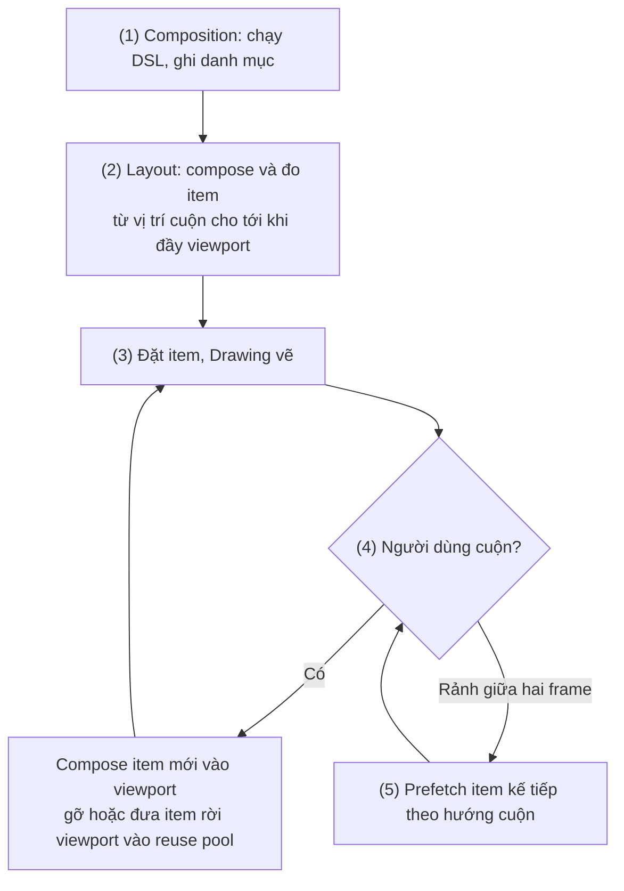
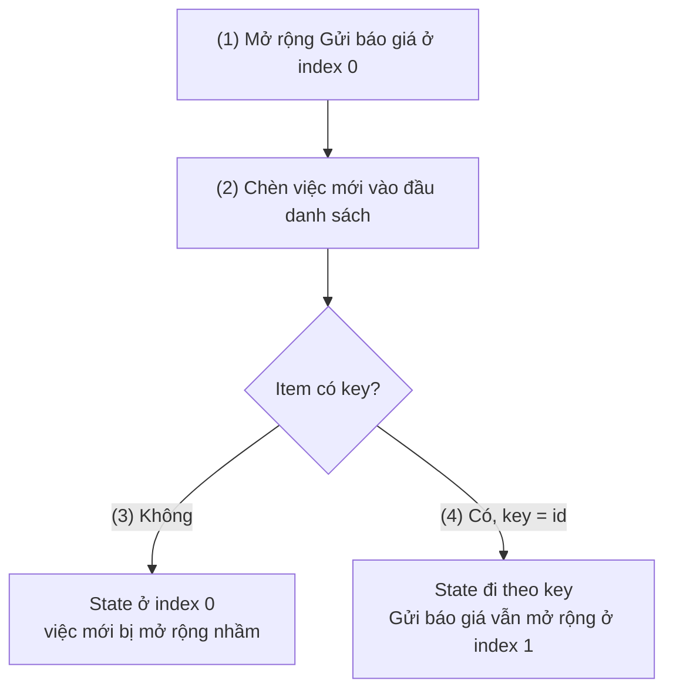
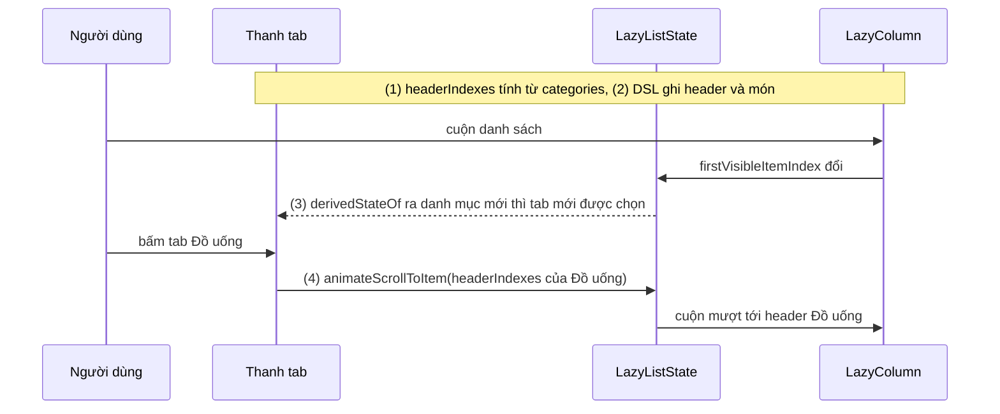

# Lazy Column

## Vấn đề cần giải quyết

Mọi app đều có danh sách: hộp thư, lịch sử giao dịch, danh bạ, kết quả tìm kiếm. Cách viết đầu tiên nghĩ đến là duyệt danh sách trong `Column` rồi cho nó cuộn:

```kotlin
// ContactListScreen.kt — cách viết không mở rộng được
@Composable
fun ContactList(contacts: List<Contact>) {
    Column(Modifier.verticalScroll(rememberScrollState())) {
        contacts.forEach { contact ->
            ContactRow(contact)   // 5.000 liên hệ → 5.000 lần compose, đo, đặt
        }
    }
}
```

`Column` không biết khái niệm "vùng đang nhìn thấy": nó compose, đo và đặt **mọi** con, dù màn hình chỉ chứa khoảng mười dòng. Với vài nghìn dòng, lần hiển thị đầu chậm thấy rõ và bộ nhớ tăng theo số dòng.

Hệ thống View giải bài toán này bằng `RecyclerView` ([8.5.1 Layouts](../../session_08/view_layout/layouts.md), [7.1.2 ViewHolder Pattern](../../session_07/design_pattern/viewholder_pattern.md)): chỉ tạo View cho phần nhìn thấy, tái sử dụng View khi cuộn. Cái giá là Adapter, ViewHolder, DiffUtil, LayoutManager, cả một bộ máy phải tự lắp. Compose cần cùng hiệu quả đó nhưng giữ được cách viết declarative: **mô tả danh sách gồm những gì, còn việc dựng phần nào, lúc nào, để layout lo.**

## Sau khi học xong

- Giải thích được vì sao LazyColumn chỉ compose và đo các item cần cho viewport, và khác Column cộng verticalScroll ở đâu.
- Triển khai được danh sách bằng DSL item, items, itemsIndexed và stickyHeader, kèm contentPadding và verticalArrangement.
- Áp dụng được key và contentType để state, vị trí cuộn và composition được tái sử dụng đi theo đúng item.
- Xử lý được việc đọc và điều khiển vị trí cuộn bằng LazyListState mà không gây recompose ở mỗi frame cuộn.
- Nhận diện được các lỗi lồng scroll cùng hướng, item cao 0px, key trùng hoặc không lưu được vào Bundle.

## LazyColumn là gì?

**Lazy layout** là nhóm layout cuộn của Compose (`LazyColumn`, `LazyRow`, `LazyVerticalGrid`...) nhận một **mô tả danh sách** viết bằng DSL thay vì các composable con, rồi chỉ compose, đo và đặt những item cần cho **viewport** (vùng đang nhìn thấy). **`LazyColumn`** là lazy layout cuộn theo chiều dọc.

Mental model: **danh mục và khung cửa sổ.** Khối lambda của `LazyColumn` viết ra một *danh mục*: bao nhiêu item, key gì, loại gì, vẽ bằng hàm nào. `LazyColumn` là *khung cửa sổ* trượt trên danh mục đó: chỉ dòng nằm trong khung (cộng một ít sắp vào khung) mới được dựng thành UI thật; dòng trượt ra thì được dỡ đi hoặc giữ lại để dựng dòng khác.

Khác biệt cốt lõi so với `Column`: lambda của `Column` là composable và **phát ra** các con ngay; lambda của `LazyColumn` có kiểu `LazyListScope.() -> Unit`, **không phải composable**, chỉ ghi danh mục. Nội dung của từng item (`itemContent`) mới là composable, và chỉ được gọi khi item đó cần hiện.

## Cách hoạt động

### 1. Lazy layout chỉ dựng phần nằm trong viewport

Compose vẽ một frame qua ba phase Composition → Layout → Drawing (xem [9.0 Jetpack Compose Overview](../overview.md)). Lazy layout đặc biệt ở chỗ nó **compose item ngay trong phase Layout của chính nó**:

1. Composition: `LazyColumn` chạy lambda DSL để có danh mục. Chưa item nào được compose.
2. Layout: `LazyColumn` biết chiều cao viewport và vị trí cuộn hiện tại. Nó bắt đầu từ item đầu tiên cần thấy, compose item đó, đo chiều cao, cộng dồn, lặp lại cho đến khi lấp đầy viewport.
3. Đặt các item đã đo vào đúng vị trí; Drawing vẽ chúng.
4. Người dùng cuộn: vị trí cuộn đổi, phase Layout của `LazyColumn` chạy lại. Item mới đi vào viewport được compose; item rời viewport bị gỡ khỏi composition hoặc đưa vào **reuse pool** (kho composition chờ tái sử dụng, xem phần 3).
5. Lúc rảnh giữa hai frame, lazy layout **prefetch** (dựng trước) item kế tiếp theo hướng cuộn, để khi item vào viewport thì đã sẵn sàng.



Vì item được compose trong lúc đo, số item thật sự tồn tại chỉ bằng số dòng nhìn thấy cộng vài dòng dự trữ, bất kể danh mục dài bao nhiêu; còn ghi danh mục thì rẻ, vì `items(contacts)` chỉ lưu "một khoảng N phần tử, vẽ bằng lambda này".

Một hệ quả về constraints: item được đo với chiều cao tối đa **vô hạn** (danh sách cuộn được thì không có "chiều cao còn lại"). Vì vậy `Modifier.fillMaxHeight()` trong item không có tác dụng; muốn item cao bằng viewport thì dùng `Modifier.fillParentMaxHeight()` của `LazyItemScope`. Chuyện constraints đi từ cha xuống con được giải thích ở [9.5.1 Modifier Order](modifier_order.md).

Đổi `Column` ở phần "Vấn đề" thành `LazyColumn { items(contacts) { ContactRow(it) } }` (extension cần `import androidx.compose.foundation.lazy.items`) là đủ: bước (1) chỉ ghi một khoảng 5.000 phần tử, bước (2) chỉ compose khoảng 10–12 `ContactRow`. Layout Inspector cho thấy số `ContactRow` trong cây chỉ bằng số dòng nhìn thấy cộng vài dòng, trong khi bản `Column` có đủ 5.000 node. Đo hiệu năng luôn trên release build có R8 (xem [9.0](../overview.md)).

### 2. DSL mô tả danh sách: item, items, itemsIndexed

`LazyListScope` cung cấp các hàm ghi danh mục:

| Hàm | Ghi vào danh mục |
|---|---|
| `item(key, contentType) { ... }` | Một item đơn: header, footer, banner, nút "Tải thêm". |
| `items(count, key, contentType) { index -> ... }` | `count` item, nội dung nhận `index`. |
| `items(list, key, contentType) { item -> ... }` | Một item cho mỗi phần tử của `List` (hoặc `Array`). |
| `itemsIndexed(list, key, contentType) { index, item -> ... }` | Như trên, nội dung nhận cả `index` và phần tử. |
| `stickyHeader(key, contentType) { index -> ... }` | Item dính ở đầu viewport cho tới khi header kế tiếp đẩy nó đi (phần 5). |

Các lời gọi được nối theo thứ tự viết: một `LazyColumn` có thể có header, rồi vài nhóm `items`, rồi footer. Nhờ vậy cả một màn hình dài nhiều phần vẫn nằm trong **một** lazy layout, thay vì lồng nhiều danh sách vào nhau (sai lầm 1).

Hai tham số của chính `LazyColumn` điều khiển khoảng cách:

- `contentPadding = PaddingValues(...)`: padding quanh **nội dung**, không quanh khung cuộn: item đầu cách mép trên, nhưng khi cuộn thì nội dung vẫn trượt tới sát mép. Thường dùng để nhận `PaddingValues` của `Scaffold`. `Modifier.padding()` thì thu nhỏ chính khung cuộn, nội dung bị cắt ở mép padding.
- `verticalArrangement = Arrangement.spacedBy(8.dp)`: khoảng cách **giữa** các item, thay cho việc tự thêm `Spacer` hay `ItemDecoration` như `RecyclerView`.

#### Ví dụ: giỏ hàng có header, danh sách sản phẩm và tổng tiền

**Bài toán:** màn giỏ hàng gồm dòng tiêu đề ("3 sản phẩm"), danh sách sản phẩm có thể dài, và khối tổng tiền cùng nút thanh toán ở cuối nội dung. Ba phần khác nhau nhưng cùng cuộn như một danh sách. Đây là khai báo thuần (DSL ghi theo thứ tự viết, không rẽ nhánh), nên không cần sơ đồ.

**Code:**

```kotlin
// CartScreen.kt
@Composable
fun CartScreen(
    uiState: CartUiState,
    onQuantityChange: (productId: String, quantity: Int) -> Unit,
    onCheckout: () -> Unit,
    modifier: Modifier = Modifier,
) {
    LazyColumn(
        modifier = modifier.fillMaxSize(),
        contentPadding = PaddingValues(horizontal = 16.dp, vertical = 12.dp), // quanh nội dung
        verticalArrangement = Arrangement.spacedBy(8.dp),                      // giữa các item
    ) {
        item(key = "header") {
            Text("${uiState.lines.size} sản phẩm", style = MaterialTheme.typography.titleMedium)
        }
        items(uiState.lines, key = { line -> line.productId }) { line ->
            CartLineRow(
                line = line,
                onQuantityChange = { quantity -> onQuantityChange(line.productId, quantity) },
            )
        }
        item(key = "summary") {                                                // chỉ compose khi cuộn tới
            CartSummary(total = uiState.total, onCheckout = onCheckout)
        }
    }
}
```

**Kết quả:** giỏ 40 sản phẩm thì header cuộn đi cùng danh sách, khối tổng tiền chỉ được compose khi người dùng cuộn tới cuối. Tham số `key` được giải thích ở phần sau.

### 3. key và contentType: danh tính và loại của item

#### key: state đi theo item, không theo vị trí

Mặc định, lazy layout định danh item theo **vị trí** (index). Mọi thứ gắn với một item, gồm state `remember`/`rememberSaveable` bên trong nó và vị trí cuộn, đều được ghi theo index đó. Khi danh sách đổi thứ tự hoặc chèn phần tử, index cũ trỏ sang dữ liệu khác, và state "nhảy" sang item khác. Cơ chế `remember` ghi nhớ theo vị trí gọi được dạy ở [9.1 Remember and Recomposition](../remember_and_recomposition.md); `key` của lazy layout là cùng ý tưởng với composable `key {}`, áp cho từng item.

Truyền `key` (lambda trả về giá trị **ổn định và duy nhất**, thường là id) thì lazy layout định danh item theo key:

- State bên trong item đi theo key khi item đổi vị trí.
- `rememberSaveable` trong item được lưu theo key, nên sống qua cả việc cuộn khỏi màn hình rồi cuộn lại (cơ chế `rememberSaveable` ở [9.2.2 Remember and rememberSaveable](../state/remember_saveable.md)).
- Vị trí cuộn được giữ theo key: chèn item **phía trên** item đang nhìn thì item đang nhìn vẫn đứng yên ở đầu viewport, người dùng không bị đẩy đi. (Từ Compose foundation 1.7, `LazyListState.requestScrollToItem()` cho phép bỏ qua hành vi này cho lần đo kế tiếp, ví dụ màn chat muốn bám tin mới nhất.)
- `Modifier.animateItem()` cần key để biết item nào đã di chuyển (phần 6).

Hai ràng buộc: key không được trùng trong cùng một lazy layout, và kiểu của key phải lưu được vào `Bundle` (String, Int, Long, enum, `Parcelable`...), vì state của item được lưu qua cơ chế lưu state của Activity.

#### Ví dụ: danh sách việc cần làm có ghi chú mở rộng

**Bài toán:** mỗi việc cần làm bấm vào thì mở rộng để hiện ghi chú; trạng thái mở rộng là state UI của dòng, giữ bằng `rememberSaveable`. Việc mới được chèn lên **đầu** danh sách. Đây là trường hợp lộ rõ nhất sự khác nhau giữa định danh theo vị trí và theo key.

**Luồng chạy:**

1. Người dùng mở rộng việc "Gửi báo giá" đang ở index 0.
2. Một việc mới được thêm vào đầu; "Gửi báo giá" chuyển xuống index 1.
3. Không có key: state "đang mở rộng" vẫn nằm ở index 0, nên việc **mới** hiện ra ở trạng thái mở rộng, còn "Gửi báo giá" bị thu lại.
4. Có `key = { it.id }`: state nằm dưới key của "Gửi báo giá", đi theo nó xuống index 1; việc mới có key mới, state mới.



**Code:**

```kotlin
// TaskListScreen.kt
@Composable
fun TaskList(tasks: List<Task>, modifier: Modifier = Modifier) {
    LazyColumn(modifier) {
        items(
            items = tasks,
            key = { task -> task.id },          // (4) Long/String: duy nhất, lưu được vào Bundle
        ) { task ->
            TaskRow(task)
        }
    }
}

@Composable
private fun TaskRow(task: Task) {
    var expanded by rememberSaveable { mutableStateOf(false) }   // (1) state UI của dòng
    Column(
        Modifier
            .fillMaxWidth()
            .clickable { expanded = !expanded }
            .padding(16.dp),
    ) {
        Text(task.title, style = MaterialTheme.typography.titleMedium)
        if (expanded) {
            Text(task.note, style = MaterialTheme.typography.bodyMedium)
        }
    }
}
```

**Kết quả:** bỏ dòng `key = ...`, mở rộng dòng đầu rồi thêm việc mới: dòng mới hiện ghi chú, dòng cũ thu lại (bước 3). Thêm lại key: dòng cũ giữ trạng thái mở rộng ở vị trí mới (bước 4).

#### contentType: tái sử dụng composition đúng loại

Item rời viewport không nhất thiết bị vứt composition: một số ít được giữ trong **reuse pool**, và item mới đi vào **tái sử dụng** cây layout node và cấu trúc slot cũ, chỉ áp tham số mới. Ý tưởng giống `RecyclerView` tái sử dụng ViewHolder, nhưng state `remember` của item cũ không được giữ, vì item mới có key khác.

Tái sử dụng chỉ có lợi khi hai item có **cấu trúc giống nhau**. `contentType` cho lazy layout biết item thuộc loại nào; composition chỉ được tái sử dụng giữa các item **cùng loại**. Danh sách chỉ có một loại item thì không cần khai báo (mọi item mặc định cùng loại `null`); danh sách trộn nhiều loại (bài viết, quảng cáo, header ngày) thì nên khai báo.

```kotlin
// NewsFeed.kt — FeedItem là sealed interface gồm Article và Ad, cùng có id
@Composable
fun NewsFeed(feed: List<FeedItem>, modifier: Modifier = Modifier) {
    LazyColumn(modifier) {
        items(
            items = feed,
            key = { it.id },
            contentType = { item ->                    // chỉ tái sử dụng Article cho Article, Ad cho Ad
                when (item) {
                    is FeedItem.Article -> "article"
                    is FeedItem.Ad -> "ad"
                }
            },
        ) { item ->
            when (item) {
                is FeedItem.Article -> ArticleCard(item)
                is FeedItem.Ad -> AdBanner(item)
            }
        }
    }
}
```

Thiếu `contentType` thì composition của một `AdBanner` có thể bị lấy ra để dựng `ArticleCard`, phải gỡ gần hết rồi dựng lại.

### 4. LazyListState: đọc và điều khiển vị trí cuộn

`LazyListState` là state holder của vị trí cuộn, tạo bằng `rememberLazyListState()` và truyền vào `LazyColumn(state = ...)`. Kéo nó lên (hoist) ra ngoài `LazyColumn` thì code khác đọc hoặc điều khiển được vị trí cuộn. `rememberLazyListState()` lưu bằng `LazyListState.Saver`, nên vị trí cuộn sống qua xoay màn hình.

| Thành viên | Dùng để |
|---|---|
| `firstVisibleItemIndex`, `firstVisibleItemScrollOffset` | Item đầu đang thấy và nó đã cuộn khuất bao nhiêu pixel. |
| `layoutInfo` | Thông tin lần layout gần nhất: `visibleItemsInfo` (index, key, offset, size của từng item đang thấy), `totalItemsCount`, kích thước viewport. |
| `isScrollInProgress`, `canScrollForward`, `canScrollBackward` | Đang cuộn hay không, còn cuộn tiếp được không. |
| `scrollToItem(index)`, `animateScrollToItem(index)` | Nhảy ngay hoặc cuộn mượt tới item; là hàm `suspend`. |
| `requestScrollToItem(index)` | Không `suspend`: yêu cầu lần đo kế tiếp đặt item ở đầu viewport (từ 1.7). |

Hai điều cần nhớ khi dùng:

- **Đọc ở đâu thì recompose ở đó.** `firstVisibleItemScrollOffset` và `layoutInfo` đổi ở gần như mỗi frame cuộn; `firstVisibleItemIndex` đổi mỗi khi một item trôi qua mép trên, vẫn thường xuyên hơn nhiều so với điều UI thật sự cần. Đọc thẳng chúng trong thân composable thì composable đó recompose theo nhịp đó. Cần giá trị suy ra ("đã cuộn qua item đầu chưa") thì bọc bằng `derivedStateOf` ([9.3.4 DerivedStateOf](../side_effects/derived_state_of.md)); cần chạy tác vụ theo vị trí cuộn thì chuyển thành Flow bằng `snapshotFlow` ([9.3.5 SnapShotFlow and flowWithSnapshot](../side_effects/flow_with_snapshot.md)).
- **Cuộn bằng code cần coroutine.** `animateScrollToItem` là hàm `suspend`: gọi từ onClick thì dùng scope của `rememberCoroutineScope()`, gọi khi một giá trị đổi thì dùng `LaunchedEffect` (cả hai ở [9.3.1 LaunchedEffect](../side_effects/launched_effect.md)). Coroutine chỉ dùng tối thiểu ở đây; cơ chế học ở [8.4.3 Coroutines](../../session_08/async_threads/coroutines.md).

Ví dụ đầy đủ cho cả hai ý nằm ở phần "Ví dụ thực tế" (menu có tab danh mục).

### 5. stickyHeader: tiêu đề dính khi cuộn

`stickyHeader { }` ghi một item mà khi cuộn qua, nó **dính** ở đầu viewport cho tới khi header kế tiếp chạm tới và đẩy nó lên. Kiểu danh bạ nhóm theo chữ cái hay lịch sử giao dịch nhóm theo ngày. Từ Compose foundation 1.8, `stickyHeader` là API stable và lambda nội dung nhận `index` (vị trí của header trong toàn danh sách), dùng được để biết header đang dính hay không; trước đó nó là API experimental với lambda không tham số.

Ba điều cần làm đúng khi dùng `stickyHeader`:

- **Nhóm dữ liệu ở ViewModel**, không trong DSL: `groupBy` trong lambda `LazyColumn` chạy lại mỗi lần recompose.
- **Key của header khác hẳn key của item**, ví dụ `"header-" + date`.
- **Header có nền đặc** (`Modifier.background(MaterialTheme.colorScheme.surface)`): header vẽ đè lên item bên dưới, nền trong suốt thì chữ của item lộ qua.

Ví dụ đầy đủ dùng `stickyHeader` cho từng danh mục nằm ở phần "Ví dụ thực tế".

### 6. Modifier.animateItem: animation khi thêm, xoá, đổi chỗ

`RecyclerView` có `ItemAnimator` mặc định. Lazy layout có `Modifier.animateItem()` (thuộc `LazyItemScope`, từ Compose foundation 1.7), đặt lên **phần tử gốc** của nội dung item. Nó có ba tham số: `fadeInSpec` (item mới fade in), `placementSpec` (item đổi vị trí trượt tới chỗ mới thay vì nhảy) và `fadeOutSpec` (item bị xoá fade out); mỗi spec mặc định là một `spring`, truyền `null` để tắt riêng phần đó. Lazy layout so vị trí cũ và mới **theo key**, nên không có key thì không có animation đổi chỗ.

#### Ví dụ: việc đã xong trượt xuống cuối danh sách

**Bài toán:** danh sách việc cần làm xếp việc chưa xong lên trên. Tick một việc thì nó chuyển xuống nhóm đã xong; nếu nó nhảy tức thì, người dùng không biết nó đi đâu.

**Luồng chạy:**

1. Người dùng tick việc; `onToggle(task.id)` báo lên ViewModel.
2. ViewModel phát danh sách mới đã sắp xếp lại: cùng các key, khác vị trí.
3. `LazyColumn` thấy key của việc vừa tick đổi từ index 0 sang index 5; `animateItem` cho nó trượt xuống, các việc khác trượt lên lấp chỗ.

**Code:**

```kotlin
// TaskBoard.kt
@Composable
fun TaskBoard(tasks: List<Task>, onToggle: (taskId: Long) -> Unit, modifier: Modifier = Modifier) {
    LazyColumn(modifier) {
        items(tasks, key = { it.id }) { task ->             // (3) key để biết ai đi đâu
            TaskCheckRow(
                task = task,
                onToggle = { onToggle(task.id) },           // (1)(2) ViewModel sắp xếp lại
                modifier = Modifier.animateItem(),          // (3) đặt trên phần tử gốc của item
            )
        }
    }
}
```

**Kết quả:** tick một việc, nó trượt xuống nhóm đã xong; thêm việc mới thì việc đó fade in. Animation chung của Compose (`AnimatedVisibility`, `animate*AsState`...) được dạy ở [9.7.2 AnimatedVisibility](../graphics_animations/animated_visibility.md).

## Deep Dive: bên trong lazy layout

Đọc phần này để hiểu vì sao các quy tắc ở trên tồn tại; bỏ qua vẫn dùng được `LazyColumn`.

- **Một nền chung.** `LazyColumn`, `LazyRow`, các loại lưới và `HorizontalPager` đều dựng trên `LazyLayout` (package `androidx.compose.foundation.lazy.layout`), vốn dựng trên `SubcomposeLayout`: layout được phép **compose con trong lúc đo**, khi đã biết kích thước viewport.
- **State của item sống theo key.** Mỗi item được bọc bởi một `SaveableStateHolder` theo key: item rời viewport thì giá trị `rememberSaveable` được cất dưới key và khôi phục khi item quay lại; `remember` thường thì mất. Composition của item rời viewport thì được giữ ở trạng thái vô hiệu (deactivated) trong reuse pool của contentType tương ứng.
- **Prefetch và cache window.** Sau mỗi lần cuộn, lazy layout compose và đo trước item kế tiếp trong khoảng rảnh của frame. Từ Compose foundation 1.9, `LazyLayoutCacheWindow` (experimental) cho chỉnh vùng giữ sẵn trước và sau viewport; nó được đánh dấu stable từ 1.13.0-alpha01 (1.13 đang ở rc lúc viết bài). Phần lớn app không cần chỉnh.

## Ví dụ thực tế

Ba bài toán thường gặp:

1. **Menu quán ăn có tab danh mục đồng bộ với danh sách** (code đầy đủ bên dưới).
2. **Trang chi tiết sản phẩm dài nhiều phần**: **một** `LazyColumn` với nhiều `item`/`items`; hàng "sản phẩm tương tự" là một `LazyRow` trong một `item` ([9.5.5 Lazy Row](lazy_row.md)).
3. **Danh sách lớn tải theo trang**: `collectAsLazyPagingItems()` ở [9.5.7 Lazy Paging Items](lazy_paging_items.md).

### Menu quán ăn: tab danh mục đồng bộ với danh sách

**Bài toán:** menu có các danh mục "Món chính", "Món phụ", "Đồ uống"... mỗi danh mục một header dính và các món. Một `PrimaryScrollableTabRow` ở trên: bấm tab thì cuộn tới header danh mục; người dùng tự cuộn thì tab tương ứng được chọn.

**Luồng chạy:**

1. ViewModel cung cấp `List<MenuCategory>`. Composable tính một lần (trong `remember(categories)`) **index của header** từng danh mục, từ chính cấu trúc sẽ ghi vào DSL: mỗi danh mục chiếm 1 header + số món.
2. DSL ghi `stickyHeader` và `items` cho từng danh mục, với key và contentType.
3. Tab đang chọn được **suy ra** từ `firstVisibleItemIndex`: danh mục cuối cùng có header index không vượt quá item đầu đang thấy. Bọc trong `derivedStateOf` để thanh tab chỉ recompose khi danh mục đổi, không phải mỗi pixel cuộn.
4. Bấm tab: coroutine gọi `animateScrollToItem(headerIndex)`.



**Code:**

```kotlin
// MenuScreen.kt
import kotlinx.coroutines.launch

data class MenuCategory(val id: String, val name: String, val dishes: List<Dish>)
data class Dish(val id: String, val name: String, val price: Long)

@OptIn(ExperimentalMaterial3Api::class) // PrimaryScrollableTabRow: experimental ở một số bản Material 3
@Composable
fun MenuScreen(categories: List<MenuCategory>, modifier: Modifier = Modifier) {
    val listState = rememberLazyListState()
    val coroutineScope = rememberCoroutineScope()

    // (1) index header của từng danh mục, tính từ đúng cấu trúc ghi vào DSL bên dưới
    val headerIndexes: List<Int> = remember(categories) {
        var index = 0
        categories.map { category ->
            val headerIndex = index
            index += 1 + category.dishes.size
            headerIndex
        }
    }

    // (3) chỉ đổi khi danh mục đang xem đổi, không phải mỗi frame cuộn
    val selectedTab by remember(headerIndexes) {
        derivedStateOf {
            val first = listState.firstVisibleItemIndex
            headerIndexes.indexOfLast { it <= first }.coerceAtLeast(0)
        }
    }

    Column(modifier.fillMaxSize()) {
        PrimaryScrollableTabRow(selectedTabIndex = selectedTab) {
            categories.forEachIndexed { tabIndex, category ->
                Tab(
                    selected = tabIndex == selectedTab,
                    onClick = {
                        coroutineScope.launch {
                            listState.animateScrollToItem(headerIndexes[tabIndex])   // (4)
                        }
                    },
                    text = { Text(category.name) },
                )
            }
        }
        LazyColumn(state = listState, modifier = Modifier.weight(1f)) {
            categories.forEach { category ->                                          // (2)
                stickyHeader(key = "category-" + category.id, contentType = "header") {
                    Text(
                        text = category.name,
                        style = MaterialTheme.typography.titleMedium,
                        modifier = Modifier
                            .fillMaxWidth()
                            .background(MaterialTheme.colorScheme.surface)
                            .padding(horizontal = 16.dp, vertical = 12.dp),
                    )
                }
                items(category.dishes, key = { it.id }, contentType = { "dish" }) { dish ->
                    DishRow(dish)
                }
            }
        }
    }
}
```

`@OptIn` chỉ cần khi bản Material 3 trong dự án còn đánh dấu `PrimaryScrollableTabRow` experimental; bản cũ hơn dùng `ScrollableTabRow` tương tự.

**Kết quả:** cuộn qua header "Đồ uống", tab "Đồ uống" sáng lên; bấm tab "Món phụ", danh sách cuộn mượt tới header đó và header dính ở đỉnh. Layout Inspector cho thấy thanh tab chỉ recompose khi danh mục đổi. Vì `headerIndexes` và DSL cùng đọc từ `categories`, thêm món không làm lệch index.

## So sánh với các cách tiếp cận khác

| Tiêu chí | `Column` + `verticalScroll` | `LazyColumn` | `RecyclerView` (View system) |
|---|---|---|---|
| Item được dựng | Tất cả | Chỉ phần cần cho viewport | Chỉ phần cần cho viewport |
| Mô tả danh sách | `forEach` phát composable | DSL `item`/`items` | `Adapter` + `ViewHolder` |
| Danh tính item | Theo vị trí gọi | `key` | `getItemId`, `DiffUtil.ItemCallback.areItemsTheSame` |
| Cập nhật khi dữ liệu đổi | Recompose | Recompose; item có tham số không đổi được skip | `DiffUtil` tính diff, `notifyItem*` |
| Tái sử dụng | Không | Reuse pool theo `contentType` | `RecycledViewPool` theo `viewType` |
| Animation item | Không có sẵn | `Modifier.animateItem()` | `ItemAnimator` |
| Nên dùng khi | Nội dung ngắn, cố định | Danh sách dài hoặc không biết trước độ dài | Màn hình còn viết bằng View |

Compose không cần DiffUtil: `key` cho biết item nào giữ, item nào mới, và smart skipping bỏ qua item có tham số không đổi (stability ở [9.1](../remember_and_recomposition.md)).

## Khi nào nên và không nên dùng

**Nên dùng `LazyColumn` khi:**

- Danh sách dài, hoặc độ dài phụ thuộc dữ liệu (API, database, người dùng nhập).
- Màn hình dài gồm nhiều phần khác nhau nhưng cuộn chung: một `LazyColumn` với nhiều `item`/`items`.
- Cần sticky header, animation thêm/xoá/đổi chỗ, hoặc điều khiển vị trí cuộn.

**Không cần, hoặc không nên:**

- Nội dung ngắn và cố định (form đăng nhập, màn cài đặt vài mục): `Column` + `verticalScroll` đơn giản hơn ([9.8.1 Scrolling](../gesture/scrolling.md)).
- Các dòng phải đo cùng nhau (bảng có cột rộng bằng ô rộng nhất của **toàn bảng**): lazy layout chỉ đo phần nhìn thấy.
- Lưới nhiều cột: dùng [9.5.6 Lazy Vertical Grid](lazy_vertical_grid.md) thay vì tự chia hàng bằng `chunked`.

## Sai lầm thường gặp

### 1. Lồng LazyColumn trong Column cuộn dọc

```kotlin
// Sai: crash IllegalStateException
Column(Modifier.verticalScroll(rememberScrollState())) {
    ProductHeader(product)
    LazyColumn {                                 // được đo với chiều cao tối đa vô hạn
        items(product.reviews) { ReviewRow(it) }
    }
}
```

**Lỗi lộ ra thế nào:** crash `IllegalStateException` báo một component cuộn dọc được đo với chiều cao tối đa vô hạn: `Column` cuộn được đo con với chiều cao vô hạn, còn `LazyColumn` cần chiều cao hữu hạn để biết viewport dài bao nhiêu.

**Cách sửa:** gộp mọi thứ vào một `LazyColumn`, phần đầu là `item { ProductHeader(product) }`. Lồng khác hướng (`LazyRow` trong `LazyColumn`) thì hợp lệ; lồng cùng hướng với danh sách con cao cố định (`Modifier.height(200.dp)`) chạy được nhưng hai vùng cuộn chồng nhau khó dùng.

### 2. Không có key, hoặc key sai

- **Không có key:** state UI nhảy sang item khác khi chèn hoặc đổi chỗ (phần 3), `animateItem()` không animate đổi chỗ.
- **Key trùng:** crash `IllegalArgumentException` báo key đã được dùng; hay gặp khi header và item cùng dùng id số, hoặc API trả một phần tử hai lần. Sửa: tiền tố cho key của header (`"header-" + date`), loại trùng ở tầng dữ liệu.
- **Key không lưu được vào Bundle:** dùng nguyên một `data class` không `Parcelable` làm key thì crash báo kiểu key không được hỗ trợ. Sửa: dùng `id` kiểu String/Long.
- **Key không ổn định:** `key = { UUID.randomUUID() }` hay `hashCode()` của object có field thay đổi biến mỗi lần recompose thành item mới, mất state.

### 3. Item cao 0px trước khi dữ liệu tới

```kotlin
// Sai: ảnh chưa tải xong thì item cao 0
items(photos, key = { it.id }) { photo ->
    AsyncImage(model = photo.url, contentDescription = photo.caption)
}
```

**Lỗi lộ ra thế nào:** ở lần đo đầu, mọi item cao 0px nên đều "vừa" viewport; `LazyColumn` compose **toàn bộ** danh sách, rồi bỏ gần hết khi ảnh về. Vị trí cuộn cũng nhảy khi item đổi kích thước.

**Cách sửa:** cho item kích thước mặc định hoặc placeholder có kích thước thật (`Modifier.height(240.dp)`, `aspectRatio(...)`). `AsyncImage` thuộc thư viện Coil, học ở [8.2.4 Coil](../../session_08/loading_image/coil.md).

### 4. Đọc vị trí cuộn ngay trong composition

```kotlin
// Sai: composable này recompose mỗi khi item đầu đổi, dù showFab chỉ đổi một lần
val listState = rememberLazyListState()
val showFab = listState.firstVisibleItemIndex > 0
```

**Lỗi lộ ra thế nào:** Layout Inspector cho thấy số lần recompose của màn hình tăng liên tục khi cuộn; đọc `firstVisibleItemScrollOffset` hay `layoutInfo` kiểu này còn tệ hơn vì chúng đổi theo từng frame.

**Cách sửa:** `val showFab by remember { derivedStateOf { listState.firstVisibleItemIndex > 0 } }`, chi tiết ở [9.3.4 DerivedStateOf](../side_effects/derived_state_of.md). Thao tác chỉ cần chạy khi vị trí đổi (log, analytics) thì dùng `snapshotFlow` trong `LaunchedEffect`.

### 5. Nhồi nhiều phần tử vào một item, hoặc tính toán nặng trong DSL

- `item { reviews.forEach { ReviewRow(it) } }` biến cả danh sách đánh giá thành **một** item: compose hết một lượt, mất lazy, `scrollToItem` không trỏ được tới từng đánh giá. Ngoại lệ hợp lý: một `HorizontalDivider` nhỏ đi kèm item phía trước.
- `items(orders.sortedByDescending { it.createdAt })` trong DSL: lambda DSL chạy lại mỗi lần `LazyColumn` recompose, nên sort lặp lại. Đưa việc đó lên ViewModel, hoặc ít nhất `remember(orders) { ... }`.

## Lịch sử phát triển

Mốc phiên bản dưới đây là của artifact `androidx.compose.foundation:foundation`.

- **Compose 1.0 (07/2021):** `LazyColumn`, `LazyRow`, `LazyListState`, `item`/`items`/`itemsIndexed`, `key`; `stickyHeader` có nhưng là API experimental. Lưới lazy (`LazyVerticalGrid`) mới ở dạng experimental.
- **1.1:** `Modifier.animateItemPlacement()` (experimental) để animate đổi chỗ.
- **1.2 (2022):** thêm tham số `contentType` và cơ chế tái sử dụng composition giữa các item cùng loại; `LazyVerticalGrid` và `LazyHorizontalGrid` ổn định với `GridCells`.
- **1.3:** thêm lưới staggered và API snapping (`rememberSnapFlingBehavior`), dạng experimental; lưới staggered stable từ 1.5.
- **1.7 (2024):** `Modifier.animateItem()` thay `animateItemPlacement()` (bị deprecate rồi gỡ), thêm fade in/fade out; `LazyListState.requestScrollToItem()`; snapping và Pager thành stable.
- **1.8 (2025):** `stickyHeader` stable, nhận `index` của header trong lambda nội dung.
- **1.9 (2025):** `LazyLayoutCacheWindow` (experimental) để chỉnh vùng prefetch; được đánh dấu stable ở 1.13.0-alpha01 (08/2026). Tại thời điểm viết (11/2026), bản stable mới nhất là 1.12.1, còn 1.13.0 đang ở rc01.

## Kết nối hệ thống

- **Tiên quyết:** [9.0 Jetpack Compose Overview](../overview.md) (ba phase, recomposition), [9.1 Remember and Recomposition](../remember_and_recomposition.md) (`remember` theo vị trí, `key {}`, stability).
- **Liên quan:**
  - [9.5.1 Modifier Order](modifier_order.md): constraints đi từ cha xuống con, lý do `fillMaxHeight` không có tác dụng trong item.
  - [9.2.2 Remember and rememberSaveable](../state/remember_saveable.md): `rememberSaveable` trong item của lazy layout.
  - [9.3.4 DerivedStateOf](../side_effects/derived_state_of.md), [9.3.5 SnapShotFlow and flowWithSnapshot](../side_effects/flow_with_snapshot.md): đọc vị trí cuộn đúng cách.
  - [9.8.1 Scrolling](../gesture/scrolling.md): `verticalScroll`, nested scroll; [9.8.3 Swipping](../gesture/swipping.md): vuốt để xoá item trong `LazyColumn`.
  - [6.5 Paging](../../session_06/paging.md): danh sách tải theo trang ở tầng dữ liệu.
  - [8.5.1 Layouts](../../session_08/view_layout/layouts.md) và [7.1.2 ViewHolder Pattern](../../session_07/design_pattern/viewholder_pattern.md): `RecyclerView` trong View system.
- **Học tiếp:** [9.5.5 Lazy Row](lazy_row.md), [9.5.6 Lazy Vertical Grid](lazy_vertical_grid.md), [9.5.7 Lazy Paging Items](lazy_paging_items.md).

## Tham khảo

- [Lists and grids - Android Developers](https://developer.android.com/develop/ui/compose/lists)
- [LazyListScope reference - Android Developers](https://developer.android.com/reference/kotlin/androidx/compose/foundation/lazy/LazyListScope)
- [LazyItemScope reference (animateItem, fillParentMaxHeight) - Android Developers](https://developer.android.com/reference/kotlin/androidx/compose/foundation/lazy/LazyItemScope)
- [LazyListState reference - Android Developers](https://developer.android.com/reference/kotlin/androidx/compose/foundation/lazy/LazyListState)
- [Migrate RecyclerView to Lazy list - Android Developers](https://developer.android.com/develop/ui/compose/migrate/migration-scenarios/recycler-view)
- [Compose performance - Android Developers](https://developer.android.com/develop/ui/compose/performance)
- [Compose Foundation release notes - Android Developers](https://developer.android.com/jetpack/androidx/releases/compose-foundation)
