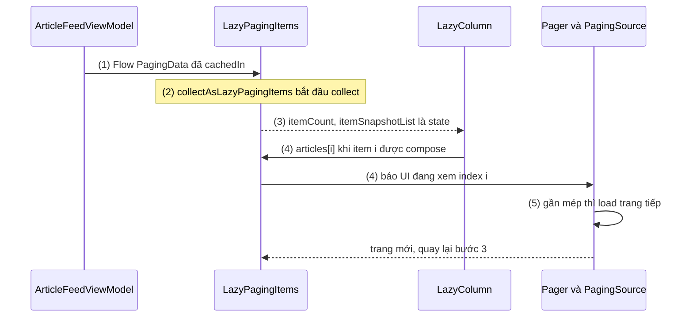
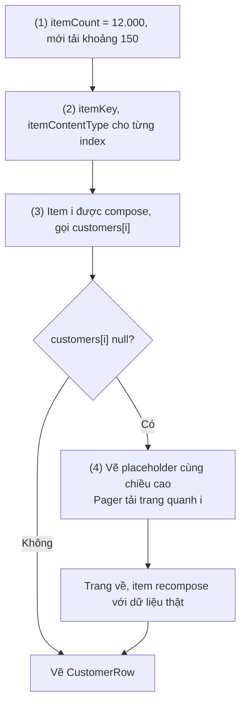
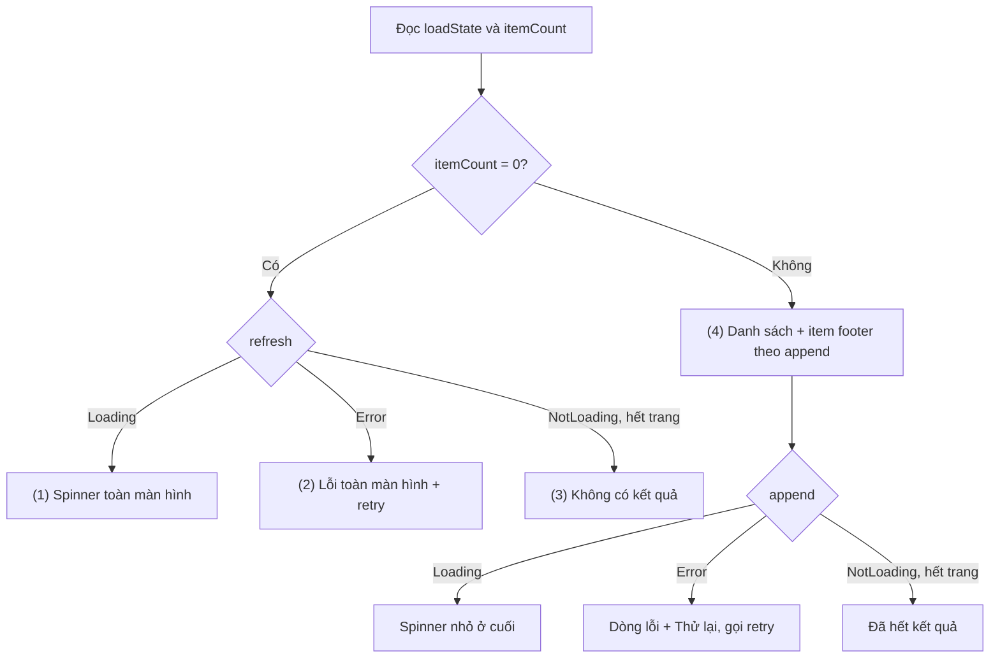
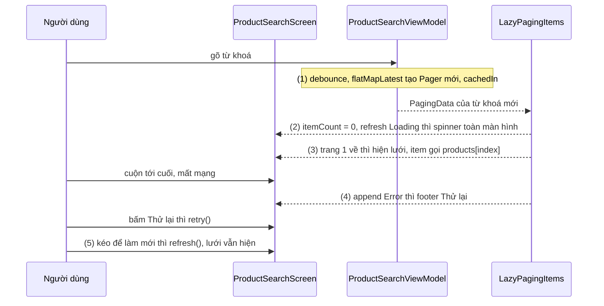

# Lazy Paging Items

## Vấn đề cần giải quyết

[6.5 Paging](../../session_06/paging.md) đã giải bài toán ở tầng dữ liệu: `PagingSource` tải từng trang, `Pager` phát `Flow<PagingData<T>>`, `cachedIn(viewModelScope)` giữ các trang đã tải. Với View system, phần UI do `PagingDataAdapter` đảm nhận: nhận `PagingData` qua `submitData()`, trả item theo `getItem(position)` (đồng thời báo vị trí đang xem cho `Pager`), và phát `loadStateFlow`.

Compose không có Adapter. `LazyColumn` cần một số lượng item và một cách lấy item theo index; còn Paging cần biết UI đang xem tới index nào để tải trang kế. Thiếu cầu nối thì phải tự collect `PagingData`, tự giữ danh sách item thành state, tự báo vị trí cho Paging, tự đưa `LoadState` vào composition, và mỗi việc đều có cách làm sai:

```kotlin
// Sai: biến PagingData thành List kiểu này là không thể
val articles: List<Article> = viewModel.articles   // Flow<PagingData<Article>>, không phải List
LazyColumn { items(articles) { ArticleRow(it) } }  // không compile; và kể cả có List thì Paging không biết đang xem tới đâu
```

Cần một đối tượng đóng **đúng vai của `PagingDataAdapter`**, nhưng nói ngôn ngữ của Compose: state thay cho callback, index thay cho ViewHolder.

## Sau khi học xong

- Giải thích được LazyPagingItems nối Flow<PagingData> với lazy layout thế nào, và vì sao đọc item theo index là tín hiệu để Paging tải trang.
- Triển khai được danh sách phân trang trong LazyColumn bằng collectAsLazyPagingItems, items(count), itemKey và itemContentType.
- Xử lý được refresh và append bằng loadState gồm loading toàn màn hình, lỗi kèm retry, footer tải thêm và placeholder null.
- Nhận diện được các lỗi tạo Pager trong composable hoặc quên cachedIn, render bằng peek hoặc itemSnapshotList, spinner che danh sách khi làm mới và key trùng giữa các trang.

## LazyPagingItems là gì?

**`LazyPagingItems<T>`** (artifact `androidx.paging:paging-compose`) là đối tượng do `Flow<PagingData<T>>.collectAsLazyPagingItems()` tạo ra để đưa dữ liệu phân trang vào lazy layout: nó collect `PagingData` trong composition, phơi ra danh sách đang hiển thị (`itemCount`, `get(index)`) và trạng thái tải (`loadState`) dưới dạng **state** mà Compose theo dõi được, và mỗi lần item được đọc qua `get(index)` thì báo cho Paging biết UI đang xem tới đâu.

Mental model: **`LazyPagingItems` là `PagingDataAdapter` của Compose, chỉ không có ViewHolder.** Nó giữ snapshot đang hiển thị, trả item theo vị trí, báo vị trí cho `Pager`, phát trạng thái tải, có `retry()` và `refresh()`, đúng những gì adapter làm ở 6.5. Phần dựng UI cho từng item, việc của ViewHolder, thì `LazyColumn` lo.

## Cách hoạt động

```kotlin
// app/build.gradle.kts — cùng version với paging-runtime, xem 6.5
dependencies {
    implementation("androidx.paging:paging-compose:$pagingVersion")
}
```

### 1. collectAsLazyPagingItems: từ Flow tới state

`collectAsLazyPagingItems()` là một composable. Khi được gọi, nó `remember` một `LazyPagingItems` **gắn với chính instance Flow** truyền vào, rồi khởi chạy việc collect `PagingData` và `LoadState` trong các effect của composition. Việc collect kéo dài chừng nào composable còn trong composition, và không tự dừng theo lifecycle như `collectAsStateWithLifecycle()` (API đó dạy ở [9.3.5 SnapShotFlow and flowWithSnapshot](../side_effects/flow_with_snapshot.md)). Tham số tuỳ chọn `context: CoroutineContext` cho đổi context của việc collect; hầu hết trường hợp để mặc định.

Một vòng tải trang đi qua các bước sau:

1. ViewModel phát `Flow<PagingData<Article>>` đã `cachedIn(viewModelScope)`.
2. Composable gọi `collectAsLazyPagingItems()`; `LazyPagingItems` bắt đầu collect.
3. Mỗi khi có trang mới, `LazyPagingItems` cập nhật snapshot item (`itemSnapshotList`) và `loadState`. Đây là state, nên code đọc `itemCount` hay `loadState` sẽ recompose.
4. `LazyColumn` ghi `items(count = articles.itemCount)`. Khi item ở index `i` cần hiện, nội dung item gọi `articles[i]`: nhận item (hoặc `null`) **và** gửi tín hiệu "UI đang xem index i" cho `Pager`.
5. Index đó cách mép dữ liệu đã tải ít hơn `prefetchDistance`, `Pager` gọi `PagingSource.load()` cho trang tiếp (append); trang về thì quay lại bước 3.



Bước (4) là điểm khác biệt quan trọng nhất so với một `List` thường: **đọc item chính là cách UI kéo trang tiếp**. Đó là lý do API không cho `items(lazyPagingItems)` kiểu `List`, mà dùng `items(count)` rồi tự gọi `get(index)` trong nội dung item.

#### Ví dụ: feed bài viết cuộn vô tận

**Bài toán:** feed bài viết lấy từ API phân trang theo số trang, giống ví dụ ở [6.5](../../session_06/paging.md); `Pager` và `ArticlePagingSource` dùng lại nguyên. Bài này chỉ thay phần Fragment + `PagingDataAdapter` bằng một màn Compose.

**Code:**

```kotlin
// ArticleFeedViewModel.kt
class ArticleFeedViewModel(repository: ArticleRepository) : ViewModel() {
    val articles: Flow<PagingData<Article>> = repository.articlePager()   // Pager(...).flow, xem 6.5
        .cachedIn(viewModelScope)                                         // (1) một instance Flow, cache trong ViewModel
}

// ArticleFeedScreen.kt
import androidx.paging.compose.collectAsLazyPagingItems
import androidx.paging.compose.itemKey

@Composable
fun ArticleFeedScreen(viewModel: ArticleFeedViewModel, modifier: Modifier = Modifier) {
    val articles = viewModel.articles.collectAsLazyPagingItems()            // (2)(3)
    LazyColumn(modifier.fillMaxSize()) {
        items(count = articles.itemCount, key = articles.itemKey { it.id }) { index ->   // (3)
            val article = articles[index]                                    // (4)(5) đọc = báo vị trí cho Pager
            if (article != null) ArticleRow(article) else ArticleRowPlaceholder()
        }
    }
}
```

**Kết quả:** cuộn tới gần cuối, log OkHttp cho thấy `page=2`, `page=3` được gửi lần lượt, không trùng dù cuộn nhanh. Xoay màn hình: danh sách giữ nguyên, không có request mới, nhờ `cachedIn` (phần 4).

### 2. items(count) với itemKey và itemContentType

`LazyPagingItems` không phải `List`, nên đưa vào lazy layout bằng `items(count = ..., key = ..., contentType = ...)` của `LazyListScope` (hoặc `LazyGridScope`, hoặc `HorizontalPager`). Hai extension của `paging-compose` sinh ra hai lambda theo index mà các tham số đó cần:

- **`itemKey { item -> item.id }`** trả về `(index) -> Any`. Item đã tải thì key là giá trị lambda trả về; item chưa tải (placeholder) thì Paging tự sinh một **key placeholder**. Key có cùng vai trò như ở [9.5.4 Lazy Column](lazy_column.md): state và vị trí cuộn đi theo item, và cùng ràng buộc: duy nhất, lưu được vào `Bundle`. Nó thay `DiffUtil.ItemCallback.areItemsTheSame` của adapter.
- **`itemContentType { item -> "article" }`** trả về `(index) -> Any?`. Item `null` tự nhận content type placeholder, nên composition của placeholder không bị tái sử dụng cho item thật và ngược lại.

Bản thân `itemKey` và `itemContentType` đọc snapshot **không** kích hoạt tải trang; chỉ `get(index)` trong nội dung item mới là tín hiệu. Ba cách đọc dữ liệu cần phân biệt:

| Cách đọc | Trả về | Báo vị trí cho Paging? | Dùng khi |
|---|---|---|---|
| `lazyPagingItems[index]` | `T?` | Có | Render item trong nội dung item |
| `lazyPagingItems.peek(index)` | `T?` | Không | Đọc item để tính toán phụ (nhãn, analytics) mà không kéo trang |
| `lazyPagingItems.itemSnapshotList` | `ItemSnapshotList<T>` (gồm cả placeholder) | Không | Đọc toàn bộ snapshot hiện có, ví dụ để kiểm tra rỗng |

**Placeholder:** khi `PagingConfig(enablePlaceholders = true)` và `PagingSource` đếm được tổng số item (Room đếm được, đa số API thì không, xem 6.5), `itemCount` bằng **tổng** số item, kể cả phần chưa tải; các vị trí chưa tải trả `null`. Nội dung item phải vẽ được `null`, và placeholder phải có **kích thước thật** của item. Placeholder 0px khiến lazy layout compose cả loạt item cùng lúc (lỗi item 0px ở 9.5.4); với `RemoteMediator`, tài liệu Android còn cảnh báo màn hình có thể không bao giờ "đầy", khiến app tải liên tục.

#### Ví dụ: danh bạ khách hàng từ Room có placeholder

**Bài toán:** app bán hàng có danh bạ 12.000 khách hàng lưu trong Room. Người dùng kéo thanh cuộn tới giữa danh sách; danh sách phải hiện đúng độ dài ngay (thanh cuộn đúng tỉ lệ), phần chưa tải hiện khung xám rồi lấp dần.

**Luồng chạy:**

1. `PagingSource` do Room sinh đếm được tổng số dòng; với `enablePlaceholders = true`, sau lần tải đầu `itemCount` là 12.000 dù mới tải khoảng 150 dòng.
2. `itemKey` và `itemContentType` cho key và content type thật với dòng đã tải, key và content type placeholder với dòng chưa tải.
3. Người dùng nhảy tới giữa danh sách: các item quanh index 6.000 được compose, nội dung item gọi `customers[6000]`, nhận `null` và báo vị trí cho `Pager`.
4. Item `null` vẽ `CustomerRowPlaceholder` cùng chiều cao với dòng thật; `Pager` tải trang quanh index 6.000, trang về thì các item đó recompose với dữ liệu thật.



**Code:**

```kotlin
// CustomerDirectoryViewModel.kt
val customers: Flow<PagingData<Customer>> =
    Pager(PagingConfig(pageSize = 50, enablePlaceholders = true)) {   // (1) Room đếm được tổng
        customerDao.pagingSource()
    }.flow.cachedIn(viewModelScope)

// CustomerDirectoryScreen.kt
import androidx.paging.compose.itemContentType
import androidx.paging.compose.itemKey

@Composable
fun CustomerDirectory(customers: LazyPagingItems<Customer>, modifier: Modifier = Modifier) {
    LazyColumn(modifier.fillMaxSize()) {
        items(
            count = customers.itemCount,                               // (1) gồm cả vị trí chưa tải
            key = customers.itemKey { it.id },                         // (2) null → key placeholder
            contentType = customers.itemContentType { "customer" },    // (2) null → content type placeholder
        ) { index ->
            val customer = customers[index]                            // (3) báo vị trí
            if (customer != null) {
                CustomerRow(customer, Modifier.height(72.dp))
            } else {
                CustomerRowPlaceholder(Modifier.height(72.dp))          // (4) cùng chiều cao dòng thật
            }
        }
    }
}
```

**Kết quả:** kéo thanh cuộn (hoặc gọi `listState.scrollToItem(6000)`) thấy các khung xám cùng chiều cao, sau một khoảnh khắc được lấp dữ liệu; chiều dài danh sách không nhảy. Khi dữ liệu tới, key đổi từ key placeholder sang `id` thật, nên item được coi là item mới: đừng giữ state UI trong placeholder.

### 3. loadState: loading, lỗi và retry

`lazyPagingItems.loadState` là `CombinedLoadStates`, cùng cấu trúc với `adapter.loadStateFlow` ở 6.5 (`refresh`, `prepend`, `append`, cùng `source` và `mediator`), mỗi hướng là `LoadState.Loading`, `LoadState.NotLoading(endOfPaginationReached)` hoặc `LoadState.Error(error)`. Khác biệt là nó đã là **state**: đọc trong composable là đủ, không cần collect riêng. Từ Paging 3.3, `CombinedLoadStates` có thêm `isIdle` và `hasError` cho các kiểm tra tổng quát.

Hai thao tác:

- `retry()`: thử lại **những lần tải đang lỗi** trong cùng thế hệ `PagingData`, không tạo `PagingSource` mới. Dùng cho nút "Thử lại".
- `refresh()`: tạo `PagingData` mới với `PagingSource` mới (và gọi `RemoteMediator` với `LoadType.REFRESH` nếu có). Dùng cho kéo để làm mới; thay đổi ở tầng dữ liệu (database đổi) thì để `PagingSource.invalidate()` lo, không gọi `refresh()` từ UI.

Quy tắc hiển thị quan trọng nhất: **trạng thái toàn màn hình chỉ dành cho lúc chưa có item nào.** Khi đã có item, `refresh` đang `Loading` nghĩa là người dùng đang làm mới, danh sách phải ở nguyên chỗ.

#### Ví dụ: kết quả tìm kiếm mất mạng ở giữa danh sách

**Bài toán:** màn kết quả tìm kiếm sản phẩm phải xử lý đủ trạng thái: đang tải lần đầu, lỗi lần đầu, không có kết quả, đang tải thêm, lỗi khi tải thêm (mất mạng ở trang 3), và đã hết kết quả. Đây là chỗ `loadState` được dùng đầy đủ nhất.

**Luồng chạy:**

1. Đọc `refresh` và `itemCount`. Chưa có item và `refresh` là `Loading`: spinner toàn màn hình.
2. Chưa có item và `refresh` là `Error`: thông báo lỗi toàn màn hình kèm nút `retry()`.
3. Chưa có item, `refresh` là `NotLoading` và `append.endOfPaginationReached`: màn "Không có kết quả".
4. Có item: hiện danh sách; một item footer cuối danh sách đọc `append`: `Loading` thì spinner nhỏ, `Error` thì dòng lỗi kèm "Thử lại", `NotLoading` với `endOfPaginationReached` thì "Đã hết kết quả".



**Code:** phần "Ví dụ thực tế" có code đầy đủ của màn hình này, ghép thêm lưới và kéo để làm mới. Footer theo `append` chỉ đúng khi **tắt placeholder**: bật placeholder thì footer nằm sau toàn bộ các vị trí placeholder, người dùng không bao giờ thấy nó đúng lúc.

### 4. Phía ViewModel: một Flow, cachedIn, và preview

`collectAsLazyPagingItems()` gắn `LazyPagingItems` với **instance** của Flow. Ba hệ quả:

- **Flow phải là một thuộc tính ổn định của ViewModel** (`val articles = ...`), không phải hàm tạo Flow mới mỗi lần gọi. `viewModel.search(query).collectAsLazyPagingItems()` tạo Flow mới mỗi lần recompose, `LazyPagingItems` mới, tải lại từ đầu (sai lầm 1).
- **`cachedIn(viewModelScope)` là bắt buộc trên thực tế.** Xoay màn hình hay quay lại từ màn khác tạo composition mới, `collectAsLazyPagingItems()` collect lại từ đầu. Không có `cachedIn`, lần collect mới bắt `Pager` tải lại từ trang đầu và người dùng mất vị trí cuộn; có `cachedIn`, các trang đã tải được phát lại ngay (cơ chế cache và multicast ở 6.5).
- **Danh sách phụ thuộc tham số** (từ khoá, bộ lọc) thì giữ tham số trong `StateFlow`, dùng `flatMapLatest` để tạo `Pager` mới cho mỗi giá trị và đặt `cachedIn` **sau** `flatMapLatest`, như ví dụ `ProductSearchViewModel` ở 6.5. Flow mà composable collect vẫn là một instance duy nhất.

Preview và test UI không cần `Pager` thật: `flowOf(PagingData.from(fakeArticles))` cho một `Flow<PagingData>` dữ liệu giả, đưa vào `collectAsLazyPagingItems()` như bình thường. Kiểm thử `PagingSource` và Flow ở tầng dữ liệu (`asSnapshot`, `TestPager`) đã có ở 6.5.

## Ví dụ thực tế

Ba bài toán thường gặp:

1. **Tìm kiếm sản phẩm: lưới phân trang, footer tải thêm, kéo để làm mới** (code đầy đủ bên dưới).
2. **Lịch sử giao dịch offline-first với `RemoteMediator`**: `loadState.refresh` gộp cả database lẫn mạng, có thể hiện spinner dù database đã có dữ liệu. Tách ra: `loadState.mediator?.refresh is LoadState.Loading` (đang đồng bộ mạng) và `loadState.source.refresh` cùng `itemSnapshotList.items.isEmpty()` (database còn rỗng); chỉ hiện loading toàn màn hình khi đang đồng bộ **và** database rỗng, còn lại hiện danh sách kèm chỉ báo nhỏ. Phần `RemoteMediator` ở 6.5.
3. **Feed có dòng phân cách theo ngày** (`insertSeparators` ở 6.5): `PagingData<FeedUiModel>` là sealed type gồm `ArticleItem` và `DateSeparator`; `itemContentType { if (it is FeedUiModel.DateSeparator) "separator" else "article" }` để hai loại không dùng lại composition của nhau. Muốn cuộn lên đầu sau khi làm mới xong thì quan sát `loadState.refresh` bằng `snapshotFlow` trong `LaunchedEffect`, xem [9.3.5](../side_effects/flow_with_snapshot.md).

### Tìm kiếm sản phẩm: lưới phân trang, footer và kéo để làm mới

**Bài toán:** kết quả tìm kiếm hiện dạng lưới (2 cột trên điện thoại, nhiều hơn trên tablet), đổi từ khoá thì tìm lại, kéo xuống để làm mới, xử lý đủ các trạng thái ở phần 3. API không đếm được tổng số kết quả nên tắt placeholder.

**Luồng chạy:**

1. ViewModel: từ khoá trong `StateFlow`, `debounce` để không tìm theo từng ký tự, `flatMapLatest` tạo `Pager` mới, `cachedIn` sau cùng. Composable collect một Flow duy nhất.
2. Chưa có item: chọn màn loading, lỗi hoặc rỗng theo `refresh` (bước 1–3 ở phần 3).
3. Có item: `PullToRefreshBox` bọc `LazyVerticalGrid`; `items(count)` với `itemKey`, `itemContentType`; nội dung item gọi `products[index]`.
4. Footer chiếm trọn hàng (`GridItemSpan(maxLineSpan)`, xem [9.5.6 Lazy Vertical Grid](lazy_vertical_grid.md)) đọc `append`.
5. Kéo để làm mới gọi `refresh()`; chỉ báo kéo hiện theo `refresh is LoadState.Loading` trong khi lưới vẫn nằm nguyên.



**Code:**

```kotlin
// ProductSearchViewModel.kt
class ProductSearchViewModel(private val repository: ProductRepository) : ViewModel() {
    private val query = MutableStateFlow("")

    @OptIn(FlowPreview::class, ExperimentalCoroutinesApi::class)
    val results: Flow<PagingData<Product>> = query
        .debounce(300)                                                   // (1)
        .flatMapLatest { keyword -> repository.searchProducts(keyword) } // (1) Pager(...).flow mới, xem 6.5
        .cachedIn(viewModelScope)                                        // (1) sau flatMapLatest

    fun onQueryChange(keyword: String) {
        query.value = keyword.trim()
    }
}
```

```kotlin
// ProductSearchResults.kt
import androidx.compose.foundation.lazy.grid.GridCells
import androidx.compose.foundation.lazy.grid.GridItemSpan
import androidx.compose.foundation.lazy.grid.LazyVerticalGrid
import androidx.compose.material3.pulltorefresh.PullToRefreshBox
import androidx.paging.LoadState
import androidx.paging.compose.collectAsLazyPagingItems
import androidx.paging.compose.itemContentType
import androidx.paging.compose.itemKey

@OptIn(ExperimentalMaterial3Api::class) // PullToRefreshBox: experimental ở một số bản Material 3
@Composable
fun ProductSearchResults(
    viewModel: ProductSearchViewModel,
    onProductClick: (String) -> Unit,
    modifier: Modifier = Modifier,
) {
    val products = viewModel.results.collectAsLazyPagingItems()          // (1) một Flow duy nhất
    val refresh = products.loadState.refresh
    val append = products.loadState.append

    when {
        products.itemCount == 0 && refresh is LoadState.Loading ->       // (2)
            FullScreenLoading(modifier)
        products.itemCount == 0 && refresh is LoadState.Error ->         // (2)
            FullScreenError(
                message = refresh.error.message ?: "Không tải được kết quả",
                onRetry = products::retry,
                modifier = modifier,
            )
        products.itemCount == 0 && append.endOfPaginationReached ->      // (2) refresh xong, không có gì
            EmptySearchResult(modifier)
        else -> PullToRefreshBox(
            isRefreshing = refresh is LoadState.Loading,                 // (5) chỉ báo nhỏ, lưới vẫn hiện
            onRefresh = products::refresh,                               // (5)
            modifier = modifier,
        ) {
            LazyVerticalGrid(
                columns = GridCells.Adaptive(minSize = 160.dp),
                modifier = Modifier.fillMaxSize(),
                contentPadding = PaddingValues(16.dp),
                horizontalArrangement = Arrangement.spacedBy(12.dp),
                verticalArrangement = Arrangement.spacedBy(12.dp),
            ) {
                items(
                    count = products.itemCount,
                    key = products.itemKey { it.id },                    // (3)
                    contentType = products.itemContentType { "product" },
                ) { index ->
                    val product = products[index]                        // (3) tín hiệu tải trang tiếp
                    if (product != null) {
                        ProductCard(product, onClick = { onProductClick(product.id) })
                    }
                }
                item(span = { GridItemSpan(maxLineSpan) }, contentType = "append-footer") {   // (4)
                    AppendFooter(append = append, onRetry = products::retry)
                }
            }
        }
    }
}

@Composable
private fun AppendFooter(append: LoadState, onRetry: () -> Unit) {
    Box(Modifier.fillMaxWidth().padding(16.dp), contentAlignment = Alignment.Center) {
        when (append) {
            is LoadState.Loading -> CircularProgressIndicator()                      // (4)
            is LoadState.Error -> Row(verticalAlignment = Alignment.CenterVertically) {
                Text("Không tải được trang tiếp")
                TextButton(onClick = onRetry) { Text("Thử lại") }                   // (4) retry()
            }
            is LoadState.NotLoading ->
                if (append.endOfPaginationReached) Text("Đã hết kết quả")            // (4)
        }
    }
}
```

`product == null` không xảy ra khi placeholder tắt, nhưng vẫn kiểm tra vì `get` trả `T?`. Trạng thái rỗng chỉ cần kiểm tra `append.endOfPaginationReached`, vì khi chưa có item và `refresh` không còn `Loading` hay `Error` thì nó là `NotLoading`.

**Kết quả:** gõ "tai nghe": spinner toàn màn hình rồi lưới hiện ra. Bật chế độ máy bay, cuộn tới cuối: footer "Không tải được trang tiếp / Thử lại"; tắt máy bay, bấm "Thử lại": trang tiếp được tải, lưới không giật. Kéo xuống ở đầu lưới: chỉ báo làm mới hiện, lưới vẫn nằm nguyên tới khi dữ liệu mới về. Gõ từ khoá không có kết quả: màn "Không có kết quả". Xoay màn hình ở bất kỳ trạng thái nào: không có request mới.

## So sánh với các cách tiếp cận khác

`LazyPagingItems` và `PagingDataAdapter` làm cùng một việc ở hai hệ UI:

| Việc | View system (6.5) | Compose |
|---|---|---|
| Nhận dữ liệu | `collectLatest { adapter.submitData(it) }` trong `repeatOnLifecycle` | `flow.collectAsLazyPagingItems()` |
| Số item | `adapter.itemCount` | `lazyPagingItems.itemCount` (state) |
| Lấy item, báo vị trí | `getItem(position)` trong `onBindViewHolder` | `lazyPagingItems[index]` trong nội dung item |
| Danh tính item | `DiffUtil.ItemCallback.areItemsTheSame` | `itemKey { it.id }` |
| Loại item | `getItemViewType` | `itemContentType { ... }` |
| Trạng thái tải | `loadStateFlow`, `withLoadStateFooter` | `loadState` (state), một `item` footer |
| Thử lại, làm mới | `adapter.retry()`, `adapter.refresh()` | `lazyPagingItems.retry()`, `refresh()` |

Không dùng Paging, danh sách vài chục đến vài trăm item tải một lần thì chỉ cần `StateFlow<List<T>>` + `collectAsStateWithLifecycle()` + `items(list)`; Paging chỉ đáng chi phí khi dữ liệu lớn hơn nhiều so với phần người dùng xem.

## Khi nào nên và không nên dùng

**Nên dùng `LazyPagingItems` khi** tầng dữ liệu đã (hoặc nên) dùng Paging 3: feed, kết quả tìm kiếm, lịch sử dài, danh bạ lớn, dữ liệu offline-first từ Room với `RemoteMediator`. Nó dùng được với `LazyColumn`, `LazyRow`, các lưới lazy và `HorizontalPager`.

**Không nên dùng khi:**

- Danh sách nhỏ, tải một lần (danh mục cố định, giỏ hàng): `List` + `items(list)` đơn giản hơn.
- Cần biến đổi phức tạp trên **toàn bộ** dữ liệu ở UI (sắp xếp lại, nhóm lại toàn bộ): Paging chỉ có một phần dữ liệu; sắp xếp và lọc phải làm ở nguồn (query Room, tham số API).
- Màn hình cần truy cập ngẫu nhiên item ở xa mà nguồn không hỗ trợ nhảy trang (API cursor chỉ đi tới): placeholder và nhảy tới giữa danh sách chỉ có ý nghĩa khi nguồn đếm được và tải được theo vị trí.

## Sai lầm thường gặp

### 1. Tạo Pager trong composable, hoặc quên cachedIn

```kotlin
// Sai: mỗi lần recompose là một Pager và một Flow mới
@Composable
fun ArticleFeedScreen(repository: ArticleRepository) {
    val articles = Pager(PagingConfig(pageSize = 20)) { ArticlePagingSource(api) }
        .flow
        .collectAsLazyPagingItems()
    // ...
}
```

**Lỗi lộ ra thế nào:** `collectAsLazyPagingItems()` gắn với instance Flow, Flow mới thì `LazyPagingItems` mới; mỗi lần recompose (state nào đó đổi) danh sách tải lại trang 1, vị trí cuộn về đầu, log thấy `page=1` lặp lại. Không có `cachedIn` thì xoay màn hình cũng tải lại từ đầu.

**Cách sửa:** `Pager` sống trong ViewModel, Flow là `val` có `cachedIn(viewModelScope)`; composable chỉ gọi `viewModel.articles.collectAsLazyPagingItems()`.

### 2. Render bằng peek hoặc itemSnapshotList

```kotlin
// Sai: không ai báo vị trí cho Pager
LazyColumn {
    items(products.itemSnapshotList.items, key = { it.id }) { product -> ProductRow(product) }
}
```

**Lỗi lộ ra thế nào:** trang đầu hiện bình thường, cuộn tới cuối thì dừng; log không có request trang 2. `itemSnapshotList` và `peek()` đọc dữ liệu **không** báo vị trí. **Cách sửa:** `items(count = products.itemCount, key = products.itemKey { it.id }) { index -> products[index] ... }`.

Biến thể ngược: gọi `products[index]` cho mọi index ngoài nội dung item (ví dụ `(0 until products.itemCount).map { products[it] }` để tính tổng tiền) báo cho Paging rằng UI "đang xem" mọi vị trí, kéo tải hết dữ liệu. Tính toán phụ dùng `peek()` hoặc làm ở tầng dữ liệu.

### 3. Spinner toàn màn hình che danh sách khi làm mới

```kotlin
// Sai: không xét itemCount
if (products.loadState.refresh is LoadState.Loading) FullScreenLoading() else ProductGrid(products)
```

**Lỗi lộ ra thế nào:** mỗi lần kéo để làm mới, lưới biến mất, thay bằng spinner, rồi hiện lại từ đầu: `LazyVerticalGrid` rời composition nên mất cả `LazyGridState`, vị trí cuộn về 0. **Cách sửa:** chỉ hiện trạng thái toàn màn hình khi `itemCount == 0`; khi đã có item thì giữ danh sách và dùng chỉ báo nhỏ (`PullToRefreshBox`), như ví dụ ở phần "Ví dụ thực tế".

### 4. Key trùng giữa các trang

**Lỗi lộ ra thế nào:** crash `IllegalArgumentException` báo một key đã được dùng. Hay gặp với API phân trang theo **offset** (`?offset=40&limit=20`) khi có item mới chèn vào đầu tập dữ liệu giữa hai lần tải: item cuối trang 2 bị đẩy sang đầu trang 3 và xuất hiện hai lần.

**Cách sửa:** sửa ở **nguồn**: phân trang theo cursor hay keyset (`?after=<id>`), hoặc dùng Room làm nguồn sự thật với `RemoteMediator` và khoá chính là id (6.5). Không "chữa" bằng key ngẫu nhiên hay key ghép với index: mất danh tính item, `animateItem()` và state theo key không còn đúng.

### 5. Placeholder không có kích thước thật

Bật `enablePlaceholders` nhưng nhánh `null` vẽ `Spacer(Modifier)` hoặc không vẽ gì: item cao 0px, lazy layout compose hàng loạt item một lượt (lỗi item 0px ở 9.5.4) và vị trí cuộn nhảy khi dữ liệu tới. Với `RemoteMediator`, màn hình có thể không bao giờ "đầy", `RemoteMediator` bị gọi liên tục. **Cách sửa:** placeholder cùng kích thước item thật, hoặc tắt placeholder nếu không cần.

## Lịch sử phát triển

- **Cuối 2020:** `androidx.paging:paging-compose` ra bản alpha đầu tiên (đánh số riêng `1.0.0-alphaXX`), có `collectAsLazyPagingItems()` cùng extension `items(lazyPagingItems)` và `itemsIndexed(lazyPagingItems)` dành riêng cho `LazyColumn`/`LazyRow`.
- **2023, các bản alpha cuối của paging-compose:** `items(lazyPagingItems)` và `itemsIndexed(lazyPagingItems)` bị deprecate rồi gỡ bỏ, thay bằng `items(count)` của lazy layout cùng `itemKey` và `itemContentType`. Lý do: một API chung dùng được cho mọi lazy layout (lưới, `HorizontalPager`) thay vì viết extension riêng cho từng loại.
- **Paging 3.2.0 (07/2023):** `paging-compose` về cùng số version với Paging và có bản stable đầu tiên; `LazyPagingItems` hỗ trợ preview bằng `PagingData.from(list)`.
- **Paging 3.3.0 (05/2024):** `CombinedLoadStates` có thêm `isIdle` và `hasError`; Paging, gồm `paging-compose`, hỗ trợ Kotlin Multiplatform.

## Kết nối hệ thống

- **Tiên quyết:** [6.5 Paging](../../session_06/paging.md) (`PagingSource`, `Pager`, `PagingConfig`, `cachedIn`, `LoadState`, `RemoteMediator`), [9.5.4 Lazy Column](lazy_column.md) (DSL, `key`, `contentType`, lỗi item 0px).
- **Liên quan:**
  - [9.5.6 Lazy Vertical Grid](lazy_vertical_grid.md): lưới phân trang, footer trọn hàng bằng `GridItemSpan(maxLineSpan)`.
  - [6.4 ViewModel](../../session_06/viewmodel.md), [7.2.3 MVVM](../../session_07/architecture/mvvm.md): nơi `Pager` và `cachedIn` sống.
  - [9.3.5 SnapShotFlow and flowWithSnapshot](../side_effects/flow_with_snapshot.md): `collectAsStateWithLifecycle()` cho state thường, `snapshotFlow` để phản ứng khi `loadState` đổi.
  - 7.1.4.2 Flow và 8.4.3 Coroutines (chưa có bài): `flatMapLatest`, `debounce`, `viewModelScope`.
- **Học tiếp:** 10.2 Unit Testing (chưa có bài) cho kiểm thử tầng dữ liệu phân trang; [9.8.3 Swipping](../gesture/swipping.md) cho vuốt để xoá item trong danh sách.

## Tham khảo

- [Load and display paged data - Android Developers](https://developer.android.com/topic/libraries/architecture/paging/v3-paged-data)
- [Manage and present loading states - Android Developers](https://developer.android.com/topic/libraries/architecture/paging/load-state)
- [Lists and grids: Large data-sets (paging) - Android Developers](https://developer.android.com/develop/ui/compose/lists#large-datasets)
- [LazyPagingItems reference - Android Developers](https://developer.android.com/reference/kotlin/androidx/paging/compose/LazyPagingItems)
- [CombinedLoadStates reference - Android Developers](https://developer.android.com/reference/kotlin/androidx/paging/CombinedLoadStates)
- [Pull to refresh - Android Developers](https://developer.android.com/develop/ui/compose/components/pull-to-refresh)
- [Paging release notes - Android Developers](https://developer.android.com/jetpack/androidx/releases/paging)
