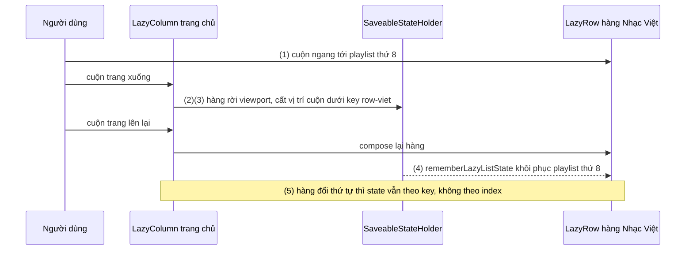
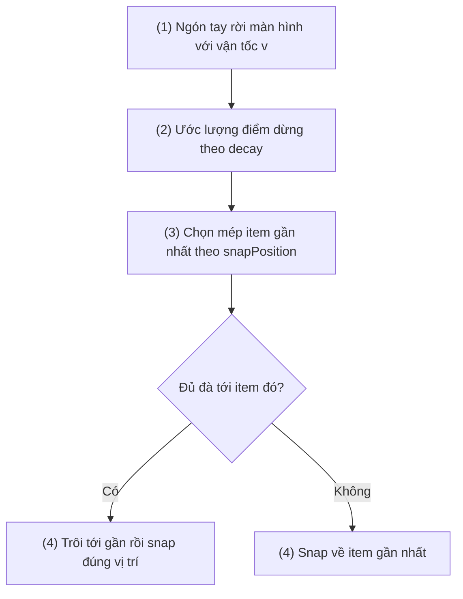

# Lazy Row

## Vấn đề cần giải quyết

Trang chủ của app thương mại, app nghe nhạc hay app xem phim thường là một danh sách dọc gồm nhiều **hàng cuộn ngang**: "Đã xem gần đây", "Gợi ý cho bạn", "Khuyến mãi hôm nay". Mỗi hàng có thể dài hàng trăm item, nên `Row` + `horizontalScroll` gặp đúng vấn đề của `Column` + `verticalScroll` ở [9.5.4 Lazy Column](lazy_column.md): compose hết mọi item.

Đổi sang lazy layout ngang giải quyết chuyện số lượng, nhưng trang chủ nhiều hàng có thêm những yêu cầu mà danh sách dọc đơn lẻ không có:

- Mỗi hàng giữ **vị trí cuộn riêng**: người dùng cuộn hàng "Nhạc Việt" tới playlist thứ 8, cuộn trang xuống rồi lên lại, hàng đó vẫn ở playlist thứ 8.
- Chiều cao hàng phải **ổn định**, nếu không cả trang nhảy lên xuống khi người dùng cuộn ngang.
- Carousel thường cần **dừng đúng mép một thẻ** sau khi vuốt, thay vì dừng ở vị trí bất kỳ.

## Sau khi học xong

- Phân biệt được LazyRow với LazyColumn ở trục cuộn, horizontalArrangement, verticalAlignment và cách item được đo theo chiều ngang.
- Triển khai được carousel bằng LazyRow lồng trong LazyColumn, mỗi hàng giữ được vị trí cuộn riêng nhờ key của hàng.
- Áp dụng được rememberSnapFlingBehavior để carousel dừng đúng mép item sau khi vuốt.
- Nhận diện được các lỗi chiều cao hàng nhảy khi cuộn, hàng mất hoặc lẫn vị trí cuộn, và dùng Row cộng horizontalScroll cho danh sách dài.

## LazyRow là gì?

**`LazyRow`** là lazy layout cuộn theo **chiều ngang**: cùng DSL (`item`, `items`, `itemsIndexed`), cùng `key`, `contentType`, `LazyListState`, `Modifier.animateItem()` và cùng cơ chế chỉ compose, đo, đặt những item cần cho viewport như `LazyColumn`; khác biệt duy nhất về bản chất là trục chính (trục cuộn) nằm ngang.

Mental model vẫn là **danh mục và khung cửa sổ** của [9.5.4](lazy_column.md): DSL viết danh mục, còn `LazyRow` là khung cửa sổ trượt **ngang** trên danh mục đó. Toàn bộ phần chung (DSL, key, contentType, `LazyListState`, reuse pool, prefetch) không nhắc lại ở bài này.

## Cách hoạt động

### 1. Những gì đổi khi trục chính nằm ngang

Đổi trục kéo theo đổi tên tham số và đổi chiều của constraints:

| | `LazyColumn` | `LazyRow` |
|---|---|---|
| Khoảng cách giữa item | `verticalArrangement` | `horizontalArrangement` |
| Căn item trên trục phụ | `horizontalAlignment` | `verticalAlignment` |
| Chiều item được đo với max **vô hạn** | Chiều cao | Chiều rộng |
| Modifier "lấp đầy cha" trong item | `fillParentMaxHeight()` | `fillParentMaxWidth()` |
| Kích thước trên trục phụ của chính layout | Rộng bằng item rộng nhất đang được compose (nếu không ép) | Cao bằng item cao nhất đang được compose (nếu không ép) |

Ba hệ quả hay gặp:

- **`fillMaxWidth()` trong item không có tác dụng**, vì chiều ngang là vô hạn. Muốn thẻ chiếm khoảng 85% chiều rộng hàng để lộ một phần thẻ kế tiếp (gợi ý "còn nữa, vuốt đi"), dùng `Modifier.fillParentMaxWidth(0.85f)`.
- **Chiều cao `LazyRow` phụ thuộc item đang thấy** nếu không đặt chiều cao cố định: item cao hơn đi vào viewport thì cả hàng cao lên (sai lầm 2).
- **`contentPadding` theo chiều ngang** giúp thẻ đầu thẳng hàng với lề trang (16dp) nhưng khi cuộn thì thẻ vẫn trượt tới sát mép màn hình. `Modifier.padding(horizontal = 16.dp)` thì cắt thẻ ở mép lề (sai lầm 4).

Với ngôn ngữ viết từ phải sang trái (layout direction RTL), `LazyRow` tự đặt item đầu ở bên phải và đảo chiều cuộn; không cần `reverseLayout`. `reverseLayout = true` là để đảo thứ tự item theo ý đồ thiết kế, không liên quan RTL.

#### Ví dụ: hàng "Đã xem gần đây" trên trang chủ cửa hàng

**Bài toán:** hàng ngang hiện các sản phẩm vừa xem, mỗi thẻ cùng kích thước, thẻ đầu thẳng lề trang, có khoảng cách đều giữa các thẻ. Đây là cấu hình thuần (không có logic rẽ nhánh), nên không cần sơ đồ.

**Code:**

```kotlin
// RecentlyViewedRow.kt
@Composable
fun RecentlyViewedRow(
    products: List<ProductSummary>,
    onProductClick: (String) -> Unit,
    modifier: Modifier = Modifier,
) {
    LazyRow(
        modifier = modifier.fillMaxWidth(),
        contentPadding = PaddingValues(horizontal = 16.dp),       // thẻ đầu thẳng lề, cuộn vẫn tới sát mép
        horizontalArrangement = Arrangement.spacedBy(12.dp),      // khoảng cách giữa các thẻ
        verticalAlignment = Alignment.Top,
    ) {
        items(products, key = { it.id }) { product ->
            ProductCard(
                product = product,
                onClick = { onProductClick(product.id) },
                modifier = Modifier.size(width = 140.dp, height = 200.dp), // kích thước cố định: hàng không đổi cao
            )
        }
    }
}
```

**Kết quả:** thẻ đầu cách mép trái 16dp; cuộn ngang thì thẻ trượt qua vùng lề tới sát mép màn hình. Bật "Show layout bounds" trong Developer options để thấy `LazyRow` rộng hết màn hình còn padding chỉ nằm trong nội dung.

### 2. LazyRow trong LazyColumn: mỗi hàng một vị trí cuộn

Lồng `LazyRow` trong một item của `LazyColumn` là **hợp lệ**, vì hai layout cuộn khác hướng: `LazyColumn` đo item với chiều cao vô hạn nhưng chiều rộng hữu hạn, đúng thứ `LazyRow` cần. Cử chỉ cũng tự tách: kéo ngang thì hàng cuộn, kéo dọc thì trang cuộn.

Câu hỏi còn lại là **vị trí cuộn của từng hàng sống ở đâu**:

1. Mỗi `LazyRow` có `LazyListState` riêng. `rememberLazyListState()` (cũng là giá trị mặc định của tham số `state`) lưu bằng `rememberSaveable`, nên vị trí cuộn là state **lưu được**.
2. `rememberSaveable` bên trong một item của `LazyColumn` được `LazyColumn` cất **dưới key của item đó** (cơ chế `SaveableStateHolder` ở [9.5.4](lazy_column.md), mục Deep Dive; cơ chế `rememberSaveable` ở [9.2.2 Remember and rememberSaveable](../state/remember_saveable.md)).
3. Hàng cuộn ra khỏi viewport của trang: composition của hàng bị gỡ, vị trí cuộn của hàng được cất dưới key.
4. Hàng quay lại: `rememberLazyListState()` khôi phục đúng vị trí đã cất.
5. Danh sách hàng đổi thứ tự (server cá nhân hoá thứ tự hàng): nhờ key, vị trí cuộn đi theo đúng hàng. Không có key, state được cất theo **index**, hàng ở index 2 mới sẽ nhận vị trí cuộn của hàng index 2 cũ.



Ví dụ đầy đủ của năm bước này là trang chủ app nghe nhạc ở phần "Ví dụ thực tế".

> [!TIP]
> Khi màn hình cần **biết** hoặc **đặt lại** vị trí cuộn của một hàng từ bên ngoài (ví dụ bấm tiêu đề hàng thì cuộn hàng về đầu), tạo `LazyListState` ở nơi có quyền điều khiển đó và truyền xuống. Chỉ cần "nhớ vị trí" thì để mặc định như ví dụ là đủ. Hoist state tới đâu được bàn ở [9.2.1 MutableState](../state/mutable_state.md).

### 3. Snapping: dừng đúng mép một thẻ

Mặc định, vuốt nhanh (fling) một `LazyRow` thì danh sách trôi chậm dần rồi dừng ở bất kỳ đâu, thường là giữa hai thẻ. Carousel muốn kết quả khác: sau fling, một thẻ nằm thẳng hàng ở vị trí định trước.

`LazyRow` (và `LazyColumn`) nhận tham số `flingBehavior: FlingBehavior`, đối tượng quyết định danh sách chuyển động thế nào sau khi ngón tay rời màn hình. `rememberSnapFlingBehavior(lazyListState, snapPosition)` (package `androidx.compose.foundation.gestures.snapping`, overload này có từ Compose foundation 1.7) tạo một `FlingBehavior` biết đọc layout của `LazyListState`:

1. Người dùng fling; `LazyRow` giao vận tốc cho `flingBehavior`.
2. Snap behavior ước lượng danh sách sẽ trôi tới đâu với vận tốc đó (decay).
3. Nó chọn mép item gần điểm dừng ước lượng nhất, theo `snapPosition`: `SnapPosition.Start` (đầu item thẳng đầu layout), `SnapPosition.Center` (mặc định, giữa item thẳng giữa layout) hoặc `SnapPosition.End`.
4. Nó chạy animation tới đúng vị trí đó; vuốt chậm không đủ đà thì về item gần nhất.



#### Ví dụ: carousel khuyến mãi dừng thẳng lề trái

**Bài toán:** banner khuyến mãi rộng khoảng 85% màn hình, lộ một phần banner kế tiếp. Sau mỗi lần vuốt, banner phải dừng thẳng lề trái, không lửng giữa hai banner.

**Code:**

```kotlin
// PromoCarousel.kt
import androidx.compose.foundation.gestures.snapping.SnapPosition
import androidx.compose.foundation.gestures.snapping.rememberSnapFlingBehavior

@Composable
fun PromoCarousel(promos: List<Promo>, modifier: Modifier = Modifier) {
    val listState = rememberLazyListState()
    val snapBehavior = rememberSnapFlingBehavior(
        lazyListState = listState,
        snapPosition = SnapPosition.Start,          // (3) đầu banner thẳng đầu layout
    )
    LazyRow(
        modifier = modifier.fillMaxWidth(),
        state = listState,                          // snap behavior đọc layout qua cùng state
        flingBehavior = snapBehavior,               // (1)(2)(4)
        contentPadding = PaddingValues(horizontal = 16.dp),
        horizontalArrangement = Arrangement.spacedBy(12.dp),
    ) {
        items(promos, key = { it.id }) { promo ->
            PromoBanner(
                promo = promo,
                modifier = Modifier
                    .fillParentMaxWidth(0.85f)      // lộ một phần banner kế tiếp
                    .height(160.dp),
            )
        }
    }
}
```

**Kết quả:** vuốt nhẹ thì banner kế tiếp trượt vào và dừng thẳng lề; vuốt mạnh thì lướt qua vài banner rồi vẫn dừng đúng mép một banner. Bỏ `flingBehavior` để so sánh: danh sách dừng ở vị trí bất kỳ. `snapBehavior` và `LazyRow` phải dùng **cùng** `listState`, nếu không snap behavior đọc nhầm layout.

## Ví dụ thực tế

Ba bài toán thường gặp với danh sách ngang:

1. **Trang chủ nhiều hàng cuộn ngang** (code đầy đủ bên dưới): mỗi hàng là một `LazyRow` trong một item của `LazyColumn`, có key, kích thước thẻ cố định.
2. **Hàng chip lọc trên màn tìm kiếm** ("Giá", "Thương hiệu", "Đánh giá"...): chỉ vài item cố định, `Row` + `horizontalScroll` là đủ, không cần lazy.
3. **Xem ảnh sản phẩm toàn màn hình, vuốt từng ảnh**: khái niệm "ảnh hiện tại" quan trọng, dùng `HorizontalPager` thay vì `LazyRow` + snap.

### Trang chủ app nghe nhạc với nhiều hàng playlist

**Bài toán:** trang chủ có 10–20 hàng playlist do server sắp thứ tự theo sở thích người dùng; thứ tự hàng có thể đổi sau mỗi lần làm mới. Đây chính là trường hợp cần cả lồng hai chiều lẫn key cho hàng.

**Luồng chạy:** đúng năm bước ở phần 2 "LazyRow trong LazyColumn" (kèm sơ đồ); số trong comment khớp với bước tương ứng.

**Code:**

```kotlin
// MusicHomeScreen.kt
data class PlaylistRow(val id: String, val title: String, val playlists: List<Playlist>)

@Composable
fun MusicHome(
    rows: List<PlaylistRow>,
    onPlaylistClick: (Playlist) -> Unit,
    modifier: Modifier = Modifier,
) {
    LazyColumn(
        modifier = modifier.fillMaxSize(),
        verticalArrangement = Arrangement.spacedBy(24.dp),
    ) {
        items(rows, key = { row -> row.id }, contentType = { "playlist-row" }) { row ->   // (2)(5) key của hàng
            Column {
                Text(
                    text = row.title,
                    style = MaterialTheme.typography.titleLarge,
                    modifier = Modifier.padding(horizontal = 16.dp),
                )
                Spacer(Modifier.height(8.dp))
                val rowState = rememberLazyListState()                // (1)(3)(4) lưu dưới key của hàng
                LazyRow(
                    state = rowState,
                    contentPadding = PaddingValues(horizontal = 16.dp),
                    horizontalArrangement = Arrangement.spacedBy(12.dp),
                ) {
                    items(row.playlists, key = { it.id }) { playlist ->
                        PlaylistCard(
                            playlist = playlist,
                            onClick = { onPlaylistClick(playlist) },
                            modifier = Modifier.size(width = 140.dp, height = 180.dp),
                        )
                    }
                }
            }
        }
    }
}
```

**Kết quả:** cuộn hàng "Nhạc Việt" sang phải, cuộn trang xuống tận cuối rồi lên lại: hàng vẫn ở vị trí cũ. Xoay màn hình: mọi hàng giữ vị trí. Thử bỏ `key = { row -> row.id }` rồi đảo thứ tự `rows`: vị trí cuộn bám theo index, hàng mới ở vị trí đó nhận vị trí cuộn của hàng cũ.

## So sánh với các cách tiếp cận khác

| Cách | Bản chất | Hợp với |
|---|---|---|
| `Row` + `horizontalScroll` | Compose hết mọi con, cuộn được | Vài chip lọc, thanh công cụ ngắn |
| `LazyRow` | Lazy layout ngang, item kích thước tuỳ ý | Hàng sản phẩm, playlist, danh sách ngang dài |
| `LazyRow` + `rememberSnapFlingBehavior` | Như trên, dừng đúng mép item | Carousel thẻ, banner |
| `HorizontalPager` | Lazy layout theo **trang**: mỗi trang có kích thước trang (`PageSize`), có `PagerState.currentPage` | Onboarding, xem ảnh toàn màn hình, tab vuốt ngang |
| Carousel của Material 3 (`HorizontalMultiBrowseCarousel`...) | Component Material dựng sẵn, item co giãn theo vị trí | Carousel theo đúng spec Material 3 |

`HorizontalPager` cũng dựng trên `LazyLayout` và có snapping sẵn; chọn nó khi khái niệm "trang hiện tại" quan trọng. Pager được nhắc thêm ở [9.8.3 Swipping](../gesture/swipping.md); carousel Material 3 thuộc phạm vi 8.5.4 Design Guide (chưa có bài) và đang là API experimental ở các bản Material 3 gần đây.

## Khi nào nên và không nên dùng

**Nên dùng `LazyRow` khi** danh sách ngang dài hoặc không biết trước độ dài, nhất là khi nhiều hàng như vậy nằm trong một `LazyColumn`.

**Không cần, hoặc nên dùng thứ khác khi:**

- Chỉ vài item cố định (chip lọc, nút hành động): `Row` + `horizontalScroll(rememberScrollState())` đơn giản hơn.
- Mỗi item chiếm trọn một "trang" và cần biết trang hiện tại: `HorizontalPager`.
- Nhiều hàng **và** nhiều cột cùng cuộn dọc: đó là lưới, dùng [9.5.6 Lazy Vertical Grid](lazy_vertical_grid.md).

## Sai lầm thường gặp

### 1. Row cộng horizontalScroll cho danh sách dài

`Row(Modifier.horizontalScroll(rememberScrollState())) { products.forEach { ProductCard(it) } }` compose hết mọi thẻ của **mọi** hàng ngay khi hàng xuất hiện. Trang chủ 15 hàng, mỗi hàng 50 thẻ là 750 thẻ dù màn hình chỉ thấy khoảng 10. **Cách sửa:** `LazyRow` với `items(products, key = { it.id })`.

### 2. Chiều cao hàng nhảy khi cuộn ngang

```kotlin
// Sai: thẻ có tên dài xuống 2–3 dòng, cao hơn thẻ khác
LazyRow {
    items(products, key = { it.id }) { product ->
        ProductCard(product, Modifier.width(140.dp))   // chiều cao tuỳ nội dung
    }
}
```

**Lỗi lộ ra thế nào:** `LazyRow` không có chiều cao cố định thì cao bằng item cao nhất **đang được compose**. Cuộn ngang tới một thẻ có tên dài, cả hàng cao lên, các hàng bên dưới trong `LazyColumn` bị đẩy xuống; cuộn đi thì hàng thấp lại. Trang chủ "giật" theo mỗi lần cuộn ngang.

**Cách sửa:** cố định chiều cao thẻ (`Modifier.size(140.dp, 200.dp)`) hoặc chiều cao hàng (`LazyRow(Modifier.height(220.dp))`), và giới hạn `maxLines` cho tên sản phẩm.

### 3. Hàng mất hoặc lẫn vị trí cuộn

- **Không có key cho hàng** trong `LazyColumn`: đổi thứ tự hàng thì vị trí cuộn đi theo index, sai hàng (phần 2).
- **Tạo `LazyListState` bằng `remember { LazyListState() }`**: không lưu được, hàng về đầu mỗi khi cuộn khuất rồi quay lại và khi xoay màn hình. Dùng `rememberLazyListState()`.
- **Giữ một `LazyListState` dùng chung cho mọi hàng**: mọi hàng cuộn cùng nhau. Mỗi hàng một state.

### 4. Dùng Modifier.padding thay cho contentPadding

`LazyRow(Modifier.padding(horizontal = 16.dp))` thu hẹp chính khung cuộn: khi cuộn, thẻ biến mất ở vạch 16dp thay vì trượt tới mép màn hình, nhìn như bị cắt. **Cách sửa:** `contentPadding = PaddingValues(horizontal = 16.dp)`.

## Lịch sử phát triển

Mốc phiên bản dưới đây là của `androidx.compose.foundation:foundation`.

- **Compose 1.0 (07/2021):** `LazyRow` ra mắt cùng `LazyColumn`, dùng chung `LazyListState` và DSL. Snapping và pager khi đó nằm ở thư viện Accompanist (ngoài Jetpack).
- **1.3:** thêm API snapping (`rememberSnapFlingBehavior(SnapLayoutInfoProvider)`, `SnapLayoutInfoProvider(lazyListState)`), ban đầu experimental.
- **Khoảng 1.4:** `HorizontalPager`/`VerticalPager` được đưa vào foundation, thay pager của Accompanist.
- **1.7 (2024):** thêm overload `rememberSnapFlingBehavior(lazyListState, snapPosition)` và `SnapPosition` (`Start`, `Center`, `End`), cách viết gọn được dùng trong bài.

## Kết nối hệ thống

- **Tiên quyết:** [9.5.4 Lazy Column](lazy_column.md): DSL, key, contentType, `LazyListState`, cơ chế lazy layout.
- **Liên quan:** [9.2.2 Remember and rememberSaveable](../state/remember_saveable.md) (vì sao vị trí cuộn của hàng sống qua cuộn khuất và xoay màn hình), [9.5.1 Modifier Order](modifier_order.md) (constraints, `padding` và kích thước), [9.8.1 Scrolling](../gesture/scrolling.md) (`horizontalScroll`, nested scroll), [9.8.3 Swipping](../gesture/swipping.md) (`HorizontalPager`).
- **Học tiếp:** [9.5.6 Lazy Vertical Grid](lazy_vertical_grid.md), [9.5.7 Lazy Paging Items](lazy_paging_items.md); 8.5.4 Design Guide (chưa có bài) cho carousel theo Material.

## Tham khảo

- [Lists and grids - Android Developers](https://developer.android.com/develop/ui/compose/lists)
- [Display nested scrolling items in a list - Android Developers](https://developer.android.com/develop/ui/compose/quick-guides/content/display-nested-list)
- [rememberSnapFlingBehavior reference - Android Developers](https://developer.android.com/reference/kotlin/androidx/compose/foundation/gestures/snapping/rememberSnapFlingBehavior.composable)
- [androidx.compose.foundation.gestures.snapping package - Android Developers](https://developer.android.com/reference/kotlin/androidx/compose/foundation/gestures/snapping/package-summary)
- [LazyItemScope reference (fillParentMaxWidth) - Android Developers](https://developer.android.com/reference/kotlin/androidx/compose/foundation/lazy/LazyItemScope)
- [Compose Foundation release notes - Android Developers](https://developer.android.com/jetpack/androidx/releases/compose-foundation)
