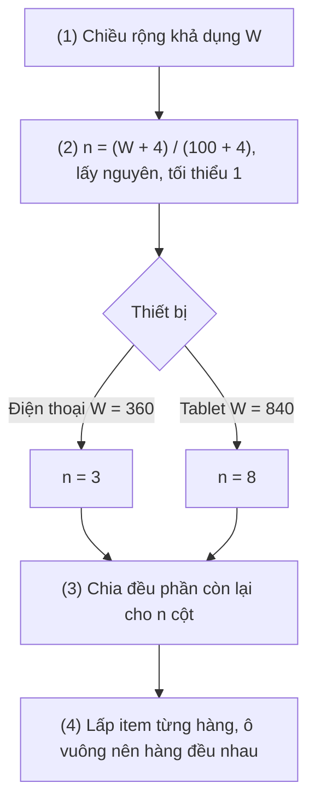
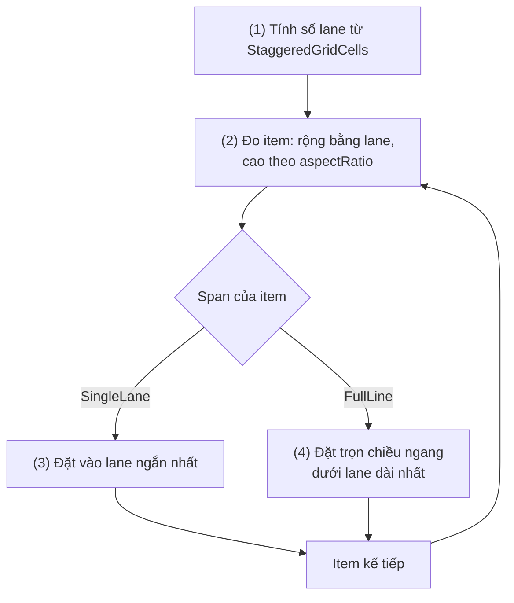

# Lazy Vertical Grid

## Vấn đề cần giải quyết

Thư viện ảnh, danh mục sản phẩm, lưới ứng dụng, feed công thức nấu ăn đều hiển thị item theo **nhiều cột** và cuộn dọc. Không có layout lưới thì cách thường thấy là tự chia hàng:

```kotlin
// PhotoGallery.kt — tự chia hàng, số cột cố định
LazyColumn {
    items(photos.chunked(3)) { rowPhotos ->
        Row { rowPhotos.forEach { photo -> PhotoThumbnail(photo, Modifier.weight(1f)) } }
    }
}
```

Cách này chạy được, nhưng: số cột cứng là 3 nên điện thoại nhỏ thì ảnh tí hon, tablet thì ảnh khổng lồ; hàng cuối thiếu ảnh bị giãn hoặc lệch; đơn vị lazy là **hàng** chứ không phải ảnh, nên `key`, `animateItem()` và `scrollToItem` đều làm việc theo hàng. Cần một lazy layout hiểu khái niệm "cột", tự tính số cột theo chiều rộng, và vẫn coi từng ảnh là một item.

## Sau khi học xong

- Phân biệt được GridCells.Fixed, GridCells.Adaptive và GridCells.FixedSize theo cách chúng tính số cột và chia phần chiều rộng còn dư.
- Triển khai được lưới có header chiếm trọn hàng bằng tham số span và GridItemSpan(maxLineSpan).
- Biết khi nào chuyển sang LazyVerticalStaggeredGrid cho item cao khác nhau và dùng StaggeredGridItemSpan.FullLine.
- Nhận diện được các lỗi khoảng trống do item cao khác nhau trong cùng hàng, header dùng số cột cứng và tự chia hàng bằng chunked.

## LazyVerticalGrid là gì?

**`LazyVerticalGrid`** là lazy layout cuộn dọc xếp item thành các **cột** theo mô tả `GridCells`: item được lấp lần lượt vào từng hàng (line) từ đầu tới cuối hàng, hết chỗ thì sang hàng mới, và mỗi hàng cao bằng item cao nhất trong hàng.

Mental model vẫn là **danh mục và khung cửa sổ** của [9.5.4 Lazy Column](lazy_column.md), chỉ thêm một điều: khung cửa sổ có **kẻ cột**. DSL (`item`, `items`, `itemsIndexed`), `key`, `contentType`, `Modifier.animateItem()`, cơ chế chỉ dựng phần trong viewport đều giống `LazyColumn`; state cuộn là `LazyGridState` (`rememberLazyGridState()`), có cùng `firstVisibleItemIndex`, `animateScrollToItem()`... như `LazyListState`. `LazyHorizontalGrid` là bản cuộn ngang, nhận `rows` thay cho `columns`.

## Cách hoạt động

### 1. GridCells: số cột và chiều rộng cột

Tham số bắt buộc `columns: GridCells` quyết định lưới có bao nhiêu cột và mỗi cột rộng bao nhiêu, tính từ chiều rộng khả dụng `W` (đã trừ `contentPadding`) và khoảng cách giữa các cột `s` (từ `horizontalArrangement = Arrangement.spacedBy(s)`):

| `GridCells` | Số cột | Chiều rộng mỗi cột |
|---|---|---|
| `Fixed(count)` | Đúng `count` | Chia đều `W` sau khi trừ khoảng cách |
| `Adaptive(minSize)` | Nhiều nhất có thể, miễn mỗi cột rộng ít nhất `minSize`: `n = max(1, (W + s) / (minSize + s))` (chia lấy nguyên) | Chia đều `W`, nên mỗi cột **≥ `minSize`**: phần dư được chia cho các cột |
| `FixedSize(size)` | Nhiều nhất có thể với mỗi cột rộng **đúng** `size` | Đúng `size`; phần dư không chia cho cột mà để `horizontalArrangement` xử lý (ví dụ căn giữa) |

`Adaptive` là lựa chọn mặc định cho giao diện chạy trên nhiều kích thước màn hình: cùng một code cho 3 cột trên điện thoại và 8 cột trên tablet. `Fixed` hợp khi thiết kế yêu cầu đúng số cột (lưới 2 cột sản phẩm trên điện thoại). `FixedSize` hợp khi ô phải đúng kích thước (bảng chọn emoji, lịch), chấp nhận khoảng trống ở hai bên.

#### Ví dụ: thư viện ảnh trên điện thoại và tablet

**Bài toán:** thư viện ảnh muốn ô ảnh rộng khoảng 100dp trở lên trên mọi thiết bị, lấp kín chiều ngang, khoảng cách 4dp. Đây đúng là bài toán `GridCells.Adaptive` giải.

**Luồng chạy:**

1. `LazyVerticalGrid` nhận chiều rộng khả dụng: 360dp trên điện thoại, 840dp trên tablet.
2. `Adaptive(100.dp)` tính số cột: điện thoại `(360 + 4) / (100 + 4) = 3` (lấy nguyên), tablet `(840 + 4) / (100 + 4) = 8`.
3. Chiều rộng còn lại sau khi trừ khoảng cách được chia đều: điện thoại khoảng 117dp mỗi ô, tablet khoảng 101dp.
4. Item được lấp từng hàng; mỗi ô vuông nhờ `aspectRatio(1f)`, nên mọi hàng cao bằng nhau.



**Code:**

```kotlin
// PhotoGalleryScreen.kt
@Composable
fun PhotoGallery(photos: List<Photo>, onPhotoClick: (String) -> Unit, modifier: Modifier = Modifier) {
    LazyVerticalGrid(
        columns = GridCells.Adaptive(minSize = 100.dp),        // (2)(3)
        modifier = modifier.fillMaxSize(),                     // (1)
        horizontalArrangement = Arrangement.spacedBy(4.dp),
        verticalArrangement = Arrangement.spacedBy(4.dp),
    ) {
        items(photos, key = { it.id }) { photo ->              // (4)
            PhotoThumbnail(
                photo = photo,
                onClick = { onPhotoClick(photo.id) },
                modifier = Modifier.aspectRatio(1f),           // ô vuông: chiều cao theo chiều rộng cột
            )
        }
    }
}
```

`items(List)` của lưới nằm ở package `androidx.compose.foundation.lazy.grid` (`import androidx.compose.foundation.lazy.grid.items`), khác package của `LazyColumn`.

**Kết quả:** chạy trên emulator điện thoại thấy 3 cột, đổi sang emulator tablet (hoặc xoay ngang) thấy nhiều cột hơn, ảnh vẫn khoảng 100–120dp. Dùng `@Preview(widthDp = 360)` và `@Preview(widthDp = 840)` để so sánh nhanh không cần chạy app.

### 2. span: item chiếm nhiều cột

Mặc định mỗi item chiếm **một** cột. `item` và `items` của `LazyGridScope` nhận tham số `span`, là lambda chạy trong `LazyGridItemSpanScope` và trả về `GridItemSpan(n)`: số cột item chiếm. Scope cung cấp hai giá trị:

- `maxLineSpan`: tổng số cột của một hàng. Dùng cho item phải **trọn hàng** (header, banner), đúng cả khi `Adaptive` cho số cột khác nhau theo màn hình.
- `maxCurrentLineSpan`: số cột **còn trống** ở hàng đang lấp.

Khi lấp, nếu span của item lớn hơn số cột còn trống, item **xuống hàng mới**, để lại ô trống ở cuối hàng trước. Header trọn hàng vì vậy luôn bắt đầu một hàng mới.

```kotlin
// CategoryGrid.kt — header trọn hàng dù lưới có 2 hay 6 cột
LazyVerticalGrid(columns = GridCells.Adaptive(minSize = 160.dp)) {
    item(key = "header-fruits", span = { GridItemSpan(maxLineSpan) }) {
        SectionHeader("Trái cây")
    }
    items(fruits, key = { it.id }) { product -> ProductCard(product) }
}
```

Phần "Ví dụ thực tế" dùng `span` cho cả một danh mục nhiều section.

### 3. LazyVerticalStaggeredGrid: item cao khác nhau

Lưới thường xếp theo **hàng**: hàng cao bằng item cao nhất, nên item thấp trong hàng đó để lại khoảng trống phía dưới. Với nội dung có chiều cao tự nhiên khác nhau (ảnh dọc và ảnh ngang, thẻ công thức có mô tả dài ngắn khác nhau), khoảng trống đó rất rõ.

**`LazyVerticalStaggeredGrid`** (package `androidx.compose.foundation.lazy.staggeredgrid`) bỏ khái niệm hàng: mỗi cột (lane) là một chồng item độc lập, và item tiếp theo được đặt vào **lane đang ngắn nhất**. Kết quả là kiểu bố cục "Pinterest", không có khoảng trống dọc.

Khác với lưới thường ở vài chỗ:

- Mô tả cột bằng `StaggeredGridCells.Fixed`, `Adaptive` hoặc `FixedSize`, cùng ý nghĩa như `GridCells`.
- Khoảng cách dọc là `verticalItemSpacing: Dp` (không có hàng nên không có `verticalArrangement`), khoảng cách ngang vẫn là `horizontalArrangement`.
- `span` chỉ có hai giá trị: `StaggeredGridItemSpan.SingleLane` (mặc định) và `StaggeredGridItemSpan.FullLine` (trọn chiều ngang). Ở `item(span = ...)` truyền thẳng giá trị; ở `items(..., span = { ... })` truyền lambda.
- Thứ tự đọc **không** còn là trái sang phải theo hàng: item 4 có thể nằm cao hơn item 3. Nội dung mà thứ tự có ý nghĩa (bảng xếp hạng, kết quả sắp theo giá) nên dùng lưới thường.

#### Ví dụ: feed công thức nấu ăn với ảnh tỉ lệ khác nhau

**Bài toán:** feed công thức hiện ảnh món ăn đúng tỉ lệ gốc (dọc, vuông, ngang) kèm tên món; API trả sẵn `aspectRatio` của ảnh. Lưới thường sẽ để lại khoảng trống dưới các ảnh ngang thấp.

**Luồng chạy:**

1. `LazyVerticalStaggeredGrid` tính 2 lane trên điện thoại (`Adaptive(160.dp)`).
2. Mỗi item được đo với chiều rộng của lane; chiều cao lấy từ `aspectRatio` của ảnh nên **đã biết trước khi ảnh tải xong** (tránh item 0px, sai lầm 3 ở [9.5.4](lazy_column.md)).
3. Item được đặt vào lane đang ngắn nhất, cộng `verticalItemSpacing`.
4. Banner "Công thức theo mùa" khai báo `FullLine` nên chiếm trọn chiều ngang, bắt đầu dưới lane dài nhất.



**Code:**

```kotlin
// RecipeFeedScreen.kt
import androidx.compose.foundation.lazy.staggeredgrid.LazyVerticalStaggeredGrid
import androidx.compose.foundation.lazy.staggeredgrid.StaggeredGridCells
import androidx.compose.foundation.lazy.staggeredgrid.StaggeredGridItemSpan
import androidx.compose.foundation.lazy.staggeredgrid.items

@Composable
fun RecipeFeed(seasonalBanner: Banner?, recipes: List<Recipe>, modifier: Modifier = Modifier) {
    LazyVerticalStaggeredGrid(
        columns = StaggeredGridCells.Adaptive(160.dp),                     // (1)
        modifier = modifier.fillMaxSize(),
        contentPadding = PaddingValues(12.dp),
        verticalItemSpacing = 12.dp,                                       // (3)
        horizontalArrangement = Arrangement.spacedBy(12.dp),
    ) {
        if (seasonalBanner != null) {
            item(key = "seasonal-banner", span = StaggeredGridItemSpan.FullLine) {   // (4)
                SeasonalBanner(seasonalBanner)
            }
        }
        items(recipes, key = { it.id }) { recipe ->                        // (3) lane ngắn nhất
            RecipeCard(
                recipe = recipe,
                imageModifier = Modifier
                    .fillMaxWidth()
                    .aspectRatio(recipe.imageAspectRatio),                 // (2) chiều cao biết trước
            )
        }
    }
}
```

**Kết quả:** hai lane được lấp so le, không có khoảng trống dưới ảnh ngang; banner chiếm trọn chiều ngang. Cuộn nhanh khi ảnh chưa tải, các ô vẫn giữ đúng chiều cao (chỉ thiếu ảnh), vị trí cuộn không nhảy.

## Ví dụ thực tế

Ba bài toán thường gặp:

1. **Danh mục sản phẩm nhiều section trên điện thoại và tablet** (code đầy đủ bên dưới): `Adaptive` + header `GridItemSpan(maxLineSpan)` cho từng section.
2. **Lưới sản phẩm tải theo trang từ API**: `LazyVerticalGrid` nhận `LazyPagingItems` giống `LazyColumn`, xem [9.5.7 Lazy Paging Items](lazy_paging_items.md).
3. **Bảng chọn emoji hoặc màu**: ô kích thước đúng 40dp, dùng `GridCells.FixedSize(40.dp)` và `horizontalArrangement = Arrangement.SpaceEvenly` để chia khoảng trống hai bên.

### Danh mục sản phẩm nhiều section

**Bài toán:** màn danh mục có nhiều section ("Trái cây", "Rau củ", "Sữa"), mỗi section một tiêu đề trọn hàng và lưới sản phẩm bên dưới; điện thoại 2 cột, tablet 4–5 cột, không viết code riêng cho từng thiết bị.

**Luồng chạy:**

1. ViewModel cung cấp `List<ProductSection>`.
2. `GridCells.Adaptive(160.dp)` tính số cột theo chiều rộng màn hình.
3. Với mỗi section, DSL ghi một `item` header có `span = { GridItemSpan(maxLineSpan) }` (trọn hàng, luôn bắt đầu hàng mới), rồi `items` cho sản phẩm.
4. `contentType` tách header và thẻ sản phẩm để composition chỉ được tái sử dụng giữa item cùng loại.

**Code:**

```kotlin
// CatalogScreen.kt
data class ProductSection(val id: String, val title: String, val products: List<Product>)

@Composable
fun CatalogScreen(
    sections: List<ProductSection>,                                        // (1)
    onProductClick: (String) -> Unit,
    modifier: Modifier = Modifier,
) {
    LazyVerticalGrid(
        columns = GridCells.Adaptive(minSize = 160.dp),                    // (2)
        modifier = modifier.fillMaxSize(),
        contentPadding = PaddingValues(16.dp),
        horizontalArrangement = Arrangement.spacedBy(12.dp),
        verticalArrangement = Arrangement.spacedBy(12.dp),
    ) {
        sections.forEach { section ->
            item(
                key = "section-" + section.id,
                span = { GridItemSpan(maxLineSpan) },                      // (3) trọn hàng ở mọi số cột
                contentType = "section-header",                            // (4)
            ) {
                Text(section.title, style = MaterialTheme.typography.titleLarge)
            }
            items(
                items = section.products,
                key = { it.id },
                contentType = { "product" },                               // (4)
            ) { product ->
                ProductCard(
                    product = product,
                    onClick = { onProductClick(product.id) },
                    modifier = Modifier.height(240.dp),                    // cùng chiều cao: hàng không có khoảng trống
                )
            }
        }
    }
}
```

**Kết quả:** điện thoại 360dp thấy 2 cột, tablet thấy nhiều cột hơn; tiêu đề section luôn trọn hàng và luôn bắt đầu ở hàng mới, kể cả khi section trước có số sản phẩm lẻ (ô trống ở cuối hàng trước là đúng thiết kế). Kiểm tra bằng hai `@Preview` với `widthDp` khác nhau.

## Khi nào nên và không nên dùng

**Nên dùng `LazyVerticalGrid` khi** item có kích thước tương đương nhau và cần nhiều cột: thư viện ảnh, lưới sản phẩm, lưới ứng dụng. **Chuyển sang `LazyVerticalStaggeredGrid` khi** chiều cao tự nhiên của item khác nhau rõ rệt và thứ tự đọc chặt chẽ không quan trọng.

**Không nên dùng khi:**

- Chỉ có một cột: dùng `LazyColumn`.
- Lưới nhỏ cố định (bàn phím số 3×4, vài ô cài đặt) không cuộn: `Row`/`Column` lồng nhau, hoặc `FlowRow` khi số item mỗi hàng tuỳ chiều rộng, đơn giản hơn một lazy layout.
- Các ô phải căn theo nhau như bảng tính (cột rộng theo nội dung dài nhất của toàn bảng): lưới lazy chia cột theo `GridCells`, không đo nội dung để quyết định chiều rộng cột.

## Sai lầm thường gặp

### 1. Tự chia hàng bằng chunked

Như phần "Vấn đề": `items(photos.chunked(3)) { Row { ... } }` cố định số cột, đơn vị lazy là hàng nên `key` phải đặt cho hàng (thường bị bỏ), `animateItem()` animate cả hàng, `scrollToItem(index)` nhận index của hàng. **Cách sửa:** `LazyVerticalGrid(columns = GridCells.Adaptive(...))` với `items(photos, key = { it.id })`.

### 2. Item cao khác nhau trong lưới thường

```kotlin
// Sai: tên sản phẩm dài ngắn khác nhau, thẻ tự co theo nội dung
items(products, key = { it.id }) { product -> ProductCard(product) }
```

**Lỗi lộ ra thế nào:** hàng cao bằng thẻ cao nhất, thẻ thấp hơn trong hàng để lại khoảng trống bên dưới; nhìn như lưới bị vỡ. **Cách sửa:** cố định chiều cao thẻ (`Modifier.height(240.dp)`) và giới hạn `maxLines` của tên, hoặc dùng `aspectRatio`; nếu chiều cao khác nhau là bản chất của nội dung thì dùng `LazyVerticalStaggeredGrid`.

### 3. Header dùng số cột cứng

`item(span = { GridItemSpan(2) }) { SectionHeader(...) }` đúng trên điện thoại 2 cột, nhưng trên tablet 5 cột thì header chỉ chiếm 2 ô, sản phẩm đầu tiên chen vào cùng hàng với header. **Cách sửa:** `GridItemSpan(maxLineSpan)`.

### 4. Fixed cho mọi kích thước màn hình

`GridCells.Fixed(2)` trên tablet 840dp cho thẻ rộng hơn 400dp, ảnh vỡ nét và lãng phí không gian. **Cách sửa:** `GridCells.Adaptive(minSize)`; chỉ dùng `Fixed` khi chính thiết kế yêu cầu số cột, hoặc chọn số cột theo window size class.

### 5. Lồng lưới trong LazyColumn

`LazyColumn { item { LazyVerticalGrid(...) } }` crash vì cùng hướng cuộn, y như lỗi lồng `LazyColumn` ở [9.5.4](lazy_column.md). **Cách sửa:** để lưới làm layout chính, phần "phía trên lưới" (banner, bộ lọc) thành `item(span = { GridItemSpan(maxLineSpan) })`.

## Lịch sử phát triển

Mốc phiên bản dưới đây là của `androidx.compose.foundation:foundation`.

- **Compose 1.0 (07/2021):** `LazyVerticalGrid` ở dạng experimental, tham số tên `cells`.
- **1.2 (2022):** lưới lazy ổn định; tham số đổi tên thành `columns` (và `rows` cho `LazyHorizontalGrid` mới thêm); `GridCells.Fixed`, `GridCells.Adaptive`; `span` với `LazyGridItemSpanScope`; thêm `contentType`.
- **1.3:** thêm `LazyVerticalStaggeredGrid` và `LazyHorizontalStaggeredGrid` dạng experimental.
- **1.5 (2023):** lưới staggered thành stable; thêm `GridCells.FixedSize`.
- **1.7 (2024):** `Modifier.animateItem()` dùng được trong lưới (thường và staggered) như trong danh sách.

## Kết nối hệ thống

- **Tiên quyết:** [9.5.4 Lazy Column](lazy_column.md): DSL, `key`, `contentType`, cơ chế lazy layout, lỗi item 0px và lồng scroll cùng hướng.
- **Liên quan:** [9.5.5 Lazy Row](lazy_row.md) (danh sách ngang trong trang chủ dạng lưới), [9.5.1 Modifier Order](modifier_order.md) (`aspectRatio`, `height` và constraints), [9.6 Layout and View](../layout_and_view.md) (`Row`, `Column`, layout tuỳ chỉnh).
- **Học tiếp:** [9.5.7 Lazy Paging Items](lazy_paging_items.md) (lưới tải theo trang).

## Tham khảo

- [Lists and grids: Lazy grids, Lazy staggered grid - Android Developers](https://developer.android.com/develop/ui/compose/lists#lazy-grids)
- [GridCells reference - Android Developers](https://developer.android.com/reference/kotlin/androidx/compose/foundation/lazy/grid/GridCells)
- [LazyVerticalStaggeredGrid reference - Android Developers](https://developer.android.com/reference/kotlin/androidx/compose/foundation/lazy/staggeredgrid/LazyVerticalStaggeredGrid.composable)
- [Create a scrollable grid - Android Developers](https://developer.android.com/develop/ui/compose/quick-guides/content/create-scrollable-grid)
- [Compose Foundation release notes - Android Developers](https://developer.android.com/jetpack/androidx/releases/compose-foundation)
