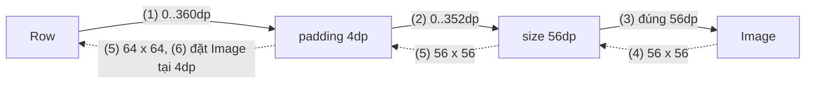
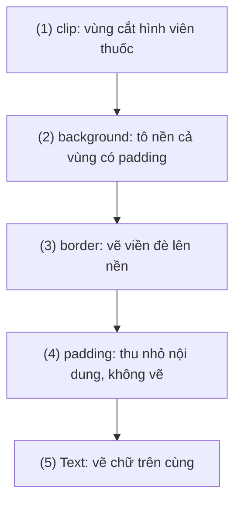
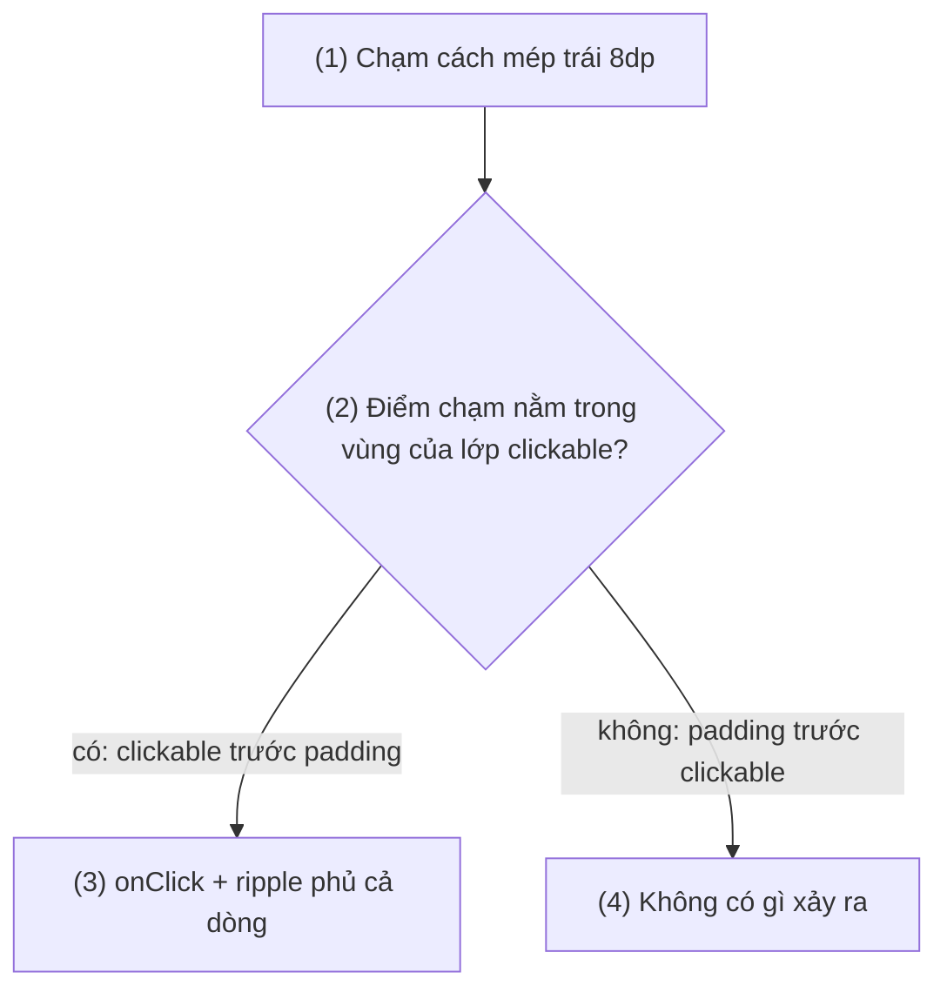
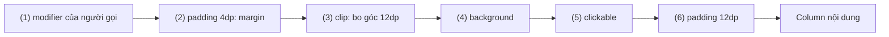

# Modifier Order

## Vấn đề cần giải quyết

Trong View system, thứ tự viết `android:padding`, `android:background`, `android:layout_margin` trong XML không có ý nghĩa; View tự áp chúng theo một "box model" cố định: margin ở ngoài, background phủ cả vùng padding, vùng bấm là cả View.

Compose không có box model cố định. Kích thước, khoảng đệm, nền, viền, vùng bấm đều nằm trong **một chuỗi modifier**, và thứ tự trong chuỗi quyết định kết quả. Viết theo thói quen XML thường ra lỗi khó hiểu:

```kotlin
// ProductCard.kt (cách viết có vấn đề)
Column(
    modifier = Modifier
        .padding(12.dp)                                 // định làm khoảng đệm nội dung
        .clickable { onOpenProduct(product.id) }
        .background(MaterialTheme.colorScheme.surfaceVariant)
        .clip(RoundedCornerShape(12.dp))                // định bo góc nền
) {
    Text(product.name)
    Text(product.priceText)
}
```

Chạy lên, thẻ có bốn lỗi cùng lúc: nền ôm sát chữ thay vì có khoảng đệm, nền **không** bo góc, ripple khi bấm cũng vuông, và chạm vào dải 12dp quanh chữ không có tác dụng gì. Không lỗi nào là bug của Compose; tất cả đều đúng theo thứ tự đã viết.

Vấn đề cần giải quyết là: **hiểu chuỗi modifier được áp thế nào**, để đọc một chuỗi là đoán được kích thước, phần được vẽ và vùng nhận chạm, thay vì đổi chỗ từng modifier cho tới khi "trông đúng".

## Sau khi học xong

- Giải thích được Modifier là chuỗi bất biến các Modifier.Element, mỗi phần tử bọc phần còn lại của chuỗi và layout node, nên được áp từ ngoài vào trong.
- Giải thích được cách constraints truyền từ trái sang phải trong chuỗi và kích thước đi ngược lại, qua các tổ hợp size, padding, fillMaxWidth, requiredSize, wrapContentSize.
- Phân biệt được kết quả của padding trước và sau background, clickable trước và sau padding, clip trước và sau background.
- Áp dụng được thứ tự modifier đúng cho thẻ bấm được, chip bo tròn, ảnh đại diện tròn có viền và vùng chạm tối thiểu.
- Debug được lỗi do thứ tự modifier bằng Layout Inspector và UI test kiểm tra kích thước.

## Modifier là gì?

**Modifier** là một chuỗi bất biến, có thứ tự, gồm các `Modifier.Element`; mỗi phần tử mô tả một hành vi (đo, vẽ, nhận chạm, semantics...) và **bọc phần còn lại của chuỗi cùng layout node** của composable, nên chuỗi được áp từ ngoài (bên trái) vào trong (bên phải).

Mental model dùng xuyên suốt bài, và cả nhóm bài 9.5: **chuỗi modifier là các lớp bọc lồng nhau**. Đọc chuỗi từ trái sang phải là đi từ lớp ngoài cùng vào tới composable ở lõi. Mỗi lớp chỉ "thấy" phần nằm bên trong nó:

```text
Modifier.padding(16.dp).background(Gray).size(100.dp)  →  Box

┌ padding 16dp ─────────────────────┐
│  ┌ background(Gray) ────────────┐ │
│  │  ┌ size(100dp) ────────────┐ │ │
│  │  │        Box (lõi)        │ │ │
│  │  └─────────────────────────┘ │ │
│  └──────────────────────────────┘ │
└───────────────────────────────────┘
```

Ba hệ quả rút ra ngay từ mô hình lớp bọc, và cũng là ba phần chính của bài:

- **Đo:** yêu cầu kích thước (constraints) đi **từ ngoài vào trong**, kích thước thật đi **từ trong ra ngoài**.
- **Vẽ:** lớp ngoài vẽ trước, nằm dưới; lớp trong vẽ sau, nằm trên. Một lớp vẽ đúng bằng kích thước phần bên trong nó.
- **Nhận chạm:** lớp nhận chạm (như `clickable`) chỉ nhận cú chạm rơi vào kích thước của phần bên trong nó.

Không có "margin" trong Compose: margin chỉ là `padding` đặt **bên ngoài** lớp nền hoặc lớp bấm. Đây là quyết định thiết kế có chủ ý: thay box model ngầm định bằng thứ tự tường minh.

## Cách hoạt động

### Chuỗi bất biến: mỗi lời gọi trả về một chuỗi mới

`Modifier` (object companion) là chuỗi rỗng, không làm gì. Mỗi hàm như `.padding()`, `.background()` là một **modifier factory**: nó không sửa chuỗi đang có, mà trả về một chuỗi mới gồm chuỗi cũ nối thêm một phần tử ở phía trong. Cơ chế nối (`then`) học ở [9.5.2 Chaining](chaining.md); ở bài này chỉ cần biết hai tính chất:

```kotlin
// ReusableModifiers.kt
val base = Modifier.padding(8.dp)
val withBackground = base.background(Color.LightGray)  // chuỗi mới: padding → background
// base vẫn chỉ có padding: chuỗi là bất biến, dùng chung an toàn giữa nhiều composable
```

- **Bất biến:** chuỗi đã tạo không bao giờ đổi, nên lưu vào biến hay dùng chung cho nhiều item đều an toàn.
- **Có thứ tự:** `Modifier.padding(8.dp).background(Gray)` và `Modifier.background(Gray).padding(8.dp)` là hai chuỗi khác nhau, không bằng nhau khi so sánh, cho hai kết quả khác nhau.

Các phần tử so sánh được bằng `equals`, nên khi recompose Compose chỉ cập nhật phần tử thật sự đổi (xem Deep Dive).

### Mỗi phần tử tham gia một mặt: đo, vẽ hay nhận chạm

Một composable như `Text`, `Image`, `Box` về bản chất là **một layout node** được bọc bởi chuỗi modifier (chuỗi của bạn cộng với các modifier mà chính composable đó tự thêm vào). Mỗi phần tử trong chuỗi thuộc một hoặc vài loại hành vi:

| Loại | Ví dụ modifier | Tác động |
|---|---|---|
| Layout | `size`, `width`, `fillMaxWidth`, `padding`, `offset`, `wrapContentSize`, `requiredSize` | Đổi constraints truyền vào trong, đổi kích thước hoặc vị trí báo ra ngoài |
| Draw | `background`, `border`, `clip`, `alpha`, `drawBehind`, `shadow` | Vẽ thêm, cắt hoặc biến đổi phần bên trong |
| Pointer input | `clickable`, `toggleable`, `pointerInput`, `draggable` | Nhận sự kiện chạm trong vùng của phần bên trong |
| Semantics | `semantics`, `testTag`, và phần semantics của `clickable` | Mô tả cho accessibility và UI test |
| Parent data | `weight`, `align`, `matchParentSize` | Gửi thông tin cho layout cha (học ở [9.5.2 Chaining](chaining.md)) |

Một modifier có thể thuộc nhiều loại: `clickable` vừa nhận chạm, vừa vẽ ripple (indication), vừa thêm semantics. Thứ tự chỉ quan trọng **giữa các phần tử tác động lên nhau**: `testTag` đặt đâu cũng được, `padding` so với `background` thì không.

Quy tắc chung để đọc mọi tổ hợp: **một phần tử draw hoặc pointer input có kích thước bằng phần chuỗi bên phải nó** (gồm các lớp layout phía trong và composable lõi). Phần dưới áp quy tắc này cho từng mặt.

### Đo: constraints đi từ trái sang phải, kích thước đi ngược lại

Phase Layout ([Jetpack Compose Overview](../overview.md), mục "Deep Dive: ba phase của một frame") đo mỗi node theo ba bước: đo con, tự quyết định kích thước, đặt con. Công cụ của bước đo là **Constraints**: khoảng `minWidth..maxWidth`, `minHeight..maxHeight` mà cha cho phép con chiếm.

Với chuỗi modifier, "con" của một lớp chính là phần chuỗi bên phải nó:

1. Layout cha (`Row`, `Column`...) đưa constraints cho **lớp ngoài cùng** của chuỗi.
2. Lớp không ảnh hưởng đo (`background`, `clickable`) chuyển constraints nguyên vẹn vào trong.
3. Lớp layout **sửa** constraints rồi mới chuyển vào trong: `padding(4.dp)` trừ 8dp khỏi max mỗi chiều; `size(56.dp)` ép min = max = 56dp (trong giới hạn được phép); `fillMaxWidth()` đặt minWidth = maxWidth.
4. Composable lõi (lá) chọn kích thước nằm trong constraints nhận được rồi báo ra ngoài.
5. Kích thước đi ngược qua từng lớp: `padding` cộng thêm phần đệm, `size` báo kích thước của nó; lớp ngoài cùng báo kết quả cho layout cha.
6. Bước đặt: mỗi lớp đặt phần bên trong ở vị trí của nó (`padding` đặt lõi lệch vào 4dp, `offset` dịch đi mà không đổi kích thước báo ra ngoài).

Từ cơ chế này suy ra các tổ hợp hay gặp:

| Chuỗi | Kết quả | Vì sao |
|---|---|---|
| `size(56.dp).padding(4.dp)` | Tổng 56dp, nội dung 48dp | `size` ép 56 trước, `padding` lấy 8dp từ bên trong |
| `padding(4.dp).size(56.dp)` | Tổng 64dp, nội dung 56dp | `padding` trừ 8dp khỏi max, `size` 56 vẫn vừa, rồi cộng lại 8dp |
| `size(100.dp).size(50.dp)` | 100dp | `size` đầu ép min = max = 100; `size` sau phải tuân constraints chính xác đó |
| `size(100.dp).requiredSize(50.dp)` | Nội dung 50dp, chiếm chỗ 100dp, nằm giữa | `requiredSize` bỏ qua constraints nhận vào; hệ thống căn giữa nó trong vùng 100dp |
| `fillMaxWidth().size(50.dp)` | Rộng hết cha, cao 50dp | `fillMaxWidth` đặt minWidth = maxWidth; `size` không được nhỏ hơn min |
| `size(50.dp).fillMaxWidth()` | 50 x 50dp | `fillMaxWidth` chỉ lấp đầy max nó nhận được, tức 50dp |
| `fillMaxSize().wrapContentSize().size(50.dp)` | 50dp, căn giữa vùng của cha | `wrapContentSize` đặt lại min về 0 rồi căn nội dung giữa vùng tối thiểu nó nhận |

> [!IMPORTANT]
> `size` là kích thước **mong muốn**: nó luôn tuân constraints nhận từ bên ngoài, chỉ tiến gần giá trị yêu cầu nhất có thể. Muốn bỏ qua constraints của cha (hiếm khi đúng), dùng `requiredSize`; muốn lớp trong được nhỏ hơn constraints đang bị ép, chèn `wrapContentSize()`.

#### Ví dụ: ảnh đại diện 56dp có khoảng đệm 4dp trong một hàng

**Bài toán:** hàng thông tin người dùng có ảnh đại diện 56dp, cách mép hàng 4dp. Viết `size` trước hay `padding` trước quyết định ảnh thật sự là 56dp hay chỉ còn 48dp, và hàng cao 56dp hay 64dp.

**Luồng chạy** với `Modifier.padding(4.dp).size(56.dp)`, giả sử `Row` cho phép tối đa 360dp mỗi chiều:

1. `Row` đưa constraints `0..360dp` cho lớp ngoài cùng là `padding`.
2. `padding(4.dp)` trừ 8dp khỏi max, chuyển `0..352dp` vào trong.
3. `size(56.dp)` ép constraints thành đúng 56dp (56 nằm trong `0..352` nên được giữ nguyên).
4. `Image` (lõi) chọn 56 x 56dp và báo ra ngoài.
5. `size` báo 56dp; `padding` cộng 8dp, báo 64 x 64dp cho `Row`.
6. Bước đặt: `padding` đặt `Image` tại (4dp, 4dp) bên trong vùng 64dp.



Đảo thành `Modifier.size(56.dp).padding(4.dp)`: `size` ép 56dp ở bước (2), `padding` lấy 8dp từ bên trong nên `Image` chỉ còn 48dp, hàng cao 56dp.

**Code:**

```kotlin
// UserHeader.kt
@Composable
fun UserHeader(user: User, modifier: Modifier = Modifier) {
    Row(modifier = modifier, verticalAlignment = Alignment.CenterVertically) {
        Image(
            painter = painterResource(R.drawable.avatar_placeholder),
            contentDescription = "Ảnh đại diện của " + user.displayName,
            contentScale = ContentScale.Crop,
            modifier = Modifier
                .padding(4.dp)     // (1)(2) lớp ngoài: trừ 8dp khỏi constraints, (5)(6) cộng lại và đặt lệch 4dp
                .size(56.dp)       // (3) lớp trong: ép đúng 56dp
                .testTag("avatar") // không ảnh hưởng đo
        )
        Text(user.displayName, modifier = Modifier.padding(start = 12.dp))
    }
}
```

`Image`, `painterResource`, `ContentScale` học ở 9.6 [Layout and View](../layout_and_view.md).

**Kết quả:** mở Layout Inspector (Android Studio → Tools → Layout Inspector), chọn node `Image`: kích thước hiển thị là 56 x 56dp và vị trí lệch 4dp so với `Row`. Có thể khoá hành vi này bằng UI test Compose (`createComposeRule`, xem mục Compose UI test của [10.2 Unit Testing](../../coding_analyst_and_testing/unit_testing.md)): `composeTestRule.onNodeWithTag("avatar").assertWidthIsEqualTo(56.dp)`. Đổi thứ tự hai modifier, test báo 48dp.

### Vẽ: lớp ngoài vẽ trước, mỗi lớp vẽ bằng kích thước phần bên trong nó

Ở phase Drawing, chuỗi được duyệt từ ngoài vào trong. Mỗi lớp vẽ có thể vẽ phần của mình **trước** khi vẽ nội dung bên trong (như `background`) hoặc **sau** (như `border` vẽ đè viền lên trên), và có thể biến đổi mọi thứ bên trong (như `clip`, `alpha`). Vùng vẽ của một lớp là kích thước phần chuỗi bên phải nó.

Áp vào các cặp hay nhầm:

- **`background` rồi `padding`:** nền có kích thước bằng phần bên trong nó, tức đã gồm padding → nền phủ cả vùng đệm (giống `android:padding` + `android:background`).
- **`padding` rồi `background`:** padding nằm ngoài lớp nền → nền chỉ phủ phần nội dung, dải đệm trong suốt (giống `layout_margin`).
- **`clip` rồi `background`:** `clip` cắt mọi thứ vẽ bên trong nó theo shape → nền bo góc.
- **`background` rồi `clip`:** nền nằm **ngoài** lớp cắt nên vẫn vuông; `clip` chỉ cắt nội dung bên trong. (Nếu chỉ cần nền bo góc, `background(color, shape)` nhận thẳng shape.)
- **`background(Red).background(Blue)`:** lớp trong vẽ sau nên nền xanh nằm trên, che nền đỏ.

#### Ví dụ: chip lọc "Đang giảm giá" bo tròn có viền

**Bài toán:** thanh lọc sản phẩm có các chip bo tròn; chip đang chọn có nền màu, viền mảnh và chữ cách viền 16dp theo chiều ngang. Bốn hiệu ứng (cắt, nền, viền, đệm) phải đứng đúng thứ tự mới ra hình viên thuốc.

**Luồng chạy** khi vẽ chip (chuỗi `clip → background → border → padding → Text`):

1. `clip(shape)` thiết lập vùng cắt hình viên thuốc cho mọi thứ vẽ bên trong.
2. `background` tô nền bằng kích thước phần bên trong (đã gồm padding), bị cắt theo shape.
3. `border` vẽ viền theo shape đè lên nền.
4. `padding` không vẽ gì; nó chỉ làm `Text` nhỏ hơn và lệch vào trong.
5. `Text` vẽ chữ ở giữa, nằm trên nền.



**Code:**

```kotlin
// FilterChipItem.kt
@Composable
fun FilterChipItem(
    label: String,
    selected: Boolean,
    onToggle: () -> Unit,
    modifier: Modifier = Modifier
) {
    val shape = RoundedCornerShape(percent = 50)
    val colors = MaterialTheme.colorScheme
    Text(
        text = label,
        style = MaterialTheme.typography.labelLarge,
        color = if (selected) colors.onSecondaryContainer else colors.onSurfaceVariant,
        modifier = modifier
            .clip(shape)                                                       // (1)
            .background(if (selected) colors.secondaryContainer else colors.surface) // (2)
            .border(1.dp, colors.outline, shape)                               // (3)
            .clickable(onClick = onToggle)                                     // ripple cũng bị cắt theo shape
            .padding(horizontal = 16.dp, vertical = 8.dp)                      // (4)
    )                                                                          // (5) Text vẽ chữ
}
```

`clickable` đặt sau `clip` và trước `padding` để ripple bo tròn và vùng bấm gồm cả phần đệm (giải thích ở phần tiếp theo). Material 3 có sẵn `FilterChip`; ví dụ tự dựng chip chỉ để thấy thứ tự.

**Kết quả:** chip hình viên thuốc, nền và viền khớp nhau ở góc. Thử đưa `.clip(shape)` xuống sau `.background(...)`: nền thành chữ nhật, chỉ viền còn bo tròn (vì `border` nhận shape riêng). Thử đưa `.padding(...)` lên đầu chuỗi: nền chỉ ôm sát chữ, dải 16dp hai bên trong suốt.

### Nhận chạm: vùng bấm là kích thước phần bên trong lớp nhận chạm

Khi người dùng chạm, Compose làm **hit test**: tìm các lớp pointer input mà điểm chạm nằm trong vùng của chúng. Vùng của `clickable` là kích thước phần chuỗi bên phải nó, đúng như quy tắc chung. Hệ quả:

- **`clickable` rồi `padding`:** vùng bấm gồm cả dải đệm. Đây là cách đúng cho dòng danh sách, thẻ, nút: người dùng chạm gần mép vẫn bấm được.
- **`padding` rồi `clickable`:** dải đệm nằm ngoài lớp bấm, chạm vào đó không có tác dụng; ripple cũng chỉ phủ phần bên trong.
- **`clip` rồi `clickable`:** ripple (indication do `clickable` vẽ) nằm trong vùng cắt nên theo shape.
- **`clickable` rồi `clip`:** ripple vẽ ở lớp ngoài vùng cắt nên vẫn là hình chữ nhật, lộ ra ngoài góc bo.

Material khuyến nghị vùng chạm tối thiểu 48 x 48dp; component Material (`IconButton`, `Checkbox`...) tự đảm bảo qua `Modifier.minimumInteractiveComponentSize()`, còn phần tử tự dựng thì phải tự tạo vùng bấm đủ lớn bằng thứ tự modifier.

#### Ví dụ: dòng cài đặt bấm được toàn bộ chiều rộng

**Bài toán:** màn Cài đặt có các dòng "Thông báo", "Ngôn ngữ"... Người dùng thường chạm vào khoảng trống gần mép trái; dòng phải phản hồi ở bất kỳ điểm nào trong nó, và ripple phải phủ cả dòng.

**Luồng chạy** khi người dùng chạm vào điểm cách mép trái 8dp, với chuỗi `fillMaxWidth → clickable → padding(16.dp)`:

1. Cú chạm rơi vào dải đệm 16dp, chưa tới nội dung chữ.
2. Hit test hỏi: điểm chạm có nằm trong vùng của lớp `clickable` không? Vùng đó là cả dòng (đã gồm padding) nên câu trả lời là có.
3. `clickable` gọi `onClick` và vẽ ripple phủ cả dòng.
4. Nếu chuỗi là `fillMaxWidth → padding(16.dp) → clickable`: vùng của `clickable` bắt đầu từ 16dp, điểm 8dp nằm ngoài, cú chạm bị bỏ qua.



**Code:**

```kotlin
// SettingsRow.kt
@Composable
fun SettingsRow(
    title: String,
    value: String,
    onClick: () -> Unit,
    modifier: Modifier = Modifier
) {
    Row(
        verticalAlignment = Alignment.CenterVertically,
        modifier = modifier
            .fillMaxWidth()
            .clickable(onClick = onClick)                        // (2)(3) vùng bấm = cả dòng, gồm dải đệm
            .padding(horizontal = 16.dp, vertical = 12.dp)       // (1) dải đệm nằm bên trong vùng bấm
    ) {
        Text(title, style = MaterialTheme.typography.bodyLarge, modifier = Modifier.weight(1f))
        Text(value, style = MaterialTheme.typography.bodyMedium)
    }
}
```

**Kết quả:** chạm ở mép trái, mép phải hay khoảng giữa hai chữ đều mở được màn con, ripple phủ cả dòng. Đổi `.padding(...)` lên trước `.clickable(...)` rồi chạm sát mép: không có phản hồi. Layout Inspector cho thấy rõ hai vùng khác nhau khi chọn node của dòng.

## Deep Dive: chuỗi modifier trở thành chuỗi node trên layout node

- Với các modifier hiện đại, mỗi phần tử trong chuỗi (một `ModifierNodeElement`) tạo ra một **`Modifier.Node`**, object sống lâu gắn vào layout node. Toàn bộ chuỗi trở thành một danh sách node theo đúng thứ tự từ ngoài vào trong.
- Mỗi node **layout** (`padding`, `size`...) có một lớp đo/đặt riêng, giống một layout node chỉ có một con. Đây là lý do mỗi `padding` hay `size` là một "lớp bọc" thật sự trong lúc đo.
- Node **vẽ** và **nhận chạm** không có lớp đo riêng: chúng gắn vào lớp đo gần nhất **phía trong** chúng. Vì vậy vùng vẽ của `background` hay vùng bấm của `clickable` bằng kích thước của lớp layout đứng ngay bên phải nó (hoặc của composable lõi nếu bên phải không còn lớp layout nào).
- Khi recompose tạo chuỗi mới, Compose so từng phần tử mới với phần tử cũ ở cùng vị trí: bằng nhau thì giữ nguyên node; cùng loại nhưng khác tham số thì cập nhật node cũ; khác loại thì bỏ node cũ, tạo node mới. Đổi thứ tự modifier giữa các lần recompose vì thế có thể làm mất trạng thái của node (như trạng thái nhấn của `clickable`).

Cách tự viết một node như vậy là nội dung của [9.5.3 Composed Modifier](composed.md).

## Ví dụ thực tế

Ba bài toán thường gặp, đều giải bằng cách đặt đúng thứ tự:

1. **Thẻ sản phẩm bấm được, bo góc, có khoảng cách với thẻ bên cạnh** (code đầy đủ bên dưới).
2. **Ảnh đại diện tròn có viền:** `Modifier.size(48.dp).clip(CircleShape).border(2.dp, Color.White, CircleShape)`. `border` phải nhận cùng `CircleShape`; thiếu shape, nó vẽ viền chữ nhật và bị `clip` cắt chỉ còn bốn đoạn ngắn ở giữa bốn cạnh.
3. **Icon nhỏ nhưng vùng chạm đủ 48dp:** icon xoá 20dp trong ô nhập liệu dùng `Modifier.clickable(onClick = onClear).padding(14.dp).size(20.dp)`: vùng bấm 48dp, icon 20dp. Đảo `padding` lên trước thì vùng bấm chỉ còn 20dp. `IconButton` của Material đã xử lý sẵn việc này.

### Thẻ sản phẩm trong lưới

**Bài toán:** sửa thẻ ở phần "Vấn đề cần giải quyết": thẻ cách nhau 8dp, nền bo góc 12dp, chạm ở bất kỳ đâu trên thẻ (kể cả sát mép nền) đều mở chi tiết sản phẩm, ripple bo góc theo thẻ, nội dung cách mép nền 12dp.

**Luồng chạy** của chuỗi, đọc từ ngoài vào trong:

1. `modifier` của người gọi đứng đầu: người gọi (lưới, danh sách) quyết định kích thước và vị trí của cả thẻ (quy ước này học ở [9.5.2 Chaining](chaining.md)).
2. `padding(4.dp)` đóng vai margin: nằm ngoài nền và ngoài vùng bấm; hai thẻ cạnh nhau cách 8dp.
3. `clip(cardShape)`: mọi thứ bên trong (nền, ripple, ảnh tràn mép) bị cắt bo góc.
4. `background(...)`: nền phủ toàn bộ phần bên trong, gồm cả padding nội dung.
5. `clickable`: vùng bấm bằng nền, ripple bị cắt theo góc bo.
6. `padding(12.dp)`: khoảng cách nội dung tới mép nền, nằm trong vùng bấm.



**Code:**

```kotlin
// ProductCard.kt
private val cardShape = RoundedCornerShape(12.dp)

@Composable
fun ProductCard(
    product: ProductUi,
    onOpenProduct: (productId: String) -> Unit,
    modifier: Modifier = Modifier
) {
    Column(
        modifier = modifier                                          // (1)
            .padding(4.dp)                                           // (2) margin: ngoài nền, ngoài vùng bấm
            .clip(cardShape)                                         // (3) cắt mọi thứ bên trong
            .background(MaterialTheme.colorScheme.surfaceVariant)    // (4) nền bo góc, gồm padding nội dung
            .clickable { onOpenProduct(product.id) }                 // (5) vùng bấm = nền, ripple bo góc
            .padding(12.dp)                                          // (6) đệm nội dung, vẫn bấm được
    ) {
        Text(product.name, style = MaterialTheme.typography.titleSmall, maxLines = 2)
        Text(product.priceText, style = MaterialTheme.typography.bodyMedium)
    }
}

```

Đặt thẻ vào `LazyVerticalGrid` (học ở [9.5.6 Lazy Vertical Grid](lazy_vertical_grid.md)) với `contentPadding = PaddingValues(4.dp)`: khe giữa hai thẻ là 4dp + 4dp. Trong app thật, Material 3 có `Card(onClick = ...)` gom sẵn shape, nền, ripple và vùng bấm; tự dựng chuỗi như trên hữu ích khi thiết kế không khớp `Card`, và giúp đọc được code của chính `Card`.

**Kết quả:** chạm sát góc thẻ vẫn mở chi tiết, ripple bo góc đúng 12dp, giữa hai thẻ có khe 8dp không bấm được. So sánh với phiên bản ở đầu bài trong Layout Inspector: ở bản cũ, `padding(12.dp)` đứng ngoài cùng nên cả nền lẫn vùng bấm chỉ ôm phần chữ, còn nền không bo góc vì `clip` đứng sau `background`.

## Khi nào nên và không nên dùng

Mọi chuỗi modifier đều có thứ tự, nên câu hỏi thực tế là **dùng modifier nào cho khoảng cách và vùng hiển thị**:

- **Nên** dùng `padding` ngoài cùng làm margin khi khoảng cách thuộc về chính component; đặt `clickable` trước padding nội dung; đặt `clip` trước `background` và `clickable` khi component có góc bo; dùng `offset` khi chỉ dịch vị trí mà không muốn cha dành thêm chỗ (badge lệch ra góc icon).
- **Không nên** dùng `padding` để tạo khoảng cách **giữa** các phần tử của `Column`/`Row`/`LazyColumn`: việc đó thuộc về layout cha (`Arrangement.spacedBy`, `contentPadding`, học ở 9.6 [Layout and View](../layout_and_view.md) và [9.5.4 Lazy Column](lazy_column.md)).
- **Không nên** dùng `requiredSize` để "ép" khi `size` không ra như ý: thường một lớp phía ngoài đã ép constraints; sửa thứ tự hoặc chèn `wrapContentSize()` thay vì phá constraints của cha.
- **Không nên** tự dựng chuỗi clip/background/clickable khi `Card`, `Button`, `FilterChip` của Material 3 đã đáp ứng thiết kế.

## Sai lầm thường gặp

### 1. Padding đặt trước clickable

```kotlin
// Sai: dải 16dp quanh dòng không bấm được, ripple chỉ phủ phần chữ
Row(Modifier.fillMaxWidth().padding(16.dp).clickable(onClick = onClick)) { /* ... */ }

// Đúng
Row(Modifier.fillMaxWidth().clickable(onClick = onClick).padding(16.dp)) { /* ... */ }
```

Lỗi lộ ra khi người dùng chạm gần mép và "bấm không ăn". Nếu 16dp thật sự là margin thì thứ tự đầu là chủ ý.

### 2. Clip đặt sau background

```kotlin
// Sai: nền vẫn vuông, chỉ nội dung bên trong bị cắt
Box(Modifier.background(Color.LightGray).clip(RoundedCornerShape(12.dp)))

// Đúng: cắt trước rồi vẽ nền, hoặc truyền shape thẳng cho background
Box(Modifier.clip(RoundedCornerShape(12.dp)).background(Color.LightGray))
Box(Modifier.background(Color.LightGray, RoundedCornerShape(12.dp)))
```

Cách thứ hai chỉ bo nền; nội dung tràn mép (ảnh) và ripple vẫn vuông. Cần cắt cả nội dung thì dùng `clip`.

### 3. Gọi size hai lần, mong giá trị sau thắng

`Modifier.size(100.dp).then(modifier)` với người gọi truyền `Modifier.size(48.dp)` cho ra 100dp, không phải 48dp: `size` ngoài ép constraints chính xác, `size` trong không thoát được. Đây cũng là lý do `modifier` của người gọi phải đứng **đầu** chuỗi bên trong component: kích thước người gọi đặt sẽ là lớp ngoài cùng và có hiệu lực (xem [9.5.2 Chaining](chaining.md)).

### 4. Nhầm offset với padding

`offset(x = 8.dp)` dịch phần tử sang phải nhưng kích thước báo cho cha không đổi, nên phần tử có thể đè lên phần tử bên cạnh hoặc tràn khỏi cha. Đây là hành vi đúng cho badge hay hiệu ứng, sai khi mục đích là chừa khoảng trống; khi đó dùng `padding`.

### 5. Debug bằng cách đổi chỗ ngẫu nhiên

Khi chuỗi cho kết quả lạ, đọc lại từ trái sang phải với ba câu hỏi: lớp này nhận constraints gì, vẽ trong vùng nào, vùng bấm là vùng nào. Kiểm chứng bằng Layout Inspector hoặc UI test `assertWidthIsEqualTo` thay vì nhìn bằng mắt.

## Lịch sử phát triển

| Thời điểm | Mốc |
|---|---|
| 2019–2021 | Từ các bản đầu tới Compose 1.0 (07/2021), Modifier đã là chuỗi có thứ tự; Compose chủ động không có modifier "margin", chỉ có `padding` và thứ tự |
| Khoảng 2022 | Compose giới thiệu `Modifier.Node`, cách hiện thực modifier mới sống lâu trên layout node (chi tiết ở [9.5.3 Composed Modifier](composed.md)) |
| 08/2023 | Compose 1.5 bắt đầu chuyển `clickable` sang `Modifier.Node`, giảm đáng kể thời gian composition; các modifier có sẵn khác dần được chuyển theo |

Ngữ nghĩa thứ tự **không đổi** qua các mốc trên: chỉ cách hiện thực bên trong thay đổi, nên tài liệu cũ về thứ tự modifier vẫn đúng.

## Kết nối hệ thống

- **Prerequisites:**
  - [Jetpack Compose Overview](../overview.md) — composable, ba phase Composition → Layout → Drawing.
  - [1.1.2 Kotlin](../../session_01/languages/kotlin.md) — ngôn ngữ của ví dụ; bài dùng extension function, infix function và companion object của Kotlin.
- **Related (Session 09):**
  - [9.5.2 Chaining](chaining.md) — nối chuỗi bằng `then`, quy ước tham số `modifier`, modifier theo scope (`weight`, `align`).
  - [9.5.3 Composed Modifier](composed.md) — tự viết modifier, `Modifier.Node`.
  - 9.6 [Layout and View](../layout_and_view.md) — `Row`/`Column`/`Box`, mô hình đo một lần, `Arrangement`.
  - 9.7.1 [Surface and Canvas](../graphics_animations/surface_and_canvas.md) — `drawBehind`, `drawWithContent`, đọc state ở phase vẽ.
  - 9.8.1 [Scrolling](../gesture/scrolling.md) — tổng quan gesture; `verticalScroll` cũng là một lớp trong chuỗi và thứ tự với `padding` quyết định phần đệm cuộn theo hay đứng yên.
- **Liên hệ View system:** [8.5.1 Layouts](../../session_08/view_layout/layouts.md) — box model của View (padding, margin, measure/layout) mà Compose thay bằng thứ tự.
- **Học tiếp:** [9.5.2 Chaining](chaining.md).

## Tham khảo

- [Compose modifiers — Android Developers](https://developer.android.com/develop/ui/compose/modifiers)
- [Constraints and modifier order — Android Developers](https://developer.android.com/develop/ui/compose/layouts/constraints-modifiers)
- [List of Compose modifiers — Android Developers](https://developer.android.com/develop/ui/compose/modifiers-list)
- [Modifier API reference — Android Developers](https://developer.android.com/reference/kotlin/androidx/compose/ui/Modifier)
- [Jetpack Compose phases — Android Developers](https://developer.android.com/develop/ui/compose/phases)
- [What's new in Jetpack Compose August '23 release — Android Developers Blog](https://android-developers.googleblog.com/2023/08/whats-new-in-jetpack-compose-august-23-release.html)
