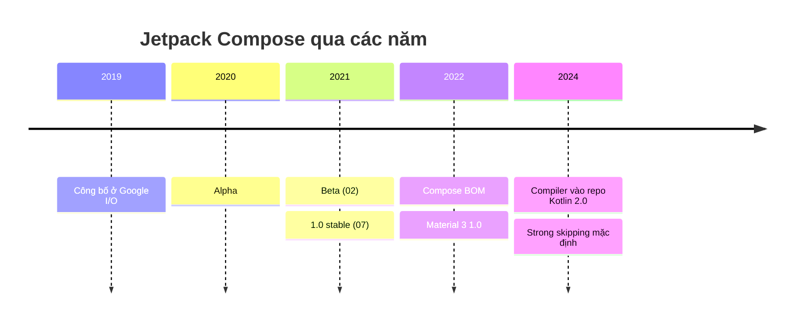
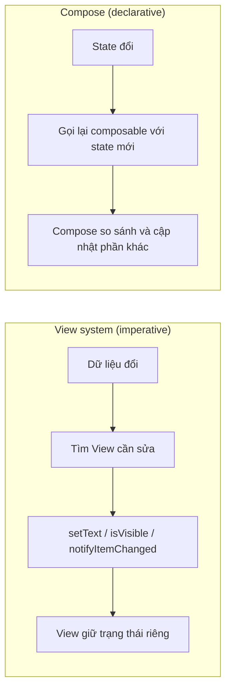
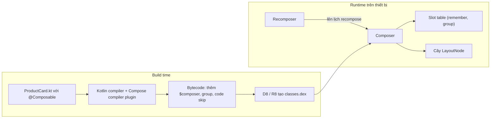
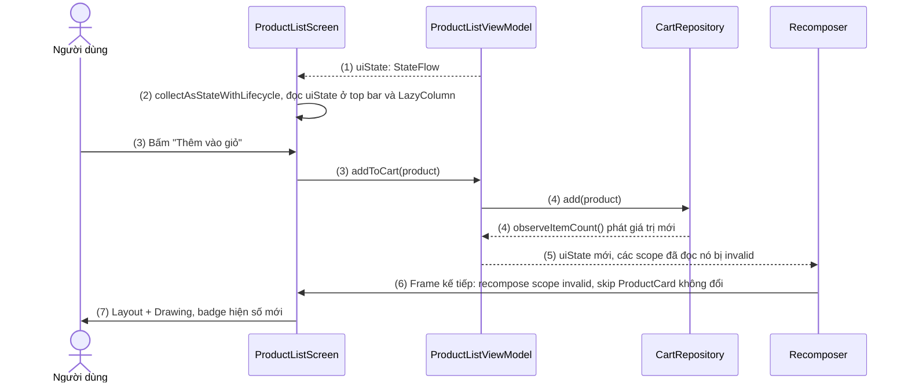
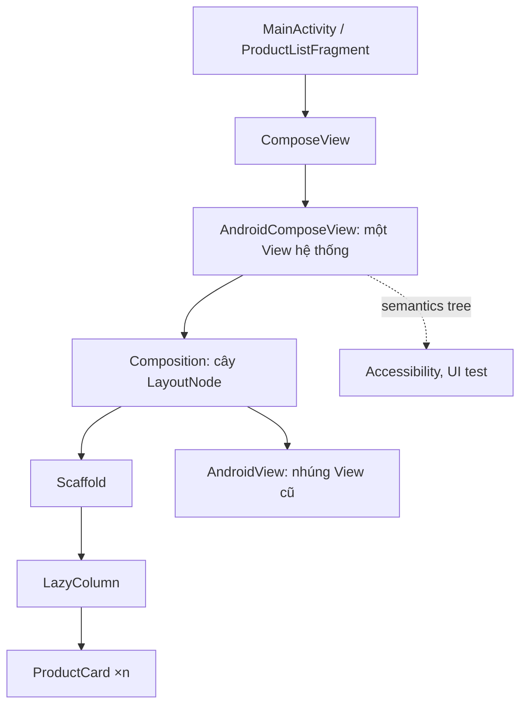
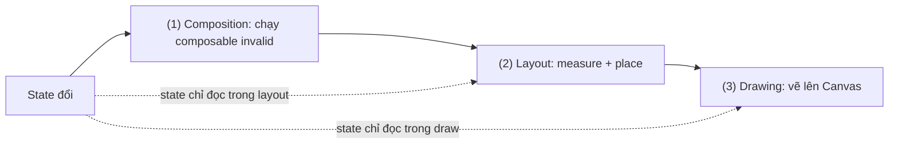

# Jetpack Compose Overview

## Vấn đề cần giải quyết

Với View system, UI là một cây View **giữ trạng thái riêng** (text, visibility, checked...). Mỗi lần dữ liệu đổi, code phải **tự tay sửa từng View** cho khớp. Ví dụ, một danh sách sản phẩm dùng `RecyclerView` + `Adapter`:

```kotlin
// ProductAdapter.kt — cách làm imperative với View system
override fun onBindViewHolder(holder: ProductViewHolder, position: Int) {
    val product = items[position]
    holder.binding.name.text = product.name
    holder.binding.price.text = formatPrice(product.price)
    if (product.stock > 0) {
        holder.binding.addToCart.isVisible = true
        // Quên dòng dưới: ViewHolder tái sử dụng từ sản phẩm "Hết hàng" vẫn hiện nhãn đỏ
        // holder.binding.outOfStock.isVisible = false
    } else {
        holder.binding.addToCart.isVisible = false
        holder.binding.outOfStock.isVisible = true
    }
}
```

Ba lỗi hay gặp với cách làm này:

1. **UI lệch dữ liệu**: View được tái sử dụng (như `ViewHolder`), quên reset một thuộc tính là View mang trạng thái cũ, ở đây sản phẩm còn hàng vẫn hiện nhãn "Hết hàng".
2. **Nhiều nơi cùng sửa một dữ liệu hiển thị**: cùng một giá trị (ví dụ số trên biểu tượng giỏ hàng) hiện ở nhiều màn hình, mỗi màn tự cập nhật View của mình. Một nơi quên cập nhật là UI lệch với dữ liệu thật.
3. **Code UI rải ở nhiều nơi**: layout XML, `ViewHolder`/`Adapter`, `Fragment`/`Activity`. Muốn thêm một trạng thái ("Đang giảm giá") phải sửa cả ba và nhớ mọi tổ hợp trạng thái cũ.

Gốc của cả ba lỗi là cùng một việc: View system giữ **trạng thái riêng trong từng View** (text, visibility, checked...), còn developer chịu trách nhiệm **đồng bộ** trạng thái đó với dữ liệu thật. Số tổ hợp trạng thái càng nhiều thì càng dễ sót.

Jetpack Compose giải bài toán theo hướng khác: bỏ bước "đồng bộ View với dữ liệu", để developer chỉ **mô tả UI từ dữ liệu**, phần cập nhật màn hình do framework lo.

---

## Sau khi học xong

- Giải thích được mô hình declarative UI = f(state) của Jetpack Compose và khác biệt với cách cập nhật View theo kiểu imperative.
- Giải thích được vai trò của Compose compiler plugin và runtime (Composer, slot table, Recomposer) từ lúc build tới lúc chạy.
- Phân biệt được composition, recomposition và ba phase Composition → Layout → Drawing của một frame.
- Triển khai được màn hình Compose đầu tiên: đọc state từ ViewModel và nhúng vào Fragment có sẵn bằng ComposeView.
- Biết khi nào nên chuyển một màn hình sang Compose và khi nào giữ View system.

---

## Jetpack Compose là gì?

**Jetpack Compose** là bộ công cụ UI declarative (khai báo) của Android: bạn viết các hàm Kotlin đánh dấu `@Composable` để **mô tả giao diện nên trông thế nào với state hiện tại**, và runtime của Compose tự gọi lại những hàm có đọc state vừa thay đổi để cập nhật màn hình.

Mental model dùng xuyên suốt bài và cả Session 09:

> **UI = f(state)**. Composable là hàm `f`: nhận state, trả ra mô tả UI. State đổi thì Compose gọi lại `f` với state mới (gọi là recomposition), so với lần trước và chỉ cập nhật phần khác biệt. Bạn không bao giờ "sửa" một phần tử UI có sẵn; bạn đổi state, rồi để `f` mô tả lại.

Ba điểm cần tách bạch ngay từ đầu:

- Composable **không trả về View** và không giữ tham chiếu tới phần tử UI. Hàm `@Composable` trả `Unit`; nó *phát ra* (emit) mô tả UI vào một cây do Compose quản lý.
- Compose **không dựng một View cho mỗi phần tử**. Toàn bộ cây UI Compose được vẽ bên trong **một** View duy nhất của hệ thống (`AndroidComposeView`), nên vẫn chạy trong `Activity`/`Fragment` như mọi app Android.
- Compose là **thư viện** (unbundled, đi kèm APK của app), không nằm trong Android framework như `android.widget.*`. Vì vậy cập nhật Compose không phụ thuộc phiên bản Android của máy, đổi lại app nặng hơn một chút và cần Baseline Profile để khởi động nhanh (xem Trade-offs).

---

## Lịch sử phát triển

| Thời điểm | Mốc |
|---|---|
| 05/2019 | Google công bố Jetpack Compose ở Google I/O, ở dạng pre-alpha mã nguồn mở |
| 08/2020 | Bản alpha đầu tiên |
| 02/2021 | Bản beta, API được giữ ổn định |
| 07/2021 | Compose 1.0 stable — dùng được cho production |
| 10/2022 | Ra mắt Compose BOM (Bill of Materials) để đồng bộ version các thư viện Compose; Material 3 cho Compose đạt 1.0 |
| 05/2024 | Kotlin 2.0: Compose compiler chuyển vào repo Kotlin, dùng plugin Gradle `org.jetbrains.kotlin.plugin.compose`, version luôn bằng version Kotlin |
| 2024 | Strong skipping mode bật mặc định từ Kotlin 2.0.20 — composable có tham số unstable vẫn được skip nếu tham số không đổi |

Hai mốc 2024 ảnh hưởng trực tiếp tới cách bạn cấu hình project và đọc tài liệu cũ: các bài viết trước 2024 nói về `kotlinCompilerExtensionVersion` và bảng tương thích Compose compiler ↔ Kotlin; từ Kotlin 2.0 trở đi chỉ cần plugin `kotlin.plugin.compose` cùng version Kotlin.


<!-- dd: s09-compose-history -->

---

## Cách hoạt động

### 1. Declarative thay cho imperative

Với View system, bạn làm hai việc: **dựng** cây View (inflate XML), rồi **sửa** cây đó mỗi khi dữ liệu đổi (`setText`, `isVisible`, `notifyItemChanged`). Đây là cách imperative (mệnh lệnh): bạn ra lệnh từng thao tác thay đổi.

Với Compose, bạn chỉ làm một việc: viết hàm mô tả UI cho **một** trạng thái bất kỳ. Không có bước "sửa", vì mỗi lần state đổi, hàm được gọi lại và mô tả lại từ đầu.


<!-- dd: s09-compose-imperative-vs-declarative -->

Hệ quả quan trọng: trong Compose **chỉ có một nguồn sự thật** cho mỗi mẩu dữ liệu UI — chính là state truyền vào hàm. Không còn chuyện "View hiện một đằng, dữ liệu một nẻo", vì View không tự giữ bản sao dữ liệu.

#### Ví dụ: thẻ sản phẩm còn hàng / hết hàng

**Bài toán**: chính đoạn `onBindViewHolder` ở phần "Vấn đề cần giải quyết": một thẻ có hai trạng thái, View system bắt phải bật/tắt `addToCart` và `outOfStock` cho đủ hai nhánh.

**Code**: trước hết bật Compose cho module `:app` (cấu hình, không có luồng chạy nên không cần sơ đồ). Version các thư viện Compose lấy từ BOM, khai báo trong version catalog.

```kotlin
// app/build.gradle.kts
plugins {
    alias(libs.plugins.android.application)
    alias(libs.plugins.kotlin.android)
    alias(libs.plugins.kotlin.compose) // Compose compiler plugin, cùng version với Kotlin (Kotlin 2.0+)
}

android {
    buildFeatures { compose = true }
}

dependencies {
    implementation(platform(libs.androidx.compose.bom)) // BOM quyết định version các thư viện Compose
    implementation(libs.androidx.compose.material3)
    implementation(libs.androidx.compose.ui.tooling.preview)
    debugImplementation(libs.androidx.compose.ui.tooling)    // Preview, Layout Inspector
    implementation(libs.androidx.activity.compose)           // setContent cho ComponentActivity
    implementation(libs.androidx.lifecycle.runtime.compose)  // collectAsStateWithLifecycle
    implementation(libs.androidx.lifecycle.viewmodel.compose)
}
```

Rồi viết thẻ thành một composable. Nhánh "còn hàng / hết hàng" trở thành một câu `if` bình thường: mỗi lần gọi, hàm mô tả **đúng một** trong hai trạng thái, không có trạng thái cũ nào để quên reset.

```kotlin
// ui/product/ProductCard.kt
@Composable
fun ProductCard(
    product: Product,
    onAddToCart: (Product) -> Unit,
    modifier: Modifier = Modifier,
) {
    Column(modifier.padding(12.dp)) {
        Text(product.name, style = MaterialTheme.typography.titleMedium)
        Text(formatPrice(product.price))
        if (product.stock > 0) {
            Button(onClick = { onAddToCart(product) }) { Text("Thêm vào giỏ") }
        } else {
            Text("Hết hàng", color = MaterialTheme.colorScheme.error)
        }
    }
}
```

**Kết quả**: lỗi số 1 ở phần "Vấn đề cần giải quyết" không thể xảy ra nữa — không có View nào mang trạng thái của sản phẩm trước. `ProductCard` cũng nhận dữ liệu (`Product`) và sự kiện (`onAddToCart`) qua tham số, không biết gì về ViewModel; đây là nền cho State Hoisting ở 9.2.

---

### 2. Composable function và Compose compiler plugin

`@Composable` không phải annotation trang trí. Nó báo cho **Compose compiler plugin** (một plugin của trình biên dịch Kotlin) biến đổi hàm lúc build, giống cách `suspend` khiến compiler thêm tham số `Continuation`.

Compiler plugin làm ba việc chính với mỗi hàm `@Composable`:

1. **Thêm tham số ẩn** `$composer: Composer` (và các bitmask `$changed`) vào chữ ký hàm. Vì vậy composable chỉ gọi được từ composable khác — hàm thường không có `$composer` để truyền vào, compiler báo lỗi *"@Composable invocations can only happen from the context of a @Composable function"*.
2. **Bọc thân hàm trong các group** có khoá theo **vị trí gọi trong source code**. Nhờ khoá này, runtime biết lần gọi `ProductCard` ở dòng X của lần recompose này chính là lần gọi ở dòng X lần trước (positional memoization — ghi nhớ theo vị trí).
3. **Sinh code so sánh tham số**: nếu mọi tham số bằng lần trước, runtime **bỏ qua** (skip) cả hàm thay vì chạy lại.

Lúc chạy, các phần của runtime phối hợp với code đã biến đổi:

- **Composer**: đối tượng được truyền qua `$composer`, ghi lại cấu trúc cây và giá trị `remember` vào **slot table**.
- **Slot table**: cấu trúc dữ liệu lưu "lần trước mỗi vị trí gọi đã phát ra gì, nhớ gì". Đây là nơi `remember { ... }` thực sự cất giá trị.
- **Recomposer**: theo dõi state thay đổi, đánh dấu phần cần chạy lại và lên lịch recompose vào frame kế tiếp.
- **Cây `LayoutNode`**: kết quả cuối của composition — cây node UI mà phase Layout và Drawing làm việc trên đó.


<!-- dd: s09-compose-build-runtime -->

Bạn không cần đọc bytecode đã biến đổi để dùng Compose. Điều cần nhớ là hệ quả: **composable có thể được gọi lại bất cứ lúc nào, nhiều lần, hoặc bị bỏ qua**. Code trong thân composable phải chịu được việc đó.

#### Ví dụ: xem trước hai trạng thái của một composable

**Bài toán**: muốn kiểm tra giao diện "còn hàng" và "hết hàng" của `ProductCard` mà không phải chạy app, mở đúng màn hình và tạo dữ liệu tương ứng.

**Code**: một `@Preview` dùng dữ liệu mẫu. Preview chạy được chính vì composable chỉ là hàm Kotlin nhận tham số — Android Studio gọi nó với composer riêng, không cần Activity, ViewModel hay mạng.

```kotlin
// ui/product/ProductCard.kt
@Preview(showBackground = true)
@Composable
private fun ProductCardPreview() {
    MaterialTheme {
        Column {
            ProductCard(
                product = Product(id = 1, name = "Nồi cơm điện", price = 890_000, imageUrl = "", stock = 12),
                onAddToCart = {},
            )
            ProductCard(
                product = Product(id = 2, name = "Ấm siêu tốc", price = 350_000, imageUrl = "", stock = 0),
                onAddToCart = {},
            )
        }
    }
}
```

**Kết quả**: panel Preview hiện cùng lúc hai trạng thái "còn hàng" và "hết hàng". Muốn thử trạng thái mới chỉ cần thêm một lời gọi với dữ liệu khác — điều View system không làm được nếu không dựng cả Fragment. Trong app thật, thay `MaterialTheme` bằng theme riêng của app (học ở 9.4).

---

### 3. Composition, recomposition và smart skipping

**Composition** là lần đầu Compose chạy các composable để dựng cây UI. **Recomposition** là những lần chạy lại sau đó khi state đổi. Cơ chế nối hai việc này là **snapshot state**:

- State đọc được trong Compose là `State<T>` (tạo bằng `mutableStateOf`, hoặc chuyển từ `Flow` bằng `collectAsStateWithLifecycle()`).
- Khi composable **đọc** `state.value` trong lúc chạy, runtime ghi nhận: phạm vi (recompose scope) này phụ thuộc state đó.
- Khi state được **ghi** giá trị mới, runtime đánh dấu mọi scope đã đọc nó là invalid; Recomposer chờ frame kế tiếp (qua `Choreographer`) rồi chỉ chạy lại các scope invalid.
- Trong lúc chạy lại, composable con có tham số không đổi được **skip**.

Đây là lý do Compose không "vẽ lại cả màn hình" dù về mặt khái niệm `f(state)` được gọi lại: phần không đọc state đổi không chạy, phần có tham số không đổi bị skip. Đơn vị chạy lại là **recompose scope** (thường là một hàm composable hoặc một lambda composable như `actions = { }`), nên *nơi đọc* state quyết định phạm vi recompose. Chi tiết về `remember` và giới hạn của recomposition học ở 9.1; các loại state học ở 9.2.

#### Ví dụ: badge giỏ hàng tự cập nhật khi thêm sản phẩm

**Bài toán**: lỗi số 2 ở phần "Vấn đề cần giải quyết": số trên biểu tượng giỏ hàng phải luôn khớp giỏ thật, dù sản phẩm được thêm từ đâu. Bài toán này cho thấy rõ cả vòng đọc state → ghi state → recompose → skip.

**Luồng chạy** khi người dùng thêm "Nồi cơm điện" vào giỏ:

1. `ProductListViewModel` phát `uiState: StateFlow<ProductListUiState>` gồm danh sách sản phẩm và `cartCount`, kết hợp từ `ProductRepository` và `CartRepository`.
2. `ProductListScreen` chuyển `StateFlow` thành `State` bằng `collectAsStateWithLifecycle()`. Vì khai báo bằng `by`, state thực sự được **đọc** ở nơi dùng `uiState.cartCount` (lambda `actions` của top bar) và `uiState.products` (nội dung `LazyColumn`) — runtime ghi nhận phụ thuộc tại đúng các scope đó.
3. Người dùng bấm "Thêm vào giỏ"; lambda `onAddToCart` gọi `viewModel.addToCart(product)`. Composable **không** tự sửa số trên badge.
4. ViewModel ghi vào `CartRepository` (Room); `Flow` số lượng phát giá trị mới, `uiState` có `cartCount` mới.
5. State mới được ghi → Recomposer đánh dấu các scope đã đọc `uiState` là invalid và lên lịch recompose cho frame kế tiếp.
6. Frame kế tiếp: chỉ các scope invalid chạy lại; `CartBadge` nhận `count` mới nên chạy lại; các `ProductCard` có `product` không đổi không phải chạy lại (được skip).
7. Phase Layout và Drawing cập nhật phần đã đổi; badge hiện số mới.


<!-- archify: s09-compose-recomposition-loop | Một vòng recomposition: từ bấm nút tới badge giỏ hàng -->

**Code**: giả sử đã có `ProductRepository.getProducts(): Flow<List<Product>>`, `CartRepository.observeItemCount(): Flow<Int>` và `suspend fun CartRepository.add(product: Product)` (lớp dữ liệu, học ở Session 05–06).

```kotlin
// ui/product/ProductListViewModel.kt
data class ProductListUiState(
    val products: List<Product> = emptyList(),
    val cartCount: Int = 0,
)

class ProductListViewModel(
    productRepository: ProductRepository,
    private val cartRepository: CartRepository,
) : ViewModel() {

    // (1) Một nguồn state duy nhất cho màn hình
    val uiState: StateFlow<ProductListUiState> =
        combine(productRepository.getProducts(), cartRepository.observeItemCount()) { products, count ->
            ProductListUiState(products = products, cartCount = count)
        }.stateIn(viewModelScope, SharingStarted.WhileSubscribed(5_000), ProductListUiState())

    // (4) Ghi vào nguồn dữ liệu, không đụng tới UI
    fun addToCart(product: Product) {
        viewModelScope.launch { cartRepository.add(product) }
    }
}
```

```kotlin
// ui/product/ProductListScreen.kt
@Composable
fun ProductListScreen(viewModel: ProductListViewModel) {
    // (2) Tạo State; mỗi chỗ dùng uiState.xxx bên dưới là một lần đọc được runtime ghi nhận
    val uiState by viewModel.uiState.collectAsStateWithLifecycle()

    Scaffold(
        topBar = {
            TopAppBar(
                title = { Text("Sản phẩm") },
                actions = { CartBadge(count = uiState.cartCount) }, // (6) chạy lại vì count đổi
            )
        },
    ) { padding ->
        LazyColumn(contentPadding = padding) {
            items(uiState.products, key = { it.id }) { product ->
                // (6) product không đổi → ProductCard được skip
                ProductCard(product = product, onAddToCart = viewModel::addToCart) // (3)
            }
        }
    }
}

@Composable
fun CartBadge(count: Int) {
    BadgedBox(badge = { if (count > 0) Badge { Text(count.toString()) } }) {
        Icon(Icons.Filled.ShoppingCart, contentDescription = "Giỏ hàng")
    }
}
```

**Kết quả**: số trên badge chỉ có **một** nguồn là `CartRepository`. Màn hình chi tiết hay giỏ hàng thêm/xoá sản phẩm thì `observeItemCount()` phát giá trị mới và mọi màn hình đang hiển thị badge tự đúng — lỗi số 2 biến mất mà không cần ai "nhớ cập nhật". Kiểm chứng bằng **Layout Inspector** (bật hiển thị recomposition counts): bấm "Thêm vào giỏ" vài lần, số lần recompose của `CartBadge` tăng, còn số lần recompose của các `ProductCard` đứng yên.

---

### 4. Compose sống bên trong View system

Compose không thay Android framework; nó chạy **bên trong** một View. Hai cửa nối:

| Hướng | API | Dùng khi |
|---|---|---|
| Activity → Compose | `ComponentActivity.setContent { }` | Màn hình (hoặc cả app) viết bằng Compose |
| View → Compose | `ComposeView` (trong XML hoặc tạo bằng code) | Chuyển dần: một Fragment hoặc một phần layout dùng Compose |
| Compose → View | `AndroidView(factory = { ... })` | Cần View chưa có bản Compose: `MapView`, `AdView`, `PlayerView`, custom View cũ |

Dù vào từ cửa nào, cấu trúc bên dưới giống nhau: `setContent` tạo (hoặc tái sử dụng) một `ComposeView`, bên trong nó là `AndroidComposeView` — **một** View của hệ thống — chứa cả cây `LayoutNode` của Compose. Với hệ thống Android, đó chỉ là một View tự đo, tự vẽ; accessibility, autofill, test UI đọc cây Compose qua **semantics tree** (cây ngữ nghĩa) do Compose cung cấp.


<!-- dd: s09-compose-hosting -->

Composition gắn với vòng đời của View chủ: khi `ComposeView` bị huỷ composition thì mọi `remember` mất theo. Với Fragment, view bị huỷ mỗi lần Fragment vào back stack, nên phải chọn **`ViewCompositionStrategy`** khớp vòng đời view của Fragment (xem [Fragment Lifecycle](../session_04/components/fragment/lifecycle.md)).

#### Ví dụ: nhúng màn hình Compose vào Fragment có sẵn

**Bài toán**: app có sẵn dùng `MainActivity` + bottom navigation bằng Fragment, muốn chuyển màn danh sách sản phẩm sang Compose mà không viết lại cả app, vì viết lại một lần là rủi ro lớn.

**Code**: giữ `ProductListFragment` trong navigation hiện tại, chỉ thay phần thân bằng `ComposeView`. `RecyclerView`, `ProductAdapter`, `fragment_product_list.xml` bị xoá.

```kotlin
// ui/product/ProductListFragment.kt
class ProductListFragment : Fragment() {

    private val viewModel: ProductListViewModel by viewModels() // factory/Hilt như Session 06–07

    override fun onCreateView(
        inflater: LayoutInflater,
        container: ViewGroup?,
        savedInstanceState: Bundle?,
    ): View = ComposeView(requireContext()).apply {
        // Huỷ composition khi view của Fragment bị huỷ, không phải khi detach khỏi window
        setViewCompositionStrategy(ViewCompositionStrategy.DisposeOnViewTreeLifecycleDestroyed)
        setContent {
            MaterialTheme { ProductListScreen(viewModel) } // hoặc theme riêng của app
        }
    }
}
```

**Kết quả**: màn hình danh sách chạy bằng Compose, các màn hình khác (chi tiết, giỏ hàng) vẫn là View và không cần sửa. Đây là cách Google khuyến nghị cho app có sẵn: chuyển **từng màn hình**, bắt đầu từ màn hình mới hoặc màn hình hay sửa.

---

## Deep Dive: ba phase của một frame

Recomposition mới chỉ là bước đầu. Mỗi frame Compose đi qua ba phase theo thứ tự:

1. **Composition** — *hiển thị cái gì*: chạy các composable (scope invalid), cập nhật cây `LayoutNode` và slot table.
2. **Layout** — *đặt ở đâu*: đo (measure) và đặt vị trí (place) từng node. Mỗi node chỉ được đo **một lần** mỗi lượt layout; Compose không có kiểu đo đi đo lại lồng nhau như `RelativeLayout` hay `LinearLayout` với `weight`.
3. **Drawing** — *vẽ thế nào*: vẽ từng node lên `Canvas`.


<!-- dd: s09-compose-frame-phases -->

Điểm tinh tế: state được đọc ở phase nào thì khi đổi, Compose **bắt đầu lại từ phase đó**. State đọc trong thân composable → chạy lại từ Composition. State chỉ đọc trong lambda của `Modifier.offset { }` hay `Modifier.drawBehind { }` → bỏ qua Composition, chỉ chạy lại Layout hoặc Drawing. Đây là kỹ thuật "trì hoãn đọc state" dùng cho animation và cuộn mượt, sẽ gặp lại ở 9.5 (Modifier) và 9.7 (Animation).

---

## Ví dụ thực tế

### Ba cách đưa Compose vào app

| Bài toán | Cách làm |
|---|---|
| App mới | Viết toàn bộ bằng Compose, `Activity` gọi `setContent { }` |
| App có sẵn, chuyển dần | Chuyển **từng màn hình** qua `ComposeView` trong Fragment, bắt đầu từ màn mới hoặc màn hay sửa |
| Cần View chưa có bản Compose | Nhúng ngược bằng `AndroidView` (bản đồ, quảng cáo, video player) |

Bài toán chính là chuyển dần. Ghép các ví dụ ở trên, màn hình danh sách sản phẩm có cấu trúc hoàn chỉnh:

```text
ProductListFragment (View, giữ nguyên trong bottom navigation)
└── ComposeView  [DisposeOnViewTreeLifecycleDestroyed]
    └── MaterialTheme
        └── ProductListScreen(viewModel)          ← đọc uiState: StateFlow
            ├── TopAppBar
            │   └── CartBadge(count)              ← chạy lại khi cartCount đổi
            └── LazyColumn
                └── ProductCard(product, onAddToCart) ×n   ← skip khi product không đổi
```

Các màn hình còn lại được chuyển theo cùng mẫu. Khi mọi màn hình đã là composable, `MainActivity` bỏ Fragment và gọi thẳng:

```kotlin
// MainActivity.kt — đích cuối của việc chuyển đổi
class MainActivity : ComponentActivity() {
    override fun onCreate(savedInstanceState: Bundle?) {
        super.onCreate(savedInstanceState)
        enableEdgeToEdge()
        setContent {
            MaterialTheme { MainScreen() } // MainScreen: Scaffold + bottom navigation bằng Compose
        }
    }
}
```

### Kiểm tra hiệu năng đúng cách

Trước khi kết luận "màn hình Compose bị giật", đo trên **release build** có R8 và Baseline Profile:

| Điều kiện đo | Vì sao ảnh hưởng tới Compose |
|---|---|
| Debug build | App `debuggable` khiến ART tắt nhiều tối ưu, không có R8 → chậm hơn rõ rệt so với release |
| Release không Baseline Profile | Compose là thư viện đi kèm app, không được hệ điều hành biên dịch sẵn; lần chạy đầu code chạy ở chế độ JIT |
| Release + R8 + Baseline Profile | Điều kiện giống người dùng thật — chỉ kết luận hiệu năng ở đây |

---

## So sánh với các cách tiếp cận khác

| Tiêu chí | View system (XML + View) | Jetpack Compose |
|---|---|---|
| Mô hình | Imperative: dựng cây rồi sửa từng View | Declarative: mô tả UI từ state, framework tự cập nhật |
| Trạng thái UI | Mỗi View giữ trạng thái riêng | State nằm ngoài UI, truyền vào composable |
| Nơi viết UI | XML + Adapter/ViewHolder + Fragment | Một ngôn ngữ (Kotlin), một chỗ |
| Danh sách | `RecyclerView` + Adapter + DiffUtil | `LazyColumn` / `LazyRow` + `items(key = ...)` |
| Đo layout | Có thể đo nhiều lần với layout lồng nhau | Mỗi node đo một lần mỗi lượt layout |
| Phân phối | Nằm trong Android framework | Thư viện đi kèm APK, cập nhật độc lập với phiên bản Android |
| Xem trước | Layout Editor cho XML tĩnh | `@Preview` với dữ liệu bất kỳ, nhiều trạng thái cùng lúc |
| Độ chín | Hơn 15 năm, mọi thư viện đều hỗ trợ | Ổn định từ 2021, một số View chuyên biệt vẫn phải nhúng bằng `AndroidView` |

Compose cùng họ với các framework declarative khác: **SwiftUI** (iOS) và **Flutter** cũng theo mô hình UI = f(state). Khác biệt: Flutter tự vẽ toàn bộ bằng engine riêng và dùng Dart; SwiftUI gắn với hệ điều hành Apple; Compose dùng Kotlin, chạy trong View system của Android và có **Compose Multiplatform** (của JetBrains) để dùng chung UI trên desktop, iOS, web.

---

## Khi nào nên và không nên dùng

**Nên dùng Compose khi:**

- Viết màn hình mới hoặc app mới — đây là hướng Google khuyến nghị cho Android UI hiện nay.
- Màn hình có nhiều trạng thái phối hợp (loading / lỗi / rỗng / có dữ liệu, còn hàng / hết hàng / giảm giá).
- Muốn dùng chung component và theme giữa nhiều màn hình, xem trước bằng `@Preview`.

**Cân nhắc giữ View system khi:**

- Màn hình cũ ổn định, ít sửa: viết lại chỉ thêm rủi ro, không thêm giá trị.
- Phụ thuộc nặng vào View chuyên biệt chưa có bản Compose hoặc SDK bên thứ ba chỉ cung cấp View.
- App có giới hạn kích thước APK rất chặt (Compose thêm vài MB trước khi R8 thu gọn).
- Team chưa nắm mô hình recomposition — viết Compose theo tư duy View dễ sinh lỗi hiệu năng hơn là giữ View.

---

## Sai lầm thường gặp

### 1. Gọi API hoặc ghi log ngay trong thân composable

```kotlin
// ❌ SAI: chạy lại mỗi lần recompose — bấm "Thêm vào giỏ" 3 lần là gửi 3+ event "view_product_list"
@Composable
fun ProductListScreen(viewModel: ProductListViewModel, analytics: Analytics) {
    analytics.log("view_product_list")
    val uiState by viewModel.uiState.collectAsStateWithLifecycle()
    // ...
}
```

Thân composable có thể chạy nhiều lần, không theo lịch bạn kiểm soát. Việc có tác dụng phụ (gọi mạng, ghi log, ghi DB) phải nằm trong ViewModel, trong lambda sự kiện (`onClick`), hoặc trong side-effect API như `LaunchedEffect` (9.3.1).

### 2. Tạo state mà không `remember`

```kotlin
// ❌ SAI: quantity về 1 mỗi lần CartScreen recompose
@Composable
fun QuantityStepper() {
    var quantity by mutableStateOf(1)
    Button(onClick = { quantity++ }) { Text("$quantity") }
}
```

Mỗi lần hàm chạy lại, `mutableStateOf(1)` tạo state mới. Cần `remember { mutableStateOf(1) }` để giá trị được cất trong slot table — hoặc tốt hơn, đưa số lượng lên `CartViewModel` (9.1, 9.2).

### 3. Tính toán nặng trong mỗi lần recompose

```kotlin
// ❌ SAI: sắp xếp lại 2.000 sản phẩm mỗi khi cartCount đổi
val sorted = uiState.products.sortedBy { it.price }
```

Đặt việc này trong ViewModel (nằm trong `uiState`), hoặc dùng `remember(uiState.products) { ... }` để chỉ tính lại khi danh sách đổi.

### 4. Truyền ViewModel xuống tận composable lá

Truyền `ProductListViewModel` vào `ProductCard` khiến thẻ sản phẩm không preview được, không dùng lại được ở `ProductDetailScreen`, và test phải dựng cả ViewModel. Composable lá chỉ nhận dữ liệu và lambda (`product`, `onAddToCart`) như ở bước 1.

### 5. Giả định composable chạy đúng thứ tự, đúng một lần

Không dựa vào biến bên ngoài được tăng trong thân composable (`itemIndex++`), không giả định composable cha chạy xong mới tới con. Compose có thể skip, chạy lại một phần, hoặc huỷ một lần composition giữa chừng.

### 6. Đánh giá hiệu năng trên debug build

Xem bảng ở "Kiểm tra hiệu năng đúng cách". Nhiều báo cáo "LazyColumn giật hơn RecyclerView" biến mất khi đo lại trên release build có Baseline Profile.

---

## Trade-offs

| Được | Mất |
|---|---|
| Hết lớp lỗi "UI lệch dữ liệu" vì không còn trạng thái riêng trong View | Phải học mô hình mới: recomposition, stability, side effect |
| Ít code hơn: không Adapter, ViewHolder, XML | APK lớn hơn vài MB (giảm nhiều nhờ R8) |
| Cập nhật Compose độc lập với phiên bản Android | Khởi động lần đầu chậm hơn nếu thiếu Baseline Profile |
| `@Preview`, theme, component dùng chung dễ dàng | Debug recomposition thừa cần công cụ (Layout Inspector, compiler metrics) |
| Interop hai chiều, chuyển dần từng màn hình | Thời gian chuyển tiếp phải duy trì cả hai hệ UI và hai bộ theme |

---

## Kết nối hệ thống

- **Prerequisites**:
  - `android.languages.kotlin` — lambda, trailing lambda, extension function, `suspend` (Compose dùng các tính năng này dày đặc).
  - `android.component.activity.lifecycle` và `android.component.fragment.lifecycle` — composition gắn với vòng đời của View chủ.
  - Session 06–08 (ViewModel, Flow, Coroutines, RecyclerView) — `uiState` và `viewModelScope` trong ví dụ.
- **Related**:
  - `android.component.activity.state_changes` — xoay màn hình huỷ Activity; state chỉ nằm trong `remember` sẽ mất (cách giữ lại học ở 9.2.2).
  - `android.output_packages.apk_files` — vì sao Compose làm tăng kích thước APK và vai trò của R8.
- **Downstream** (Session 09):
  - 9.1 Remember and Recomposition — slot table và `remember` hoạt động thế nào.
  - 9.2 State and State Hoisting — `MutableState`, `rememberSaveable`, đưa state lên ViewModel.
  - 9.3 Side-Effects — chỗ đúng cho gọi API, log, subscription.
  - 9.4 Theming — xây theme riêng cho app trên Material 3.
  - 9.5 Modifier và Lazy lists — thứ tự modifier, `LazyColumn`, `LazyPagingItems`.
  - 9.6–9.8 — layout, animation, gesture.
  - Session 10 — test UI Compose qua semantics tree, tối ưu recomposition.

---

## Developer Curiosity Checklist

- [ ] Vì sao Compose gọi lại hàm mà không "vẽ lại cả màn hình"?
- [ ] `@Composable` khiến compiler thêm gì vào hàm, và vì sao hàm thường không gọi được composable?
- [ ] Slot table lưu gì, và vì sao `remember` phụ thuộc vào vị trí gọi trong code?
- [ ] State đọc ở phase Layout hoặc Drawing thì khi đổi có chạy lại Composition không?
- [ ] Toàn bộ cây Compose nằm trong bao nhiêu View hệ thống?
- [ ] Khi chuyển một Fragment sang Compose, chọn `ViewCompositionStrategy` nào và vì sao?
- [ ] Vì sao phải đo hiệu năng Compose trên release build có Baseline Profile?

---

## Tham khảo

- [Thinking in Compose — Android Developers](https://developer.android.com/develop/ui/compose/mental-model)
- [Lifecycle of composables — Android Developers](https://developer.android.com/develop/ui/compose/lifecycle)
- [Jetpack Compose phases — Android Developers](https://developer.android.com/develop/ui/compose/phases)
- [Compose architectural layering — Android Developers](https://developer.android.com/develop/ui/compose/layering)
- [Interoperability APIs — Android Developers](https://developer.android.com/develop/ui/compose/migrate/interoperability-apis)
- [Compose compiler Gradle plugin — Android Developers](https://developer.android.com/develop/ui/compose/compiler)
- [Strong skipping mode — Android Developers](https://developer.android.com/develop/ui/compose/performance/stability/strongskipping)
- [Use a Bill of Materials (BOM) — Android Developers](https://developer.android.com/develop/ui/compose/bom)
- [Jetpack Compose is now 1.0 — Android Developers Blog (07/2021)](https://android-developers.googleblog.com/2021/07/jetpack-compose-announcement.html)
