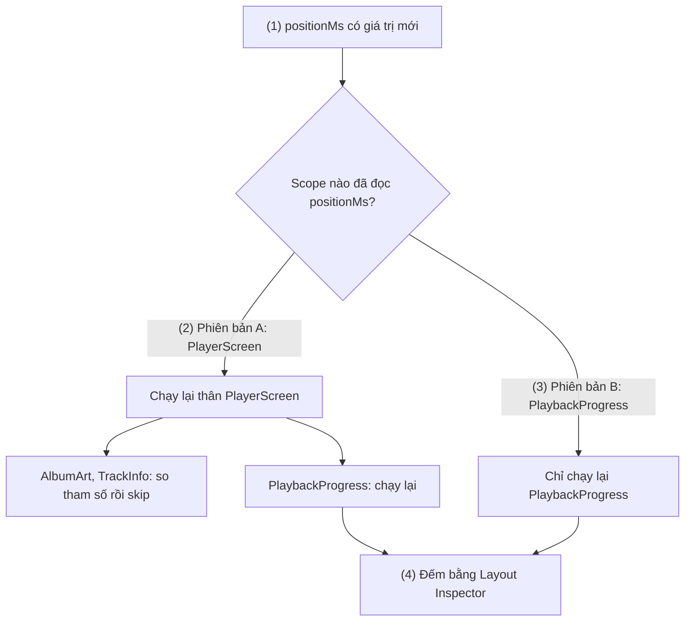
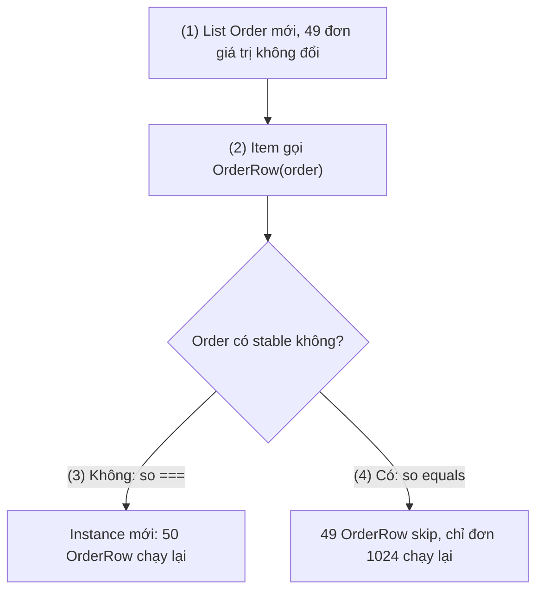
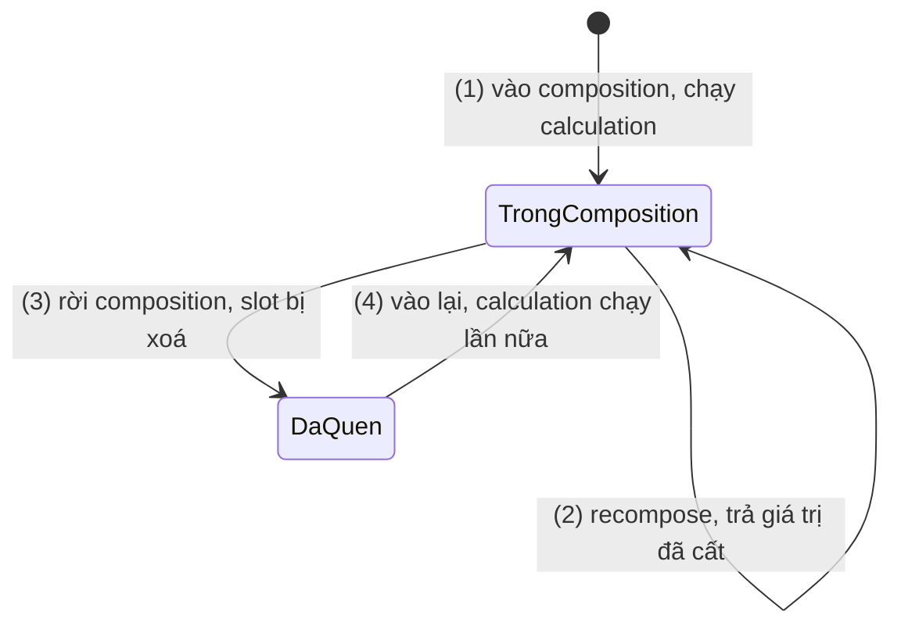
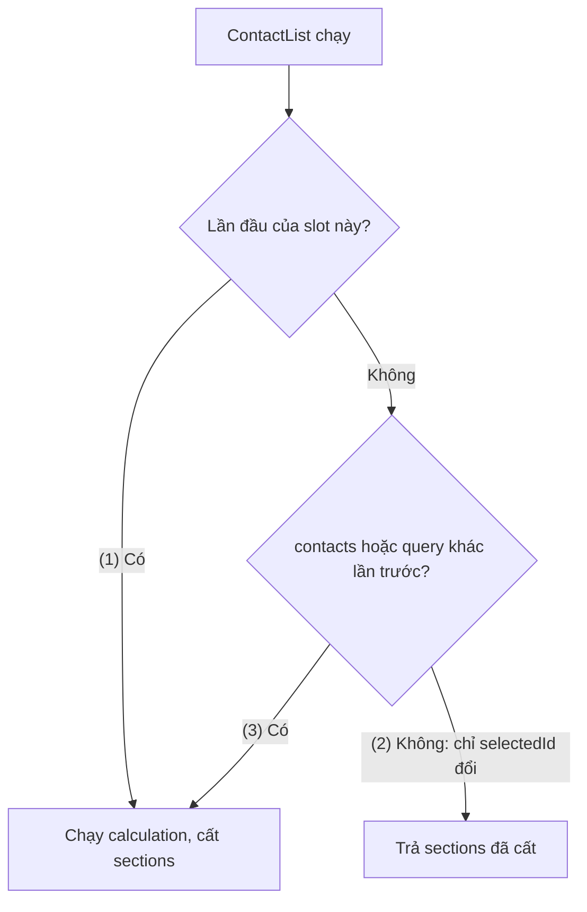
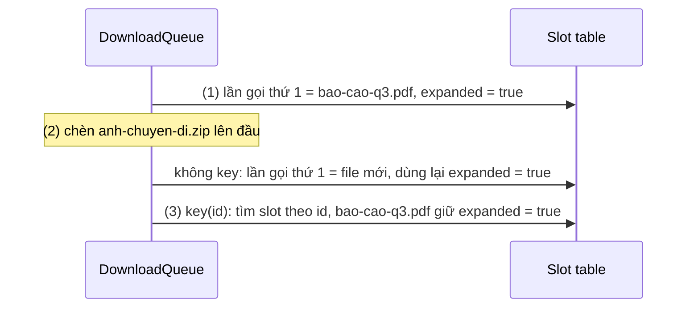
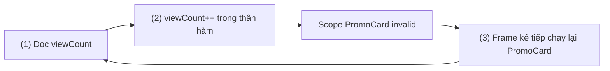

# Remember and Recomposition

## Vấn đề cần giải quyết

[Jetpack Compose Overview](overview.md) nói rằng state đổi thì Compose "gọi lại" composable (UI = f(state)). Câu đó đúng về khái niệm nhưng chưa đủ để viết code đúng và nhanh. Ba câu hỏi xuất hiện ngay ở màn hình thật:

1. **Chạy lại phần nào?** Thanh tiến độ của trình phát nhạc đổi 5 lần mỗi giây. Nếu cả màn hình chạy lại theo nó thì ảnh bìa, tên bài cũng bị xử lý lại vô ích.
2. **Giá trị cục bộ sống bao lâu?** Composable là một hàm, biến cục bộ được tạo mới mỗi lần hàm chạy. Vậy object tốn kém (bộ so sánh chuỗi, kết quả lọc 2.000 dòng) hay trạng thái "đang mở rộng" của một thẻ để ở đâu?
3. **Hàm chạy lúc nào, bao nhiêu lần?** Không biết điều này, developer dễ đặt vào thân composable những việc chỉ đúng khi hàm chạy đúng một lần, theo thứ tự.

```kotlin
// ❌ Ba vấn đề trong một hàm
@Composable
fun ContactList(contacts: List<Contact>, query: String, selectedId: Long?) {
    val collator = Collator.getInstance(Locale.forLanguageTag("vi-VN"))   // tạo lại mỗi lần chạy
    val visible = contacts.filter { it.name.contains(query, ignoreCase = true) }
        .sortedWith(compareBy(collator) { it.name })                       // lọc lại cả khi chỉ selectedId đổi
    var shownCount = 0
    visible.forEach { contact ->
        ContactRow(contact, selected = contact.id == selectedId)
        shownCount++                                                        // giả định hàm chạy hết, đúng thứ tự
    }
}
```

## Sau khi học xong

- Giải thích được recompose scope là gì và vì sao nơi đọc state quyết định phạm vi recomposition.
- Phân biệt được khi nào Compose skip một composable dựa trên stability của tham số và strong skipping mode.
- Áp dụng được remember, remember(key) và key {} để giữ hoặc làm mới giá trị theo đúng danh tính của từng phần UI.
- Nhận diện được code vi phạm tính idempotent của composable như side effect trong thân hàm, backwards write và phụ thuộc thứ tự chạy.
- Debug được recomposition thừa bằng Layout Inspector và Compose compiler reports.

## Recomposition và remember là gì?

**Recomposition** là việc Compose chạy lại đúng những **recompose scope** đã đọc một state vừa đổi (cùng các composable con không skip được) để cập nhật composition. **`remember`** ghi nhớ một giá trị trong slot table **tại vị trí gọi của nó**, để giá trị đó sống qua các lần recomposition cho tới khi phần UI chứa nó rời composition.

Mental model dùng xuyên suốt bài:

> **Composition là một cuốn sổ ghi theo vị trí.** Mỗi lời gọi composable (xác định bằng vị trí trong source code và thứ tự chạy) là một mục. Recomposition chỉ mở lại và viết lại những mục bị đánh dấu "đã đọc state vừa đổi". `remember` là ô ghi chú gắn vào mục: mục còn thì ghi chú còn, mục bị xoá thì ghi chú mất theo.

Hai hệ quả lặp lại trong cả bài: **danh tính là vị trí** (muốn danh tính đi theo `id` thì phải dùng `key`), và **không có lần chạy nào đặc biệt** (một mục có thể được viết lại nhiều lần, bị bỏ qua, hoặc viết dở rồi huỷ). Compiler plugin, slot table và ba phase của một frame đã có ở [Jetpack Compose Overview](overview.md); bài này đi sâu vào phase Composition.

## Cách hoạt động

### 1. Recompose scope: đơn vị chạy lại

Khi state được ghi giá trị mới, Compose chạy lại **scope đã đọc state đó**, không phải "composable chứa state". Recompose scope là đoạn code runtime khởi động lại được một mình:

- Mỗi hàm `@Composable` trả `Unit`, không `inline` (gọi là **restartable**) là một scope.
- Mỗi **lambda composable** không inline (`content` của `Button`, `topBar` của `Scaffold`, `item { }` của `LazyColumn`) là một scope riêng.
- `Column`, `Row`, `Box` là hàm **`inline`**: lambda nội dung của chúng **không** phải scope riêng; đọc state trong `Column { }` là đọc trong scope của hàm bao ngoài.
- Composable trả về giá trị (`stringResource()`, `remember`) hoặc gắn `@NonRestartableComposable` không phải scope; lần đọc trong chúng tính cho scope gọi chúng.

Quy tắc quan trọng nhất: **state được đọc ở đâu thì scope đó bị invalid**. Truyền `state.value` làm tham số là đọc ở scope cha; truyền lambda `{ state.value }` là hoãn lần đọc tới khi lambda được gọi, tức trong scope con.

#### Ví dụ: thanh tiến độ của trình phát nhạc

**Bài toán:** `PlayerViewModel` phát `track: StateFlow<Track>` (đổi khi sang bài) và `positionMs: StateFlow<Long>` (đổi mỗi 200 ms). Mỗi 200 ms chỉ thanh tiến độ nên chạy lại.

**Luồng chạy:**

1. `positionMs` phát giá trị mới; `collectAsStateWithLifecycle()` ghi vào `State<Long>` (chuyển `Flow` thành `State` học ở [9.3.5 SnapShotFlow and flowWithSnapshot](side_effects/flow_with_snapshot.md)).
2. **Phiên bản A:** `PlayerScreen` đọc `positionMs` để truyền vào `PlaybackProgress`. Lần đọc thuộc scope `PlayerScreen` (vì `Column` inline), nên cả thân `PlayerScreen` chạy lại 5 lần mỗi giây; `AlbumArt`, `TrackInfo` được skip nhưng vẫn phải so tham số.
3. **Phiên bản B:** `PlayerScreen` chỉ truyền lambda `{ positionMs }`, không đọc; lần đọc xảy ra trong `PlaybackProgress`, nên chỉ scope đó chạy lại.
4. Kiểm chứng bằng Layout Inspector (mục 7).



**Code:**

```kotlin
// ui/player/PlayerScreen.kt
@Composable
fun PlayerScreen(viewModel: PlayerViewModel) {
    val track by viewModel.track.collectAsStateWithLifecycle()
    val positionMs by viewModel.positionMs.collectAsStateWithLifecycle()   // (1)

    Column(Modifier.padding(16.dp)) {
        AlbumArt(coverUrl = track.coverUrl)
        TrackInfo(title = track.title, artist = track.artist)
        // ❌ (2) đọc positionMs ở đây = đọc trong scope PlayerScreen
        // PlaybackProgress(positionMs = positionMs, durationMs = track.durationMs)
        // ✅ (3) chỉ truyền cách đọc
        PlaybackProgress(positionMs = { positionMs }, durationMs = track.durationMs)
    }
}

// ui/player/PlaybackProgress.kt
@Composable
fun PlaybackProgress(positionMs: () -> Long, durationMs: Long, modifier: Modifier = Modifier) {
    val position = positionMs()                                   // (3) lần đọc thuộc scope này
    val fraction = position / durationMs.coerceAtLeast(1).toFloat()
    Column(modifier) {
        LinearProgressIndicator(progress = { fraction }, modifier = Modifier.fillMaxWidth())
        Text(formatDuration(position) + " / " + formatDuration(durationMs))
    }
}
```

**Kết quả:** phiên bản A, recomposition count của `PlayerScreen` tăng 5 lần mỗi giây; phiên bản B, nó đứng yên. Lambda `{ positionMs }` không làm `PlaybackProgress` chạy lại thừa vì với strong skipping (mục 2), compiler tự `remember` lambda theo giá trị nó capture (object `State`, không đổi). `LinearProgressIndicator` của Material 3 nhận `progress` dạng lambda cũng vì lý do này.

> [!TIP]
> Chỉ dùng lambda cho state **đổi thường xuyên** (vị trí phát, vị trí cuộn, giá trị animation) đang bị đọc ở scope quá cao. State đổi hiếm thì truyền giá trị thẳng cho dễ đọc.

### 2. Skipping và stability

Khi một scope chạy lại và gặp lời gọi composable con, Compose so từng tham số với giá trị lần trước. Cách so phụ thuộc **stability** (tính ổn định) của kiểu:

| Kiểu tham số | So bằng | Ví dụ |
|---|---|---|
| **Stable** | `equals()` | `Int`, `String`, lambda, `MutableState`, `data class` chỉ có `val` kiểu stable trong module có chạy Compose compiler, class gắn `@Stable`/`@Immutable` |
| **Unstable** | `===` (cùng instance) | `List`/`Set`/`Map` (interface, cài đặt có thể mutable), class có `var`, class từ module không chạy Compose compiler hoặc thư viện Java |

**Strong skipping mode** bật mặc định từ Kotlin 2.0.20. Trước đó, composable có **bất kỳ** tham số unstable nào thì **không bao giờ** được skip. Với strong skipping, mọi restartable composable skip được, tham số unstable so bằng `===`; compiler cũng tự `remember` mọi lambda trong composable, key theo giá trị lambda capture.

Hai annotation là **lời cam kết** với compiler:

- **`@Immutable`**: mọi property không bao giờ đổi sau khi tạo object.
- **`@Stable`**: object có thể đổi, nhưng mọi thay đổi của property public đều báo cho Compose (thường vì property là `MutableState`). `LazyListState` là ví dụ.

> [!WARNING]
> Annotation không làm class bất biến, nó chỉ là lời hứa, giống `!!`: hứa sai thì UI **không cập nhật** (Sai lầm 3). Docs strong skipping còn khuyên chỉ gắn annotation cho class có `equals()` rẻ, và cẩn thận với model chứa collection: so `equals` từng phần tử mỗi lần recompose có thể tốn hơn so `===` hay recompose luôn.

Với strong skipping, câu hỏi thực tế là: **khi dữ liệu về, object không đổi có giữ nguyên instance không?** Nếu có, `===` đã đủ để skip.

#### Ví dụ: danh sách đơn hàng tự làm mới mỗi 30 giây

**Bài toán:** `Order` nằm trong module `:core:model` thuần Kotlin. Mỗi lần làm mới, repository map JSON thành `List<Order>` **mới**, kể cả đơn không đổi.

**Luồng chạy:**

1. Repository phát danh sách mới; chỉ đơn 1024 đổi trạng thái, 49 đơn còn lại có giá trị y hệt nhưng là instance mới.
2. Các item đang hiển thị chạy lại và gọi `OrderRow(order)`.
3. `Order` unstable (khác module) nên so `===`, instance mới nên "khác": mọi `OrderRow` chạy lại.
4. Khai báo `Order` là stable qua stability configuration file: Compose so `equals()`, chỉ `OrderRow` của đơn 1024 chạy lại.



**Code:** `Order` chỉ có `val` kiểu `Long`, `String`, `enum`, không chứa collection, `equals()` rẻ: đúng loại nên khai báo stable.

```kotlin
// :core:model — module không có Compose
data class Order(val id: Long, val code: String, val status: OrderStatus, val totalVnd: Long)
```

```text
// stability_config.conf (gốc project) — (4) mỗi dòng một class, hỗ trợ * và **
com.shop.core.model.Order
```

```kotlin
// app/build.gradle.kts — (4) bản plugin cũ hơn dùng stabilityConfigurationFile = ...
composeCompiler {
    stabilityConfigurationFiles.add(rootProject.layout.projectDirectory.file("stability_config.conf"))
}
```

**Kết quả:** sau mỗi lần làm mới, skip count của `OrderRow` tăng, recomposition count chỉ tăng ở dòng đổi trạng thái. Cách tương đương: map sang `OrderUi` khai báo trong module UI, hoặc giữ nguyên instance của đơn không đổi ở repository.

### 3. `remember`: ghi nhớ theo vị trí gọi

`remember { calculation }` chạy `calculation` **lần đầu** mục đó vào composition và cất kết quả vào slot table tại vị trí của nó; **các lần recompose sau** trả lại giá trị đã cất, không chạy `calculation`.

Vòng đời của một composable chỉ có ba sự kiện: **vào composition → recompose 0 hoặc nhiều lần → rời composition**, và giá trị `remember` sống đúng khoảng đó. Nó bị quên khi nhánh `if` chứa nó thành `false`, item chứa nó bị xoá, màn hình rời composition, hoặc composition bị huỷ (Activity tạo lại khi xoay màn hình).

`remember` thường giữ hai loại giá trị: **object tốn kém** (`Collator`, `Brush`, kết quả tính toán) và **state của phần tử UI** (`remember { mutableStateOf(false) }` cho trạng thái mở rộng). `mutableStateOf` tạo `MutableState` mà Compose quan sát được, học ở [9.2.1 MutableState](state/mutable_state.md). Vì ghi nhớ theo vị trí, mỗi lời gọi `ReviewCard(review)` có giá trị `remember` riêng.

#### Ví dụ: đánh giá đã "Xem thêm" bị thu gọn sau khi ẩn mục

**Bài toán:** trang sản phẩm có mục "Đánh giá" gập/mở được; mỗi thẻ dài có nút "Xem thêm". Người dùng mở rộng vài thẻ, ẩn cả mục rồi mở lại: mọi thẻ đã thu gọn.

**Luồng chạy:**

1. Mỗi `ReviewCard` vào composition; `remember` tạo state `false` trong slot của thẻ đó.
2. Bấm "Xem thêm": state của thẻ thành `true`; các lần recompose sau trả lại đúng state này.
3. Bấm "Ẩn đánh giá": nhánh `if` không chạy nữa, các `ReviewCard` rời composition, slot bị xoá.
4. Bấm "Xem đánh giá": các thẻ vào composition như lần đầu, mọi thẻ về `false`.



**Code:**

```kotlin
// ui/product/ProductReviewsSection.kt
@Composable
fun ProductReviewsSection(reviews: List<Review>) {
    var showReviews by remember { mutableStateOf(true) }
    Column {
        TextButton(onClick = { showReviews = !showReviews }) {                   // (3) (4)
            Text(if (showReviews) "Ẩn đánh giá" else "Xem đánh giá")
        }
        if (showReviews) reviews.forEach { review -> ReviewCard(review) }
    }
}

@Composable
fun ReviewCard(review: Review) {
    var expanded by remember { mutableStateOf(false) }                          // (1) mỗi thẻ một slot
    Column(Modifier.padding(vertical = 8.dp)) {
        Text(review.content, maxLines = if (expanded) Int.MAX_VALUE else 3)
        if (!expanded) TextButton(onClick = { expanded = true }) { Text("Xem thêm") } // (2)
    }
}
```

**Kết quả:** đúng như bước 4. Muốn giữ trạng thái qua lần ẩn/hiện, state phải sống **ngoài** phần rời composition: đưa tập `id` đã mở rộng lên `ProductReviewsSection` (phía trên `if`) — state hoisting ở [9.2.1 MutableState](state/mutable_state.md). `rememberSaveable` **không** giải quyết được, vì nó cũng quên khi rời composition ([9.2.2](state/remember_saveable.md)).

### 4. `remember(key)`: tính lại khi input đổi

`remember(key1, key2, ...) { }` so các key với lần trước bằng `equals()` mỗi lần recompose; một key khác là giá trị cũ bị bỏ và `calculation` chạy lại. Giá trị đúng **cho tới khi input đổi**, thay vì cho tới khi rời composition. Quên một key là lỗi "dữ liệu cũ": input đã đổi nhưng UI hiện kết quả của input cũ.

#### Ví dụ: danh bạ lọc theo từ khoá và nhóm theo chữ cái đầu

**Bài toán:** danh bạ 2.000 liên hệ có ô tìm kiếm và dòng đang chọn được tô màu. Lọc, sắp xếp theo tiếng Việt và nhóm theo chữ cái chỉ cần làm lại khi danh sách hoặc từ khoá đổi, không phải khi chọn dòng.

**Luồng chạy:**

1. Lần đầu: `remember(contacts, query)` chạy `calculation`, cất `sections`.
2. Chọn một liên hệ: `selectedId` đổi, `ContactList` recompose; hai key vẫn bằng lần trước, trả `sections` cũ.
3. Gõ thêm chữ: `query` khác, `calculation` chạy lại.



**Code:**

```kotlin
// ui/contacts/ContactList.kt
@Composable
fun ContactList(contacts: List<Contact>, query: String, selectedId: Long?, onSelect: (Long) -> Unit) {
    val collator = remember { Collator.getInstance(Locale.forLanguageTag("vi-VN")) }  // không phụ thuộc input
    val sections = remember(contacts, query) {                                       // (1) (3)
        contacts
            .filter { it.name.contains(query, ignoreCase = true) }
            .sortedWith(compareBy(collator) { it.name })
            .groupBy { it.name.first().uppercaseChar() }
    }
    LazyColumn {
        sections.forEach { (initial, group) ->
            item(key = "header-$initial") { SectionHeader(initial) }
            items(group, key = { it.id }) { contact ->
                ContactRow(contact, selected = contact.id == selectedId, onClick = { onSelect(contact.id) }) // (2)
            }
        }
    }
}
```

**Kết quả:** đặt log tạm trong `calculation`: chọn dòng không in log, gõ từ khoá thì có. `items(key = ...)` học ở [9.5.4 Lazy Column](modifier/lazy_column.md).

> [!NOTE]
> `remember(key)` tính lại khi **tham số** đổi; `derivedStateOf` dùng khi giá trị suy ra từ **state** đổi thường xuyên hơn kết quả ([9.3.4 DerivedStateOf](side_effects/derived_state_of.md)). Tính toán nặng trên dữ liệu nghiệp vụ thường thuộc về ViewModel hơn là `remember`.

### 5. `key {}`: danh tính cho lời gọi lặp

Khi một composable được gọi nhiều lần **từ cùng vị trí** (trong vòng lặp), Compose phân biệt các lần gọi bằng **thứ tự thực thi**. Cách này đúng khi chỉ thêm vào cuối. Chèn vào đầu, xoá ở giữa hay đổi thứ tự thì mọi mục phía sau "trượt" một vị trí: giá trị `remember` của mục cũ dính sang dữ liệu mới.

`key(vararg keys) { }` cho Compose biết danh tính của đoạn UI bên trong. Key chỉ cần **duy nhất trong cùng vị trí gọi**, không cần duy nhất toàn app. `LazyColumn` có sẵn cơ chế này qua tham số `key` của `items()`.

#### Ví dụ: hàng đợi tải xuống chèn file mới lên đầu

**Bài toán:** màn hình "Tải xuống" dùng `Column` hiển thị vài file, mới nhất ở đầu; mỗi dòng mở rộng được để xem đường dẫn. Người dùng mở rộng dòng `bao-cao-q3.pdf`, rồi một file mới vào hàng đợi.

**Luồng chạy:**

1. Không có `key`: slot "lần gọi thứ nhất" (`bao-cao-q3.pdf`) có `expanded = true`.
2. `anh-chuyen-di.zip` được chèn lên đầu; "lần gọi thứ nhất" giờ nhận file mới nhưng giữ slot cũ, nên file mới hiện mở rộng còn `bao-cao-q3.pdf` bị thu gọn.
3. Có `key(download.id)`: slot gắn với `id`; `bao-cao-q3.pdf` dời xuống mang theo `expanded = true`, file mới có slot mới.



**Code:**

```kotlin
// ui/downloads/DownloadQueue.kt
@Composable
fun DownloadQueue(downloads: List<Download>) {
    Column {
        for (download in downloads) {
            key(download.id) { DownloadRow(download) }      // (3) danh tính theo id
        }
    }
}

@Composable
fun DownloadRow(download: Download) {
    var expanded by remember { mutableStateOf(false) }     // (1) slot gắn với id khi có key
    Column(Modifier.clickable { expanded = !expanded }.padding(12.dp)) {
        Text(download.fileName)
        LinearProgressIndicator(progress = { download.progress }, modifier = Modifier.fillMaxWidth())
        if (expanded) Text(download.localPath, style = MaterialTheme.typography.bodySmall)
    }
}
```

**Kết quả:** bỏ `key` rồi thêm file vào đầu hàng đợi, trạng thái mở rộng "nhảy" sang file mới; có `key` thì nó đi theo đúng file. Với effect trong dòng (đang tải ảnh), lỗi này còn làm effect bị huỷ và chạy lại cho mọi dòng bị trượt.

### 6. Recomposition có thể chạy lại, bỏ dở, không theo thứ tự

Theo docs, thân composable phải chịu được việc recomposition: **skip nhiều nhất có thể** (scope con chạy mà cha không chạy, và ngược lại), **lạc quan và có thể bị huỷ** (tham số đổi tiếp giữa chừng thì lượt đó bị bỏ, chạy lại với giá trị mới), **chạy rất thường xuyên** (mỗi frame khi có animation), **không theo thứ tự** trong source, và **có thể song song** (hiện chạy trên main thread, nhưng phải viết như thể chạy trên nhiều thread).

Hệ quả: composable phải **idempotent** (cùng input → cùng UI, gọi bao nhiêu lần cũng vậy) và **không có side effect** (không thay đổi gì nhìn thấy được bên ngoài hàm: biến dùng chung, state đã đọc, SharedPreferences, analytics). Side effect thuộc về lambda sự kiện (`onClick`), ViewModel, hoặc effect API như [9.3.1 LaunchedEffect](side_effects/launched_effect.md).

Dạng nguy hiểm nhất là **backwards write**: ghi vào state **sau khi** chính scope đó đã đọc nó trong cùng lượt composition. Lần ghi làm scope invalid, scope chạy lại, lại ghi: vòng lặp recompose vô hạn.

#### Ví dụ: đếm lượt hiển thị thẻ khuyến mãi

**Bài toán:** marketing muốn biết thẻ khuyến mãi hiển thị bao nhiêu lần; cách "tự nhiên" nhưng sai là tăng biến đếm trong thân composable.

**Luồng chạy (của code sai):**

1. `PromoCard` đọc `viewCount` để hiển thị.
2. Ngay sau đó thân hàm ghi `viewCount++`, scope `PromoCard` invalid.
3. Frame kế tiếp `PromoCard` chạy lại, đọc, rồi lại ghi: số đếm tăng mãi.



**Code:**

```kotlin
// ❌ ui/home/PromoCard.kt — backwards write
@Composable
fun PromoCard(promo: Promo) {
    var viewCount by remember { mutableIntStateOf(0) }
    Text("Đã xem: $viewCount")      // (1)
    viewCount++                     // (2) ghi sau khi đọc → (3) vòng lặp
    PromoContent(promo)
}
```

**Kết quả:** recomposition count của `PromoCard` tăng liên tục khi màn hình đứng yên. Cách đúng: gửi sự kiện hiển thị bằng `LaunchedEffect(promo.id) { analytics.logImpression(promo.id) }` (9.3.1); số lượt xem nếu cần hiện thì do ViewModel cung cấp.

### 7. Debug recomposition: Layout Inspector và compiler reports

| Công cụ | Trả lời câu hỏi |
|---|---|
| **Layout Inspector** (Android Studio) | Lúc app chạy: composable nào recompose, bao nhiêu lần, bao nhiêu lần được skip |
| **Compose compiler reports** | Lúc build: hàm nào restartable/skippable, tham số và class nào stable/unstable |

**Layout Inspector:** chạy app, mở Layout Inspector, bật hiển thị recomposition counts. Cây component có thêm cột số lần recompose và số lần skip; reset bộ đếm, thao tác trên app rồi xem cột nào tăng.

**Compiler reports:** bật trong module, rồi build **release**:

```kotlin
// app/build.gradle.kts
composeCompiler {
    reportsDestination = layout.buildDirectory.dir("compose_compiler")
    metricsDestination = layout.buildDirectory.dir("compose_compiler")
}
```

Thư mục đích có `<module>-classes.txt` (stability từng class), `<module>-composables.txt`/`.csv` (từng composable và tham số) và file metrics. Dòng của `OrderRow` ở mục 2 trước khi thêm stability configuration file:

```text
restartable skippable scheme("[androidx.compose.ui.UiComposable]") fun OrderRow(
  unstable order: Order
  stable onClick: Function1<Long, Unit>
  stable modifier: Modifier? = @static Companion
)
```

`restartable`: là một scope. `skippable` (nhờ strong skipping) nhưng `order` là `unstable`, nên chỉ skip khi cùng instance — manh mối dẫn tới cách sửa ở mục 2.

> [!IMPORTANT]
> Recomposition count là chỉ báo, không phải số đo hiệu năng. Chỉ kết luận sau khi đo frame time trên release build ([Jetpack Compose Overview](overview.md), mục "Kiểm tra hiệu năng đúng cách").

## Ví dụ thực tế

Ba bài toán thường gặp: **state đổi liên tục** (đồng hồ đếm ngược, "đang nhập...") → đọc ở scope hẹp; **dữ liệu suy ra tốn kém** (lọc/nhóm danh sách) → `remember(key)` hoặc ViewModel; **danh sách đổi thứ tự có state trong item** (hàng đợi, chat) → `key {}` / `items(key = ...)`.

### Màn hình chat nhóm

Bài toán chính ghép cả ba: tin nhắn nhóm theo ngày, bấm một tin để xem giờ gửi, dòng "Lan đang nhập..." đổi vài lần mỗi giây. Yêu cầu: báo "đang nhập" đổi thì danh sách không chạy lại; tin mới chèn vào thì tin đang mở xem giờ vẫn giữ trạng thái.

```kotlin
// ui/chat/ChatScreen.kt
@Composable
fun ChatScreen(viewModel: ChatViewModel) {
    val messages by viewModel.messages.collectAsStateWithLifecycle()       // đổi khi có tin mới
    val typingUsers by viewModel.typingUsers.collectAsStateWithLifecycle() // đổi vài lần mỗi giây

    Scaffold(
        bottomBar = {
            // Lambda bottomBar là scope riêng: chỉ phần này chạy lại khi typingUsers đổi
            Column {
                TypingIndicator(typingUsers)
                MessageInput(onSend = viewModel::send)
            }
        },
    ) { padding ->
        MessageList(messages, contentPadding = padding)
    }
}

@Composable
fun MessageList(messages: List<Message>, contentPadding: PaddingValues) {
    val zone = remember { ZoneId.systemDefault() }
    val byDay = remember(messages) { messages.groupBy { it.sentAt.atZone(zone).toLocalDate() } }

    LazyColumn(contentPadding = contentPadding, reverseLayout = true) {
        byDay.forEach { (day, dayMessages) ->
            items(dayMessages, key = { it.id }) { message -> MessageBubble(message) }
            item(key = "day-$day") { DayHeader(day) }
        }
    }
}

@Composable
fun MessageBubble(message: Message) {
    var showTime by remember { mutableStateOf(false) }   // đi theo message.id nhờ key
    Column(Modifier.clickable { showTime = !showTime }.padding(8.dp)) {
        Text(message.text)
        if (showTime) Text(formatTime(message.sentAt), style = MaterialTheme.typography.labelSmall)
    }
}
```

- `typingUsers` chỉ được đọc trong lambda `bottomBar`, `messages` trong lambda `content` (mục 1): hai luồng state khác tần suất không kéo nhau chạy lại.
- `remember(messages)` nhóm lại chỉ khi ViewModel phát danh sách mới (mục 4).
- `items(key = { it.id })` giữ `showTime` đúng tin khi có tin mới chèn vào (mục 5). Key phải là kiểu lưu được vào `Bundle` (`Long`, `String`...) vì lazy list còn dùng nó để khôi phục state đã lưu (9.2.2).

**Kết quả:** bật recomposition counts, cho tài khoản khác gõ liên tục: chỉ `TypingIndicator` tăng, `MessageList` và các `MessageBubble` đứng yên. Mở giờ của một tin rồi nhận tin mới: tin đã mở vẫn hiện giờ.

## Khi nào nên và không nên dùng

**Nên dùng `remember`** cho object tạo tốn kém (có key nếu phụ thuộc input); state phần tử UI **chấp nhận mất** khi rời composition hoặc Activity tạo lại (trạng thái mở rộng, state animation); object cần giữ **danh tính** qua recomposition (`MutableInteractionSource`, `FocusRequester`, các hàm `rememberXxxState()`).

**Không nên dùng `remember`** cho user input cần sống qua xoay màn hình → `rememberSaveable` (9.2.2); cho dữ liệu nghiệp vụ, dữ liệu mạng/database → [ViewModel](../session_06/viewmodel.md); cho phép tính rẻ (`a + b`), vì `remember` cũng tốn một slot và một lần so key; và như cách "chạy một lần" việc có side effect (`remember { api.load() }`): việc đó vẫn chạy trong composition, không huỷ được khi rời màn hình → effect API (9.3.1) hoặc ViewModel.

**Tối ưu stability** chỉ khi Layout Inspector và đo frame time chỉ ra vấn đề; với strong skipping mặc định, phần lớn app không cần annotation nào.

## Sai lầm thường gặp

### 1. Quên key của `remember`

```kotlin
// ❌ Đổi sang sản phẩm khác vẫn hiện banner của sản phẩm đầu tiên
val brush = remember { ShaderBrush(ImageShader(ImageBitmap.imageResource(res, product.bannerRes))) }
```

**Lỗi lộ ra thế nào:** màn hình chi tiết được dùng lại cho sản phẩm khác (cùng vị trí) nhưng `calculation` không chạy lại. **Cách sửa:** `remember(product.bannerRes) { ... }` — mọi giá trị `calculation` dùng mà có thể đổi đều phải là key.

### 2. Đọc state đổi nhanh ở scope quá cao

```kotlin
// ❌ Đọc vị trí cuộn ở đầu màn hình để quyết định đổ bóng top bar
val elevated = listState.firstVisibleItemScrollOffset > 0   // đổi theo từng pixel cuộn
```

**Lỗi lộ ra thế nào:** cả màn hình chạy lại theo từng pixel cuộn, giật trên máy yếu. **Cách sửa:** đọc trong scope hẹp nhất (lambda `topBar`); vì kết quả chỉ có `true/false` trong khi input đổi liên tục, bọc bằng `remember { derivedStateOf { ... } }` (9.3.4).

### 3. Gắn `@Immutable`/`@Stable` sai hợp đồng

```kotlin
// ❌ Lời hứa sai: MutableList bị sửa tại chỗ
@Immutable
data class CartUi(val items: MutableList<CartItem>)

cart.items.add(newItem)   // cùng instance, equals vẫn bằng → CartSummary skip, tổng tiền không đổi
```

**Lỗi lộ ra thế nào:** một số chỗ "đứng hình", chỉ cập nhật khi có lý do khác làm chúng chạy lại; lỗi chập chờn, khó tái hiện. **Cách sửa:** dữ liệu bất biến thật (`List`, tạo bản mới khi đổi) hoặc collection quan sát được (`mutableStateListOf`, 9.2.1).

### 4. Ghi state, biến ngoài, hoặc phụ thuộc thứ tự trong thân composable

Ngoài backwards write ở mục 6: cộng dồn tổng tiền vào biến ngoài trong vòng lặp vẽ từng dòng cho số sai khi chỉ một phần chạy lại; để `StartScreen()` ghi biến toàn cục cho `MiddleScreen()` đọc thì sai khi thứ tự chạy khác. **Cách sửa:** giá trị suy ra tính thẳng từ input (`items.sumOf { it.priceVnd * it.quantity }`); side effect ở lambda sự kiện, ViewModel hoặc effect API.

## Lịch sử phát triển

| Thời điểm | Mốc |
|---|---|
| 07/2021 | Compose 1.0: positional memoization, `remember`, `key {}`, recompose scope; chỉ skip khi mọi tham số stable |
| 2022 | Android Studio Dolphin: Layout Inspector hiển thị recomposition và skip counts |
| Cuối 2023 | Compose compiler 1.5.5 thêm stability configuration file; strong skipping có ở dạng thử nghiệm, phải bật bằng cờ |
| 2024 | Kotlin 2.0: Compose compiler vào repo Kotlin, cấu hình qua `composeCompiler { }`. Kotlin 2.0.20 bật strong skipping mặc định; opt-out bằng `@NonSkippableComposable` (hàm) và `@DontMemoize` (lambda) |

Vì strong skipping, nhiều bài tối ưu stability viết trước 2024 (đổi mọi `List` sang `ImmutableList`, gắn `@Immutable` khắp nơi) không còn cần thiết, có khi phản tác dụng.

## Kết nối hệ thống

- **Tiên quyết:** [Jetpack Compose Overview](overview.md) (UI = f(state), slot table, ba phase); `android.languages.kotlin` (lambda, `inline`, delegated property `by`).
- **Học tiếp trong Session 09:**
  - [9.2.1 MutableState](state/mutable_state.md): state quan sát được mà `remember` thường giữ, và state hoisting.
  - [9.2.2 Remember and rememberSaveable](state/remember_saveable.md): giữ giá trị qua xoay màn hình và process death.
  - [9.3.1 LaunchedEffect](side_effects/launched_effect.md) và [9.3.4 DerivedStateOf](side_effects/derived_state_of.md): side effect đúng chỗ, giảm recomposition khi kết quả đổi ít hơn input.
  - [9.5.4 Lazy Column](modifier/lazy_column.md): `key` và `contentType` cho lazy list.
- **Liên quan:** [MVVM](../session_07/architecture/mvvm.md) (ViewModel giữ state màn hình); [7.1.4.2 Flow](../session_07/design_pattern/observer/flow.md) (`StateFlow` mà ViewModel expose, ví dụ mục 1).

## Tham khảo

- [Thinking in Compose (Recomposition) — Android Developers](https://developer.android.com/develop/ui/compose/mental-model)
- [Lifecycle of composables — Android Developers](https://developer.android.com/develop/ui/compose/lifecycle)
- [State and Jetpack Compose (remember, keys) — Android Developers](https://developer.android.com/develop/ui/compose/state)
- [State lifespans — Android Developers](https://developer.android.com/develop/ui/compose/state-lifespans)
- [Stability in Compose — Android Developers](https://developer.android.com/develop/ui/compose/performance/stability)
- [Strong skipping mode — Android Developers](https://developer.android.com/develop/ui/compose/performance/stability/strongskipping)
- [Diagnose stability issues — Android Developers](https://developer.android.com/develop/ui/compose/performance/stability/diagnose)
- [Fix stability issues — Android Developers](https://developer.android.com/develop/ui/compose/performance/stability/fix)
- [Compose performance best practices — Android Developers](https://developer.android.com/develop/ui/compose/performance/bestpractices)
- [Compose compiler Gradle plugin extension — Kotlin docs](https://kotlinlang.org/api/kotlin-gradle-plugin/compose-compiler-gradle-plugin/org.jetbrains.kotlin.compose.compiler.gradle/-compose-compiler-gradle-plugin-extension/)
