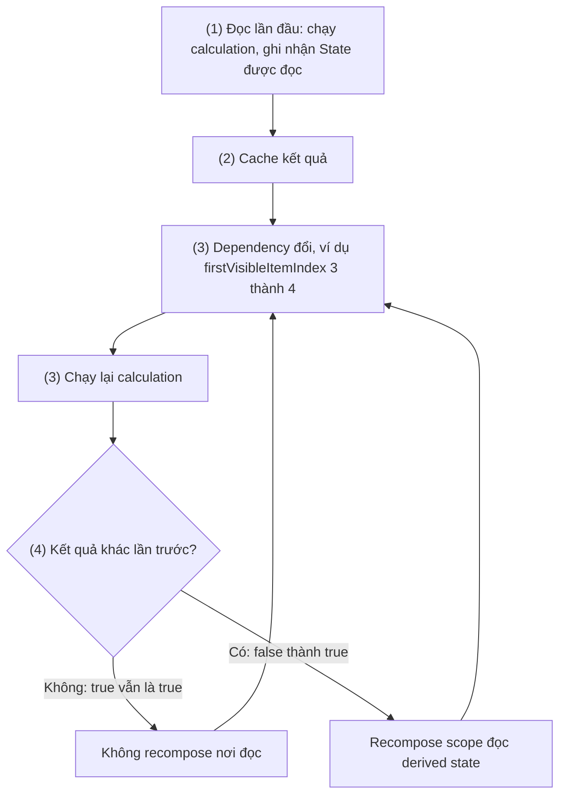
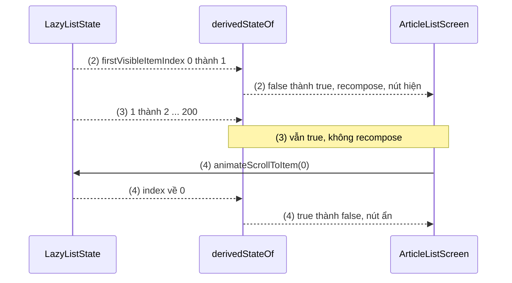

# derivedStateOf

## Vấn đề cần giải quyết

Một số State đổi **rất thường xuyên**: vị trí cuộn, kích thước khi kéo, text đang gõ. Nhưng UI thường chỉ cần biết một điều **thô hơn** về chúng: "đã cuộn qua item đầu chưa", "text đã đủ 8 ký tự chưa".

```kotlin
// ArticleListScreen.kt (cách làm có vấn đề)
@Composable
fun ArticleListScreen(articles: List<Article>) {
    val listState = rememberLazyListState()
    val showScrollToTop = listState.firstVisibleItemIndex > 0   // đọc trực tiếp trong composition

    Box {
        LazyColumn(state = listState) { items(articles, key = { it.id }) { ArticleRow(it) } }
        if (showScrollToTop) ScrollToTopButton(listState)
    }
}
```

`firstVisibleItemIndex` là State đổi mỗi khi item đầu tiên thay đổi: cuộn qua 200 bài là 200 lần đổi. Vì nó được **đọc** trong thân `ArticleListScreen`, cả scope này recompose 200 lần, dù `showScrollToTop` chỉ đổi đúng **một** lần (từ `false` sang `true`). Nơi đọc state quyết định phạm vi recompose ([Remember và Recomposition](../remember_and_recomposition.md)).

Vấn đề cần giải quyết là: **cho composable phụ thuộc vào kết quả thô, không phụ thuộc vào input đổi liên tục**, để recomposition xảy ra theo nhịp của kết quả.

## Sau khi học xong

- Giải thích được cơ chế của derivedStateOf, gồm theo dõi các State đọc trong khối tính toán và chỉ báo thay đổi khi kết quả khác lần trước.
- Áp dụng được derivedStateOf bọc trong remember để giảm recomposition khi input đổi thường xuyên hơn output, như nút lên đầu trang theo firstVisibleItemIndex.
- Phân biệt được khi nào dùng derivedStateOf, khi nào chỉ cần tính thẳng hoặc dùng remember(key).
- Nhận diện được lỗi tạo derivedStateOf không remember và lỗi bắt tham số không phải State mà thiếu key.

## derivedStateOf là gì?

**`derivedStateOf { calculation }`** tạo một `State<T>` có giá trị được tính từ các State khác **đọc trong khối `calculation`**, và chỉ báo cho nơi đọc nó recompose khi **kết quả khác lần trước**. Vì vậy nó dùng khi input đổi thường xuyên hơn output cần đổi.

Mental model: derivedStateOf là **bộ lọc tần số** đặt giữa một State đổi nhanh và UI: input dao động liên tục ở phía trước, phía sau chỉ thấy một tín hiệu khi kết quả thật sự đổi. Docs so sánh nó với `distinctUntilChanged()` của Flow.

## Cách hoạt động

### Theo dõi lần đọc và so sánh kết quả

Khi State của derivedStateOf được đọc lần đầu:

1. Khối `calculation` chạy; snapshot system **ghi nhận mọi State được đọc** trong khối (ở đây `firstVisibleItemIndex`). Đó là các dependency.
2. Kết quả được cache lại cùng "phiên bản" của từng dependency.
3. Một dependency đổi: nơi đang quan sát derived state được báo có thể có thay đổi; khối `calculation` chạy lại để tính kết quả mới.
4. So kết quả mới với kết quả cũ (mặc định bằng `equals`, theo `structuralEqualityPolicy`). **Bằng nhau thì không làm gì**: scope đọc derived state không recompose. Khác nhau thì scope đó recompose.

Điểm cần nhớ: **khối tính toán vẫn chạy mỗi khi input đổi**; cái được tiết kiệm là **recomposition** của nơi đọc kết quả. Vì vậy `calculation` nên rẻ, và derivedStateOf chỉ đáng dùng khi recomposition được tiết kiệm lớn hơn chi phí theo dõi. Docs ghi rõ derivedStateOf **tốn kém**, chỉ dùng để tránh recomposition khi kết quả không đổi.



Có overload nhận `policy` (`derivedStateOf(policy = referentialEqualityPolicy()) { ... }`) khi muốn so sánh kiểu khác, nhưng mặc định là đủ cho hầu hết trường hợp.

### Luôn bọc trong remember

`derivedStateOf { }` tạo một object mới mỗi lần được gọi. Gọi thẳng trong thân composable thì mỗi lần recompose là một object mới, cache bị bỏ, và không còn gì để so với "lần trước". Vì vậy luôn viết:

```kotlin
val showScrollToTop by remember { derivedStateOf { listState.firstVisibleItemIndex > 0 } }
```

Khi khối tính toán dùng thêm một giá trị **không phải State** (tham số của composable), giá trị đó không được snapshot system theo dõi. `remember { }` không key sẽ giữ khối tính toán với giá trị cũ mãi mãi. Đưa giá trị đó vào key của `remember`:

```kotlin
// threshold là tham số Int thường, không phải State
val showScrollToTop by remember(threshold) {
    derivedStateOf { listState.firstVisibleItemIndex > threshold }
}
```

`listState` không cần là key ở đây vì nó được tạo bằng `rememberLazyListState()` trong cùng composable, không đổi trong composition.

#### Ví dụ: nút "Lên đầu trang" cho danh sách bài báo

**Bài toán:** danh sách dài hiện nút nổi "Lên đầu trang" khi người dùng đã cuộn qua item đầu, ẩn khi về đầu. Input (`firstVisibleItemIndex`) đổi hàng trăm lần, output (`showScrollToTop`) đổi vài lần.

**Luồng chạy:**

1. `remember { derivedStateOf { ... } }` tạo derived state một lần; lần đọc đầu cho `false`.
2. Người dùng cuộn: `firstVisibleItemIndex` đổi 0 → 1. Calculation chạy lại, kết quả `true` khác `false`: scope đọc `showScrollToTop` recompose, nút hiện.
3. Cuộn tiếp 1 → 2 → … → 200: calculation chạy lại mỗi lần, kết quả vẫn `true`: không recompose.
4. Bấm nút: `scope.launch { listState.animateScrollToItem(0) }` ([LaunchedEffect](launched_effect.md), mục `rememberCoroutineScope`). Về 0: kết quả `false`, nút ẩn.



**Code:**

```kotlin
// ArticleListScreen.kt
@Composable
fun ArticleListScreen(articles: List<Article>, modifier: Modifier = Modifier) {
    val listState = rememberLazyListState()
    val scope = rememberCoroutineScope()

    val showScrollToTop by remember {                                // (1) tạo một lần
        derivedStateOf { listState.firstVisibleItemIndex > 0 }       // (2) (3) chạy lại khi index đổi
    }

    Box(modifier) {
        LazyColumn(state = listState) {
            items(articles, key = { it.id }) { article -> ArticleRow(article) }
        }
        AnimatedVisibility(
            visible = showScrollToTop,                               // (2) (4) chỉ đổi khi kết quả đổi
            modifier = Modifier.align(Alignment.BottomEnd).padding(16.dp),
        ) {
            FloatingActionButton(onClick = { scope.launch { listState.animateScrollToItem(0) } }) { // (4)
                Icon(Icons.Filled.KeyboardArrowUp, contentDescription = "Lên đầu trang")
            }
        }
    }
}
```

`LazyListState` và `firstVisibleItemIndex` học ở [LazyColumn](../modifier/lazy_column.md); `AnimatedVisibility` học ở [AnimatedVisibility](../graphics_animations/animated_visibility.md).

**Kết quả:** mở Layout Inspector, bật recomposition counts rồi cuộn hết danh sách. Với bản trong "Vấn đề cần giải quyết", số recompose của `ArticleListScreen` tăng theo từng item cuộn qua; với bản derivedStateOf, nó chỉ tăng khi nút hiện hoặc ẩn.

## Ví dụ thực tế

1. **Nút "Lên đầu trang"** theo `firstVisibleItemIndex`: ví dụ chính ở trên.
2. **Top bar có bóng khi đã cuộn:** `remember { derivedStateOf { listState.firstVisibleItemIndex > 0 || listState.firstVisibleItemScrollOffset > 0 } }`. `firstVisibleItemScrollOffset` đổi từng pixel, kết quả chỉ đổi hai lần.
3. **Nút "Đăng ký" bật khi mật khẩu đủ mạnh:** text đổi mỗi ký tự, nhưng "đủ mạnh hay chưa" đổi rất ít. Chỉ đáng dùng khi state text được đọc ở một composable lớn; nếu chỉ nút đọc nó thì tính thẳng là đủ.

## Khi nào nên và không nên dùng

Câu hỏi quyết định: **output có đổi ít hơn input không?** Nếu output đổi cùng nhịp với input, derivedStateOf không bớt được recomposition nào, chỉ thêm chi phí theo dõi.

```kotlin
// Sai theo docs: fullName đổi đúng mỗi lần firstName hoặc lastName đổi
val fullNameBad by remember { derivedStateOf { "$firstName $lastName" } }

// Đúng: tính thẳng
val fullName = "$firstName $lastName"
```

Bảng chọn giữa derivedStateOf và các cách khác:

| Tình huống | Dùng | Vì sao |
|---|---|---|
| Output đổi cùng nhịp với input State (ghép họ tên, định dạng giá) | Tính thẳng trong thân composable | Không có recomposition thừa để tiết kiệm |
| Phép tính đắt, input là **tham số** (không phải State) | `remember(input) { compute(input) }` | Chỉ tính lại khi tham số đổi; xem [Remember và Recomposition](../remember_and_recomposition.md) |
| Input là State đổi nhanh, output đổi ít (vị trí cuộn → bool, text → hợp lệ/không) | `remember { derivedStateOf { } }` | Tiết kiệm recomposition |
| Cần phản ứng bằng side effect khi output đổi (gửi analytics) | `snapshotFlow { }` trong LaunchedEffect | Đó là việc của effect ([snapshotFlow](flow_with_snapshot.md)) |
| Dữ liệu nghiệp vụ suy ra (tổng tiền giỏ hàng) | Tính trong ViewModel, đưa vào `uiState` | Logic không thuộc UI |

Khác biệt giữa `remember(key)` và derivedStateOf: `remember(key)` chỉ chạy lại khi composable **đã** recompose và thấy key đổi, nên không ngăn được recomposition; derivedStateOf quyết định **có** recompose hay không.

## Sai lầm thường gặp

### 1. Không bọc trong remember

```kotlin
// Sai: tạo derived state mới mỗi lần recompose
val showScrollToTop by derivedStateOf { listState.firstVisibleItemIndex > 0 }
```

**Lỗi lộ ra thế nào:** không còn cache để so, nên mỗi lần recompose lại tạo object và theo dõi từ đầu; Android Studio hiện cảnh báo lint `UnrememberedMutableState`, vì `derivedStateOf` được đánh dấu là hàm tạo state (`@StateFactoryMarker`), giống `mutableStateOf`.

**Cách sửa:** `remember { derivedStateOf { ... } }`.

### 2. Bắt tham số không phải State mà thiếu key

```kotlin
// Sai: đổi threshold từ 0 sang 5 nhưng nút vẫn hiện từ item 1
@Composable
fun ScrollToTopHost(listState: LazyListState, threshold: Int) {
    val show by remember { derivedStateOf { listState.firstVisibleItemIndex > threshold } }
    // ...
}
```

**Lỗi lộ ra thế nào:** khối tính toán giữ `threshold` (và `listState`) của lần composition đầu; tham số mới bị bỏ qua.

**Cách sửa:** `remember(listState, threshold) { derivedStateOf { ... } }`. Ở đây `listState` cũng là tham số nên cũng phải là key.

### 3. Dùng derivedStateOf cho mọi giá trị "suy ra"

**Lỗi lộ ra thế nào:** code đầy `remember { derivedStateOf { } }` cho ghép chuỗi, định dạng số; Layout Inspector cho thấy số recompose không giảm, còn code khó đọc hơn.

**Cách sửa:** áp câu hỏi "output có đổi ít hơn input không?"; không thì tính thẳng.

### 4. Đọc derived state ở scope quá rộng

**Lỗi lộ ra thế nào:** derived state đúng, nhưng được đọc ở đầu một composable lớn nên mỗi lần kết quả đổi là cả màn hình recompose.

**Cách sửa:** đọc nó gần nơi dùng nhất (truyền `State` hoặc lambda `() -> Boolean` xuống composable con), để chỉ scope nhỏ recompose.

## Lịch sử phát triển

- **2020 (trước 1.0):** `derivedStateOf` là một phần của snapshot system ngay từ đầu, cùng `mutableStateOf`; nó dùng cùng cơ chế ghi nhận lần đọc mà recomposition dựa vào.
- **07/2021 (Compose 1.0):** API ổn định. Về sau runtime có thêm overload nhận `SnapshotMutationPolicy` để tuỳ biến cách so sánh kết quả.
- **Hiện nay:** vì derivedStateOf bị lạm dụng, docs chính thức tách hẳn hai mục "Correct usage" và "Incorrect usage", ghi rõ nó tốn kém và chỉ dùng khi kết quả đổi ít hơn input; lint của Compose cảnh báo khi tạo state (gồm derivedStateOf) trong composition mà không `remember`.

## Kết nối hệ thống

- **Tiên quyết:**
  - [Remember và Recomposition](../remember_and_recomposition.md): recompose scope, nơi đọc state quyết định phạm vi, `remember(key)`.
  - [MutableState và State Hoisting](../state/mutable_state.md): snapshot system theo dõi lần đọc.
- **Liên quan:**
  - [LaunchedEffect](launched_effect.md): bảng chọn effect API, `rememberCoroutineScope` của nút cuộn lên đầu.
  - [snapshotFlow](flow_with_snapshot.md): cùng ý "chỉ phản ứng khi giá trị khác", nhưng cho side effect.
  - [LazyColumn](../modifier/lazy_column.md): `LazyListState`, `firstVisibleItemIndex`.
- **Học tiếp:**
  - [snapshotFlow và flowWithSnapshot](flow_with_snapshot.md).

## Tham khảo

- [Side-effects in Compose: derivedStateOf - Android Developers](https://developer.android.com/develop/ui/compose/side-effects#derivedstateof)
- [Follow best practices: use derivedStateOf to limit recompositions - Android Developers](https://developer.android.com/develop/ui/compose/performance/bestpractices#use-derivedstateof)
- [derivedStateOf - API reference](https://developer.android.com/reference/kotlin/androidx/compose/runtime/package-summary#derivedStateOf(kotlin.Function0))
