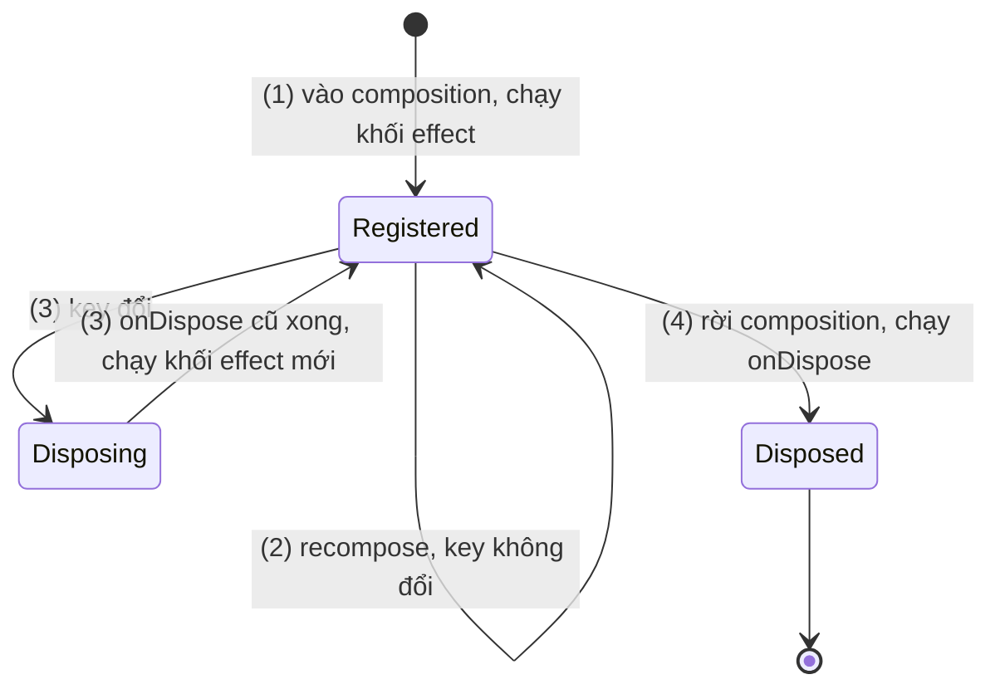
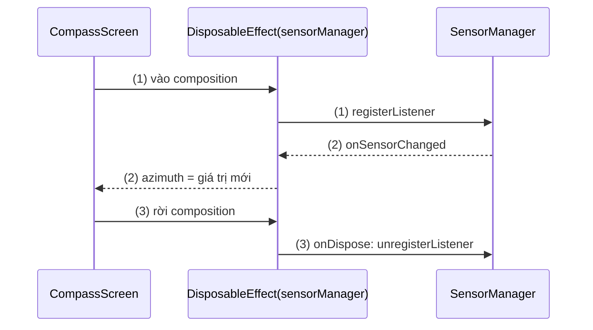
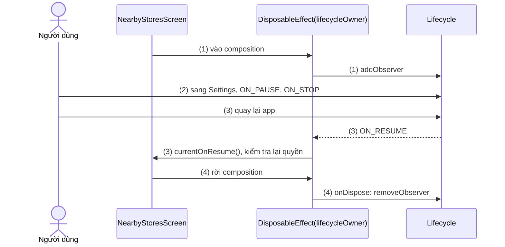
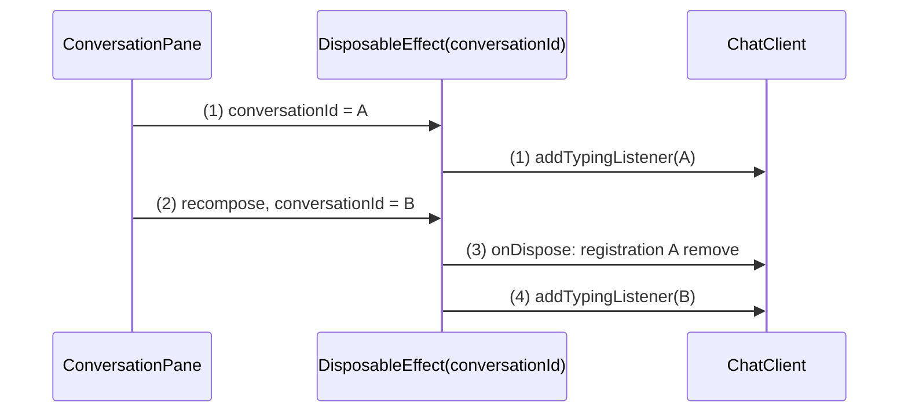
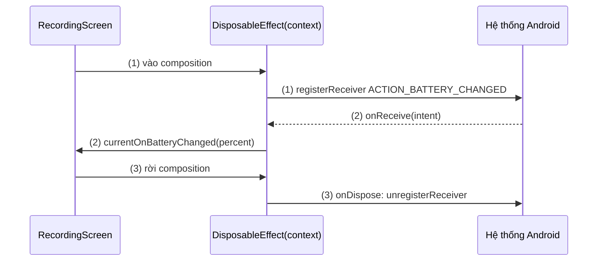

# DisposableEffect

## Vấn đề cần giải quyết

Nhiều nguồn dữ liệu trên Android hoạt động theo kiểu **đăng ký rồi huỷ đăng ký**: `SensorManager.registerListener` / `unregisterListener`, `Lifecycle.addObserver` / `removeObserver`, `registerReceiver` / `unregisterReceiver`. Ở View system, cặp này được đặt vào cặp callback lifecycle (`onStart`/`onStop`). Composable không có các callback đó, nên cách viết đầu tiên thường là:

```kotlin
// CompassScreen.kt (cách làm có vấn đề)
@Composable
fun CompassScreen(sensorManager: SensorManager) {
    var azimuth by remember { mutableFloatStateOf(0f) }
    val listener = remember {
        object : SensorEventListener {
            override fun onSensorChanged(event: SensorEvent) { azimuth = toAzimuth(event.values) }
            override fun onAccuracyChanged(sensor: Sensor?, accuracy: Int) = Unit
        }
    }
    sensorManager.registerListener(                       // chạy lại mỗi lần recompose
        listener,
        sensorManager.getDefaultSensor(Sensor.TYPE_ROTATION_VECTOR),
        SensorManager.SENSOR_DELAY_UI,
    )
    // Không có chỗ nào gọi unregisterListener
}
```

Hậu quả:

- **Không có điểm huỷ:** rời màn la bàn, sensor vẫn chạy, pin tụt; listener giữ tham chiếu tới state của màn đã đóng.
- **Đăng ký lặp:** mỗi lần recompose lại gọi `registerListener`.
- **Không đổi nguồn được:** nếu nguồn phụ thuộc tham số (id cuộc hội thoại, `LifecycleOwner`), đổi tham số không làm listener chuyển sang nguồn mới.

LaunchedEffect ([LaunchedEffect](launched_effect.md)) giải quyết được "chạy đúng lúc", nhưng nó dành cho coroutine. Vấn đề ở đây là **một cặp lệnh đồng bộ phải luôn đi cùng nhau**: có đăng ký thì phải có huỷ, đúng lúc vị trí gọi rời màn hình hoặc nguồn đổi.

## Sau khi học xong

- Giải thích được vòng đời của DisposableEffect, gồm khối effect chạy khi vào composition và onDispose chạy khi rời composition hoặc trước khi chạy lại với key mới.
- Triển khai được việc đăng ký và huỷ đăng ký sensor listener, LifecycleEventObserver và BroadcastReceiver bằng DisposableEffect.
- Phân biệt được DisposableEffect với LaunchedEffect và với các effect theo lifecycle LifecycleStartEffect, LifecycleResumeEffect, LifecycleEventEffect.
- Nhận diện được lỗi thiếu key, onDispose rỗng và callback cũ bị giữ trong listener.

## DisposableEffect là gì?

**`DisposableEffect(key) { ...; onDispose { ... } }`** là effect chạy một khối code **đồng bộ** khi vị trí gọi vào composition (và mỗi lần key đổi), và bắt buộc kết thúc bằng `onDispose { }`: khối dọn dẹp được gọi khi vị trí đó rời composition, hoặc ngay **trước** khi effect chạy lại với key mới.

Mental model: DisposableEffect là **một cặp đăng ký – huỷ đăng ký buộc vào một chỗ trong cây UI**. Compose bảo đảm hai vế luôn đi cùng nhau: mỗi lần khối effect chạy thì về sau đúng một lần `onDispose` tương ứng chạy.

## Cách hoạt động

### Khối effect, onDispose và thứ tự khi key đổi

DisposableEffect dùng cùng quy tắc key với LaunchedEffect (so bằng `equals`; mọi biến dùng trong khối và có thể đổi phải là key hoặc qua `rememberUpdatedState`). Khác biệt nằm ở thứ tự:

1. **Vào composition:** sau khi composition được áp, khối effect chạy (đăng ký) và trả về object `DisposableEffectResult` do `onDispose { }` tạo.
2. **Recompose, key không đổi:** không làm gì.
3. **Key đổi:** chạy `onDispose` của lần trước (huỷ nguồn cũ), **rồi** mới chạy khối effect với giá trị mới (đăng ký nguồn mới).
4. **Rời composition:** chạy `onDispose` của lần gần nhất.

`onDispose` phải là câu lệnh cuối của khối: kiểu trả về của khối là `DisposableEffectResult`, nên thiếu nó là lỗi biên dịch. Khối effect không phải coroutine; không gọi được hàm `suspend` trong đó.



#### Ví dụ: la bàn dùng cảm biến định hướng

**Bài toán:** màn la bàn đọc cảm biến để xoay mũi tên. Cảm biến chỉ được chạy khi màn này đang trong composition, vì nó tốn pin. Đây đúng là cặp đăng ký – huỷ đăng ký.

**Luồng chạy:**

1. `CompassScreen` vào composition; khối effect tạo listener và gọi `registerListener`.
2. Mỗi lần cảm biến báo, listener ghi `azimuth`; state đổi nên mũi tên recompose (hoặc chỉ vẽ lại). Key không đổi nên effect không bị đụng tới.
3. Người dùng rời màn la bàn: `onDispose` gọi `unregisterListener`.



**Code:**

```kotlin
// CompassScreen.kt
@Composable
fun CompassScreen(sensorManager: SensorManager, modifier: Modifier = Modifier) {
    var azimuth by remember { mutableFloatStateOf(0f) }

    DisposableEffect(sensorManager) {
        val rotationSensor = sensorManager.getDefaultSensor(Sensor.TYPE_ROTATION_VECTOR)
        val listener = object : SensorEventListener {
            private val rotation = FloatArray(9)
            private val orientation = FloatArray(3)
            override fun onSensorChanged(event: SensorEvent) {
                SensorManager.getRotationMatrixFromVector(rotation, event.values)
                SensorManager.getOrientation(rotation, orientation)
                azimuth = Math.toDegrees(orientation[0].toDouble()).toFloat()   // (2)
            }
            override fun onAccuracyChanged(sensor: Sensor?, accuracy: Int) = Unit
        }
        sensorManager.registerListener(listener, rotationSensor, SensorManager.SENSOR_DELAY_UI) // (1)

        onDispose { sensorManager.unregisterListener(listener) }               // (3)
    }

    CompassArrow(azimuth = azimuth, modifier = modifier)
}
```

**Kết quả:** mũi tên xoay theo hướng điện thoại. Rời màn hình thì Logcat không còn log từ `onSensorChanged` (thêm `Log.d` để thấy); `adb shell dumpsys sensorservice` không còn liệt kê kết nối của app tới cảm biến. Mở lại màn hình thì listener được đăng ký lại đúng một lần.

### LifecycleEventObserver: phản ứng theo lifecycle của màn hình

Composition chỉ biết composable **có mặt hay không**, không biết app đang foreground hay background. Khi Activity vào `STOPPED` (người dùng bấm Home), composition vẫn còn, các effect vẫn chạy. Muốn phản ứng theo `ON_START`/`ON_STOP`/`ON_RESUME`, đăng ký một `LifecycleEventObserver` vào `LifecycleOwner` hiện tại ([Activity Lifecycle](../../session_04/components/activity/lifecycle.md)).

`LifecycleOwner` của vị trí hiện tại lấy qua `LocalLifecycleOwner.current`. Từ Lifecycle 2.8.0, `LocalLifecycleOwner` nằm trong `lifecycle-runtime-compose` (package `androidx.lifecycle.compose`); bản cũ trong `androidx.compose.ui.platform` đã deprecated. `LocalLifecycleOwner` là một CompositionLocal, học ở [Custom Theme](../theming/custom_theme.md).

#### Ví dụ: kiểm tra lại quyền vị trí khi quay lại app

**Bài toán:** màn "Cửa hàng gần bạn" hiện nút "Bật quyền vị trí" khi chưa có quyền. Người dùng bấm, được đưa sang Settings, cấp quyền rồi quay lại app. Màn hình phải tự kiểm tra lại quyền ở `ON_RESUME`; không có sự kiện nào khác báo cho composable việc này.

**Luồng chạy:**

1. Khối effect tạo observer và `addObserver` vào lifecycle của `lifecycleOwner`.
2. Người dùng sang Settings: Activity vào `ON_PAUSE`, `ON_STOP`; composition vẫn còn.
3. Người dùng quay lại: `ON_RESUME` tới, observer gọi `currentOnResume()` (bản mới nhất qua `rememberUpdatedState`) để kiểm tra lại quyền.
4. Rời màn hình hoặc `lifecycleOwner` đổi (ví dụ màn hình được đặt vào destination khác của Navigation): `onDispose` gọi `removeObserver`.



**Code:**

```kotlin
// NearbyStoresScreen.kt
import androidx.lifecycle.compose.LocalLifecycleOwner

@Composable
fun NearbyStoresScreen(
    onResume: () -> Unit,                                      // ViewModel kiểm tra lại quyền
    lifecycleOwner: LifecycleOwner = LocalLifecycleOwner.current,
) {
    val currentOnResume by rememberUpdatedState(onResume)

    DisposableEffect(lifecycleOwner) {                         // key: đổi owner thì nghe owner mới
        val observer = LifecycleEventObserver { _, event ->
            if (event == Lifecycle.Event.ON_RESUME) currentOnResume()   // (3)
        }
        lifecycleOwner.lifecycle.addObserver(observer)         // (1)
        onDispose { lifecycleOwner.lifecycle.removeObserver(observer) } // (4)
    }
    // ... nội dung màn hình
}
```

**Kết quả:** cấp quyền trong Settings rồi bấm Back, màn hình tự chuyển từ nút "Bật quyền vị trí" sang danh sách cửa hàng. Lưu ý `addObserver` phát lại các sự kiện tới trạng thái hiện tại, nên `ON_RESUME` cũng tới ngay lần đầu màn hình hiện khi Activity đang resumed. Kiểm chứng: log trong observer xuất hiện mỗi lần quay lại app, không xuất hiện sau khi rời màn hình.

### Key đổi: dọn nguồn cũ trước, đăng ký nguồn mới sau

Thứ tự "dispose rồi mới chạy lại" là điều làm DisposableEffect an toàn khi nguồn phụ thuộc tham số: không bao giờ có lúc hai listener cùng nghe.

#### Ví dụ: chỉ báo "đang gõ…" khi chuyển hội thoại

**Bài toán:** màn chat hiện "An đang gõ…" bằng listener của SDK chat: `chatClient.addTypingListener(conversationId, listener)` trả về một `Registration` có `remove()`. Người dùng chuyển từ hội thoại A sang B trong cùng màn hình (ví dụ layout hai cột trên tablet): phải ngừng nghe A rồi mới nghe B.

**Luồng chạy:**

1. `conversationId = "A"`: khối effect đăng ký listener cho A.
2. Người dùng chọn hội thoại B: recompose với key khác.
3. Compose chạy `onDispose` của lần trước: `registration.remove()` cho A, và xoá chỉ báo cũ.
4. Compose chạy khối effect với key `"B"`: đăng ký listener cho B.



**Code:**

```kotlin
// ConversationPane.kt
@Composable
fun ConversationPane(conversationId: String, chatClient: ChatClient) {
    var typingUser by remember { mutableStateOf<String?>(null) }

    DisposableEffect(chatClient, conversationId) {                      // (2) đổi id là key khác
        val registration = chatClient.addTypingListener(conversationId) { user ->
            typingUser = user                                           // null khi ngừng gõ
        }                                                               // (1) (4)
        onDispose {
            registration.remove()                                       // (3) ngừng nghe hội thoại cũ
            typingUser = null
        }
    }

    typingUser?.let { Text("$it đang gõ…", style = MaterialTheme.typography.labelMedium) }
}
```

**Kết quả:** chuyển từ A sang B, chỉ báo "đang gõ" của A biến mất ngay và không còn quay lại. Kiểm chứng bằng một `FakeChatClient` trong UI test đếm số listener đang đăng ký: sau mỗi lần đổi `conversationId`, số đó luôn là 1.

### Effect theo lifecycle: LifecycleStartEffect, LifecycleResumeEffect, LifecycleEventEffect

Mẫu "DisposableEffect + LifecycleEventObserver" phổ biến tới mức Lifecycle 2.7.0 thêm sẵn ba effect trong `lifecycle-runtime-compose`:

| API | Chạy khối chính khi | Dọn dẹp khi | Dùng cho |
|---|---|---|---|
| `LifecycleEventEffect(event) { }` | Sự kiện `event` xảy ra | Không có dọn dẹp | Việc một lần theo sự kiện: log, kiểm tra lại quyền ở `ON_RESUME` |
| `LifecycleStartEffect(key) { ...; onStopOrDispose { } }` | `ON_START` (và khi key đổi) | `ON_STOP` hoặc rời composition | Tài nguyên cần khi app đang hiển thị: vị trí, kết nối |
| `LifecycleResumeEffect(key) { ...; onPauseOrDispose { } }` | `ON_RESUME` (và khi key đổi) | `ON_PAUSE` hoặc rời composition | Tài nguyên cần khi người dùng đang tương tác: camera, video |

Ba điểm cần nhớ:

- `LifecycleStartEffect` và `LifecycleResumeEffect` **bắt buộc có key** từ Lifecycle 2.8.0 (giống DisposableEffect), và khối dọn dẹp là bắt buộc. Không cần dọn dẹp thì dùng `LifecycleEventEffect`.
- `LifecycleEventEffect` không nghe được `ON_DESTROY`, vì composition đã kết thúc trước khi sự kiện này tới.
- Cả ba mặc định dùng `LocalLifecycleOwner.current`.

Ví dụ kiểm tra quyền ở trên viết gọn lại được:

```kotlin
// NearbyStoresScreen.kt (bản gọn với Lifecycle 2.7.0+)
LifecycleEventEffect(Lifecycle.Event.ON_RESUME) {
    onResume()      // effect tự giữ lambda mới nhất, không cần rememberUpdatedState
}
```

`LifecycleEventEffect` dùng `rememberUpdatedState` bên trong cho khối `onEvent`, nên luôn gọi lambda mới nhất.

## Ví dụ thực tế

Ba bài toán thường gặp:

1. **Lắng nghe broadcast của hệ thống chỉ khi màn hình đang hiện:** như cảnh báo pin yếu trên màn quay video. Code đầy đủ bên dưới.
2. **Giữ màn hình sáng khi đang dẫn đường:** khối effect đặt `view.keepScreenOn = true` (lấy `LocalView.current`), `onDispose` đặt lại `false`. Không có luồng phức tạp, một cặp lệnh.
3. **Camera preview chỉ chạy khi người dùng đang tương tác:** `LifecycleResumeEffect(cameraController) { startPreview(); onPauseOrDispose { stopPreview() } }`.

### Cảnh báo pin yếu bằng BroadcastReceiver

**Bài toán:** màn quay video hiện cảnh báo khi pin dưới 15%. Thông tin pin đến qua broadcast `ACTION_BATTERY_CHANGED` của hệ thống. Receiver chỉ được đăng ký khi màn quay đang trong composition, và composable nhận callback mới nhất từ cha.

**Luồng chạy:**

1. Khối effect tạo `BroadcastReceiver`, đăng ký bằng `ContextCompat.registerReceiver` với `IntentFilter(ACTION_BATTERY_CHANGED)`.
2. Hệ thống gửi broadcast mỗi khi mức pin đổi; `onReceive` tính phần trăm rồi gọi `currentOnBatteryChanged(percent)`.
3. Rời màn quay hoặc `context` đổi: `onDispose` gọi `unregisterReceiver`.



**Code:**

```kotlin
// BatteryLevelEffect.kt
@Composable
fun BatteryLevelEffect(onBatteryChanged: (percent: Int) -> Unit) {
    val context = LocalContext.current
    val currentOnBatteryChanged by rememberUpdatedState(onBatteryChanged)

    DisposableEffect(context) {
        val receiver = object : BroadcastReceiver() {
            override fun onReceive(context: Context, intent: Intent) {
                val level = intent.getIntExtra(BatteryManager.EXTRA_LEVEL, -1)
                val scale = intent.getIntExtra(BatteryManager.EXTRA_SCALE, -1)
                if (level >= 0 && scale > 0) currentOnBatteryChanged(level * 100 / scale) // (2)
            }
        }
        ContextCompat.registerReceiver(                                   // (1)
            context,
            receiver,
            IntentFilter(Intent.ACTION_BATTERY_CHANGED),
            ContextCompat.RECEIVER_NOT_EXPORTED,   // không nhận từ app khác; broadcast hệ thống vẫn tới
        )
        onDispose { context.unregisterReceiver(receiver) }                // (3)
    }
}

// RecordingScreen.kt
@Composable
fun RecordingScreen() {
    var batteryPercent by remember { mutableIntStateOf(100) }
    BatteryLevelEffect(onBatteryChanged = { batteryPercent = it })

    if (batteryPercent < 15) {
        Text("Pin yếu ($batteryPercent%), video có thể bị dừng", color = MaterialTheme.colorScheme.error)
    }
    // ... camera preview, nút quay
}
```

`BatteryLevelEffect` là một composable không phát ra UI, đóng gói cả cặp đăng ký – huỷ: màn nào cần chỉ việc gọi. Đây là cách docs khuyên tách effect dùng lại. `BroadcastReceiver` và cờ export học ở [Broadcast Receiver](../../session_04/components/broadcast/broadcast_receiver.md).

**Kết quả:** giả lập pin 10% bằng `adb shell dumpsys battery set level 10`: cảnh báo hiện ngay. `adb shell dumpsys battery reset` để trả lại. Rời màn quay rồi đổi mức pin: không còn log từ `onReceive`.

## So sánh với các cách tiếp cận khác

| Tiêu chí | `DisposableEffect` | `LaunchedEffect` | `LifecycleStartEffect` / `LifecycleResumeEffect` |
|---|---|---|---|
| Khối chính | Code đồng bộ | Coroutine, gọi được `suspend` | Code đồng bộ |
| Dọn dẹp | `onDispose` bắt buộc | Huỷ coroutine (dùng `try/finally` nếu cần) | `onStopOrDispose` / `onPauseOrDispose` bắt buộc |
| Theo dõi | Có mặt trong composition | Có mặt trong composition | Có mặt trong composition **và** trạng thái lifecycle |
| Hợp với | Listener, observer, receiver | Snackbar, cuộn, animation, đếm ngược | Tài nguyên nên tắt khi app ở background |

Với nguồn dữ liệu dùng ở nhiều màn hình (trạng thái mạng, vị trí), cách bền hơn là bọc listener thành `Flow` bằng `callbackFlow` trong tầng data ([Flow](../../session_07/design_pattern/observer/flow.md), mục "`callbackFlow`: biến listener thành Flow"), rồi UI đọc qua `collectAsStateWithLifecycle()` ([snapshotFlow](flow_with_snapshot.md)). DisposableEffect hợp nhất khi listener chỉ phục vụ **một** composable.

## Khi nào nên và không nên dùng

- **Nên dùng** khi có cặp lệnh đồng bộ phải đi cùng nhau và gắn với một composable: listener của sensor, SDK, View cũ; `Lifecycle.addObserver`; `registerReceiver`; đặt rồi trả lại một thuộc tính (`keepScreenOn`, độ sáng màn hình).
- **Dùng LifecycleStartEffect/LifecycleResumeEffect** khi tài nguyên phải tắt cả khi app vào background, không chỉ khi rời composition.
- **Không dùng** khi không có gì để dọn: `onDispose { }` rỗng là dấu hiệu nên dùng `SideEffect` hoặc `LaunchedEffect` (docs gọi đây là cách làm không tốt).
- **Không dùng** cho việc cần `suspend`: dùng LaunchedEffect; cần dọn dẹp thêm thì đặt trong `try { awaitCancellation() } finally { }`.
- **Không dùng** để nghe dữ liệu nghiệp vụ dùng chung (giỏ hàng, phiên đăng nhập): đó là `Flow` từ Repository qua ViewModel.

## Sai lầm thường gặp

### 1. Thiếu key cho thứ được dùng trong khối effect

```kotlin
// Sai: lifecycleOwner dùng trong khối nhưng không là key
DisposableEffect(Unit) {
    lifecycleOwner.lifecycle.addObserver(observer)
    onDispose { lifecycleOwner.lifecycle.removeObserver(observer) }
}
```

**Lỗi lộ ra thế nào:** khi `lifecycleOwner` đổi (composable được dời sang destination Navigation khác), observer vẫn gắn vào owner cũ: sự kiện của màn hiện tại không tới, và owner cũ bị giữ lại.

**Cách sửa:** `DisposableEffect(lifecycleOwner)`. Cùng quy tắc với LaunchedEffect: mọi biến có thể đổi trong khối là key, hoặc đi qua `rememberUpdatedState`.

### 2. Listener giữ callback cũ

```kotlin
// Sai: onBatteryChanged của lần composition đầu bị giữ mãi trong receiver
DisposableEffect(context) {
    val receiver = object : BroadcastReceiver() {
        override fun onReceive(c: Context, i: Intent) = onBatteryChanged(readPercent(i))
    }
    // ...
}
```

**Lỗi lộ ra thế nào:** cha truyền lambda mới (ví dụ đã đổi sang ghi vào một state khác), nhưng receiver vẫn gọi lambda đầu tiên; UI không cập nhật như mong đợi.

**Cách sửa:** `val currentOnBatteryChanged by rememberUpdatedState(onBatteryChanged)` và gọi biến này trong receiver. Đưa lambda vào key cũng chạy đúng, nhưng sẽ huỷ và đăng ký lại receiver mỗi lần cha recompose.

### 3. Đăng ký trong `remember` thay vì trong effect

```kotlin
// Sai: không có điểm huỷ
val registration = remember(conversationId) { chatClient.addTypingListener(conversationId) { } }
```

**Lỗi lộ ra thế nào:** `remember` không có callback "khi bị quên" cho code của bạn; mỗi lần đổi `conversationId` là thêm một listener không bao giờ được gỡ. `remember` còn chạy ngay trong composition, kể cả lần bị bỏ dở.

**Cách sửa:** đăng ký trong DisposableEffect, huỷ trong `onDispose`.

### 4. `onDispose` rỗng

```kotlin
// Không nên: không có gì để dọn
DisposableEffect(screenName) {
    analytics.logScreenView(screenName)
    onDispose { }
}
```

**Lỗi lộ ra thế nào:** code chạy đúng, nhưng người đọc tìm mãi xem dọn dẹp ở đâu; về sau dễ có người thêm việc `suspend` vào và phải đổi API.

**Cách sửa:** `LaunchedEffect(screenName) { analytics.logScreenView(screenName) }`, hoặc `LifecycleEventEffect(ON_RESUME)` nếu muốn log mỗi lần màn hình quay lại foreground.

## Lịch sử phát triển

- **2019–2020 (dev, alpha):** Compose có `onActive { }`, `onCommit { }` và `onDispose { }` riêng rẽ; cặp đăng ký – huỷ không bị bắt buộc đi cùng nhau.
- **Cuối 2020 (alpha):** `DisposableEffect` thay cho bộ trên, với `onDispose` là câu lệnh cuối bắt buộc. Quy ước key giống LaunchedEffect.
- **07/2021 (Compose 1.0):** API ổn định; overload không key là lỗi biên dịch.
- **01/2024 (Lifecycle 2.7.0, alpha từ 07/2023):** thêm `LifecycleEventEffect`, `LifecycleStartEffect`, `LifecycleResumeEffect` trong `lifecycle-runtime-compose`, thay cho mẫu tự viết DisposableEffect + LifecycleEventObserver.
- **05/2024 (Lifecycle 2.8.0):** gọi `LifecycleStartEffect` và `LifecycleResumeEffect` không có key thành lỗi biên dịch; `LocalLifecycleOwner` chuyển từ Compose UI sang `lifecycle-runtime-compose`.

## Kết nối hệ thống

- **Tiên quyết:**
  - [LaunchedEffect](launched_effect.md): khái niệm side effect, quy tắc key, `rememberUpdatedState`, bảng chọn effect API.
  - [Activity Lifecycle](../../session_04/components/activity/lifecycle.md): các sự kiện `ON_START`, `ON_RESUME`, `ON_PAUSE`, `ON_STOP`.
- **Liên quan:**
  - [produceState](produce_state.md): biến nguồn callback thành `State` bằng `awaitDispose`, cùng tinh thần đăng ký – huỷ.
  - [snapshotFlow](flow_with_snapshot.md): `collectAsStateWithLifecycle` cho nguồn đã là `Flow`.
  - [Remember và Recomposition](../remember_and_recomposition.md): vì sao `remember` không phải chỗ để đăng ký listener.
  - [Fragment Lifecycle](../../session_04/components/fragment/lifecycle.md): `LocalLifecycleOwner` trong Fragment là view lifecycle.
  - [Broadcast Receiver](../../session_04/components/broadcast/broadcast_receiver.md): receiver đăng ký bằng context.
  - [8.4.3 Coroutines](../../session_08/async_threads/coroutines.md): `awaitCancellation`, `try/finally` khi coroutine bị huỷ.
  - [Flow](../../session_07/design_pattern/observer/flow.md): `callbackFlow` khi listener cần dùng ở nhiều màn hình.
- **Học tiếp:**
  - [produceState](produce_state.md).

## Tham khảo

- [Side-effects in Compose: DisposableEffect - Android Developers](https://developer.android.com/develop/ui/compose/side-effects#disposableeffect)
- [Lifecycle in Jetpack Compose - Android Developers](https://developer.android.com/topic/libraries/architecture/compose)
- [Lifecycle release notes (2.7.0, 2.8.0) - Android Developers](https://developer.android.com/jetpack/androidx/releases/lifecycle)
- [Broadcasts overview: context-registered receivers - Android Developers](https://developer.android.com/develop/background-work/background-tasks/broadcasts)
- [Sensors overview - Android Developers](https://developer.android.com/develop/sensors-and-location/sensors/sensors_overview)
