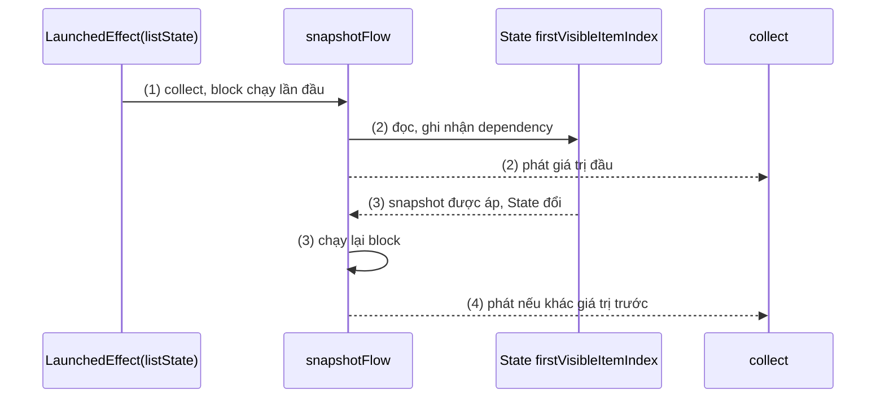
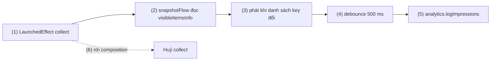
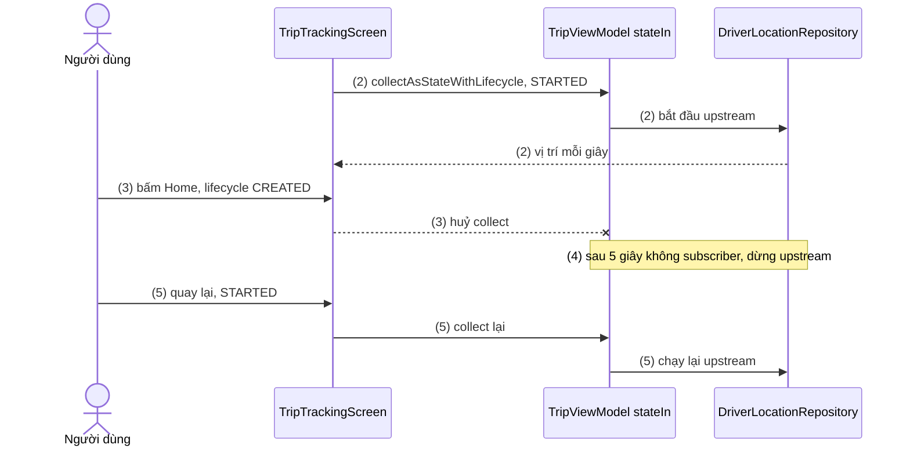
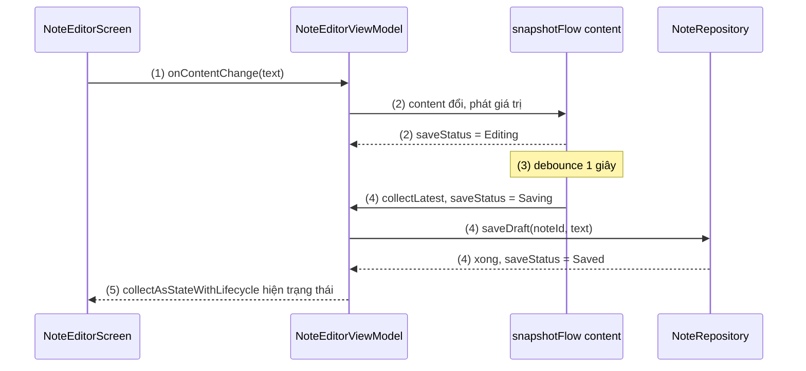

# snapshotFlow và flowWithSnapshot

## Vấn đề cần giải quyết

Một app Compose có hai thế giới giá trị thay đổi theo thời gian:

- **Compose State** (`State<T>`, `mutableStateOf`, `LazyListState.firstVisibleItemIndex`): composition đọc được và tự recompose khi nó đổi.
- **Kotlin Flow** (`Flow<T>`, `StateFlow<T>`): tầng data và ViewModel dùng để phát dữ liệu, có toán tử `map`, `filter`, `debounce`, `combine`.

Hai thế giới cần đi qua nhau theo cả hai hướng:

1. **Flow → State:** ViewModel đưa `uiState: StateFlow<...>` ra, nhưng composable chỉ đọc được `State`.
2. **State → Flow:** UI có một State đổi liên tục (vị trí cuộn, text đang gõ) và muốn xử lý nó bằng toán tử Flow: chờ người dùng dừng cuộn 500 ms rồi mới gửi analytics, lọc giá trị trùng.

Cách làm thủ công cho hướng 2 thường là một LaunchedEffect có key đổi theo State:

```kotlin
// ArticleFeed.kt (cách làm có vấn đề)
LaunchedEffect(listState.firstVisibleItemIndex) {   // key đổi mỗi item, effect khởi động lại liên tục
    delay(500)
    analytics.logVisibleItems(listState.layoutInfo.visibleItemsInfo.map { it.key })
}
```

Effect khởi động lại ở mỗi item cuộn qua, và vì key được đọc trong composition nên cả màn hình recompose theo vị trí cuộn. Hướng 1 có bẫy khác: cách collect đơn giản nhất (`collectAsState()`) **vẫn collect khi app ở background**.

Vấn đề cần giải quyết là: **chuyển giá trị giữa State và Flow theo cả hai chiều, đúng vòng đời, không gây recomposition thừa**.

## Sau khi học xong

- Giải thích được snapshotFlow biến các State đọc trong khối thành cold Flow thế nào, và vì sao nó chỉ phát giá trị khác giá trị trước.
- Áp dụng được snapshotFlow trong LaunchedEffect hoặc ViewModel để dùng toán tử Flow như debounce, filter cho State, ví dụ gửi analytics khi cuộn.
- Phân biệt được collectAsState với collectAsStateWithLifecycle, và giải thích được vì sao collectAsStateWithLifecycle là cách khuyên dùng trên Android.
- Phân biệt được tên gọi flowWithSnapshot trong mục lục với các API có thật là snapshotFlow và Flow.flowWithLifecycle.
- Nhận diện được lỗi đọc giá trị không phải State trong snapshotFlow, tạo Flow mới mỗi lần recompose và collect Flow khi app ở background.

## Chuyển đổi State ↔ Flow là gì?

**Chuyển đổi State ↔ Flow** là hai bộ chuyển đổi đối xứng giữa Compose State và Kotlin Flow: **`snapshotFlow { }`** biến các State được đọc trong khối thành một **cold Flow** phát giá trị mới (khác giá trị trước) mỗi khi State đó đổi; **`collectAsState()` / `collectAsStateWithLifecycle()`** collect một Flow và đưa giá trị mới nhất vào một State cho composition đọc.

Mental model: hai **cửa khẩu** giữa hai thế giới. Đi từ Compose sang coroutine thì qua cửa `snapshotFlow`; đi từ coroutine vào Compose thì qua cửa `collectAsStateWithLifecycle`. Mỗi cửa có giờ mở riêng: cửa `snapshotFlow` mở khi có người collect, cửa `collectAsStateWithLifecycle` chỉ mở khi màn hình đang hiển thị.

> [!IMPORTANT]
> Mục lục ghi "SnapShotFlow and flowWithSnapshot", nhưng **`flowWithSnapshot` không phải API của Compose** hay của thư viện AndroidX nào. API có thật gần tên nhất là `Flow.flowWithLifecycle()` của `lifecycle-runtime-ktx`, dùng cho View system (mục "flowWithSnapshot và Flow.flowWithLifecycle" bên dưới). Bài này dạy hai chiều chuyển đổi State ↔ Flow, là kiến thức mà tên mục hướng tới.

Flow là **kiến thức dùng trước**: Flow là luồng giá trị bất đồng bộ của Kotlin coroutines, được học ở 7.1.4.2 Flow (chưa có bài). Bài chỉ dùng `collect`, vài toán tử (`map`, `filter`, `debounce`) và `StateFlow`.

## Cách hoạt động

### 1. snapshotFlow: State → Flow

```kotlin
// androidx.compose.runtime
fun <T> snapshotFlow(block: () -> T): Flow<T>
```

Cơ chế, theo đúng thứ tự xảy ra:

1. **Cold:** khối `block` chưa chạy cho tới khi có người `collect`. Mỗi collector có một lần chạy riêng.
2. **Chạy lần đầu và ghi nhận:** khi được collect, `block` chạy trong một snapshot có theo dõi lần đọc; mọi Compose State được đọc trong khối được ghi lại. Kết quả được phát ngay.
3. **Chờ thay đổi:** snapshotFlow đăng ký nghe các snapshot được áp (apply). Khi một State đã ghi nhận bị đổi, `block` chạy lại.
4. **Chỉ phát khi khác:** kết quả mới chỉ được phát nếu **không `equals`** kết quả đã phát trước, giống `distinctUntilChanged()`.

Hai hệ quả:

- **Chỉ State của Compose được theo dõi.** Đọc biến `var` thường, `StateFlow.value` hay thuộc tính của object thường trong khối thì đổi giá trị cũng không làm `block` chạy lại.
- **Không bảo đảm nhận mọi giá trị trung gian.** `block` đọc giá trị hiện tại lúc chạy lại; nếu State đổi nhiều lần giữa hai lần áp snapshot, chỉ giá trị cuối được thấy. snapshotFlow phù hợp với "giá trị mới nhất", không phù hợp làm log đầy đủ mọi thay đổi.

snapshotFlow trả về Flow, nên phải được collect trong một coroutine: trong UI là `LaunchedEffect` ([LaunchedEffect](launched_effect.md)); trong ViewModel là `viewModelScope`.



#### Ví dụ: ghi nhận lượt hiển thị khi người dùng dừng cuộn

**Bài toán:** feed tin tức gửi event "impression" cho các bài đang hiện trên màn hình, nhưng chỉ khi người dùng **dừng cuộn** 500 ms, để không gửi hàng trăm event trong lúc lướt. Đây là side effect (gửi analytics) dựa trên một State đổi liên tục (danh sách item đang hiện).

**Luồng chạy:**

1. LaunchedEffect(listState) vào composition và collect `snapshotFlow`.
2. `block` đọc `listState.layoutInfo.visibleItemsInfo` (là State) và trả về danh sách key đang hiện.
3. Người dùng cuộn: danh sách key đổi liên tục; snapshotFlow phát mỗi khi danh sách khác lần trước.
4. `debounce(500)` bỏ qua các giá trị đến dồn dập, chỉ cho qua giá trị khi đã yên 500 ms.
5. `collect` gửi `analytics.logImpressions(keys)`.
6. Rời màn feed: LaunchedEffect bị huỷ, collect dừng.



**Code:**

```kotlin
// ArticleFeed.kt
@OptIn(FlowPreview::class)                                        // debounce còn là FlowPreview
@Composable
fun ArticleFeed(articles: List<Article>, analytics: Analytics) {
    val listState = rememberLazyListState()

    LaunchedEffect(listState, analytics) {                        // (1) (6)
        snapshotFlow {
            listState.layoutInfo.visibleItemsInfo.map { it.key }  // (2) đọc State, không đọc trong composition
        }                                                         // (3) chỉ phát khi khác lần trước
            .debounce(500)                                        // (4)
            .collect { keys -> analytics.logImpressions(keys) }   // (5)
    }

    LazyColumn(state = listState) {
        items(articles, key = { it.id }) { article -> ArticleRow(article) }
    }
}
```

`LazyListState.layoutInfo` học ở [LazyColumn](../modifier/lazy_column.md). Khác với cách thủ công trong "Vấn đề cần giải quyết", vị trí cuộn chỉ được đọc trong `snapshotFlow`, không được đọc trong composition, nên `ArticleFeed` không recompose theo vị trí cuộn.

**Kết quả:** lướt nhanh qua 50 bài rồi dừng: Logcat (thêm `Log.d` trong `collect`) chỉ có **một** dòng impression với các bài đang hiện. Layout Inspector cho thấy số recompose của `ArticleFeed` không tăng khi cuộn.

### 2. Flow → State: collectAsState và collectAsStateWithLifecycle

Hai API cùng làm một việc: tạo State, collect Flow, gán từng giá trị vào State. Cả hai được xây trên [produceState](produce_state.md). Khác nhau ở **khi nào collect**:

| | `collectAsState()` | `collectAsStateWithLifecycle()` |
|---|---|---|
| Thư viện | `compose-runtime` | `androidx.lifecycle:lifecycle-runtime-compose` |
| Collect khi | Composition còn (kể cả khi app ở background) | Lifecycle ít nhất ở `minActiveState` (mặc định `STARTED`) |
| Khi app vào background | Vẫn collect, upstream vẫn chạy | Ngừng collect; upstream dừng nếu dùng `WhileSubscribed` |
| Dùng khi | Code không phụ thuộc Android (Compose Multiplatform chung) | **Khuyên dùng cho app Android** |

Bên trong, `collectAsStateWithLifecycle` là produceState chạy `lifecycle.repeatOnLifecycle(minActiveState) { flow.collect { value = it } }`: mỗi lần lifecycle xuống dưới `STARTED` thì coroutine collect bị huỷ, lên lại thì collect lại. Với `StateFlow`, không cần giá trị đầu (lấy `StateFlow.value`); với `Flow` thường phải truyền `initialValue`.

Điều làm khác biệt này quan trọng: **composition không bị huỷ khi app vào background**. Bấm Home thì Activity chỉ `onStop`, composition vẫn còn, nên `collectAsState()` vẫn collect, và mọi thứ phía sau (`stateIn` của ViewModel, truy vấn Room, callback vị trí) vẫn chạy.

#### Ví dụ: màn theo dõi chuyến xe dừng nhận vị trí khi ở background

**Bài toán:** màn "Tài xế đang đến" hiện vị trí tài xế từ một `Flow` cập nhật mỗi giây qua kết nối mạng. Khi người dùng bấm Home, phải ngừng nhận vị trí để tiết kiệm pin và dữ liệu; quay lại thì nhận tiếp.

**Luồng chạy:**

1. ViewModel đưa ra `driverLocation: StateFlow<LatLng?>` dựng bằng `stateIn(viewModelScope, WhileSubscribed(5_000), null)`.
2. Màn hình gọi `collectAsStateWithLifecycle()`; lifecycle đang `STARTED` nên collect, ViewModel có một subscriber, upstream (kết nối vị trí) chạy.
3. Bấm Home: lifecycle xuống `CREATED`, `repeatOnLifecycle` huỷ coroutine collect. ViewModel mất subscriber.
4. Sau 5 giây không có subscriber, `WhileSubscribed(5_000)` dừng upstream: kết nối vị trí đóng.
5. Quay lại app: lifecycle lên `STARTED`, collect lại; upstream chạy lại, State nhận vị trí mới.



**Code:**

```kotlin
// TripViewModel.kt
class TripViewModel(repository: DriverLocationRepository, tripId: String) : ViewModel() {
    val driverLocation: StateFlow<LatLng?> = repository.observeDriverLocation(tripId) // (1)
        .stateIn(viewModelScope, SharingStarted.WhileSubscribed(5_000), null)    // (4)
}

// TripTrackingScreen.kt
@Composable
fun TripTrackingScreen(viewModel: TripViewModel) {
    val location by viewModel.driverLocation.collectAsStateWithLifecycle()       // (2) (3) (5)

    when (val current = location) {
        null -> Text("Đang tìm vị trí tài xế…")
        else -> DriverMap(location = current)
    }
}
```

`stateIn` và `WhileSubscribed` đã giải thích ở [ViewModel](../../session_06/viewmodel.md), mục "Tải dữ liệu: lười, không launch trong init". `LatLng` và `DriverMap` là kiểu và composable bản đồ của dự án.

**Kết quả:** thêm `onStart { Log.d(...) }` và `onCompletion { Log.d(...) }` vào Flow của repository. Bấm Home: khoảng 5 giây sau có log "completion"; quay lại: có log "start". Đổi sang `collectAsState()` rồi làm lại: không có log "completion" nào khi ở background, kết nối vẫn chạy.

### 3. flowWithSnapshot và Flow.flowWithLifecycle

Không có API nào tên `flowWithSnapshot`. Tên gần nhất là **`Flow.flowWithLifecycle(lifecycle, minActiveState)`** trong `lifecycle-runtime-ktx`: toán tử trả về một Flow chỉ phát giá trị khi `lifecycle` ít nhất ở `minActiveState`, dừng collect upstream khi xuống dưới mức đó. Bên trong nó dùng `repeatOnLifecycle`, cùng cơ chế với `collectAsStateWithLifecycle`.

Nơi dùng `flowWithLifecycle` là **View system**, khi chỉ có một Flow cần collect:

```kotlin
// OrderStatusFragment.kt (View system)
viewLifecycleOwner.lifecycleScope.launch {
    viewModel.orderStatus
        .flowWithLifecycle(viewLifecycleOwner.lifecycle, Lifecycle.State.STARTED)
        .collect { status -> binding.statusText.text = status.label }
}
```

Có nhiều Flow thì dùng `repeatOnLifecycle` với nhiều `launch` bên trong, như ví dụ ở [MVVM](../../session_07/architecture/mvvm.md).

Trong Compose, **không cần** `flowWithLifecycle`: `collectAsStateWithLifecycle()` gộp cả "theo lifecycle" và "thành State" vào một lời gọi. Trước khi API này có (trước Lifecycle 2.6.0), cách làm được khuyên là ghép tay hai mảnh, và có thể đây là nguồn gốc của cái tên "flowWithSnapshot":

```kotlin
// Cách cũ, trước lifecycle-runtime-compose 2.6.0: không cần viết nữa
val lifecycleOwner = LocalLifecycleOwner.current
val lifecycleAwareFlow = remember(viewModel.driverLocation, lifecycleOwner) {
    viewModel.driverLocation.flowWithLifecycle(lifecycleOwner.lifecycle, Lifecycle.State.STARTED)
}
val location by lifecycleAwareFlow.collectAsState(initial = null)
```

### 4. Chiều nào ở đâu: State trong UI, Flow trong ViewModel

Hai cửa thường được dùng nối tiếp nhau thành một vòng:

- State của UI (text, vị trí cuộn) → `snapshotFlow` → toán tử Flow → gọi ViewModel hoặc ghi Repository.
- Repository → Flow → ViewModel `stateIn` → `collectAsStateWithLifecycle` → State của UI.

snapshotFlow cũng dùng được **trong ViewModel**, khi ViewModel giữ state bằng `mutableStateOf` (cách docs khuyên cho state của `TextField`, vì cập nhật đồng bộ, con trỏ không nhảy). Khi đó ViewModel quan sát chính state của mình bằng `snapshotFlow` để debounce, kiểm tra hợp lệ hay lưu nháp. Ví dụ đầy đủ ở mục "Ví dụ thực tế".

## Ví dụ thực tế

Ba bài toán thường gặp:

1. **Tự lưu nháp ghi chú khi người dùng ngừng gõ**, kèm trạng thái "Đang lưu… / Đã lưu". Dùng cả hai chiều; code đầy đủ bên dưới.
2. **Gửi analytics khi cuộn qua item đầu:** `snapshotFlow { listState.firstVisibleItemIndex > 0 }.filter { it }.collect { analytics.log("scrolled_past_first") }` trong `LaunchedEffect(listState)`. Vì snapshotFlow chỉ phát khi khác, event chỉ gửi mỗi lần chuyển từ `false` sang `true`.
3. **Đọc `uiState` của mọi màn hình**: `val uiState by viewModel.uiState.collectAsStateWithLifecycle()`, như ví dụ ở [Jetpack Compose Overview](../overview.md). Với `LiveData`, dùng `observeAsState()` của `runtime-livedata` ([LiveData](../../session_06/livedata.md)).

### Tự lưu nháp ghi chú

**Bài toán:** trình soạn ghi chú lưu nháp vào Room 1 giây sau lần gõ cuối, không lưu ở mỗi phím. Thanh trạng thái hiện "Đang gõ…", "Đang lưu…", "Đã lưu". Việc lưu không được dừng khi xoay màn hình, nên nó nằm trong ViewModel chứ không trong LaunchedEffect.

**Luồng chạy:**

1. `TextField` gọi `viewModel.onContentChange(text)`; ViewModel gán vào `content` (một `mutableStateOf`), cập nhật đồng bộ nên con trỏ không nhảy.
2. Trong ViewModel, `snapshotFlow { content }` phát mỗi khi `content` đổi (State → Flow). `onEach` đặt trạng thái "Đang gõ…".
3. `debounce(1_000)` chờ người dùng ngừng gõ 1 giây.
4. `collectLatest` đặt "Đang lưu…", gọi `repository.saveDraft()`, rồi đặt "Đã lưu". Gõ tiếp trong lúc đang lưu thì lần lưu cũ bị huỷ, lần mới thay thế.
5. Màn hình đọc `saveStatus: StateFlow` bằng `collectAsStateWithLifecycle()` (Flow → State) và hiện trạng thái.



**Code:**

```kotlin
// NoteEditorViewModel.kt
enum class SaveStatus { Editing, Saving, Saved }

@OptIn(FlowPreview::class)
class NoteEditorViewModel(
    private val repository: NoteRepository,
    private val noteId: String,
) : ViewModel() {

    var content by mutableStateOf("")                                   // (1) state của TextField
        private set

    private val _saveStatus = MutableStateFlow(SaveStatus.Saved)
    val saveStatus: StateFlow<SaveStatus> = _saveStatus.asStateFlow()

    init {
        // Quan sát state của chính ViewModel để lưu, không phải tải dữ liệu cho UI
        viewModelScope.launch {
            snapshotFlow { content }                                     // (2) State → Flow
                .drop(1)                                                 // bỏ giá trị đầu chưa sửa
                .onEach { _saveStatus.value = SaveStatus.Editing }
                .debounce(1_000)                                         // (3)
                .collectLatest { text ->                                 // (4)
                    _saveStatus.value = SaveStatus.Saving
                    repository.saveDraft(noteId, text)
                    _saveStatus.value = SaveStatus.Saved
                }
        }
    }

    fun onContentChange(newContent: String) {
        content = newContent                                             // (1)
    }
}

// NoteEditorScreen.kt
@Composable
fun NoteEditorScreen(viewModel: NoteEditorViewModel) {
    val saveStatus by viewModel.saveStatus.collectAsStateWithLifecycle() // (5) Flow → State

    Column(Modifier.fillMaxSize().padding(16.dp)) {
        Text(
            text = when (saveStatus) {
                SaveStatus.Editing -> "Đang gõ…"
                SaveStatus.Saving -> "Đang lưu…"
                SaveStatus.Saved -> "Đã lưu"
            },
            style = MaterialTheme.typography.labelMedium,
        )
        TextField(
            value = viewModel.content,
            onValueChange = viewModel::onContentChange,                  // (1)
            modifier = Modifier.fillMaxSize(),
        )
    }
}
```

Bài [ViewModel](../../session_06/viewmodel.md) khuyên không `launch` trong `init` để **tải** dữ liệu; ở đây coroutine trong `init` chỉ **quan sát** state của chính ViewModel để ghi, và phải sống suốt đời ViewModel để không mất nháp. Tải nội dung ghi chú ban đầu vẫn nên làm lười theo cách của bài đó. `collectLatest` và `drop` là toán tử Flow, học ở 7.1.4.2 Flow (chưa có bài).

**Kết quả:** gõ liên tục thì thanh trạng thái hiện "Đang gõ…"; dừng 1 giây thì "Đang lưu…" rồi "Đã lưu", và Database Inspector của Android Studio cho thấy bản ghi nháp mới. Gõ rồi xoay màn hình ngay: nháp vẫn được lưu, vì `viewModelScope` sống qua configuration change. Giới hạn: bấm Back trong lúc đang chờ debounce thì ViewModel bị xoá, `viewModelScope` bị huỷ và lần gõ cuối chưa được lưu; nháp quan trọng cần một lần lưu chạy trong scope sống lâu hơn ViewModel (application scope hoặc WorkManager). Unit test được trên JVM: gọi `onContentChange`, `advanceTimeBy(1_000)`, kiểm tra `FakeNoteRepository` đã nhận nội dung.

## Khi nào nên và không nên dùng

- **Nên dùng `snapshotFlow`** khi cần toán tử Flow (debounce, filter, sample) trên một State, hoặc cần side effect khi State đổi mà không muốn đọc State đó trong composition.
- **Nên dùng `collectAsStateWithLifecycle`** cho mọi Flow mà UI Android đọc, đặc biệt `uiState` của ViewModel.
- **Dùng `collectAsState`** khi code không phụ thuộc Android, hoặc Flow không làm gì tốn tài nguyên và cần cập nhật cả khi app ở background (hiếm).
- **Không dùng `snapshotFlow`** chỉ để tạo một State suy ra từ State khác: đó là [derivedStateOf](derived_state_of.md). snapshotFlow là cửa ra khỏi Compose, dành cho side effect.
- **Không dùng `flowWithLifecycle`** trong Compose: `collectAsStateWithLifecycle` đã bao gồm nó.

## Sai lầm thường gặp

### 1. Đọc giá trị không phải State trong snapshotFlow

```kotlin
// Sai: StateFlow.value không phải Compose State, block không bao giờ chạy lại
LaunchedEffect(Unit) {
    snapshotFlow { viewModel.searchQuery.value }   // searchQuery là StateFlow<String>
        .collect { analytics.logSearch(it) }
}
```

**Lỗi lộ ra thế nào:** chỉ có một event cho giá trị đầu, sau đó im lặng dù người dùng gõ tiếp.

**Cách sửa:** đã là Flow thì collect thẳng `viewModel.searchQuery.collect { }`; snapshotFlow chỉ dành cho State của Compose.

### 2. Gọi snapshotFlow trong thân composable

```kotlin
// Sai: tạo Flow mới mỗi lần recompose, và không ai collect
val scrolledFlow = snapshotFlow { listState.firstVisibleItemIndex > 0 }
```

**Lỗi lộ ra thế nào:** không có gì xảy ra (Flow là cold), hoặc nếu tự `launch` collect ở đây thì có thêm một collector mỗi lần recompose.

**Cách sửa:** đặt snapshotFlow và `collect` trong `LaunchedEffect(listState) { }`.

### 3. Tạo Flow mới trong composition rồi collect

```kotlin
// Sai: mỗi lần recompose gọi search() trả về Flow mới, collect bị huỷ rồi bắt đầu lại
val results by viewModel.search(query).collectAsStateWithLifecycle(initialValue = emptyList())
```

**Lỗi lộ ra thế nào:** kết quả nhấp nháy về rỗng, request lặp lại sau mỗi lần recompose (log mạng cho thấy rõ).

**Cách sửa:** ViewModel đưa ra một property `results: StateFlow<...>` dựng từ `query` bằng `flatMapLatest`; UI chỉ gọi `viewModel.onQueryChange(query)`. Nếu buộc phải tạo Flow trong UI, `remember(query) { viewModel.search(query) }`.

### 4. Dùng collectAsState trên Android cho Flow tốn tài nguyên

**Lỗi lộ ra thế nào:** như phần "Kết quả" của ví dụ theo dõi chuyến xe: bấm Home, kết nối vị trí vẫn mở; Battery Historian hoặc log mạng cho thấy app vẫn nhận dữ liệu ở background.

**Cách sửa:** `collectAsStateWithLifecycle()`, kết hợp `stateIn(..., WhileSubscribed(5_000), ...)` ở ViewModel để upstream thật sự dừng.

### 5. Mong snapshotFlow phát mọi giá trị trung gian

**Lỗi lộ ra thế nào:** đếm số lần đổi của một State bằng snapshotFlow cho ra số nhỏ hơn thực tế khi State đổi nhiều lần trong một khung hình.

**Cách sửa:** cần mọi sự kiện thì phát sự kiện trực tiếp từ nơi tạo ra nó (callback, `Channel` trong ViewModel); snapshotFlow chỉ dành cho "giá trị hiện tại".

## Lịch sử phát triển

- **2020 (trước Compose 1.0):** `snapshotFlow` và `collectAsState` có trong `compose-runtime`, là hai cầu nối đầu tiên giữa snapshot system và coroutines.
- **2021 (Lifecycle 2.4.0):** thêm `repeatOnLifecycle` và `Flow.flowWithLifecycle` để collect Flow an toàn trong View system. Bài hướng dẫn chính thức thời đó cho Compose là ghép `remember { flow.flowWithLifecycle(...) }` với `collectAsState`.
- **2022–03/2023 (Lifecycle 2.6.0):** `lifecycle-runtime-compose` thêm `collectAsStateWithLifecycle()` (alpha từ 2022, stable trong 2.6.0, 03/2023), trở thành cách khuyên dùng để collect Flow trong Compose trên Android.
- **05/2024 (Lifecycle 2.8.0):** `LocalLifecycleOwner` chuyển vào `lifecycle-runtime-compose`; `collectAsStateWithLifecycle` mặc định dùng owner này.

## Kết nối hệ thống

- **Tiên quyết:**
  - [LaunchedEffect](launched_effect.md): nơi collect snapshotFlow trong UI, bảng chọn effect API.
  - [MutableState và State Hoisting](../state/mutable_state.md): snapshot system và State mà snapshotFlow theo dõi.
  - [ViewModel](../../session_06/viewmodel.md): `stateIn`, `WhileSubscribed`, `viewModelScope`.
- **Liên quan:**
  - [produceState](produce_state.md): nền của `collectAsState` và `collectAsStateWithLifecycle`.
  - [derivedStateOf](derived_state_of.md): cùng ý "chỉ phản ứng khi khác", nhưng kết quả là State trong Compose.
  - [DisposableEffect](disposable_effect.md): effect theo lifecycle cho nguồn không phải Flow.
  - [MVVM](../../session_07/architecture/mvvm.md): `uiState` một chiều và `repeatOnLifecycle` trong Fragment.
  - [LiveData](../../session_06/livedata.md): `observeAsState()` cho code còn dùng LiveData.
  - [LazyColumn](../modifier/lazy_column.md): `LazyListState` trong các ví dụ.
- **Học tiếp:**
  - 7.1.4.2 Flow (chưa có bài): `StateFlow`, `debounce`, `flatMapLatest`, `collectLatest`.
  - 8.4.3 Coroutines (chưa có bài): huỷ coroutine, `repeatOnLifecycle` bên trong.
  - [Material Design Theme](../theming/material_design_theme.md): mục tiếp theo của Session 09.

## Tham khảo

- [Side-effects in Compose: snapshotFlow - Android Developers](https://developer.android.com/develop/ui/compose/side-effects#snapshotFlow)
- [State and Jetpack Compose: other supported types of state - Android Developers](https://developer.android.com/develop/ui/compose/state#use-other-types-of-state-in-jetpack-compose)
- [Lifecycle in Jetpack Compose - Android Developers](https://developer.android.com/topic/libraries/architecture/compose)
- [Use Kotlin coroutines with lifecycle-aware components (repeatOnLifecycle, flowWithLifecycle) - Android Developers](https://developer.android.com/topic/libraries/architecture/coroutines)
- [Lifecycle release notes - Android Developers](https://developer.android.com/jetpack/androidx/releases/lifecycle)
- [snapshotFlow - API reference](https://developer.android.com/reference/kotlin/androidx/compose/runtime/package-summary#snapshotFlow(kotlin.Function0))
- [Consuming flows safely in Jetpack Compose - Android Developers Blog (Medium)](https://medium.com/androiddevelopers/consuming-flows-safely-in-jetpack-compose-cde014d0d5a3)
