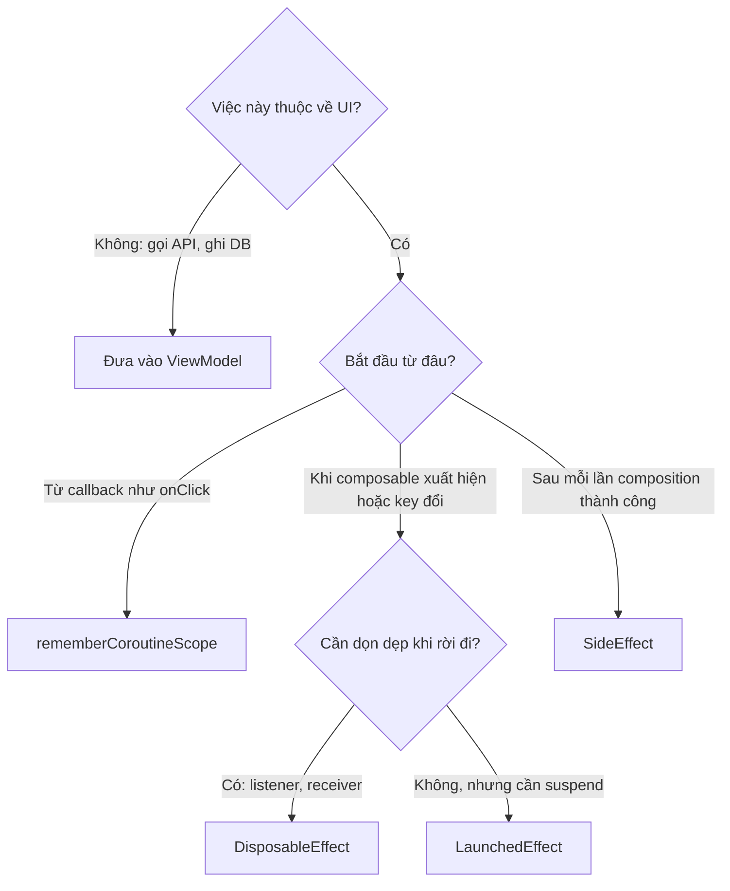
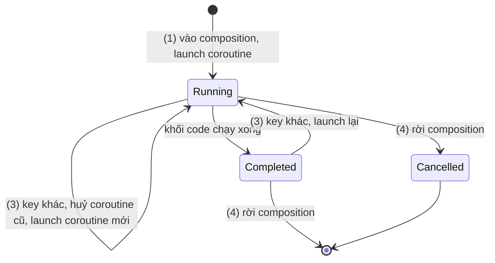
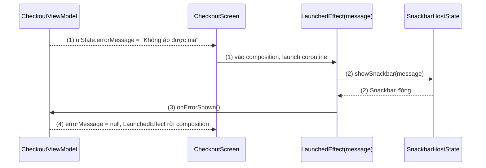
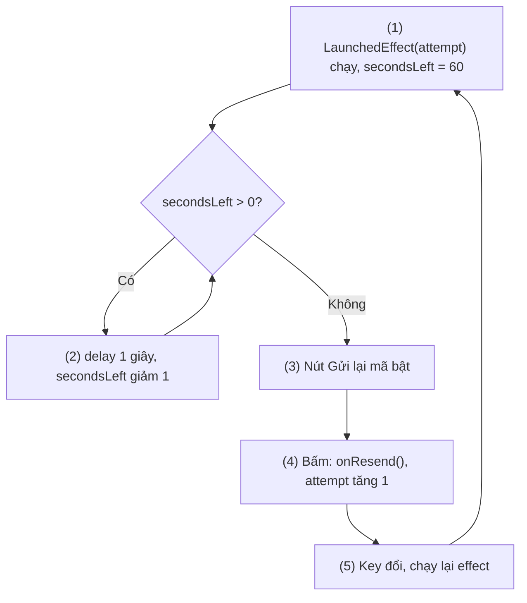
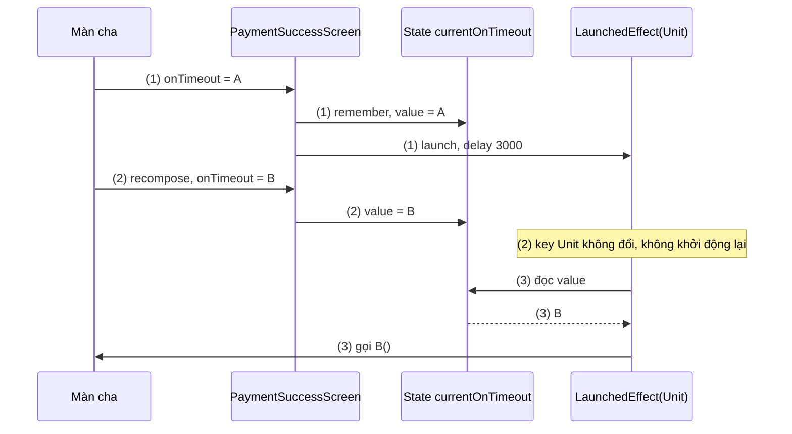
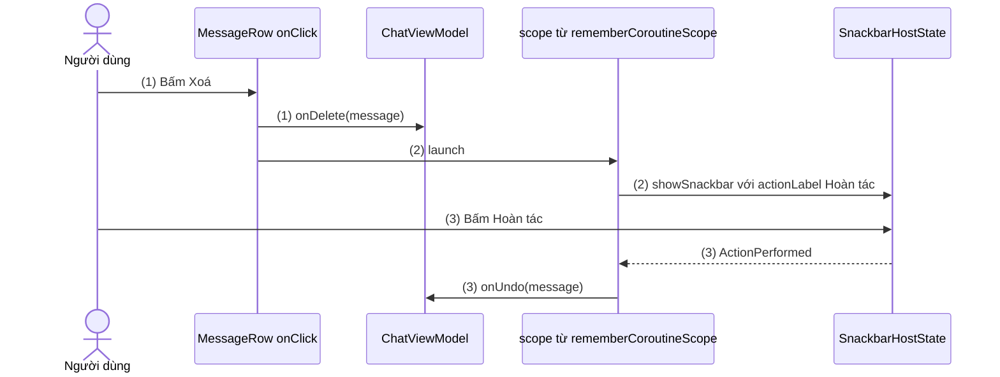
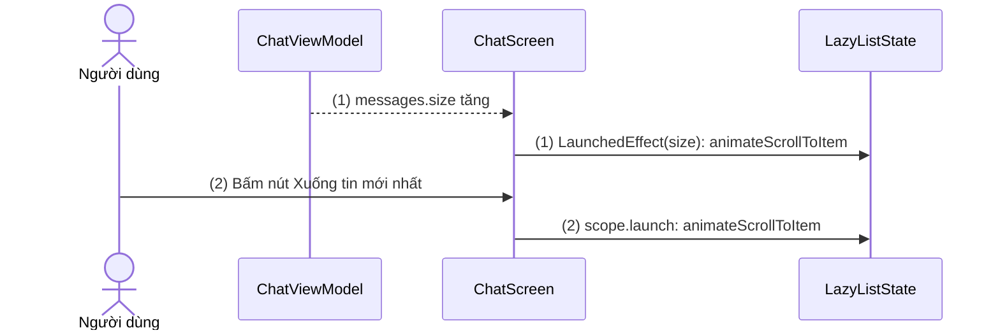

# LaunchedEffect

## Vấn đề cần giải quyết

Composable là hàm mô tả UI từ state ([Jetpack Compose Overview](../overview.md)). Nhưng màn hình thật còn phải **làm** những việc không phải mô tả UI: hiện Snackbar khi có lỗi, cuộn xuống tin nhắn mới, đếm ngược, ghi log. Những việc này gọi là **side effect (tác dụng phụ)**: thay đổi trạng thái của app xảy ra **ngoài phạm vi** một composable.

Cách viết đầu tiên mà nhiều người thử là đặt thẳng vào thân hàm:

```kotlin
// CheckoutScreen.kt (cách làm có vấn đề)
@Composable
fun CheckoutScreen(uiState: CheckoutUiState, snackbarHostState: SnackbarHostState, analytics: Analytics) {
    analytics.logScreenView("checkout")                 // chạy lại mỗi lần recompose
    if (uiState.errorMessage != null) {
        // snackbarHostState.showSnackbar(uiState.errorMessage) // không biên dịch: showSnackbar là hàm suspend
    }
    // ...
}
```

Đoạn code lộ ra bốn vấn đề:

- **Không kiểm soát số lần chạy:** thân composable chạy lại mỗi lần recompose; gõ một ký tự vào ô mã giảm giá là thêm một event `logScreenView`.
- **Chạy cả khi composition bị bỏ dở** ([Remember và Recomposition](../remember_and_recomposition.md)): log đã gửi thì không rút lại được.
- **Không gọi được hàm `suspend`** như `showSnackbar()`, `animateScrollToItem()`, `delay()`.
- **Không có điểm dừng:** coroutine tự `launch` trong thân hàm không bị huỷ khi người dùng rời màn hình.

Vấn đề cần giải quyết là: **chạy side effect vào thời điểm có kiểm soát, gắn với vòng đời của composable trong composition**, và hỗ trợ được việc bất đồng bộ.

## Sau khi học xong

- Giải thích được side effect trong Compose là gì, vì sao không được đặt trong thân composable, và effect API chạy nó vào thời điểm nào.
- Giải thích được vòng đời coroutine của LaunchedEffect là chạy khi vào composition, huỷ khi rời composition, huỷ rồi chạy lại khi key đổi.
- Phân biệt được LaunchedEffect, rememberCoroutineScope và SideEffect, và chọn được effect API phù hợp bằng bảng chọn.
- Áp dụng được rememberUpdatedState để effect chạy dài luôn dùng giá trị mới nhất mà không phải khởi động lại.
- Nhận diện được lỗi chọn key sai, khi key thiếu làm effect dùng dữ liệu cũ và key thừa làm effect khởi động lại liên tục.

## LaunchedEffect là gì?

**`LaunchedEffect(key) { ... }`** là một effect composable (không phát ra UI) khởi chạy một coroutine chứa khối code truyền vào khi vị trí gọi nó **vào composition**, huỷ coroutine khi vị trí đó **rời composition**, và khi được recompose với **key khác** thì huỷ coroutine cũ rồi chạy coroutine mới.

Mental model: LaunchedEffect là **một coroutine buộc vào một chỗ trong cây UI**. Chỗ đó còn trên màn hình thì coroutine còn chạy; chỗ đó biến mất thì coroutine bị huỷ; key là **nhãn** của chỗ đó, nhãn đổi thì coi như chỗ cũ đã đi và chỗ mới vừa tới.

## Cách hoạt động

### Side effect, effect API và bảng chọn

Docs chính thức định nghĩa side effect là thay đổi trạng thái của app xảy ra ngoài phạm vi một composable. Composable nên **không có side effect**, vì runtime có thể gọi lại nó nhiều lần, theo thứ tự bất kỳ, hoặc bỏ dở kết quả. Khi thật sự cần side effect, Compose cung cấp **effect**: một composable không phát ra UI, chỉ chạy side effect **sau khi một lần composition hoàn tất** (đã được áp vào cây UI).

Bảng chọn effect API (nơi chính của bảng này trong Session 09):

| Bạn cần | API | Học ở |
|---|---|---|
| Chạy hàm `suspend` theo vòng đời của một composable (Snackbar, cuộn, animation, đếm ngược) | `LaunchedEffect(key)` | Bài này |
| Chạy coroutine từ **callback** của người dùng (`onClick`), hoặc tự huỷ coroutine theo ý mình | `rememberCoroutineScope()` | Bài này |
| Dùng giá trị mới nhất (lambda, tham số) trong effect chạy dài mà không khởi động lại effect | `rememberUpdatedState(value)` | Bài này |
| Đẩy state của Compose ra object không do Compose quản lý, sau mỗi lần composition thành công | `SideEffect { }` | Bài này |
| Đăng ký rồi huỷ đăng ký (listener, observer, receiver, sensor) | `DisposableEffect(key) { onDispose { } }` | [DisposableEffect](disposable_effect.md) |
| Chạy và dọn dẹp theo sự kiện lifecycle (`ON_START`/`ON_STOP`, `ON_RESUME`/`ON_PAUSE`) | `LifecycleStartEffect`, `LifecycleResumeEffect`, `LifecycleEventEffect` | [DisposableEffect](disposable_effect.md) |
| Biến nguồn không phải Compose (hàm `suspend`, callback) thành `State` | `produceState` | [produceState](produce_state.md) |
| State suy ra từ state khác, đổi ít hơn input | `derivedStateOf` (không phải effect, nhưng hay bị nhầm) | [derivedStateOf](derived_state_of.md) |
| State → Flow (debounce, gửi analytics khi cuộn) | `snapshotFlow { }` | [snapshotFlow](flow_with_snapshot.md) |
| Flow → State (đọc `uiState` của ViewModel) | `collectAsStateWithLifecycle()` | [snapshotFlow](flow_with_snapshot.md) |

Trước khi chọn một dòng trong bảng, hỏi câu đầu tiên: **việc này có thuộc về UI không?** Gọi API, ghi database, quyết định nghiệp vụ thuộc về ViewModel và tầng data ([MVVM](../../session_07/architecture/mvvm.md)). Effect dành cho việc gắn với UI: hiện Snackbar, cuộn, focus, animation, đồng bộ một object của UI. Docs nhắc rõ: việc trong effect không được phá vỡ luồng dữ liệu một chiều.



Bài dùng coroutine (một phép tính có thể tạm dừng ở các điểm `suspend` mà không chặn thread) theo định nghĩa ở [8.4.3 Coroutines](../../session_08/async_threads/coroutines.md); `launch`, `delay`, `withContext` và việc huỷ coroutine không giải thích lại ở đây.

### Vòng đời coroutine của LaunchedEffect

LaunchedEffect có bốn trường hợp, ứng với các vế trong định nghĩa:

1. **Vào composition:** lần đầu lời gọi `LaunchedEffect(key)` xuất hiện trong composition và composition đó được áp thành công, Compose `launch` một coroutine chạy khối code.
2. **Recompose với key bằng key cũ** (so bằng `equals`): không làm gì, coroutine cũ chạy tiếp. Đây là trường hợp thường gặp nhất: màn hình recompose hàng chục lần, effect không bị đụng tới.
3. **Recompose với key khác:** huỷ coroutine cũ, `launch` coroutine mới với khối code của lần recompose này.
4. **Rời composition** (nhánh `if` chứa nó không còn chạy, màn hình bị đóng, Activity bị huỷ khi xoay màn hình): huỷ coroutine.



Hai hệ quả cần nhớ:

- Coroutine chạy trên **main thread** (dispatcher của composition trên Android). Việc nặng phải chuyển sang dispatcher khác bằng `withContext`, hoặc tốt hơn là nằm trong tầng data.
- "Rời composition" bao gồm cả **configuration change**: xoay màn hình thì Activity bị tạo lại, composition mới được dựng, LaunchedEffect **chạy lại từ đầu**. Việc chỉ được chạy một lần cho mỗi màn hình (tải dữ liệu) vì vậy không đặt trong LaunchedEffect mà trong ViewModel ([ViewModel](../../session_06/viewmodel.md)).

#### Ví dụ: hiện Snackbar khi có lỗi rồi báo đã hiện

**Bài toán:** ViewModel đưa lỗi vào `uiState.errorMessage` theo mẫu "event thành state" ([MVVM](../../session_07/architecture/mvvm.md), mục "Thao tác của người dùng và event một lần"). Màn hình phải hiện Snackbar đúng một lần cho mỗi lỗi, rồi báo ViewModel xoá lỗi. `showSnackbar()` là hàm `suspend`, chờ tới khi Snackbar biến mất.

**Luồng chạy:**

1. `uiState.errorMessage` chuyển từ `null` sang `"Không áp được mã giảm giá"`. Nhánh `if` chứa LaunchedEffect bắt đầu chạy, LaunchedEffect vào composition với key là chuỗi lỗi.
2. Coroutine gọi `showSnackbar(message)` và treo cho tới khi Snackbar đóng.
3. Coroutine gọi `onErrorShown()`; ViewModel đặt `errorMessage = null`.
4. Recompose: nhánh `if` không còn chạy, LaunchedEffect rời composition. Lỗi mới về sau sẽ vào lại bước 1.



**Code:**

```kotlin
// CheckoutScreen.kt
@Composable
fun CheckoutScreen(
    uiState: CheckoutUiState,
    onErrorShown: () -> Unit,
    modifier: Modifier = Modifier,
) {
    val snackbarHostState = remember { SnackbarHostState() }

    uiState.errorMessage?.let { message ->
        LaunchedEffect(message) {                       // (1) key là chính lỗi đang hiện
            snackbarHostState.showSnackbar(message)     // (2) treo tới khi Snackbar đóng
            onErrorShown()                              // (3) ViewModel xoá lỗi, (4) effect rời composition
        }
    }

    Scaffold(
        modifier = modifier,
        snackbarHost = { SnackbarHost(snackbarHostState) },
    ) { padding ->
        CheckoutContent(uiState, Modifier.padding(padding))
    }
}
```

`Scaffold` và `SnackbarHost` là layout chuẩn của Material 3, học ở [Layout and View](../layout_and_view.md); ở đây chỉ cần biết `SnackbarHostState` là nơi hiện Snackbar.

**Kết quả:** áp mã sai thì Snackbar hiện một lần; gõ vào ô địa chỉ (recompose) không làm nó hiện lại vì key không đổi. Lỗi khác tới khi Snackbar đang hiện thì key đổi: coroutine cũ bị huỷ (Snackbar cũ đóng), Snackbar mới hiện. Kiểm chứng bằng UI test: đặt `errorMessage`, kiểm tra `onNodeWithText(...).assertIsDisplayed()` và `onErrorShown` được gọi.

### Chọn key

Key trả lời câu hỏi: **khi nào effect này coi như là một effect khác?** Quy tắc của docs:

- Mọi biến dùng trong khối effect mà có thể đổi thì **đưa vào key**, hoặc bọc bằng `rememberUpdatedState` nếu không muốn đổi biến đó làm effect khởi động lại (phần sau).
- Biến tạo bằng `remember { }` không key thì không bao giờ đổi trong composition, không cần đưa vào key.
- Có thể truyền nhiều key: `LaunchedEffect(orderId, userId) { }`; đổi bất kỳ key nào là khởi động lại.
- Key hằng (`Unit`, `true`) nghĩa là effect **theo đúng vòng đời của vị trí gọi**: chạy một lần khi vào, huỷ khi rời. Docs cảnh báo `LaunchedEffect(true)` đáng ngờ như `while (true)`: dùng được, nhưng phải dừng lại kiểm tra đó có đúng là điều mình cần.
- `LaunchedEffect { }` không key là lỗi biên dịch: overload này chỉ tồn tại với `@Deprecated(level = DeprecationLevel.ERROR)`, chính để buộc bạn nghĩ về key.

Key thiếu thì effect **chạy với dữ liệu cũ**; key thừa (đổi thường xuyên hơn cần) thì effect **khởi động lại liên tục**, có thể không bao giờ chạy xong.

#### Ví dụ: đếm ngược "Gửi lại mã OTP"

**Bài toán:** màn nhập mã OTP chỉ cho bấm "Gửi lại mã" sau 60 giây. Mỗi lần bấm gửi lại, đếm ngược phải bắt đầu lại từ 60. Đây là việc thuần UI, gắn với việc màn hình đang hiện, nên hợp với LaunchedEffect.

**Luồng chạy:**

1. Màn hình vào composition với `attempt = 0`; LaunchedEffect(attempt) chạy, đặt `secondsLeft = 60`.
2. Vòng lặp `delay(1_000)` rồi giảm `secondsLeft`; mỗi lần giảm, state đổi nên nút recompose và hiện số giây mới. Key không đổi nên effect không bị đụng tới.
3. `secondsLeft` về 0: vòng lặp kết thúc, nút bật.
4. Người dùng bấm "Gửi lại mã": gọi `onResend()` và tăng `attempt`.
5. Recompose với `attempt = 1`: key khác nên LaunchedEffect huỷ coroutine cũ (đã xong) và chạy coroutine mới, quay lại bước 1.



**Code:**

```kotlin
// ResendCodeButton.kt
@Composable
fun ResendCodeButton(onResend: () -> Unit, modifier: Modifier = Modifier) {
    var attempt by remember { mutableIntStateOf(0) }
    var secondsLeft by remember { mutableIntStateOf(60) }

    LaunchedEffect(attempt) {                          // (1) (5) key = lần gửi
        secondsLeft = 60
        while (secondsLeft > 0) {
            delay(1_000)                               // (2) treo, không chặn main thread
            secondsLeft--
        }                                              // (3) hết vòng lặp, coroutine xong
    }

    TextButton(
        onClick = { onResend(); attempt++ },           // (4)
        enabled = secondsLeft == 0,
        modifier = modifier,
    ) {
        Text(if (secondsLeft > 0) "Gửi lại mã sau $secondsLeft giây" else "Gửi lại mã")
    }
}
```

**Kết quả:** nút đếm từ 60 về 0 rồi bật; bấm thì đếm lại từ 60. Rời màn OTP giữa chừng thì coroutine bị huỷ. Xoay màn hình thì đếm lại từ 60 vì effect chạy lại trong composition mới; muốn giữ số giây thì dùng [rememberSaveable](../state/remember_saveable.md) hoặc đưa đồng hồ vào ViewModel. Kiểm chứng bằng UI test: `composeTestRule.mainClock.advanceTimeBy(60_000)` rồi kiểm tra nút đã bật.

### rememberUpdatedState: giá trị mới nhất mà không khởi động lại

Có những effect **không được** khởi động lại, nhưng lại dùng một giá trị có thể đổi. Ví dụ: chờ 3 giây rồi gọi `onTimeout`. Nếu đưa `onTimeout` vào key, mỗi lần cha truyền lambda mới thì bộ đếm 3 giây bắt đầu lại. Nếu không đưa vào key, coroutine giữ lambda của **lần composition đầu tiên** (closure bắt giá trị lúc tạo), và có thể gọi một lambda đã cũ.

`rememberUpdatedState(value)` giải quyết bằng cách tạo một `State` được `remember` một lần, và mỗi lần recompose thì gán `value` mới vào đó. Effect bắt **State** (không đổi) chứ không bắt giá trị, nên đọc ra luôn là giá trị mới nhất. Bản chất chỉ là:

```kotlin
// Cách rememberUpdatedState được hiện thực trong compose-runtime (rút gọn)
@Composable
fun <T> rememberUpdatedState(newValue: T): State<T> =
    remember { mutableStateOf(newValue) }.apply { value = newValue }
```

#### Ví dụ: màn "Thanh toán thành công" tự chuyển sau 3 giây

**Bài toán:** sau khi thanh toán, màn xác nhận hiện 3 giây rồi tự gọi `onTimeout()` để về trang chủ. Trong 3 giây đó màn cha có thể recompose (ví dụ badge giỏ hàng cập nhật) và truyền một lambda `onTimeout` mới; bộ đếm không được bắt đầu lại, nhưng lambda được gọi phải là lambda mới nhất.

**Luồng chạy:**

1. Lần composition đầu: `rememberUpdatedState` tạo State giữ `onTimeout` (bản A). LaunchedEffect(Unit) bắt đầu `delay(3_000)`.
2. Giây thứ 1: màn cha recompose, truyền `onTimeout` bản B. `rememberUpdatedState` gán B vào State. LaunchedEffect có key `Unit` nên không khởi động lại.
3. Hết 3 giây: effect đọc `currentOnTimeout`, ra bản B, và gọi nó.



**Code:**

```kotlin
// PaymentSuccessScreen.kt
@Composable
fun PaymentSuccessScreen(orderCode: String, onTimeout: () -> Unit) {
    val currentOnTimeout by rememberUpdatedState(onTimeout)   // (1) (2) luôn giữ lambda mới nhất

    LaunchedEffect(Unit) {                                    // (1) chỉ chạy một lần cho màn này
        delay(3_000)
        currentOnTimeout()                                    // (3) gọi bản mới nhất
    }

    Column(horizontalAlignment = Alignment.CenterHorizontally) {
        Text("Thanh toán thành công", style = MaterialTheme.typography.headlineSmall)
        Text("Mã đơn: $orderCode")
    }
}
```

**Kết quả:** màn hình chuyển đúng 3 giây sau khi hiện, dù cha recompose bao nhiêu lần, và gọi lambda của lần recompose gần nhất. Kiểm chứng bằng UI test: đổi lambda từ bản ghi `"A"` sang bản ghi `"B"` trong lúc chờ, `advanceTimeBy(3_000)`, kiểm tra kết quả là `"B"`.

### rememberCoroutineScope: coroutine từ callback

LaunchedEffect là composable, nên chỉ gọi được trong composition. Lambda `onClick` **không** phải composable, nên không thể viết `onClick = { LaunchedEffect(...) { } }`. Với việc bắt đầu từ thao tác của người dùng, dùng `rememberCoroutineScope()`: hàm composable trả về một `CoroutineScope` gắn với vị trí gọi; scope bị huỷ khi vị trí đó rời composition.

Khác biệt với LaunchedEffect nằm ở **ai quyết định thời điểm chạy**:

- LaunchedEffect: composition quyết định (vào composition, key đổi).
- `rememberCoroutineScope`: code của bạn quyết định (`scope.launch` trong callback), và bạn giữ được `Job` để huỷ khi muốn.

#### Ví dụ: xoá tin nhắn rồi cho "Hoàn tác"

**Bài toán:** vuốt hoặc bấm xoá một tin nhắn thì ẩn nó ngay và hiện Snackbar "Đã xoá" có nút "Hoàn tác". Việc bắt đầu từ `onClick`, và `showSnackbar()` là hàm `suspend` trả về người dùng có bấm hành động hay không.

**Luồng chạy:**

1. Người dùng bấm "Xoá"; callback gọi `onDelete(message)` để ViewModel ẩn tin nhắn.
2. Callback `scope.launch` một coroutine gọi `showSnackbar(..., actionLabel = "Hoàn tác")`.
3. Người dùng bấm "Hoàn tác": `showSnackbar` trả `SnackbarResult.ActionPerformed`, coroutine gọi `onUndo(message)`. Snackbar tự hết hạn thì trả `Dismissed`, không làm gì.



**Code:**

```kotlin
// MessageList.kt
@Composable
fun MessageList(
    messages: List<Message>,
    snackbarHostState: SnackbarHostState,
    onDelete: (Message) -> Unit,
    onUndo: (Message) -> Unit,
) {
    val scope = rememberCoroutineScope()                     // huỷ khi MessageList rời composition

    LazyColumn {
        items(messages, key = { it.id }) { message ->
            MessageRow(
                message = message,
                onDeleteClick = {
                    onDelete(message)                        // (1) ViewModel ẩn tin nhắn
                    scope.launch {                           // (2) coroutine bắt đầu từ callback
                        val result = snackbarHostState.showSnackbar(
                            message = "Đã xoá tin nhắn",
                            actionLabel = "Hoàn tác",
                            duration = SnackbarDuration.Short,
                        )
                        if (result == SnackbarResult.ActionPerformed) onUndo(message) // (3)
                    }
                },
            )
        }
    }
}
```

`LazyColumn` và `items(key = ...)` học ở [LazyColumn](../modifier/lazy_column.md).

**Kết quả:** xoá thì tin nhắn biến mất ngay và Snackbar hiện; bấm "Hoàn tác" thì tin nhắn quay lại. Việc xoá thật trên server **không** nằm trong `scope.launch` này, vì scope bị huỷ khi rời màn hình; ViewModel quyết định xoá vĩnh viễn trong `viewModelScope`.

### SideEffect: đẩy state ra object không do Compose quản lý

`SideEffect { }` chạy khối code (không phải coroutine) **sau mỗi lần composition thành công** của scope chứa nó. Nó dành cho việc **đồng bộ** state của Compose sang một object bên ngoài, không biết gì về Compose: thư viện analytics, crash reporter, một View cũ.

Khác với viết thẳng trong thân hàm: code trong thân chạy cả khi lần composition đó bị bỏ dở; `SideEffect` chỉ chạy khi composition đã được áp. Khác với LaunchedEffect: không có key, chạy lại **mỗi lần** scope recompose, và không chạy được hàm `suspend`.

#### Ví dụ: gắn ngữ cảnh màn hình vào báo cáo crash

**Bài toán:** khi app crash, báo cáo nên kèm màn hình đang mở và số sản phẩm trong giỏ để dễ tái hiện. Crash reporter là object bên ngoài, giữ "custom key" cho tới khi bị ghi đè; ta chỉ cần nó luôn khớp state hiện tại.

**Code:** khối code một bước, không có luồng rẽ nhánh nên không cần sơ đồ.

```kotlin
// CartScreen.kt
@Composable
fun CartScreen(uiState: CartUiState, crashReporter: CrashReporter) {
    SideEffect {
        // Chạy sau mỗi lần CartScreen recompose thành công, không chạy nếu composition bị bỏ dở
        crashReporter.setCustomKey("screen", "cart")
        crashReporter.setCustomKey("cart_item_count", uiState.items.size)
    }
    CartContent(uiState)
}
```

**Kết quả:** mọi crash xảy ra trên màn giỏ hàng đều mang `cart_item_count` đúng tại thời điểm crash. Kiểm chứng bằng một `FakeCrashReporter` trong UI test: đổi `uiState`, kiểm tra key cuối cùng được ghi khớp số item mới.

## Deep Dive: effect chạy vào lúc nào trong một frame

Một lần composition không sửa cây UI ngay: Composer ghi lại các thay đổi rồi **áp** (apply) chúng khi composition hoàn tất. Effect gắn vào đúng bước áp này:

- LaunchedEffect, DisposableEffect và `rememberCoroutineScope` là các object `RememberObserver` cất trong slot table. Composition được áp thì runtime gọi `onRemembered()` (LaunchedEffect `launch` coroutine ở đây); object bị loại khỏi slot table (rời composition, hoặc key đổi) thì gọi `onForgotten()` (huỷ coroutine).
- Composition bị bỏ dở thì object chưa từng được "remembered", runtime gọi `onAbandoned()`: coroutine không bao giờ được launch.
- `SideEffect` được xếp hàng và chạy sau khi các thay đổi đã áp xong.

Vì vậy key của LaunchedEffect hoạt động giống key của `remember(key)` ([Remember và Recomposition](../remember_and_recomposition.md)). Hệ quả dễ bị bất ngờ: LaunchedEffect trong một item `LazyColumn` bị huỷ khi item cuộn ra khỏi màn hình, vì item đó rời composition.

## Ví dụ thực tế

Ba bài toán hay gặp:

1. **Màn chat:** tự cuộn xuống khi có tin nhắn mới và nút "Xuống tin mới nhất". Cùng một việc (cuộn) nhưng hai điểm bắt đầu khác nhau nên dùng hai API khác nhau; code đầy đủ bên dưới.
2. **Focus ô nhập khi mở màn tìm kiếm:** `LaunchedEffect(Unit) { focusRequester.requestFocus() }`. Key `Unit` đúng ở đây vì việc chỉ cần một lần mỗi khi màn hình xuất hiện.
3. **Hiện Snackbar từ state lỗi:** như ví dụ ở mục "Vòng đời coroutine của LaunchedEffect".

### Màn chat: tự cuộn khi có tin mới và nút xuống cuối

**Bài toán:** danh sách tin nhắn hiện mới nhất ở cuối. Có tin mới thì tự cuộn xuống; người dùng đang đọc tin cũ thì bấm nút nổi để xuống cuối.

**Luồng chạy:**

1. `messages.size` tăng (tin mới từ ViewModel). LaunchedEffect(messages.size) khởi động lại và gọi `animateScrollToItem(lastIndex)`. Key là **số lượng**, không phải cả danh sách, để tin cũ được sửa (đã đọc, đã sửa nội dung) không làm màn hình cuộn.
2. Người dùng bấm nút nổi: việc bắt đầu từ callback nên dùng `scope.launch { animateScrollToItem(lastIndex) }`.



**Code:**

```kotlin
// ChatScreen.kt
@Composable
fun ChatScreen(messages: List<Message>, modifier: Modifier = Modifier) {
    val listState = rememberLazyListState()
    val scope = rememberCoroutineScope()

    LaunchedEffect(messages.size) {                                   // (1) chỉ khi số tin đổi
        if (messages.isNotEmpty()) listState.animateScrollToItem(messages.lastIndex)
    }

    Scaffold(
        modifier = modifier,
        floatingActionButton = {
            SmallFloatingActionButton(onClick = {
                scope.launch {                                        // (2) bắt đầu từ callback
                    if (messages.isNotEmpty()) listState.animateScrollToItem(messages.lastIndex)
                }
            }) { Icon(Icons.Filled.KeyboardArrowDown, contentDescription = "Xuống tin mới nhất") }
        },
    ) { padding ->
        LazyColumn(state = listState, contentPadding = padding) {
            items(messages, key = { it.id }) { message -> MessageBubble(message) }
        }
    }
}
```

`rememberLazyListState()` và `animateScrollToItem()` thuộc `LazyListState`, học ở [LazyColumn](../modifier/lazy_column.md).

**Kết quả:** nhận tin mới thì danh sách cuộn mượt xuống cuối; sửa nội dung một tin cũ thì không cuộn. Kiểm chứng bằng `Log.d` ở đầu khối LaunchedEffect: log chỉ xuất hiện khi số tin đổi, dù Layout Inspector (recomposition counts) cho thấy `ChatScreen` recompose nhiều lần hơn.

## Khi nào nên và không nên dùng

- **Nên dùng LaunchedEffect** cho việc UI cần hàm `suspend` và gắn với việc một composable đang hiện: hiện Snackbar từ state, cuộn tới vị trí, animation bằng `Animatable`, đếm ngược hiển thị, `requestFocus`.
- **Nên dùng `rememberCoroutineScope`** khi việc bắt đầu từ callback: bấm nút mở/đóng `ModalBottomSheet`, cuộn lên đầu, hiện Snackbar có hành động.
- **Nên dùng `SideEffect`** khi chỉ cần đồng bộ một giá trị sang object ngoài sau mỗi lần composition.
- **Phân biệt với `viewModelScope.launch`:** coroutine của LaunchedEffect và `rememberCoroutineScope` sống theo composition, không sống qua xoay màn hình; coroutine của `viewModelScope` sống theo ViewModel. Việc vẫn phải xảy ra khi màn hình đang xoay hoặc vừa đóng thì không thuộc về composition.
- **Không dùng** LaunchedEffect để tải dữ liệu màn hình (`LaunchedEffect(Unit) { viewModel.load() }`): chạy lại sau mỗi lần xoay màn hình. Để ViewModel tải lười bằng `stateIn` ([ViewModel](../../session_06/viewmodel.md)).
- **Không dùng** `rememberCoroutineScope` cho việc phải chạy xong (lưu, gửi đánh giá): scope bị huỷ khi rời màn hình, người dùng bấm Back ngay là việc dừng giữa chừng. Callback gọi hàm của ViewModel, ViewModel chạy trong `viewModelScope`.
- **Không dùng** effect để tính state từ state khác: đó là việc của phép tính thường, `remember(key)` hoặc [derivedStateOf](derived_state_of.md).

## Sai lầm thường gặp

### 1. `launch` hoặc gọi việc có tác dụng phụ trong thân composable

```kotlin
// Sai: mỗi lần recompose là thêm một coroutine
@Composable
fun OrderTracking(snackbarHostState: SnackbarHostState) {
    val scope = rememberCoroutineScope()
    scope.launch { snackbarHostState.showSnackbar("Đơn đang được giao") }
}
```

**Lỗi lộ ra thế nào:** Snackbar hiện lại mỗi khi màn hình recompose, và coroutine được tạo cả trong những lần composition bị bỏ dở.

**Cách sửa:** việc bắt đầu khi composable xuất hiện thì dùng `LaunchedEffect(key)`; `rememberCoroutineScope` chỉ `launch` trong callback.

### 2. Key thiếu: effect chạy với dữ liệu cũ

```kotlin
// Sai: đổi sang đơn khác, đồng hồ vẫn đếm cho đơn cũ
@Composable
fun HoldTimer(orderId: String, expiresAt: Instant) {
    var remaining by remember { mutableStateOf(Duration.ZERO) }
    LaunchedEffect(Unit) {
        while (true) { remaining = Duration.between(Instant.now(), expiresAt); delay(1_000) }
    }
    Text("Giữ chỗ còn ${remaining.toMinutes()} phút")
}
```

**Lỗi lộ ra thế nào:** coroutine bắt `expiresAt` của lần composition đầu. Mở đơn khác trong cùng màn hình, đồng hồ hiện thời gian của đơn trước.

**Cách sửa:** `LaunchedEffect(expiresAt)`. Mọi biến dùng trong khối và có thể đổi phải là key, hoặc bọc bằng `rememberUpdatedState` nếu chủ ý không khởi động lại.

### 3. Key thừa: effect khởi động lại liên tục

```kotlin
// Sai: uiState đổi mỗi khi gõ một ký tự, effect bị huỷ trước khi kịp xong
LaunchedEffect(uiState) {
    delay(2_000)
    onShowTooltip()
}
```

**Lỗi lộ ra thế nào:** tooltip không bao giờ hiện khi người dùng đang gõ, vì mỗi ký tự tạo `uiState` mới (khác `equals`) và huỷ coroutine. Lambda hay object tạo mới mỗi lần recompose làm key cũng gây lỗi tương tự.

**Cách sửa:** chọn key là đúng phần dữ liệu quyết định effect (`uiState.screenId`), không phải cả object; lambda thì dùng `rememberUpdatedState`.

### 4. Tải dữ liệu trong `LaunchedEffect(Unit)`

```kotlin
// Không nên
LaunchedEffect(Unit) { viewModel.loadOrders() }
```

**Lỗi lộ ra thế nào:** xoay màn hình là composition mới, request chạy lại; điều hướng đi rồi quay lại cũng tải lại. Log mạng cho thấy cùng một request lặp lại.

**Cách sửa:** ViewModel tự tải khi `uiState` có người quan sát (`stateIn(..., WhileSubscribed(5_000), ...)`). Nếu tải theo tham số điều hướng, ViewModel đọc tham số đó từ `SavedStateHandle`.

## Lịch sử phát triển

- **2019–2020 (dev, alpha):** API side effect đầu tiên mang tên `onCommit`, `onActive`, `onDispose`, `launchInComposition`; tên không nói rõ khi nào effect chạy lại.
- **Cuối 2020 (alpha):** đổi sang bộ API hiện nay `SideEffect`, `DisposableEffect`, `LaunchedEffect` (một thời gian ngắn mang tên `LaunchedTask`), với quy ước key quyết định khi nào khởi động lại; `rememberUpdatedState` và `rememberCoroutineScope` ra đời cho hai trường hợp key không giải quyết được.
- **07/2021 (Compose 1.0):** bộ API ổn định. Overload không key của LaunchedEffect và DisposableEffect là lỗi biên dịch.
- **01/2024 (Lifecycle 2.7.0, alpha từ 07/2023):** thêm effect theo lifecycle (`LifecycleStartEffect`, `LifecycleResumeEffect`, `LifecycleEventEffect`), học ở [DisposableEffect](disposable_effect.md).

## Kết nối hệ thống

- **Tiên quyết:**
  - [Jetpack Compose Overview](../overview.md): composition, recomposition và vì sao composable có thể chạy lại bất kỳ lúc nào.
  - [Remember và Recomposition](../remember_and_recomposition.md): `remember(key)` và slot table, cùng cơ chế với key của effect.
  - [MutableState và State Hoisting](../state/mutable_state.md): state mà effect đọc và ghi.
  - [8.4.3 Coroutines](../../session_08/async_threads/coroutines.md): `launch`, huỷ coroutine, dispatcher và `withContext`.
- **Liên quan:**
  - [DisposableEffect](disposable_effect.md), [produceState](produce_state.md), [derivedStateOf](derived_state_of.md), [snapshotFlow](flow_with_snapshot.md): các dòng còn lại của bảng chọn.
  - [ViewModel](../../session_06/viewmodel.md) và [MVVM](../../session_07/architecture/mvvm.md): nơi đặt việc không thuộc UI, và mẫu event thành state mà ví dụ Snackbar dựa vào.
  - [rememberSaveable](../state/remember_saveable.md): giữ state mà effect dùng qua xoay màn hình.
- **Học tiếp:**
  - [DisposableEffect](disposable_effect.md): effect có bước dọn dẹp.
  - [10.2 Unit Testing](../../coding_analyst_and_testing/unit_testing.md): test tự động (test UI Compose với `mainClock` chưa có bài riêng).

## Tham khảo

- [Side-effects in Compose - Android Developers](https://developer.android.com/develop/ui/compose/side-effects)
- [Thinking in Compose - Android Developers](https://developer.android.com/develop/ui/compose/mental-model)
- [Lifecycle of composables - Android Developers](https://developer.android.com/develop/ui/compose/lifecycle)
- [LaunchedEffect - API reference](https://developer.android.com/reference/kotlin/androidx/compose/runtime/package-summary#LaunchedEffect(kotlin.Any,kotlin.coroutines.SuspendFunction1))
- [UI events - Android Developers](https://developer.android.com/topic/architecture/ui-layer/events)
- [Lifecycle in Jetpack Compose - Android Developers](https://developer.android.com/topic/libraries/architecture/compose)
