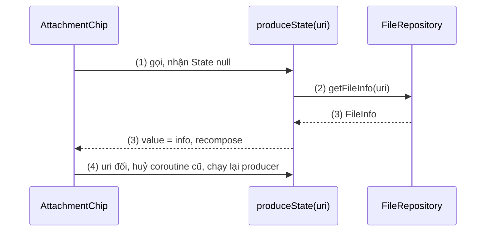
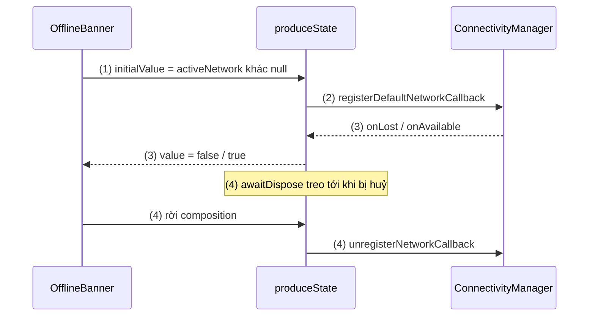
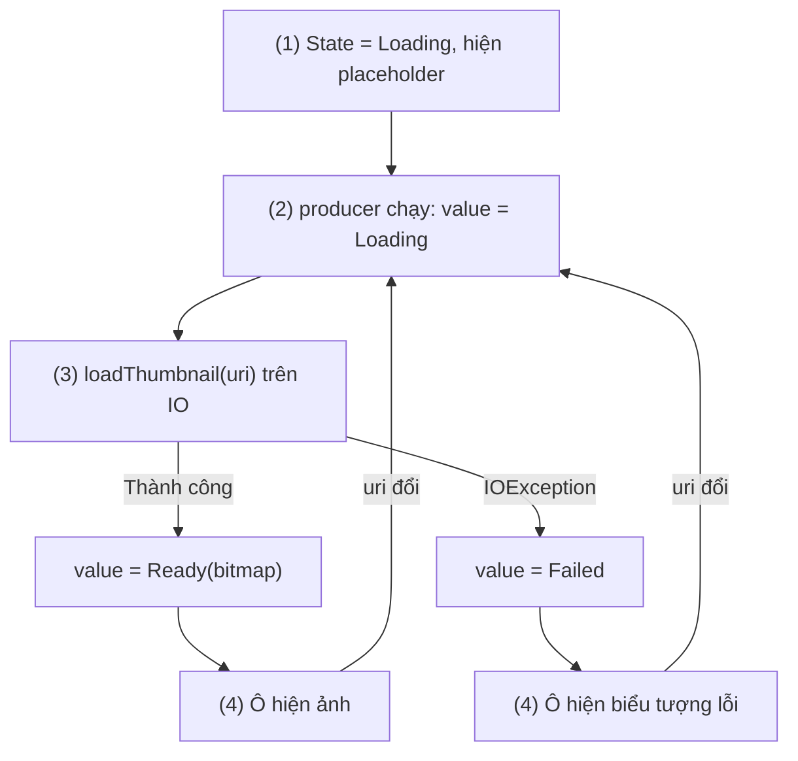

# produceState

## Vấn đề cần giải quyết

Composable chỉ đọc được `State`. Nhưng nhiều giá trị UI cần lại đến từ nơi không phải Compose:

- **Hàm `suspend`:** đọc tên và dung lượng của file người dùng vừa chọn, tạo thumbnail cho video. Kết quả có sau một lúc, không có ngay khi composable chạy.
- **API callback:** `ConnectivityManager.NetworkCallback`, listener của SDK. Giá trị được "đẩy" tới nhiều lần, và phải huỷ đăng ký khi không dùng nữa.

Với [LaunchedEffect](launched_effect.md), cách viết là tự ghép hai mảnh:

```kotlin
// AttachmentChip.kt (viết tay: đúng, nhưng lặp lại ở mỗi chỗ cần)
@Composable
fun AttachmentChip(uri: Uri, fileRepository: FileRepository) {
    var info by remember { mutableStateOf<FileInfo?>(null) }
    LaunchedEffect(uri) {
        info = fileRepository.getFileInfo(uri)
    }
    Text(info?.let { "${it.name} (${it.sizeLabel})" } ?: "Đang đọc file…")
}
```

Mẫu này đúng, nhưng có ba chỗ dễ sai mỗi lần viết lại: quên `remember`, quên key, và để biến `var` có thể bị gán từ chỗ khác. Vấn đề cần giải quyết là: **một cách gọn và nhất quán để biến nguồn không phải Compose thành `State`**, mà việc tạo state, chạy coroutine và dọn dẹp luôn đi cùng nhau.

## Sau khi học xong

- Giải thích được produceState là remember { mutableStateOf(initialValue) } cộng LaunchedEffect(keys), và State trả về thay đổi thế nào khi key đổi.
- Triển khai được produceState để biến một hàm suspend hoặc một nguồn callback (dùng awaitDispose) thành State cho composable đọc.
- Biết khi nào dùng produceState, khi nào dùng collectAsStateWithLifecycle hoặc đưa việc tải vào ViewModel.

## produceState là gì?

**`produceState(initialValue, keys) { ... }`** là hàm composable trả về một **`State<T>`** bắt đầu bằng `initialValue`, đồng thời chạy một coroutine gắn với composition (khối `producer`) để gán `value` mới cho State đó. Bản chất của nó chỉ là `remember { mutableStateOf(initialValue) }` cộng `LaunchedEffect(keys)`.

Mental model: produceState là **một State có người sản xuất riêng**. Bên ngoài chỉ thấy một `State<T>` chỉ đọc; bên trong, khối `producer` là người duy nhất được ghi vào nó, và người đó sống đúng theo vòng đời của LaunchedEffect.

## Cách hoạt động

### Giá trị đầu, producer và key

Chữ ký thường dùng:

```kotlin
// androidx.compose.runtime (rút gọn)
@Composable
fun <T> produceState(
    initialValue: T,
    vararg keys: Any?,                                  // cũng có overload key1, key2, key3 và không key
    producer: suspend ProduceStateScope<T>.() -> Unit,
): State<T>
```

Khối `producer` chạy với receiver `ProduceStateScope<T>`: vừa là `CoroutineScope` (gọi được hàm `suspend`), vừa có thuộc tính `value` để ghi vào State. Thứ tự:

1. Lần đầu vào composition, hàm trả về State có `value = initialValue`; composable đọc giá trị này ngay.
2. Sau khi composition được áp, coroutine `producer` bắt đầu (như LaunchedEffect).
3. `producer` gán `value = ...`; State đổi nên mọi scope đã đọc nó recompose. Gán một giá trị bằng giá trị hiện tại thì không gây recompose (State dùng so sánh `equals`).
4. Key đổi: coroutine cũ bị huỷ, `producer` chạy lại. **State không quay về `initialValue`**: nó giữ giá trị cuối của lần trước cho tới khi `producer` mới gán.
5. Rời composition: coroutine bị huỷ.

Khác với `remember { }` + LaunchedEffect viết tay, overload không key của produceState là hợp lệ: nó tương đương key cố định, chạy một lần cho vị trí gọi.

#### Ví dụ: hiện tên và dung lượng file đính kèm

**Bài toán:** màn soạn email hiện một chip cho mỗi file đính kèm. Tên và dung lượng đọc từ `ContentResolver` bằng hàm `suspend` chạy trên `Dispatchers.IO`. Chip phải hiện "Đang đọc file…" trước, rồi hiện thông tin khi có.

**Luồng chạy:**

1. `produceState<FileInfo?>(initialValue = null, uri)` trả về State `null`; chip hiện "Đang đọc file…".
2. `producer` chạy, gọi `fileRepository.getFileInfo(uri)` (chuyển sang IO bên trong repository).
3. Có kết quả: `value = info`; chip recompose và hiện tên, dung lượng.
4. Người dùng thay file khác cho chip này: key `uri` đổi, coroutine cũ huỷ, `producer` chạy lại với `uri` mới.



**Code:**

```kotlin
// AttachmentChip.kt
@Composable
fun AttachmentChip(uri: Uri, fileRepository: FileRepository, modifier: Modifier = Modifier) {
    val info by produceState<FileInfo?>(initialValue = null, uri, fileRepository) { // (1) (4)
        value = fileRepository.getFileInfo(uri)                                       // (2) (3)
    }
    AssistChip(
        onClick = {},
        label = { Text(info?.let { "${it.name} (${it.sizeLabel})" } ?: "Đang đọc file…") },
        modifier = modifier,
    )
}

// FileRepository.kt
class FileRepository(private val contentResolver: ContentResolver) {
    suspend fun getFileInfo(uri: Uri): FileInfo = withContext(Dispatchers.IO) {
        contentResolver.query(uri, null, null, null, null)!!.use { cursor ->
            cursor.moveToFirst()
            val name = cursor.getString(cursor.getColumnIndexOrThrow(OpenableColumns.DISPLAY_NAME))
            val size = cursor.getLong(cursor.getColumnIndexOrThrow(OpenableColumns.SIZE))
            FileInfo(name = name, sizeBytes = size)
        }
    }
}
```

`withContext(Dispatchers.IO)` chuyển việc đọc sang luồng I/O ([8.4.3 Coroutines](../../session_08/async_threads/coroutines.md), mục "CoroutineContext, Dispatchers và withContext"). Mọi biến dùng trong `producer` (`uri`, `fileRepository`) đều là key, theo đúng quy tắc key của [LaunchedEffect](launched_effect.md).

**Kết quả:** chọn file "bao-gia.pdf" thì chip hiện "Đang đọc file…" trong chốc lát rồi "bao-gia.pdf (1,2 MB)". Kiểm chứng bằng UI test với `FakeFileRepository` có `delay(500)`: lúc đầu thấy "Đang đọc file…", sau `advanceTimeBy(500)` thấy tên file.

### Nguồn callback và awaitDispose

Với nguồn callback, `producer` đăng ký listener rồi phải **treo** cho tới khi bị huỷ, để còn huỷ đăng ký. `ProduceStateScope.awaitDispose(onDispose)` làm đúng việc đó: treo mãi, và khi coroutine bị huỷ (key đổi hoặc rời composition) thì chạy `onDispose`. Đây là cặp đăng ký – huỷ giống [DisposableEffect](disposable_effect.md), nhưng kết quả là một `State`.

#### Ví dụ: banner "Mất kết nối mạng"

**Bài toán:** màn đặt xe hiện banner khi mất mạng. Trạng thái mạng đến qua `ConnectivityManager.NetworkCallback` (callback, gọi trên luồng của hệ thống). Banner chỉ cần biết "đang có mạng hay không" dưới dạng `State<Boolean>`.

**Luồng chạy:**

1. Giá trị đầu đọc đồng bộ từ `activeNetwork`, để banner không nhấp nháy lúc mới mở.
2. `producer` tạo callback và gọi `registerDefaultNetworkCallback`.
3. Mạng mất hoặc có lại: callback gán `value = false` hoặc `true`; banner recompose.
4. `awaitDispose` treo coroutine; rời màn hình thì `onDispose` gọi `unregisterNetworkCallback`.



**Code:**

```kotlin
// NetworkStatus.kt
@Composable
fun isOnlineState(connectivityManager: ConnectivityManager): State<Boolean> =
    produceState(initialValue = connectivityManager.activeNetwork != null, connectivityManager) { // (1)
        val callback = object : ConnectivityManager.NetworkCallback() {
            override fun onAvailable(network: Network) { value = true }   // (3) ghi State từ luồng hệ thống
            override fun onLost(network: Network) { value = false }
        }
        connectivityManager.registerDefaultNetworkCallback(callback)       // (2)
        awaitDispose { connectivityManager.unregisterNetworkCallback(callback) } // (4)
    }

// OfflineBanner.kt
@Composable
fun OfflineBanner(connectivityManager: ConnectivityManager) {
    val isOnline by isOnlineState(connectivityManager)
    if (!isOnline) Text("Mất kết nối mạng", color = MaterialTheme.colorScheme.error)
}
```

Ghi `value` từ luồng khác main được phép: `MutableState` thuộc snapshot system và an toàn khi ghi từ nhiều luồng ([MutableState và State Hoisting](../state/mutable_state.md)). Hàm composable trả về giá trị được đặt tên bắt đầu bằng chữ thường, như hàm Kotlin thường. App cần quyền `ACCESS_NETWORK_STATE`.

**Kết quả:** bật chế độ máy bay, banner hiện; tắt đi, banner biến mất. Rời màn hình rồi bật tắt mạng: không còn log trong callback. Nếu nhiều màn cần trạng thái mạng, chuyển callback này xuống tầng data dưới dạng `Flow` (`callbackFlow`, học ở [Flow](../../session_07/design_pattern/observer/flow.md)) và đọc bằng `collectAsStateWithLifecycle()` ([snapshotFlow](flow_with_snapshot.md)).

### Bên trong produceState

Mã nguồn của `compose-runtime` cho thấy produceState chỉ ghép hai API đã học:

```kotlin
// androidx.compose.runtime, ProduceState.kt (rút gọn)
@Composable
fun <T> produceState(initialValue: T, key1: Any?, producer: suspend ProduceStateScope<T>.() -> Unit): State<T> {
    val result = remember { mutableStateOf(initialValue) }       // remember KHÔNG có key
    LaunchedEffect(key1) {
        ProduceStateScopeImpl(result, coroutineContext).producer()
    }
    return result
}
```

Đọc đoạn này trả lời được mọi câu hỏi về hành vi:

- Vì sao State **giữ giá trị cũ** khi key đổi: `remember` không có key, chỉ LaunchedEffect bị khởi động lại.
- Vì sao chạy lại sau xoay màn hình: composition mới, `remember` và LaunchedEffect mới.
- Vì sao **không theo lifecycle**: LaunchedEffect chỉ biết composition. App vào background mà composition còn thì `producer` vẫn chạy.

## Ví dụ thực tế

1. **Thumbnail video trong lưới thư viện:** mỗi ô tạo thumbnail bằng hàm `suspend`, hiện trạng thái tải, lỗi; key là `uri` vì cùng một vị trí gọi có thể nhận video khác. Code đầy đủ bên dưới.
2. **Trạng thái mạng, pin, cảm biến cho một composable:** như ví dụ banner mất mạng.
3. **Đọc một giá trị một lần từ API cũ dạng callback** (ví dụ SDK bên thứ ba trả kết quả qua listener): `producer` dùng `suspendCancellableCoroutine` để chờ callback rồi gán `value` ([8.4.3 Coroutines](../../session_08/async_threads/coroutines.md), mục "Bọc callback thành hàm suspend").

### Thumbnail video với Loading, Ready, Failed

**Bài toán:** lưới video hiện thumbnail cho mỗi ô. Tạo thumbnail tốn thời gian và có thể lỗi (file bị xoá). Khi cùng một vị trí gọi `VideoCell` nhận `uri` khác (ví dụ lưới không khai `key` và người dùng đổi album: ô thứ ba giờ là video khác), ô không được hiện thumbnail của video trước trong lúc tải ảnh mới. Item cuộn ra khỏi màn hình thì khác: nó rời composition (hoặc được lazy layout tái sử dụng với state mới), nên quay lại sẽ bắt đầu từ `initialValue`.

**Luồng chạy:**

1. State bắt đầu là `Loading`; ô hiện placeholder.
2. `producer` **đặt lại `value = Loading`** trước tiên, vì khi key đổi State vẫn giữ giá trị của `uri` cũ.
3. Gọi `loadThumbnail(uri)` trên IO; thành công thì `Ready(bitmap)`, lỗi thì `Failed`.
4. Ô recompose theo trạng thái.



**Code:**

```kotlin
// VideoThumbnail.kt
sealed interface ThumbnailState {
    data object Loading : ThumbnailState
    data class Ready(val image: ImageBitmap) : ThumbnailState
    data object Failed : ThumbnailState
}

@Composable
fun videoThumbnailState(uri: Uri, contentResolver: ContentResolver): State<ThumbnailState> =
    produceState<ThumbnailState>(initialValue = ThumbnailState.Loading, uri, contentResolver) { // (1)
        value = ThumbnailState.Loading                                                  // (2)
        value = try {
            val bitmap = withContext(Dispatchers.IO) {                                  // (3)
                contentResolver.loadThumbnail(uri, Size(320, 180), null)                // API 29+
            }
            ThumbnailState.Ready(bitmap.asImageBitmap())
        } catch (e: IOException) {
            ThumbnailState.Failed
        }
    }

@Composable
fun VideoCell(video: Video, contentResolver: ContentResolver, modifier: Modifier = Modifier) {
    val thumbnail by videoThumbnailState(video.uri, contentResolver)
    when (val state = thumbnail) {                                                      // (4)
        ThumbnailState.Loading -> Box(modifier.aspectRatio(16f / 9f).background(Color.LightGray))
        is ThumbnailState.Ready -> Image(state.image, contentDescription = video.title, modifier = modifier)
        ThumbnailState.Failed -> Icon(Icons.Filled.BrokenImage, contentDescription = "Không tải được ảnh")
    }
}
```

`ContentResolver.loadThumbnail` có từ API 29. `Icons.Filled.BrokenImage` nằm trong bộ icon mở rộng (`material-icons-extended`). Lưới video dùng `LazyVerticalGrid` ([LazyVerticalGrid](../modifier/lazy_vertical_grid.md)); với ảnh từ mạng, dùng thư viện ảnh như [Coil](../../session_08/loading_image/coil.md) thay vì tự viết.

**Kết quả:** đổi album, mỗi ô hiện placeholder rồi đúng thumbnail của video mới, không còn chớp ảnh của video trước. Xoá một video khỏi máy rồi mở lại lưới: ô đó hiện biểu tượng lỗi. Bỏ dòng (2) đi để thấy lỗi: ô nhận video mới vẫn hiện thumbnail cũ trong lúc tải thumbnail mới.

## So sánh với các cách tiếp cận khác

| Nguồn | Cách nên dùng | Vì sao |
|---|---|---|
| Hàm `suspend` hoặc callback, chỉ một composable cần | `produceState` | Gọn, State chỉ đọc, dọn dẹp bằng `awaitDispose` |
| `Flow` / `StateFlow` | `collectAsStateWithLifecycle()` | Dừng collect khi app ở background ([snapshotFlow](flow_with_snapshot.md)) |
| `LiveData` | `observeAsState()` (`runtime-livedata`) | Theo lifecycle như `LiveData.observe` |
| Dữ liệu của cả màn hình (danh sách đơn, hồ sơ) | ViewModel với `uiState` | Sống qua xoay màn hình, test được ([ViewModel](../../session_06/viewmodel.md)) |

## Khi nào nên và không nên dùng

- **Nên dùng** cho giá trị nhỏ, thuộc UI, mà chỉ một composable cần: thông tin file, thumbnail, trạng thái của một listener.
- **Nên dùng** để đóng gói một nguồn callback thành hàm `xxxState()` dùng lại được giữa các composable.
- **Không dùng** cho dữ liệu màn hình hay dữ liệu nghiệp vụ: produceState chạy lại sau mỗi lần xoay màn hình và không test được bằng unit test JVM.
- **Không dùng** để collect `Flow`: `produceState { flow.collect { value = it } }` chạy cả khi app ở background; `collectAsStateWithLifecycle()` làm đúng việc này mà có lifecycle.

## Sai lầm thường gặp

### 1. Thiếu key cho biến dùng trong producer

```kotlin
// Sai: uri đổi nhưng producer không chạy lại
val info by produceState<FileInfo?>(null) { value = fileRepository.getFileInfo(uri) }
```

**Lỗi lộ ra thế nào:** thay file đính kèm, chip vẫn hiện tên file cũ.

**Cách sửa:** `produceState<FileInfo?>(null, uri, fileRepository) { ... }`.

### 2. Không đặt lại giá trị khi key đổi

**Lỗi lộ ra thế nào:** như phần "Kết quả" của ví dụ thumbnail: ô nhận video mới hiện ảnh của video trước cho tới khi ảnh mới xong.

**Cách sửa:** gán `value = Loading` ở đầu `producer`, vì `remember` bên trong produceState không có key.

### 3. Quên `awaitDispose` với nguồn callback

```kotlin
// Sai: producer kết thúc ngay, callback không bao giờ được huỷ
produceState(initialValue = true, connectivityManager) {
    connectivityManager.registerDefaultNetworkCallback(callback)
}
```

**Lỗi lộ ra thế nào:** rời màn hình, callback vẫn được gọi và giữ tham chiếu tới State của màn đã đóng. Mở lại màn hình vài lần thì có nhiều callback cùng chạy.

**Cách sửa:** kết thúc `producer` bằng `awaitDispose { unregister... }`.

### 4. Việc nặng trên main thread

**Lỗi lộ ra thế nào:** `producer` chạy trên main thread như LaunchedEffect. Gọi `contentResolver.query()` hay giải mã ảnh trực tiếp làm khung hình bị giật; StrictMode báo vi phạm disk read.

**Cách sửa:** việc I/O nằm trong hàm `suspend` dùng `withContext(Dispatchers.IO)`, tốt nhất là trong repository.

## Lịch sử phát triển

- **2020 (alpha):** `produceState` xuất hiện cùng bộ effect API (`LaunchedEffect`, `DisposableEffect`), được thiết kế như một effect dựng sẵn từ hai API cơ bản; docs dùng nó làm ví dụ cho việc tự xây effect riêng.
- **07/2021 (Compose 1.0):** API ổn định với các overload `key1`, `key2`, `key3`, `vararg keys` và không key, cùng `ProduceStateScope.awaitDispose`.
- **Hiện nay:** `collectAsState` và `collectAsStateWithLifecycle` đều được hiện thực bằng produceState; hướng dẫn chính thức khuyên dùng produceState cho nguồn không phải Flow, còn Flow thì dùng `collectAsStateWithLifecycle`.

## Kết nối hệ thống

- **Tiên quyết:**
  - [LaunchedEffect](launched_effect.md): vòng đời coroutine và quy tắc key mà produceState dùng lại.
  - [MutableState và State Hoisting](../state/mutable_state.md): `State`, `MutableState` và snapshot system.
  - [8.4.3 Coroutines](../../session_08/async_threads/coroutines.md): `withContext`, `suspendCancellableCoroutine`.
- **Liên quan:**
  - [DisposableEffect](disposable_effect.md): cặp đăng ký – huỷ khi không cần trả về State.
  - [snapshotFlow](flow_with_snapshot.md): `collectAsState` và `collectAsStateWithLifecycle` được xây trên produceState.
  - [Remember và Recomposition](../remember_and_recomposition.md): vì sao `remember` không key giữ giá trị khi key của effect đổi.
  - [ViewModel](../../session_06/viewmodel.md): nơi đặt dữ liệu của cả màn hình.
  - [Flow](../../session_07/design_pattern/observer/flow.md): `callbackFlow` cho nguồn callback dùng ở nhiều màn hình.
- **Học tiếp:**
  - [derivedStateOf](derived_state_of.md).

## Tham khảo

- [Side-effects in Compose: produceState - Android Developers](https://developer.android.com/develop/ui/compose/side-effects#producestate)
- [produceState - API reference](https://developer.android.com/reference/kotlin/androidx/compose/runtime/package-summary#produceState(kotlin.Any,kotlin.coroutines.SuspendFunction1))
- [ProduceStateScope.awaitDispose - API reference](https://developer.android.com/reference/kotlin/androidx/compose/runtime/ProduceStateScope)
- [Read network state - Android Developers](https://developer.android.com/develop/connectivity/network-ops/reading-network-state)
- [ContentResolver.loadThumbnail - API reference](https://developer.android.com/reference/android/content/ContentResolver#loadThumbnail(android.net.Uri,%20android.util.Size,%20android.os.CancellationSignal))
