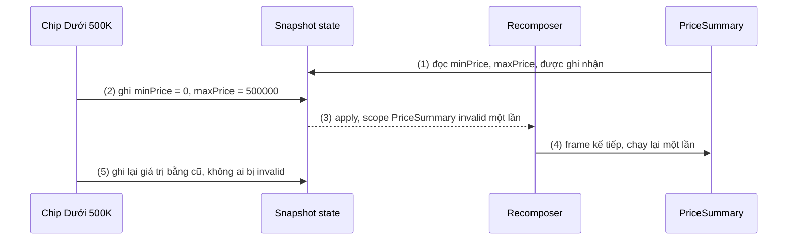
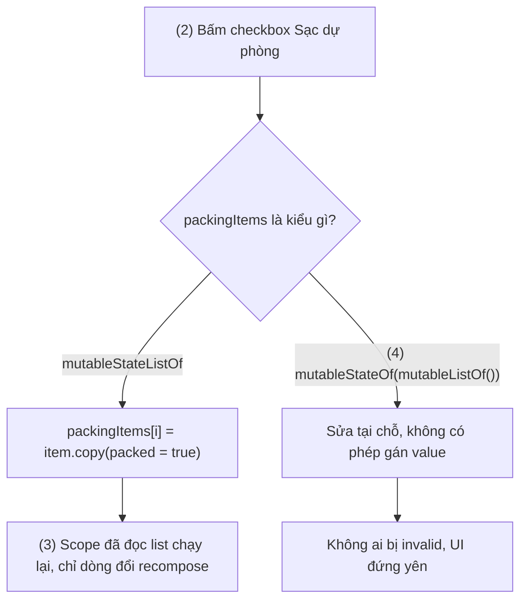
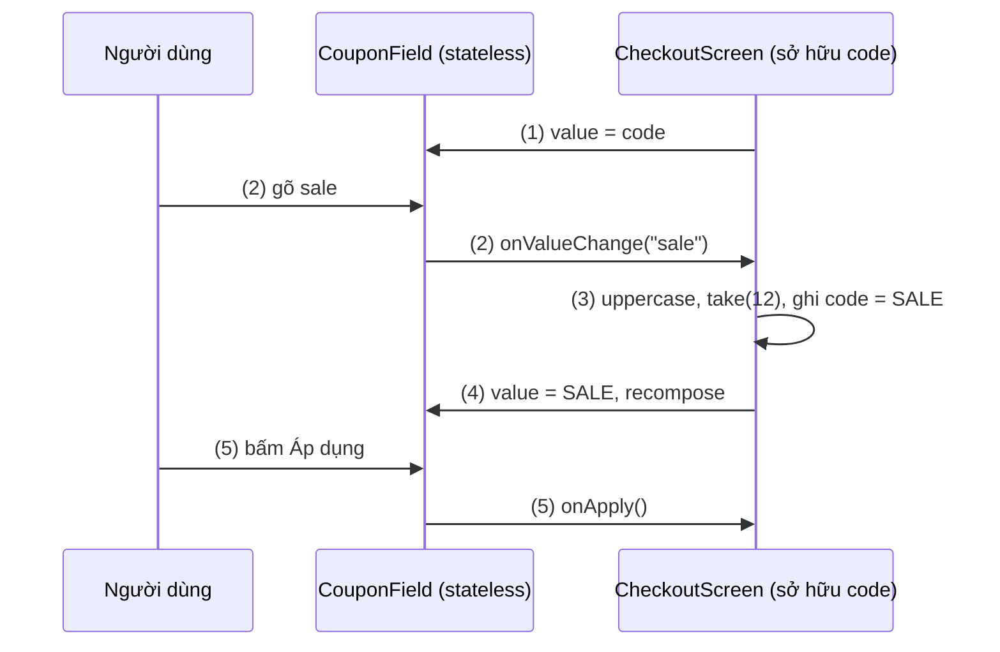
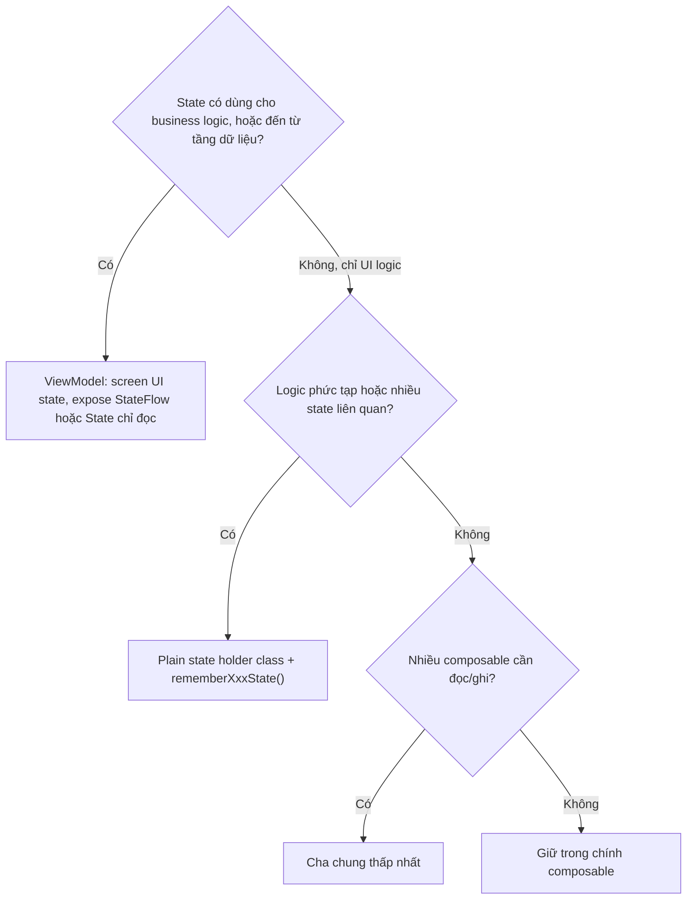
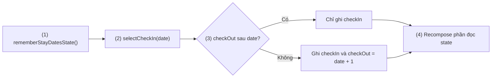

# MutableState

## Vấn đề cần giải quyết

Compose chỉ chạy lại những scope đã **đọc** một state vừa đổi ([9.1 Remember and Recomposition](../remember_and_recomposition.md)). Vậy runtime phải *biết* lần đọc và lần ghi đó. Một biến Kotlin thường không báo cho ai cả:

```kotlin
// ❌ Bấm nút không có gì xảy ra
@Composable
fun BookmarkButton() {
    var saved = false                                  // biến thường: ghi không ai biết, lần chạy sau tạo lại false
    FilledTonalButton(onClick = { saved = !saved }) {
        Text(if (saved) "Đã lưu" else "Lưu bài")
    }
}
```

Cần một kiểu giá trị mà **đọc thì được ghi nhận, ghi thì báo cho người đã đọc**. Có kiểu đó rồi, lại có câu hỏi thứ hai: state này thuộc về **ai**? Đặt sâu trong `BookmarkButton` thì màn hình danh sách không biết bài nào đã lưu, không test được, không dùng lại được. Đẩy tất cả lên ViewModel thì một trạng thái "đang mở menu" cũng phải đi qua tầng nghiệp vụ. Bài này trả lời cả hai: `MutableState` hoạt động thế nào, và state hoisting quyết định nơi đặt nó.

## Sau khi học xong

- Giải thích được cách snapshot system theo dõi lần đọc và lần ghi MutableState để quyết định scope nào recompose.
- Áp dụng được mutableStateOf, các biến thể primitive và ba cách khai báo (value, delegate by, destructuring) đúng ngữ cảnh.
- Phân biệt được mutableStateListOf/mutableStateMapOf với mutableStateOf chứa list, và chọn SnapshotMutationPolicy phù hợp.
- Thiết kế được composable stateless theo pattern value + onValueChange và quyết định hoist state tới composable cha, state holder class hay ViewModel.
- Nhận diện được các lỗi state không cập nhật UI như biến thường, collection mutable không quan sát được và state trùng lặp ở hai nơi.

## MutableState là gì?

**`MutableState<T>`** là holder giá trị quan sát được của Compose: đọc `value` trong lúc composition thì snapshot system ghi nhận scope đó phụ thuộc vào nó, ghi `value` mới (khác giá trị cũ theo mutation policy) thì mọi scope đã đọc nó bị invalid và được recompose. **State hoisting** là quyết định *ai sở hữu* `MutableState` đó: composable tự giữ, hay đưa lên nơi gọi nó.

Mental model:

> **`MutableState` là một ô giá trị có sổ đăng ký người đọc.** Ai đọc ô trong lúc composition thì tên được ghi vào sổ. Ai ghi giá trị mới vào ô thì mọi người trong sổ được báo "cần vẽ lại". Ghi một giá trị bằng giá trị cũ thì không ai bị báo.

## Cách hoạt động

### 1. `State<T>`, `MutableState<T>` và ba cách khai báo

```kotlin
interface State<out T> { val value: T }
interface MutableState<T> : State<T> { override var value: T }
```

`mutableStateOf(value, policy = structuralEqualityPolicy())` tạo một `MutableState`. Để state sống qua recomposition, nó gần như luôn được bọc trong `remember` (hoặc `rememberSaveable`, [9.2.2](remember_saveable.md)), hoặc nằm trong một object sống lâu hơn composition (state holder, ViewModel). Ba cách khai báo tương đương nhau:

```kotlin
val saved = remember { mutableStateOf(false) }          // đọc/ghi qua saved.value
var saved by remember { mutableStateOf(false) }         // delegate: đọc/ghi như biến thường
val (saved, setSaved) = remember { mutableStateOf(false) } // destructuring: giá trị + hàm ghi
```

| Cách | Hợp khi |
|---|---|
| `val x = mutableStateOf(...)` | Cần truyền **chính object `State`** đi (để nơi khác đọc muộn, ví dụ `{ x.value }`) |
| `var x by mutableStateOf(...)` | Phần lớn trường hợp trong composable và state holder; cần `import androidx.compose.runtime.getValue` và `setValue` |
| `val (x, setX) = ...` | Muốn truyền thẳng hàm ghi làm callback (`onCheckedChange = setX`) |

Với delegate `by`, lần **đọc** thật sự xảy ra ở chỗ dùng biến, không phải ở dòng khai báo. Điều này quan trọng với phạm vi recompose (9.1, mục 1).

### 2. Snapshot system: đọc được theo dõi, ghi làm invalid

`MutableState` là một **snapshot state object**. Snapshot system của Compose runtime cho mỗi đoạn code một "ảnh chụp" nhất quán của mọi state, và cho phép quan sát việc đọc/ghi:

- **Đọc:** composition chạy bên trong một snapshot có *read observer*. Mỗi lần `value` được đọc, runtime ghi nhận "scope đang chạy phụ thuộc state này".
- **Ghi:** code ngoài composition (lambda `onClick`, coroutine trong ViewModel) ghi vào *global snapshot*. Khi các thay đổi được *apply*, Recomposer nhận thông báo, đánh dấu mọi scope đã đọc state đó là invalid và lên lịch recompose cho frame kế tiếp.
- **Gộp:** nhiều lần ghi trước frame kế tiếp chỉ gây **một** lượt recompose.
- **Bỏ qua lần ghi tương đương:** với policy mặc định, ghi giá trị `==` giá trị cũ không invalid ai.

Snapshot state an toàn đa luồng: ghi từ thread nền được, và composition luôn đọc một ảnh chụp nhất quán. Muốn **nhiều** lần ghi từ thread nền được thấy cùng lúc (không ai đọc được trạng thái nửa vời), bọc chúng trong `Snapshot.withMutableSnapshot { }`.

#### Ví dụ: bộ lọc khoảng giá

**Bài toán:** bộ lọc sản phẩm có hai ô "giá từ" và "giá đến", cùng một dòng tóm tắt "Từ 200.000đ đến 500.000đ". Bấm chip "Dưới 500K" phải đặt cả hai giá trị. Ví dụ cho thấy vòng đọc → ghi → invalid → recompose, và việc gộp hai lần ghi.

**Luồng chạy:**

1. Lần composition đầu: `PriceSummary` đọc `minPrice` và `maxPrice`; read observer ghi nhận scope `PriceSummary` phụ thuộc cả hai.
2. Bấm chip: `onClick` ghi `minPrice = 0` rồi `maxPrice = 500_000` vào global snapshot.
3. Thay đổi được apply trước frame kế tiếp; Recomposer đánh dấu scope `PriceSummary` invalid **một lần**.
4. Frame kế tiếp: `PriceSummary` chạy lại một lần với cả hai giá trị mới.
5. Bấm lại chính chip đó: hai lần ghi bằng giá trị cũ, không scope nào invalid.



**Code:**

```kotlin
// ui/filter/PriceFilter.kt
@Composable
fun PriceFilter() {
    var minPrice by remember { mutableLongStateOf(200_000) }
    var maxPrice by remember { mutableLongStateOf(1_000_000) }

    Column {
        PriceSummary(min = minPrice, max = maxPrice)               // (1) đọc ở đây
        AssistChip(
            onClick = { minPrice = 0; maxPrice = 500_000 },         // (2) (5)
            label = { Text("Dưới 500K") },
        )
    }
}

@Composable
fun PriceSummary(min: Long, max: Long) {                           // (4)
    Text("Từ " + formatVnd(min) + " đến " + formatVnd(max))
}
```

**Kết quả:** Layout Inspector cho thấy mỗi lần bấm chip lần đầu, recomposition count của `PriceSummary` tăng **1** (không phải 2); bấm lại chip đang chọn thì không tăng. Ở đây `PriceFilter` đọc state để truyền xuống nên nó cũng chạy lại; nếu muốn hẹp hơn, áp dụng kỹ thuật hoãn đọc ở 9.1.

### 3. Biến thể primitive: `mutableIntStateOf` và các anh em

`mutableStateOf<Int>` lưu giá trị dạng object (`Integer`), mỗi lần ghi là một lần **boxing**. Với state đổi liên tục (âm lượng, tiến độ kéo, bộ đếm), Compose có biến thể lưu primitive trực tiếp: `mutableIntStateOf`, `mutableLongStateOf`, `mutableFloatStateOf`, `mutableDoubleStateOf` (trả `MutableIntState`... với property `intValue`, `longValue`...). Lint của Compose gợi ý chuyển khi thấy `mutableStateOf(0)`.

```kotlin
// ui/player/VolumeControl.kt — Slider ghi liên tục khi kéo
var volume by remember { mutableFloatStateOf(0.6f) }
Slider(value = volume, onValueChange = { volume = it })
```

Delegate `by` vẫn dùng được với các kiểu này. Khác biệt chỉ là hiệu năng; hành vi quan sát giống hệt `mutableStateOf`.

### 4. Collection: `mutableStateListOf` / `mutableStateMapOf` và `mutableStateOf(list)`

`MutableState` chỉ quan sát **phép gán `value`**, không nhìn vào bên trong giá trị. Vì vậy:

- `mutableStateOf(mutableListOf<T>())` rồi `list.value.add(x)`: **không** có phép gán nào, UI không đổi.
- `mutableStateOf(listOf<T>())` rồi `items = items + x`: tạo list mới và gán, UI đổi. Đơn giản, hợp với list nhỏ hoặc khi cả list đến từ ViewModel.
- `mutableStateListOf<T>()` (kiểu `SnapshotStateList`) và `mutableStateMapOf<K, V>()` (`SnapshotStateMap`): chính collection là snapshot state, nên `add`, `remove`, `set`, `put` đều được quan sát. Hợp khi sửa từng phần tử thường xuyên. Có thể tạo từ list sẵn có bằng `toMutableStateList()`.

Phần tử bên trong vẫn phải bất biến: đổi một phần tử bằng cách **thay** nó (`list[i] = item.copy(...)`), không sửa property `var` của nó.

#### Ví dụ: danh sách đồ cần mang khi đi du lịch

**Bài toán:** checklist "Chuẩn bị chuyến đi": thêm món, tick món đã xếp vào vali, vuốt để xoá. Thao tác trên từng phần tử diễn ra liên tục, nên `mutableStateListOf` hợp hơn tạo list mới mỗi lần.

**Luồng chạy:**

1. Tạo `packingItems` bằng `toMutableStateList()` (một `SnapshotStateList`); `PackingList` đọc nó khi lặp.
2. Bấm checkbox món "Sạc dự phòng": thay phần tử tại vị trí đó bằng bản `copy(packed = true)`; `SnapshotStateList` báo thay đổi.
3. Scope đã đọc `packingItems` chạy lại; dòng có `item` mới (khác `equals`) chạy lại, các dòng khác skip.
4. Phiên bản sai dùng `mutableStateOf(mutableListOf())` và sửa `packed` tại chỗ: không có lần ghi nào được quan sát, checkbox không đổi.



**Code:**

```kotlin
// ui/trip/PackingList.kt
data class PackingItem(val id: Long, val name: String, val packed: Boolean = false)

@Composable
fun PackingList(initial: List<PackingItem>) {
    val packingItems = remember { initial.toMutableStateList() }               // (1)

    LazyColumn {
        items(packingItems, key = { it.id }) { item ->
            PackingRow(
                item = item,
                onToggle = {
                    val index = packingItems.indexOfFirst { it.id == item.id }
                    packingItems[index] = item.copy(packed = !item.packed)     // (2) thay phần tử
                },
                onRemove = { packingItems.removeAll { it.id == item.id } },
            )
        }
    }
}
```

**Kết quả:** tick một món chỉ dòng đó recompose (Layout Inspector); xoá một món thì danh sách cập nhật ngay. Trong app thật, checklist cần lưu lâu dài thường nằm ở ViewModel + Room; ví dụ này giữ trong composition để tập trung vào cơ chế quan sát. Lưu ý `packingItems` là `SnapshotStateList` (stable); truyền nó xuống con dưới dạng `List<PackingItem>` để con không sửa được.

### 5. `SnapshotMutationPolicy`: thế nào là "giá trị mới"

Tham số `policy` của `mutableStateOf` quyết định khi nào một lần ghi được coi là thay đổi (hàm `equivalent(a, b)`), và cách gộp xung đột khi hai snapshot cùng ghi (hàm `merge`, tuỳ chọn).

| Policy | Coi là "không đổi" khi | Dùng khi |
|---|---|---|
| `structuralEqualityPolicy()` (mặc định) | `a == b` | Hầu hết trường hợp; `data class` bất biến |
| `referentialEqualityPolicy()` | `a === b` | Giá trị lớn có `equals` đắt (dữ liệu biểu đồ hàng nghìn điểm), chỉ thay bằng instance mới khi thật sự đổi |
| `neverEqualPolicy()` | Không bao giờ | Mỗi lần ghi đều phải báo, kể cả cùng giá trị |

```kotlin
// ui/stats/RevenueChart.kt — so tham chiếu thay vì so 5.000 điểm dữ liệu
var series by remember { mutableStateOf(emptyChartSeries, referentialEqualityPolicy()) }
```

> [!WARNING]
> `neverEqualPolicy()` hay bị dùng để "ép" UI cập nhật sau khi sửa tại chỗ một object mutable rồi gán lại chính nó. Cách đó che giấu vấn đề thật (dữ liệu mutable) và làm mọi scope đọc state chạy lại cả khi không có gì đổi. Ưu tiên dữ liệu bất biến.

### 6. State hoisting: stateless, stateful và pattern `value` + `onValueChange`

Composable dùng `remember` để giữ state riêng là **stateful**: tiện cho nơi gọi không quan tâm state, nhưng khó dùng lại, khó test, và nơi khác không đọc được state đó. Composable không giữ state là **stateless**: mọi thứ nó hiển thị đến từ tham số.

**State hoisting** biến composable stateful thành stateless bằng cách thay biến state bằng hai tham số:

- `value: T` — giá trị hiện tại để hiển thị.
- `onValueChange: (T) -> Unit` — sự kiện **yêu cầu** đổi giá trị, kèm giá trị đề xuất.

Không bắt buộc tên `onValueChange`; sự kiện cụ thể hơn (`onExpand`, `onApply`) thì đặt tên theo nghĩa của nó. State được hoist có năm tính chất theo docs:

| Tính chất | Nghĩa |
|---|---|
| Single source of truth | State chỉ có một bản, không sao chép |
| Encapsulated | Chỉ nơi sở hữu state mới sửa được nó |
| Shareable | Nhiều composable đọc được cùng một state |
| Interceptable | Nơi gọi có thể bỏ qua hoặc biến đổi sự kiện trước khi ghi state |
| Decoupled | Composable stateless không biết state nằm ở đâu (cha, state holder, ViewModel) |

Đây chính là **Unidirectional Data Flow (UDF)** trong Compose: **state đi xuống** qua tham số, **sự kiện đi lên** qua lambda; chỉ chủ sở hữu state ghi state. Cùng nguyên tắc với MVVM ở [7.2.3 MVVM](../../session_07/architecture/mvvm.md), nhưng áp dụng ở mọi cấp, không chỉ giữa UI và ViewModel.

Ba quy tắc chọn nơi hoist:

1. Hoist ít nhất tới **cha chung thấp nhất** của mọi composable **đọc** state.
2. Hoist ít nhất tới **cấp cao nhất có thể ghi** state.
3. Hai state **đổi cùng lúc theo cùng sự kiện** thì hoist cùng nhau.

#### Ví dụ: ô nhập mã giảm giá

**Bài toán:** màn thanh toán có ô nhập mã giảm giá và nút "Áp dụng". Mã luôn viết hoa, tối đa 12 ký tự, và nút chỉ bật khi mã đủ 6 ký tự. `CouponField` nên dùng lại được ở màn giỏ hàng, nên nó phải stateless; quy tắc viết hoa và giới hạn độ dài do nơi gọi quyết định (interceptable).

**Luồng chạy:**

1. `CheckoutScreen` sở hữu `code` và truyền xuống `CouponField(value = code, ...)`.
2. Người dùng gõ "sale"; `TextField` gọi `onValueChange("sale")`, `CouponField` chuyển tiếp lên.
3. `CheckoutScreen` chặn sự kiện: viết hoa, cắt còn 12 ký tự, rồi mới ghi `code = "SALE"`.
4. `code` đổi, `CouponField` recompose với `value = "SALE"`, nút "Áp dụng" tính lại trạng thái bật.
5. Bấm "Áp dụng": `onApply` đi lên `CheckoutScreen`, nơi gọi ViewModel kiểm tra mã.



**Code:**

```kotlin
// ui/checkout/CouponField.kt — stateless, dùng lại được
@Composable
fun CouponField(
    value: String,
    onValueChange: (String) -> Unit,
    onApply: () -> Unit,
    modifier: Modifier = Modifier,
) {
    Row(modifier, verticalAlignment = Alignment.CenterVertically) {
        OutlinedTextField(
            value = value,                                   // (1) (4)
            onValueChange = onValueChange,                   // (2) chỉ chuyển tiếp, không tự ghi
            label = { Text("Mã giảm giá") },
            singleLine = true,
            modifier = Modifier.weight(1f),
        )
        Button(onClick = onApply, enabled = value.length >= 6) { Text("Áp dụng") } // (5)
    }
}

// ui/checkout/CheckoutScreen.kt — chủ sở hữu state
@Composable
fun CheckoutScreen(viewModel: CheckoutViewModel) {
    var code by rememberSaveable { mutableStateOf("") }
    CouponField(
        value = code,
        onValueChange = { input -> code = input.uppercase().take(12) },   // (3) chặn và biến đổi
        onApply = { viewModel.applyCoupon(code) },                        // (5)
    )
    // ... phần còn lại của màn thanh toán
}
```

**Kết quả:** gõ "sale2024abcdef" thì ô hiện "SALE2024ABCD". `CouponField` có thể viết `@Preview` với bất kỳ `value` nào và test bằng UI test mà không cần ViewModel. `rememberSaveable` giữ mã khi xoay màn hình ([9.2.2](remember_saveable.md)).

> [!TIP]
> Thư viện thường cung cấp **cả hai** phiên bản: bản stateless cho nơi gọi cần kiểm soát state, và bản stateful có state mặc định cho nơi gọi không quan tâm. `LazyColumn(state = rememberLazyListState())` là ví dụ: tham số `state` có giá trị mặc định.

### 7. Hoist tới đâu: composable cha, state holder class hay ViewModel

Quy tắc ở mục 6 cho biết hoist **ít nhất** tới đâu. Chọn **chủ sở hữu** cụ thể dựa vào loại logic dùng state:

- **UI logic** — *cách* hiển thị: mở/đóng menu, cuộn tới item, ngày trả phòng không được trước ngày nhận phòng.
- **Business logic** — quy tắc nghiệp vụ trên dữ liệu app: áp mã giảm giá, lưu bài viết, tìm phòng trống.

| Chủ sở hữu | Khi nào | Vòng đời |
|---|---|---|
| Chính composable | State đơn giản, chỉ nó đọc/ghi (trạng thái mở rộng của một thẻ) | Theo composition |
| Composable cha | Vài composable anh em cần cùng state, logic đơn giản | Theo composition |
| **Plain state holder class** (`@Stable class` + `rememberXxxState()`) | UI logic phức tạp, nhiều field liên quan nhau, muốn test riêng | Theo composition |
| **ViewModel** | State cần cho business logic, hoặc là screen UI state từ tầng dữ liệu | Theo `ViewModelStoreOwner`, sống qua xoay màn hình ([ViewModel](../../session_06/viewmodel.md)) |



ViewModel không phải là composition: nó được cung cấp bởi framework và scope theo Activity, Fragment hoặc navigation destination. ViewModel thường expose screen UI state bằng `StateFlow` và composable chuyển sang `State` bằng `collectAsStateWithLifecycle()` (học ở [9.3.5 SnapShotFlow and flowWithSnapshot](../side_effects/flow_with_snapshot.md)); ViewModel cũng có thể giữ `var x by mutableStateOf(...)` với `private set`. Hai quy ước từ docs: chỉ composable cấp màn hình nhận ViewModel, **không truyền ViewModel xuống** composable con; và chỉ đưa state lên ViewModel khi business logic cần nó, không phải vì muốn sống qua xoay màn hình.

#### Ví dụ: chọn ngày nhận phòng và trả phòng

**Bài toán:** bộ chọn ngày khách sạn có hai ô "Nhận phòng", "Trả phòng" và dòng "3 đêm". Quy tắc: chọn ngày nhận phòng mới mà ngày trả phòng không còn sau nó thì tự đẩy trả phòng thành nhận phòng + 1 ngày. Đây là UI logic với hai state đổi cùng nhau (quy tắc 3), nên dồn vào một plain state holder.

**Luồng chạy:**

1. `rememberStayDatesState()` tạo và remember `StayDatesState` với hai `MutableState` bên trong.
2. Người dùng chọn ngày nhận phòng; composable gọi `state.selectCheckIn(date)`.
3. State holder áp quy tắc: ghi `checkIn`, nếu cần thì ghi luôn `checkOut`.
4. Các composable đọc `checkIn`, `checkOut`, `nights` recompose; logic không nằm trong composable nào.



**Code:**

```kotlin
// ui/hotel/StayDatesState.kt
@Stable
class StayDatesState(initialCheckIn: LocalDate, initialCheckOut: LocalDate) {
    var checkIn by mutableStateOf(initialCheckIn)
        private set
    var checkOut by mutableStateOf(initialCheckOut)
        private set
    val nights: Long get() = ChronoUnit.DAYS.between(checkIn, checkOut)  // đọc qua state nên vẫn được theo dõi

    fun selectCheckIn(date: LocalDate) {                                  // (2) (3)
        checkIn = date
        if (!checkOut.isAfter(date)) checkOut = date.plusDays(1)
    }

    fun selectCheckOut(date: LocalDate) {
        if (date.isAfter(checkIn)) checkOut = date
    }
}

@Composable
fun rememberStayDatesState(today: LocalDate = LocalDate.now()): StayDatesState =   // (1)
    remember { StayDatesState(today, today.plusDays(1)) }
```

**Kết quả:** unit test `StayDatesState` như class Kotlin thường (`selectCheckIn` rồi kiểm tra `checkOut`), không cần Compose UI. `@Stable` đúng hợp đồng: mọi property public đều đọc từ `MutableState`. Muốn giữ ngày đã chọn qua xoay màn hình thì thay `remember` bằng `rememberSaveable` với một `Saver` ([9.2.2](remember_saveable.md)).

## Ví dụ thực tế

Ba bài toán điển hình theo ba cấp chủ sở hữu: **trạng thái mở/đóng** của một thẻ, dropdown → giữ trong composable; **bộ chọn ngày, form nhiều ô ràng buộc nhau** → plain state holder; **giỏ hàng, kết quả tìm kiếm, trạng thái đã lưu bài** → ViewModel.

### Màn hình tìm phòng khách sạn

Bài toán chính ghép cả ba cấp: ngày ở do `StayDatesState` (UI logic) sở hữu; số khách và kết quả tìm kiếm do `HotelSearchViewModel` sở hữu (tìm phòng là business logic, và số khách là input của nó); các component hiển thị đều stateless.

```kotlin
// ui/hotel/HotelSearchViewModel.kt
data class HotelSearchUiState(
    val guests: Int = 2,
    val isLoading: Boolean = false,
    val hotels: List<HotelSummary> = emptyList(),
)

class HotelSearchViewModel(private val hotelRepository: HotelRepository) : ViewModel() {
    private val _uiState = MutableStateFlow(HotelSearchUiState())
    val uiState: StateFlow<HotelSearchUiState> = _uiState.asStateFlow()

    fun onGuestsChange(guests: Int) = _uiState.update { it.copy(guests = guests.coerceIn(1, 8)) }

    fun search(checkIn: LocalDate, checkOut: LocalDate) {
        _uiState.update { it.copy(isLoading = true) }
        viewModelScope.launch {
            val hotels = hotelRepository.findAvailable(checkIn, checkOut, _uiState.value.guests)
            _uiState.update { it.copy(isLoading = false, hotels = hotels) }
        }
    }
}

// ui/hotel/HotelSearchScreen.kt — chỉ composable cấp màn hình biết ViewModel
@Composable
fun HotelSearchScreen(viewModel: HotelSearchViewModel) {
    val uiState by viewModel.uiState.collectAsStateWithLifecycle()
    val dates = rememberStayDatesState()

    Column(Modifier.padding(16.dp)) {
        StayDatesPicker(
            checkIn = dates.checkIn,
            checkOut = dates.checkOut,
            nights = dates.nights,
            onCheckInChange = dates::selectCheckIn,
            onCheckOutChange = dates::selectCheckOut,
        )
        GuestCounter(value = uiState.guests, onValueChange = viewModel::onGuestsChange)
        Button(onClick = { viewModel.search(dates.checkIn, dates.checkOut) }, enabled = !uiState.isLoading) {
            Text("Tìm phòng")
        }
        HotelResults(hotels = uiState.hotels, isLoading = uiState.isLoading)
    }
}

// ui/hotel/GuestCounter.kt — stateless
@Composable
fun GuestCounter(value: Int, onValueChange: (Int) -> Unit, modifier: Modifier = Modifier) {
    Row(modifier, verticalAlignment = Alignment.CenterVertically) {
        OutlinedButton(onClick = { onValueChange(value - 1) }, enabled = value > 1) { Text("−") }
        Text("$value khách", modifier = Modifier.padding(horizontal = 12.dp))
        OutlinedButton(onClick = { onValueChange(value + 1) }) { Text("+") }
    }
}
```

Các điểm đáng chú ý:

- **Một nguồn sự thật cho mỗi state**: `guests` chỉ có trong `uiState`; `GuestCounter` không giữ bản sao. ViewModel còn chặn giá trị (`coerceIn(1, 8)`) — tính chất interceptable ở cấp ViewModel.
- **Chọn chủ sở hữu theo logic**: ngày ở là UI logic nên không lên ViewModel; khi bấm "Tìm phòng", chúng được truyền vào `search()` như tham số của sự kiện.
- `StayDatesPicker`, `GuestCounter`, `HotelResults` không biết ViewModel tồn tại: preview và test với dữ liệu giả được ngay.

**Kết quả:** `HotelSearchViewModel` unit test được với `FakeHotelRepository` như ở [MVVM](../../session_07/architecture/mvvm.md); `StayDatesState` test như class thường; các component stateless có `@Preview` cho từng trạng thái (đang tải, không có phòng, có kết quả).

## Khi nào nên và không nên dùng

**Nên dùng `MutableState`:**

- State UI trong composable hoặc plain state holder: `remember { mutableStateOf(...) }`, biến thể primitive cho giá trị đổi liên tục.
- `mutableStateListOf`/`mutableStateMapOf` khi sửa từng phần tử thường xuyên trong UI.
- Trong ViewModel khi muốn expose state cho Compose mà không cần toán tử `Flow` (`var query by mutableStateOf("")` + `private set`).

**Cân nhắc cách khác:**

- Screen UI state kết hợp nhiều nguồn dữ liệu (`combine`, `debounce`, `stateIn`) → `StateFlow` trong ViewModel, rồi `collectAsStateWithLifecycle()` ở UI.
- State suy ra từ state khác → tính trực tiếp, `remember(key)` (9.1) hoặc `derivedStateOf` ([9.3.4 DerivedStateOf](../side_effects/derived_state_of.md)), không tạo `MutableState` thứ hai rồi tự đồng bộ.
- Dữ liệu phải sống lâu dài (giỏ hàng, cài đặt) → Room/DataStore qua repository; `MutableState` chỉ là bản hiển thị.

**Về hoisting:** đừng hoist mọi thứ lên ViewModel "cho chắc". State chỉ UI cần nằm càng gần nơi dùng càng tốt; hoist cao hơn mức cần làm property drilling dài và ViewModel phình to.

## Sai lầm thường gặp

### 1. Biến thường, hoặc `mutableStateOf` không `remember`

`var saved = false` không được quan sát; `var saved by mutableStateOf(false)` không `remember` thì mỗi lần recompose tạo state mới ([Jetpack Compose Overview](../overview.md), mục "Sai lầm thường gặp"). **Cách sửa:** `var saved by remember { mutableStateOf(false) }`, hoặc đưa state lên chủ sở hữu phù hợp.

### 2. Sửa collection mutable bên trong `mutableStateOf`

```kotlin
// ❌ Không có phép gán value nào
val tags = remember { mutableStateOf(mutableListOf<String>()) }
Button(onClick = { tags.value.add("du-lich") }) { Text("Thêm tag") }
```

**Lỗi lộ ra thế nào:** bấm nút không thấy tag mới; tag chỉ hiện khi một lý do khác làm composable chạy lại, nên lỗi chập chờn. **Cách sửa:** `remember { mutableStateListOf<String>() }` rồi `tags.add(...)`, hoặc `mutableStateOf(listOf<String>())` rồi `tags = tags + "du-lich"`.

### 3. Sửa property `var` của object nằm trong state

```kotlin
// ❌ Cùng instance, policy mặc định thấy bằng nhau
data class Profile(var displayName: String)
var profile by remember { mutableStateOf(Profile("An")) }
profile.displayName = "Bình"
```

**Lỗi lộ ra thế nào:** UI vẫn hiện "An". **Cách sửa:** model bất biến (`val`) và gán bản mới: `profile = profile.copy(displayName = "Bình")`.

### 4. Sao chép tham số vào state cục bộ

```kotlin
// ❌ Hai nguồn sự thật: initialNote chỉ được dùng ở lần đầu
@Composable
fun NoteEditor(initialNote: String, onSave: (String) -> Unit) {
    var note by remember { mutableStateOf(initialNote) }
    // ...
}
```

**Lỗi lộ ra thế nào:** dữ liệu từ server về sau (hoặc chuyển sang ghi chú khác) nhưng ô soạn vẫn hiện nội dung cũ, vì `remember` không chạy lại. **Cách sửa:** hoist hẳn (`note` + `onNoteChange` từ nơi sở hữu); nếu thật sự cần bản nháp cục bộ khởi tạo từ tham số thì dùng key: `remember(noteId) { mutableStateOf(initialNote) }`, và nói rõ đó là bản nháp.

### 5. Truyền ViewModel hoặc `MutableState` xuống composable con

```kotlin
// ❌ Con biết quá nhiều
@Composable
fun GuestCounter(viewModel: HotelSearchViewModel) { /* ... */ }
@Composable
fun CouponField(code: MutableState<String>) { /* tự ghi code.value */ }
```

**Lỗi lộ ra thế nào:** không preview, không dùng lại, test phải dựng ViewModel; với `MutableState` làm tham số, con tự ghi state nên mất tính interceptable và khó biết ai đã đổi giá trị. **Cách sửa:** truyền `value` + lambda sự kiện; chỉ màn hình biết ViewModel.

### 6. ViewModel cho phép ghi state từ bên ngoài

`var query by mutableStateOf("")` không có `private set` (hoặc expose `MutableStateFlow`) thì UI ghi thẳng vào state, bỏ qua mọi quy tắc của ViewModel. **Cách sửa:** `private set` và một hàm sự kiện `fun onQueryChange(...)`, giống nguyên tắc ở [MVVM](../../session_07/architecture/mvvm.md).

## Lịch sử phát triển

| Thời điểm | Mốc |
|---|---|
| 07/2021 | Compose 1.0: `mutableStateOf`, `State`/`MutableState`, `mutableStateListOf`/`mutableStateMapOf`, snapshot system và `SnapshotMutationPolicy` có từ bản stable đầu tiên |
| 2022 | Docs bổ sung hướng dẫn "Where to hoist state", phân biệt UI logic với business logic và plain state holder với ViewModel, khớp với phần UI layer của hướng dẫn kiến trúc |
| 2023 | Compose 1.5 thêm `mutableIntStateOf`, `mutableLongStateOf`, `mutableFloatStateOf`, `mutableDoubleStateOf` tránh boxing; `collectAsStateWithLifecycle()` (lifecycle-runtime-compose) stable, thành cách khuyến nghị để biến `Flow` thành `State` trên Android |

Thiết kế snapshot state không đổi từ 1.0. Những gì thay đổi là hướng dẫn **đặt state ở đâu**: từ "hoist càng cao càng tốt" sang "hoist tới cha chung thấp nhất, chọn chủ sở hữu theo loại logic".

## Kết nối hệ thống

- **Tiên quyết:** [9.1 Remember and Recomposition](../remember_and_recomposition.md) (recompose scope, `remember`, stability); [Jetpack Compose Overview](../overview.md).
- **Cùng nhóm 9.2:** [9.2.2 Remember and rememberSaveable](remember_saveable.md): giữ `MutableState` qua xoay màn hình và process death.
- **Liên quan:**
  - [ViewModel](../../session_06/viewmodel.md) và [MVVM](../../session_07/architecture/mvvm.md): chủ sở hữu screen UI state, UDF giữa UI và ViewModel.
  - [LiveData](../../session_06/livedata.md): `observeAsState()` chuyển `LiveData` thành `State`.
- **Học tiếp:**
  - [9.3.5 SnapShotFlow and flowWithSnapshot](../side_effects/flow_with_snapshot.md): `collectAsStateWithLifecycle()` và `snapshotFlow`, hai chiều State ↔ Flow.
  - [9.3.4 DerivedStateOf](../side_effects/derived_state_of.md): state suy ra từ state khác.
  - 7.1.4.2 Flow (chưa có bài): `StateFlow` mà ViewModel expose.

## Tham khảo

- [State and Jetpack Compose — Android Developers](https://developer.android.com/develop/ui/compose/state)
- [Where to hoist state — Android Developers](https://developer.android.com/develop/ui/compose/state-hoisting)
- [Architecting your Compose UI (UDF) — Android Developers](https://developer.android.com/develop/ui/compose/architecture)
- [State holders and UI state — Android Developers](https://developer.android.com/topic/architecture/ui-layer/stateholders)
- [SnapshotMutationPolicy — API reference](https://developer.android.com/reference/kotlin/androidx/compose/runtime/SnapshotMutationPolicy)
- [androidx.compose.runtime package summary (mutableStateOf, mutableIntStateOf, mutableStateListOf) — API reference](https://developer.android.com/reference/kotlin/androidx/compose/runtime/package-summary)
- [Stability in Compose — Android Developers](https://developer.android.com/develop/ui/compose/performance/stability)
