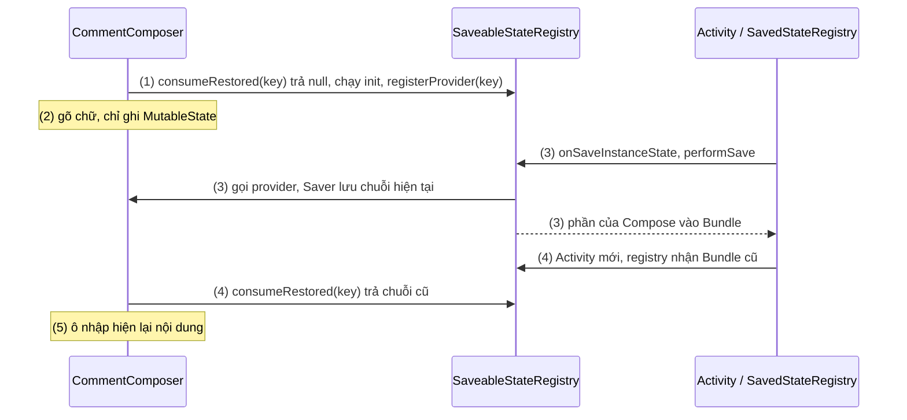
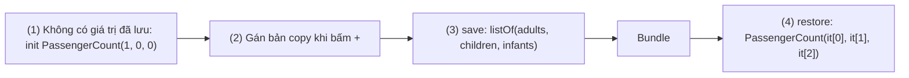
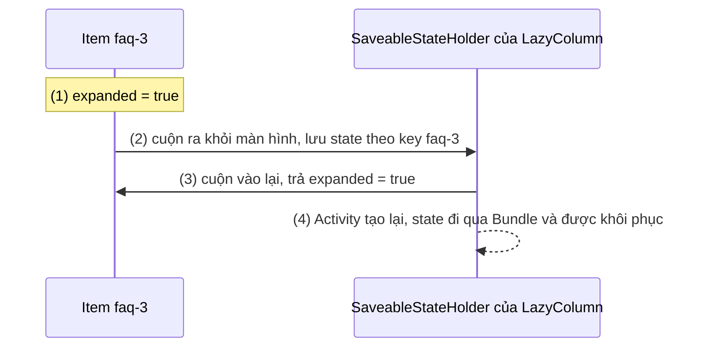
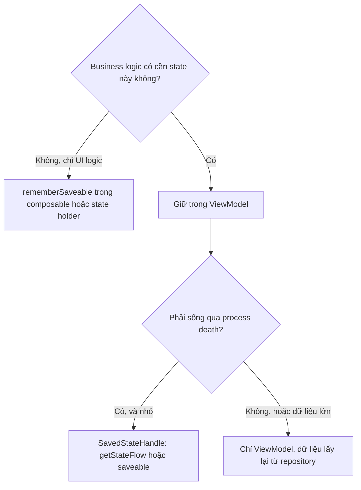
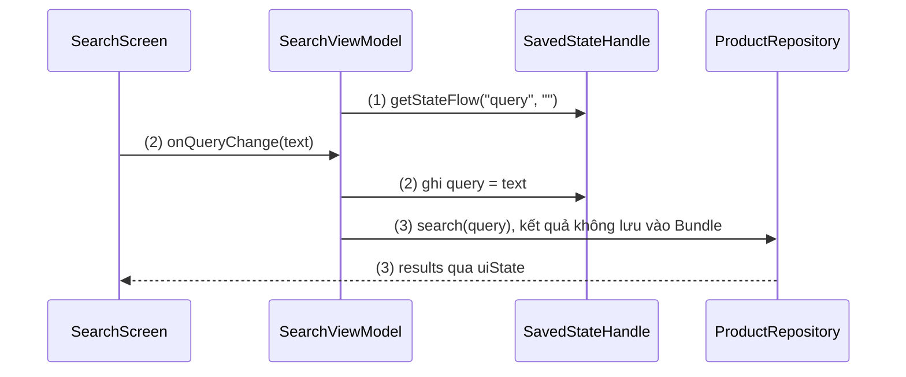

# Remember and rememberSaveable

## Vấn đề cần giải quyết

`remember` giữ giá trị trong slot table của composition ([9.1 Remember and Recomposition](../remember_and_recomposition.md)). Nhưng composition không sống mãi. Xoay màn hình, đổi ngôn ngữ, bật dark mode là các configuration change: Activity bị huỷ và tạo lại, composition cũ bị huỷ theo, **mọi giá trị `remember` mất**. Khi app ở background lâu, hệ thống có thể kill cả process; người dùng quay lại thì Activity được tạo lại từ đầu ([Activity State Changes](../../session_04/components/activity/state_changes.md)).

```kotlin
// ❌ Gõ bình luận dài, xoay màn hình: ô trống trơn
@Composable
fun CommentComposer(onSend: (String) -> Unit) {
    var draft by remember { mutableStateOf("") }
    OutlinedTextField(value = draft, onValueChange = { draft = it }, label = { Text("Viết bình luận") })
}
```

Cách khắc phục không phải "lưu mọi thứ". Saved instance state là một `Bundle` nhỏ, dùng chung cho cả Activity, được hệ thống giữ hộ app ngay cả khi process đã chết. Nhét danh sách sản phẩm vào đó là crash. Vì vậy cần biết chính xác: **cái gì** đáng lưu, lưu **bằng gì**, và **mỗi công cụ** giữ được qua sự kiện nào.

## Sau khi học xong

- Phân biệt được giá trị nào sống qua recomposition, configuration change, process death và rời composition khi dùng remember, rememberSaveable, retain và ViewModel.
- Giải thích được cách rememberSaveable đăng ký với SaveableStateRegistry để ghi giá trị vào Bundle và khôi phục theo vị trí gọi.
- Triển khai được Saver tuỳ chỉnh bằng listSaver, mapSaver hoặc @Parcelize cho kiểu không tự lưu được vào Bundle.
- Áp dụng được rememberSaveable trong item của LazyColumn với key ổn định để giữ state khi cuộn và khi Activity được tạo lại.
- Biết khi nào chuyển state sang ViewModel với SavedStateHandle thay vì rememberSaveable, và giữ dữ liệu trong Bundle ở mức tối thiểu.

## rememberSaveable là gì?

**`rememberSaveable`** là `remember` có thêm một bản sao rút gọn của giá trị trong **saved instance state** (`Bundle`) của host: nó đăng ký với `SaveableStateRegistry` theo vị trí gọi, nên giá trị sống qua configuration change và system-initiated process death. Nó vẫn **mất** khi composable rời composition, hoặc khi người dùng chủ động đóng màn hình (bấm Back thoát, vuốt app khỏi Recents).

Mental model:

> **`remember` ghi chú vào cuốn sổ của composition; `rememberSaveable` ghi chú vào sổ và chép thêm một bản tóm tắt vào một phong bì nhỏ (`Bundle`) mà hệ thống giữ hộ.** Sổ bị huỷ (Activity tạo lại, process chết) thì Compose mở phong bì, chép lại vào đúng mục cũ. Phong bì nhỏ, nên chỉ chép thứ không lấy lại được ở nơi khác (chữ người dùng gõ, tab đang chọn, `id` đang xem), không chép dữ liệu tải lại được.

Cơ chế slot table và vị trí gọi của `remember` đã có ở 9.1; bài này chỉ nói phần "phong bì".

## Cách hoạt động

### 1. Bốn sự kiện làm mất state, và công cụ nào sống qua sự kiện nào

| Sự kiện | `remember` | `retain` (Compose 1.10+) | `rememberSaveable` | ViewModel | ViewModel + `SavedStateHandle` |
|---|---|---|---|---|---|
| Recomposition | ✅ | ✅ | ✅ | ✅ | ✅ |
| Configuration change (xoay, dark mode, đổi ngôn ngữ) | ❌ | ✅ cùng instance | ✅ bản khôi phục `==` | ✅ | ✅ |
| System-initiated process death | ❌ | ❌ | ✅ | ❌ | ✅ |
| Rời composition (nhánh `if` tắt, item bị xoá) | ❌ | ❌ | ❌ (trừ khi có `SaveableStateHolder`, mục 5) | ✅ (theo owner, không theo composition) | ✅ |
| Người dùng đóng hẳn (Back thoát, vuốt khỏi Recents) | ❌ | ❌ | ❌ | ❌ | ❌ |

Ba điểm cần nhớ từ bảng:

- **Chỉ hai công cụ dùng `Bundle`** (`rememberSaveable`, `SavedStateHandle`) mới sống qua process death; cái giá là giá trị phải serialize được và phải nhỏ.
- **`retain`** (artifact `androidx.compose.runtime:runtime-retain`, từ Compose 1.10) giữ **cùng instance** qua configuration change mà không serialize, nên giữ được object không vào `Bundle` được (player, cache, bitmap). Không `retain` Activity, View, Fragment, Context, ViewModel hay object tham chiếu tới chúng (leak).
- **Người dùng đóng hẳn** thì không công cụ state nào giữ: dữ liệu phải sống lâu dài (bản nháp quan trọng, giỏ hàng) thuộc về Room/DataStore.

### 2. Cơ chế: `SaveableStateRegistry` ghi vào `Bundle`

Mỗi `ComposeView` (cũng là thứ `setContent` tạo ra) cung cấp cho composition một `SaveableStateRegistry` qua `LocalSaveableStateRegistry`. Registry này được nối với `SavedStateRegistry` của owner gần nhất trong cây View (Activity hoặc Fragment): khi owner lưu saved instance state, registry đóng góp phần của Compose vào `Bundle` đó. Bên trong composition, `SaveableStateHolder` (mục 5) có thể cung cấp registry con cho từng phần UI.

`rememberSaveable` làm thêm ba việc so với `remember`:

- **Tạo key theo vị trí:** từ *composite key hash* của vị trí gọi (cùng thông tin vị trí mà slot table dùng), Compose sinh một chuỗi làm key trong registry. Không cần tự đặt tên; tham số `key: String` tuỳ chỉnh đã bị **deprecated** từ Compose 1.9 vì phá vỡ việc scope theo vị trí.
- **Khôi phục hoặc khởi tạo** ở lần đầu vào composition: hỏi registry `consumeRestored(key)`. Có giá trị đã lưu → dùng `Saver.restore` để dựng lại; không có → chạy `init`.
- **Đăng ký provider:** `registerProvider(key) { saver.save(currentValue) }`. Registry chỉ gọi provider **khi lưu thật sự** (owner đang vào `onSaveInstanceState`), nên giá trị được lưu là giá trị **mới nhất** tại thời điểm đó. Khi composable rời composition, provider bị huỷ đăng ký: giá trị không còn được lưu nữa.

`rememberSaveable(vararg inputs)` nhận input như key của `remember`: input đổi thì state reset và `init` chạy lại. Docs ghi rõ: lúc **khôi phục**, giá trị đã lưu **không** được kiểm tra lại với input cũ.

#### Ví dụ: ô soạn bình luận sống qua xoay màn hình và process death

**Bài toán:** sửa `CommentComposer` ở phần "Vấn đề cần giải quyết" để chữ đang gõ còn nguyên sau khi xoay màn hình, và sau khi app bị kill ở background rồi được mở lại.

**Luồng chạy:**

1. Lần đầu vào composition: registry không có giá trị cho key của vị trí này, `init` chạy, `draft = ""`; provider được đăng ký.
2. Người dùng gõ "Bài viết rất hữu ích"; mỗi lần gõ chỉ ghi `MutableState`, chưa có gì vào `Bundle`.
3. Xoay màn hình (hoặc bấm Home trước khi process bị kill): Activity gọi `onSaveInstanceState`; registry gọi provider, `Saver` lưu chuỗi hiện tại vào `Bundle`.
4. Activity mới (hoặc process mới) được tạo với `Bundle` đã lưu; composition mới chạy, `rememberSaveable` ở **cùng vị trí** sinh ra cùng key, `consumeRestored` trả chuỗi cũ.
5. Ô nhập hiện lại "Bài viết rất hữu ích".



**Code:** chỉ đổi một từ.

```kotlin
// ui/post/CommentComposer.kt
@Composable
fun CommentComposer(onSend: (String) -> Unit) {
    var draft by rememberSaveable { mutableStateOf("") }          // (1) (4) String lưu thẳng vào Bundle
    Row(verticalAlignment = Alignment.CenterVertically) {
        OutlinedTextField(
            value = draft,
            onValueChange = { draft = it },                       // (2)
            label = { Text("Viết bình luận") },
            modifier = Modifier.weight(1f),
        )
        IconButton(onClick = { onSend(draft); draft = "" }, enabled = draft.isNotBlank()) {
            Icon(Icons.AutoMirrored.Filled.Send, contentDescription = "Gửi")
        }
    }
}
```

**Kết quả:** gõ rồi xoay màn hình, chữ còn. Kiểm tra process death: gõ, bấm Home, chạy `adb shell am kill <package>`, mở lại từ Recents: chữ vẫn còn. Vuốt app khỏi Recents rồi mở lại: ô trống, đúng như bảng mục 1. `rememberTextFieldState()` của API `TextFieldState` cũng lưu bằng cơ chế này.

### 3. Kiểu lưu được và `Saver`

Mặc định `rememberSaveable` dùng `autoSaver()`, không chuyển đổi gì: giá trị phải là thứ `Bundle` chứa được — primitive, `String`, mảng primitive, `Parcelable`, `Serializable`, và vài kiểu khác mà registry trên Android chấp nhận. `MutableState` bọc một giá trị lưu được, cùng `List`/`Map`/`Set` chứa giá trị lưu được, cũng được xử lý tự động. Kiểu khác (một `data class` thường) thì crash khi lưu, với thông báo rằng kiểu đó không lưu được bằng `SaveableStateRegistry` hiện tại và gợi ý viết `Saver`.

Bốn cách lưu kiểu tuỳ chỉnh:

| Cách | Khi nào |
|---|---|
| `@Parcelize` + `Parcelable` | Cách đơn giản nhất cho class của bạn; cần plugin `kotlin-parcelize` ([Parcelables & Bundle](../../session_04/components/activity/parcelables_and_bundle.md)) |
| `listSaver(save, restore)` | Đổi object thành `List` giá trị lưu được, khôi phục theo chỉ số; gọn cho class ít field |
| `mapSaver(save, restore)` | Như `listSaver` nhưng theo key tên, dễ đọc hơn khi nhiều field |
| `Saver(save, restore)` | Toàn quyền: đổi sang một giá trị lưu được bất kỳ (ví dụ chỉ lưu `id`) |

Với `MutableState<T>`, truyền saver của **`T`** qua tham số `stateSaver`; với object không bọc state, dùng tham số `saver`. Từ Compose 1.9 còn có `rememberSerializable`: cùng cơ chế, nhưng dùng serializer của `kotlinx.serialization` cho class `@Serializable` thay cho `Saver`.

#### Ví dụ: bộ chọn số hành khách khi đặt vé máy bay

**Bài toán:** form đặt vé có bộ đếm người lớn, trẻ em, em bé. Ba số đổi cùng nhau theo quy tắc (em bé không quá số người lớn), nên gom vào `data class PassengerCount`. Class này không phải `Parcelable`, và ta không muốn module domain phụ thuộc Android, nên viết `Saver` ở tầng UI.

**Luồng chạy:**

1. `rememberSaveable(stateSaver = PassengerCount.Saver)` không có giá trị đã lưu, `init` tạo `PassengerCount(adults = 1)`.
2. Người dùng thêm trẻ em; state được gán bản `copy(...)` mới.
3. Khi lưu, `save` biến object thành `listOf(adults, children, infants)` (ba `Int`, `Bundle` chứa được).
4. Khi khôi phục, `restore` dựng lại `PassengerCount` từ list theo đúng thứ tự.



**Code:**

```kotlin
// ui/booking/PassengerCount.kt
data class PassengerCount(val adults: Int = 1, val children: Int = 0, val infants: Int = 0) {
    companion object {
        val Saver = listSaver<PassengerCount, Int>(
            save = { listOf(it.adults, it.children, it.infants) },              // (3)
            restore = { PassengerCount(it[0], it[1], it[2]) },                  // (4)
        )
    }
}

// ui/booking/PassengerPicker.kt
@Composable
fun PassengerPicker(modifier: Modifier = Modifier) {
    var passengers by rememberSaveable(stateSaver = PassengerCount.Saver) {    // (1)
        mutableStateOf(PassengerCount())
    }
    Column(modifier) {
        CounterRow("Người lớn", passengers.adults, min = 1) { passengers = passengers.copy(adults = it) }   // (2)
        CounterRow("Trẻ em", passengers.children) { passengers = passengers.copy(children = it) }
        CounterRow("Em bé", passengers.infants, max = passengers.adults) { passengers = passengers.copy(infants = it) }
    }
}
```

Phương án `@Parcelize` tương đương, ngắn hơn nếu class thuộc module Android:

```kotlin
@Parcelize
data class PassengerCount(val adults: Int = 1, val children: Int = 0, val infants: Int = 0) : Parcelable
// rememberSaveable { mutableStateOf(PassengerCount()) } — autoSaver tự lưu
```

**Kết quả:** chọn 2 người lớn, 1 trẻ em, xoay màn hình hoặc kill process: số còn nguyên. Thứ tự `save` và `restore` phải khớp nhau; UI test với `StateRestorationTester` (phần "Ví dụ thực tế") bắt lỗi này nhanh hơn chạy tay.

### 4. Giới hạn kích thước `Bundle`

`Bundle` của `rememberSaveable` không riêng cho Compose: nó dùng chung với `onSaveInstanceState()` của Activity, `SavedStateHandle`, Fragment, Navigation. Hai con số cần nhớ, từ docs:

- **Binder transaction buffer** có kích thước cố định, hiện là **1 MB**, dùng chung cho **mọi** transaction đang chạy của process. Vượt quá thì hệ thống ném `TransactionTooLargeException` (runtime exception từ Android 7.0).
- Docs khuyến nghị giữ saved state **dưới 50 KB**, vì system process phải giữ dữ liệu này suốt thời gian người dùng còn có thể quay lại Activity, kể cả khi process của app đã chết.

App một Activity (phổ biến với Compose) gom state của mọi màn hình trong back stack vào cùng `Bundle` đó, nên giới hạn đến nhanh hơn bạn nghĩ. Nguyên tắc: **chỉ lưu tối thiểu để dựng lại UI** — `id`, từ khoá, chỉ số tab, vị trí cuộn — rồi lấy dữ liệu nặng từ tầng dữ liệu. Cơ chế Binder chi tiết ở [Parcelables & Bundle](../../session_04/components/activity/parcelables_and_bundle.md).

```kotlin
// ❌ Lưu cả bài viết (nội dung HTML vài trăm KB) vào Bundle
var article by rememberSaveable { mutableStateOf<Article?>(null) }

// ✅ Lưu id; nội dung lấy lại từ repository (cache Room) sau khi khôi phục
var selectedArticleId by rememberSaveable { mutableStateOf<Long?>(null) }
```

### 5. `rememberSaveable` trong item của `LazyColumn`

Lazy list chỉ compose những item đang hiển thị: item cuộn ra khỏi màn hình thì **rời composition**. Theo mục 1, `remember` trong item mất ngay khi cuộn qua. Lazy layout xử lý việc này bằng `SaveableStateHolder`: trước khi bỏ một item, nó lưu các giá trị `rememberSaveable` của item đó theo **key của item**, và trả lại khi item quay vào màn hình. Cùng cơ chế giúp state được khôi phục khi Activity tạo lại.

Hai hệ quả:

- **Key quyết định state thuộc về item nào.** Không truyền `key`, item được định danh theo vị trí: chèn item lên đầu thì state "trượt" sang item khác, như lỗi `key {}` ở 9.1.
- **Key phải là kiểu `Bundle` chứa được** (`Long`, `String`, `Int`, enum, `Parcelable`), vì nó được lưu cùng state. Key là `data class` thường thì crash khi lưu.

Navigation Compose dùng cùng loại holder cho mỗi màn hình trong back stack: `rememberSaveable` của màn A vẫn còn khi bạn đi sang màn B rồi quay lại, dù màn A đã rời composition.

#### Ví dụ: trang câu hỏi thường gặp có câu trả lời mở rộng

**Bài toán:** trang FAQ có 60 câu hỏi trong `LazyColumn`, bấm để mở câu trả lời. Người dùng mở câu 3, cuộn xuống câu 50 rồi cuộn lên: câu 3 phải vẫn mở. Trạng thái mở chỉ là UI logic, không cần lên ViewModel.

**Luồng chạy:**

1. Item câu 3 vào composition; `rememberSaveable` trong item khởi tạo `expanded = false`. Người dùng bấm, `expanded = true`.
2. Cuộn xuống: item câu 3 rời màn hình; `SaveableStateHolder` lưu `expanded = true` theo key `"faq-3"` trước khi bỏ item.
3. Cuộn lên: item câu 3 compose lại; holder trả state đã lưu cho key `"faq-3"`, `expanded = true`.
4. Xoay màn hình khi câu 3 đang mở: state của holder đi vào `Bundle` như mọi `rememberSaveable` khác, được khôi phục ở Activity mới.



**Code:**

```kotlin
// ui/help/FaqScreen.kt
@Composable
fun FaqScreen(questions: List<FaqItem>) {
    LazyColumn {
        items(questions, key = { "faq-" + it.id }) { question ->      // key là String: Bundle lưu được
            FaqRow(question)
        }
    }
}

@Composable
fun FaqRow(question: FaqItem) {
    var expanded by rememberSaveable { mutableStateOf(false) }       // (1) (3) (4)
    Column(Modifier.fillMaxWidth().clickable { expanded = !expanded }.padding(16.dp)) {
        Text(question.title, style = MaterialTheme.typography.titleMedium)
        if (expanded) Text(question.answer, modifier = Modifier.padding(top = 8.dp))
    }
}
```

**Kết quả:** đổi `rememberSaveable` thành `remember`: cuộn đi rồi quay lại thì câu 3 đã đóng. Giữ `rememberSaveable` nhưng bỏ `key` và chèn một câu hỏi mới lên đầu danh sách: trạng thái mở trượt sang câu khác. `LazyColumn` và `items(key = ...)` học đầy đủ ở [9.5.4 Lazy Column](../modifier/lazy_column.md).

> [!NOTE]
> Nếu trạng thái của item có ý nghĩa nghiệp vụ (sản phẩm đã chọn để so sánh, email đã tick để xoá), đừng để rải trong từng item: đưa tập `id` đã chọn lên ViewModel ([9.2.1 MutableState](mutable_state.md), mục "Hoist tới đâu").

### 6. `rememberSaveable` hay ViewModel + `SavedStateHandle`

Câu hỏi không phải "API nào mạnh hơn" mà là **state đang nằm ở đâu**, và điều đó do loại logic quyết định (9.2.1, mục 7):

- State thuộc **UI logic**, nằm trong composable hoặc plain state holder → `rememberSaveable`.
- State mà **business logic** trong ViewModel cần đọc/ghi → giữ trong ViewModel; để sống qua process death, lưu nó vào **`SavedStateHandle`** ([ViewModel](../../session_06/viewmodel.md)). ViewModel tự sống qua configuration change; `SavedStateHandle` cũng dùng `Bundle`, nên cùng giới hạn kích thước.

`SavedStateHandle` có hai API tiện cho Compose: `getStateFlow(key, initialValue)` trả `StateFlow` của giá trị đã lưu (ghi bằng `savedStateHandle[key] = value`), và `saveable` (lifecycle-viewmodel-compose) cho ViewModel dùng `MutableState` được lưu, ví dụ `var query by savedStateHandle.saveable { mutableStateOf("") }`, nhận `Saver` như `rememberSaveable`; `saveable` còn là API **experimental** (`@SavedStateHandleSaveableApi`).



#### Ví dụ: từ khoá tìm kiếm sản phẩm

**Bài toán:** màn tìm kiếm có ô từ khoá; mỗi lần từ khoá đổi, ViewModel gọi repository để lọc kết quả. Từ khoá là input của business logic, nên nằm trong ViewModel; người dùng không được mất từ khoá sau process death.

**Luồng chạy:**

1. ViewModel đọc `query` từ `SavedStateHandle` bằng `getStateFlow("query", "")`: lần đầu là `""`, sau process death là giá trị đã lưu.
2. Người dùng gõ; UI gọi `onQueryChange`, ViewModel ghi `savedStateHandle["query"] = text`.
3. `results` được tính từ `query` qua repository; process death xảy ra thì `query` được khôi phục từ `Bundle`, còn `results` được **tính lại**, không lưu.



**Code:**

```kotlin
// ui/search/SearchViewModel.kt
class SearchViewModel(
    private val savedStateHandle: SavedStateHandle,
    productRepository: ProductRepository,
) : ViewModel() {

    val query: StateFlow<String> = savedStateHandle.getStateFlow(QUERY_KEY, "")       // (1)

    @OptIn(ExperimentalCoroutinesApi::class, FlowPreview::class)
    val results: StateFlow<List<ProductSummary>> = query
        .debounce(300)
        .flatMapLatest { productRepository.search(it) }                                // (3)
        .stateIn(viewModelScope, SharingStarted.WhileSubscribed(5_000), emptyList())

    fun onQueryChange(text: String) {
        savedStateHandle[QUERY_KEY] = text                                             // (2)
    }

    private companion object { const val QUERY_KEY = "query" }
}
```

**Kết quả:** gõ "nồi cơm", kill process ở background, mở lại: ô tìm kiếm hiện "nồi cơm" và kết quả được tải lại. Cùng mẫu này viết cho View system ở [Activity State Changes](../../session_04/components/activity/state_changes.md), mục "Ví dụ thực tế". Toán tử `debounce`, `flatMapLatest`, `stateIn` học ở [7.1.4.2 Flow](../../session_07/design_pattern/observer/flow.md).

## Ví dụ thực tế

Bài toán thường gặp: **chữ người dùng đang gõ** (bình luận, form) → `rememberSaveable` hoặc `SavedStateHandle` nếu ViewModel cần; **lựa chọn UI** (tab, bộ lọc đang mở, câu FAQ đang mở, vị trí cuộn — `rememberLazyListState()` đã dùng `rememberSaveable` bên trong) → `rememberSaveable`; **màn hình đang xem gì** (`productId`) → `SavedStateHandle`/tham số điều hướng, dữ liệu đầy đủ lấy lại từ repository.

### Form đặt vé nhiều bước, kèm test khôi phục state

Bài toán chính: form đặt vé có ba bước (chọn chuyến → hành khách → thanh toán). Chuyến bay đã chọn ảnh hưởng tới giá, nên thuộc ViewModel (`SavedStateHandle`); bước hiện tại và số hành khách đang chỉnh là UI state (`rememberSaveable`). Yêu cầu: xoay màn hình hay process death ở bất kỳ bước nào đều quay về đúng chỗ.

```kotlin
// ui/booking/BookingViewModel.kt
class BookingViewModel(
    private val savedStateHandle: SavedStateHandle,
    private val flightRepository: FlightRepository,
) : ViewModel() {
    val selectedFlightId: StateFlow<String?> = savedStateHandle.getStateFlow("flightId", null) // chỉ lưu id

    @OptIn(ExperimentalCoroutinesApi::class)
    val selectedFlight: StateFlow<Flight?> = selectedFlightId
        .flatMapLatest { id -> if (id == null) flowOf(null) else flightRepository.observeFlight(id) }
        .stateIn(viewModelScope, SharingStarted.WhileSubscribed(5_000), null)

    fun selectFlight(id: String) { savedStateHandle["flightId"] = id }
}

// ui/booking/BookingScreen.kt
enum class BookingStep { Flight, Passengers, Payment }   // enum: Bundle lưu được

@Composable
fun BookingScreen(viewModel: BookingViewModel) {
    var step by rememberSaveable { mutableStateOf(BookingStep.Flight) }
    val flight by viewModel.selectedFlight.collectAsStateWithLifecycle()

    when (step) {
        BookingStep.Flight -> FlightPicker(onSelect = { id -> viewModel.selectFlight(id); step = BookingStep.Passengers })
        BookingStep.Passengers -> Column {
            PassengerPicker()                               // rememberSaveable + PassengerCount.Saver (mục 3)
            Button(onClick = { step = BookingStep.Payment }) { Text("Tiếp tục") }
        }
        BookingStep.Payment -> PaymentSummary(flight = flight)
    }
}
```

Hai chi tiết thiết kế:

- `when (step)` đổi nhánh nghĩa là `PassengerPicker` **rời composition** khi sang bước thanh toán, nên số hành khách đang chỉnh mất khi người dùng quay lại bước 2 (bảng mục 1). Nếu yêu cầu là giữ, hoist `PassengerCount` lên `BookingScreen` (vẫn bằng `rememberSaveable`) hoặc lên ViewModel khi giá vé phụ thuộc số hành khách.
- `Bundle` chỉ chứa `flightId`, một enum và ba `Int`: vài chục byte. Thông tin chuyến bay (giờ bay, giá, hành lý) được lấy lại từ repository.

Kiểm chứng việc khôi phục bằng UI test thay vì xoay máy bằng tay. `StateRestorationTester` (ui-test-junit4) giả lập lưu rồi khôi phục saved instance state cho nội dung Compose:

```kotlin
// androidTest/ui/booking/PassengerPickerTest.kt
class PassengerPickerTest {
    @get:Rule val composeTestRule = createComposeRule()

    @Test
    fun passengerCount_survivesStateRestoration() {
        val restorationTester = StateRestorationTester(composeTestRule)
        restorationTester.setContent { PassengerPicker() }

        composeTestRule.onNodeWithContentDescription("Thêm Trẻ em").performClick()
        restorationTester.emulateSavedInstanceStateRestore()       // huỷ composition, khôi phục từ Bundle giả lập

        composeTestRule.onNodeWithText("Trẻ em: 1").assertExists()
    }
}
```

(Giả định `CounterRow` gắn `contentDescription = "Thêm " + label` cho nút cộng và hiển thị `"$label: $value"`.)

**Kết quả:** test bắt được lỗi quên `stateSaver` hoặc `save`/`restore` lệch thứ tự. Process death thật vẫn nên thử tay một lần cho mỗi màn quan trọng bằng `adb shell am kill`, vì test chỉ giả lập phần `Bundle`, không giả lập việc ViewModel bị tạo lại.

## So sánh với các cách tiếp cận khác

Bảng so sánh các công cụ trong Compose đã có ở mục 1. Trong View system, vai trò của `rememberSaveable` do `onSaveInstanceState()`/`onRestoreInstanceState()` và cơ chế tự lưu state của View có `android:id` đảm nhận ([Activity State Changes](../../session_04/components/activity/state_changes.md)). Khác biệt: Compose định danh state theo **vị trí gọi** thay vì theo `id` của View, nên không cần tự đặt key.

## Khi nào nên và không nên dùng

**Nên dùng `rememberSaveable`** cho state mà app không lấy lại được từ nơi khác và người dùng sẽ khó chịu nếu mất: chữ đang gõ, tab/bước đang chọn, trạng thái mở rộng có ý nghĩa với người dùng, vị trí cuộn, `id` của mục đang xem.

**Không nên dùng `rememberSaveable`:**

- Cho dữ liệu tải lại được (danh sách sản phẩm, nội dung bài viết) → ViewModel + repository; chỉ lưu `id`.
- Cho object lớn hoặc không serialize được (`Bitmap`, player, kết nối) → `retain` hoặc ViewModel.
- Cho state mà ViewModel cần cho business logic → `SavedStateHandle`, tránh hai nguồn sự thật.
- Cho state thoáng qua mà mất cũng không sao (hiệu ứng nhấn, animation đang chạy) → `remember`; lưu chúng chỉ tốn chỗ trong `Bundle`.
- Như cơ chế lưu lâu dài: nó không sống qua việc người dùng đóng hẳn màn hình → Room/DataStore.

## Sai lầm thường gặp

### 1. Dùng `remember` cho user input

Như `CommentComposer` ở phần "Vấn đề cần giải quyết": mất chữ khi xoay màn hình, đổi dark mode, hoặc khi hệ thống kill process. **Cách sửa:** `rememberSaveable`; nếu ViewModel cần giá trị, đưa vào `SavedStateHandle`.

### 2. Lưu dữ liệu lớn vào `Bundle`

```kotlin
// ❌ Vài trăm sản phẩm, mỗi cái có mô tả dài
val products = rememberSaveable { mutableStateOf(loadedProducts) }
```

**Lỗi lộ ra thế nào:** chạy ổn lúc phát triển với dữ liệu ít, rồi crash `TransactionTooLargeException` trên máy người dùng khi bấm Home, thường từ màn hình khác trong cùng Activity vì `Bundle` dùng chung. **Cách sửa:** lưu `id`/từ khoá, dữ liệu để ViewModel và repository lo.

### 3. Lưu kiểu không serialize được mà không có `Saver`

```kotlin
data class DateRange(val start: LocalDate, val end: LocalDate)
var range by rememberSaveable { mutableStateOf(DateRange(today, today.plusDays(2))) } // ❌ crash khi lưu
```

**Lỗi lộ ra thế nào:** không lỗi lúc build, chạy bình thường, chỉ crash khi Activity lưu state (xoay màn hình, bấm Home), với thông báo kiểu này không lưu được bằng `SaveableStateRegistry`. **Cách sửa:** `@Parcelize`, hoặc `listSaver` lưu `start.toEpochDay()` và `end.toEpochDay()`, rồi truyền qua `stateSaver`.

### 4. Tưởng `rememberSaveable` sống qua việc rời composition

Đặt `rememberSaveable` trong nhánh `if` hay trong một bước của `when` rồi kỳ vọng giá trị còn khi nhánh đó hiện lại. Provider đã bị huỷ đăng ký khi nhánh rời composition. **Cách sửa:** hoist state lên phần luôn ở trong composition, hoặc dùng `rememberSaveableStateHolder()` khi tự viết container kiểu tab/pager cần giữ state từng trang (lazy layout và Navigation đã làm sẵn).

### 5. Key của lazy item không lưu được vào `Bundle`

`items(list, key = { it })` với `it` là `data class` thường: crash khi lazy list lưu state của item. **Cách sửa:** key là `id` kiểu `Long`/`String`/`Int`.

### 6. Dùng tham số `key` đã deprecated

`rememberSaveable(key = "draft") { ... }` để "chia sẻ" state giữa hai nơi hoặc để "chắc chắn khôi phục". API này bị deprecated vì key tự đặt bỏ qua việc scope theo vị trí, gây chia sẻ hoặc mất state ngoài ý muốn (đặc biệt trong lazy layout lồng nhau). **Cách sửa:** bỏ `key`; muốn chia sẻ thì hoist state lên cha chung.

## Lịch sử phát triển

| Thời điểm | Mốc |
|---|---|
| 07/2021 | Compose 1.0: `rememberSaveable`, `Saver`, `listSaver`, `mapSaver`, `SaveableStateRegistry`, `SaveableStateHolder`; lazy list tự lưu state item theo key |
| 2022 | Lifecycle 2.5: `SavedStateHandle.getStateFlow()` và `SavedStateHandle.saveable` (experimental) cho Compose |
| 2025 | Compose 1.9: thêm `rememberSerializable` dùng `kotlinx.serialization`, deprecate tham số `key` tuỳ chỉnh của `rememberSaveable` |
| 12/2025 | Compose 1.10 (BOM 2025.12.00): thêm `retain` (artifact `runtime-retain`), giữ instance qua configuration change mà không serialize |

Hướng thay đổi nhất quán: Compose ngày càng tách rõ **ba tuổi thọ** — theo composition (`remember`), theo việc tạo lại Activity (`retain`), theo saved state (`rememberSaveable`/`rememberSerializable`) — và bỏ những lối tắt phá vỡ việc định danh theo vị trí (key tuỳ chỉnh).

## Kết nối hệ thống

- **Tiên quyết:**
  - [9.1 Remember and Recomposition](../remember_and_recomposition.md): slot table, vị trí gọi, khi nào `remember` quên.
  - [9.2.1 MutableState](mutable_state.md): `MutableState` mà `rememberSaveable` thường bọc, và chọn chủ sở hữu state.
  - [Activity State Changes](../../session_04/components/activity/state_changes.md): configuration change, process death, cách test bằng `adb shell am kill`.
- **Liên quan:**
  - [Parcelables & Bundle](../../session_04/components/activity/parcelables_and_bundle.md): `@Parcelize`, Binder transaction buffer.
  - [ViewModel](../../session_06/viewmodel.md): sống qua configuration change, `SavedStateHandle`.
  - [Activity Lifecycle](../../session_04/components/activity/lifecycle.md): thời điểm `onSaveInstanceState` được gọi.
- **Học tiếp:**
  - [9.5.4 Lazy Column](../modifier/lazy_column.md): `key`, `contentType`, `LazyListState`.
  - [7.1.4.2 Flow](../../session_07/design_pattern/observer/flow.md): `StateFlow`, `stateIn`, toán tử dùng trong ví dụ ViewModel.

## Tham khảo

- [Save UI state in Compose — Android Developers](https://developer.android.com/develop/ui/compose/state-saving)
- [State lifespans: remember, retain, rememberSaveable — Android Developers](https://developer.android.com/develop/ui/compose/state-lifespans)
- [State and Jetpack Compose (Restoring state, ways to store state) — Android Developers](https://developer.android.com/develop/ui/compose/state)
- [rememberSaveable — API reference (deprecation của tham số key)](https://developer.android.com/reference/kotlin/androidx/compose/runtime/saveable/rememberSaveable.composable)
- [androidx.compose.runtime.saveable package summary — API reference](https://developer.android.com/reference/kotlin/androidx/compose/runtime/saveable/package-summary)
- [rememberSerializable — API reference](https://developer.android.com/reference/kotlin/androidx/compose/runtime/saveable/rememberSerializable.composable)
- [Lists and grids (Item keys) — Android Developers](https://developer.android.com/develop/ui/compose/lists)
- [Parcelables and bundles (1 MB, 50 KB) — Android Developers](https://developer.android.com/guide/components/activities/parcelables-and-bundles)
- [Saved State module for ViewModel — Android Developers](https://developer.android.com/topic/libraries/architecture/viewmodel/viewmodel-savedstate)
