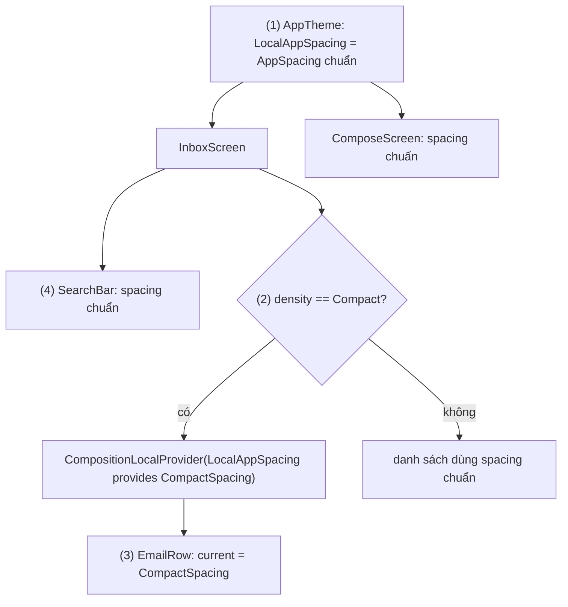
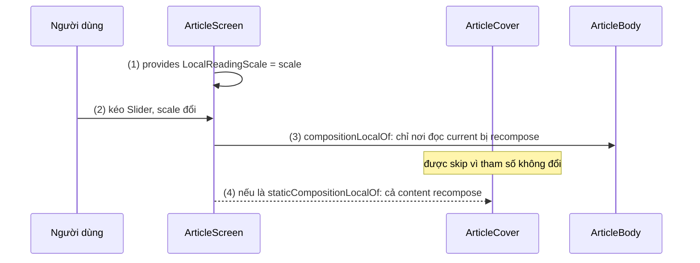
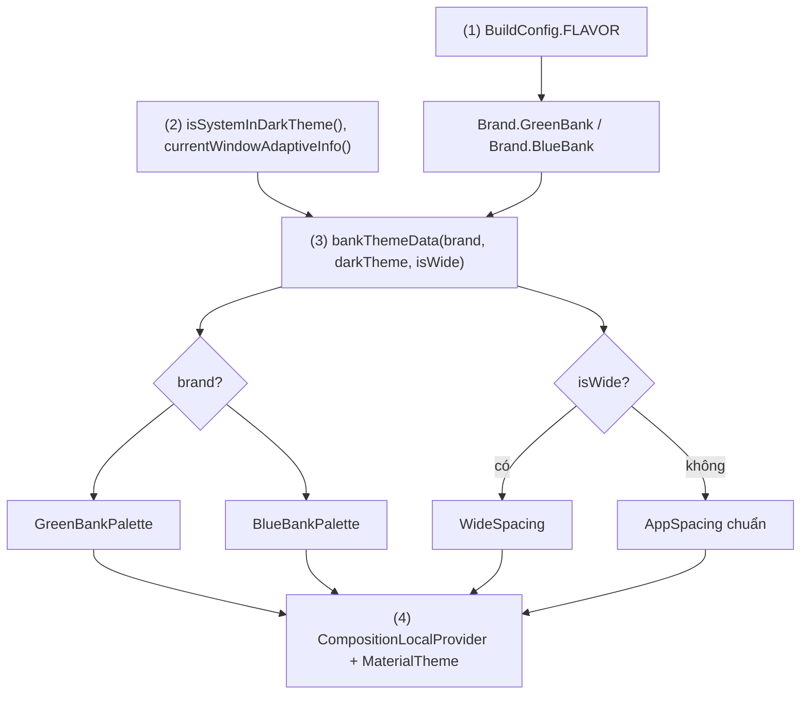
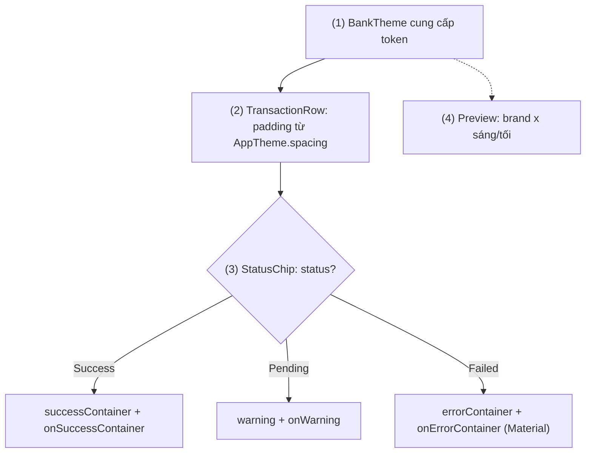

# Custom Theme (Dimens, Factories, Data)

## Vấn đề cần giải quyết

[9.4.1 Material Design Theme](material_design_theme.md) cho app ba hệ thống token: màu theo vai trò, thang chữ, thang bo góc. Nhưng design system của một app thật luôn có những thứ Material không định nghĩa:

- **Màu theo nghĩa nghiệp vụ:** "thành công" (đơn đã giao), "cảnh báo" (sắp hết hàng), màu riêng cho tăng/giảm giá cổ phiếu. `ColorScheme` chỉ có `error`, không có `success` hay `warning`.
- **Khoảng cách (dimens/spacing):** lề màn hình, khoảng giữa các thẻ, padding trong nút. Không có token thì mỗi người viết một số: `16.dp` ở đây, `15.dp` ở kia.
- **Giá trị phụ thuộc điều kiện:** tablet cần lề rộng hơn điện thoại; một app white-label (cùng code, bán cho nhiều thương hiệu) cần bảng màu khác nhau cho mỗi bản build.

Cách gỡ nhanh nhất là truyền tham số:

```kotlin
// Truyền token qua từng tầng (cách làm có vấn đề)
@Composable
fun OrderScreen(order: Order, spacing: AppSpacing, statusColors: StatusColors) {
    OrderHeader(order, spacing)
    OrderTimeline(order.events, spacing, statusColors)   // Timeline lại truyền tiếp xuống từng dòng
}
```

Mọi composable ở giữa phải nhận và chuyển tiếp những tham số nó không dùng (prop drilling). Thêm một token mới là sửa chữ ký của hàng chục hàm.

Vấn đề cần giải quyết là: **thêm token riêng của app vào theme**, đọc được ở mọi độ sâu như `MaterialTheme.colorScheme`, đổi được theo brand, theo sáng tối, theo kích thước màn hình, mà không truyền qua từng tầng.

## Sau khi học xong

- Giải thích được CompositionLocal truyền giá trị ngầm theo nhánh cây composable thế nào, và vì sao current trả về giá trị của provider gần nhất phía trên.
- Phân biệt được compositionLocalOf với staticCompositionLocalOf về phạm vi recomposition khi giá trị đổi, và chọn đúng loại cho từng token.
- Thiết kế được theme riêng gồm data class bất biến, CompositionLocal, hàm theme và object AppTheme, mở rộng MaterialTheme bằng màu trạng thái, khoảng cách và elevation.
- Triển khai được hàm factory tạo theme theo brand, product flavor, chế độ sáng tối và kích thước cửa sổ.
- Biết khi nào không nên dùng CompositionLocal (ViewModel, repository, dữ liệu chỉ vài composable cần) và dùng tham số tường minh thay thế.

## Custom Theme là gì?

**Custom theme** là lớp token riêng của app (màu trạng thái, khoảng cách, elevation...) được gói thành **data class bất biến**, đưa xuống cây composable bằng **CompositionLocal** và đọc qua một object như `AppTheme.spacing`, đặt cạnh hoặc thay cho `MaterialTheme`.

Mental model: CompositionLocal giống **biến môi trường theo nhánh cây**. Giá trị được đặt ở một node; mọi composable con cháu "thừa hưởng" nó mà không cần tham số. Một node con đặt lại giá trị thì chỉ nhánh của node đó thấy giá trị mới, giống tiến trình con đặt lại biến môi trường mà không ảnh hưởng tiến trình cha.

## Cách hoạt động

### CompositionLocal: dữ liệu ngầm theo nhánh cây

Bình thường, dữ liệu trong Compose đi xuống bằng **tham số**, nên phụ thuộc của mỗi composable là tường minh. `CompositionLocal` là ngoại lệ có chủ đích: một khoá có tên, có kiểu, mang giá trị đi ngầm qua composition. Docs của Android mô tả nó là cách tạo "named object có phạm vi theo cây". Chính `MaterialTheme` dùng cơ chế này cho `colorScheme`, `typography`, `shapes`; các khoá có sẵn khác hay gặp là `LocalContext`, `LocalDensity`, `LocalContentColor`, `LocalLifecycleOwner`.

Ba thao tác:

1. **Khai báo** một khoá ở top-level, kèm **giá trị mặc định** (factory lambda): `val LocalAppSpacing = staticCompositionLocalOf { AppSpacing() }`. Quy ước đặt tên bắt đầu bằng `Local`.
2. **Cung cấp** giá trị cho một nhánh: `CompositionLocalProvider(LocalAppSpacing provides spacing) { content() }`. Có thể cung cấp nhiều khoá trong một lần gọi.
3. **Đọc** giá trị: `LocalAppSpacing.current`, trả về giá trị của **provider gần nhất phía trên** trong cây; không có provider nào thì trả giá trị mặc định. `current` là getter `@Composable`, chỉ đọc được trong composable.

#### Ví dụ: chế độ hiển thị gọn cho danh sách email

**Bài toán:** app email có khoảng cách chuẩn cho toàn app, nhưng người dùng chọn "Mật độ: gọn" thì riêng danh sách thư dùng khoảng cách nhỏ hơn để thấy nhiều thư hơn. Các màn hình khác (soạn thư, cài đặt) giữ khoảng cách chuẩn.

**Luồng chạy:**

1. Theme của app cung cấp `AppSpacing()` chuẩn cho toàn bộ cây.
2. `InboxScreen` kiểm tra lựa chọn mật độ; nếu là "gọn", nó cung cấp lại `LocalAppSpacing` bằng `CompactSpacing` cho nhánh danh sách.
3. `EmailRow` đọc `LocalAppSpacing.current`: trong danh sách nhận `CompactSpacing`, vì đó là provider gần nhất.
4. Thanh tìm kiếm nằm ngoài nhánh đó vẫn nhận `AppSpacing()` chuẩn.



**Code:**

```kotlin
// ui/theme/Spacing.kt
@Immutable
data class AppSpacing(
    val small: Dp = 8.dp,
    val medium: Dp = 16.dp,
    val large: Dp = 24.dp,
)

val CompactSpacing = AppSpacing(small = 4.dp, medium = 8.dp, large = 12.dp)

val LocalAppSpacing = staticCompositionLocalOf { AppSpacing() }   // (1) mặc định: khoảng cách chuẩn
```

```kotlin
// InboxScreen.kt
@Composable
fun InboxScreen(emails: List<Email>, density: ListDensity, onEmailClick: (Email) -> Unit) {
    Column {
        SearchBarRow()                                              // (4) ngoài nhánh: spacing chuẩn
        val listSpacing = if (density == ListDensity.Compact) CompactSpacing else LocalAppSpacing.current
        CompositionLocalProvider(LocalAppSpacing provides listSpacing) { // (2) đặt lại cho nhánh danh sách
            LazyColumn {
                items(emails, key = { it.id }) { email ->
                    EmailRow(email, onClick = { onEmailClick(email) })
                }
            }
        }
    }
}

@Composable
fun EmailRow(email: Email, onClick: () -> Unit) {
    val spacing = LocalAppSpacing.current                           // (3) provider gần nhất
    Column(
        Modifier
            .fillMaxWidth()
            .clickable(onClick = onClick)
            .padding(horizontal = spacing.medium, vertical = spacing.small)
    ) {
        Text(email.sender, style = MaterialTheme.typography.titleSmall)
        Text(email.subject, style = MaterialTheme.typography.bodyMedium, maxLines = 1)
    }
}
```

`LazyColumn` và `items(key = ...)` học ở 9.5.4 Lazy Column; `Column`, `Text` ở [9.6 Layout and View](../layout_and_view.md).

**Kết quả:** chuyển mật độ sang "gọn", danh sách hiện nhiều thư hơn trên một màn hình; thanh tìm kiếm và màn hình soạn thư không đổi. `EmailRow` không có tham số spacing nào: cùng một composable cho ra hai mật độ tuỳ nhánh cây mà nó nằm trong.

### `compositionLocalOf` và `staticCompositionLocalOf`

Hai hàm tạo CompositionLocal khác nhau ở chỗ Compose có **theo dõi nơi đọc** `current` hay không:

| | `compositionLocalOf` | `staticCompositionLocalOf` |
|---|---|---|
| Theo dõi nơi đọc `current` | Có | Không |
| Giá trị cung cấp đổi thì recompose | **Chỉ** các composable đã đọc `current` | **Toàn bộ** `content` của `CompositionLocalProvider` đó |
| Chi phí khi đọc | Có chi phí ghi nhận phụ thuộc | Rẻ hơn |
| Hợp với | Giá trị có thể đổi lúc chạy và chỉ một phần cây đọc | Giá trị gần như không đổi, hoặc đổi thì cả cây cũng đổi |

Docs khuyên: giá trị **rất khó đổi hoặc không bao giờ đổi** thì dùng `staticCompositionLocalOf` để có lợi về hiệu năng. Token của theme thuộc nhóm này: khi chúng đổi (sáng sang tối, đổi brand) thì gần như mọi thứ trên màn hình cũng phải vẽ lại, nên việc recompose cả nhánh không gây thiệt hại. Các bản mẫu chính thức (`ExtendedColors`, design system tuỳ chỉnh) đều dùng `staticCompositionLocalOf`. Ngược lại, `LocalContentColor` của Material dùng `compositionLocalOf`, vì nó đổi thường xuyên ở từng `Surface` và chỉ `Text`, `Icon` đọc nó.

Cơ chế "chỉ chạy lại nơi đọc" chính là cơ chế recompose scope của Compose, giải thích chi tiết ở [9.1 Remember and Recomposition](../remember_and_recomposition.md).

#### Ví dụ: cỡ chữ đọc bài thay đổi bằng thanh trượt

**Bài toán:** màn hình đọc báo có thanh trượt cỡ chữ. Kéo thanh trượt làm giá trị đổi liên tục, nhưng chỉ phần thân bài cần đổi cỡ; ảnh bìa và tiêu đề không liên quan.

**Luồng chạy:**

1. `ArticleScreen` giữ `scale` (state) và cung cấp `LocalReadingScale provides scale`.
2. Người dùng kéo thanh trượt, `scale` đổi.
3. Với `compositionLocalOf`: Compose chỉ invalidate các composable đã đọc `LocalReadingScale.current`, tức `ArticleBody`. `ArticleCover` có tham số không đổi nên được skip.
4. Nếu đổi sang `staticCompositionLocalOf`: toàn bộ `content` của provider bị recompose, kể cả `ArticleCover`.



**Code:**

```kotlin
// ReadingScale.kt
val LocalReadingScale = compositionLocalOf { 1f }                       // (3) theo dõi nơi đọc

// ArticleScreen.kt
@Composable
fun ArticleScreen(article: Article) {
    var scale by rememberSaveable { mutableFloatStateOf(1f) }           // state học ở 9.2.1, 9.2.2
    CompositionLocalProvider(LocalReadingScale provides scale) {         // (1)
        Column(Modifier.verticalScroll(rememberScrollState())) {
            ArticleCover(article.coverUrl, article.title)                // không đọc LocalReadingScale
            Slider(value = scale, onValueChange = { scale = it }, valueRange = 0.8f..1.6f) // (2)
            ArticleBody(article.paragraphs)
        }
    }
}

@Composable
fun ArticleBody(paragraphs: List<String>) {
    val scale = LocalReadingScale.current                               // (3) nơi đọc được ghi nhận
    val base = MaterialTheme.typography.bodyLarge
    val style = base.copy(fontSize = base.fontSize * scale, lineHeight = base.lineHeight * scale)
    paragraphs.forEach { paragraph -> Text(paragraph, style = style) }
}
```

`mutableFloatStateOf` và `rememberSaveable` là kiến thức dùng trước, học ở 9.2.1 MutableState và 9.2.2 rememberSaveable.

**Kết quả:** mở Layout Inspector, bật hiển thị recomposition counts rồi kéo thanh trượt: số lần recompose của `ArticleBody` tăng theo, của `ArticleCover` đứng yên. Đổi khai báo thành `staticCompositionLocalOf { 1f }` rồi kéo lại: `ArticleCover` cũng tăng. Ở đây chọn `compositionLocalOf` là đúng, vì giá trị đổi liên tục và chỉ một nhánh nhỏ đọc nó.

### Theme data: data class bất biến

Mỗi nhóm token là một data class được đánh dấu `@Immutable` (hoặc `@Stable`), giống `ColorScheme`, `Typography` của Material:

```kotlin
// ui/theme/AppColors.kt
@Immutable
data class AppColors(
    val success: Color,
    val onSuccess: Color,
    val successContainer: Color,
    val onSuccessContainer: Color,
    val warning: Color,
    val onWarning: Color,
)

// ui/theme/AppElevation.kt
@Immutable
data class AppElevation(
    val card: Dp = 1.dp,
    val raisedCard: Dp = 3.dp,
    val sheet: Dp = 6.dp,
)

// ui/theme/AppThemeLocals.kt: default vô hại để Preview, test chạy được khi quên bọc theme
val LocalAppColors = staticCompositionLocalOf {
    AppColors(
        success = Color.Unspecified, onSuccess = Color.Unspecified,
        successContainer = Color.Unspecified, onSuccessContainer = Color.Unspecified,
        warning = Color.Unspecified, onWarning = Color.Unspecified,
    )
}
val LocalAppElevation = staticCompositionLocalOf { AppElevation() }
```

Ba quyết định thiết kế:

- **Bất biến, `val` hết:** muốn đổi theme là tạo **instance mới** rồi cung cấp lại, không sửa field của instance cũ. Compose chỉ biết giá trị CompositionLocal đổi khi provider nhận giá trị khác; sửa `var` bên trong instance cũ thì không ai được báo.
- **`@Immutable`:** lời hứa với Compose compiler rằng instance không bao giờ đổi sau khi tạo, để composable nhận nó làm tham số có thể được skip. Stability và skipping được giải thích ở [9.1 Remember and Recomposition](../remember_and_recomposition.md).
- **Đặt tên theo vai trò, có cặp on-color:** `success`/`onSuccess` theo đúng quy ước của Material ở [9.4.1](material_design_theme.md), để chữ đặt trên nền `success` luôn đọc rõ ở cả sáng và tối.

Docs gợi ý giá trị mặc định của CompositionLocal là giá trị "vô hại" như `Color.Unspecified`, `TextStyle.Default`, hoặc bộ token chuẩn (như `AppSpacing()` ở ví dụ trên).

### Hàm theme và object `AppTheme`

Một custom theme gồm hai phần, theo đúng cấu trúc của `MaterialTheme`:

- **Hàm theme** `@Composable fun AppTheme(content)`: tạo các instance token, cung cấp chúng bằng `CompositionLocalProvider`, và (nếu vẫn dùng Material component) gọi `MaterialTheme` bên trong.
- **Object cùng tên** `object AppTheme`: các property getter `@Composable` trả `LocalX.current`, để chỗ dùng viết `AppTheme.colors.success` thay vì nhớ tên từng `LocalX`.

```kotlin
// ui/theme/AppTheme.kt
object AppTheme {
    val colors: AppColors
        @Composable @ReadOnlyComposable get() = LocalAppColors.current
    val spacing: AppSpacing
        @Composable @ReadOnlyComposable get() = LocalAppSpacing.current
    val elevation: AppElevation
        @Composable @ReadOnlyComposable get() = LocalAppElevation.current
    val colorScheme: ColorScheme
        @Composable @ReadOnlyComposable get() = MaterialTheme.colorScheme  // một cửa cho mọi token
    val typography: Typography
        @Composable @ReadOnlyComposable get() = MaterialTheme.typography
}
```

`@ReadOnlyComposable` báo cho compiler rằng getter chỉ **đọc** composition, không tạo node hay group nào, nên compiler bỏ được phần code quản lý group; `MaterialTheme.colorScheme` cũng được khai báo như vậy.

Có bốn mức tuỳ biến, docs mô tả thành các cách tiếp cận riêng:

| Cách | Làm gì | Hợp khi |
|---|---|---|
| Extension property | `val ColorScheme.success: Color @Composable get() = ...` | Vài giá trị đơn giản, giống nhau giữa các theme |
| **Mở rộng `MaterialTheme`** | `AppTheme` cung cấp token riêng rồi bọc `MaterialTheme` | Đa số app: giữ Material component, thêm token còn thiếu |
| Thay một hệ thống của Material | Tự định nghĩa typography hoặc shapes riêng, giữ `ColorScheme` | Design system khác hẳn Material ở một mảng |
| Design system hoàn toàn riêng | Không gọi `MaterialTheme`, tự cung cấp mọi token | Thương hiệu có design system riêng hoàn chỉnh, tự viết component |

Extension property là cách nhẹ nhất, nhưng docs lưu ý chỉ nên dùng cho giá trị đơn giản hoặc giống nhau giữa các theme; có nhiều theme (sáng/tối, nhiều brand) thì định nghĩa class riêng như trên.

### Factories: hàm tạo theme theo điều kiện

"Factory" ở đây là **hàm thường** (không `@Composable`) nhận các điều kiện và trả về theme data: `appThemeData(brand, darkTheme, isWideWindow)`. Hàm theme `@Composable` chỉ thu thập điều kiện từ môi trường (cài đặt hệ thống, kích thước cửa sổ, flavor) rồi gọi factory.

Tách như vậy có ba lợi ích:

- Quy tắc "brand nào, sáng hay tối, màn rộng hay hẹp thì token nào" nằm ở một chỗ, **test được bằng unit test JVM** vì không cần composition.
- Thêm brand mới chỉ thêm một bảng màu và một nhánh trong factory.
- Preview truyền thẳng điều kiện (`brand = BlueBank, darkTheme = true`) để xem mọi tổ hợp.

#### Ví dụ: app ngân hàng white-label hai thương hiệu, có khoảng cách cho tablet

**Bài toán:** cùng một codebase được build thành hai app cho hai ngân hàng (product flavor `greenbank`, `bluebank`), mỗi app có màu thương hiệu riêng, không dùng dynamic color để giữ màu nhận diện. Trên cửa sổ rộng (tablet, máy gập mở ra) lề và khoảng cách phải rộng hơn.

**Luồng chạy:**

1. Gradle tạo hai flavor; code đọc `BuildConfig.FLAVOR` để biết brand.
2. `BankTheme` đọc `isSystemInDarkTheme()` và độ rộng cửa sổ từ `currentWindowAdaptiveInfo()`.
3. `bankThemeData()` chọn bảng màu theo brand, chọn bản sáng hoặc tối, chọn spacing theo độ rộng.
4. `BankTheme` cung cấp token riêng và bọc `MaterialTheme` với `ColorScheme` của brand.



**Code:**

```kotlin
// app/build.gradle.kts  // (1)
android {
    buildFeatures { buildConfig = true }
    flavorDimensions += "brand"
    productFlavors {
        create("greenbank") { dimension = "brand"; applicationId = "vn.greenbank.mobile" }
        create("bluebank") { dimension = "brand"; applicationId = "vn.bluebank.mobile" }
    }
}
```

```kotlin
// ui/theme/BankThemeFactory.kt
enum class Brand {
    GreenBank, BlueBank;

    companion object {
        fun fromFlavor(flavor: String): Brand = if (flavor == "bluebank") BlueBank else GreenBank // (1)
    }
}

@Immutable
data class BrandPalette(
    val lightScheme: ColorScheme,
    val darkScheme: ColorScheme,
    val lightColors: AppColors,
    val darkColors: AppColors,
)

@Immutable
data class BankThemeData(
    val colorScheme: ColorScheme,
    val colors: AppColors,
    val spacing: AppSpacing,
    val elevation: AppElevation,
)

val WideSpacing = AppSpacing(small = 12.dp, medium = 24.dp, large = 40.dp)

fun bankThemeData(brand: Brand, darkTheme: Boolean, isWide: Boolean): BankThemeData {  // (3)
    val palette = when (brand) {
        Brand.GreenBank -> GreenBankPalette
        Brand.BlueBank -> BlueBankPalette
    }
    return BankThemeData(
        colorScheme = if (darkTheme) palette.darkScheme else palette.lightScheme,
        colors = if (darkTheme) palette.darkColors else palette.lightColors,
        spacing = if (isWide) WideSpacing else AppSpacing(),
        elevation = AppElevation(),
    )
}
```

```kotlin
// ui/theme/BankTheme.kt
@Composable
fun BankTheme(
    brand: Brand = Brand.fromFlavor(BuildConfig.FLAVOR),
    darkTheme: Boolean = isSystemInDarkTheme(),                                       // (2)
    content: @Composable () -> Unit,
) {
    val isWide = currentWindowAdaptiveInfo().windowSizeClass
        .isWidthAtLeastBreakpoint(WindowSizeClass.WIDTH_DP_MEDIUM_LOWER_BOUND)       // (2) >= 600dp
    val theme = remember(brand, darkTheme, isWide) { bankThemeData(brand, darkTheme, isWide) } // (3)

    CompositionLocalProvider(                                                         // (4)
        LocalAppColors provides theme.colors,
        LocalAppSpacing provides theme.spacing,
        LocalAppElevation provides theme.elevation,
    ) {
        MaterialTheme(colorScheme = theme.colorScheme, typography = BankTypography, content = content)
    }
}
```

`BankTypography` khai báo như `Type.kt` ở 9.4.1. `GreenBankPalette`, `BlueBankPalette` khai báo hai `ColorScheme` (sinh bằng Material Theme Builder như ở 9.4.1) và hai `AppColors`. `currentWindowAdaptiveInfo()` nằm trong artifact `androidx.compose.material3.adaptive:adaptive`; window size class được dùng ở đây vì nó dựa trên **kích thước cửa sổ** của app chứ không phải loại thiết bị, nên đúng cả khi chia đôi màn hình. `remember(keys)` giữ theme data qua recomposition và chỉ tạo lại khi điều kiện đổi (cơ chế ở 9.1).

**Kết quả:** `./gradlew assembleGreenbankDebug` và `assembleBluebankDebug` cho hai app khác màu từ cùng một code màn hình. Mở app trên emulator tablet hoặc kéo rộng cửa sổ trong chế độ chia đôi qua mốc 600dp: lề màn hình nới ra. Unit test gọi `bankThemeData(Brand.BlueBank, darkTheme = true, isWide = false)` và kiểm tra `colorScheme.primary` của brand, không cần thiết bị.

### Dùng token riêng với Material component

Material component chỉ biết `MaterialTheme`. `Button` luôn lấy `colorScheme.primary`, không tự biết `AppTheme.colors.warning`. Có hai cách:

- **Đưa token vào `ColorScheme`** khi vai trò khớp nghĩa: màu chủ đạo của brand chính là `primary`.
- **Bọc component** khi cần vai trò Material không có: viết composable của app, đặt sẵn màu từ token riêng, mở các tham số còn lại ra ngoài.

```kotlin
// ui/components/WarningButton.kt
@Composable
fun WarningButton(
    onClick: () -> Unit,
    modifier: Modifier = Modifier,
    content: @Composable RowScope.() -> Unit,
) {
    Button(
        onClick = onClick,
        modifier = modifier,
        colors = ButtonDefaults.buttonColors(
            containerColor = AppTheme.colors.warning,
            contentColor = AppTheme.colors.onWarning,
        ),
        content = content,
    )
}
```

Màn hình dùng `WarningButton` thay cho `Button` ở các hành động "nửa nguy hiểm" (huỷ giao dịch định kỳ). Với design system hoàn toàn riêng, docs khuyên tự viết component khi token có kiểu mới mà Material không hiểu (ví dụ nền gradient `List<Color>`).

## Ví dụ thực tế

Ba bài toán thường gặp với custom theme:

1. **Màu trạng thái và khoảng cách cho màn hình nghiệp vụ** (đơn hàng, giao dịch) dùng `AppTheme`, kèm Preview mọi brand và chế độ. Đây là bài toán chính, code bên dưới.
2. **White-label nhiều thương hiệu:** như ví dụ ở mục Factories; mỗi brand thêm một `BrandPalette`.
3. **Mật độ hiển thị theo lựa chọn người dùng:** cung cấp lại `LocalAppSpacing` cho một nhánh, như ví dụ danh sách email.

### Lịch sử giao dịch với màu trạng thái và Preview mọi tổ hợp

**Bài toán:** màn hình lịch sử giao dịch của app ngân hàng hiện mỗi giao dịch với chip trạng thái: "Thành công" (màu success), "Đang xử lý" (màu warning), "Thất bại" (màu error của Material). Khoảng cách theo token, đúng ở cả hai brand, sáng và tối, điện thoại và tablet.

**Luồng chạy:**

1. Màn hình nằm trong `BankTheme`, token đã được cung cấp.
2. `TransactionRow` đọc `AppTheme.spacing` cho padding.
3. `StatusChip` ánh xạ trạng thái giao dịch sang cặp màu nền và chữ: hai trạng thái lấy từ `AppTheme.colors`, trạng thái lỗi lấy từ `AppTheme.colorScheme`.
4. Preview gọi `BankTheme(brand, darkTheme)` với các tổ hợp để kiểm tra bằng mắt.



**Code:**

```kotlin
// ui/transactions/TransactionRow.kt
@Composable
fun TransactionRow(transaction: Transaction, modifier: Modifier = Modifier) {
    val spacing = AppTheme.spacing                                               // (2)
    Row(
        modifier = modifier
            .fillMaxWidth()
            .padding(horizontal = spacing.medium, vertical = spacing.small),
        verticalAlignment = Alignment.CenterVertically,
        horizontalArrangement = Arrangement.spacedBy(spacing.small),
    ) {
        Column(Modifier.weight(1f)) {
            Text(transaction.counterparty, style = AppTheme.typography.titleSmall)
            Text(transaction.amountText, style = AppTheme.typography.bodyMedium)
        }
        StatusChip(transaction.status)
    }
}

@Composable
fun StatusChip(status: TransactionStatus) {
    val (container, content, label) = when (status) {                            // (3)
        TransactionStatus.Success -> Triple(AppTheme.colors.successContainer, AppTheme.colors.onSuccessContainer, "Thành công")
        TransactionStatus.Pending -> Triple(AppTheme.colors.warning, AppTheme.colors.onWarning, "Đang xử lý")
        TransactionStatus.Failed -> Triple(AppTheme.colorScheme.errorContainer, AppTheme.colorScheme.onErrorContainer, "Thất bại")
    }
    Text(
        text = label,
        color = content,
        style = AppTheme.typography.labelMedium,
        modifier = Modifier
            .background(container, MaterialTheme.shapes.small)
            .padding(horizontal = AppTheme.spacing.small, vertical = 2.dp),
    )
}
```

```kotlin
// ui/transactions/TransactionRowPreview.kt
@Preview(name = "GreenBank sáng")
@Preview(name = "GreenBank tối", uiMode = Configuration.UI_MODE_NIGHT_YES)
@Composable
private fun GreenBankPreview() = TransactionRowSamples(Brand.GreenBank)

@Preview(name = "BlueBank sáng")
@Preview(name = "BlueBank tối", uiMode = Configuration.UI_MODE_NIGHT_YES)
@Composable
private fun BlueBankPreview() = TransactionRowSamples(Brand.BlueBank)

@Composable
private fun TransactionRowSamples(brand: Brand) {
    BankTheme(brand = brand) {                                                   // (4)
        Surface {
            Column { sampleTransactions.forEach { TransactionRow(it) } }
        }
    }
}
```

`Row`, `Arrangement.spacedBy`, `Surface` học ở [9.6 Layout and View](../layout_and_view.md) và 9.7.1; `Modifier.weight` ở 9.5.2.

**Kết quả:** panel Preview hiện bốn tổ hợp brand × sáng/tối; mỗi chip đọc rõ trên nền của nó. Thêm Preview với `@Preview(device = Devices.TABLET)` để thấy spacing rộng. Không có một hằng số `dp` hay màu nào trong `TransactionRow`: đổi spacing chuẩn trong `AppSpacing` thì mọi màn hình đổi theo.

## So sánh với các cách tiếp cận khác

| Cách truyền | Phụ thuộc tường minh? | Hợp với |
|---|---|---|
| Tham số composable | Có | Dữ liệu màn hình, callback, mọi thứ chỉ vài composable cần |
| **CompositionLocal** | Không (ngầm) | Giá trị cắt ngang cả cây và có default tốt: token theme, `Context`, `Density` |
| Extension property trên `ColorScheme` | Không | Một vài token đơn giản, giống nhau ở mọi theme |
| Dependency injection (Hilt) | Có, ở tầng ViewModel/Repository | Đối tượng nghiệp vụ, không phải giá trị UI theo nhánh cây |
| Resource XML (`dimens.xml`, `values-sw600dp`) | Không | Vẫn đọc được bằng `dimensionResource()`, nhưng không đổi được theo nhánh cây hay theo brand lúc chạy |

Docs nêu rõ hai điều kiện để CompositionLocal là lựa chọn tốt: có **giá trị mặc định tốt**, và khái niệm thật sự có **phạm vi theo cây** (con cháu bất kỳ đều có thể dùng), không phải chỉ vài composable cần.

## Khi nào nên và không nên dùng

- **Nên** dùng custom theme khi design system có token Material không định nghĩa (màu trạng thái, spacing, elevation, gradient), hoặc khi app có nhiều brand.
- **Nên** dùng `staticCompositionLocalOf` cho token theme; dùng `compositionLocalOf` cho giá trị đổi lúc chạy mà chỉ một phần cây đọc.
- **Nên** giữ factory là hàm thường để test được, và để hàm theme `@Composable` chỉ thu thập điều kiện.
- **Không nên** dùng CompositionLocal cho `ViewModel`, repository, `NavController` của một màn hình. Docs lấy đúng ví dụ ViewModel làm bad practice: không phải composable nào trong cây cũng cần ViewModel; truyền cho composable đúng dữ liệu nó cần theo luồng state xuống, event lên ([MVVM](../../session_07/architecture/mvvm.md)).
- **Không nên** dùng CompositionLocal chỉ để tránh truyền tham số qua hai ba tầng: truyền tham số, hoặc đảo ngược điều khiển bằng slot `content: @Composable () -> Unit`.
- **Không cần** custom theme nếu Material 3 đã đủ cho design system của app; khi đó chỉ cần theme ở [9.4.1](material_design_theme.md).

## Sai lầm thường gặp

### 1. Đưa ViewModel vào CompositionLocal

```kotlin
val LocalCheckoutViewModel = staticCompositionLocalOf<CheckoutViewModel> { error("not provided") } // sai
```

**Lỗi lộ ra:** composable lá gọi thẳng `LocalCheckoutViewModel.current.pay()`, nên không dùng lại được ở màn hình khác, không Preview được nếu không dựng ViewModel, và không thể biết ai đang sửa state. **Cách sửa:** composable nhận state và lambda (`onPayClick: () -> Unit`); chỉ composable cấp màn hình biết ViewModel.

### 2. Default ném lỗi hoặc vô nghĩa

`staticCompositionLocalOf<AppColors> { error("AppTheme chưa được bọc") }` làm mọi Preview và UI test không bọc `AppTheme` crash. **Cách sửa:** default là bộ token chuẩn (hoặc giá trị vô hại như `Color.Unspecified`), đúng như docs khuyên; kiểm tra "đã bọc theme chưa" bằng review và Preview, không bằng crash.

### 3. Theme data có field `var` hoặc collection có thể sửa

```kotlin
class AppColors(var success: Color)          // sai: sửa field không ai được báo
appColors.success = Color.Red                // UI vẫn hiện màu cũ
```

**Lỗi lộ ra:** đổi màu lúc chạy nhưng màn hình không đổi, hoặc chỉ đổi một phần khi tình cờ có recomposition khác. **Cách sửa:** `@Immutable data class` toàn `val`; muốn đổi thì tạo instance mới (`copy`) và cung cấp lại qua provider.

### 4. Token riêng không tới Material component

Thêm `AppTheme.colors.brandAccent` nhưng vẫn dùng `Button` mặc định. **Lỗi lộ ra:** nút vẫn mang `colorScheme.primary`, khác màu thương hiệu. **Cách sửa:** đưa màu vào đúng vai trò trong `ColorScheme`, hoặc bọc component như `WarningButton`.

### 5. Đọc `current` ngoài composition

```kotlin
Button(onClick = { analytics.log(LocalAppSpacing.current) }) { ... }  // không compile
```

**Lỗi lộ ra:** compiler báo lời gọi `@Composable` chỉ được đặt trong hàm `@Composable`, vì `onClick` là lambda thường. **Cách sửa:** đọc `val spacing = LocalAppSpacing.current` trong thân composable, lambda dùng biến đã đọc.

### 6. `staticCompositionLocalOf` cho giá trị đổi liên tục

Dùng `staticCompositionLocalOf` cho giá trị đổi theo từng khung hình (vị trí cuộn, giá trị thanh trượt). **Lỗi lộ ra:** Layout Inspector cho thấy cả nhánh dưới provider recompose ở mỗi lần đổi, cuộn hoặc kéo bị giật. **Cách sửa:** `compositionLocalOf`, hoặc tốt hơn là truyền tham số/lambda cho đúng composable cần giá trị đó.

## Lịch sử phát triển

- **Trước Compose 1.0 (giai đoạn alpha):** cơ chế này mang tên **Ambient** (`ambientOf`, `staticAmbientOf`, `Providers`, `AmbientContext`). Khoảng đầu 2021 được đổi tên thành `compositionLocalOf`, `staticCompositionLocalOf`, `CompositionLocalProvider`, `LocalContext`, để tên nói rõ phạm vi là composition.
- **Compose 1.0 (07/2021):** `CompositionLocal` stable; Material 2 dùng nó cho `MaterialTheme`. Docs có các hướng dẫn riêng về CompositionLocal, custom design system và "Anatomy of a theme".
- **Compose Material 3:** `MaterialTheme` của Material 3 giữ cùng kiến trúc (theme function, object với getter `@ReadOnlyComposable`), nên custom theme mở rộng Material 3 theo đúng khuôn của nó.
- **Các bản runtime gần đây:** có thêm `compositionLocalWithComputedDefaultOf`, cho phép giá trị mặc định được tính từ giá trị của CompositionLocal khác thay vì là hằng số.
- **Window size classes:** thư viện `material3-adaptive` và `androidx.window` cung cấp `currentWindowAdaptiveInfo()` và các mốc breakpoint, trở thành cách khuyên dùng để token đổi theo kích thước cửa sổ thay cho logic "isTablet".

## Kết nối hệ thống

- **Tiên quyết:**
  - [9.4.1 Material Design Theme](material_design_theme.md): `ColorScheme`, `Typography`, `Shapes` và quy tắc cặp on-color mà custom theme mở rộng.
  - [Jetpack Compose Overview](../overview.md): composition là cây, recomposition chạy lại nơi đọc state.
- **Liên quan:**
  - [9.1 Remember and Recomposition](../remember_and_recomposition.md): recompose scope, `@Immutable`/`@Stable` và skipping.
  - [9.6 Layout and View](../layout_and_view.md): `Row`, `Column`, `Text` dùng token spacing và typography.
  - [MVVM](../../session_07/architecture/mvvm.md): vì sao ViewModel đi xuống bằng state và lambda, không bằng CompositionLocal.
  - 9.8 Gesture and Composition Local: nhóm mục này trong nav nhắc tới Composition Local; kiến thức được dạy tại bài này.
- **Học tiếp:**
  - 9.5.1 Modifier Order và 9.5.2 Chaining: dùng token spacing trong chuỗi modifier.
  - 8.5.4 Design Guide (Materials, Flat) (chưa có bài): nguyên tắc thiết kế đứng sau design system.

## Tham khảo

- [Locally scoped data with CompositionLocal - Android Developers](https://developer.android.com/develop/ui/compose/compositionlocal)
- [Custom design systems in Compose - Android Developers](https://developer.android.com/develop/ui/compose/designsystems/custom)
- [Anatomy of a theme in Compose - Android Developers](https://developer.android.com/develop/ui/compose/designsystems/anatomy)
- [Use window size classes - Android Developers](https://developer.android.com/develop/ui/compose/layouts/adaptive/use-window-size-classes)
- [CompositionLocal API reference - Android Developers](https://developer.android.com/reference/kotlin/androidx/compose/runtime/CompositionLocal)
- [Configure build variants (product flavors) - Android Developers](https://developer.android.com/build/build-variants)
- [Jetsnack sample (design system tuỳ chỉnh) - GitHub android/compose-samples](https://github.com/android/compose-samples/tree/main/Jetsnack)
